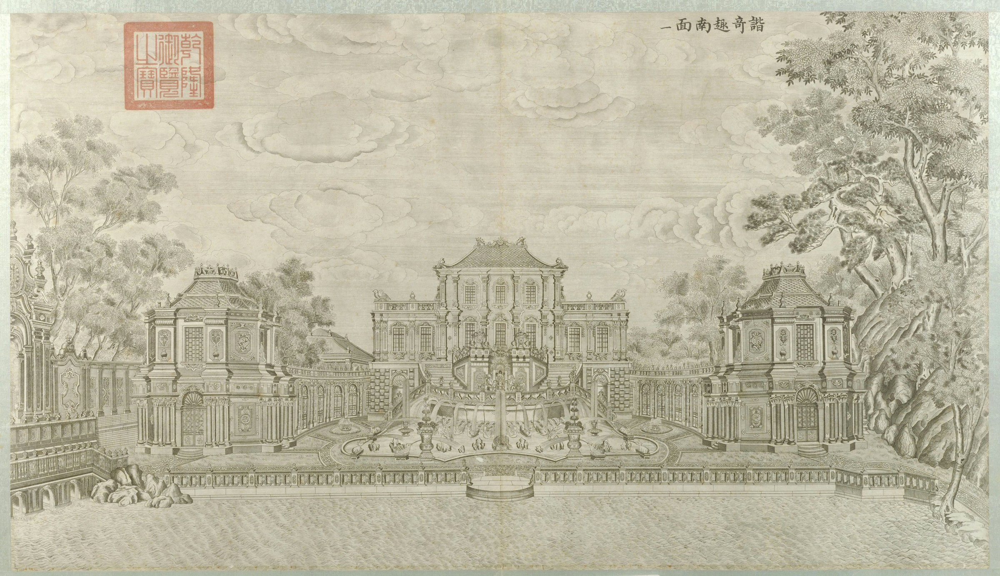
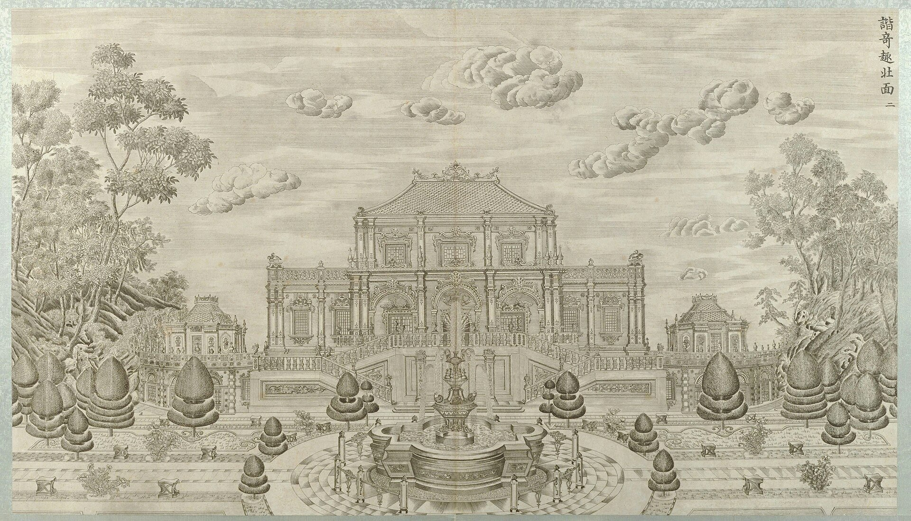
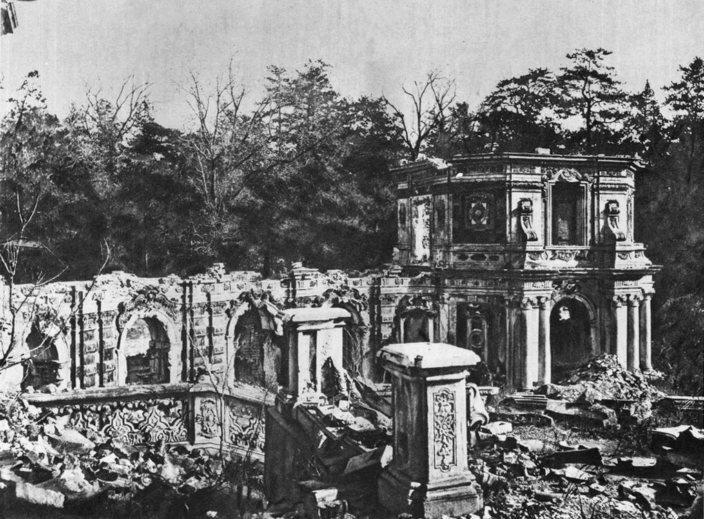
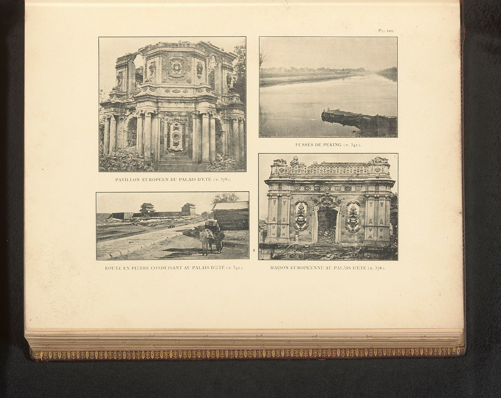
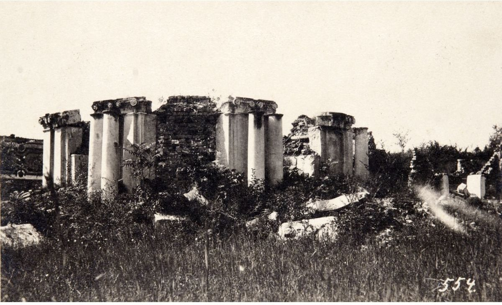

<!-- generated:start (scripts/building_pages.py): do not edit between these markers -->

# XY01-N01: 八角奏乐亭 Ba Jiao Zou Yue Ting

Xiyang Lou

**3D object:** 2 boxes. Open it: `/reconstruction/3d.html?b=XY01-N01`

**Part of:** XY01 谐奇趣

## What we know

- **Name:** 八角奏乐亭 Ba Jiao Zou Yue Ting (S01 · confidence B)
- **Garden:** Xiyang Lou (S01)
- **Type:** pavilion (S01 · confidence B)
- **Destroyed:** 1860 (S01)
- **Position:** 40.01101, 116.30282. S01 likely (S01 · confidence B)
- **Size in the inventory:** 9.6 × 12.1 m. S01 plan px / hall scale (S01)
- **Plan reader's note:** rect=40,40,0. Octagon, end of east gallery (8942,1490) (9000,1510) (9025,1560) (9025,1580). Twin of XY01-01. (S01) *(research copy, not public)*
- **How it was read:** likely (S01) *(research copy, not public)*
- **Plan pixels:** 8963, 1539 (S01) *(research copy, not public)*

## Our model now

Simple massing of a European palace, assumed: sizes from the texts and the ruin polygons, position from the plan or the ruin. Not a reading of the 1786 engravings yet.

- **1 ×:** octagonal music pavilion, two storeys: 8 × 8 m, eave 8 m, ridge 11 m
- **1 ×:** corridor (9 bays, curved; a straight run here): 34.57 × 4 m, eave 5 m, ridge 6 m
- **Confidence:** C, all assumed

## Pictures (5)

- **P0041** (sure): 谐奇趣南面 (圆明园铜版画册 / 西洋楼铜版画, plate 一 of 二十; title and number printed on the plate) (1786 (Commons); Palace Museum: 清). https://commons.wikimedia.org/wiki/File%3A%E5%9C%86%E6%98%8E%E5%9B%AD%E9%93%9C%E7%89%88%E7%94%BB%E5%86%8C-17.jpg

  

- **P0042** (likely): 谐奇趣北面 (圆明园铜版画册 / 西洋楼铜版画, plate 二 of 二十; title and number printed on the plate) (1786 (Commons); Palace Museum: 清). https://commons.wikimedia.org/wiki/File%3A%E5%9C%86%E6%98%8E%E5%9B%AD%E9%93%9C%E7%89%88%E7%94%BB%E5%86%8C.jpg

  

- **P0185** (sure): 谐奇趣 east wing, colonnade and music pavilion (between 1872 and 1873 (Commons); 1873 (hpchina blog)). https://commons.wikimedia.org/wiki/File%3AXieqiqu_East_Wing_Ruins.jpg

  

- **P0174** (likely): Gezicht op de ruïnes van een deel van het Zomerpaleis, Gezicht op een water bij Peking, Gezicht op de weg naar het Zomerpaleis en Gezicht op een deel van het Zomerpaleis (ca. 1892, in or before 1897 (Commons, Rijksmuseum)). https://commons.wikimedia.org/wiki/File%3AGezicht_op_de_ru%C3%AFnes_van_een_deel_van_het_Zomerpaleis%2C_Gezicht_op_een_water_bij_Peking%2C_Gezicht_op_de_weg_naar_het_Zomerpaleis_en_Gezicht_op_een_deel_van_het_Zomerpaleis%2C_RP-F-2001-7-1126-26.jpg

  

- **P0305** (guess): Fotografija Ruševine knjižnice v Stari poletni palači (album: "Yüen-Ming-Yüen: Ruinen der Bibliothek") (20th c., album bought 1914-1920 (holder)). https://vazcollections.si/predmeti/fotografija-rusevine-knjiznice-v-stari-poletni-palaci-2/

  

## Texts and drawings (0)

None of its own.

**On the plan:** Drawn on the plan of the gardens (S01), labelled 八角奏乐亭. https://artmuseum.princeton.edu/collections/objects/138657

## Evidence for the set of buildings

- Evidence for the whole compound 谐奇趣: see XY01
- Reconstructions and comparables for the whole garden, 西洋楼 Xiyang Lou: see GARDEN-XY
- Standing buildings comparable to a square pavilion (not this building): see CLASS-pavilion_square

**Searched and not found:** No text or drawing names it in 日下旧闻考 j83, the Qianlong poems on Kanripo, Delatour 1803, Malone 1934, the witnesses of 1860, what search indexes show of the Yangshi Lei drawings.

## Open questions

None that name it.

<!-- generated:end -->

## Notes

<!-- Yours: regeneration never touches this part. It goes on the public site; what you write below a line holding only %% private %% stays in the research copy. -->
