<!-- generated:start (scripts/building_pages.py): do not edit between these markers -->

# XY01: 谐奇趣 Xieqiqu

Hsieh Ch'i Ch'u, Harmonious Strange and Pleasant · Xiyang Lou

**3D object:** 1 box. Open it: `/reconstruction/3d.html?b=XY01`

## What we know

- **Name:** 谐奇趣 Xieqiqu (S05, S02, S06, S42, S54, S56, S01, S108, S03 · confidence A)
- **English:** Hsieh Ch'i Ch'u, Harmonious Strange and Pleasant (S05, S02, S06, S42, S54, S56, S01, S108, S03)
- **Garden:** Xiyang Lou (S05, S02, S06, S42, S54, S56, S01, S108, S03)
- **Type:** european (S05, S02, S06, S42, S54, S56, S01, S108, S03 · confidence A)
- **Built:** 乾隆十二年 1747 起 (S02 p.139; S42); 乾隆十六年秋 1751 完成 (S54 lead) (S05, S02, S06, S42, S54, S56, S01, S108, S03)
- **Destroyed:** Looted and burnt 1860; stone ruins stayed, further damage 1900 and after (S02 pp.142,218) (S05, S02, S06, S42, S54, S56, S01, S108, S03)
- **Position:** 40.01123, 116.30244. S01 sure (S01 · confidence B)
- **Bays:** 7 lower, 3 upper (S06) in the texts (S05, S02, S06, S42, S54, S56, S01, S108, S03)
- **Size in the inventory:** 39.7 × 38.6 m. typology xiyang_lou, C (S01)
- **Lead on its size, from a modern study, not used in the model:** Northern staircase: Yangshi Lei plan measurements differ from those on site; plan carries over 120 dimensions; ground-floor cornice of main building, corridor and music pavilion level to within 2 cm (site components added up) (S108, sections 2.2.1, 2.2.3, Fig 8, Fig 10). First Xiyang Lou strip, 谐奇趣 to 黄花阵: 320 x 85 m north-south (S603, p. 123). (confidence B)
- **Storeys:** 3 (S05, S02, S06, S42, S54, S56, S01, S108, S03)
- **Roof:** 庑殿顶 (S06) (S05, S02, S06, S42, S54, S56, S01, S108, S03)
- **Tiles:** 红色圆光琉璃瓦, 蓝琉璃脊 (S06) (S05, S02, S06, S42, S54, S56, S01, S108, S03)
- **Note:** Copper engraving no. 1-2 per S02. Plans Castiglione 郎世宁, fountains Benoist 蒋友仁 (S02 pp.139-140); also Attiret 王致诚 (S42;S56). Malone p.141: 3-storey centre, curved galleries to 2 two-storey towers SE and SW; S06 两层. Only XY building named in S05. Photos of ruins 1860+, 1900+ S02 p.142. (S05, S02, S06, S42, S54, S56, S01, S108, S03)
- **Plan reader's note:** Label 谐奇趣 written on the lake south of the building. Main block + curved galleries to two octagon towers + pool, as engraving 1. | plan: rect=126,41,0. Plain double-line rectangle x 8816-8942, y 1465-1506; bays not drawn (text 7 lower, 3 upper). Curved double stair x 8841-8916, y 1506-1550; round landing (8878,1562) r~15; fan stairs at x 8826-8865 and 8895-8932, y 1545-1577. (S01) *(research copy, not public)*
- **How it was read:** sure (S01) *(research copy, not public)*
- **Plan pixels:** 8824, 1422 (S01) *(research copy, not public)*

## Our model now

Simple massing of a European palace, assumed: sizes from the texts and the ruin polygons, position from the plan or the ruin. Not a reading of the 1786 engravings yet.

- **Box:** 28 × 14 m, european
- **Part:** main block, three levels
- **Heights:** platform 1 m, eave 12 m, ridge 15 m above the ground
- **Roof:** hip 庑殿, glazed tile
- **Faces:** 175.1° from north
- **Confidence:** C, assumed

## Inside it (5)

- XY01-01 八角奏乐亭
- XY01-02 海棠形喷水池
- XY01-N01 八角奏乐亭
- XY01-N02
- XY01-N03

## Pictures (34)

- **P0041** (sure): 谐奇趣南面 (圆明园铜版画册 / 西洋楼铜版画, plate 一 of 二十; title and number printed on the plate) (1786 (Commons); Palace Museum: 清). https://commons.wikimedia.org/wiki/File%3A%E5%9C%86%E6%98%8E%E5%9B%AD%E9%93%9C%E7%89%88%E7%94%BB%E5%86%8C-17.jpg

  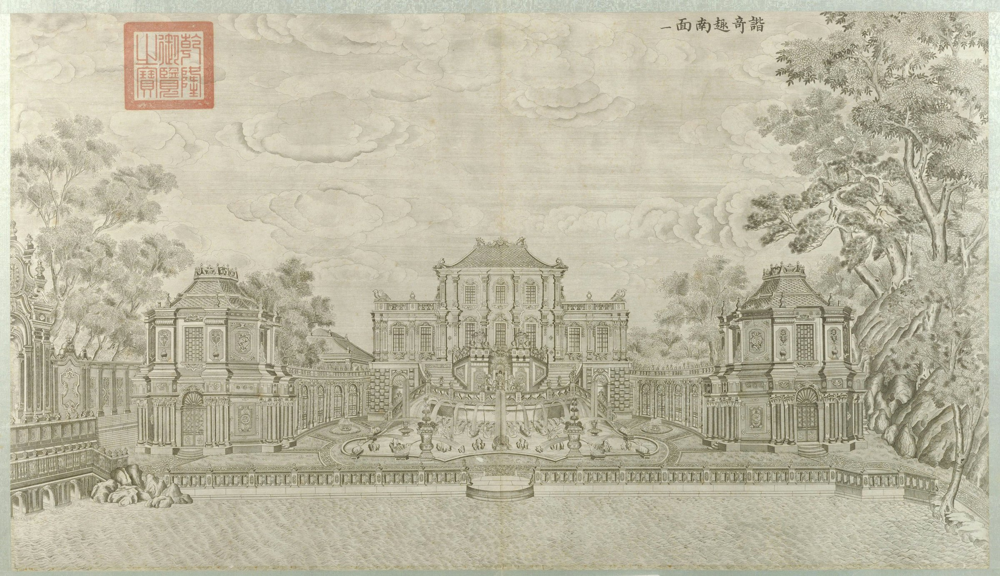

- **P0042** (sure): 谐奇趣北面 (圆明园铜版画册 / 西洋楼铜版画, plate 二 of 二十; title and number printed on the plate) (1786 (Commons); Palace Museum: 清). https://commons.wikimedia.org/wiki/File%3A%E5%9C%86%E6%98%8E%E5%9B%AD%E9%93%9C%E7%89%88%E7%94%BB%E5%86%8C.jpg

  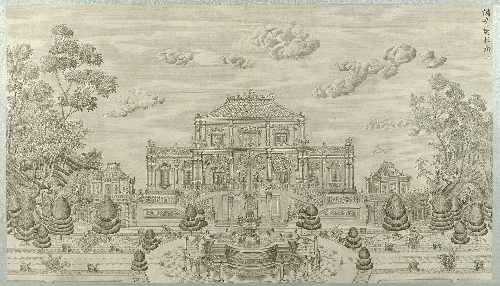

- **P0223** (sure): Xieqiqu nanmian, Chester Beatty C 1608 (plate 1, 13154 x 7536 px on Commons) (between 1781 and 1787 (Commons)). https://commons.wikimedia.org/wiki/File:South_fa%C3%A7ade_of_the_Palace_of_Harmonious_Delights_(Xieqiqu_nanmian)_(CBL_C_1608).jpg

  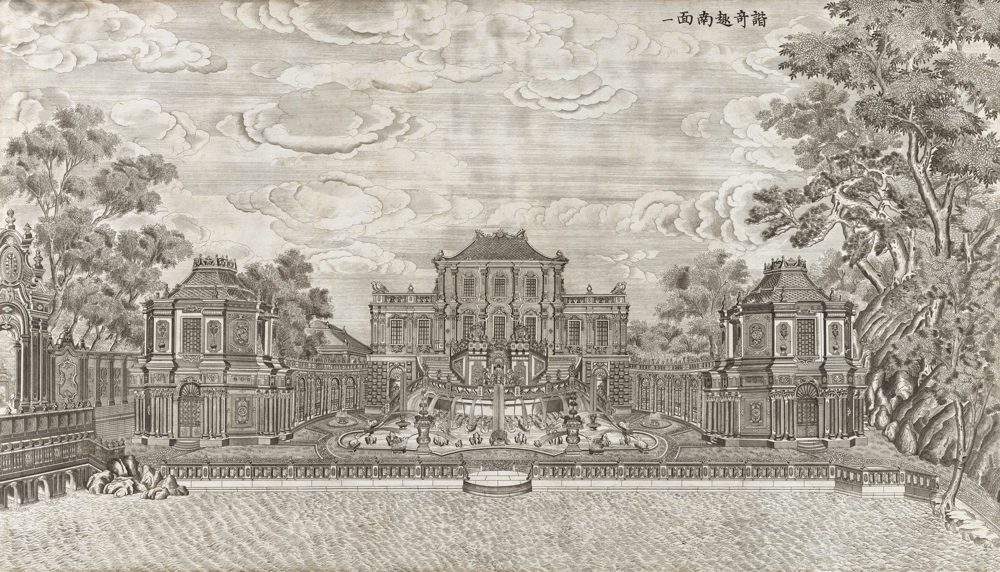

- **P0222** (sure): Xiyang Lou plates, Getty set: The European Pavilions at the Garden of Perfect Clarity (1783-1786 (Getty)). https://www.getty.edu/art/exhibitions/china_paper/ Research-only: link card.
- **P0165** (sure): Childe, Thomas: Ruinen von Yüan-ming Yüan, altes Sommerschloss nordwestlich Peking (between 1877 and 1878 (Commons, from zeno.org)). https://commons.wikimedia.org/wiki/File%3AChilde%2C_Thomas_-_Ruinen_von_Y%C3%BCan-ming_Y%C3%BCan%2C_altes_Sommerschloss_nordwestlich_von_Peking_%28Zeno_Fotografie%29.jpg

  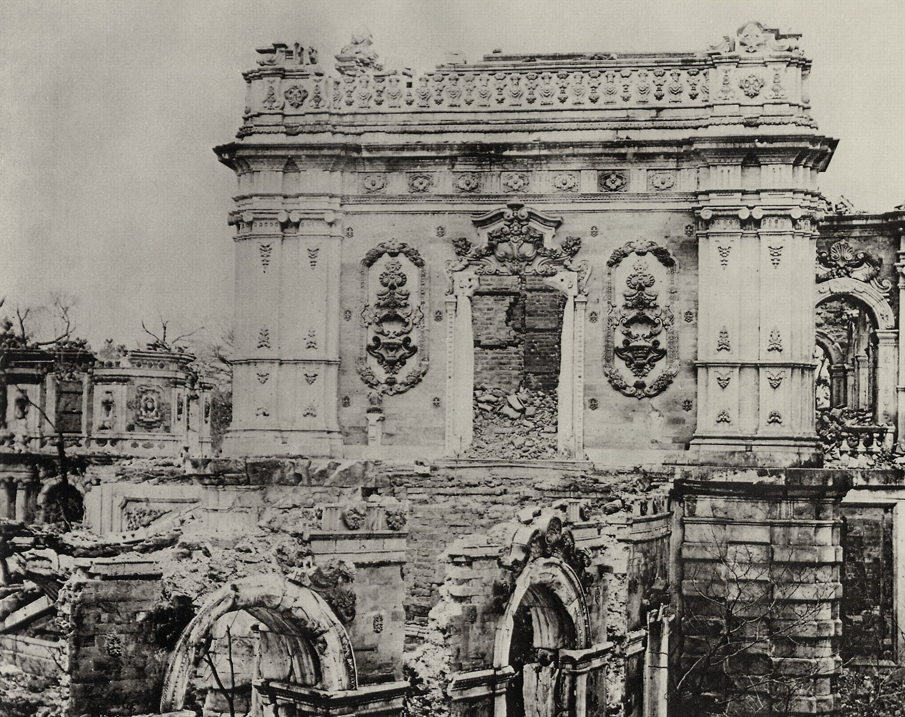

- **P0185** (sure): 谐奇趣 east wing, colonnade and music pavilion (between 1872 and 1873 (Commons); 1873 (hpchina blog)). https://commons.wikimedia.org/wiki/File%3AXieqiqu_East_Wing_Ruins.jpg

  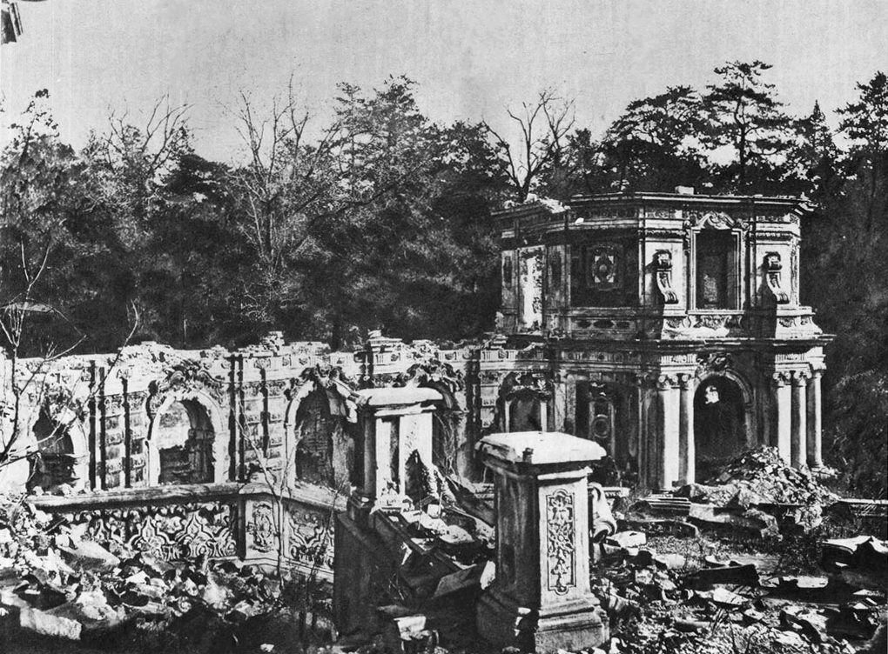

- **P0186** (sure): 谐奇趣 south side, reeds and water in front (between 1872 and 1873 (Commons); 1873 (hpchina blog)). https://commons.wikimedia.org/wiki/File%3AXieqiqu_Ruins_of_Yuanmingyuan%2C_Old_Summer_Palace%2C_Peking%2C_1870%27s.jpg

  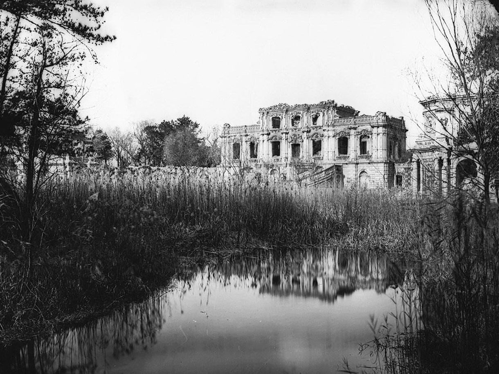

- **P0187** (sure): 谐奇趣 south side (between 1872 and 1873 (Commons); 1873 (hpchina blog)). https://commons.wikimedia.org/wiki/File%3AXieqiqu_Ruins_of_the_Yuanmingyuan%2C_Ernst_Ohlmer%2C_1870%27s.jpg

  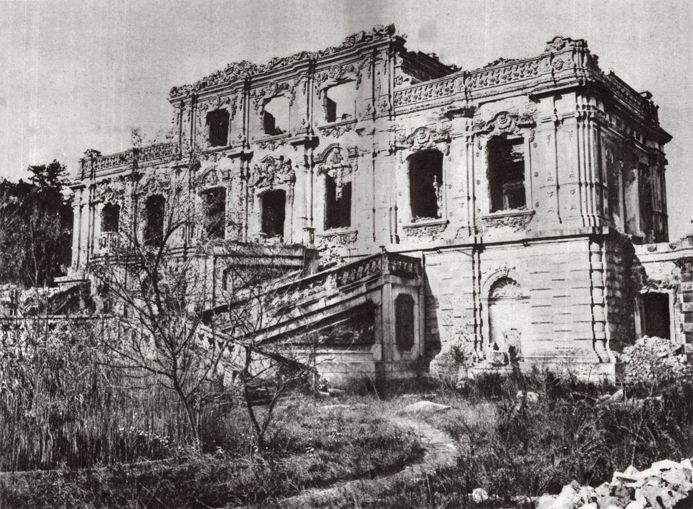

- **P0188** (sure): 谐奇趣 east side (between 1872 and 1873 (Commons); 1873 (hpchina blog)). https://commons.wikimedia.org/wiki/File%3AXieqiqu_Ruins%2C_Ernst_Ohlmer%2C_1870%27s.jpg

  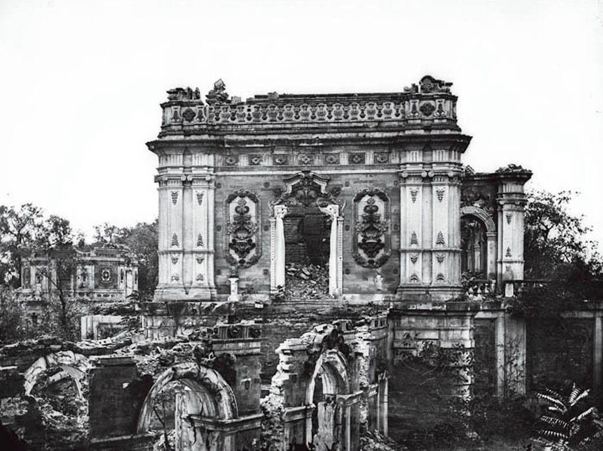

- **P0189** (sure): 谐奇趣 north side (between 1872 and 1873 (Commons); 1873 (hpchina blog)). https://commons.wikimedia.org/wiki/File%3AXieqiqu_ruins%2C_Ernst_Ohlmer%2C_1870s.jpg

  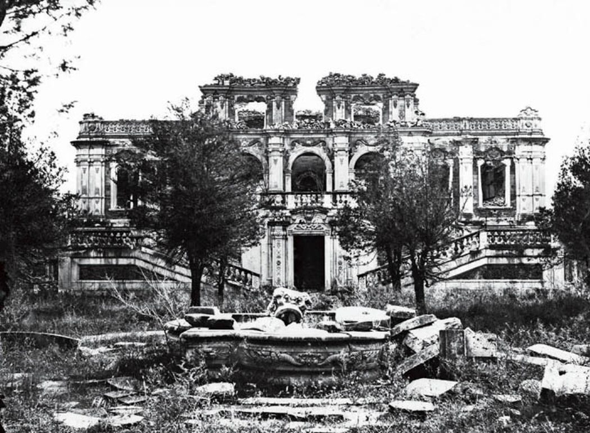

- **P0645** (sure): CHATEAU EUROPÉEN AU PALAIS D'ÉTÉ (p. 377), Pl. XII (printed caption) (c. 1892 - in or before 1897 (Rijksmuseum, leaf date); book c. 1897). https://id.rijksmuseum.nl/200721138

  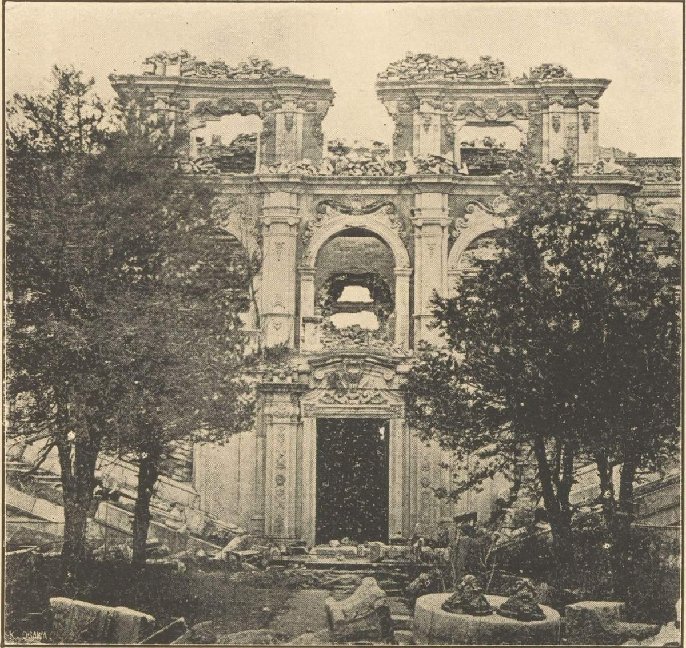

- **P0718** (sure): (二十一) 是レハ圓明園中ニアル西洋式ノ堂ナルガ曩時英佛同盟軍ノ燒毀ヲ被ムリタル跡ナリ (printed list of plates, frame 5; plate numbered 21) (published 明治27年12月 (1894), colophon and NDL; photograph undated). https://dl.ndl.go.jp/pid/773672/1/26

  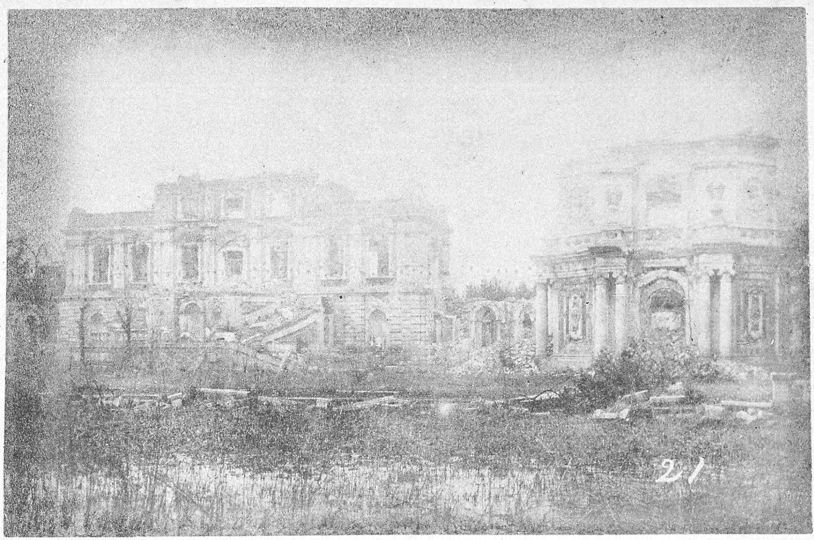

- **P0172** (likely): Yüan-ming-yüan. Der alte Sommerpalast, von den Verbündeten 1860 zerstört. Ⅰ 2 (before or in 1902 (Commons)). https://commons.wikimedia.org/wiki/File%3AY%C3%BCan-ming-y%C3%BCan._Der_alte_Sommerpalast%2C_von_den_Verb%C3%BCndeten_1860_zerst%C3%B6rt._%E2%85%A0_2.jpg

  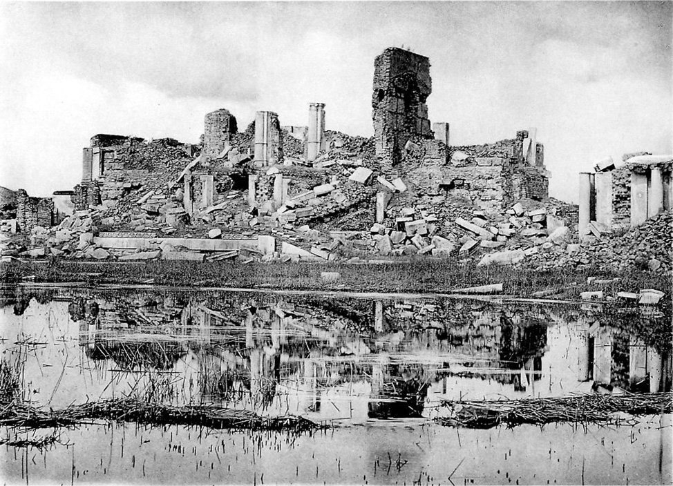

- **P0297** (likely): Fotografija Ruševine gledališča v Stari poletni palači (album: "Yüen-Ming-Yüen: Theater") (20th c., album bought 1914-1920 (holder)). https://vazcollections.si/predmeti/fotografija-rusevine-gledalisca-v-stari-poletni-palaci/

  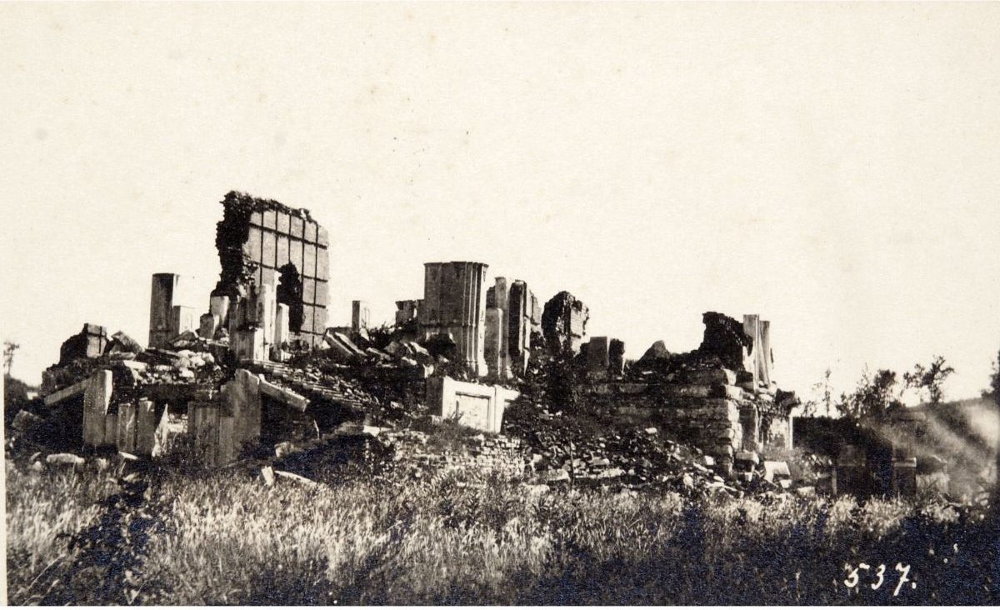

- **P0298** (likely): Fotografija Ruševine Stare poletne palače (album: "Yüen-Ming-Yüen: Total-Ansicht von Westem") (20th c., album bought 1914-1920 (holder)). https://vazcollections.si/predmeti/fotografija-rusevine-stare-poletne-palace/

  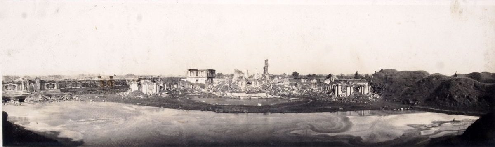

- **P0301** (likely): Fotografija Ruševine gledališča in knjižnice v Stari poletni palači (album: "Yüen-Ming-Yüen: Ruinen des Theaters und Bibliothek") (20th c., album bought 1914-1920 (holder)). https://vazcollections.si/predmeti/fotografija-rusevine-gledalisca-in-knjiznice-v-stari-poletni-palaci/

  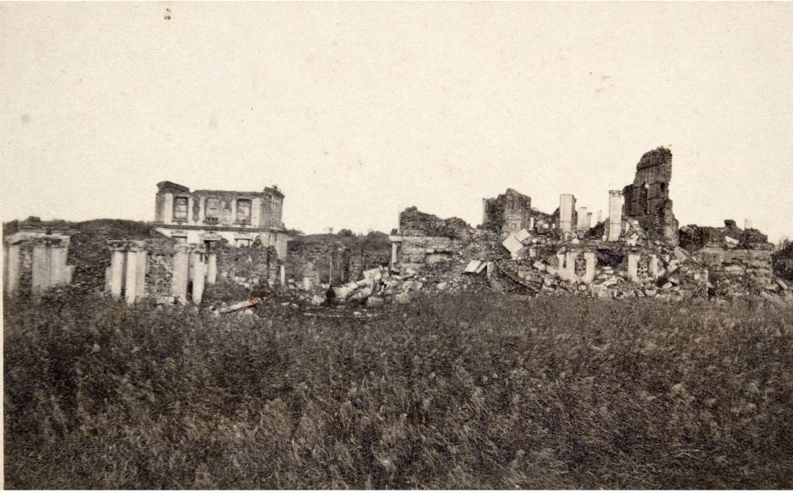

- **P0302** (likely): Fotografija Ruševine knjižnice v Stari poletni palači (album: "Yüen-Ming-Yüen: Ruinen der Bibliothek") (20th c., album bought 1914-1920 (holder)). https://vazcollections.si/predmeti/fotografija-rusevine-knjiznice-v-stari-poletni-palaci/

  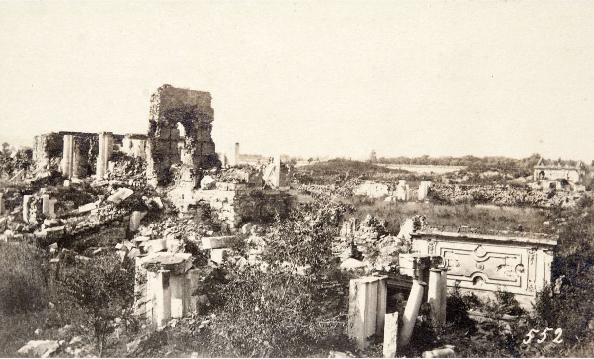

- **P0305** (likely): Fotografija Ruševine knjižnice v Stari poletni palači (album: "Yüen-Ming-Yüen: Ruinen der Bibliothek") (20th c., album bought 1914-1920 (holder)). https://vazcollections.si/predmeti/fotografija-rusevine-knjiznice-v-stari-poletni-palaci-2/

  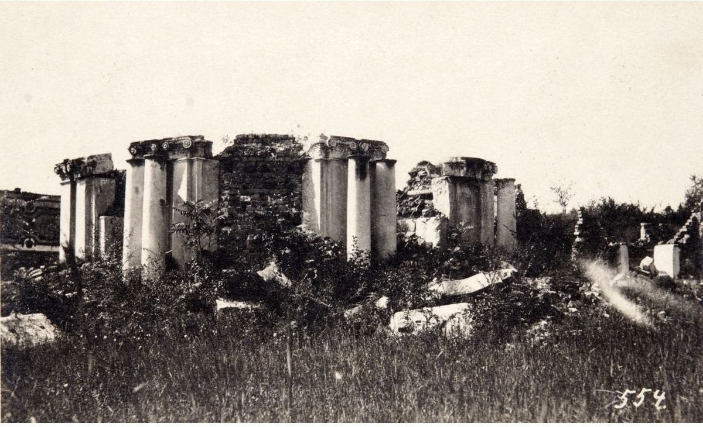

- **P0191** (sure): Ruins of Yuanming Yuan, Summer Palace, Peking, NA01-76 (between 1877 and 1890 (Commons)). https://hpcbristol.net/visual/NA01-76 Research-only: link card.

  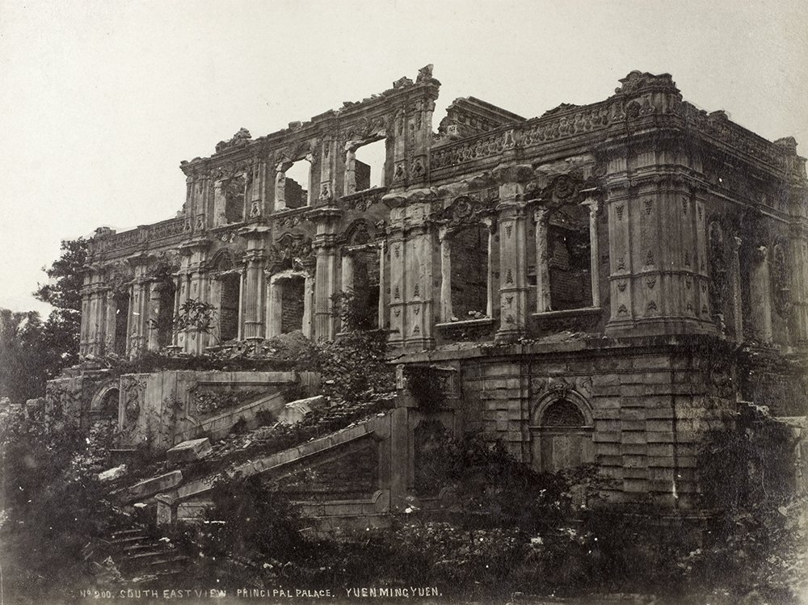

- **P0200** (likely): 圓明園の廢墟（北京郊外）, 亜東印画輯 vol. 2, 163 (not stated (1920s series)). https://commons.wikimedia.org/wiki/File%3A%E4%BA%9C%E6%9D%B1%E5%8D%B0%E7%94%BB%E8%BC%AF_02_163_%22%E5%9C%93%E6%98%8E%E5%9C%92%E3%81%AE%E5%BB%A2%E5%A2%9F%EF%BC%88%E5%8C%97%E4%BA%AC%E9%83%8A%E5%A4%96%EF%BC%89%22.jpg Research-only: link card.

  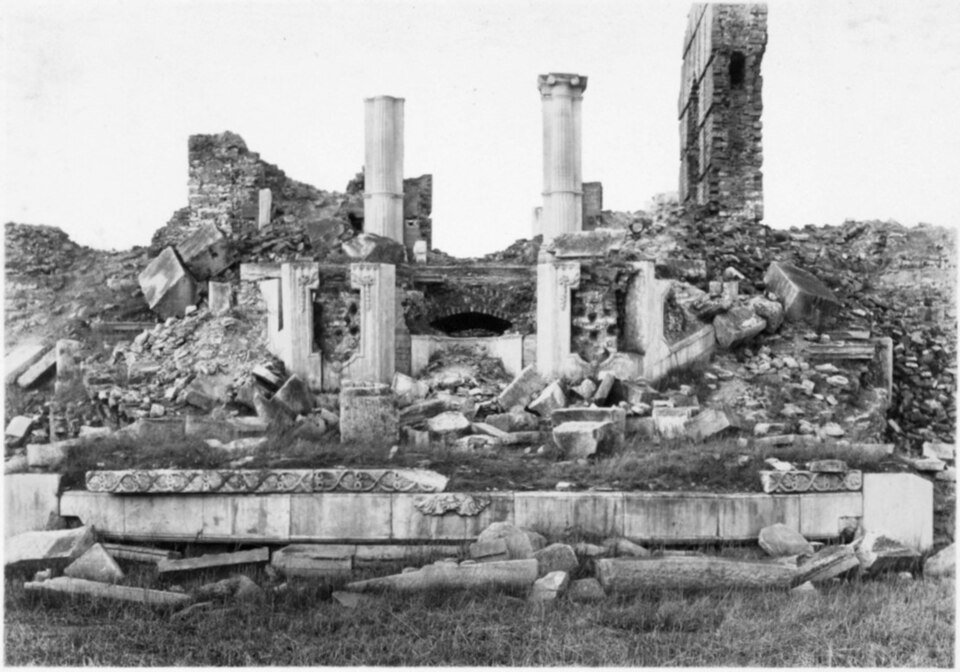

- **P0225** (likely): Moore negatives of the European palaces, Royal BC Museum MS-3171 (13 negatives, 12 views, c.1875 to early 1880s) (perhaps c.1875; early 1880s (visualisingchina.net)). https://search-bcarchives.royalbcmuseum.bc.ca/c-f-moore-fonds Research-only: link card.
- **P0311** (likely): Sirén: Yuanmingyuan (Old summer palace): Ruins. (undated; Sirén 1921-23). http://kulturarvsdata.se/SMVK-OM/Bildarkiv/199633 Research-only: link card.
- **P0316** (likely): Sirén: Yuanmingyuan (Old Summer Palace): Ruins. (undated; Sirén 1921-23). http://kulturarvsdata.se/SMVK-OM/Bildarkiv/199638 Research-only: link card.
- **P0317** (likely): Sirén: Yuanmingyuan (Old Summer Palace): Ruins. (undated; Sirén 1921-23). http://kulturarvsdata.se/SMVK-OM/Bildarkiv/199639 Research-only: link card.
- **P0345** (sure): Xieqiqu, Old Summer Palace.jpg (2021-02-17 16:40:54 (Commons DateTimeOriginal)). https://commons.wikimedia.org/wiki/File:Xieqiqu,_Old_Summer_Palace.jpg

  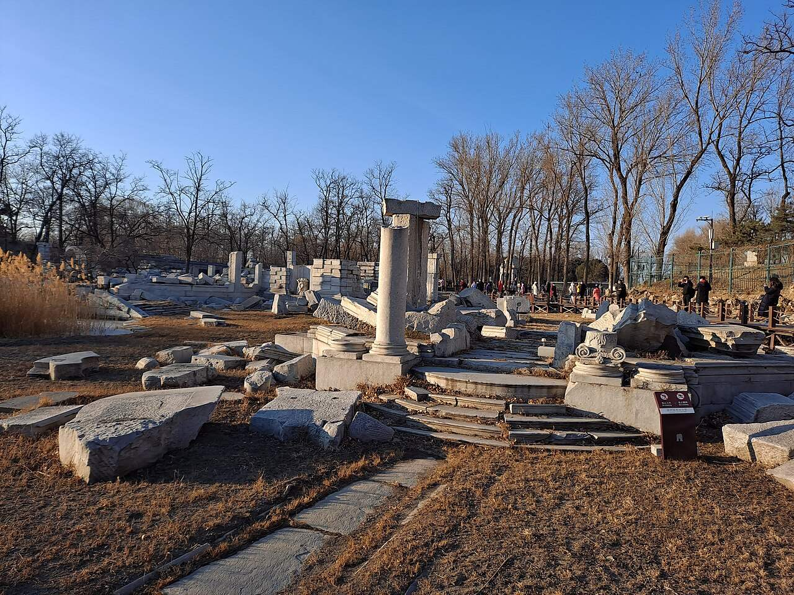

- **P0346** (sure): Ruins of Xieqiqu West Wing 20130126.JPG (2013-01-26 14:35:42 (Commons DateTimeOriginal)). https://commons.wikimedia.org/wiki/File:Ruins_of_Xieqiqu_West_Wing_20130126.JPG

  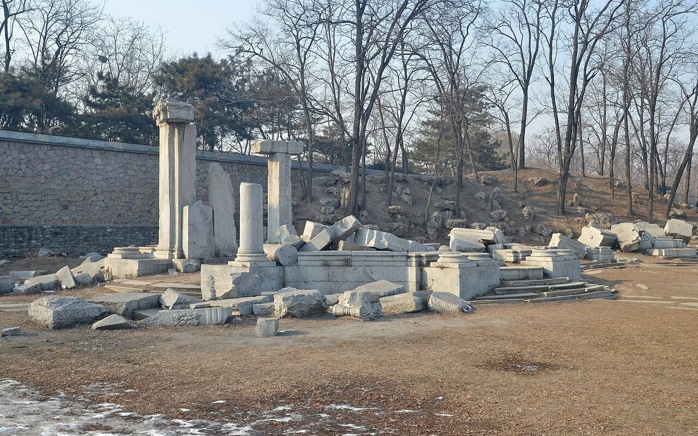

- **P0347** (sure): Inside of Xieqiqu ruins 20130323.JPG (2013-03-23 14:49:47 (Commons DateTimeOriginal)). https://commons.wikimedia.org/wiki/File:Inside_of_Xieqiqu_ruins_20130323.JPG

  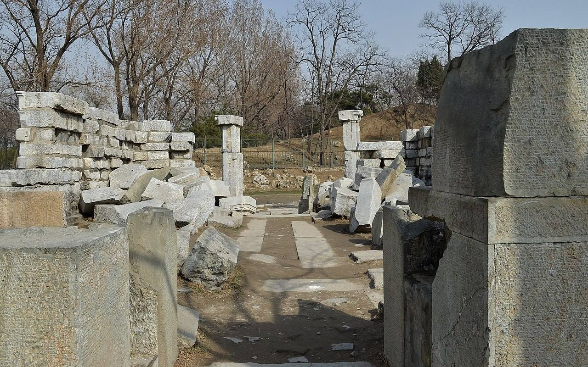

- **P0348** (sure): Fountain in north of Xieqiqu 20130201.JPG (2013-02-01 17:19:59 (Commons DateTimeOriginal)). https://commons.wikimedia.org/wiki/File:Fountain_in_north_of_Xieqiqu_20130201.JPG

  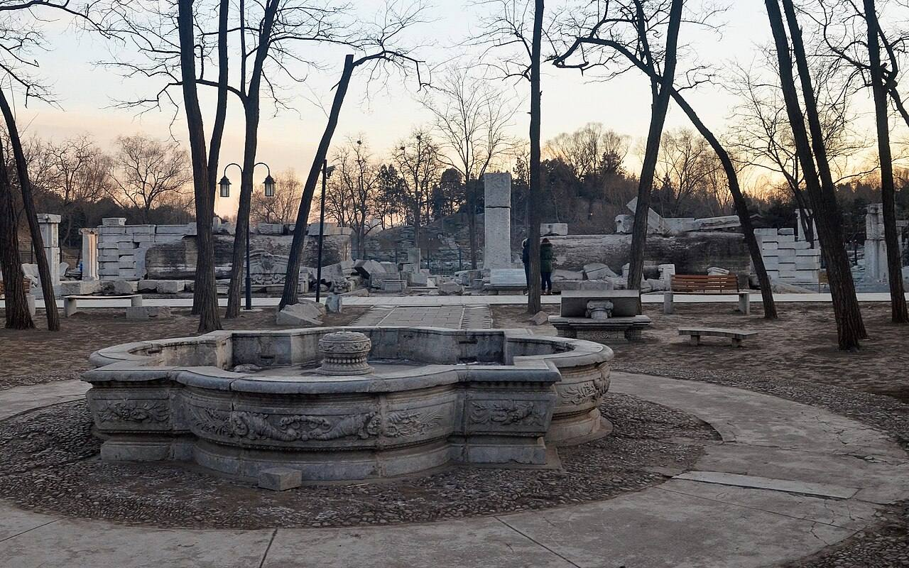

- **P0441** (sure): Ruins of Xieqiqu East Part 20130421.JPG (2013-04-21 17:39:27 (Commons DateTimeOriginal)). https://commons.wikimedia.org/wiki/File:Ruins_of_Xieqiqu_East_Part_20130421.JPG

  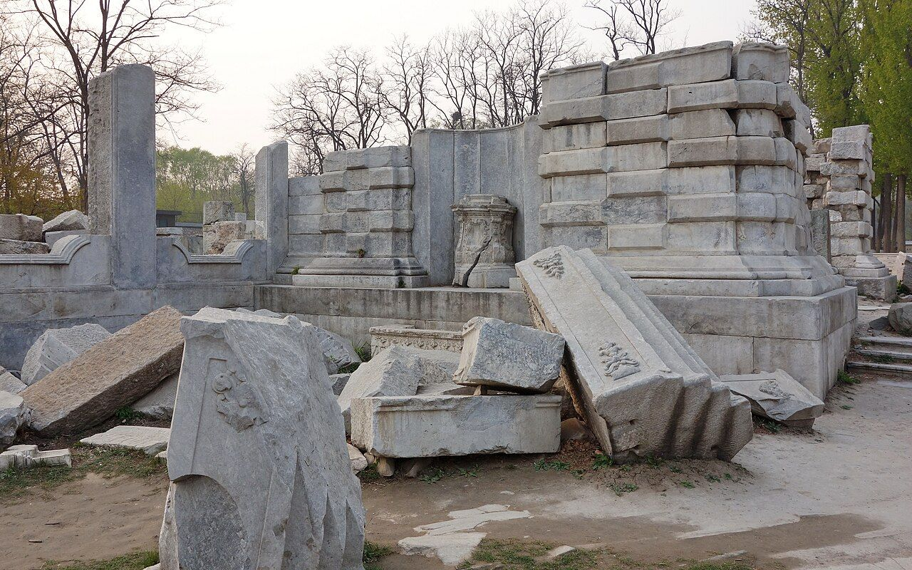

- **P0475** (likely): 雕刻精美的喷水池 - panoramio.jpg (Taken on 27 May 2011 (Commons DateTimeOriginal)). https://commons.wikimedia.org/wiki/File:%E9%9B%95%E5%88%BB%E7%B2%BE%E7%BE%8E%E7%9A%84%E5%96%B7%E6%B0%B4%E6%B1%A0_-_panoramio.jpg

  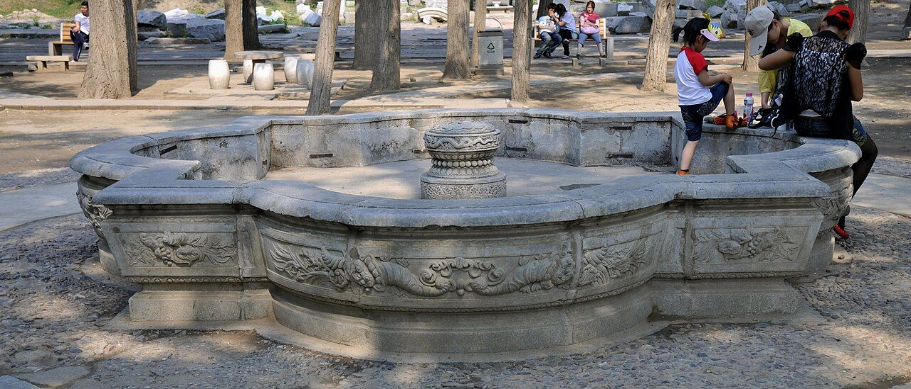

- **P0476** (likely): 断成两段的精美的石雕部件 - panoramio.jpg (Taken on 27 May 2011 (Commons DateTimeOriginal)). https://commons.wikimedia.org/wiki/File:%E6%96%AD%E6%88%90%E4%B8%A4%E6%AE%B5%E7%9A%84%E7%B2%BE%E7%BE%8E%E7%9A%84%E7%9F%B3%E9%9B%95%E9%83%A8%E4%BB%B6_-_panoramio.jpg

  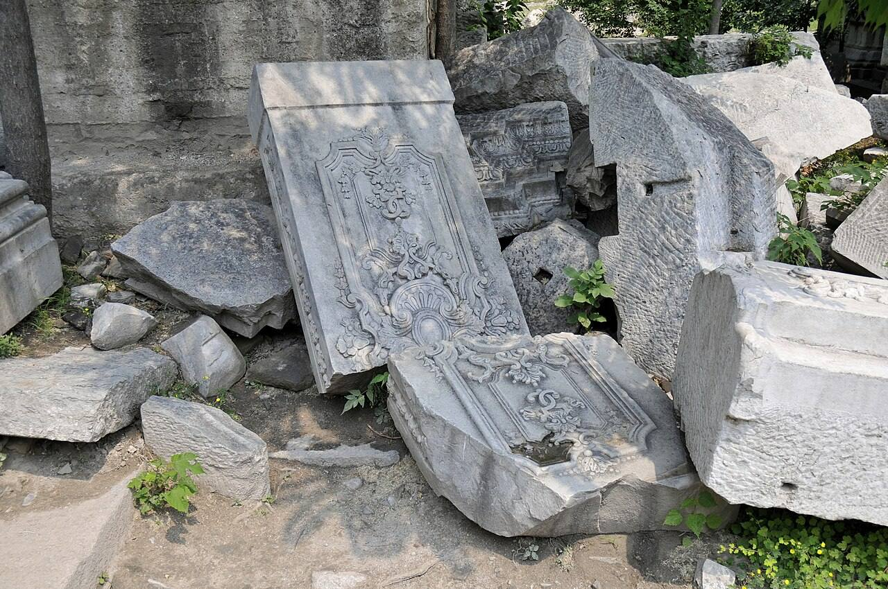

- **P0477** (likely): 精美的石雕部件 - panoramio.jpg (Taken on 27 May 2011 (Commons DateTimeOriginal)). https://commons.wikimedia.org/wiki/File:%E7%B2%BE%E7%BE%8E%E7%9A%84%E7%9F%B3%E9%9B%95%E9%83%A8%E4%BB%B6_-_panoramio.jpg

  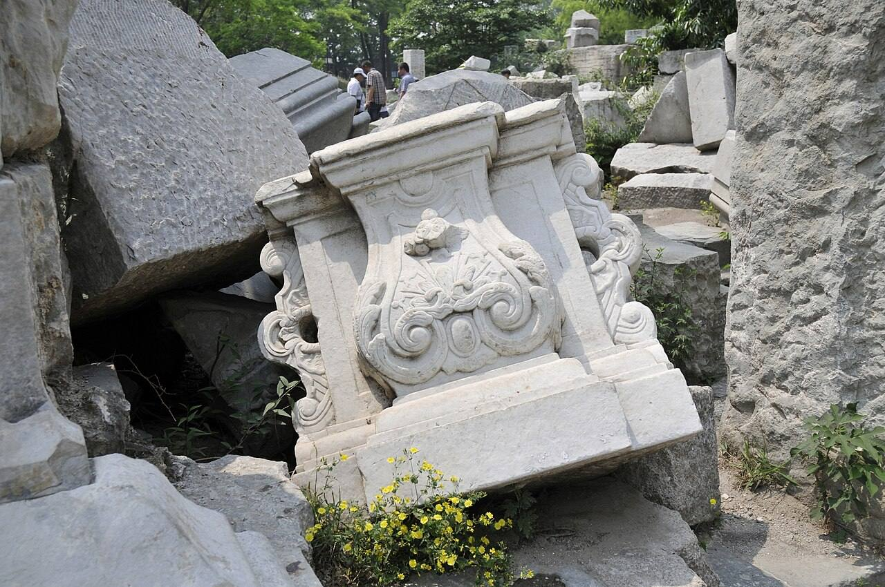

- **P0478** (likely): 谐奇趣 身首异处的石狮 - panoramio.jpg (Taken on 27 May 2011 (Commons DateTimeOriginal)). https://commons.wikimedia.org/wiki/File:%E8%B0%90%E5%A5%87%E8%B6%A3_%E8%BA%AB%E9%A6%96%E5%BC%82%E5%A4%84%E7%9A%84%E7%9F%B3%E7%8B%AE_-_panoramio.jpg

  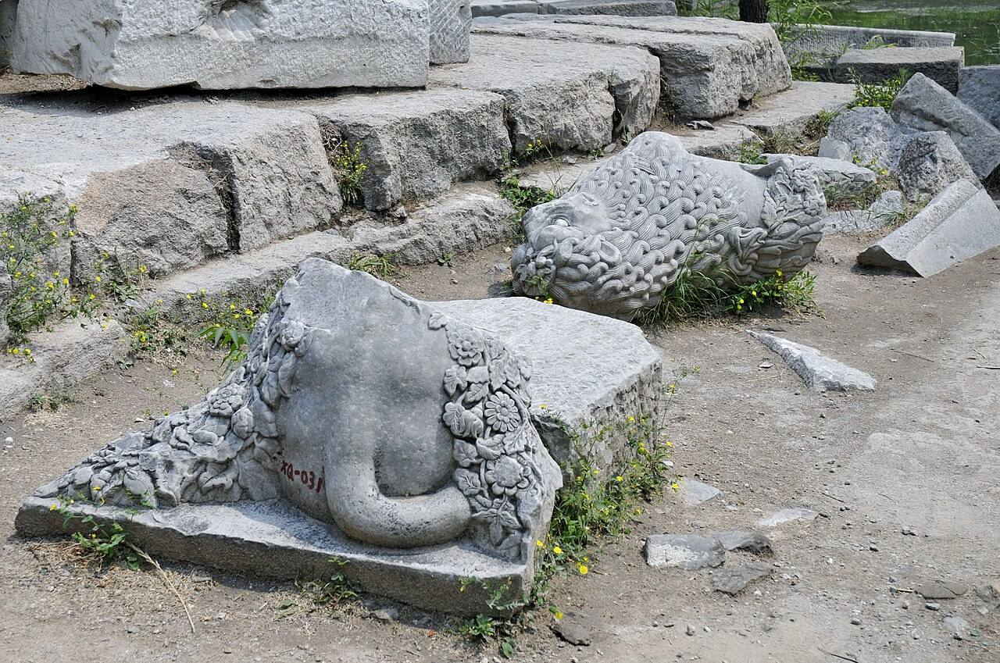

- **P0480** (guess): 制作精美的石雕水槽 - panoramio.jpg (Taken on 27 May 2011 (Commons DateTimeOriginal)). https://commons.wikimedia.org/wiki/File:%E5%88%B6%E4%BD%9C%E7%B2%BE%E7%BE%8E%E7%9A%84%E7%9F%B3%E9%9B%95%E6%B0%B4%E6%A7%BD_-_panoramio.jpg

  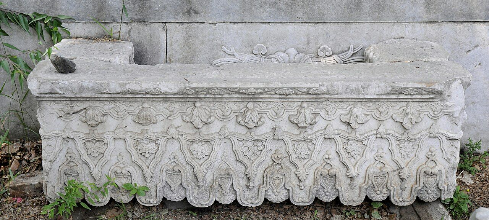

Of its halls: P0174 (XY01-N01).

## Texts and drawings (16)

- **E0171** (text, sure): 日下舊聞考 法慧寺、宝相寺、谐奇趣. 1780s (乾隆 敕撰) · j83:12a · S05. https://github.com/kanripo/KR2k0036/blob/master/KR2k0036_083.txt
  > 海嶽開襟東北為諧竒趣東為法慧寺山門西嚮内為四面延樓後殿為光明性海其西别院有琉璃方塔法慧寺東為寳相寺山門南嚮内為澄光閣後為曇霏閣又後崇基上有殿為現大圓鏡（長春園册）臣等謹案法慧寺山門額曰普香界現大圓鏡殿内額曰香臺華鬘
  The only line in 日下舊聞考 on the European palaces: 諧竒趣 north-east of 海嶽開襟. Then 法慧寺 with a west-facing gate, 四面延樓, 光明性海 and a glazed square pagoda; 寳相寺 with a south-facing gate, 澄光閣, 曇霏閣 and 現大圓鏡 on a raised base.
- **E0929** (poem, sure): 谐奇趣. 嘉庆三年 (1798) · v4 p.122, under 西洋楼; source ref 1-385 · S361. https://www.yuanmingyuanpark.cn/xs/yjbg/202008/P020200803382796786124.pdf#page=125
  > 运水由楼顶，发机务审详。周流虽尽妙，渗漏亦须防。波浪千层叠，珠玑万斛量。纡回伏脉远，灌注溯源长。浩浩终归壑，涓涓始滥觞。观澜奇趣会，至理即包藏。
  Poem 谐奇趣 by the Jiaqing Emperor, 1798, filed by the editors under 西洋楼.
- **E0928** (poem, likely): 观谐奇趣水法. 嘉庆元年 (1796) · v4 p.121, under 西洋楼; source ref 1-110 · S361. https://www.yuanmingyuanpark.cn/xs/yjbg/202008/P020200803382796786124.pdf#page=124
  > 连延楼阁仿西洋，信是熙朝声教彰。激水引泉流荡漾，笵铜伏地制精良。惊潮翻石千夫御，白雨跳珠万斛量。巧擅人工思远服，版图式廓巩金汤。
  Poem 观谐奇趣水法 by the Jiaqing Emperor, 1796, filed by the editors under 西洋楼.
- **E0930** (description, sure): Plate I: 谐奇趣 Xieqiqu, north front (by content). 1786-1803 · pp.173-175, Plate I · S258. https://archive.org/details/BIUSante_40644
  > Trois arcades au rez-de-chaussée; trois fenêtres à l'étage supérieur.
  Palace of two orders flanked by two isolated octagonal pavilions; the middle arch a niche with a throne; two-basin fountain with four dolphins and candelabra in a railed basin; lawns with shrubs and vases. Delatour's Plate I matches Malone's Engraving 2.
- **E0931** (description, sure): Plate II: 谐奇趣 Xieqiqu, south front (by content). 1786-1803 · pp.176-177, Plate II · S258. https://archive.org/details/BIUSante_40644
  > Sur le sol de cette seconde terrasse sont placées à droite et à gauche deux galeries en hémicycle, lesquelles ne s'élèvent que jusqu'au niveau de la première terrasse.
  Round stair with a double ramp and a niche with a throne; a basin with vases and animals, birds and quadrupeds spouting; a dolphin in the centre; octagonal pavilions at the ends of the galleries; on the left a triumphal arch with a European dial; a three-arch bridge. Delatour's Plate II matches Malone's Engraving 1.
- **E1524** (description, sure): 玉明 侍游御園記 (in 蕉軒隨錄). 1856 (咸豐六年七月二十一日) · 蕉軒隨錄, 御園侍游 (line 336 of the corpus file) · S210. https://github.com/garychowcmu/daizhigev20/blob/master/史藏/志存记录/蕉轩随录.txt
  > ◎御园侍游玉将军（明）有《侍游御园记》，成竹坪同年（林）曾属予代作跋语，恭书于后。按，《记》云：“咸丰六年秋七月二十一日，奉旨：本日散朝后，著玉明、肃顺自备鞍马，午初一刻进西南门，在山高水长伺候。有顷，上从内乘船，至山高水长后阁扇下船，出前门，谕玉明、肃顺暨珠勒亨、西拉布、托云、德勒格尔、伊勒东阿等脱去外褂。上乘马，命七臣随行。自山高水长游藻园，至厂地，过汇芳书院，复由紫碧山房至鱼跃鸢飞少坐。过蕊珠宫门，至黄花磴进茶毕，往西洋楼海宴堂，至转马台，过小角门，至狮子林清淑斋赏饭。左右四卓，命七臣坐，并奉温谕可饱食，非外边筵宴比也。上命膳房先给七臣面各一器，上进面，复进饭，颁赏御用菜蔬，七臣叩头谢。上进粥，复赏粥毕。随驾起行，由宝相寺、法慧寺、谐奇趣过明春门，至雷峰夕照马头，坐如在天上船，游福海。上命笔砚作诗毕，至渊氵亭镜澈马头下船。进丽春门骑马，由旧园东墙根过敷春堂，游西大堤汉城关，至含辉楼下马，命七臣散归。玉明自道光十一年由侍卫擢厕御前二十余年，仰邀优渥，得遍瞻御园盛景。欣感之余，谨作记以纪荣遇。”
  A rare first-hand record of a day in the garden four years before its destruction. The emperor takes seven officials by a named route from 山高水長 through 藻園, 彚芳書院, 紫碧山房 and 魚躍鳶飛, past 蕊珠宫門, on to 海宴堂 in the 西洋樓, a meal at 清淑齋 in 獅子林, 寳相寺, 法慧寺, 諧奇趣, by boat on 福海, then 敷春堂 and 含暉楼. All were standing then.
- **E0489** (description, sure): The Official Map (S01) as Malone describes it. 1934 · pp.230-232 · S02. https://archive.org/details/historyofpekings00malo
  > The only serious mistake in the Official Map which the writer has found is in the location of the Hsieh Ch'i Ch'u, the first building in the foreign group, which is about two inches too far to the south.
  Bought from the draftsman Pai's family in Haidian; scale about 1 to 1300; every gate, wall, road, bridge, hill, canal and bay. Pasted sheets show alterations, as at scene 40. Later than the album. Purely a ground plan. Already used in Q3, Q5.
- **E0932** (description, sure): Engraving 1: 谐奇趣 Xieqiqu, south front. 1934 · p.141 · S02. https://archive.org/details/historyofpekings00malo
  > A three-story building in the center was joined by curved galleries to two two-storied towers at the southeast and southwest of the main building.
  Curved stairs from the second floor down to a pool with several fountains between galleries and towers; a lake with a balustrade in front. Capitals mix Corinthian and Ionic (p.143).
- **E0933** (description, sure): Engraving 2: 谐奇趣 Xieqiqu, north front. 1934 · p.143 · S02. https://archive.org/details/historyofpekings00malo
  > The north front of the Hsieh Ch'i Ch'u faced on a fantastically paved courtyard containing conventionally trimmed trees.
  North front on a patterned paved court with clipped trees. Plates p.142-143 show the ruin after 1860 (from Favier) and after further damage in 1900 and later.
- **E1526** (description, guess): Van Braam, Dutch embassy, January-February 1795. 1934 · pp.167-170 · S02. https://archive.org/details/historyofpekings00malo
  > They are very numerous, of small dimensions, neatly furnished in the Chinese taste, and containing a few books and some very valuable curiosities. Three only of these apartments can boast of European time-pieces.
  Audience in a Tartar tent on the open space at the Drill Field; sled rides along frozen canals; goldfish of 15 inches and more; the emperor's rooms as quoted. They were not allowed to see the European buildings, and had seen twenty drawings of them in Canton. Told of a garden 300 li round with 36 residences; Malone calls this exaggerated.
- **E1216** (description, likely): Site status table, about 2011: remains tidied up. c. 2011 · 系列06 repost, status table · S356. https://blog.sina.com.cn/s/blog_c27029650101itzz.html
  A blogger's table of what was then visible. These scenes have building remains that have been cleared and tidied. Dated about 2011, so digs since then are not reflected.
- **E0507** (description, sure): 圆明园五朝御制诗文集注 v4, editors' note on 西洋楼. 2020 edition · v4 p.120 · S361. https://www.yuanmingyuanpark.cn/xs/yjbg/202008/P020200803382796786124.pdf#page=123
  The editors walk the strip from west to east with completion dates and plaques: 谐奇趣 1751, 养雀笼 1759, then the fountains and the perspective walls, with their mechanical details. They put the whole at about 2% of the gardens.
- **E0544** (drawing, sure, search index only): 西洋楼水法图. 国家图书馆善本部 none shown · S310. https://www.mhymy.com/dasl/ysltd/7643.html
  Plan of the Xiyang Lou waterworks across its dozen sites; the record shows no shelf number. No image here; the site may ask a small payment for the full record.
- **E0934** (drawing, sure, search index only): 谐奇趣总平面图. 不详 · 国家图书馆善本部 样077-1号 · S310. https://www.mhymy.com/dasl/ysltd/12522.html
  Undated base plan of Xieqi Qu. No image here; the site may ask a small payment for the full record.
- **E0935** (drawing, sure, search index only): 谐奇趣样式雷图. 不详 · 故宫博物院图书馆 样986号 · S310. https://www.mhymy.com/dasl/344.html
  Undated design and survey sketch with the perspective bridge, the water tower, the aviary and Xieqi Qu. No image here; the site may ask a small payment for the full record.
- **E0554** (archaeology, sure): 西洋楼区域考古勘探报告. n.d. · mhymy 档案史料 12205, free part · S149. https://www.mhymy.com/dasl/12205.html
  Report's opening: the strip runs 860 m east-west, up to 300 m wide in the west and 65 m at its narrowest, about 70,000 m2, built 1747-1783. A central axis divides it into about five sections, each with its own north-south axis, thirteen units from 谐奇趣 to 线法墙. Survey results are paywalled.

**On the plan:** Drawn on the plan of the gardens (S01), labelled 谐奇趣. https://artmuseum.princeton.edu/collections/objects/138657

## Reconstructions by others (10)

Modern interpretation, not evidence.
- **R0016** (physical model, sure): 20240112 Xieqiqu, Hengdian Yingshicheng. Hengdian World Studios (replica); Yumeto (photograph), Hengdian World Studios (per the Commons category). https://commons.wikimedia.org/wiki/File:20240112_Xieqiqu,_Hengdian_Yingshicheng.jpg
- **R0097** (paper figure, sure): Fig. 13, Accuracy assessment for the Digital Restoration of Xieqiqu (model coded by evidence level A-D). M. Gao, W. Piao, J. Guo, Re-Yuanmingyuan Company Limited, Beijing, 2015. https://isprs-annals.copernicus.org/articles/II-5-W3/75/2015/
- **R0098** (paper figure, sure): Fig. 12, element at site, point cloud, retopology, low-poly model. M. Gao, W. Piao, J. Guo, Re-Yuanmingyuan Company Limited, Beijing, 2015. https://isprs-annals.copernicus.org/articles/II-5-W3/75/2015/
- **R0099** (paper figure, likely): Fig. 14, Virtual Yuanmingyuan app, mobile guide, holographic display, circular-screen centre. M. Gao, W. Piao, J. Guo, Re-Yuanmingyuan Company Limited, Beijing, 2015. https://isprs-annals.copernicus.org/articles/II-5-W3/75/2015/
- **R0051** (3D model, likely): Laser scanning and virtual fitting of the 西洋楼 stones; 碧澜桥 repaired. 肖金亮, 郭黛姮 and team, 北京清华同衡规划设计研究院 建筑与城市遗产研究所. https://www.tsinghua.edu.cn/info/1182/46587.htm Research-only: link card.
- **R0139** (drawing, sure): Fig. 4, Plan d'ensemble (plan de restitution 1985). Antoine Durand, Mission Palais d'Ete, under Michele Pirazzoli-t'Serstevens, 1985 (published 1988). https://www.persee.fr/doc/arasi_0004-3958_1988_num_43_1_1240 Research-only: link card.
- **R0042** (AR/VR, likely): “再现圆明园” 数字导览系统: 12 scenes, 40 planned. 郭黛姮 team; 孙慧皎 (清城睿现) on the technical side, 清华大学; 清华控股 清城睿现数字科技研究院; 圆明园管理处, 2014. https://www.tsinghua.edu.cn/info/1182/39112.htm Research-only: link card.
- **R0004** (paper figure, sure): Digital restoration research and 3D model of Xieqiqu, ISPRS Annals II-5/W3. M. Gao, W. Piao, J. Guo, Re-Yuanmingyuan Company, 2015. https://isprs-annals.copernicus.org/articles/II-5-W3/75/2015/ Research-only: link card.
- **R0152** (paper figure, sure): Fig. 9, Decorative components from the balustrade at the third level of the main building of 谐奇趣; Fig. 10 Experiment of the RGB channel. Y. He, Y. H. Ma, X. R. Zhang, Tsinghua Heritage Institute for Digitization, 2017. https://isprs-archives.copernicus.org/articles/XLII-2-W5/335/2017/ Research-only: link card.
- **R0239** (physical model, guess): Old Summer Palace Scale Model / 圆明园 / 圓明園. China Travel Guide / 中国旅游指南. https://www.youtube.com/watch?v=rxuXndVT10E Research-only: link card.

## Surviving comparable buildings, not this building (1)

- **T075** 特里亚农瓷宫; 拉托纳喷泉 Trianon de Porcelaine (lost) and Latona Fountain, Versailles, France. Comparable: same court, era or type, confidence C, standing: partly. Tiled roofs in a European pleasure house (Porcelain Trianon), fountain with figures (Latona) Basis: Lancaster 1948 reported in S415 p.83: Trianon de Porcelaine and Latona fountain for 谐奇趣. Rabreau rejects most of Lancaster's list (p.82). S415 p.81 on Beurdeley and p.22 on the letters: «soutiendrait le parallèle». https://www.ghamu.org/wp-content/uploads/2022/09/Rabreau-YMY-2022.pdf
  - P0617: Bassin de Latone le 2 septembre 2015 - 06. https://commons.wikimedia.org/wiki/File:Bassin_de_Latone_le_2_septembre_2015_-_06.jpg

## Evidence for the set of buildings

- Reconstructions and comparables for the whole garden, 西洋楼 Xiyang Lou: see GARDEN-XY

## Open questions

- Q8: Known errors of S01
- Q26: Forms
- Q32: OSM errors
- Q35: Xiyang Lou massing (Round 2)
- Q49: Captions overruled by form (old photographs)
- Q56: Reconstructions against the period evidence

<!-- generated:end -->

## Notes

<!-- Yours: regeneration never touches this part. It goes on the public site; what you write below a line holding only %% private %% stays in the research copy. -->
