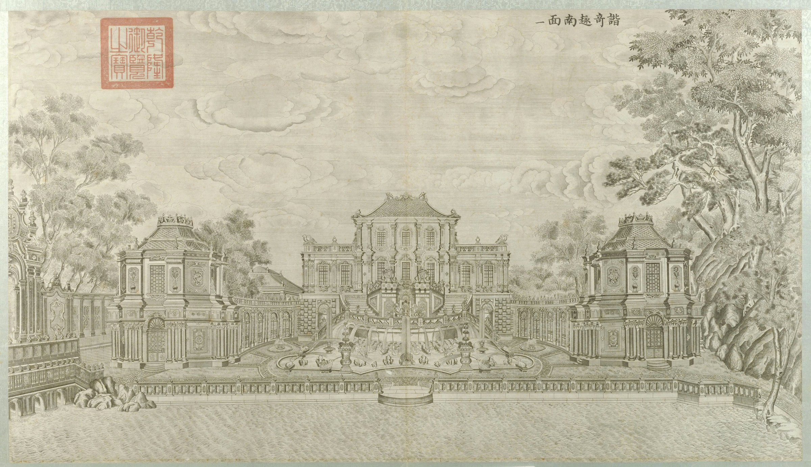

<!-- generated:start (scripts/building_pages.py): do not edit between these markers -->

# XY02-01: 线法桥 Xianfa Qiao

bridge south of 蓄水楼 · Xiyang Lou

**3D object:** none yet.

**Part of:** XY02 蓄水楼

## What we know

- **Name:** 线法桥 Xianfa Qiao (S06, S01 · confidence B)
- **English:** bridge south of 蓄水楼 (S06, S01)
- **Garden:** Xiyang Lou (S06, S01)
- **Type:** bridge (S06, S01 · confidence B)
- **Destroyed:** 1860 (S06, S01)
- **Position:** Not placed: the name was not found on the plan.
- **Where the text puts it:** 蓄水楼南 (S06) (S06, S01) *(research copy, not public)*
- **Note:** 5 arches, at the west wall; 水闸 links to YM (S06). Stone moved to 燕京大学 (S06). A bridge named by S06 only; nothing drawn close south of 蓄水楼 on S01. S01 writes 五孔闸 at (8688,1740), three diamond piers on the wall line west of 谐奇趣's lake: same wall, sluice, and 5 openings like S06's 5 arches. (S06;S01, Round 6). (S06, S01)

## Our model now

No box in the 3D view: the plan shows no building here, or a plot, water, a hill or a name only.

## Pictures (1)

- **P0041** (guess): 谐奇趣南面 (圆明园铜版画册 / 西洋楼铜版画, plate 一 of 二十; title and number printed on the plate) (1786 (Commons); Palace Museum: 清). https://commons.wikimedia.org/wiki/File%3A%E5%9C%86%E6%98%8E%E5%9B%AD%E9%93%9C%E7%89%88%E7%94%BB%E5%86%8C-17.jpg

  

## Texts and drawings (2)

- **E0939** (description, sure): 线法桥. Wikipedia text, unsourced there · zh.wikipedia 圆明园, 西洋楼 section · S06. https://zh.wikipedia.org/wiki/圆明园
  South of 蓄水楼 against the west wall of 长春园: five arches with beast faces spouting water, and a false door with a large Western clock in the centre, carved walls either side. Parts were later moved to Yenching University. A lead: not seen on a Qing source. No engraving of the 20 is named for it.
- **E2417** (drawing, likely, search index only): 谐奇趣样式雷图 (样986), 朱墨 底样, 设计与踏勘草图. 不详 · 故宫博物院图书馆 样986号 · S310. https://www.mhymy.com/dasl/344.html
  Update to E0935: red lines mark three supply pipes from 蓄水楼 to 谐奇趣's pools; on the right, field notes of a two-storey elevation, a fountain, and a five-arch sluice elevation. Useful for the pipe run and the 线法桥 sluice.

## Evidence for the set of buildings

- Evidence for the whole compound 蓄水楼: see XY02
- Reconstructions and comparables for the whole garden, 西洋楼 Xiyang Lou: see GARDEN-XY

## Open questions

- Q17: Halls in the texts and not on the plan
- Q74: Two buildings called 蓄水楼 (Round 6)

<!-- generated:end -->

## Notes

<!-- Yours: regeneration never touches this part. It goes on the public site; what you write below a line holding only %% private %% stays in the research copy. -->
