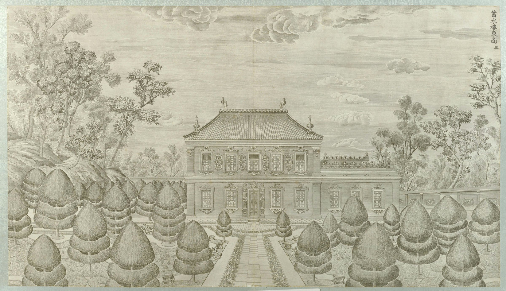
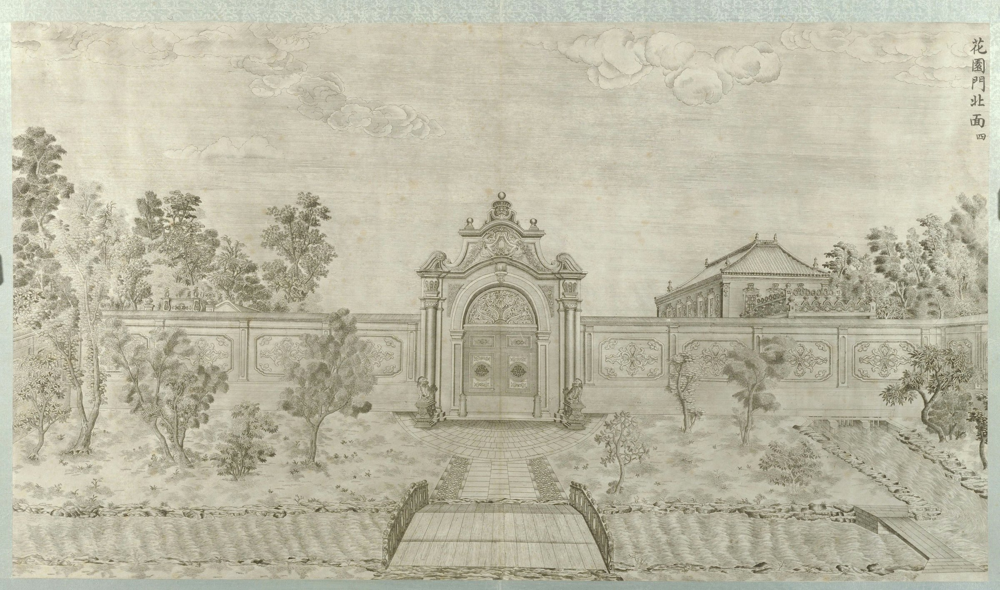
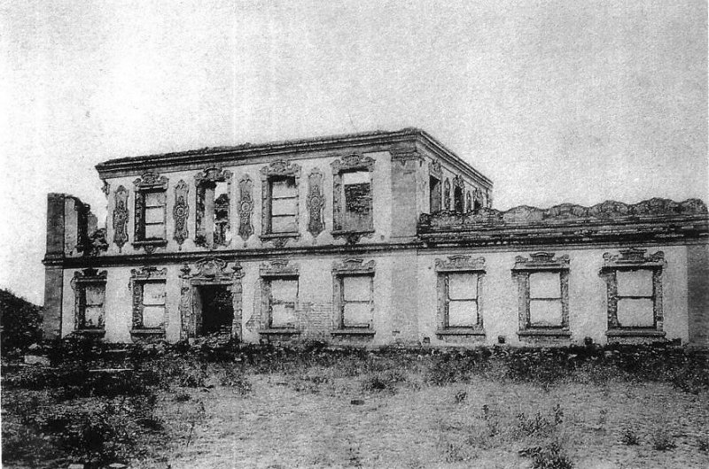
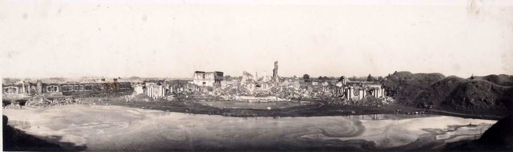
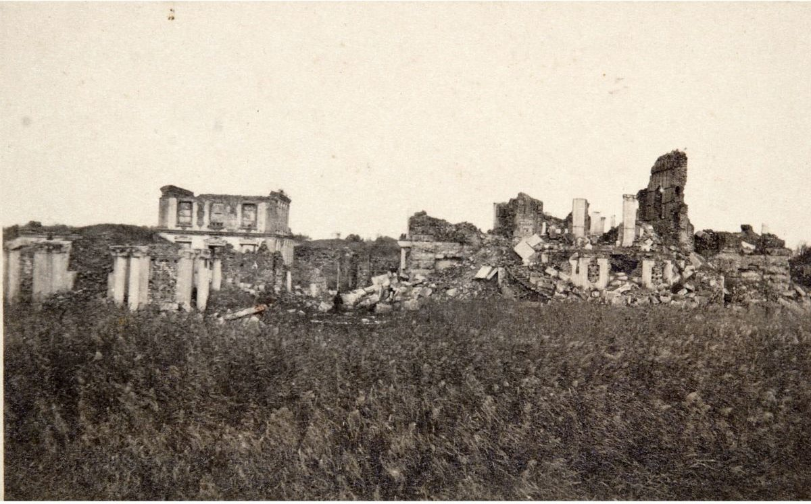

<!-- generated:start (scripts/building_pages.py): do not edit between these markers -->

# XY02: 蓄水楼 Xushui Lou

Hsu Shui Lou, Building for Gathering the Waters · Xiyang Lou

**3D object:** 2 boxes. Open it: `/reconstruction/3d.html?b=XY02`

## What we know

- **Name:** 蓄水楼 Xushui Lou (S02, S06, S56, S01, S109 · confidence A)
- **English:** Hsu Shui Lou, Building for Gathering the Waters (S02, S06, S56, S01, S109)
- **Garden:** Xiyang Lou (S02, S06, S56, S01, S109)
- **Type:** european (S02, S06, S56, S01, S109 · confidence A)
- **Destroyed:** Looted and burnt 1860; stone ruins stayed, further damage 1900 and after (S02 pp.142,218) (S02, S06, S56, S01, S109)
- **Position:** 40.01187, 116.30206. S01 likely (S01 · confidence B)
- **Bays:** 5 (S06) in the texts / 5x1 on the plan (S02, S06, S56, S01, S109)
- **Size in the inventory:** 10.0 × 8.0 m. typology xiyang_lou, C (S01)
- **Storeys:** 2 (S02, S06, S56, S01, S109)
- **Where the text puts it:** faced eastward on the courtyard north of Number Two (S02 p.143) (S02, S06, S56, S01, S109) *(research copy, not public)*
- **Note:** Copper engraving no. 3 per S02. Small 2-storey with a northern 1-storey wing (S02). Holds 养水池, 轧水机 (S06). (S02, S06, S56, S01, S109)
- **Plan reader's note:** Narrow 5-bay N-S range on the west side of the court north of 谐奇趣; matches Malone 'faced eastward on the courtyard north of Number Two' and S06 5 bays. Curved wash pool directly north of it (8682-8721,925-1025). | plan: Text 5 bays: agrees. (S01) *(research copy, not public)*
- **How it was read:** likely (S01) *(research copy, not public)*
- **Plan pixels:** 8705, 1085 (S01) *(research copy, not public)*

## Our model now

Simple massing of a European palace, assumed: sizes from the texts and the ruin polygons, position from the plan or the ruin. Not a reading of the 1786 engravings yet.

- **1 ×:** reservoir house, two storeys: 10 × 8 m, eave 6.5 m, ridge 9 m
- **1 ×:** north wing, one storey (size a guess): 8 × 6 m, eave 3.5 m, ridge 5 m
- **Confidence:** C, all assumed

## Inside it (1)

- XY02-01 线法桥

## Pictures (5)

- **P0043** (sure): 蓄水楼东面 (圆明园铜版画册 / 西洋楼铜版画, plate 三 of 二十; title and number printed on the plate) (1786 (Commons); Palace Museum: 清). https://commons.wikimedia.org/wiki/File%3A%E5%9C%86%E6%98%8E%E5%9B%AD%E9%93%9C%E7%89%88%E7%94%BB%E5%86%8C-1.jpg

  

- **P0044** (likely): 花园门北面 (圆明园铜版画册 / 西洋楼铜版画, plate 四 of 二十; title and number printed on the plate) (1786 (Commons); Palace Museum: 清). https://commons.wikimedia.org/wiki/File%3A%E5%9C%86%E6%98%8E%E5%9B%AD%E9%93%9C%E7%89%88%E7%94%BB%E5%86%8C-2.jpg

  

- **P0176** (sure): Yuanmingyuan. Ruins of Hsü Shui Lou (Xushuilou), House for Collecting the Waters (1922 (holder)). http://kulturarvsdata.se/SMVK-OM/Bildarkiv/199644

  

- **P0298** (likely): Fotografija Ruševine Stare poletne palače (album: "Yüen-Ming-Yüen: Total-Ansicht von Westem") (20th c., album bought 1914-1920 (holder)). https://vazcollections.si/predmeti/fotografija-rusevine-stare-poletne-palace/

  

- **P0301** (likely): Fotografija Ruševine gledališča in knjižnice v Stari poletni palači (album: "Yüen-Ming-Yüen: Ruinen des Theaters und Bibliothek") (20th c., album bought 1914-1920 (holder)). https://vazcollections.si/predmeti/fotografija-rusevine-gledalisca-in-knjiznice-v-stari-poletni-palaci/

  

## Texts and drawings (9)

- **E0937** (description, sure): Plate III: 蓄水楼 Xushui Lou. 1786-1803 · pp.177-178, Plate III · S258. https://archive.org/details/BIUSante_40644
  > C'est un corps-de-logis composé d'un rez-de-chaussée, et d'un étage; celui-ci percé de cinq fenêtres, celui-là de quatre fenêtres et d'une porte.
  Titled Château-d'eau, or Machine du Val-Saint-Pierre. Five windows above, four and a door below, a one-storey wing, clipped shrubs on lawns.
- **E0938** (description, sure): Engraving 3: 蓄水楼 Xushui Lou. 1934 · p.143 · S02. https://archive.org/details/historyofpekings00malo
  > A small two-story building with a northern wing of one story faced eastward on the courtyard north of Number Two.
  Small two-storey water building with a one-storey north wing, facing east.
- **E0463** (description, likely): Bourgeois 1786: the fountains after Benoist. 1786 · pp.165-167 · S258. https://archive.org/details/BIUSante_40644
  > un ou deux jours auparavant, on emploie tant de monde à porter l'eau que le bassin immense du château d'eau est suffisamment rempli, et les eaux jouent sur le passage de l'Empereur.
  Benoist's machine had worn out and was not repaired. Men filled the reservoir a day or two before the emperor's visit. Main pipes as thick as a man's body, medium and large ones of copper.
- **E0941** (description, likely): Engraving 4: 花园门 Huayuan Men. 1934 · pp.143-144 · S02. https://archive.org/details/historyofpekings00malo
  > The wall was of gray brick cut smooth and decorated with a large pattern in pink and a deep cream tint.
  North side of the maze gate, seen from inside; 蓄水楼 visible over the wall. Wall colours as quoted, source of the colours not stated.
- **E0939** (description, sure): 线法桥. Wikipedia text, unsourced there · zh.wikipedia 圆明园, 西洋楼 section · S06. https://zh.wikipedia.org/wiki/圆明园
  South of 蓄水楼 against the west wall of 长春园: five arches with beast faces spouting water, and a false door with a large Western clock in the centre, carved walls either side. Parts were later moved to Yenching University. A lead: not seen on a Qing source. No engraving of the 20 is named for it.
- **E2137** (description, sure, search index only): 圆明园水利文物遗迹研究. n.d. · mhymy xsjl 6277, search-index text · S349. https://www.mhymy.com/xsjl/6277.html
  Inventory of water works: the 藻园 one-arch inlet, main source, now buried under the wall and undug; 黄花阵 inlet with good piers; 鉴碧亭 sluice, abandoned 2007; 狮子林 七孔闸, chief outlet, buried in the 2000s behind a new weir with only a stub showing; west water tower fed from a three-arch inlet.
- **E0935** (drawing, sure, search index only): 谐奇趣样式雷图. 不详 · 故宫博物院图书馆 样986号 · S310. https://www.mhymy.com/dasl/344.html
  Undated design and survey sketch with the perspective bridge, the water tower, the aviary and Xieqi Qu. No image here; the site may ask a small payment for the full record.
- **E0554** (archaeology, sure): 西洋楼区域考古勘探报告. n.d. · mhymy 档案史料 12205, free part · S149. https://www.mhymy.com/dasl/12205.html
  Report's opening: the strip runs 860 m east-west, up to 300 m wide in the west and 65 m at its narrowest, about 70,000 m2, built 1747-1783. A central axis divides it into about five sections, each with its own north-south axis, thirteen units from 谐奇趣 to 线法墙. Survey results are paywalled.
- **E0936** (reconstruction, likely): Digital restoration research and 3D model of Xieqiqu, ISPRS Annals II-5/W3. 2015 · open access paper · S108. https://isprs-annals.copernicus.org/articles/II-5-W3/75/2015/
  The Yuanmingyuan Digital Restoration Research Project of 2013 covered five of thirteen 西洋楼 scenes in its first two years: 谐奇趣, 海晏堂, 方外观, 蓄水楼, 观水法. The paper explains 谐奇趣's method: present-day survey with archival drawings and engravings.

**On the plan:** Its place is drawn on the plan of the gardens (S01), with no name written. https://artmuseum.princeton.edu/collections/objects/138657

## Open questions

- Q8: Known errors of S01
- Q32: OSM errors

<!-- generated:end -->

## Notes

<!-- Yours: regeneration never touches this part. It goes on the public site; what you write below a line holding only %% private %% stays in the research copy. -->
