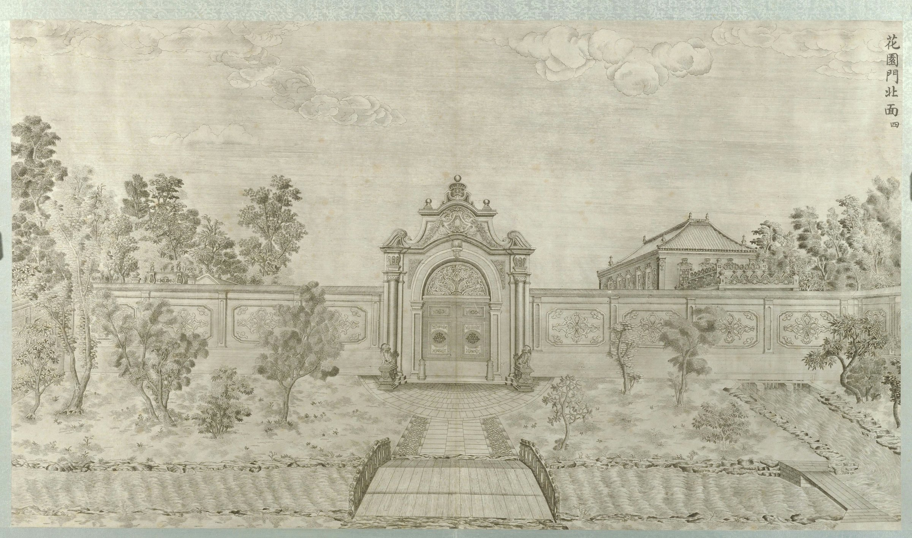
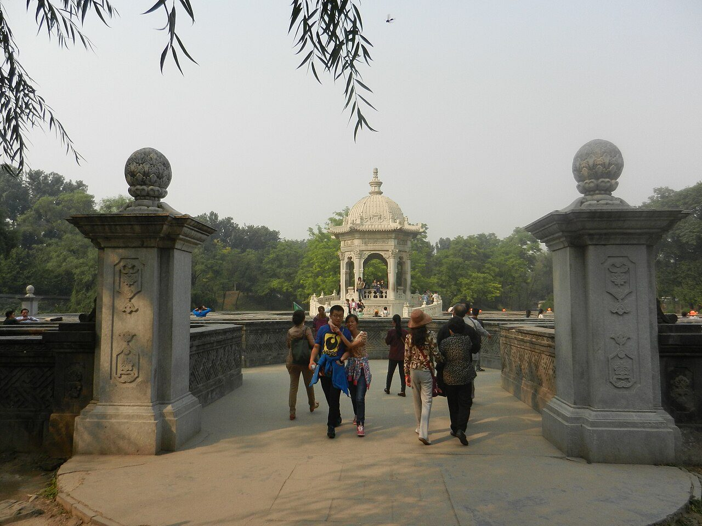
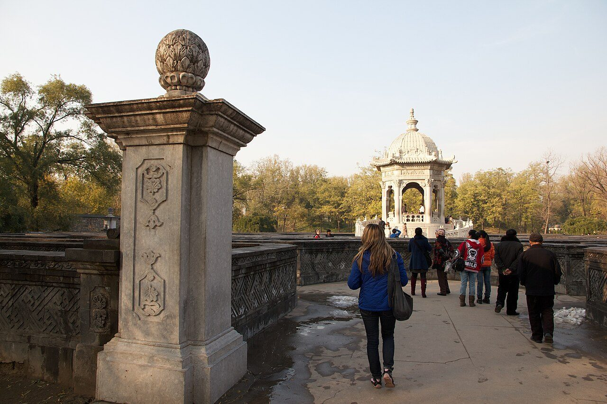

<!-- generated:start (scripts/building_pages.py): do not edit between these markers -->

# XY03: 花园门 Huayuan Men

Hua Yuan Men, Flower Garden Gate · Xiyang Lou

**3D object:** 1 box. Open it: `/reconstruction/3d.html?b=XY03`

## What we know

- **Name:** 花园门 Huayuan Men (S02, S06, S56, S01, S109 · confidence A)
- **English:** Hua Yuan Men, Flower Garden Gate (S02, S06, S56, S01, S109)
- **Garden:** Xiyang Lou (S02, S06, S56, S01, S109)
- **Type:** european (S02, S06, S56, S01, S109 · confidence A)
- **Destroyed:** Looted and burnt 1860; stone ruins stayed, further damage 1900 and after (S02 pp.142,218) (S02, S06, S56, S01, S109)
- **Position:** 40.01205, 116.30231. S850;S01, moved in Round 6: on the ruin, research/xiyanglou/boxes.csv (S01 · confidence B)
- **Bays:** 3x1 on the plan (S02, S06, S56, S01, S109)
- **Size in the inventory:** 7.9 × 4.2 m. stated: S01;S850;S71, research/xiyanglou/boxes.csv (S01)
- **Where the text puts it:** gate to the Maze; 蓄水楼 seen over the wall (S02 pp.143-144) (S02, S06, S56, S01, S109) *(research copy, not public)*
- **Note:** Copper engraving no. 4 per S02. Grey cut brick with pink and cream pattern (S02). Round 6 replaced frontage 8.0 m. Round 6 replaced depth 3.0 m. (S02, S06, S56, S01, S109)
- **Plan reader's note:** Small 3-bay gate on the maze axis, at the south wall of the maze, label 黄花灯 just below. | plan: rect=37,20,0. Engraving 4 shows its north side. (S01) *(research copy, not public)*
- **How it was read:** likely (S01) *(research copy, not public)*
- **Plan pixels:** 8875, 925 (S01) *(research copy, not public)*

## Our model now

Simple massing of a European palace: position and footprint from the ruin, the plan or a survey, heights read from the plates of the 1780s (research/xiyanglou/boxes.csv). Not a detailed model yet; the figures and their methods are in the Dimensions block.

- **Box:** 7.9 × 4.2 m, european
- **Part:** south gate of the maze
- **Heights:** platform 0.3 m, eave 6.7 m, ridge 9 m above the ground
- **Roof:** hip 庑殿, glazed tile
- **Faces:** 173.8° from north
- **Drawn:** by the stone kit: base, pilasters, arched openings, entablature, balustrade and a glazed roof, as the plates of the 1780s show such fronts; the kit's reading, C, not a detailed model
- **Confidence:** C, assumed

## Pictures (7)

- **P0044** (sure): 花园门北面 (圆明园铜版画册 / 西洋楼铜版画, plate 四 of 二十; title and number printed on the plate) (1786 (Commons); Palace Museum: 清). https://commons.wikimedia.org/wiki/File%3A%E5%9C%86%E6%98%8E%E5%9B%AD%E9%93%9C%E7%89%88%E7%94%BB%E5%86%8C-2.jpg

  

- **P0779** (sure): 圓明園東長春園平面圖 (第一圖), plan of the Xiyang Lou strip (drawn by Ohlmer, 1867-1879, per Teng Gu's preface; from Börschmann's collection). https://commons.wikimedia.org/wiki/File:CADAL11102995_%E5%9C%93%E6%98%8E%E5%9C%93%E6%AD%90%E5%BC%8F%E5%AE%AE%E6%AE%BF%E6%AE%98%E8%B7%A1.djvu

  

- **P0184** (sure): 花园门 south side, foreigners sitting by the gate (between 1872 and 1873 (Commons); 1873 (hpchina blog)). https://commons.wikimedia.org/wiki/File%3AForeigners_take_photos_in_front_of_the_garden_gate_in_xiyanglou.jpg

  

- **P0736** (likely): 圆明园西洋楼黄花阵 01 (2013-09-27 14:19:41 (Commons)). https://commons.wikimedia.org/wiki/File:%E5%9C%86%E6%98%8E%E5%9B%AD%E8%A5%BF%E6%B4%8B%E6%A5%BC%E9%BB%84%E8%8A%B1%E9%98%B5_01.JPG

  

- **P0783** (likely): Ball-finial pier north of 花园门 with the 黄花阵 pavilion (2012-11-06 (Commons)). https://commons.wikimedia.org/wiki/File:Beijing_2012_(8208664159).jpg

  

- **P0318** (guess): Sirén: Yuanmingyuan (Old Summer Palace): Ruins. (undated; Sirén 1921-23). http://kulturarvsdata.se/SMVK-OM/Bildarkiv/199640 Research-only: link card.
- **P0319** (guess): Sirén: Yuanmingyuan (Old Summer Palace): Ruins. Enligt text på fotokuvert: Yuanmingyuan. Gamla Sommarpalatset. (undated; Sirén 1921-23). http://kulturarvsdata.se/SMVK-OM/Bildarkiv/199641 Research-only: link card.

## Texts and drawings (5)

- **E0940** (description, sure): Plate IV: 花园门 Huayuan Men. 1786-1803 · p.178, Plate IV · S258. https://archive.org/details/BIUSante_40644
  > Aux pieds des colonnes sont deux cippes sur lesquels posent deux lions accroupis,
  Arch with two columns and entablature, two crouching lions on cippi. Panelled wall carried on a small bridge, river below with two more small bridges.
- **E0941** (description, sure): Engraving 4: 花园门 Huayuan Men. 1934 · pp.143-144 · S02. https://archive.org/details/historyofpekings00malo
  > The wall was of gray brick cut smooth and decorated with a large pattern in pink and a deep cream tint.
  North side of the maze gate, seen from inside; 蓄水楼 visible over the wall. Wall colours as quoted, source of the colours not stated.
- **E0942** (description, sure): 万花阵 and 花园门; 线法山 and 螺蛳牌楼, yaffin 系列02, 13. c. 2011 · captions to the 20 engravings · S356. https://blog.sina.com.cn/s/blog_65fec3ab0100svq5.html
  Lead: the maze gate 花园门 is shaped like a Western clock case with two brass doors; the maze 89 x 59 m, walls about 1.2 m high and over 1,600 m long; the hill 线法山 has a gate each side, the east one called 螺蛳牌楼. Check against the engravings.
- **E2404** (description, sure): Slips in holder transcriptions of printed titles. TEI line for Plate_19; V&A O398694 · S700;S74. 
  The plates print 蓄水樓, read in four holders: V&A types 畜水樓 and glosses Chushuilou. Plate 19: Rylands TEI types 線法山門正面十九 with the pinyin Dongmen; V&A types 線法山東門十九, which is what the plate title is by every other holder. NYPL names Castiglione as artist, nobody else does. None changes a tie.
- **E2440** (plan, sure): Teng Gu's preface on the photographs and plan. 1932-07 (preface), 1933 (book) · pp.3-5 of the preface, djvu pages 5-7 · S871. https://commons.wikimedia.org/wiki/File:CADAL11102995_%E5%9C%93%E6%98%8E%E5%9C%93%E6%AD%90%E5%BC%8F%E5%AE%AE%E6%AE%BF%E6%AE%98%E8%B7%A1.djvu
  Teng Gu says the photographs and the plan belonged to Ernst Boerschmann and were taken and drawn by Ohlmer, a customs official in Tianjin who lived in Beijing 1867-1879 and whose collection went to the Hildesheim museum. He argues they are earlier than those in Favier's Péking (1897), Combaz 1909, Perzynski 1920 and Münsterberg 1912, naming pages he compared. Fig. 13 is a recent photograph by Zhou Zuanwu; fig. 15 is copied from Favier p.264.

**On the plan:** Its place is drawn on the plan of the gardens (S01), with no name written. https://artmuseum.princeton.edu/collections/objects/138657

## Reconstructions by others (1)

Modern interpretation, not evidence.
- **R0314** (drawing, sure): Gartenplan der Xiyang Lou (西洋楼) in Peking. Maximilian Dörrbecker (Chumwa). https://commons.wikimedia.org/wiki/File:Gartenplan_der_Xiyang_Lou.png

## Evidence for the set of buildings

- Reconstructions and comparables for the whole garden, 西洋楼 Xiyang Lou: see GARDEN-XY

## Open questions

- Q68: 花园门 (Round 6)

<!-- generated:end -->

## Notes

<!-- Yours: regeneration never touches this part. It goes on the public site; what you write below a line holding only %% private %% stays in the research copy. -->
