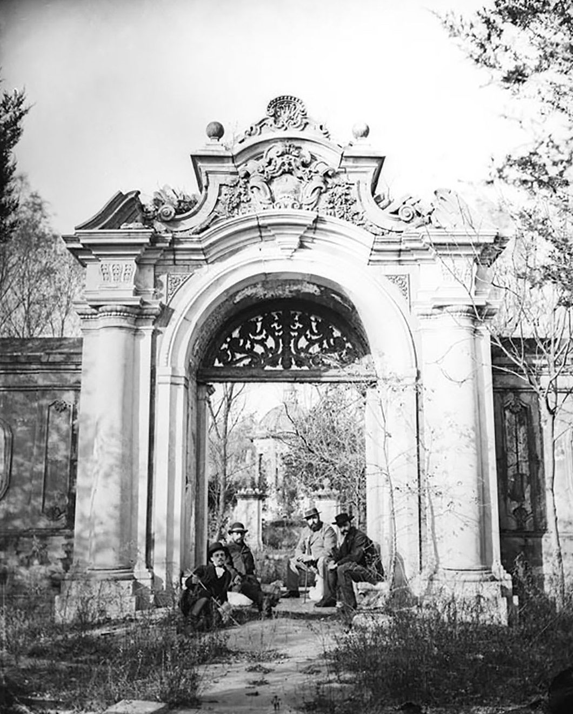

<!-- generated:start (scripts/building_pages.py): do not edit between these markers -->

# XY03: 花园门 Huayuan Men

Hua Yuan Men, Flower Garden Gate · Xiyang Lou

**3D object:** 1 box. Open it: `/reconstruction/3d.html?b=XY03`

## What we know

- **Name:** 花园门 Huayuan Men (S02, S06, S56, S01, S109 · confidence A)
- **English:** Hua Yuan Men, Flower Garden Gate (S02, S06, S56, S01, S109)
- **Garden:** Xiyang Lou (S02, S06, S56, S01, S109)
- **Type:** european (S02, S06, S56, S01, S109 · confidence A)
- **Destroyed:** Looted and burnt 1860; stone ruins stayed, further damage 1900 and after (S02 pp.142,218) (S02, S06, S56, S01, S109)
- **Position:** 40.01216, 116.30245. S01 likely (S01 · confidence B)
- **Bays:** 3x1 on the plan (S02, S06, S56, S01, S109)
- **Size in the inventory:** 8.0 × 3.0 m. typology xiyang_lou, C (S01)
- **Where the text puts it:** gate to the Maze; 蓄水楼 seen over the wall (S02 pp.143-144) (S02, S06, S56, S01, S109) *(research copy, not public)*
- **Note:** Copper engraving no. 4 per S02. Grey cut brick with pink and cream pattern (S02). (S02, S06, S56, S01, S109)
- **Plan reader's note:** Small 3-bay gate on the maze axis, at the south wall of the maze, label 黄花灯 just below. | plan: rect=37,20,0. Engraving 4 shows its north side. (S01) *(research copy, not public)*
- **How it was read:** likely (S01) *(research copy, not public)*
- **Plan pixels:** 8875, 925 (S01) *(research copy, not public)*

## Our model now

Simple massing of a European palace, assumed: sizes from the texts and the ruin polygons, position from the plan or the ruin. Not a reading of the 1786 engravings yet.

- **Box:** 8 × 3 m, european
- **Part:** south gate of the maze
- **Heights:** platform 0.3 m, eave 4.5 m, ridge 6 m above the ground
- **Roof:** hip 庑殿, glazed tile
- **Faces:** 174.8° from north
- **Confidence:** C, assumed

## Pictures (4)

- **P0044** (sure): 花园门北面 (圆明园铜版画册 / 西洋楼铜版画, plate 四 of 二十; title and number printed on the plate) (1786 (Commons); Palace Museum: 清). https://commons.wikimedia.org/wiki/File%3A%E5%9C%86%E6%98%8E%E5%9B%AD%E9%93%9C%E7%89%88%E7%94%BB%E5%86%8C-2.jpg

  

- **P0184** (sure): 花园门 south side, foreigners sitting by the gate (between 1872 and 1873 (Commons); 1873 (hpchina blog)). https://commons.wikimedia.org/wiki/File%3AForeigners_take_photos_in_front_of_the_garden_gate_in_xiyanglou.jpg

  

- **P0318** (guess): Sirén: Yuanmingyuan (Old Summer Palace): Ruins. (undated; Sirén 1921-23). http://kulturarvsdata.se/SMVK-OM/Bildarkiv/199640 Research-only: link card.
- **P0319** (guess): Sirén: Yuanmingyuan (Old Summer Palace): Ruins. Enligt text på fotokuvert: Yuanmingyuan. Gamla Sommarpalatset. (undated; Sirén 1921-23). http://kulturarvsdata.se/SMVK-OM/Bildarkiv/199641 Research-only: link card.

## Texts and drawings (3)

- **E0940** (description, sure): Plate IV: 花园门 Huayuan Men. 1786-1803 · p.178, Plate IV · S258. https://archive.org/details/BIUSante_40644
  > Aux pieds des colonnes sont deux cippes sur lesquels posent deux lions accroupis,
  Arch with two columns and entablature, two crouching lions on cippi. Panelled wall carried on a small bridge, river below with two more small bridges.
- **E0941** (description, sure): Engraving 4: 花园门 Huayuan Men. 1934 · pp.143-144 · S02. https://archive.org/details/historyofpekings00malo
  > The wall was of gray brick cut smooth and decorated with a large pattern in pink and a deep cream tint.
  North side of the maze gate, seen from inside; 蓄水楼 visible over the wall. Wall colours as quoted, source of the colours not stated.
- **E0942** (description, sure): 万花阵 and 花园门; 线法山 and 螺蛳牌楼, yaffin 系列02, 13. c. 2011 · captions to the 20 engravings · S356. https://blog.sina.com.cn/s/blog_65fec3ab0100svq5.html
  Lead: the maze gate 花园门 is shaped like a Western clock case with two brass doors; the maze 89 x 59 m, walls about 1.2 m high and over 1,600 m long; the hill 线法山 has a gate each side, the east one called 螺蛳牌楼. Check against the engravings.

**On the plan:** Its place is drawn on the plan of the gardens (S01), with no name written. https://artmuseum.princeton.edu/collections/objects/138657

## Reconstructions by others (1)

Modern interpretation, not evidence.
- **R0314** (drawing, sure): Gartenplan der Xiyang Lou (西洋楼) in Peking. Maximilian Dörrbecker (Chumwa). https://commons.wikimedia.org/wiki/File:Gartenplan_der_Xiyang_Lou.png

## Evidence for the set of buildings

- Reconstructions and comparables for the whole garden, 西洋楼 Xiyang Lou: see GARDEN-XY

## Open questions

None that name it.

<!-- generated:end -->

## Notes

<!-- Yours: regeneration never touches this part. It goes on the public site; what you write below a line holding only %% private %% stays in the research copy. -->
