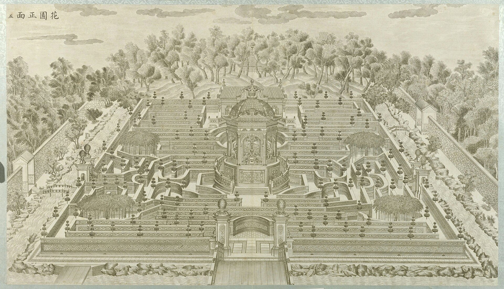
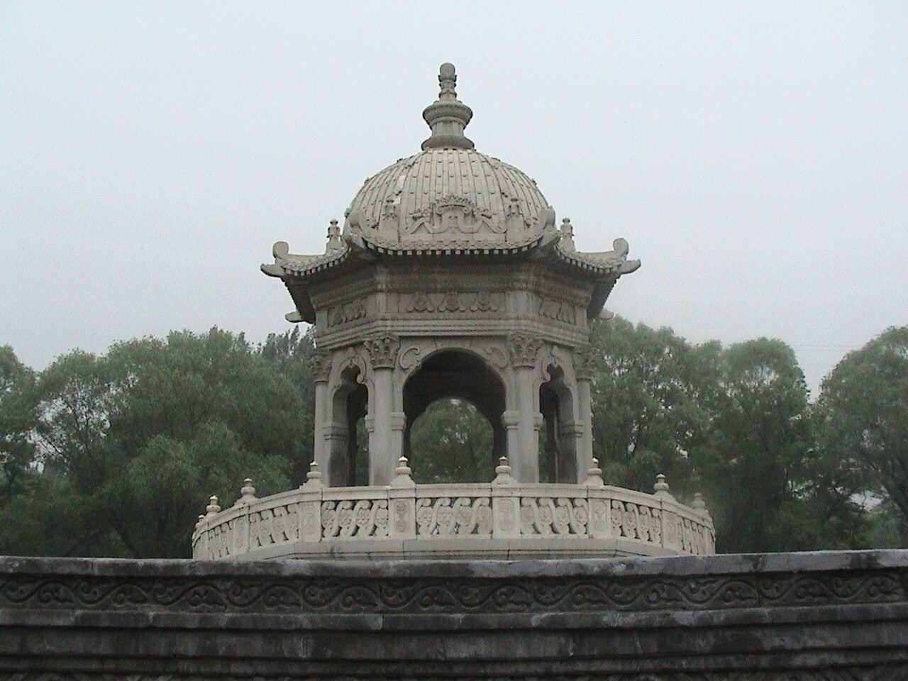
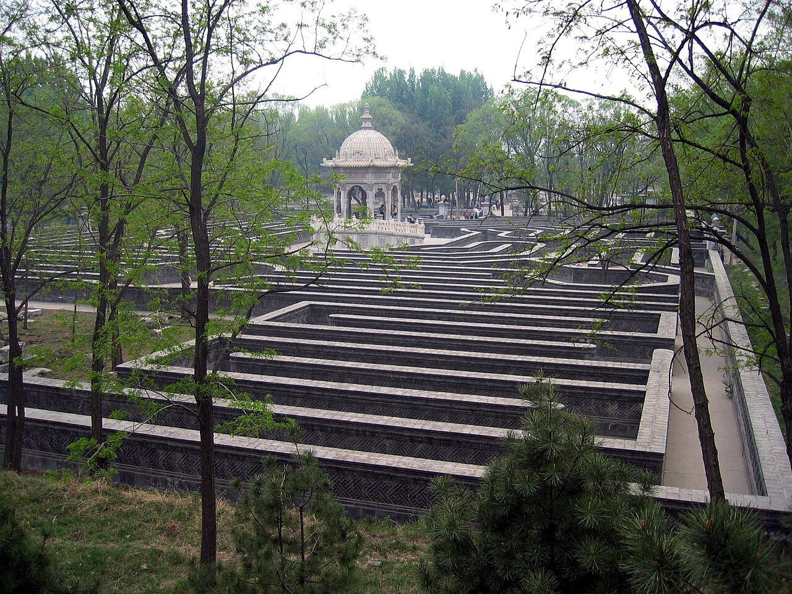
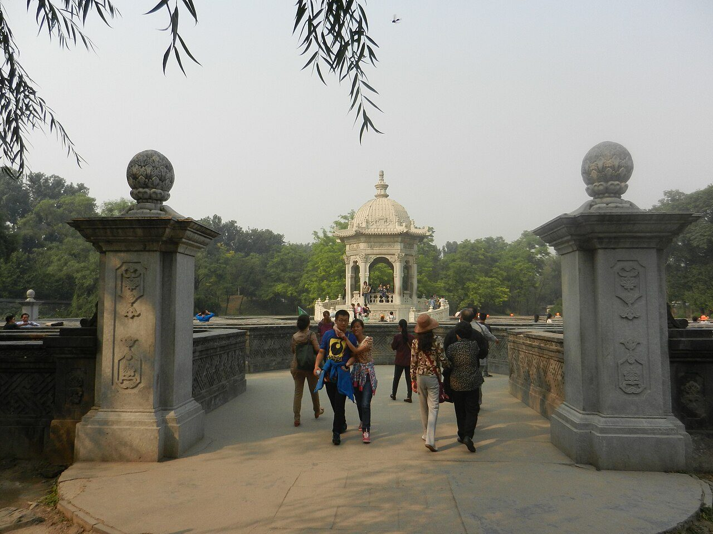
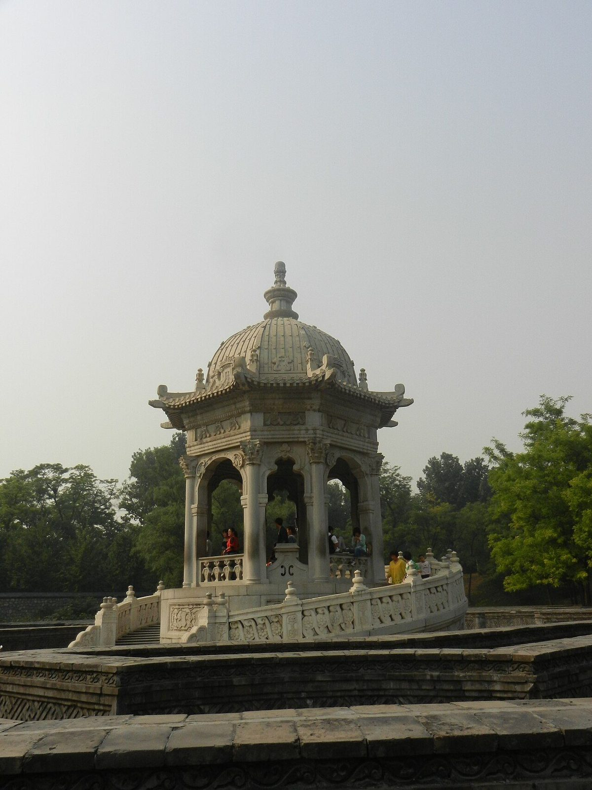
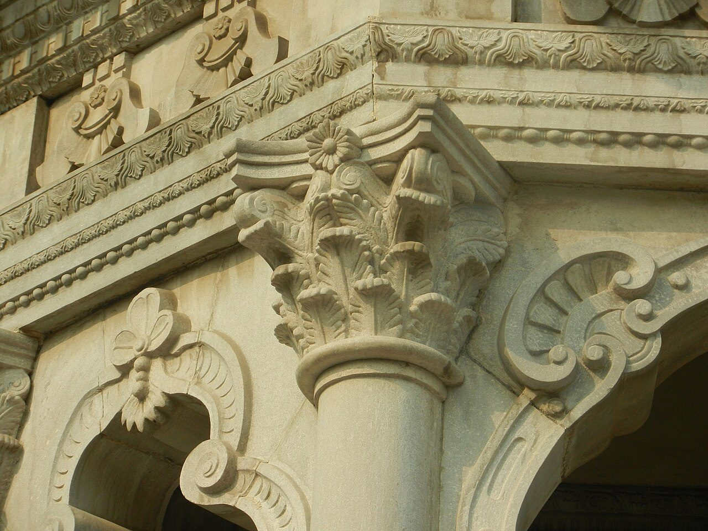
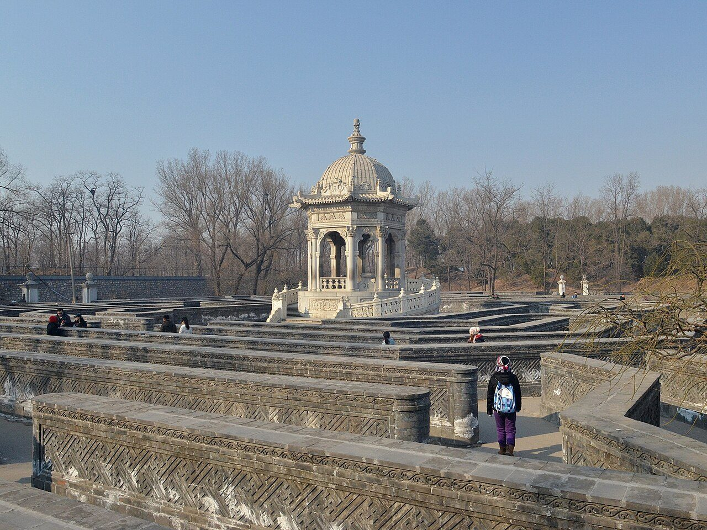
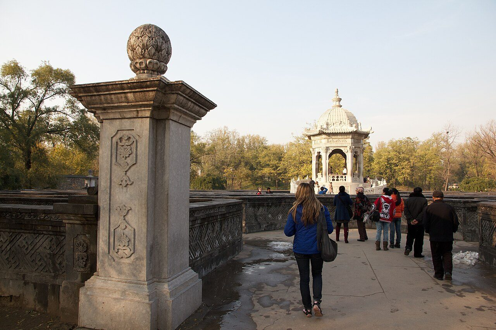

<!-- generated:start (scripts/building_pages.py): do not edit between these markers -->

# XY04-01: 中央亭 Zhongyang ting

Xiyang Lou

**3D object:** 2 boxes. Open it: `/reconstruction/3d.html?b=XY04-01`

**Part of:** XY04 黄花阵

## What we know

- **Name:** 中央亭 Zhongyang ting (S02, S06, S01 · confidence B)
- **Garden:** Xiyang Lou (S02, S06, S01)
- **Type:** pavilion (S02, S06, S01 · confidence B)
- **Destroyed:** 1860 (S02, S06, S01)
- **Position:** 40.01235, 116.30227. S850;S01, moved in Round 6: on the ruin, research/xiyanglou/boxes.csv (S01 · confidence B)
- **Size in the inventory:** 7.7 × 7.7 m. stated: S71;S109, research/xiyanglou/boxes.csv (S01)
- **Where the text puts it:** center ... octagonal pavilion (S02 p.145) (S02, S06, S01) *(research copy, not public)*
- **Note:** Old caretaker Lu: mechanical birds (hearsay). 2-storey building at the back (S02). Round 6 replaced frontage 8.6 m. Round 6 replaced depth 10.9 m. (S02, S06, S01)
- **Plan reader's note:** rect=36,36,0. Octagon inside a ring base of outer diameter ~100, with stair south at (8877,745). Malone: octagonal pavilion. (S01) *(research copy, not public)*
- **How it was read:** likely (S01) *(research copy, not public)*
- **Plan pixels:** 8880, 688 (S01) *(research copy, not public)*

## Our model now

Modelled from plate 5 of 1783-86 and the plan S01: the walls follow S01's lines, set into the block whose size the archive figures give (58.56 × 88.64 m, S310) at the place of today's rebuilt maze; heights and forms read on plate 5 (C). No picture of the maze before 1987 shows it from the ground; the Yangshi Lei plan 样337-146 is not in hand.

- **Maze walls:** 171 runs of carved grey brick, 1233 m, 1.2 × 0.6 m (S310, B): the pattern traced on the plan S01 (plan_readings.csv) and set into the block of 58.56 × 88.64 m (S310, today's rebuild; Q292); a framed band of raised keys for the 卐字 carving, clipped trees of three tiers on the copings (plate 5, C)
- **Outer wall and gates:** 276 m, 1.5 m high (C), open at the south gate (花园门 XY03, the kit's), at a west and an east gate with pineapple-finial piers and iron leaves, and at the north behind the hall (S01; plate 5, C)
- **Drum and flights:** a round drum 12 m across, its top 3.8 m up, with carved panels; a straight flight to a landing, then two curved flights of 20 steps climbing round the drum behind a carved parapet with a balustrade to meet at its back (plate 5; S01's ring 17.2 m and flight, C)
- **Pavilion:** an octagon 6.4 m across, four arched large faces and four small ones with windows (S258, B), corner columns 5.2 m, a tiled skirt, a ribbed dome, an open lantern and a gilt ball 16.7 m above the ground (plate 5, C); a vase inside (assumed)
- **North hall:** 14.9 × 10.1 m (S01 on the block), two storeys (S02, B) to 7 m, a hipped Chinese roof with finials (plate 5, C), its terrace and flight; the walls carried from the group (assumed)
- **Trees and basin:** four weeping pagoda trees in round curbs at the inner corners (S310, B; places from S01, C); a half-round basin before the hall (S01, C)
- **Assumed:** the paving of the paths, the hall's façades, the pavilion's back faces and the vase inside it, the basin: carried round or guessed (C, the pale tint with conf=1)

## Pictures (8)

- **P0045** (sure): 花园正面 (圆明园铜版画册 / 西洋楼铜版画, plate 五 of 二十; title and number printed on the plate) (1786 (Commons); Palace Museum: 清). https://commons.wikimedia.org/wiki/File%3A%E5%9C%86%E6%98%8E%E5%9B%AD%E9%93%9C%E7%89%88%E7%94%BB%E5%86%8C-3.jpg

  

- **P0733** (sure): 20020511082234 - 萬花陣 ( (Commons)). https://commons.wikimedia.org/wiki/File:20020511082234_-_%E8%90%AC%E8%8A%B1%E9%99%A3.jpg

  

- **P0734** (sure): Huanghuazhen (2005-04-23 (Commons)). https://commons.wikimedia.org/wiki/File:Huanghuazhen.jpg

  

- **P0736** (sure): 圆明园西洋楼黄花阵 01 (2013-09-27 14:19:41 (Commons)). https://commons.wikimedia.org/wiki/File:%E5%9C%86%E6%98%8E%E5%9B%AD%E8%A5%BF%E6%B4%8B%E6%A5%BC%E9%BB%84%E8%8A%B1%E9%98%B5_01.JPG

  

- **P0737** (sure): 圆明园西洋楼黄花阵 02 (2013-09-27 14:23:01 (Commons)). https://commons.wikimedia.org/wiki/File:%E5%9C%86%E6%98%8E%E5%9B%AD%E8%A5%BF%E6%B4%8B%E6%A5%BC%E9%BB%84%E8%8A%B1%E9%98%B5_02.JPG

  

- **P0738** (sure): 圆明园西洋楼黄花阵 04 (2013-09-27 14:23:36 (Commons)). https://commons.wikimedia.org/wiki/File:%E5%9C%86%E6%98%8E%E5%9B%AD%E8%A5%BF%E6%B4%8B%E6%A5%BC%E9%BB%84%E8%8A%B1%E9%98%B5_04.JPG

  

- **P0739** (sure): Xiyanglou Labyrinth 20130126 (2013-01-26 14:05:48 (Commons)). https://commons.wikimedia.org/wiki/File:Xiyanglou_Labyrinth_20130126.JPG

  

- **P0783** (sure): Ball-finial pier north of 花园门 with the 黄花阵 pavilion (2012-11-06 (Commons)). https://commons.wikimedia.org/wiki/File:Beijing_2012_(8208664159).jpg

  

## Texts and drawings (2)

- **E0943** (description, sure): Plate V: 黄花阵 Huanghua Zhen, the maze. 1786-1803 · pp.178-179, Plate V · S258. https://archive.org/details/BIUSante_40644
  > A-peu-près au centre du labyrinthe s'élève un édifice octogone établi sur un soubassement circulaire.
  Square, in a wood, inside a wall and then a river with rocks and flowers; small wooden bridges and gates. Octagon with arches on its large faces, windows on the small ones, cul-de-four dome with a small lantern, circular stair round the base. Apparently a throne inside. Small casino at the east entry.
- **E0944** (description, sure): Engraving 5: 黄花阵 Huanghua Zhen, the maze. 1934 · p.145 · S02. https://archive.org/details/historyofpekings00malo
  > This was a maze or labyrinth with carved brick walls about shoulder high, surmounted by little slender conventional pines.
  A two-storey building at the back overlooks it. Round stairs in the centre to an octagonal pavilion where, says the old caretaker Lu, mechanical singing birds were kept (hearsay).

**On the plan:** Drawn on the plan of the gardens (S01) with no label: a building stood here, its name unknown. https://artmuseum.princeton.edu/collections/objects/138657

## Evidence for the set of buildings

- Evidence for the whole compound 黄花阵: see XY04
- Reconstructions and comparables for the whole garden, 西洋楼 Xiyang Lou: see GARDEN-XY
- Standing buildings comparable to a square pavilion (not this building): see CLASS-pavilion_square

## Open questions

None that name it.

<!-- generated:end -->

## Notes

<!-- Yours: regeneration never touches this part. It goes on the public site; what you write below a line holding only %% private %% stays in the research copy. -->
