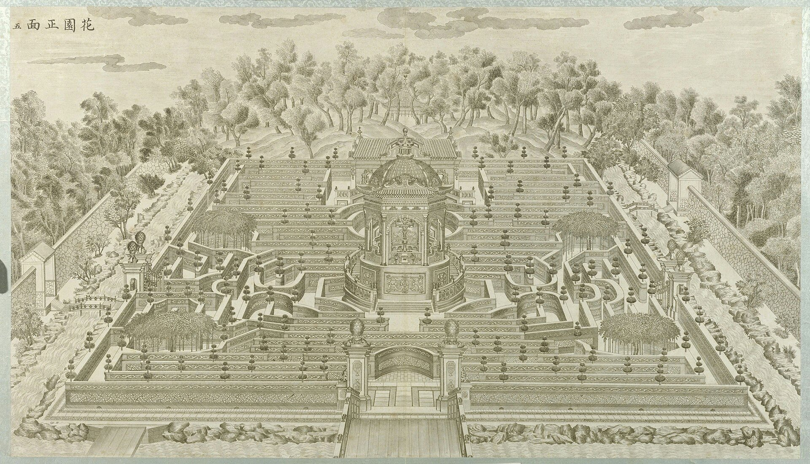

<!-- generated:start (scripts/building_pages.py): do not edit between these markers -->

# XY04-N01: Hall without a name on the plan

two-storey hall at the back of the maze · Xiyang Lou

**3D object:** 1 box. Open it: `/reconstruction/3d.html?b=XY04-N01`

**Part of:** XY04 黄花阵

## What we know

- **English:** two-storey hall at the back of the maze (S01, S02)
- **Garden:** Xiyang Lou (S01, S02)
- **Type:** other (S01, S02 · confidence B)
- **Destroyed:** 1860 (S01, S02)
- **Position:** 40.01278, 116.30216. S850;S01, moved in Round 6: on the ruin, research/xiyanglou/boxes.csv (S01 · confidence B)
- **Bays:** 5 in the texts / 6x3 on the plan (S01, S02)
- **Size in the inventory:** 18.7 × 11.4 m. stated: S01;S850;S02, research/xiyanglou/boxes.csv (S01)
- **Note:** Round 6 replaced frontage 21.3 m. Round 6 replaced depth 23.9 m. (S01, S02)
- **Plan reader's note:** Malone: two-story building at the back overlooked the maze. B0047 is its south porch or stair. (S01) *(research copy, not public)*
- **How it was read:** likely (S01) *(research copy, not public)*
- **Plan pixels:** 8882, 472 (S01) *(research copy, not public)*

## Our model now

Simple massing of a European palace: position and footprint from the ruin, the plan or a survey, heights read from the plates of the 1780s (research/xiyanglou/boxes.csv). Not a detailed model yet; the figures and their methods are in the Dimensions block.

- **Box:** 18.7 × 11.4 m, european
- **Part:** two-storey hall at the back of the maze
- **Heights:** platform 0.5 m, eave 6.5 m, ridge 9 m above the ground
- **Roof:** hip 庑殿, glazed tile
- **Faces:** 173.8° from north
- **Drawn:** by the stone kit: base, pilasters, arched openings, entablature, balustrade and a glazed roof, as the plates of the 1780s show such fronts; the kit's reading, C, not a detailed model
- **Confidence:** C, assumed

## Pictures (1)

- **P0045** (guess): 花园正面 (圆明园铜版画册 / 西洋楼铜版画, plate 五 of 二十; title and number printed on the plate) (1786 (Commons); Palace Museum: 清). https://commons.wikimedia.org/wiki/File%3A%E5%9C%86%E6%98%8E%E5%9B%AD%E9%93%9C%E7%89%88%E7%94%BB%E5%86%8C-3.jpg

  

## Texts and drawings (0)

None of its own.

**On the plan:** Drawn on the plan of the gardens (S01) with no label, 6x3 cells: a building stood here, its name unknown. https://artmuseum.princeton.edu/collections/objects/138657

## Evidence for the set of buildings

- Evidence for the whole compound 黄花阵: see XY04
- Reconstructions and comparables for the whole garden, 西洋楼 Xiyang Lou: see GARDEN-XY
- Standing buildings comparable to a main hall (not this building): see CLASS-main_hall

**Searched and not found:** This block has no name on the plan or in the texts, so no source can be searched for it by name.

## Open questions

None that name it.

<!-- generated:end -->

## Notes

<!-- Yours: regeneration never touches this part. It goes on the public site; what you write below a line holding only %% private %% stays in the research copy. -->
