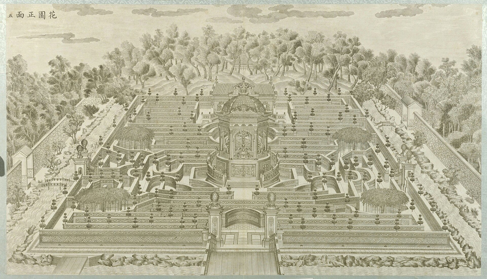
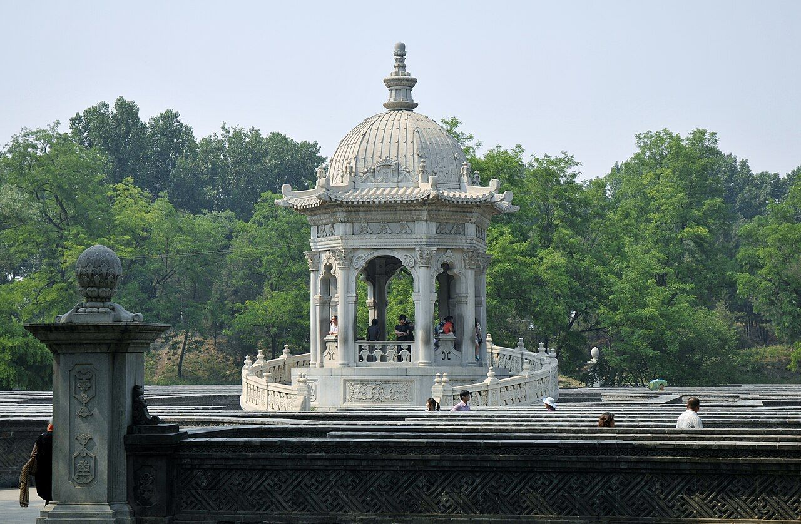
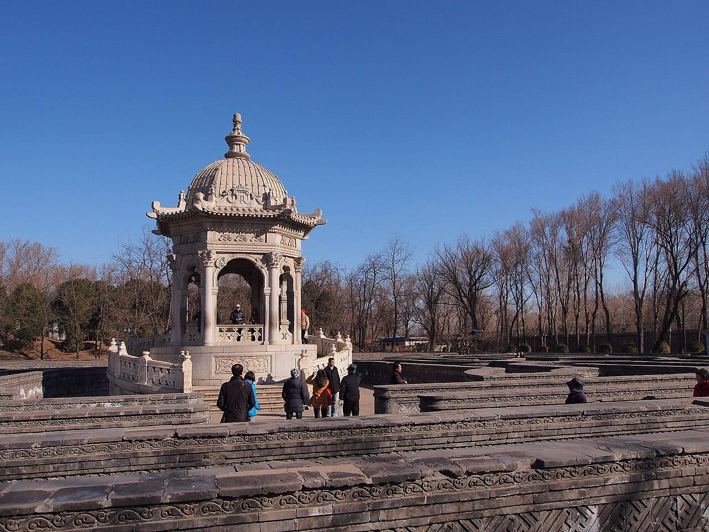
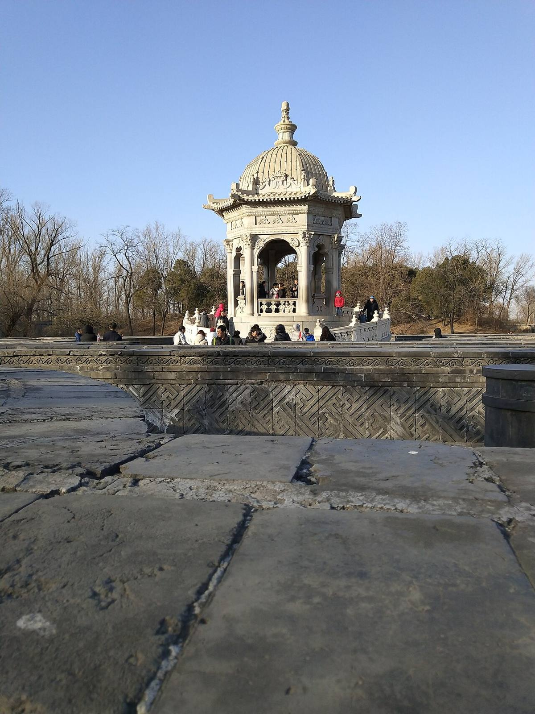
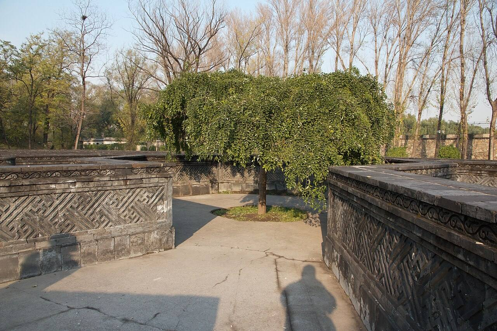

<!-- generated:start (scripts/building_pages.py): do not edit between these markers -->

# XY04: 黄花阵 Huanghua Zhen

Hua Yuan, Flower Garden, a maze · Xiyang Lou

**3D object:** 12 boxes. Open it: `/reconstruction/3d.html?b=XY04`

## What we know

- **Name:** 黄花阵 Huanghua Zhen (S02, S06, S42, S01 · confidence A)
- **English:** Hua Yuan, Flower Garden, a maze (S02, S06, S42, S01)
- **Written on the plan:** 黄花灯 (S01 · confidence A)
- **Garden:** Xiyang Lou (S02, S06, S42, S01)
- **Type:** european (S02, S06, S42, S01 · confidence A)
- **Destroyed:** Looted and burnt 1860; stone ruins stayed, further damage 1900 and after (S02 pp.142,218) (S02, S06, S42, S01)
- **Position:** 40.01260, 116.30240. S01 sure (S01 · confidence B)
- **Size in the inventory:** 89 × 59 m.  (S01)
- **Where the text puts it:** 广场之北为黄花阵 (S06) (S02, S06, S42, S01) *(research copy, not public)*
- **Note:** Copper engraving no. 5 per S02. Engraving calls it 花园. Also 万花阵 (S06; S42). S06 89 x 59 m; walls 1.2 m high. S06 wall length 16 km looks wrong, check on plan. Rebuilt in modern times (S06). (S02, S06, S42, S01)
- **Plan reader's note:** Label reads 黄花燈 (黄花灯), the common old name of the maze 黄花阵; written south of the gate at (8879,993). Walled maze drawn with hedge lines. (S01) *(research copy, not public)*
- **How it was read:** sure (S01) *(research copy, not public)*
- **Plan pixels:** 8880, 688 (S01) *(research copy, not public)*

## Our model now

Simple massing of a European palace, assumed: sizes from the texts and the ruin polygons, position from the plan or the ruin. Not a reading of the 1786 engravings yet.

- **2 ×:** maze wall, 1.2 x 0.6 m (S109); the plan of the maze is not traced: outer wall and two rings stand for it: 73 × 0.6 m, eave 1.2 m, ridge 1.2 m
- **2 ×:** maze wall, 1.2 x 0.6 m (S109); the plan of the maze is not traced: outer wall and two rings stand for it: 99 × 0.6 m, eave 1.2 m, ridge 1.2 m
- **2 ×:** maze wall, 1.2 x 0.6 m (S109); the plan of the maze is not traced: outer wall and two rings stand for it: 51 × 0.6 m, eave 1.2 m, ridge 1.2 m
- **2 ×:** maze wall, 1.2 x 0.6 m (S109); the plan of the maze is not traced: outer wall and two rings stand for it: 77 × 0.6 m, eave 1.2 m, ridge 1.2 m
- **2 ×:** maze wall, 1.2 x 0.6 m (S109); the plan of the maze is not traced: outer wall and two rings stand for it: 29 × 0.6 m, eave 1.2 m, ridge 1.2 m
- **2 ×:** maze wall, 1.2 x 0.6 m (S109); the plan of the maze is not traced: outer wall and two rings stand for it: 55 × 0.6 m, eave 1.2 m, ridge 1.2 m
- **Confidence:** C, all assumed

## Inside it (2)

- XY04-01 中央亭
- XY04-N01

## Pictures (5)

- **P0045** (sure): 花园正面 (圆明园铜版画册 / 西洋楼铜版画, plate 五 of 二十; title and number printed on the plate) (1786 (Commons); Palace Museum: 清). https://commons.wikimedia.org/wiki/File%3A%E5%9C%86%E6%98%8E%E5%9B%AD%E9%93%9C%E7%89%88%E7%94%BB%E5%86%8C-3.jpg

  

- **P0350** (sure): 迷宫中心的八角石亭 - panoramio.jpg (Taken on 27 May 2011 (Commons DateTimeOriginal)). https://commons.wikimedia.org/wiki/File:%E8%BF%B7%E5%AE%AB%E4%B8%AD%E5%BF%83%E7%9A%84%E5%85%AB%E8%A7%92%E7%9F%B3%E4%BA%AD_-_panoramio.jpg

  

- **P0351** (sure): 黄花阵 - Huanghuazhen Labyrinth - 2013.03 - panoramio.jpg (Taken on 13 March 2013 (Commons DateTimeOriginal)). https://commons.wikimedia.org/wiki/File:%E9%BB%84%E8%8A%B1%E9%98%B5_-_Huanghuazhen_Labyrinth_-_2013.03_-_panoramio.jpg

  

- **P0506** (sure): Wanhuazhen.jpg (2018-12-16 14:58:32 (Commons DateTimeOriginal)). https://commons.wikimedia.org/wiki/File:Wanhuazhen.jpg

  

- **P0507** (likely): Beijing 2012 (8208665925).jpg (2012-11-06 14:57 (Commons DateTimeOriginal)). https://commons.wikimedia.org/wiki/File:Beijing_2012_(8208665925).jpg

  

## Texts and drawings (9)

- **E0943** (description, sure): Plate V: 黄花阵 Huanghua Zhen, the maze. 1786-1803 · pp.178-179, Plate V · S258. https://archive.org/details/BIUSante_40644
  > A-peu-près au centre du labyrinthe s'élève un édifice octogone établi sur un soubassement circulaire.
  Square, in a wood, inside a wall and then a river with rocks and flowers; small wooden bridges and gates. Octagon with arches on its large faces, windows on the small ones, cul-de-four dome with a small lantern, circular stair round the base. Apparently a throne inside. Small casino at the east entry.
- **E0944** (description, sure): Engraving 5: 黄花阵 Huanghua Zhen, the maze. 1934 · p.145 · S02. https://archive.org/details/historyofpekings00malo
  > This was a maze or labyrinth with carved brick walls about shoulder high, surmounted by little slender conventional pines.
  A two-storey building at the back overlooks it. Round stairs in the centre to an octagonal pavilion where, says the old caretaker Lu, mechanical singing birds were kept (hearsay).
- **E1524** (description, guess): 玉明 侍游御園記 (in 蕉軒隨錄). 1856 (咸豐六年七月二十一日) · 蕉軒隨錄, 御園侍游 (line 336 of the corpus file) · S210. https://github.com/garychowcmu/daizhigev20/blob/master/史藏/志存记录/蕉轩随录.txt
  > ◎御园侍游玉将军（明）有《侍游御园记》，成竹坪同年（林）曾属予代作跋语，恭书于后。按，《记》云：“咸丰六年秋七月二十一日，奉旨：本日散朝后，著玉明、肃顺自备鞍马，午初一刻进西南门，在山高水长伺候。有顷，上从内乘船，至山高水长后阁扇下船，出前门，谕玉明、肃顺暨珠勒亨、西拉布、托云、德勒格尔、伊勒东阿等脱去外褂。上乘马，命七臣随行。自山高水长游藻园，至厂地，过汇芳书院，复由紫碧山房至鱼跃鸢飞少坐。过蕊珠宫门，至黄花磴进茶毕，往西洋楼海宴堂，至转马台，过小角门，至狮子林清淑斋赏饭。左右四卓，命七臣坐，并奉温谕可饱食，非外边筵宴比也。上命膳房先给七臣面各一器，上进面，复进饭，颁赏御用菜蔬，七臣叩头谢。上进粥，复赏粥毕。随驾起行，由宝相寺、法慧寺、谐奇趣过明春门，至雷峰夕照马头，坐如在天上船，游福海。上命笔砚作诗毕，至渊氵亭镜澈马头下船。进丽春门骑马，由旧园东墙根过敷春堂，游西大堤汉城关，至含辉楼下马，命七臣散归。玉明自道光十一年由侍卫擢厕御前二十余年，仰邀优渥，得遍瞻御园盛景。欣感之余，谨作记以纪荣遇。”
  A rare first-hand record of a day in the garden four years before its destruction. The emperor takes seven officials by a named route from 山高水長 through 藻園, 彚芳書院, 紫碧山房 and 魚躍鳶飛, past 蕊珠宫門, on to 海宴堂 in the 西洋樓, a meal at 清淑齋 in 獅子林, 寳相寺, 法慧寺, 諧奇趣, by boat on 福海, then 敷春堂 and 含暉楼. All were standing then.
- **E0942** (description, sure): 万花阵 and 花园门; 线法山 and 螺蛳牌楼, yaffin 系列02, 13. c. 2011 · captions to the 20 engravings · S356. https://blog.sina.com.cn/s/blog_65fec3ab0100svq5.html
  Lead: the maze gate 花园门 is shaped like a Western clock case with two brass doors; the maze 89 x 59 m, walls about 1.2 m high and over 1,600 m long; the hill 线法山 has a gate each side, the east one called 螺蛳牌楼. Check against the engravings.
- **E0507** (description, sure): 圆明园五朝御制诗文集注 v4, editors' note on 西洋楼. 2020 edition · v4 p.120 · S361. https://www.yuanmingyuanpark.cn/xs/yjbg/202008/P020200803382796786124.pdf#page=123
  The editors walk the strip from west to east with completion dates and plaques: 谐奇趣 1751, 养雀笼 1759, then the fountains and the perspective walls, with their mechanical details. They put the whole at about 2% of the gardens.
- **E2137** (description, likely, search index only): 圆明园水利文物遗迹研究. n.d. · mhymy xsjl 6277, search-index text · S349. https://www.mhymy.com/xsjl/6277.html
  Inventory of water works: the 藻园 one-arch inlet, main source, now buried under the wall and undug; 黄花阵 inlet with good piers; 鉴碧亭 sluice, abandoned 2007; 狮子林 七孔闸, chief outlet, buried in the 2000s behind a new weir with only a stub showing; west water tower fed from a three-arch inlet.
- **E0544** (drawing, sure, search index only): 西洋楼水法图. 国家图书馆善本部 none shown · S310. https://www.mhymy.com/dasl/ysltd/7643.html
  Plan of the Xiyang Lou waterworks across its dozen sites; the record shows no shelf number. No image here; the site may ask a small payment for the full record.
- **E0945** (drawing, sure, search index only): 黄花阵平面图. 国家图书馆善本部 样337-146号 · S310. https://www.mhymy.com/dasl/ysltd/7939.html
  Plan of the Huanghua Zhen maze; date not seen in the extract. No image here; the site may ask a small payment for the full record.
- **E0554** (archaeology, sure): 西洋楼区域考古勘探报告. n.d. · mhymy 档案史料 12205, free part · S149. https://www.mhymy.com/dasl/12205.html
  Report's opening: the strip runs 860 m east-west, up to 300 m wide in the west and 65 m at its narrowest, about 70,000 m2, built 1747-1783. A central axis divides it into about five sections, each with its own north-south axis, thirteen units from 谐奇趣 to 线法墙. Survey results are paywalled.

**On the plan:** Drawn on the plan of the gardens (S01), labelled 黄花灯. https://artmuseum.princeton.edu/collections/objects/138657

## Reconstructions by others (4)

Modern interpretation, not evidence.
- **R0096** (render, likely): 万花阵 (= 黄花阵), image 769 in a gallery. posted 2019. https://www.thepaper.cn/newsDetail_forward_3323921 Research-only: link card.
- **R0139** (drawing, sure): Fig. 4, Plan d'ensemble (plan de restitution 1985). Antoine Durand, Mission Palais d'Ete, under Michele Pirazzoli-t'Serstevens, 1985 (published 1988). https://www.persee.fr/doc/arasi_0004-3958_1988_num_43_1_1240 Research-only: link card.
- **R0186** (paper figure, sure): 【圆明园】系列02 圆明园复原图欣赏. yaffin (blog name), 新浪博客, c. 2011. https://blog.sina.com.cn/s/blog_65fec3ab0100siah.html Research-only: link card.
- **R0181** (paper figure, sure, search index only): Significacion semiotica del diseno del jardin el Laberinto, paradigma del Yuanming Yuan. Manuel V. Castilla, Estudios de Asia y Africa, 2018. https://doi.org/10.24201/eaa.v53i2.2404 Research-only: link card.

## Surviving comparable buildings, not this building (3)

- **T077** 凡尔赛迷宫 Labyrinthe de Versailles, Versailles, France. Comparable: same court, era or type, confidence B, standing: no. Plan idea only Basis: S414; S415 p.83 lists Lancaster's claim. S415 pp.98-99 (Droguet p.24): masonry walls here are a novelty with only distant forebears, e.g. the Cretan labyrinth printed by Fischer von Erlach. https://www.ghamu.org/wp-content/uploads/2022/09/Rabreau-YMY-2022.pdf
- **T078** 汉普顿宫迷宫 Hampton Court Maze, Hampton Court, London. Comparable: same court, era or type, confidence B, standing: yes. Plan type: paths and a central lookout Basis: S414 (PDF p.6): the engraving allows comparison with the mazes at Versailles (Le Nôtre) and Hampton Court; those are of trees, ours has flowers and, S415 p.99, brick walls. MIT essay S405: a kin of 17th c. European mazes. S423: built after a European maze. https://battle-of-qurman.com.cn/literature/VictoriaSiu-Orientations-1988.pdf
  - P0618: Hampton Court hedge maze. https://commons.wikimedia.org/wiki/File:Hampton_Court_hedge_maze.jpg
- **T079** 马西诺城堡 迷宫观景亭 Belvedere, Castello di Masino, Caravino, Italy. Comparable: same court, era or type, confidence C, standing: yes. Small stone lookout set in a labyrinth Basis: S415 p.99: a belvedere placed like the central 中央亭 of our maze is found at Masino, as a rarity. https://www.ghamu.org/wp-content/uploads/2022/09/Rabreau-YMY-2022.pdf
  - P0696: Castello di Masino - Torre dei venti. https://commons.wikimedia.org/wiki/File:Castello_di_Masino_-_Torre_dei_venti.jpg
  - P0697: Caravino Castello di Masino Torre dei Venti Esterno 1. https://commons.wikimedia.org/wiki/File:Caravino_Castello_di_Masino_Torre_dei_Venti_Esterno_1.jpg

## Evidence for the set of buildings

- Reconstructions and comparables for the whole garden, 西洋楼 Xiyang Lou: see GARDEN-XY

## Open questions

- Q8: Known errors of S01
- Q16: 海晏堂's east half and the plan's working names
- Q20: Name variants
- Q58: Plans and their dates, from Round 5

<!-- generated:end -->

## Notes

<!-- Yours: regeneration never touches this part. It goes on the public site; what you write below a line holding only %% private %% stays in the research copy. -->
