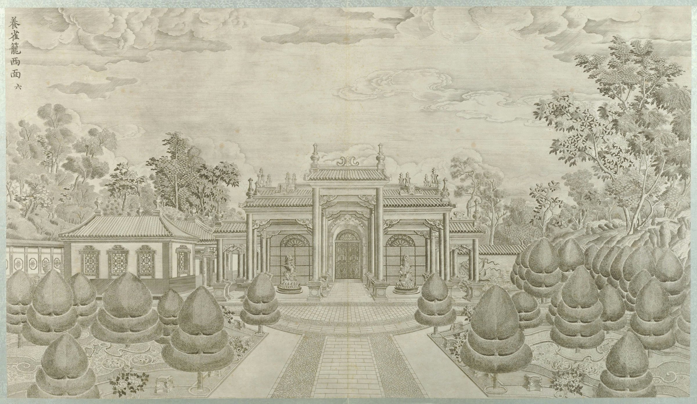

<!-- generated:start (scripts/building_pages.py): do not edit between these markers -->

# XY05-N01: small walled court north of 养雀笼

walled court north of 养雀笼 · Xiyang Lou

**3D object:** 2 boxes. Open it: `/reconstruction/3d.html?b=XY05-N01`

**Part of:** XY05 养雀笼

## What we know

- **Name:** small walled court north of 养雀笼 (S01 · confidence C)
- **English:** walled court north of 养雀笼 (S01)
- **Garden:** Xiyang Lou (S01)
- **Type:** other (S01 · confidence C)
- **Destroyed:** 1860 (S01)
- **Position:** 40.01207, 116.30290. S01 guess (S01 · confidence C)
- **Bays:** 5 in the texts / 1x1 on the plan (S01)
- **Size in the inventory:** 15.6 × 5.4 m. S01 plan px / hall scale (S01)
- **Note:** Service or keeping court; rooms N, W and E round a yard, gate on the south. The Chinese-roofed hall with windows at the left of plate 6 stands in this place: seen from the west. Not named by a text. (S01, Round 6). (S01)
- **Plan reader's note:** Rooms N (5 bays), W and E (3 bays each) round a court x 9020-9085, y 959-1018, small gate in the south side at (9055,1015). (S01) *(research copy, not public)*
- **How it was read:** guess (S01) *(research copy, not public)*
- **Plan pixels:** 9052, 968 (S01) *(research copy, not public)*

## Our model now

Simple massing of a European palace: position and footprint from the ruin, the plan or a survey, heights read from the plates of the 1780s (research/xiyanglou/boxes.csv). Not a detailed model yet; the figures and their methods are in the Dimensions block.

- **1 ×:** a block drawn on the plan in the Xiyang Lou strip; heights a guess: 13.62 × 5.4 m, eave 7 m, ridge 9.5 m
- **1 ×:** a block drawn on the plan in the Xiyang Lou strip; heights a guess: 2.73 × 8.7 m, eave 7 m, ridge 9.5 m
- **Confidence:** C, all assumed

## Pictures (1)

- **P0046** (guess): 养雀笼西面 (圆明园铜版画册 / 西洋楼铜版画, plate 六 of 二十; title and number printed on the plate) (1786 (Commons); Palace Museum: 清). https://commons.wikimedia.org/wiki/File%3A%E5%9C%86%E6%98%8E%E5%9B%AD%E9%93%9C%E7%89%88%E7%94%BB%E5%86%8C-4.jpg

  

## Texts and drawings (0)

None of its own.

**On the plan:** Drawn on the plan of the gardens (S01), labelled small walled court north of 养雀笼, 1x1 cells. https://artmuseum.princeton.edu/collections/objects/138657

## Evidence for the set of buildings

- Evidence for the whole compound 养雀笼: see XY05
- Reconstructions and comparables for the whole garden, 西洋楼 Xiyang Lou: see GARDEN-XY
- Standing buildings comparable to a side hall (not this building): see CLASS-side_hall

**Searched and not found:** No text or drawing names it in 日下旧闻考 j83, the Qianlong poems on Kanripo, Delatour 1803, Malone 1934, the witnesses of 1860, what search indexes show of the Yangshi Lei drawings.

## Open questions

None that name it.

<!-- generated:end -->

## Notes

<!-- Yours: regeneration never touches this part. It goes on the public site; what you write below a line holding only %% private %% stays in the research copy. -->
