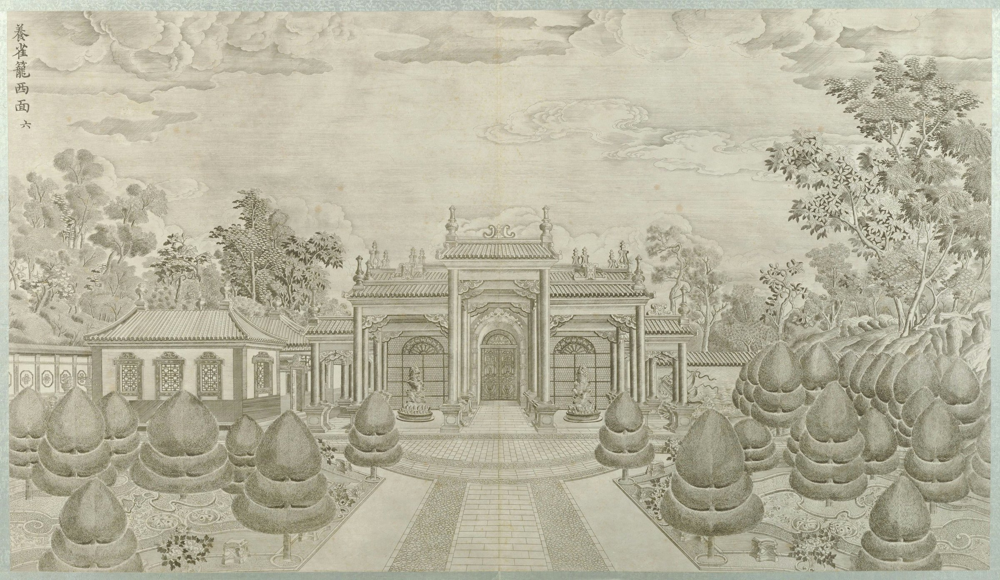
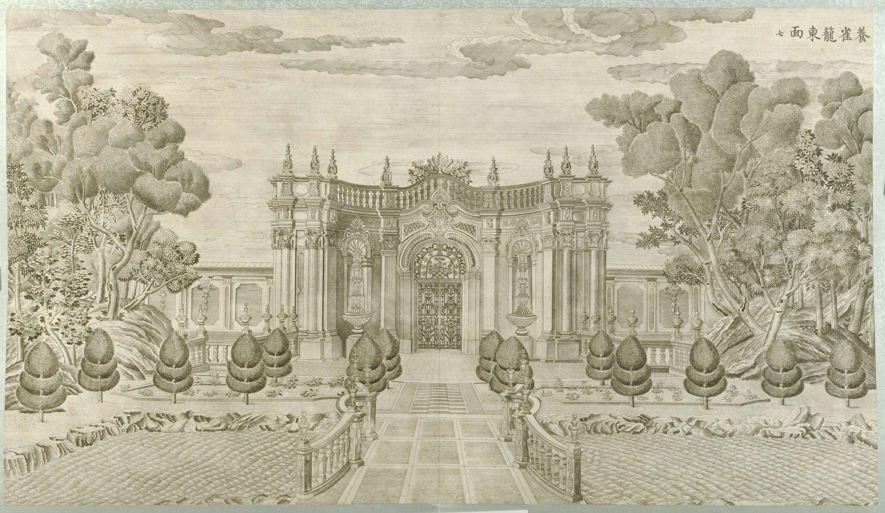
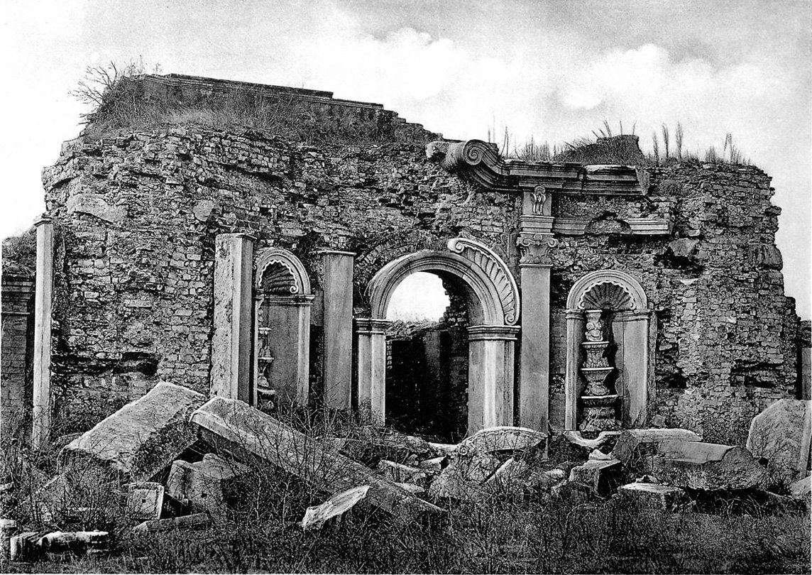
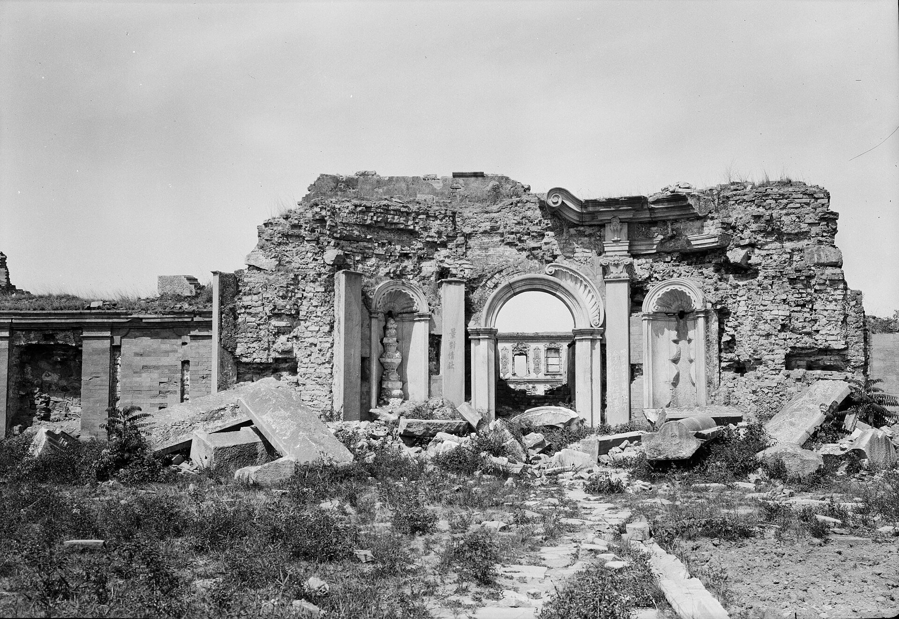
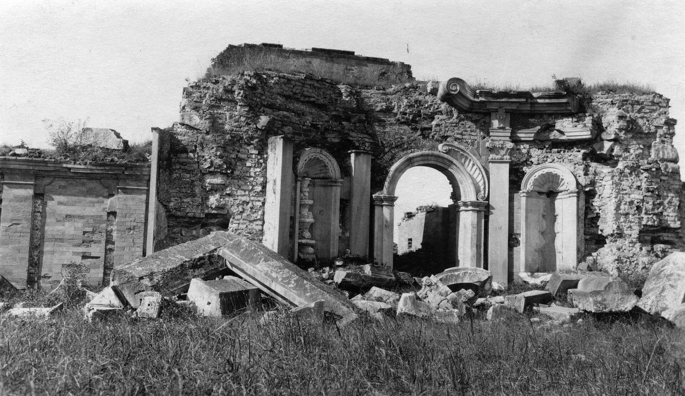
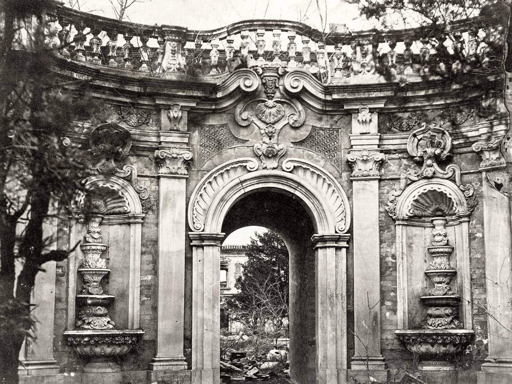
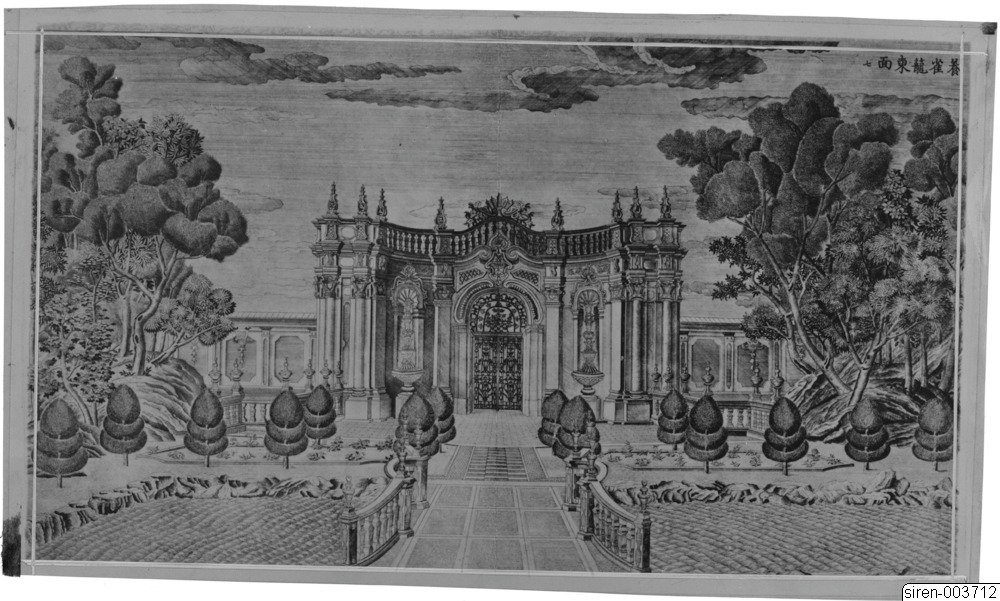
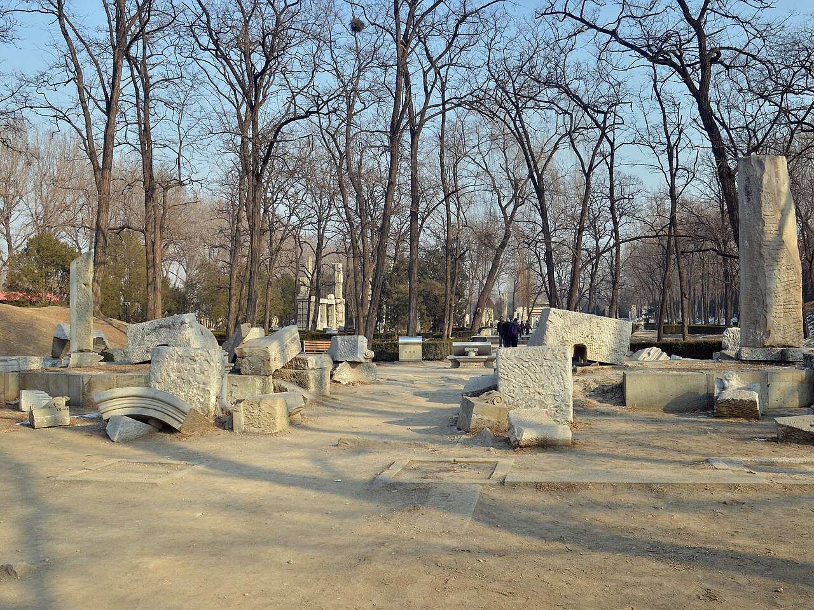
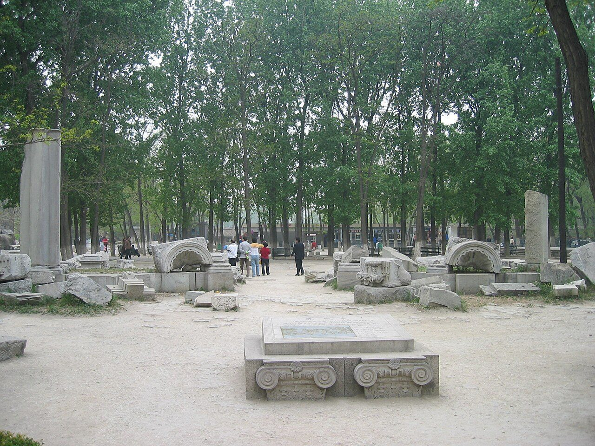
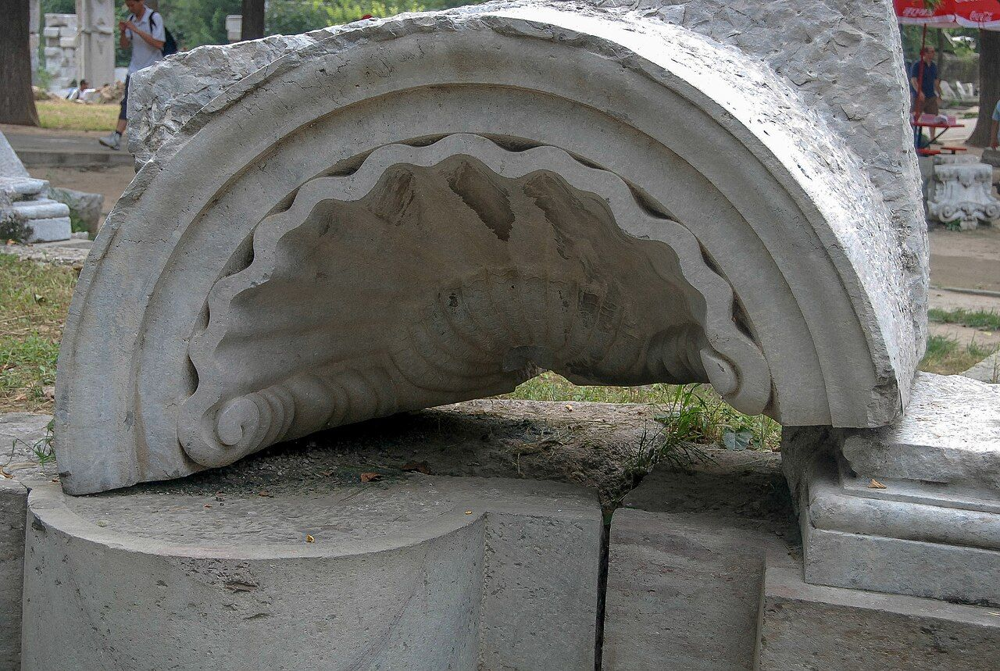

<!-- generated:start (scripts/building_pages.py): do not edit between these markers -->

# XY05: 养雀笼 Yangque Long

Yang Ch'iao Lung, Bird Cage · Xiyang Lou

**3D object:** 1 box. Open it: `/reconstruction/3d.html?b=XY05`

## What we know

- **Name:** 养雀笼 Yangque Long (S02, S06, S56, S01, S258 · confidence A)
- **English:** Yang Ch'iao Lung, Bird Cage (S02, S06, S56, S01, S258)
- **Garden:** Xiyang Lou (S02, S06, S56, S01, S258)
- **Type:** european (S02, S06, S56, S01, S258 · confidence A)
- **Destroyed:** Burnt 1860; ruin torn down about 1924 (S02 p.146) (S02, S06, S56, S01, S258)
- **Position:** 40.01170, 116.30288. S850;S01, moved in Round 6: on the ruin, research/xiyanglou/boxes.csv (S01 · confidence B)
- **Bays:** 5 (S06) in the texts / 3x1 on the plan (S02, S06, S56, S01, S258)
- **Size in the inventory:** 13.9 × 11.6 m. stated: S01;S850;S71;S02, research/xiyanglou/boxes.csv (S01)
- **Where the text puts it:** faced westward on the court behind Number Two (S02 p.147) (S02, S06, S56, S01, S258) *(research copy, not public)*
- **Note:** Copper engraving no. 6-7 per S02. 五间三进 (S06). Peacocks until Jiaqing, per Lu (S02). Oil painting by Castiglione on a wall (S06 lead). Pond before the west front with a model European ship, as if foundering, per plate VI (S258, p.179). Round 6 replaced frontage 20.0 m. Round 6 replaced depth 10.0 m. (S02, S06, S56, S01, S258)
- **Plan reader's note:** Stepped 3-part block astride the N-S wall at x=9088, with 8 small topiary marks to its west: matches Malone: faced west on the court, path led through it to the east. Not boxed. | plan: rect=67,21,-90 for the N-S range x 9066-9087, y 1068-1135. Plus centre projection rect=55,23,0 at (9067,1103) (x 9040-9095, y 1092-1115). Text 5 bays; plan shows 3 parts. (S01) *(research copy, not public)*
- **How it was read:** likely (S01) *(research copy, not public)*
- **Plan pixels:** 9068, 1101 (S01) *(research copy, not public)*

## Our model now

Simple massing of a European palace: position and footprint from the ruin, the plan or a survey, heights read from the plates of the 1780s (research/xiyanglou/boxes.csv). Not a detailed model yet; the figures and their methods are in the Dimensions block.

- **Box:** 13.9 × 11.6 m, european
- **Part:** gate block, three gates to the west, a European arch to the east
- **Heights:** platform 0.5 m, eave 6.2 m, ridge 8.5 m above the ground
- **Roof:** hip 庑殿, glazed tile
- **Faces:** 263.8° from north
- **Drawn:** by the stone kit: base, pilasters, arched openings, entablature, balustrade and a glazed roof, as the plates of the 1780s show such fronts; the kit's reading, C, not a detailed model
- **Confidence:** C, assumed

## Inside it (2)

- XY05-AX002
- XY05-N01 small walled court north of 养雀笼

## Pictures (12)

- **P0046** (sure): 养雀笼西面 (圆明园铜版画册 / 西洋楼铜版画, plate 六 of 二十; title and number printed on the plate) (1786 (Commons); Palace Museum: 清). https://commons.wikimedia.org/wiki/File%3A%E5%9C%86%E6%98%8E%E5%9B%AD%E9%93%9C%E7%89%88%E7%94%BB%E5%86%8C-4.jpg

  

- **P0047** (sure): 养雀笼东面 (圆明园铜版画册 / 西洋楼铜版画, plate 七 of 二十; title and number printed on the plate) (1786 (Commons); Palace Museum: 清). https://commons.wikimedia.org/wiki/File%3A%E5%9C%86%E6%98%8E%E5%9B%AD%E9%93%9C%E7%89%88%E7%94%BB%E5%86%8C-5.jpg

  

- **P0779** (likely): 圓明園東長春園平面圖 (第一圖), plan of the Xiyang Lou strip (drawn by Ohlmer, 1867-1879, per Teng Gu's preface; from Börschmann's collection). https://commons.wikimedia.org/wiki/File:CADAL11102995_%E5%9C%93%E6%98%8E%E5%9C%93%E6%AD%90%E5%BC%8F%E5%AE%AE%E6%AE%BF%E6%AE%98%E8%B7%A1.djvu

  

- **P0168** (sure): Europäisches Thor in Yüanmingyüan (before or in 1902 (Commons)). https://commons.wikimedia.org/wiki/File%3AEurop%C3%A4isches_Thor_in_Y%C3%BCanmingy%C3%BCan.jpg

  

- **P0175** (sure): Yuanmingyuan. Yangqiaolong (养雀笼), east gate (1922? (Commons); museum 1922). http://kulturarvsdata.se/SMVK-OM/Bildarkiv/198822

  

- **P0178** (sure): The Yangquelong (养雀笼), European-style gateway (000610, F.2602) (1900-1920 (?) (Commons)). http://kulturarvsdata.se/SMVK-OM/Bildarkiv/195707

  

- **P0192** (sure): Eastern Gate of Yangquelong (file name: Thomas Child, 1870's) (1870s (file name)). https://commons.wikimedia.org/wiki/File%3AEastern_Gate_of_Yangquelong%2C_Thomas_Child%2C_1870%27s.jpg

  

- **P0210** (sure): Sirén, Enligt text under Pl. 189a Kinas trädgårdar  Vol. I: Yuanmingyuan. Yangqiaolong, ”Rum för uppfödande av fåglar”, d. v. s. volièren. Bild efter gravyr av år 1786. (undated by holder; Sirén's second trip 1921-23 for this group). http://kulturarvsdata.se/SMVK-OM/Bildarkiv/198821 Research-only: link card.

  

- **P0225** (likely): Moore negatives of the European palaces, Royal BC Museum MS-3171 (13 negatives, 12 views, c.1875 to early 1880s) (perhaps c.1875; early 1880s (visualisingchina.net)). https://search-bcarchives.royalbcmuseum.bc.ca/c-f-moore-fonds Research-only: link card.
- **P0352** (sure): Ruins of Yangquelong 20130126.JPG (2013-01-26 13:58:24 (Commons DateTimeOriginal)). https://commons.wikimedia.org/wiki/File:Ruins_of_Yangquelong_20130126.JPG

  

- **P0740** (sure): Yangquelong (2005-04-23 (Commons)). https://commons.wikimedia.org/wiki/File:Yangquelong.jpg

  

- **P0353** (likely): Yangquelong 2008-1.jpg (2008-08-09 15:54:16 (Commons DateTimeOriginal)). https://commons.wikimedia.org/wiki/File:Yangquelong_2008-1.jpg

  

## Texts and drawings (9)

- **E0947** (description, sure): Plate VI: 养雀笼 Yangque Long, west. 1786-1803 · p.179, Plate VI · S258. https://archive.org/details/BIUSante_40644
  > on aperçoit sur la droite une pièce d'eau, où un vaisseau à l'européenne paroît faire naufrage.
  A portico rather than a house; low gallery on the left; columns on pedestals with bases and no capitals; a pond with what seems a European ship foundering, perhaps a painted or staged scene.
- **E0948** (description, sure): Plate VII: 养雀笼 Yangque Long, east. 1786-1803 · pp.179-180, Plate VII · S258. https://archive.org/details/BIUSante_40644
  > En face de ce portique est une rivière, que l'on passe sur un pont garni de balustrades,
  An entry more than a dwelling; looks Greek at first; capitals, arch and niches compared with Borromini; balustrade on the entablature.
- **E0949** (description, sure): Engravings 6 and 7: 养雀笼 Yangque Long. 1934 · p.147 · S02. https://archive.org/details/historyofpekings00malo
  > Water flowed from carved white marble fountains on both sides of the doorway.
  West front on the court behind 谐奇趣, with a passage east through the building. Peacocks until Jiaqing, per Lu. Plate p.146: being torn down about 1924.
- **E0507** (description, sure): 圆明园五朝御制诗文集注 v4, editors' note on 西洋楼. 2020 edition · v4 p.120 · S361. https://www.yuanmingyuanpark.cn/xs/yjbg/202008/P020200803382796786124.pdf#page=123
  The editors walk the strip from west to east with completion dates and plaques: 谐奇趣 1751, 养雀笼 1759, then the fountains and the perspective walls, with their mechanical details. They put the whole at about 2% of the gardens.
- **E0544** (drawing, sure, search index only): 西洋楼水法图. 国家图书馆善本部 none shown · S310. https://www.mhymy.com/dasl/ysltd/7643.html
  Plan of the Xiyang Lou waterworks across its dozen sites; the record shows no shelf number. No image here; the site may ask a small payment for the full record.
- **E0935** (drawing, sure, search index only): 谐奇趣样式雷图. 不详 · 故宫博物院图书馆 样986号 · S310. https://www.mhymy.com/dasl/344.html
  Undated design and survey sketch with the perspective bridge, the water tower, the aviary and Xieqi Qu. No image here; the site may ask a small payment for the full record.
- **E0950** (archaeology, sure): 圆明园遗址考古今年推进至大水法, 浙江在线. 2016-06-12 · news, 金和天 · S141. https://china.zjol.com.cn/gnxw/201606/t20160612_1619014.shtml
  养雀笼 Yangque Long: 1,000 m2 cleared in 2015, showing foundations that combine 三合土 lime concrete with brick and stone. 大水法 and 远瀛观 were next, about 2,000 m2 planned for 2016, with the stated aim of learning how imperial buildings were founded, which standing buildings cannot show.
- **E0363** (archaeology, sure): 揭秘圆明园考古, 华西都市报 via 中证网. 2017-07-10 · news, 张中华 and 张利芳 · S140. https://cs.com.cn/ssgs/gssc/201707/t20170710_5365575.html
  Three large campaigns since 1996 yielded over 50,000 finds. The campaign from 2012 dug 桃花洞, 大宫门, 养雀笼, the 海晏堂 water tower and 远瀛观. At 如园 Ru Yuan, the best-preserved of these sites and the first imitation of a Jiangnan garden dug here (19,000 m2 site, 2,800 m2 buildings, 3,800 m2 opened), diggers found 芝兰室, 云萝山馆, 听泉榭, 延清堂, 含碧楼, 挹霞亭, 观丰榭, 引胜轩, rockery, paths and shores, and burnt famille-rose floor tiles in 延清堂.
- **E0554** (archaeology, sure): 西洋楼区域考古勘探报告. n.d. · mhymy 档案史料 12205, free part · S149. https://www.mhymy.com/dasl/12205.html
  Report's opening: the strip runs 860 m east-west, up to 300 m wide in the west and 65 m at its narrowest, about 70,000 m2, built 1747-1783. A central axis divides it into about five sections, each with its own north-south axis, thirteen units from 谐奇趣 to 线法墙. Survey results are paywalled.

**On the plan:** Its place is drawn on the plan of the gardens (S01), with no name written. https://artmuseum.princeton.edu/collections/objects/138657

## Reconstructions by others (2)

Modern interpretation, not evidence.
- **R0314** (drawing, sure): Gartenplan der Xiyang Lou (西洋楼) in Peking. Maximilian Dörrbecker (Chumwa). https://commons.wikimedia.org/wiki/File:Gartenplan_der_Xiyang_Lou.png
- **R0139** (drawing, sure): Fig. 4, Plan d'ensemble (plan de restitution 1985). Antoine Durand, Mission Palais d'Ete, under Michele Pirazzoli-t'Serstevens, 1985 (published 1988). https://www.persee.fr/doc/arasi_0004-3958_1988_num_43_1_1240 Research-only: link card.

## Evidence for the set of buildings

- Reconstructions and comparables for the whole garden, 西洋楼 Xiyang Lou: see GARDEN-XY

## Open questions

- Q32: OSM errors
- Q64: The plan's scale and turn in this strip (Round 6)

<!-- generated:end -->

## Notes

<!-- Yours: regeneration never touches this part. It goes on the public site; what you write below a line holding only %% private %% stays in the research copy. -->
