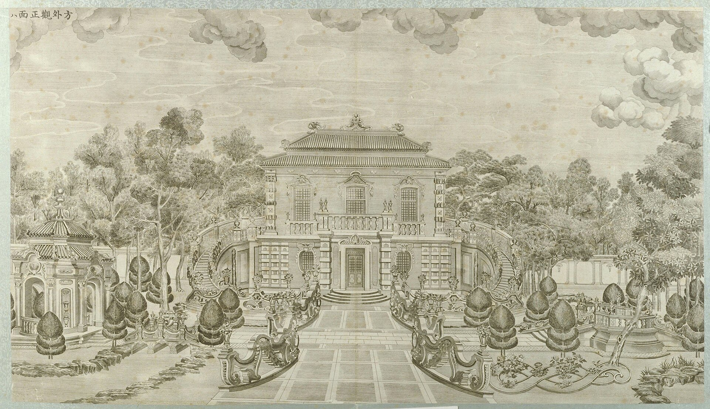

<!-- generated:start (scripts/building_pages.py): do not edit between these markers -->

# XY06-B0151: Hall without a name on the plan

small two-bay building with a rock or pond form, in the garden east of 养雀笼 · Xiyang Lou

**3D object:** 1 box. Open it: `/reconstruction/3d.html?b=XY06-B0151`

**Part of:** XY06 方外观

## What we know

- **English:** small two-bay building with a rock or pond form, in the garden east of 养雀笼 (S01)
- **Garden:** Xiyang Lou (S01)
- **Type:** hall (S01 · confidence B)
- **Destroyed:** 1860 (S01)
- **Position:** 40.01202, 116.30309. S01 block, unnamed (S01 · confidence B)
- **Bays:** 2 in the texts / 2x1 on the plan (S01)
- **Size in the inventory:** 7.4 × 6.9 m. S01 plan px / hall scale (S01)
- **Note:** Building drawn, 6.4 x 4.9 m at ground scale, at the north-west corner of 方外观's garden against the wall x=9088; a kidney-shaped form beside it. No plate shows it clearly; not 方外观's. Its mirror is XY07-B0201. (S01, Round 6). (S01)
- **Plan pixels:** 9128, 958 (S01) *(research copy, not public)*

## Our model now

Simple massing of a European palace: position and footprint from the ruin, the plan or a survey, heights read from the plates of the 1780s (research/xiyanglou/boxes.csv). Not a detailed model yet; the figures and their methods are in the Dimensions block.

- **Box:** 7.4 × 6.9 m, pavilion square
- **Part:** a block drawn on the plan in the Xiyang Lou strip; heights a guess
- **Heights:** platform 0.8 m, eave 7 m, ridge 9.5 m above the ground
- **Roof:** hip 庑殿, glazed tile
- **Faces:** 174.6° from north
- **Drawn:** by the stone kit: base, pilasters, arched openings, entablature, balustrade and a glazed roof, as the plates of the 1780s show such fronts; the kit's reading, C, not a detailed model
- **Confidence:** C, assumed

## Pictures (1)

- **P0048** (guess): 方外观正面 (圆明园铜版画册 / 西洋楼铜版画, plate 八 of 二十; title and number printed on the plate) (1786 (Commons); Palace Museum: 清). https://commons.wikimedia.org/wiki/File%3A%E5%9C%86%E6%98%8E%E5%9B%AD%E9%93%9C%E7%89%88%E7%94%BB%E5%86%8C-6.jpg

  

## Texts and drawings (0)

None of its own.

**On the plan:** Drawn on the plan of the gardens (S01) with no label, 2x1 cells: a building stood here, its name unknown. https://artmuseum.princeton.edu/collections/objects/138657

## Evidence for the set of buildings

- Evidence for the whole compound 方外观: see XY06
- Reconstructions and comparables for the whole garden, 西洋楼 Xiyang Lou: see GARDEN-XY
- Standing buildings comparable to a square pavilion (not this building): see CLASS-pavilion_square

**Searched and not found:** This block has no name on the plan or in the texts, so no source can be searched for it by name.

## Open questions

- Q64: The plan's scale and turn in this strip (Round 6)

<!-- generated:end -->

## Notes

<!-- Yours: regeneration never touches this part. It goes on the public site; what you write below a line holding only %% private %% stays in the research copy. -->
