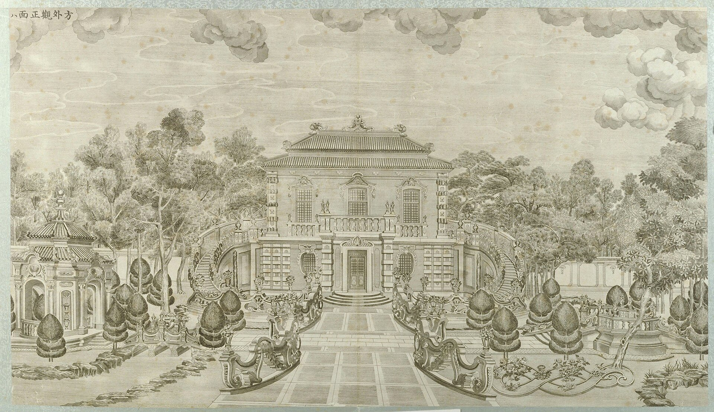

<!-- generated:start (scripts/building_pages.py): do not edit between these markers -->

# XY06-B0151: Hall without a name on the plan

Xiyang Lou

**3D object:** 1 box. Open it: `/reconstruction/3d.html?b=XY06-B0151`

**Part of:** XY06 方外观

## What we know

- **Garden:** Xiyang Lou (S01)
- **Type:** hall (S01 · confidence B)
- **Destroyed:** 1860 (S01)
- **Position:** 40.01208, 116.30308. S01 block, unnamed (S01 · confidence B)
- **Bays:** 2 in the texts / 2x1 on the plan (S01)
- **Size in the inventory:** 7.4 × 6.9 m. S01 plan px / hall scale (S01)
- **Plan pixels:** 9128, 958 (S01) *(research copy, not public)*

## Our model now

Simple massing of a European palace, assumed: sizes from the texts and the ruin polygons, position from the plan or the ruin. Not a reading of the 1786 engravings yet.

- **Box:** 7.4 × 6.9 m, pavilion square
- **Part:** a block drawn on the plan in the Xiyang Lou strip; heights a guess
- **Heights:** platform 0.8 m, eave 7 m, ridge 9.5 m above the ground
- **Roof:** hip 庑殿, glazed tile
- **Faces:** 174.5° from north
- **Confidence:** C, assumed

## Pictures (1)

- **P0048** (guess): 方外观正面 (圆明园铜版画册 / 西洋楼铜版画, plate 八 of 二十; title and number printed on the plate) (1786 (Commons); Palace Museum: 清). https://commons.wikimedia.org/wiki/File%3A%E5%9C%86%E6%98%8E%E5%9B%AD%E9%93%9C%E7%89%88%E7%94%BB%E5%86%8C-6.jpg

  

## Texts and drawings (0)

None of its own.

**On the plan:** Drawn on the plan of the gardens (S01) with no label, 2x1 cells: a building stood here, its name unknown. https://artmuseum.princeton.edu/collections/objects/138657

## Evidence for the set of buildings

- Evidence for the whole compound 方外观: see XY06

**Searched and not found:** This block has no name on the plan or in the texts, so no source can be searched for it by name.

## Open questions

None that name it.

<!-- generated:end -->

## Notes

<!-- Yours: regeneration never touches this part. It goes on the public site; what you write below a line holding only %% private %% stays in the research copy. -->
