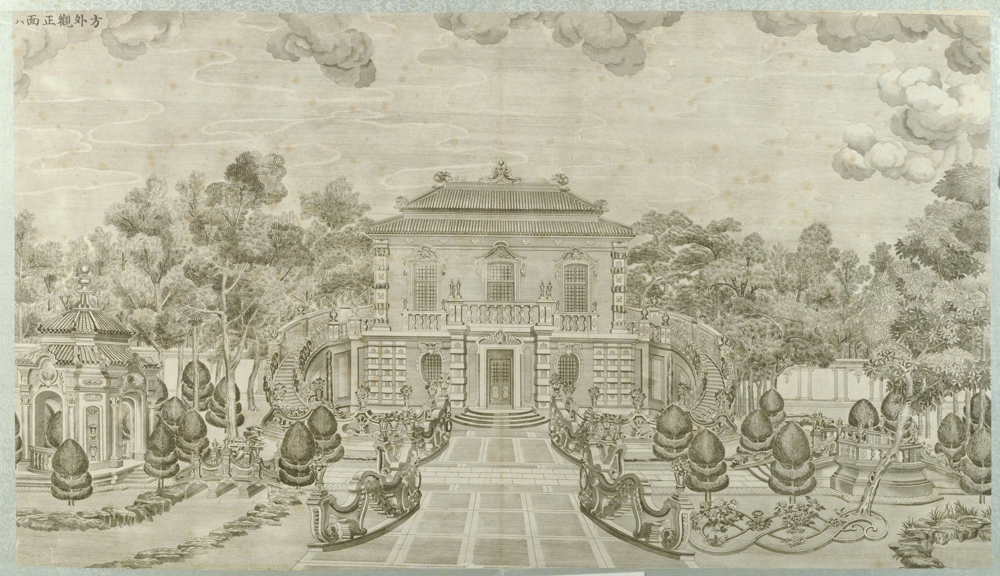
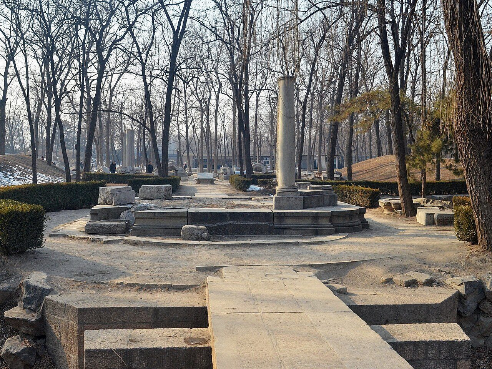

<!-- generated:start (scripts/building_pages.py): do not edit between these markers -->

# XY06-N01: Hall without a name on the plan

bow-tie figure east of the 方外观 axis · Xiyang Lou

**3D object:** none yet.

**Part of:** XY06 方外观

## What we know

- **English:** bow-tie figure east of the 方外观 axis (S01)
- **Garden:** Xiyang Lou (S01)
- **Type:** other (S01 · confidence C)
- **Destroyed:** 1860 (S01)
- **Position:** 40.01182, 116.30395. S01 guess (S01 · confidence C)
- **Size in the inventory:** 18.4 × 13.9 m. S01 plan px / hall scale (S01)
- **Note:** Retired in Round 6, no box: Not a building. A figure with a narrow centre and two flaring ends, 16 x 10 m as drawn, in the garden south of the moat, 15 m off the axis. Plates 8 and 9 show parterres with scrollwork and no building here; plate 8 lower right has one such bed. Nothing clear on the ruin at the row, which is on the moat's bank. (S01, Round 6). (S01)
- **Plan reader's note:** rect=77,46,0. Cross-shaped centre 30 px wide with two flaring wings. Off the 方外观 axis by 73 px. Could be a planted bed or pool. Not the 五竹亭 of engraving 9. (S01) *(research copy, not public)*
- **How it was read:** guess (S01) *(research copy, not public)*
- **Plan pixels:** 9469, 1101 (S01) *(research copy, not public)*

## Our model now

No box in the 3D view: the plan shows no building here, or a plot, water, a hill or a name only.

## Pictures (2)

- **P0048** (likely): 方外观正面 (圆明园铜版画册 / 西洋楼铜版画, plate 八 of 二十; title and number printed on the plate) (1786 (Commons); Palace Museum: 清). https://commons.wikimedia.org/wiki/File%3A%E5%9C%86%E6%98%8E%E5%9B%AD%E9%93%9C%E7%89%88%E7%94%BB%E5%86%8C-6.jpg

  

- **P0745** (guess): The surviving pillars of the octagonal pavilion outside Fangwaiguan 20130126 (2013-01-26 13:56:41 (Commons)). https://commons.wikimedia.org/wiki/File:The_surviving_pillars_of_the_octagonal_pavilion_outside_Fangwaiguan_20130126.JPG

  

## Texts and drawings (0)

None of its own.

**On the plan:** Drawn on the plan of the gardens (S01) with no label: a building stood here, its name unknown. https://artmuseum.princeton.edu/collections/objects/138657

## Evidence for the set of buildings

- Evidence for the whole compound 方外观: see XY06
- Reconstructions and comparables for the whole garden, 西洋楼 Xiyang Lou: see GARDEN-XY
- Standing buildings comparable to a main hall (not this building): see CLASS-main_hall

**Searched and not found:** This block has no name on the plan or in the texts, so no source can be searched for it by name.

## Open questions

None that name it.

<!-- generated:end -->

## Notes

<!-- Yours: regeneration never touches this part. It goes on the public site; what you write below a line holding only %% private %% stays in the research copy. -->
