<!-- generated:start (scripts/building_pages.py): do not edit between these markers -->

# XY06: 方外观 Fangwai Guan

Fang Wai Kuan, A Look Abroad · Xiyang Lou

**3D object:** 2 boxes. Open it: `/reconstruction/3d.html?b=XY06`

## What we know

- **Name:** 方外观 Fangwai Guan (S02, S06, S56, S01, S03, S258 · confidence A)
- **English:** Fang Wai Kuan, A Look Abroad (S02, S06, S56, S01, S03, S258)
- **Garden:** Xiyang Lou (S02, S06, S56, S01, S03, S258)
- **Type:** european (S02, S06, S56, S01, S03, S258 · confidence A)
- **Destroyed:** Looted and burnt 1860; stone ruins stayed, further damage 1900 and after (S02 pp.142,218) (S02, S06, S56, S01, S03, S258)
- **Position:** 40.01192, 116.30372. S850;S01, moved in Round 6: on the ruin, research/xiyanglou/boxes.csv (S01 · confidence B)
- **Bays:** 3 (S06) in the texts / 3x2 on the plan (S02, S06, S56, S01, S03, S258)
- **Size in the inventory:** 14.0 × 7.0 m. stated: S603;S850;S71, research/xiyanglou/boxes.csv (S01)
- **Lead on its size, from a modern study, not used in the model:** Fangwai Guan without side stairs: L 14 m, width 7 m, height 13 m (S603, p. 129). (confidence B)
- **Storeys:** 2 (S02, S06, S56, S01, S03, S258)
- **Roof:** 重檐四坡 (S06) (S02, S06, S56, S01, S03, S258)
- **Tiles:** 蓝色琉璃 (S06) (S02, S06, S56, S01, S03, S258)
- **Where the text puts it:** 过桥之后东行 路北为方外观 (S06) (S02, S06, S56, S01, S03, S258) *(research copy, not public)*
- **Note:** Copper engraving no. 8 per S02. Circular stairs from the 2nd floor; carved marble bridge (S02 p.147-148). S06: 容妃 prayer use (lead). Low room under the projecting terrace, door and two grilled oeils-de-boeuf (S258, p.180). Round 6 replaced frontage 44 m. Round 6 replaced depth 24.2 m. (S02, S06, S56, S01, S03, S258)
- **Plan reader's note:** Label legible, west of the hall. Enclosure includes the curved moat strips, the 2-bay B0151, and the bow-tie figure. | plan: 3 bays: agrees with text. Hall x 9360-9427, y 952-980. South porch x 9375-9415, y 980-1015. Curved stairs W x 9335-9362, y 961-1009; E x 9429-9454, y 961-1005. (S01) *(research copy, not public)*
- **How it was read:** sure (S01) *(research copy, not public)*
- **Plan pixels:** 9394, 966 (S01) *(research copy, not public)*

## Our model now

Simple massing of a European palace: position and footprint from the ruin, the plan or a survey, heights read from the plates of the 1780s (research/xiyanglou/boxes.csv). Not a detailed model yet; the figures and their methods are in the Dimensions block.

- **1 ×:** hall, porch and curved stairs, as the plan draws them: 24.6 × 13.3 m, eave 1 m, ridge 1 m
- **1 ×:** hall, two storeys, 3 bays, double eaves: 14 × 7 m, eave 8.9 m, ridge 13 m
- **Confidence:** B and C, some assumed

## Inside it (2)

- XY06-B0151
- XY06-N01

## Pictures (20)

- **P0048** (sure): 方外观正面 (圆明园铜版画册 / 西洋楼铜版画, plate 八 of 二十; title and number printed on the plate) (1786 (Commons); Palace Museum: 清). https://commons.wikimedia.org/wiki/File%3A%E5%9C%86%E6%98%8E%E5%9B%AD%E9%93%9C%E7%89%88%E7%94%BB%E5%86%8C-6.jpg

  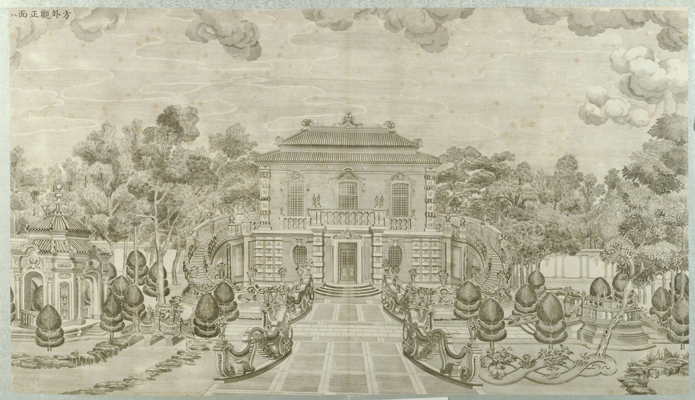

- **P0779** (sure): 圓明園東長春園平面圖 (第一圖), plan of the Xiyang Lou strip (drawn by Ohlmer, 1867-1879, per Teng Gu's preface; from Börschmann's collection). https://commons.wikimedia.org/wiki/File:CADAL11102995_%E5%9C%93%E6%98%8E%E5%9C%93%E6%AD%90%E5%BC%8F%E5%AE%AE%E6%AE%BF%E6%AE%98%E8%B7%A1.djvu

  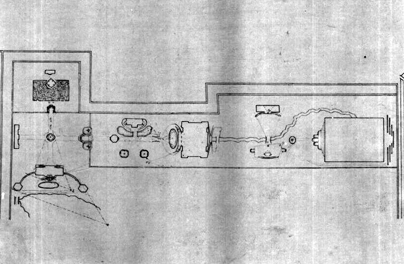

- **P0212** (sure): Enligt text under Pl. 190b Kinas trädgårdar Vol. I: Yuanmingyuan. Fangwaiguan, Belvedere, ”Plats med vidsträckt utsikt”. Bild efter fotografi 1922. (1922 (holder caption)). http://kulturarvsdata.se/SMVK-OM/Bildarkiv/198824

  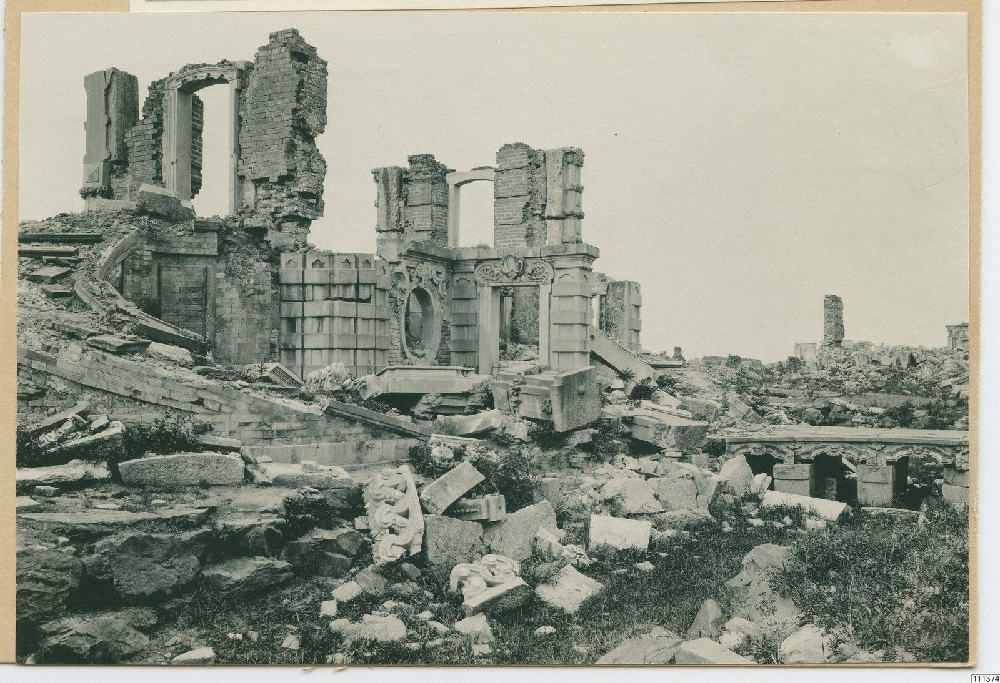

- **P0295** (sure): Fotografija Ruševine stranskega pročelja gledališča v Stari poletni palači (album: "Yüen-Ming-Yüen: Ruinen des Teaters") (20th c., album bought 1914-1920 (holder)). https://vazcollections.si/predmeti/fotografija-rusevine-stranskega-procelja-gledalisca-v-stari-poletni-palaci/

  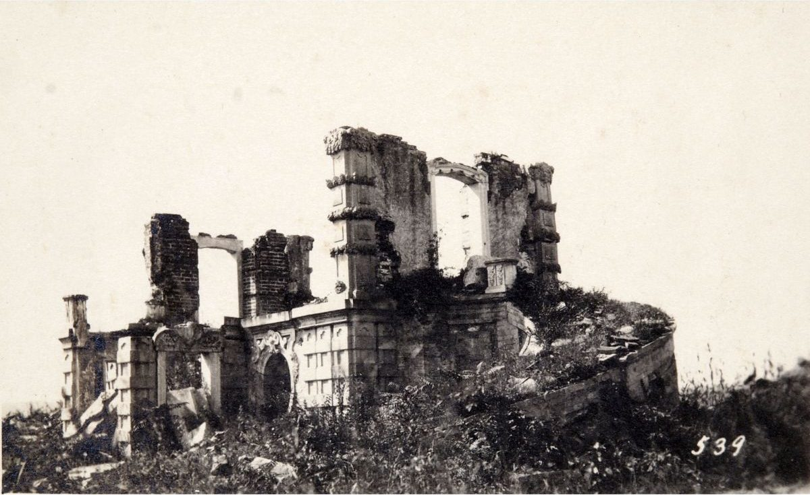

- **P0296** (sure): Fotografija Ruševine sprednjega pročelja gledališča v Stari poletni palači (album: "Yüen-Ming-Yüen: Ruinen des Teaters") (20th c., album bought 1914-1920 (holder)). https://vazcollections.si/predmeti/fotografija-rusevine-sprednjega-procelja-gledalisca-v-stari-poletni-palaci/

  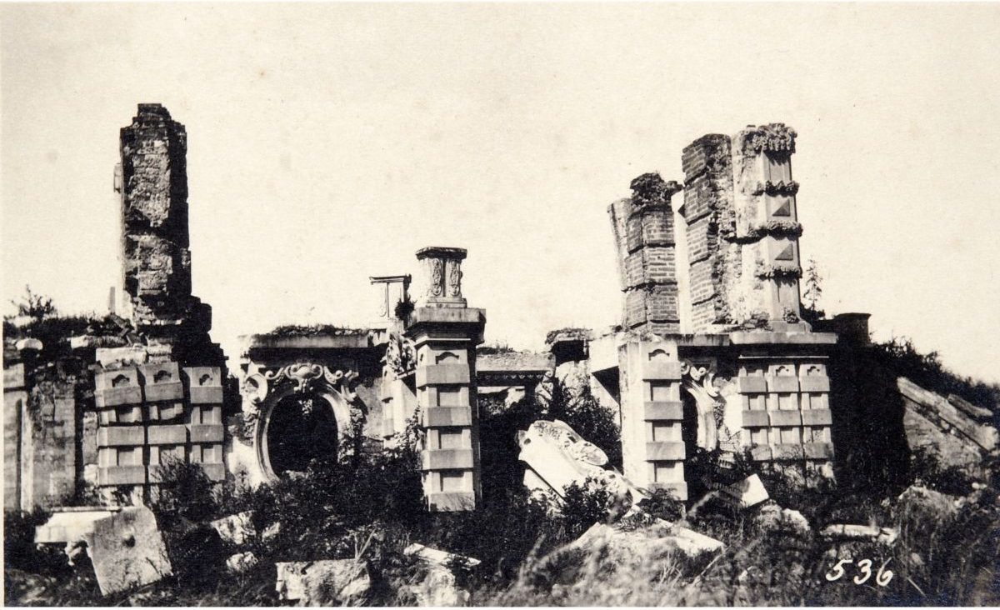

- **P0304** (sure): Fotografija Ruševine gledališča v Stari poletni palači (album: "Yüen-Ming-Yüen: Ruinen des Teaters") (20th c., album bought 1914-1920 (holder)). https://vazcollections.si/predmeti/fotografija-rusevine-gledalisca-v-stari-poletni-palaci-2/

  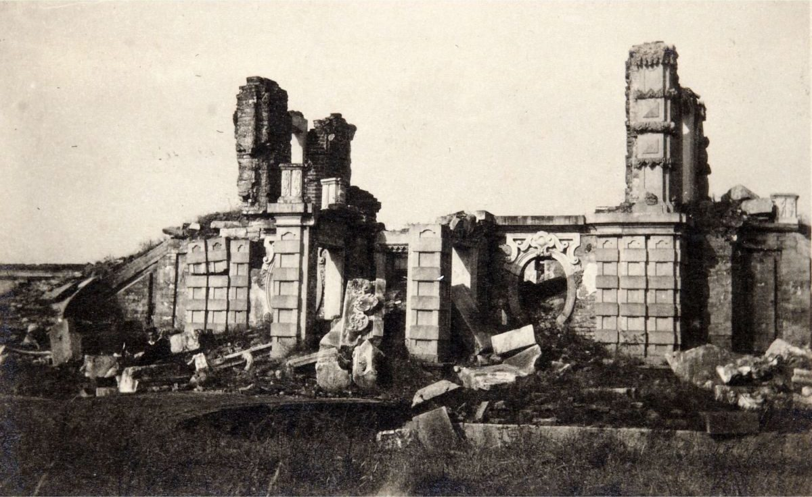

- **P0744** (sure): 方外观遗址 - Ruins of the Fangwaiguan Hall - 2013.03 - panoramio (Taken on 13 March 2013 (Commons)). https://commons.wikimedia.org/wiki/File:%E6%96%B9%E5%A4%96%E8%A7%82%E9%81%97%E5%9D%80_-_Ruins_of_the_Fangwaiguan_Hall_-_2013.03_-_panoramio.jpg

  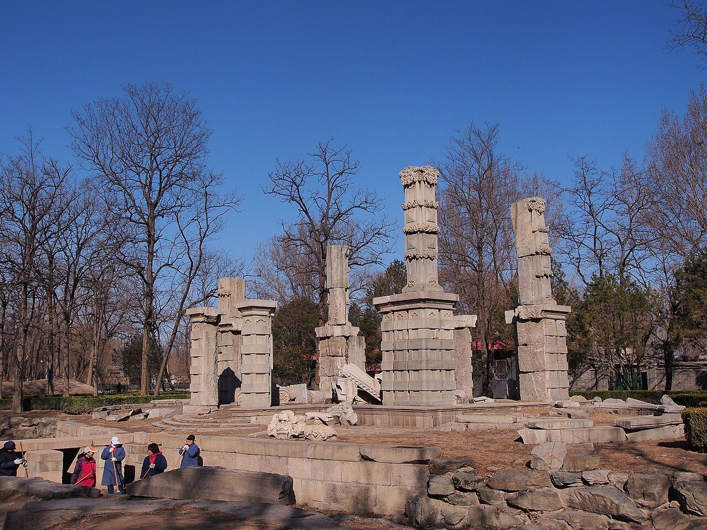

- **P0773** (sure): 方外觀正面斜景 (第八圖) (1873 (S770; dated by S89); Teng Gu says only that Ohlmer took them 1867-1879, about sixty years before). https://commons.wikimedia.org/wiki/File:CADAL11102995_%E5%9C%93%E6%98%8E%E5%9C%93%E6%AD%90%E5%BC%8F%E5%AE%AE%E6%AE%BF%E6%AE%98%E8%B7%A1.djvu

  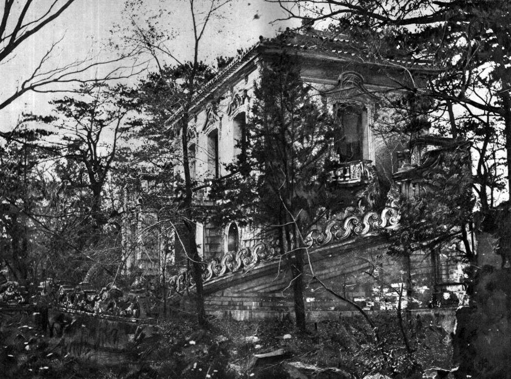

- **P0746** (likely): 方外观 雕刻精美的石头部件 - panoramio (Taken on 27 May 2011 (Commons)). https://commons.wikimedia.org/wiki/File:%E6%96%B9%E5%A4%96%E8%A7%82_%E9%9B%95%E5%88%BB%E7%B2%BE%E7%BE%8E%E7%9A%84%E7%9F%B3%E5%A4%B4%E9%83%A8%E4%BB%B6_-_panoramio.jpg

  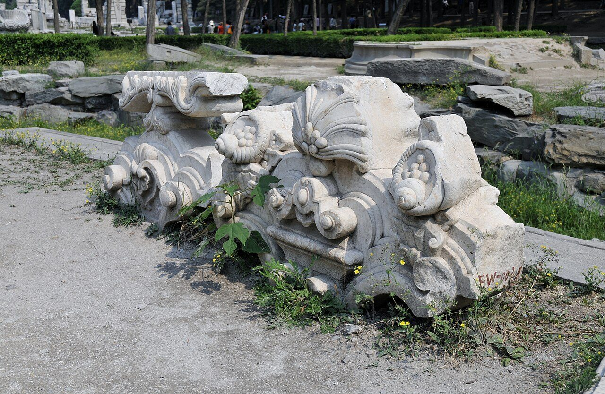

- **P0211** (sure): Sirén, Enligt text under Pl. 190a Kinas trädgårdar Vol. I: Yuanmingyuan. Fangwaiguan, Belvedere, ”Plats med vidsträckt utsikt”. Bild efter gravyr av år 1786. (undated by holder; Sirén's second trip 1921-23 for this group). http://kulturarvsdata.se/SMVK-OM/Bildarkiv/198823 Research-only: link card.

  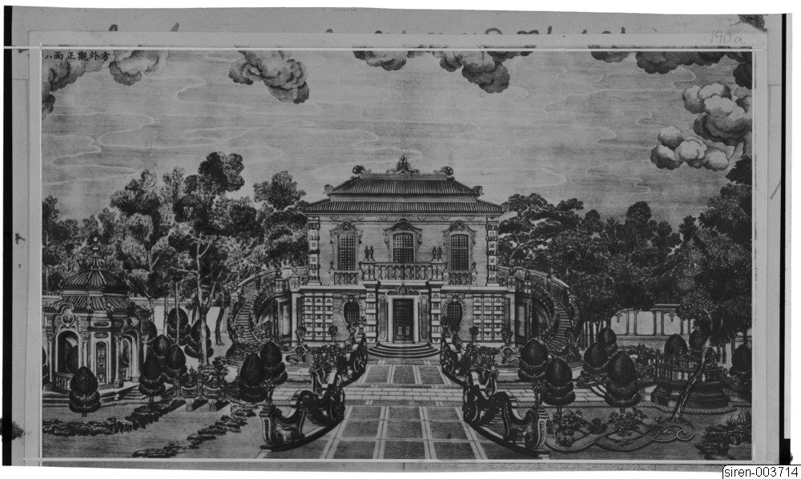

- **P0220** (sure): Sirén, Yuanmingyuan: The ruins of Fangwaiguan (The Square Looking House). (undated by holder; Sirén's second trip 1921-23 for this group). http://kulturarvsdata.se/SMVK-OM/Bildarkiv/199685 Research-only: link card.

  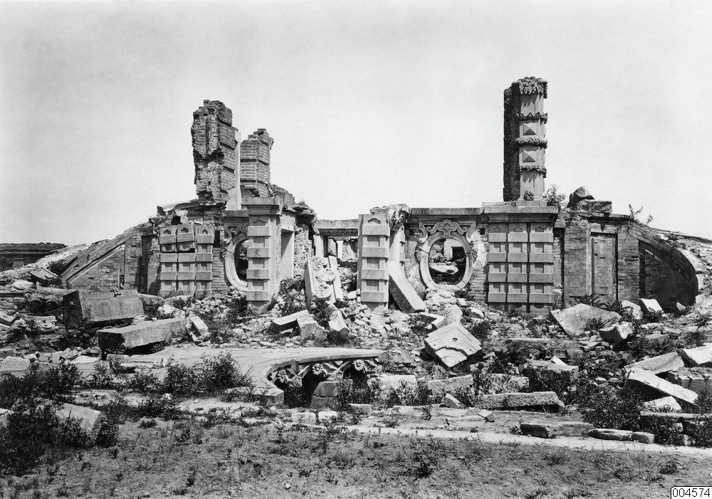

- **P0720** (sure): Fangwaiguan (S770 caption), Ohlmer negative G (1873 (S770; dated by S89)). https://visualizingcultures.mit.edu/garden_perfect_brightness_03/ymy303/e502.htm Research-only: link card.

  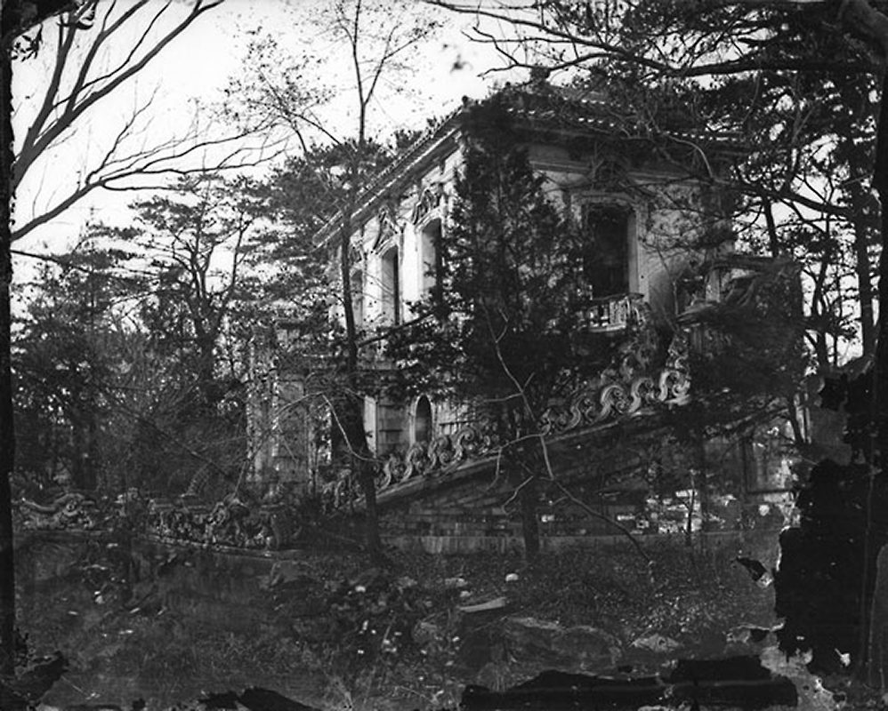

- **P0225** (likely): Moore negatives of the European palaces, Royal BC Museum MS-3171 (13 negatives, 12 views, c.1875 to early 1880s) (perhaps c.1875; early 1880s (visualisingchina.net)). https://search-bcarchives.royalbcmuseum.bc.ca/c-f-moore-fonds Research-only: link card.
- **P0354** (sure): Fangwaiguan 20130323.JPG (2013-03-23 14:39:55 (Commons DateTimeOriginal)). https://commons.wikimedia.org/wiki/File:Fangwaiguan_20130323.JPG

  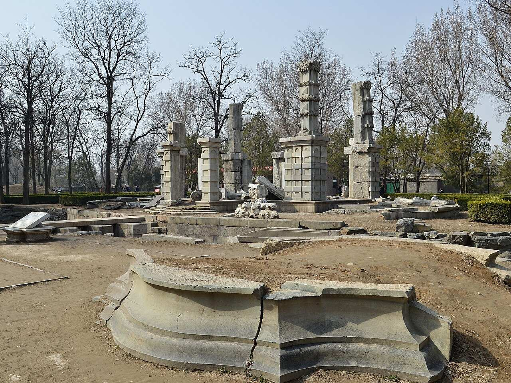

- **P0355** (sure): Yuanmingyuan Fangwaiguan 20130126.JPG (2013-01-26 13:54:34 (Commons DateTimeOriginal)). https://commons.wikimedia.org/wiki/File:Yuanmingyuan_Fangwaiguan_20130126.JPG

  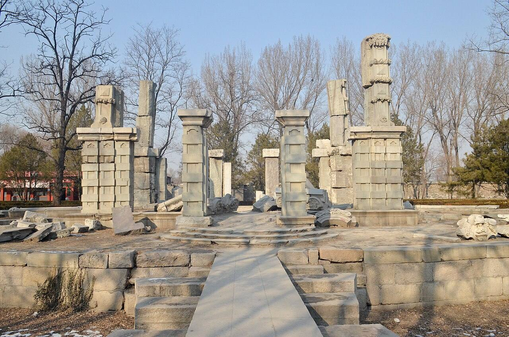

- **P0741** (sure): Fangwaiguan ruins in Yuanmingyuan (2014-03-31 15:40:53 (Commons)). https://commons.wikimedia.org/wiki/File:Fangwaiguan_ruins_in_Yuanmingyuan.jpg

  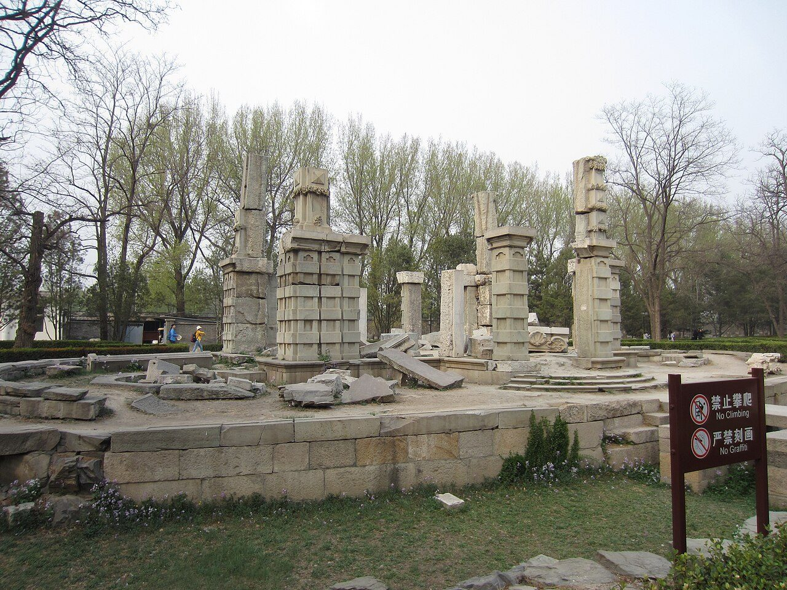

- **P0742** (sure): Fangwaiguan, Old Summer Palace (2021-02-17 17:20:34 (Commons)). https://commons.wikimedia.org/wiki/File:Fangwaiguan,_Old_Summer_Palace.jpg

  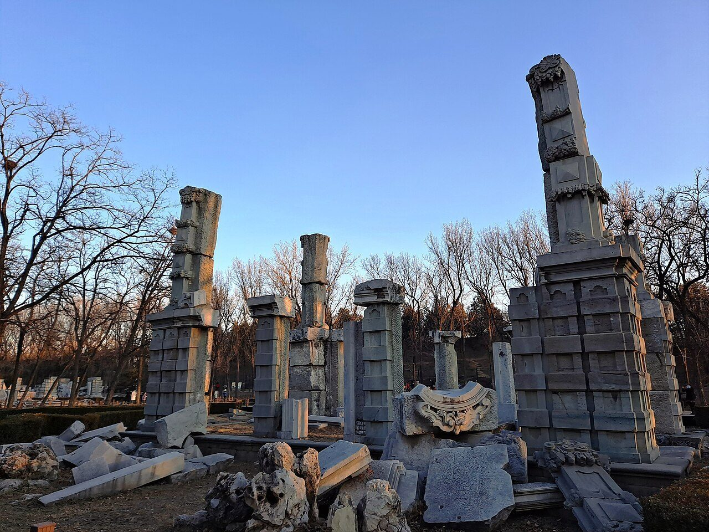

- **P0743** (sure): Yuanmingyuan Fangwaiguan 20120715 (2012-07-15 (Commons)). https://commons.wikimedia.org/wiki/File:Yuanmingyuan_Fangwaiguan_20120715.JPG

  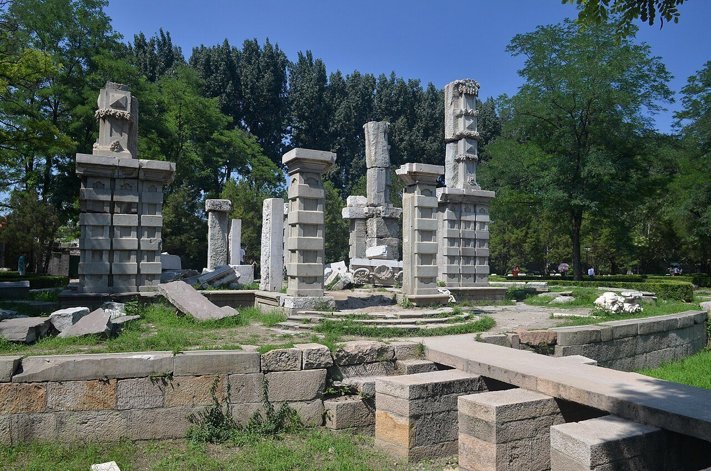

- **P0784** (sure): Stone kerb on the 五竹亭 ground, 方外观 piers behind (2012-11-06 (Commons)). https://commons.wikimedia.org/wiki/File:Beijing_2012_(8208680067).jpg

  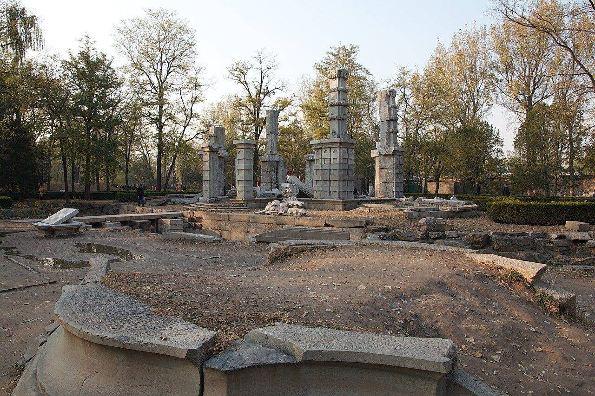

- **P0356** (likely): Fangwaiguan Stone Carving in Yuanmingyuan.jpg (2014-03-31 15:32:17 (Commons DateTimeOriginal)). https://commons.wikimedia.org/wiki/File:Fangwaiguan_Stone_Carving_in_Yuanmingyuan.jpg

  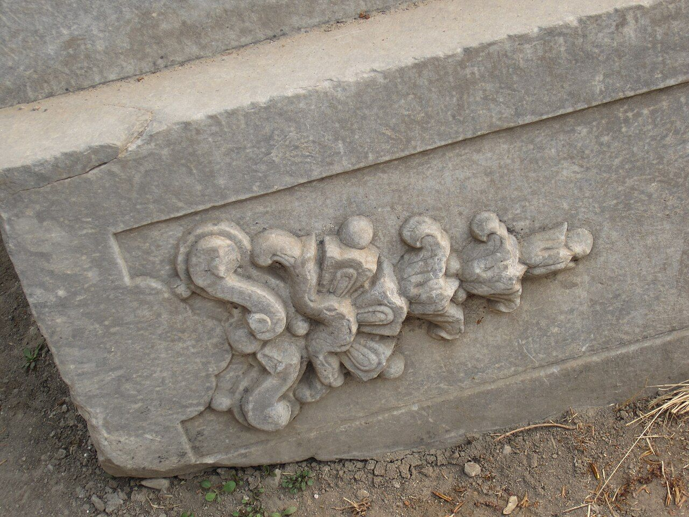

Of its halls: P0745 (XY06-N01).

## Texts and drawings (9)

- **E0951** (description, sure): Plate VIII: 方外观 Fangwai Guan. 1786-1803 · pp.180-181, Plate VIII · S258. https://archive.org/details/BIUSante_40644
  > Sous cet avant-corps est pratiqué un souterrain, dans lequel on pénètre par une porte, accompagnée à droite et à gauche d'une espèce d'œil de bœuf grillé;
  Small building on a terrace, three windows, rusticated pilasters at the ends. Under the projecting terrace a low room with a door and two grilled oeil-de-boeuf, thought to be for coolness. Round stairs at each end. On the left an open octagonal pavilion beyond a canal with a rich bridge.
- **E0952** (description, sure): Engraving 8: 方外观 Fangwai Guan. 1934 · pp.147-148 · S02. https://archive.org/details/historyofpekings00malo
  > From the sides of this building ostentatious circular stairways led downward from the second floor.
  Circular stairs at the sides from the second floor; bridge over the moat with carved marble scroll balustrades.
- **E2409** (description, sure): Detail gain, 3 plates against the catalogue thumbs. crops cmp08, cmp12, cmp15, cmp01 in palace_r6_tmp_plates · S71;S73;S700. 
  Same regions at 900 px. Plate 8 (P0048): window lattice, shading hatch and baluster ornament resolve, thumb showed them as texture. Plate 12 (P0052): door panel pattern and urn outlines clear. Plate 15 (P0055): water drops and fountain tiers separate, thumb mashes them. Original is 2.6 times wider than the thumb. Plate 1 Chester Beatty against Palace Museum: 2.7 times wider again and far darker: roof tile, hatch and capitals sharp.
- **E2431** (description, likely): Choutzé 1876: a visit to the European ruins. 1876 · p.231, as quoted S415 p.68 · S828. https://www.ghamu.org/wp-content/uploads/2022/09/Rabreau-YMY-2022.pdf
  > Ce qui reste de ces bâtiments de style italien est encore superbe. Un seul pavillon a conservé son toit fait dans le goût chinois, en tuiles violettes et vertes vernissées ; les autres n'ont debout que leurs quatre murs de pierre décorés d'ornements de faïence de toutes couleurs.
  Earliest dated colour statement of the roofs that I found: violet and green glazed tile on a Chinese-type roof, faience of all colours on stone walls. He also says the emperors never lived there: unsupported.
- **E0507** (description, likely): 圆明园五朝御制诗文集注 v4, editors' note on 西洋楼. 2020 edition · v4 p.120 · S361. https://www.yuanmingyuanpark.cn/xs/yjbg/202008/P020200803382796786124.pdf#page=123
  The editors walk the strip from west to east with completion dates and plaques: 谐奇趣 1751, 养雀笼 1759, then the fountains and the perspective walls, with their mechanical details. They put the whole at about 2% of the gardens.
- **E0544** (drawing, sure, search index only): 西洋楼水法图. 国家图书馆善本部 none shown · S310. https://www.mhymy.com/dasl/ysltd/7643.html
  Plan of the Xiyang Lou waterworks across its dozen sites; the record shows no shelf number. No image here; the site may ask a small payment for the full record.
- **E2440** (plan, sure): Teng Gu's preface on the photographs and plan. 1932-07 (preface), 1933 (book) · pp.3-5 of the preface, djvu pages 5-7 · S871. https://commons.wikimedia.org/wiki/File:CADAL11102995_%E5%9C%93%E6%98%8E%E5%9C%93%E6%AD%90%E5%BC%8F%E5%AE%AE%E6%AE%BF%E6%AE%98%E8%B7%A1.djvu
  Teng Gu says the photographs and the plan belonged to Ernst Boerschmann and were taken and drawn by Ohlmer, a customs official in Tianjin who lived in Beijing 1867-1879 and whose collection went to the Hildesheim museum. He argues they are earlier than those in Favier's Péking (1897), Combaz 1909, Perzynski 1920 and Münsterberg 1912, naming pages he compared. Fig. 13 is a recent photograph by Zhou Zuanwu; fig. 15 is copied from Favier p.264.
- **E2419** (plan, sure): Three plans by Antoine Durand: 1984 from Jin Xun at 1/500 inside Adam's 1/10000; 1985 from a survey of the whole site; 1987 fountain area from 128 surveyed points with a manual survey of all surface parts. 1984-87 · pp.125-129, Figs 4, 5, 9, 12, 16 · S603. https://www.persee.fr/doc/arasi_0004-3958_1988_num_43_1_1240
  The only published method statement for an on-site survey of the whole strip. Only excavation could fix the east fence of the gardens and the east edge of the basin. The west edge of the 线法山 gate and the ramp fix the geometry. See R0139-R0143. Plans without a printed scale in the copy I read.
- **E0554** (archaeology, sure): 西洋楼区域考古勘探报告. n.d. · mhymy 档案史料 12205, free part · S149. https://www.mhymy.com/dasl/12205.html
  Report's opening: the strip runs 860 m east-west, up to 300 m wide in the west and 65 m at its narrowest, about 70,000 m2, built 1747-1783. A central axis divides it into about five sections, each with its own north-south axis, thirteen units from 谐奇趣 to 线法墙. Survey results are paywalled.

**On the plan:** Drawn on the plan of the gardens (S01), labelled 方外观, 3x2 cells. https://artmuseum.princeton.edu/collections/objects/138657

## Reconstructions by others (7)

Modern interpretation, not evidence.
- **R0093** (render, likely): 方外观, image 765 in a gallery. posted 2019. https://www.thepaper.cn/newsDetail_forward_3323921 Research-only: link card.
- **R0144** (drawing, sure): Plan de l'aire du belvedere (Fig. 2 in S603), Jin Xun's drawing. 金勋 Jin Xun, Reproduced in Durand 1988, from Adam 1936, 1924 per S603. https://www.persee.fr/doc/arasi_0004-3958_1988_num_43_1_1240 Research-only: link card.
- **R0141** (drawing, sure): Fig. 9, Plan du belvedere (plan de restitution 1984). Antoine Durand, Mission Palais d'Ete, 1984 (published 1988). https://www.persee.fr/doc/arasi_0004-3958_1988_num_43_1_1240 Research-only: link card.
- **R0142** (drawing, sure): Fig. 12, Facade sud du belvedere (restitution 1984). Antoine Durand, Mission Palais d'Ete, 1984 (published 1988). https://www.persee.fr/doc/arasi_0004-3958_1988_num_43_1_1240 Research-only: link card.
- **R0139** (drawing, sure): Fig. 4, Plan d'ensemble (plan de restitution 1985). Antoine Durand, Mission Palais d'Ete, under Michele Pirazzoli-t'Serstevens, 1985 (published 1988). https://www.persee.fr/doc/arasi_0004-3958_1988_num_43_1_1240 Research-only: link card.
- **R0042** (AR/VR, likely): “再现圆明园” 数字导览系统: 12 scenes, 40 planned. 郭黛姮 team; 孙慧皎 (清城睿现) on the technical side, 清华大学; 清华控股 清城睿现数字科技研究院; 圆明园管理处, 2014. https://www.tsinghua.edu.cn/info/1182/39112.htm Research-only: link card.
- **R0004** (paper figure, likely): Digital restoration research and 3D model of Xieqiqu, ISPRS Annals II-5/W3. M. Gao, W. Piao, J. Guo, Re-Yuanmingyuan Company, 2015. https://isprs-annals.copernicus.org/articles/II-5-W3/75/2015/ Research-only: link card.

## Surviving comparable buildings, not this building (3)

- **T080** Fontainebleau, escalier du Fer-à-Cheval Horseshoe Stair, Fontainebleau, Fontainebleau, France. Comparable: same court, era or type, confidence C, standing: yes. Nothing: recorded so nobody repeats it Basis: Beurdeley 1971, reported and rejected by S415 p.81: he says the two stairs differ in form and in how they reach the building. https://www.ghamu.org/wp-content/uploads/2022/09/Rabreau-YMY-2022.pdf
  - P0698: Fontainebleau escalier. https://commons.wikimedia.org/wiki/File:Fontainebleau_escalier.JPG
  - P0699: Château de Fontainebleau 2011 (110). https://commons.wikimedia.org/wiki/File:Ch%C3%A2teau_de_Fontainebleau_2011_(110).JPG
- **T081** Sant'Andrea al Quirinale Sant'Andrea al Quirinale (Bernini), Rome. Comparable: same court, era or type, confidence C, standing: yes. Curved stairs only, at most Basis: S413 p.6, citing Elman 2003 p.246: the design of 方外观 is called reminiscent of this Jesuit novitiate church. No evidence offered beyond the likeness. https://journals.usj.edu.mo/index.php/mrijournal/article/download/75/84/222
  - P0700: Sant'Andrea al Quirinale September 2015-1. https://commons.wikimedia.org/wiki/File:Sant%27Andrea_al_Quirinale_September_2015-1.jpg
- **T082** 米拉贝尔宫 楼梯 Mirabell Palace, staircase balustrade, Salzburg. Comparable: same court, era or type, confidence C, standing: yes. Stone rail pattern at XY06 Basis: Lancaster 1948 reported in S415 p.83 for the 方外观 stair rail; S415 p.120 moves the same rail pattern back to Pozzo's Gesù rail, with a Hildebrandt parallel. https://www.ghamu.org/wp-content/uploads/2022/09/Rabreau-YMY-2022.pdf
  - P0701: Salzburg Schloss Mirabell Engelsstiege 01. https://commons.wikimedia.org/wiki/File:Salzburg_Schloss_Mirabell_Engelsstiege_01.jpg
  - P0702: Salzburg Schloss Mirabell Engelsstiege 03. https://commons.wikimedia.org/wiki/File:Salzburg_Schloss_Mirabell_Engelsstiege_03.jpg

## Evidence for the set of buildings

- Reconstructions and comparables for the whole garden, 西洋楼 Xiyang Lou: see GARDEN-XY

## Open questions

- Q9: Bay counts, plan against text
- Q49: Captions overruled by form (old photographs)
- Q56: Reconstructions against the period evidence
- Q64: The plan's scale and turn in this strip (Round 6)
- Q69: Colours of the 1780s state (Round 6)

<!-- generated:end -->

## Notes

<!-- Yours: regeneration never touches this part. It goes on the public site; what you write below a line holding only %% private %% stays in the research copy. -->
