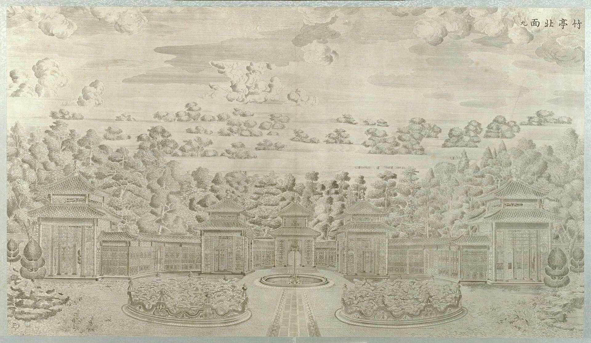

<!-- generated:start (scripts/building_pages.py): do not edit between these markers -->

# XY07: 五竹亭 Wuzhu Ting

Chu T'ing, Bamboo Pavilion · Xiyang Lou

**3D object:** 9 boxes. Open it: `/reconstruction/3d.html?b=XY07`

## What we know

- **Name:** 五竹亭 Wuzhu Ting (S02, S06, S56, S01 · confidence A)
- **English:** Chu T'ing, Bamboo Pavilion (S02, S06, S56, S01)
- **Garden:** Xiyang Lou (S02, S06, S56, S01)
- **Type:** european (S02, S06, S56, S01 · confidence A)
- **Destroyed:** Looted and burnt 1860; stone ruins stayed, further damage 1900 and after (S02 pp.142,218) (S02, S06, S56, S01)
- **Position:** 40.01156, 116.30381. S01 guess (S01 · confidence C)
- **Bays:** 5x1 on the plan (S02, S06, S56, S01)
- **Size in the inventory:** 6.0 × 6.0 m. typology xiyang_lou, C (S01)
- **Where the text puts it:** faced north toward the Fang Wai Kuan (S02 p.148) (S02, S06, S56, S01) *(research copy, not public)*
- **Note:** Copper engraving no. 9 per S02. 5 Chinese-style pavilions linked by covered walks; pool and wall survive; pavilions gone (S02). Bamboo-clad (S06). (S02, S06, S56, S01)
- **Plan reader's note:** The five pavilions are NOT drawn. Only the two kidney beds (9360,1173), (9424,1173) and small round pool (9396,1201) of engraving 9 are, on the axis of 方外观. plan_x,y inferred from engraving 9: row behind the pool. See notes.md. | plan: rect=150,30,0 inferred from engraving 9 (5 pavilions in a row; pool to row-width ratio). Nothing is drawn here on the plan. Keep C. (S01) *(research copy, not public)*
- **How it was read:** guess (S01) *(research copy, not public)*
- **Plan pixels:** 9396, 1240 (S01) *(research copy, not public)*

## Our model now

Simple massing of a European palace, assumed: sizes from the texts and the ruin polygons, position from the plan or the ruin. Not a reading of the 1786 engravings yet.

- **5 ×:** pavilion (Q15: not drawn on the plan; five in a row is a guess): 6 × 6 m, eave 3.5 m, ridge 5 m
- **4 ×:** gallery: 5 × 2.4 m, eave 2.6 m, ridge 3.2 m
- **Confidence:** C, all assumed

## Inside it (1)

- XY07-B0201

## Pictures (1)

- **P0049** (sure): 竹亭北面 (圆明园铜版画册 / 西洋楼铜版画, plate 九 of 二十; title and number printed on the plate) (1786 (Commons); Palace Museum: 清). https://commons.wikimedia.org/wiki/File%3A%E5%9C%86%E6%98%8E%E5%9B%AD%E9%93%9C%E7%89%88%E7%94%BB%E5%86%8C-7.jpg

  

## Texts and drawings (5)

- **E0953** (description, sure): Plate IX: 五竹亭 Wuzhu Ting. 1786-1803 · p.181, Plate IX · S258. https://archive.org/details/BIUSante_40644
  > Cinq pavillons en bambou, posés en hémicycle, et ouverts de tous côtés, d'où l'on voit les jets d'eau.
  Five bamboo pavilions set in a half circle, open all round, joined by bamboo galleries. Our model has them in a row (Q15, Q35).
- **E0954** (description, sure): Engraving 9: 五竹亭 Wuzhu Ting. 1934 · p.148 · S02. https://archive.org/details/historyofpekings00malo
  > It consisted of five pavilions in Chinese style connected by covered walks.
  Faced north towards 方外观. In Malone's time only two lotus pools, the fountain and the wall behind it were left (plate p.149).
- **E0951** (description, likely): Plate VIII: 方外观 Fangwai Guan. 1786-1803 · pp.180-181, Plate VIII · S258. https://archive.org/details/BIUSante_40644
  > Sous cet avant-corps est pratiqué un souterrain, dans lequel on pénètre par une porte, accompagnée à droite et à gauche d'une espèce d'œil de bœuf grillé;
  Small building on a terrace, three windows, rusticated pilasters at the ends. Under the projecting terrace a low room with a door and two grilled oeil-de-boeuf, thought to be for coolness. Round stairs at each end. On the left an open octagonal pavilion beyond a canal with a rich bridge.
- **E0544** (drawing, sure, search index only): 西洋楼水法图. 国家图书馆善本部 none shown · S310. https://www.mhymy.com/dasl/ysltd/7643.html
  Plan of the Xiyang Lou waterworks across its dozen sites; the record shows no shelf number. No image here; the site may ask a small payment for the full record.
- **E0554** (archaeology, sure): 西洋楼区域考古勘探报告. n.d. · mhymy 档案史料 12205, free part · S149. https://www.mhymy.com/dasl/12205.html
  Report's opening: the strip runs 860 m east-west, up to 300 m wide in the west and 65 m at its narrowest, about 70,000 m2, built 1747-1783. A central axis divides it into about five sections, each with its own north-south axis, thirteen units from 谐奇趣 to 线法墙. Survey results are paywalled.

**On the plan:** Its place is drawn on the plan of the gardens (S01), with no name written. https://artmuseum.princeton.edu/collections/objects/138657

## Open questions

- Q15: 五竹亭 (XY07) is not drawn
- Q35: Xiyang Lou massing (Round 2)
- Q48: Xiyang Lou

<!-- generated:end -->

## Notes

<!-- Yours: regeneration never touches this part. It goes on the public site; what you write below a line holding only %% private %% stays in the research copy. -->
