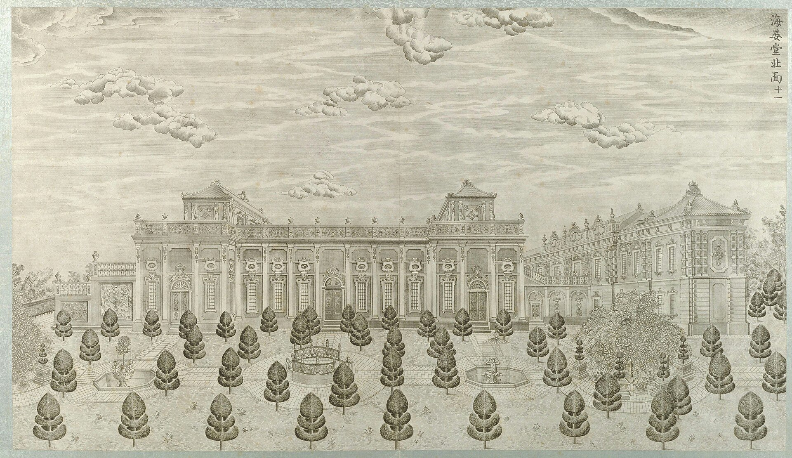
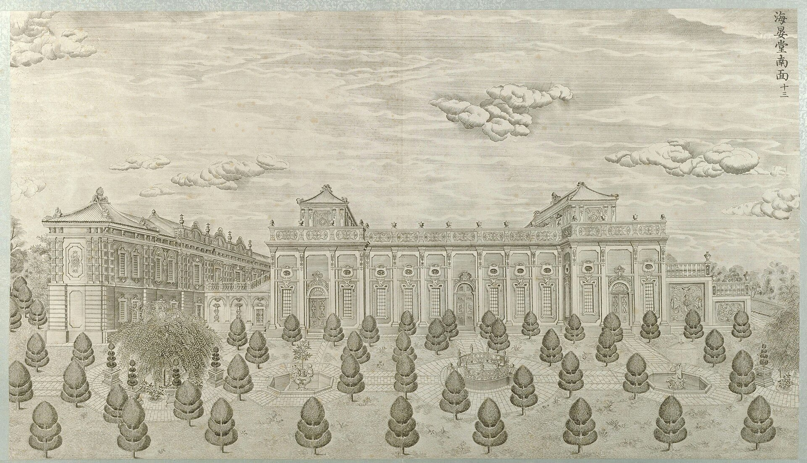
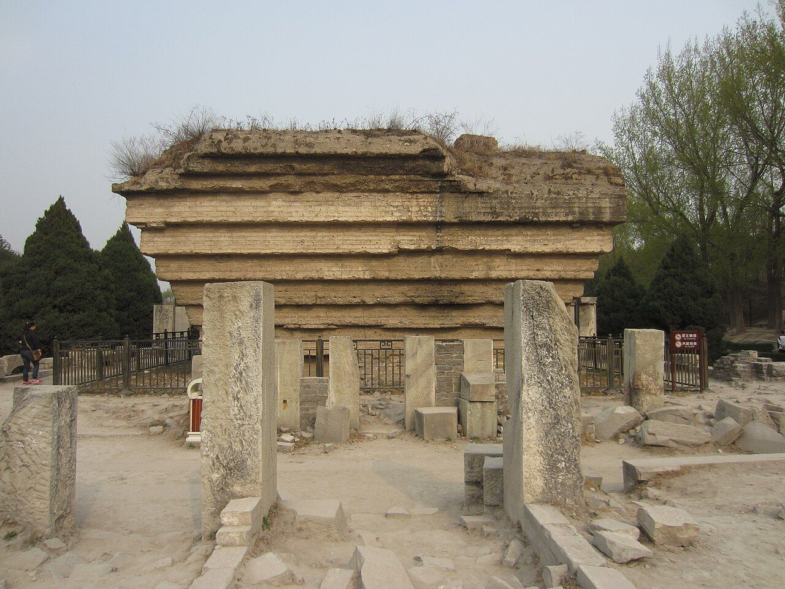
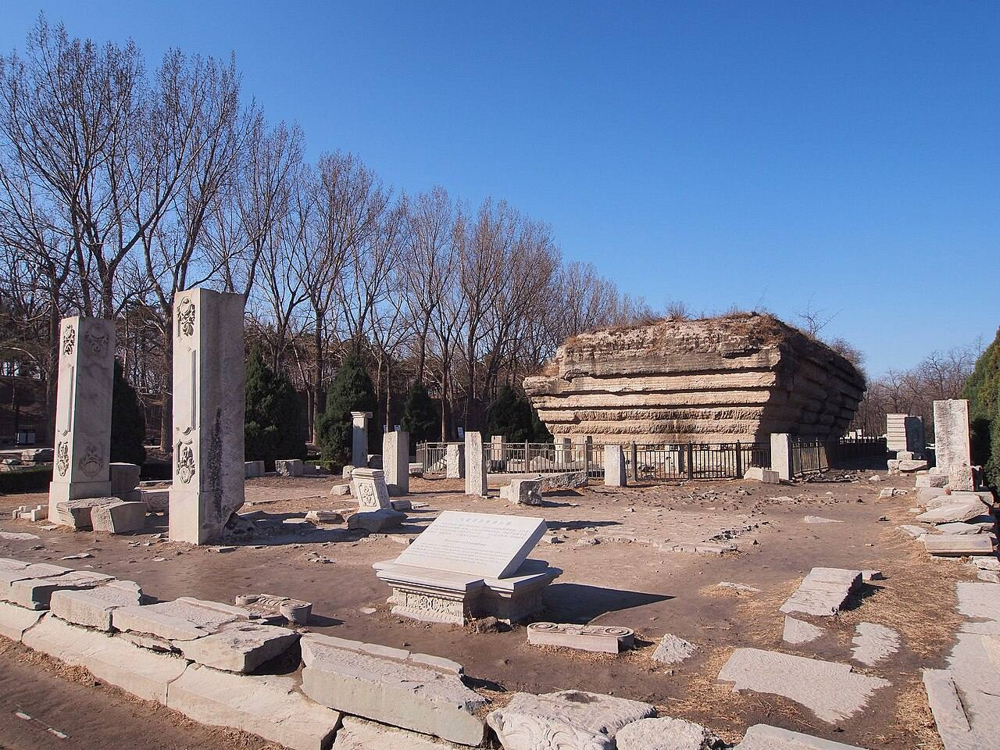
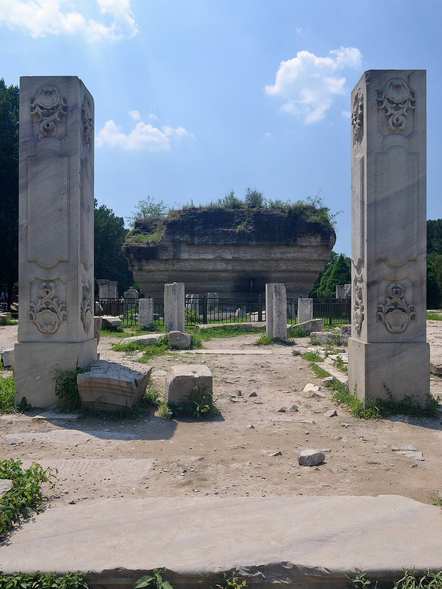
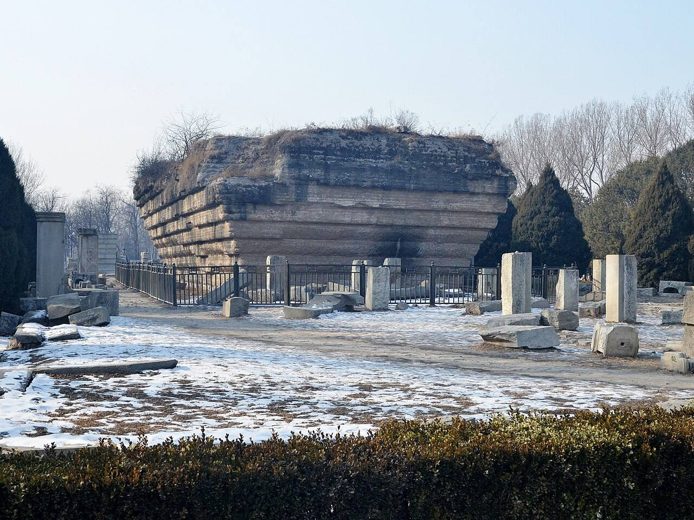
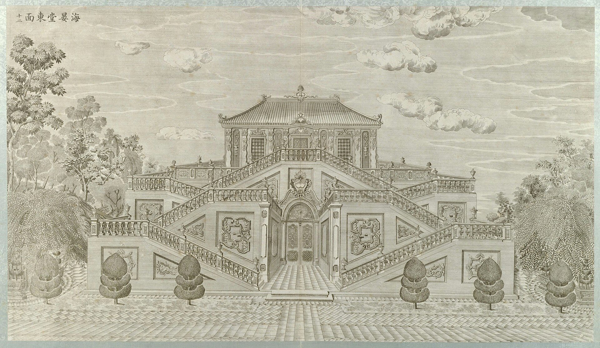

<!-- generated:start (scripts/building_pages.py): do not edit between these markers -->

# XY08-01: 蓄水池 (锡海) Xushui chi (Xi Hai)

Xiyang Lou

**3D object:** 1 box. Open it: `/reconstruction/3d.html?b=XY08-01`

**Part of:** XY08 海晏堂

## What we know

- **Name:** 蓄水池 (锡海) Xushui chi (Xi Hai) (S06, S02, S01, S258 · confidence B)
- **Written on the plan:** 海晏堂 (S01 · confidence B)
- **Garden:** Xiyang Lou (S06, S02, S01, S258)
- **Type:** other (S06, S02, S01, S258 · confidence B)
- **Destroyed:** 1860 (S06, S02, S01, S258)
- **Position:** 40.01195, 116.30545. S01 likely (S01 · confidence B)
- **Size in the inventory:** 30.6 × 27.5 m. S01 plan px / hall scale (S01)
- **Where the text puts it:** 后楼中央 (S06) (S06, S02, S01, S258) *(research copy, not public)*
- **Note:** S06: 东西8.55丈, 南北1.85丈, 深4.9尺 (lead). Benoist's machine out of use by 1786; reservoir filled by men with buckets; main pipes copper, as thick as a man's body (S258, pp.165-169). (S06, S02, S01, S258)
- **Plan reader's note:** rect=128,91,0. Long rectangle x 10026-10154, y 1062-1153, with the label 海晏堂. Inner lines suggest a tank between two side corridors: probably the reservoir 锡海 (Malone: reservoir between the hydraulic machines). Label names the whole group. (S01) *(research copy, not public)*
- **How it was read:** likely (S01) *(research copy, not public)*
- **Plan pixels:** 10090, 1107 (S01) *(research copy, not public)*

## Our model now

Simple massing of a European palace, assumed: sizes from the texts and the ruin polygons, position from the plan or the ruin. Not a reading of the 1786 engravings yet.

- **Box:** 27.36 × 10 m, european
- **Part:** 锡海 tank block; tank 27.36 x 5.72 x 1.44 m (S109, B), block C
- **Heights:** platform 0.5 m, eave 7 m, ridge 9 m above the ground
- **Roof:** hip 庑殿, glazed tile
- **Faces:** 174° from north
- **Confidence:** C, assumed

## Pictures (7)

- **P0051** (likely): 海晏堂北面 (圆明园铜版画册 / 西洋楼铜版画, plate 十一 of 二十; title and number printed on the plate) (1786 (Commons); Palace Museum: 清). https://commons.wikimedia.org/wiki/File%3A%E5%9C%86%E6%98%8E%E5%9B%AD%E9%93%9C%E7%89%88%E7%94%BB%E5%86%8C-9.jpg

  

- **P0053** (likely): 海晏堂南面 (圆明园铜版画册 / 西洋楼铜版画, plate 十三 of 二十; title and number printed on the plate) (1786 (Commons); Palace Museum: 清). https://commons.wikimedia.org/wiki/File%3A%E5%9C%86%E6%98%8E%E5%9B%AD%E9%93%9C%E7%89%88%E7%94%BB%E5%86%8C-10.jpg

  

- **P0349** (sure): Xunshuilou ruins in Yuanmingyuan.jpg (2014-03-31 15:48:48 (Commons DateTimeOriginal)). https://commons.wikimedia.org/wiki/File:Xunshuilou_ruins_in_Yuanmingyuan.jpg

  

- **P0359** (sure): 海晏堂蓄水池遗址 - Ruins of Haiyantang Reservoir - 2013.03 - panoramio.jpg (Taken on 13 March 2013 (Commons DateTimeOriginal)). https://commons.wikimedia.org/wiki/File:%E6%B5%B7%E6%99%8F%E5%A0%82%E8%93%84%E6%B0%B4%E6%B1%A0%E9%81%97%E5%9D%80_-_Ruins_of_Haiyantang_Reservoir_-_2013.03_-_panoramio.jpg

  

- **P0360** (sure): Yuanmingyuan Haiyantang the water tower Ruins 20120715.jpg (2012-07-15 13:09:11 (Commons DateTimeOriginal)). https://commons.wikimedia.org/wiki/File:Yuanmingyuan_Haiyantang_the_water_tower_Ruins_20120715.jpg

  

- **P0438** (sure): Yuanmingyuan Haiyantang Base of the reservoir in the water tower 20130126.JPG (2013-01-26 13:35:21 (Commons DateTimeOriginal)). https://commons.wikimedia.org/wiki/File:Yuanmingyuan_Haiyantang_Base_of_the_reservoir_in_the_water_tower_20130126.JPG

  

- **P0052** (guess): 海晏堂东面 (圆明园铜版画册 / 西洋楼铜版画, plate 十二 of 二十; title and number printed on the plate) (1786 (Commons); Palace Museum: 清). https://commons.wikimedia.org/wiki/File%3A%E5%9C%86%E6%98%8E%E5%9B%AD%E9%93%9C%E7%89%88%E7%94%BB%E5%86%8C-18.jpg

  

## Texts and drawings (5)

- **E0463** (description, sure): Bourgeois 1786: the fountains after Benoist. 1786 · pp.165-167 · S258. https://archive.org/details/BIUSante_40644
  > un ou deux jours auparavant, on emploie tant de monde à porter l'eau que le bassin immense du château d'eau est suffisamment rempli, et les eaux jouent sur le passage de l'Empereur.
  Benoist's machine had worn out and was not repaired. Men filled the reservoir a day or two before the emperor's visit. Main pipes as thick as a man's body, medium and large ones of copper.
- **E0958** (description, sure): Engravings 11 to 13: 海晏堂 north, east and south. 1934 · p.155 · S02. https://archive.org/details/historyofpekings00malo
  > The tallest parts of the building covered the hydraulic machines, and between them lay the reservoir.
  North front covers the machines, with the reservoir between; zigzag stairs at the east end lead to the reservoir; the south side repeats the north.
- **E0465** (description, likely): Amiot 1789: buckets from the river. 1789 · pp.168-169 · S258. https://archive.org/details/BIUSante_40644
  > ils les emploient à puiser dans la rivière avec des seaux d'osier, et à porter ces eaux dans le grand réservoir qui fournit aux différents canaux,
  From Mémoires des missionnaires XIV p.527, quoted by Delatour. Machines ruined, eunuchs afraid of blame; wicker buckets from the river close by.
- **E0960** (description, sure): 刘阳, 《圆明园的故事》, excerpt on 西洋楼, 澎湃. 2017 · excerpt, part 2 · S109. https://www.thepaper.cn/newsDetail_forward_1750908
  刘阳: 海晏堂, 1759, largest of the group; behind it the water tower, an H-plan solid building with a gallery below and balconies above, and a spiral stone stair on the east.
- **E0962** (archaeology, sure): 海晏堂蓄水楼 加固, 北京青年报 via 人民网. 2016-07-28 · news, 王猛 · S110. http://house.people.com.cn/n1/2016/0728/c164220-28590471.html
  The surviving water tower of 海晏堂 is a rammed-earth core like an inverted truncated pyramid, about 7.2 m high. Conservation in 2016 propped the four corners with about 160,000 bricks and added a concealed drain on top.

**On the plan:** Drawn on the plan of the gardens (S01), labelled 海晏堂. https://artmuseum.princeton.edu/collections/objects/138657

## Evidence for the set of buildings

- Evidence for the whole compound 海晏堂: see XY08
- Reconstructions and comparables for the whole garden, 西洋楼 Xiyang Lou: see GARDEN-XY
- Standing buildings comparable to a grand hall (not this building): see CLASS-grand_hall

## Open questions

None that name it.

<!-- generated:end -->

## Notes

<!-- Yours: regeneration never touches this part. It goes on the public site; what you write below a line holding only %% private %% stays in the research copy. -->
