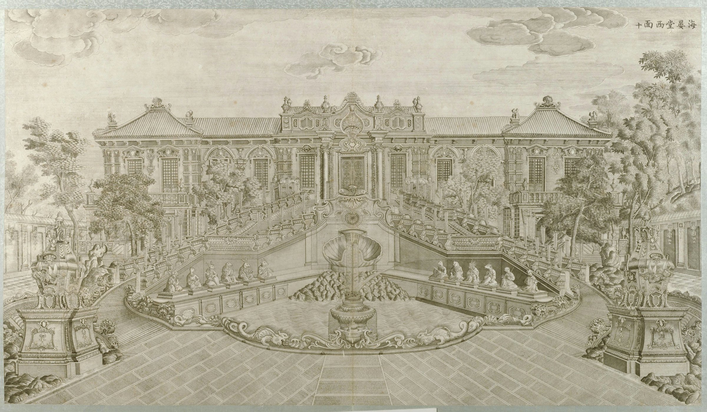
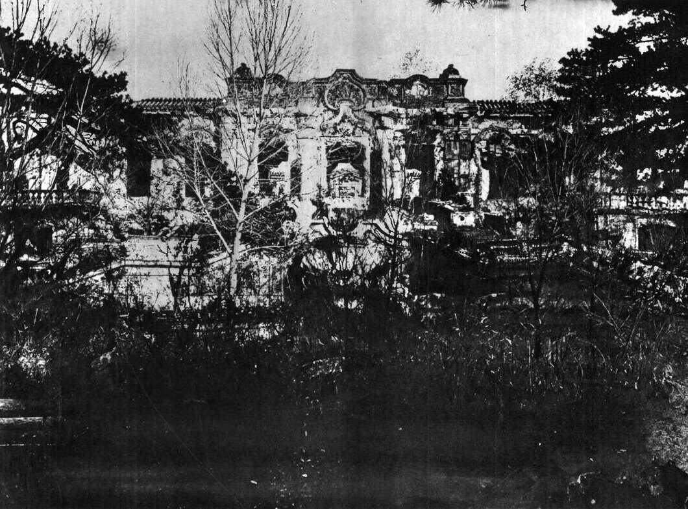
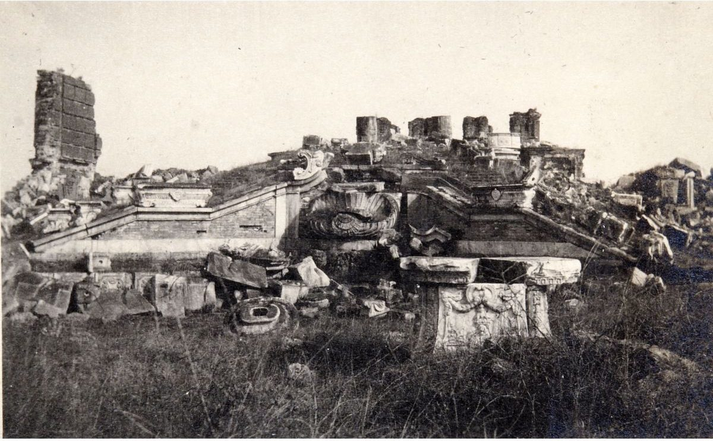
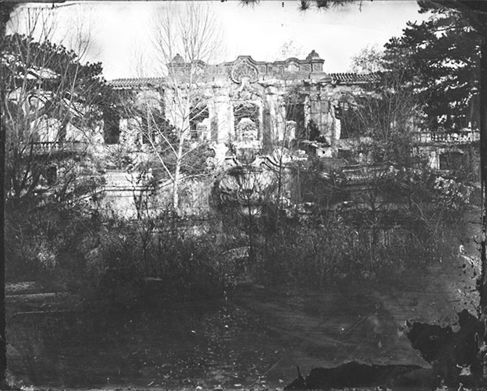
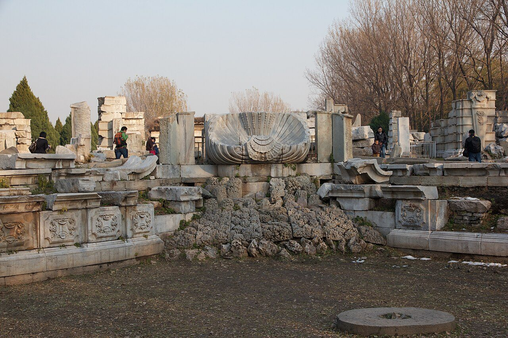
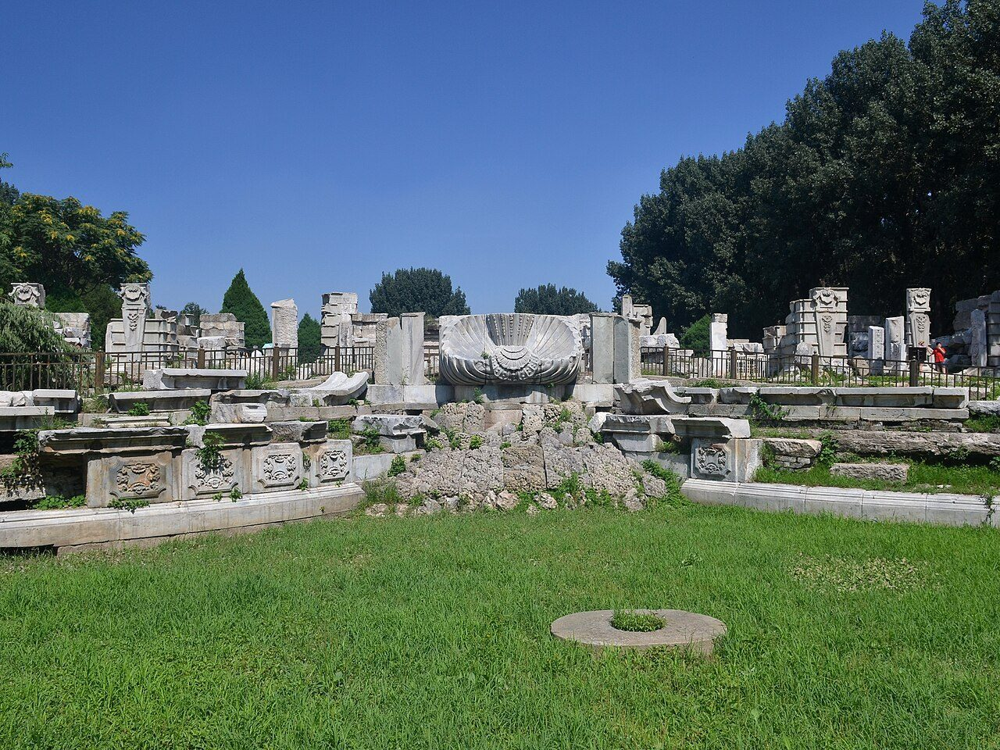
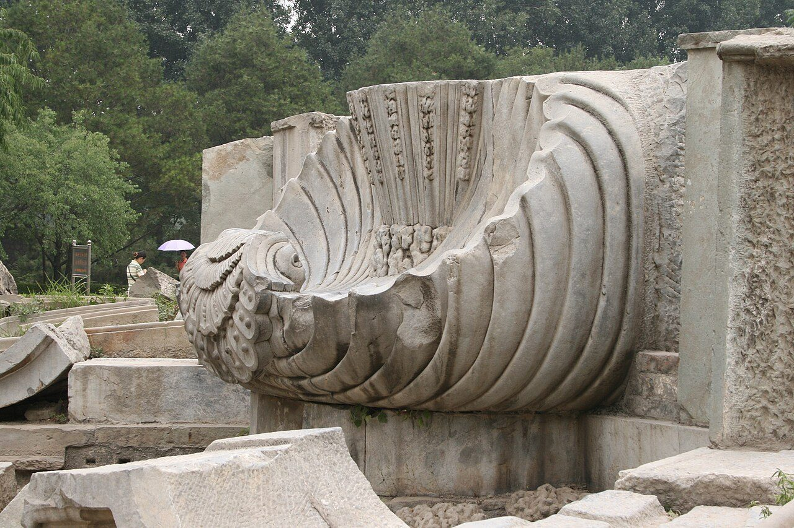
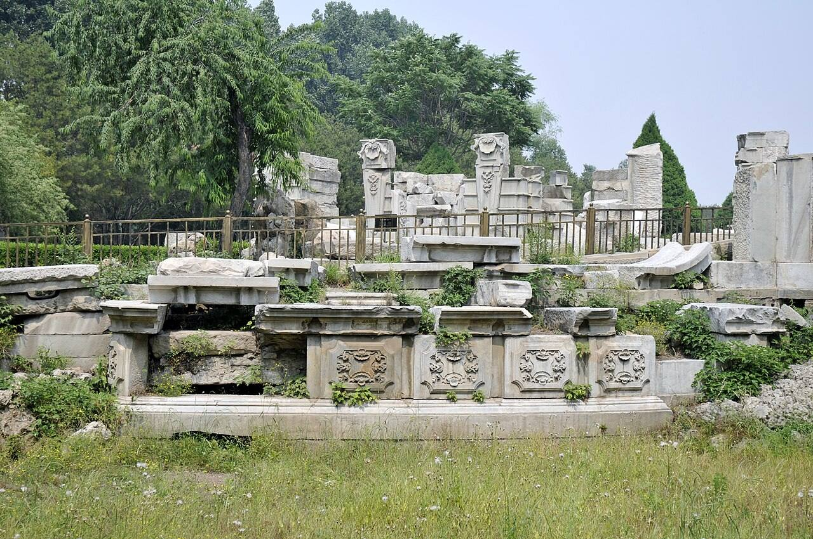

<!-- generated:start (scripts/building_pages.py): do not edit between these markers -->

# XY08-02: 十二时辰水法 Shi'er shichen shuifa

Xiyang Lou

**3D object:** 1 box. Open it: `/reconstruction/3d.html?b=XY08-02`

**Part of:** XY08 海晏堂

## What we know

- **Name:** 十二时辰水法 Shi'er shichen shuifa (S02, S06, S01, S258 · confidence A)
- **Written on the plan:** 十二时辰水法 pool (S01 · confidence A)
- **Garden:** Xiyang Lou (S02, S06, S01, S258)
- **Type:** european (S02, S06, S01, S258 · confidence A)
- **Destroyed:** 1860 (S02, S06, S01, S258)
- **Position:** 40.01181, 116.30457. S850;S01, moved in Round 6: on the ruin, research/xiyanglou/boxes.csv (S01 · confidence B)
- **Size in the inventory:** 15.3 × 18.8 m. stated: S01;S850, research/xiyanglou/boxes.csv (S01)
- **Where the text puts it:** West front pool, either side of the central pool (S02 pp.151-154) (S02, S06, S01, S258) *(research copy, not public)*
- **Note:** Water clock with 12 seated figures by Benoist (S02). Factual record only: keep this out of any playful content (CLAUDE.md). Triangular basin; twelve animals, six a side; large vase jet at the base, shell and rocks at the apex (S258, p.182). Round 6 replaced frontage 17.5 m. Round 6 replaced depth 27.5 m. (S02, S06, S01, S258)
- **Plan reader's note:** rect=91,73,0. Lens-shaped pool x 9649-9740, y 1069-1142; horseshoe double stairs N (x 9660-9735, y 1005-1060) and S (x 9665-9720, y 1160-1215) with hatched treads to the terrace. Drawn on a slip. (S01) *(research copy, not public)*
- **How it was read:** likely (S01) *(research copy, not public)*
- **Plan pixels:** 9695, 1105 (S01) *(research copy, not public)*

## Our model now

Simple massing of a European palace: position and footprint from the ruin, the plan or a survey, heights read from the plates of the 1780s (research/xiyanglou/boxes.csv). Not a detailed model yet; the figures and their methods are in the Dimensions block.

- **Box:** 15.3 × 18.8 m, european, pool
- **Part:** pool of the twelve hours
- **Faces:** 261.7° from north
- **Confidence:** C, assumed

## Pictures (11)

- **P0050** (sure): 海晏堂西面 (圆明园铜版画册 / 西洋楼铜版画, plate 十 of 二十; title and number printed on the plate) (1786 (Commons); Palace Museum: 清). https://commons.wikimedia.org/wiki/File%3A%E5%9C%86%E6%98%8E%E5%9B%AD%E9%93%9C%E7%89%88%E7%94%BB%E5%86%8C-8.jpg

  

- **P0774** (sure): 海宴堂西面 (第九圖) (1873 (S770; dated by S89); Teng Gu says only that Ohlmer took them 1867-1879, about sixty years before). https://commons.wikimedia.org/wiki/File:CADAL11102995_%E5%9C%93%E6%98%8E%E5%9C%93%E6%AD%90%E5%BC%8F%E5%AE%AE%E6%AE%BF%E6%AE%98%E8%B7%A1.djvu

  

- **P0303** (likely): Fotografija Ruševine cesaričine palače v Stari poletni palači (album: "Yüen-Ming-Yüen: Nr. 353 gegenwärtig") (20th c., album bought 1914-1920 (holder)). https://vazcollections.si/predmeti/fotografija-rusevine-cesaricine-palace-v-stari-poletni-palaci-2/

  

- **P0721** (sure): Haiyantang, west façade (S770 caption), Ohlmer negative H (1873 (S770; dated by S89)). https://visualizingcultures.mit.edu/garden_perfect_brightness_03/ymy303/e502.htm Research-only: link card.

  

- **P0307** (likely): Sirén: Illustrated: 272:209 (Imperial Palaces pl. 209) (1922 (holder)). http://kulturarvsdata.se/SMVK-OM/Bildarkiv/199625 Research-only: link card.
- **P0309** (likely): Sirén: Yuanmingyuan (Old summer palace): Ruins. (undated; Sirén 1921-23). http://kulturarvsdata.se/SMVK-OM/Bildarkiv/199631 Research-only: link card.
- **P0322** (likely): Sirén: Enligt text på fotokuvert: Yuanmingyuan. (undated; Sirén 1921-23). http://kulturarvsdata.se/SMVK-OM/Bildarkiv/203242 Research-only: link card.
- **P0747** (sure): Beijing 2012 (8209773832) (2012-11-06 15:17 (Commons)). https://commons.wikimedia.org/wiki/File:Beijing_2012_(8209773832).jpg

  

- **P0751** (sure): Yuanmingyuan Haiyantang 20120715 (2012-07-15 (Commons)). https://commons.wikimedia.org/wiki/File:Yuanmingyuan_Haiyantang_20120715.JPG

  

- **P0753** (sure): Yuanmingyuan (9865253515) (2007-06-23 10:53 (Commons)). https://commons.wikimedia.org/wiki/File:Yuanmingyuan_(9865253515).jpg

  

- **P0439** (likely): 海晏堂 安放喷水兽首的地方 - panoramio.jpg (Taken on 27 May 2011 (Commons DateTimeOriginal)). https://commons.wikimedia.org/wiki/File:%E6%B5%B7%E6%99%8F%E5%A0%82_%E5%AE%89%E6%94%BE%E5%96%B7%E6%B0%B4%E5%85%BD%E9%A6%96%E7%9A%84%E5%9C%B0%E6%96%B9_-_panoramio.jpg

  

## Texts and drawings (4)

- **E2424** (text, sure): Malone on the water clock and a later set in the palace. 1934 · p.153-154 and n. p.154 · S02. https://archive.org/details/historyofpekings00malo
  > The hydraulic machinery got out of order after the death of Father Benoit. No one could repair it and the water had to be raised more clumsily by buckets and ropes
  Malone's note also warns of a second set: bronze shichen in the Winter Palace, holding electric lights, said to have been made for the Empress Dowager Cixi and inferior to the plate's. So not every bronze zodiac figure in Beijing is from here.
- **E2435** (text, likely): Delatour on 海晏堂's jets, compared with Saint-Cloud and Versailles. 1803 · pp.181-182 · S258. https://archive.org/details/BIUSante_40644
  > Ils produisent le même effet que les jets d'eau qui bordent la cascade de Saint-Cloud, ou ceux du perron qui, à Versailles, conduit de la fontaine du dragon à la terrasse.
  The basis of the Versailles comparisons. An effect, stated by a Paris reader of the plates. Same for Malone's 'buffets d'eaux' from Lettres édifiantes xxiv p.421, which is a Jesuit's own likeness. Both are comparisons of effect, never a statement that it was the model.
- **E0955** (description, sure): Plate X: 海晏堂 Haiyan Tang, west, and the water clock. 1786-1803 · pp.181-182, Plate X · S258. https://archive.org/details/BIUSante_40644
  > Sur deux des côtés du triangle, sont placés douze animaux de différentes espèces, six de chaque côté.
  Ten bays with a central block and attic and end pavilions; a landing with two stairs, jets from vases along both ramps as at St Cloud and Versailles. A triangular basin; animals spout towards the centre; at the apex towards the building a rock group with a shell; the largest jet from a vase at the base; two pyramids at the sides. He says animals spout by hour count.
- **E0957** (description, sure): Engraving 10: 海晏堂 Haiyan Tang, west front and water clock. 1934 · pp.148-154 · S02. https://archive.org/details/historyofpekings00malo
  > There two broad staircases one swinging to the right and one to the left, met before the main entrance on the level of the second floor.
  Largest of the group; held Benoist's pumps and the main reservoir. Fifty small jets on the stair balustrades fed three basins. Twelve seated animal figures, one for each two-hour period, spouted in turn to a larger fountain in the pool. After Benoist's death the machinery failed and water was raised by buckets and ropes (Benoist 1786, Amiot 1787, per n.). Malone compares bronze figures in the Winter Palace, made later.

**On the plan:** Drawn on the plan of the gardens (S01), labelled 十二时辰水法 pool. https://artmuseum.princeton.edu/collections/objects/138657

## Evidence for the set of buildings

- Evidence for the whole compound 海晏堂: see XY08
- Reconstructions and comparables for the whole garden, 西洋楼 Xiyang Lou: see GARDEN-XY
- Standing buildings comparable to a main hall (not this building): see CLASS-main_hall

## Open questions

None that name it.

<!-- generated:end -->

## Notes

<!-- Yours: regeneration never touches this part. It goes on the public site; what you write below a line holding only %% private %% stays in the research copy. -->
