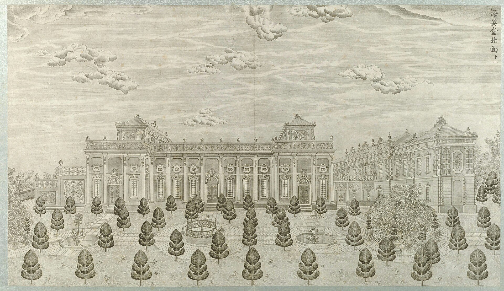
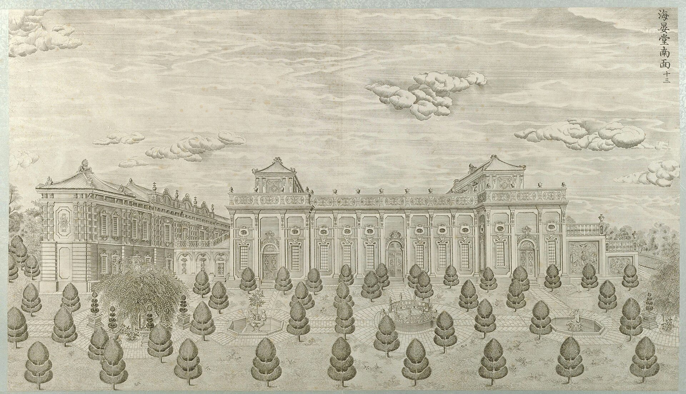

<!-- generated:start (scripts/building_pages.py): do not edit between these markers -->

# XY08-N01: 西水车房 Xi Shuiche Fang

west waterwheel house · Xiyang Lou

**3D object:** 1 box. Open it: `/reconstruction/3d.html?b=XY08-N01`

**Part of:** XY08 海晏堂

## What we know

- **Name:** 西水车房 Xi Shuiche Fang (S01, S02 · confidence B)
- **English:** west waterwheel house (S01, S02)
- **Written on the plan:** 西水?房 (S01 · confidence B)
- **Garden:** Xiyang Lou (S01, S02)
- **Type:** other (S01, S02 · confidence B)
- **Destroyed:** 1860 (S01, S02)
- **Position:** 40.01187, 116.30529. S850;S01, moved in Round 6: on the ruin, research/xiyanglou/boxes.csv (S01 · confidence B)
- **Size in the inventory:** 25.8 × 13.4 m. stated: S01;S850;S71;S02, research/xiyanglou/boxes.csv (S01)
- **Note:** Round 6 replaced frontage 29.4 m. Round 6 replaced depth 19.3 m. (S01, S02)
- **Plan reader's note:** rect=64,123,0. Box x 9967-10031, y 1046-1169, label in the inner rectangle. Third char drawn like 章 or 車; 西水車房 (west waterwheel house) would fit the hydraulics, not certain. (S01) *(research copy, not public)*
- **How it was read:** likely (S01) *(research copy, not public)*
- **Plan pixels:** 9998, 1107 (S01) *(research copy, not public)*

## Our model now

Modelled from the four plates of 1783-86 (10 west, 11 north, 12 east, 13 south), Ohlmer's photograph of the west front of 1873 and the ruin photographs of about 1902-1920, the plan S01 and the ruin's footprint; every figure is a reading (C) unless the row says otherwise. Faces no picture shows (the stairs' outer walls, the reservoir on the roof, the west wheel house's west face) are carried round from the documented parts (assumed).

- **West block:** 47.2 m along the west front, eleven bays on two storeys (S310, B): upper floor and terrace at 7.2 m, cornice 13.2 m, end pavilions under square roofs to 16.5 m, the attic's pediment 17.5 m (plate 10, C)
- **Stairs:** two diagonal flights 5 m wide from the terrace to the court, a landing half-way, carved balustrades (plate 10, C); in plan S01's stair blocks (B)
- **Water clock 十二时辰水法:** the pool between the stairs with a convex front (S01's slip, plate 10, C); twelve seated figures with bronze heads about 0.5 m high (S849, B) on plinths 1.5 m high, six a side; south 鼠 虎 龙 马 猴 狗, north 牛 兔 蛇 羊 鸡 猪 (S823, C); the great shell and the vase fountain on the axis (plate 10, P0303, C)
- **Where the heads are:** seven are in China: ox, tiger, monkey and boar at the Poly Art Museum; horse at the garden since 2020; rat and hare at the National Museum since 2013. Dragon, snake, goat, rooster and dog: whereabouts unknown (S822, S823, S817)
- **Water building 蓄水楼:** thirteen bays, 38.4 m, its cornice and roof terrace at 8.1 m (plates 11-13, C); the reservoir 锡海 27.36 × 5.92 m, 1.44 m deep (S310, S06, B; S600, A) on the roof between two raised tiers with hip roofs to 14.6 m (plates 11, 12, C)
- **East stairs:** three flights in a zig-zag to landings at 3.5, 4.8 and 8.1 m over the passage door (plate 12, C)
- **Colours:** white stone, light wall panels, peacock-green glazed tiles with yellow ridges (S310, B, as said of the wing roofs), red-brown bronze heads (S823)

## Pictures (2)

- **P0051** (guess): 海晏堂北面 (圆明园铜版画册 / 西洋楼铜版画, plate 十一 of 二十; title and number printed on the plate) (1786 (Commons); Palace Museum: 清). https://commons.wikimedia.org/wiki/File%3A%E5%9C%86%E6%98%8E%E5%9B%AD%E9%93%9C%E7%89%88%E7%94%BB%E5%86%8C-9.jpg

  

- **P0053** (guess): 海晏堂南面 (圆明园铜版画册 / 西洋楼铜版画, plate 十三 of 二十; title and number printed on the plate) (1786 (Commons); Palace Museum: 清). https://commons.wikimedia.org/wiki/File%3A%E5%9C%86%E6%98%8E%E5%9B%AD%E9%93%9C%E7%89%88%E7%94%BB%E5%86%8C-10.jpg

  

## Texts and drawings (0)

None of its own.

**On the plan:** Drawn on the plan of the gardens (S01), labelled 西水?房 (? marks an unread character). https://artmuseum.princeton.edu/collections/objects/138657

## Evidence for the set of buildings

- Evidence for the whole compound 海晏堂: see XY08
- Reconstructions and comparables for the whole garden, 西洋楼 Xiyang Lou: see GARDEN-XY
- Standing buildings comparable to a main hall (not this building): see CLASS-main_hall

**Searched and not found:** No text or drawing names it in 日下旧闻考 j83, the Qianlong poems on Kanripo, Delatour 1803, Malone 1934, the witnesses of 1860, what search indexes show of the Yangshi Lei drawings.

## Open questions

- Q74: Two buildings called 蓄水楼 (Round 6)

<!-- generated:end -->

## Notes

<!-- Yours: regeneration never touches this part. It goes on the public site; what you write below a line holding only %% private %% stays in the research copy. -->
