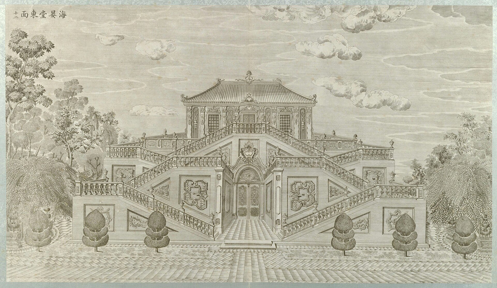
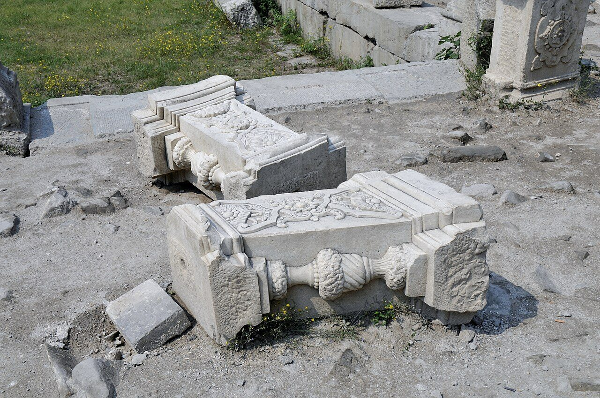

<!-- generated:start (scripts/building_pages.py): do not edit between these markers -->

# XY08-N02: Hall without a name on the plan

east block with the zig-zag stairs, the east machine house · Xiyang Lou

**3D object:** 1 box. Open it: `/reconstruction/3d.html?b=XY08-N02`

**Part of:** XY08 海晏堂

## What we know

- **English:** east block with the zig-zag stairs, the east machine house (S01, S02)
- **Garden:** Xiyang Lou (S01, S02)
- **Type:** other (S01, S02 · confidence B)
- **Destroyed:** 1860 (S01, S02)
- **Position:** 40.01192, 116.30580. S850;S01, moved in Round 6: on the ruin, research/xiyanglou/boxes.csv (S01 · confidence B)
- **Bays:** 4 in the texts / 2x4 on the plan (S01, S02)
- **Size in the inventory:** 26.1 × 23.1 m. stated: S01;S850;S71, research/xiyanglou/boxes.csv (S01)
- **Note:** Round 6 replaced frontage 10.0 m. Round 6 replaced depth 28.1 m. (S01, S02)
- **Plan reader's note:** East end block x 10154-10264, y 1051-1175 split by an E-W passage y 1101-1120. N-S strip x 10154-10168 on its west. May be the east hydraulic house and zig-zag stairs of engraving 12. (S01) *(research copy, not public)*
- **How it was read:** likely (S01) *(research copy, not public)*
- **Plan pixels:** 10218, 1080 (S01) *(research copy, not public)*

## Our model now

Simple massing of a European palace: position and footprint from the ruin, the plan or a survey, heights read from the plates of the 1780s (research/xiyanglou/boxes.csv). Not a detailed model yet; the figures and their methods are in the Dimensions block.

- **Box:** 26.1 × 23.1 m, european
- **Part:** east block with the zig-zag stairs, N and S parts
- **Heights:** platform 0.5 m, eave 10.3 m, ridge 13.6 m above the ground
- **Roof:** hip 庑殿, glazed tile
- **Faces:** 81.7° from north
- **Drawn:** by the stone kit: base, pilasters, arched openings, entablature, balustrade and a glazed roof, as the plates of the 1780s show such fronts; the kit's reading, C, not a detailed model
- **Confidence:** C, assumed

## Pictures (2)

- **P0052** (likely): 海晏堂东面 (圆明园铜版画册 / 西洋楼铜版画, plate 十二 of 二十; title and number printed on the plate) (1786 (Commons); Palace Museum: 清). https://commons.wikimedia.org/wiki/File%3A%E5%9C%86%E6%98%8E%E5%9B%AD%E9%93%9C%E7%89%88%E7%94%BB%E5%86%8C-18.jpg

  

- **P0754** (guess): 海晏堂 散落在地上的制作精美的石栏部件 - panoramio (Taken on 27 May 2011 (Commons)). https://commons.wikimedia.org/wiki/File:%E6%B5%B7%E6%99%8F%E5%A0%82_%E6%95%A3%E8%90%BD%E5%9C%A8%E5%9C%B0%E4%B8%8A%E7%9A%84%E5%88%B6%E4%BD%9C%E7%B2%BE%E7%BE%8E%E7%9A%84%E7%9F%B3%E6%A0%8F%E9%83%A8%E4%BB%B6_-_panoramio.jpg

  

## Texts and drawings (1)

- **E2414** (drawing, likely): 东水车房 (海晏堂东水车房), 墨线 底样, 503 x 453 mm. 不详 · 国家图书馆善本部 样094-4号 · S310. https://www.mhymy.com/dasl/ysltd/12168.html
  Same item as E0961, now viewed. Free text gives 海晏堂's plan as an E-W rectangle: 11-bay west main building, H-shaped water building behind, fountains west, north and south. Rest behind a paywall.

**On the plan:** Drawn on the plan of the gardens (S01) with no label, 2x4 cells: a building stood here, its name unknown. https://artmuseum.princeton.edu/collections/objects/138657

## Evidence for the set of buildings

- Evidence for the whole compound 海晏堂: see XY08
- Reconstructions and comparables for the whole garden, 西洋楼 Xiyang Lou: see GARDEN-XY
- Standing buildings comparable to a main hall (not this building): see CLASS-main_hall

## Open questions

None that name it.

<!-- generated:end -->

## Notes

<!-- Yours: regeneration never touches this part. It goes on the public site; what you write below a line holding only %% private %% stays in the research copy. -->
