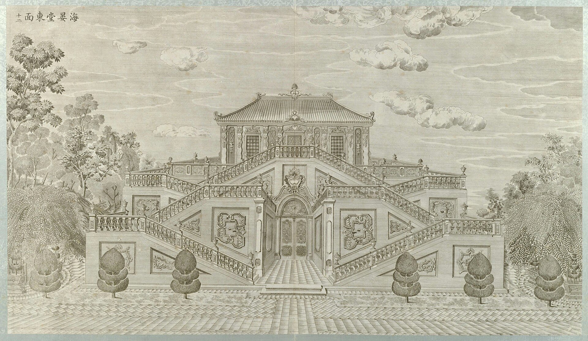

<!-- generated:start (scripts/building_pages.py): do not edit between these markers -->

# XY08-N02: Hall without a name on the plan

Xiyang Lou

**3D object:** 1 box. Open it: `/reconstruction/3d.html?b=XY08-N02`

**Part of:** XY08 海晏堂

## What we know

- **Garden:** Xiyang Lou (S01)
- **Type:** other (S01 · confidence B)
- **Destroyed:** 1860 (S01)
- **Position:** 40.01204, 116.30576. S01 likely (S01 · confidence B)
- **Bays:** 4 in the texts / 2x4 on the plan (S01)
- **Size in the inventory:** 10.0 × 28.1 m. S01 plan px / hall scale (S01)
- **Plan reader's note:** East end block x 10154-10264, y 1051-1175 split by an E-W passage y 1101-1120. N-S strip x 10154-10168 on its west. May be the east hydraulic house and zig-zag stairs of engraving 12. (S01) *(research copy, not public)*
- **How it was read:** likely (S01) *(research copy, not public)*
- **Plan pixels:** 10218, 1080 (S01) *(research copy, not public)*

## Our model now

Simple massing of a European palace, assumed: sizes from the texts and the ruin polygons, position from the plan or the ruin. Not a reading of the 1786 engravings yet.

- **Box:** 9.77 × 26.5 m, main hall
- **Part:** a block drawn on the plan in the Xiyang Lou strip; heights a guess
- **Heights:** platform 0.8 m, eave 7 m, ridge 9.5 m above the ground
- **Roof:** hip 庑殿, glazed tile
- **Faces:** 80.5° from north
- **Fit:** reduced towards the size drawn on the plan, to stand clear of its neighbours or the water
- **Confidence:** C, assumed

## Pictures (1)

- **P0052** (likely): 海晏堂东面 (圆明园铜版画册 / 西洋楼铜版画, plate 十二 of 二十; title and number printed on the plate) (1786 (Commons); Palace Museum: 清). https://commons.wikimedia.org/wiki/File%3A%E5%9C%86%E6%98%8E%E5%9B%AD%E9%93%9C%E7%89%88%E7%94%BB%E5%86%8C-18.jpg

  

## Texts and drawings (0)

None of its own.

**On the plan:** Drawn on the plan of the gardens (S01) with no label, 2x4 cells: a building stood here, its name unknown. https://artmuseum.princeton.edu/collections/objects/138657

## Evidence for the set of buildings

- Evidence for the whole compound 海晏堂: see XY08
- Reconstructions and comparables for the whole garden, 西洋楼 Xiyang Lou: see GARDEN-XY
- Standing buildings comparable to a main hall (not this building): see CLASS-main_hall

**Searched and not found:** This block has no name on the plan or in the texts, so no source can be searched for it by name.

## Open questions

None that name it.

<!-- generated:end -->

## Notes

<!-- Yours: regeneration never touches this part. It goes on the public site; what you write below a line holding only %% private %% stays in the research copy. -->
