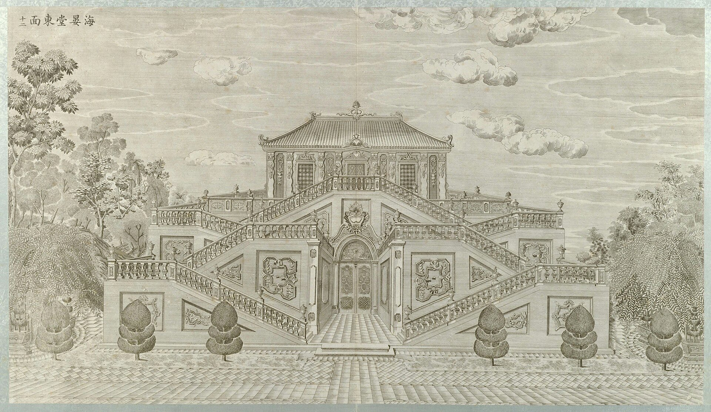

<!-- generated:start (scripts/building_pages.py): do not edit between these markers -->

# XY08-N03: Hall without a name on the plan

same block, south part · Xiyang Lou

**3D object:** 1 box. Open it: `/reconstruction/3d.html?b=XY08-N03`

**Part of:** XY08 海晏堂

## What we know

- **English:** same block, south part (S01, S02)
- **Garden:** Xiyang Lou (S01, S02)
- **Type:** other (S01, S02 · confidence B)
- **Destroyed:** 1860 (S01, S02)
- **Position:** 40.01188, 116.30578. S01 likely (S01 · confidence B)
- **Bays:** 4 in the texts / 3x4 on the plan (S01, S02)
- **Size in the inventory:** 13.2 × 28.4 m. S01 plan px / hall scale (S01)
- **Note:** Part of XY08-N02: South half of the block in XY08-N02, split only by the passage. (S01;S02, Round 6). (S01, S02)
- **Plan reader's note:** See XY08-N02. (S01) *(research copy, not public)*
- **How it was read:** likely (S01) *(research copy, not public)*
- **Plan pixels:** 10214, 1148 (S01) *(research copy, not public)*

## Our model now

Simple massing of a European palace: position and footprint from the ruin, the plan or a survey, heights read from the plates of the 1780s (research/xiyanglou/boxes.csv). Not a detailed model yet; the figures and their methods are in the Dimensions block.

- **Box:** 26.1 × 23.1 m, european
- **Part:** east block with the zig-zag stairs, N and S parts
- **Heights:** platform 0.5 m, eave 10.3 m, ridge 13.6 m above the ground
- **Roof:** hip 庑殿, glazed tile
- **Faces:** 81.7° from north
- **Drawn:** by the stone kit: base, pilasters, arched openings, entablature, balustrade and a glazed roof, as the plates of the 1780s show such fronts; the kit's reading, C, not a detailed model
- **Confidence:** C, assumed

## Pictures (1)

- **P0052** (likely): 海晏堂东面 (圆明园铜版画册 / 西洋楼铜版画, plate 十二 of 二十; title and number printed on the plate) (1786 (Commons); Palace Museum: 清). https://commons.wikimedia.org/wiki/File%3A%E5%9C%86%E6%98%8E%E5%9B%AD%E9%93%9C%E7%89%88%E7%94%BB%E5%86%8C-18.jpg

  

## Texts and drawings (0)

None of its own.

**On the plan:** Drawn on the plan of the gardens (S01) with no label, 3x4 cells: a building stood here, its name unknown. https://artmuseum.princeton.edu/collections/objects/138657

## Evidence for the set of buildings

- Evidence for the whole compound 海晏堂: see XY08
- Reconstructions and comparables for the whole garden, 西洋楼 Xiyang Lou: see GARDEN-XY
- Standing buildings comparable to a main hall (not this building): see CLASS-main_hall

**Searched and not found:** This block has no name on the plan or in the texts, so no source can be searched for it by name.

## Open questions

None that name it.

<!-- generated:end -->

## Notes

<!-- Yours: regeneration never touches this part. It goes on the public site; what you write below a line holding only %% private %% stays in the research copy. -->
