<!-- generated:start (scripts/building_pages.py): do not edit between these markers -->

# XY08: 海晏堂 Haiyan Tang

Hai Yen T'ang, Hall of Peaceful Seas · Xiyang Lou

**3D object:** 1 box. Open it: `/reconstruction/3d.html?b=XY08`

## What we know

- **Name:** 海晏堂 Haiyan Tang (S02, S06, S56, S01, S109, S110, S03, S210 · confidence A)
- **English:** Hai Yen T'ang, Hall of Peaceful Seas (S02, S06, S56, S01, S109, S110, S03, S210)
- **Garden:** Xiyang Lou (S02, S06, S56, S01, S109, S110, S03, S210)
- **Type:** european (S02, S06, S56, S01, S109, S110, S03, S210 · confidence A)
- **Changed:** Named 海宴堂 in 1856 on the emperor's route: standing and visited then (S02, S06, S56, S01, S109, S110, S03, S210)
- **Destroyed:** Looted and burnt 1860; stone ruins stayed, further damage 1900 and after (S02 pp.142,218) (S02, S06, S56, S01, S109, S110, S03, S210)
- **Position:** 40.01188, 116.30490. S01 sure (S01 · confidence B)
- **Bays:** 11 front (S06) in the texts / 1x3 on the plan (S02, S06, S56, S01, S109, S110, S03, S210)
- **Size in the inventory:** 19.0 × 44.0 m. typology xiyang_lou, B for tank, C for boxes (S01)
- **Roof:** 庑殿顶 (S06) (S02, S06, S56, S01, S109, S110, S03, S210)
- **Tiles:** 孔雀绿琉璃 (S06) (S02, S06, S56, S01, S109, S110, S03, S210)
- **Where the text puts it:** 方外观之西为海晏堂 (S06) (S02, S06, S56, S01, S109, S110, S03, S210) *(research copy, not public)*
- **Note:** Copper engraving no. 10-13 per S02. Plans Castiglione 郎世宁, fountains Benoist 蒋友仁 (S02 pp.139-140); also Attiret 王致诚 (S42;S56). Largest of the group, held the pumps and reservoir (S02 pp.148-155). Dimensions in S06 are in zhang. (S02, S06, S56, S01, S109, S110, S03, S210)
- **Plan reader's note:** Label 海晏堂 on the long east hall; second label 西水?房 on the box west of it. West pool+stairs drawn on a pasted slip. | plan: Main front block, stepped outline x 9842-9885, y 992-1217. Centre room B0180. North wing B0154 (x 9808-9872, y 1008-1039), south wing mirror needs A-cc_xyl-001 at (9840,1192). H-shaped front hall x 9776-9831, y 1092-1128. Terrace x 9751-9772, y 1060-1155. Corridor east x 9876-9967, y 1085-1130. Text 11 bays on the front; bays not drawn. (S01) *(research copy, not public)*
- **How it was read:** sure (S01) *(research copy, not public)*
- **Plan pixels:** 9860, 1107 (S01) *(research copy, not public)*

## Our model now

Simple massing of a European palace, assumed: sizes from the texts and the ruin polygons, position from the plan or the ruin. Not a reading of the 1786 engravings yet.

- **Box:** 44 × 19 m, european
- **Part:** west block, two storeys, 11 bays on the west front (S109)
- **Heights:** platform 1 m, eave 10 m, ridge 13 m above the ground
- **Roof:** hip 庑殿, glazed tile
- **Faces:** 262.6° from north
- **Confidence:** C, assumed

## Inside it (6)

- XY08-01 蓄水池 (锡海)
- XY08-02 十二时辰水法
- XY08-AX001
- XY08-N01 西水?房
- XY08-N02
- XY08-N03

## Pictures (25)

- **P0050** (sure): 海晏堂西面 (圆明园铜版画册 / 西洋楼铜版画, plate 十 of 二十; title and number printed on the plate) (1786 (Commons); Palace Museum: 清). https://commons.wikimedia.org/wiki/File%3A%E5%9C%86%E6%98%8E%E5%9B%AD%E9%93%9C%E7%89%88%E7%94%BB%E5%86%8C-8.jpg

  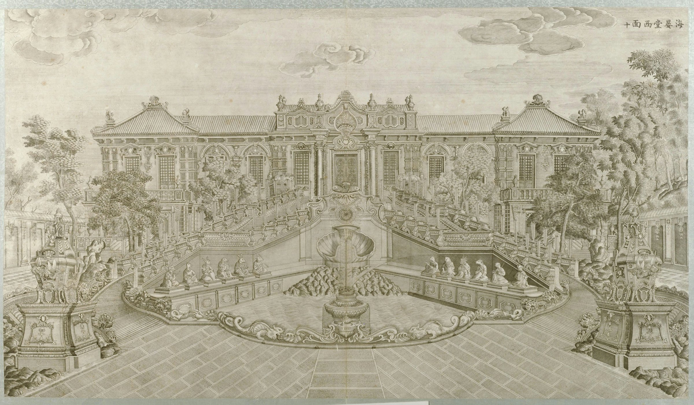

- **P0051** (sure): 海晏堂北面 (圆明园铜版画册 / 西洋楼铜版画, plate 十一 of 二十; title and number printed on the plate) (1786 (Commons); Palace Museum: 清). https://commons.wikimedia.org/wiki/File%3A%E5%9C%86%E6%98%8E%E5%9B%AD%E9%93%9C%E7%89%88%E7%94%BB%E5%86%8C-9.jpg

  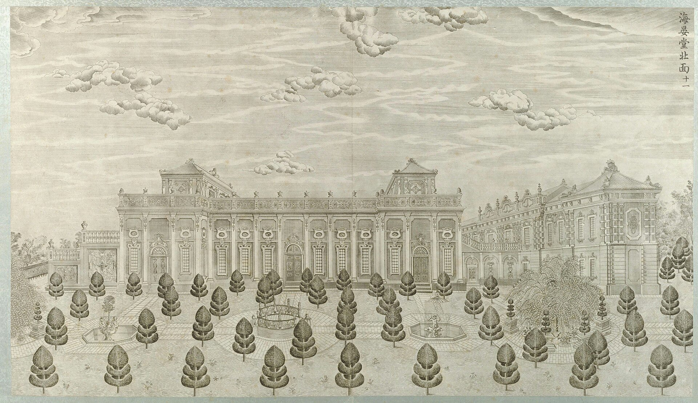

- **P0052** (sure): 海晏堂东面 (圆明园铜版画册 / 西洋楼铜版画, plate 十二 of 二十; title and number printed on the plate) (1786 (Commons); Palace Museum: 清). https://commons.wikimedia.org/wiki/File%3A%E5%9C%86%E6%98%8E%E5%9B%AD%E9%93%9C%E7%89%88%E7%94%BB%E5%86%8C-18.jpg

  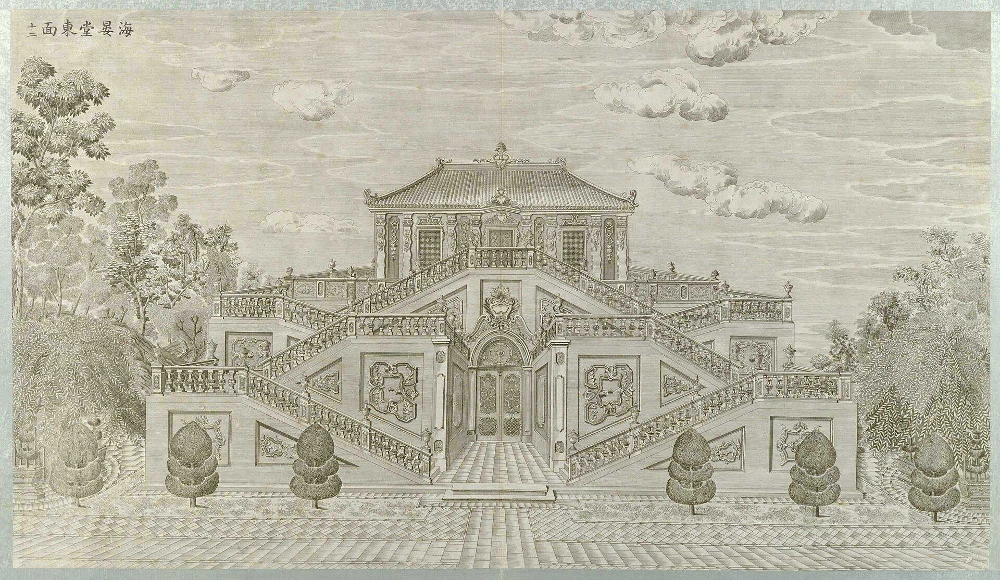

- **P0053** (sure): 海晏堂南面 (圆明园铜版画册 / 西洋楼铜版画, plate 十三 of 二十; title and number printed on the plate) (1786 (Commons); Palace Museum: 清). https://commons.wikimedia.org/wiki/File%3A%E5%9C%86%E6%98%8E%E5%9B%AD%E9%93%9C%E7%89%88%E7%94%BB%E5%86%8C-10.jpg

  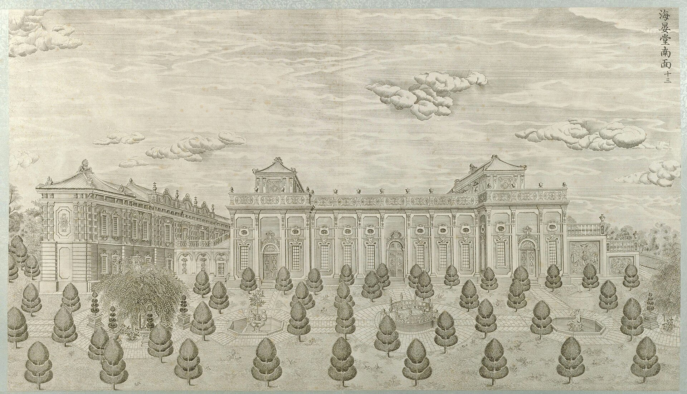

- **P0222** (sure): Xiyang Lou plates, Getty set: The European Pavilions at the Garden of Perfect Clarity (1783-1786 (Getty)). https://www.getty.edu/art/exhibitions/china_paper/ Research-only: link card.
- **P0149** (sure): Le Tour du monde 10: Haï-an thâng tching-mien, or Palace of the serene seas, p. 111 (1 July 1864 (Commons)). https://commons.wikimedia.org/wiki/File%3ALe_Tour_du_monde-10-p111.jpg

  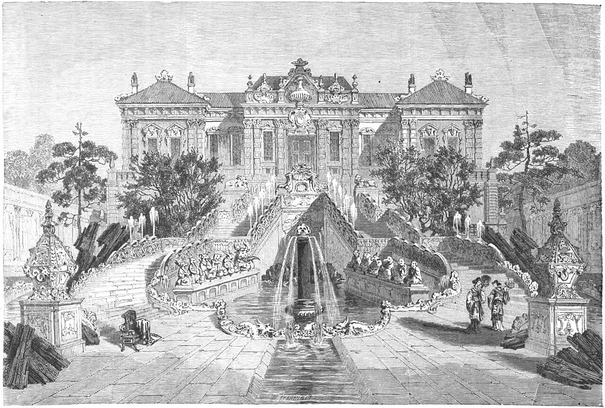

- **P0170** (sure): Mittelgebäude im europäischen Stil für die Wasseranlagen von Yüanmingyüan (before or in 1902 (Commons)). https://commons.wikimedia.org/wiki/File%3AMittelgeb%C3%A4ude_im_europ%C3%A4ischen_Stil_f%C3%BCr_die_Wasseranlagen_von_Y%C3%BCanmingy%C3%BCan.jpg

  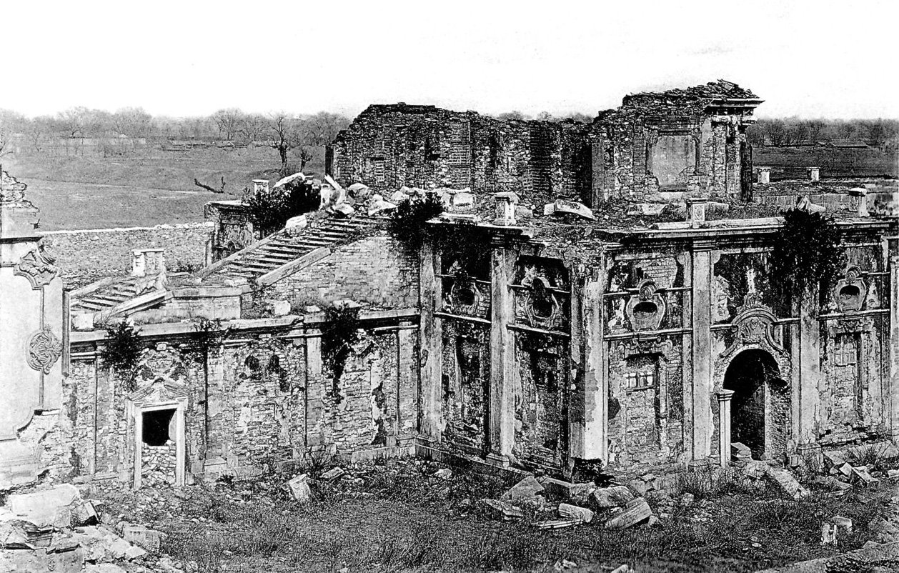

- **P0299** (sure): Fotografija Ruševine cesaričine palače v Stari poletni palači (album: "Yüen-Ming-Yüen: Palais der Kaiserin") (20th c., album bought 1914-1920 (holder)). https://vazcollections.si/predmeti/fotografija-rusevine-cesaricine-palace-v-stari-poletni-palaci/

  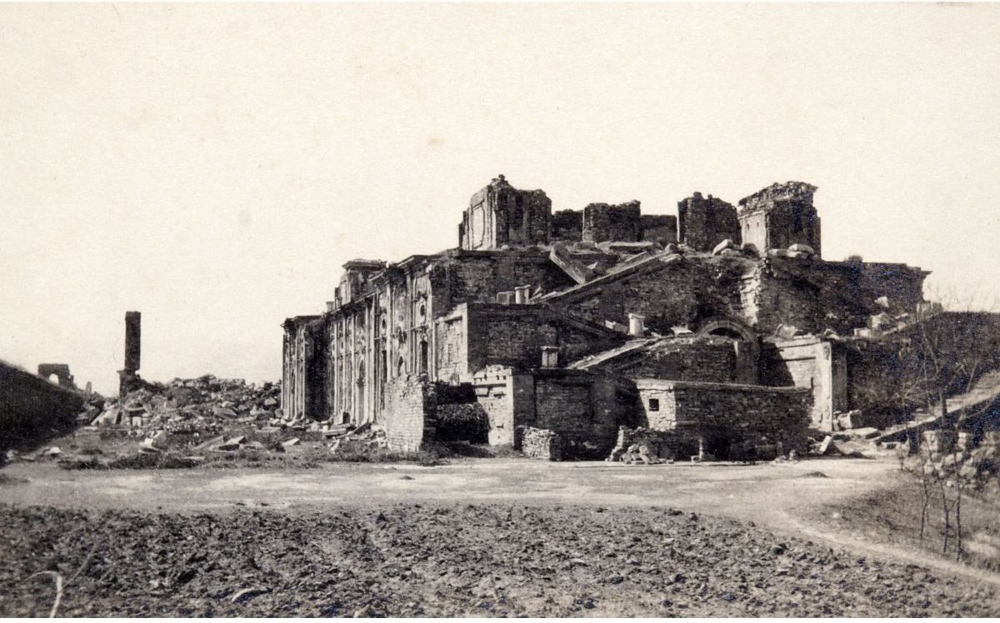

- **P0303** (sure): Fotografija Ruševine cesaričine palače v Stari poletni palači (album: "Yüen-Ming-Yüen: Nr. 353 gegenwärtig") (20th c., album bought 1914-1920 (holder)). https://vazcollections.si/predmeti/fotografija-rusevine-cesaricine-palace-v-stari-poletni-palaci-2/

  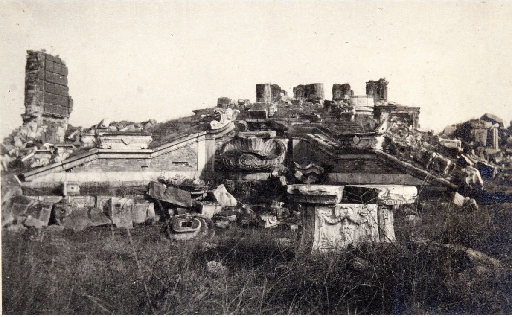

- **P0218** (sure): Sirén, Yuanmingyuan (Old Summer Palace): Haiyantang. Enligt text på fotokuvert: Yuanmingyuan. (undated by holder; Sirén's second trip 1921-23 for this group). http://kulturarvsdata.se/SMVK-OM/Bildarkiv/199646 Research-only: link card.

  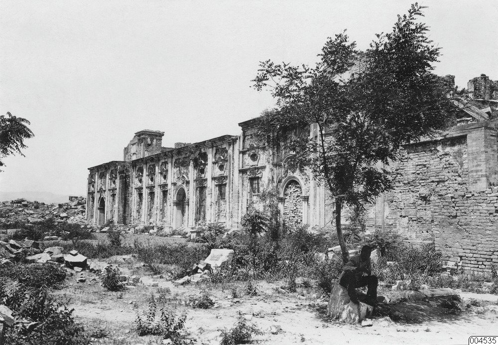

- **P0219** (sure): Sirén, Yuanmingyuan (Old Summer Palace): Haiyantang. Enligt text på fotokuvert: Yuanmingyuan. (undated by holder; Sirén's second trip 1921-23 for this group). http://kulturarvsdata.se/SMVK-OM/Bildarkiv/199647 Research-only: link card.

  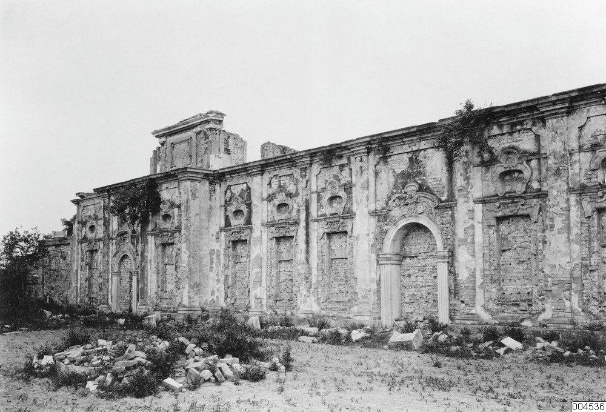

- **P0307** (sure): Sirén: Illustrated: 272:209 (Imperial Palaces pl. 209) (1922 (holder)). http://kulturarvsdata.se/SMVK-OM/Bildarkiv/199625 Research-only: link card.
- **P0322** (sure): Sirén: Enligt text på fotokuvert: Yuanmingyuan. (undated; Sirén 1921-23). http://kulturarvsdata.se/SMVK-OM/Bildarkiv/203242 Research-only: link card.
- **P0330** (sure): Ruins of Hai yan tang at Yuan Ming Yuan with Xiang Hills in background (1933-1946 (HPC estimate)). https://hpcbristol.net/visual/Hv20-072 Research-only: link card.
- **P0225** (likely): Moore negatives of the European palaces, Royal BC Museum MS-3171 (13 negatives, 12 views, c.1875 to early 1880s) (perhaps c.1875; early 1880s (visualisingchina.net)). https://search-bcarchives.royalbcmuseum.bc.ca/c-f-moore-fonds Research-only: link card.
- **P0309** (likely): Sirén: Yuanmingyuan (Old summer palace): Ruins. (undated; Sirén 1921-23). http://kulturarvsdata.se/SMVK-OM/Bildarkiv/199631 Research-only: link card.
- **P0324** (likely): Sirén: Påsikt i Osvald Siréns arkivmaterial, 110798-110855 ("box 129"). (1922 (holder)). http://kulturarvsdata.se/SMVK-OM/Bildarkiv/203256 Research-only: link card.
- **P0349** (sure): Xunshuilou ruins in Yuanmingyuan.jpg (2014-03-31 15:48:48 (Commons DateTimeOriginal)). https://commons.wikimedia.org/wiki/File:Xunshuilou_ruins_in_Yuanmingyuan.jpg

  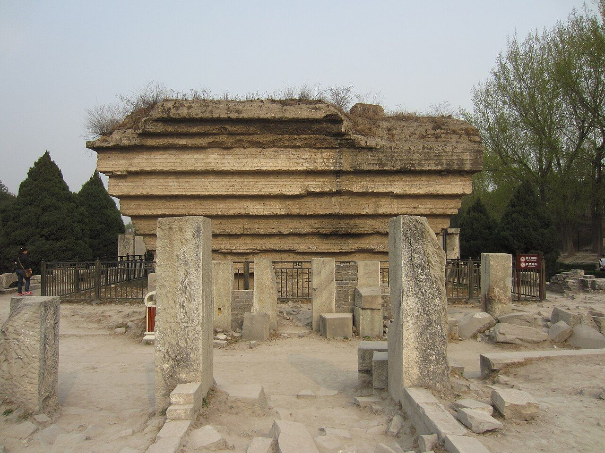

- **P0357** (sure): Ruins of Haiyantang Front 20130126.jpg (2013-01-26 13:43:49 (Commons DateTimeOriginal)). https://commons.wikimedia.org/wiki/File:Ruins_of_Haiyantang_Front_20130126.jpg

  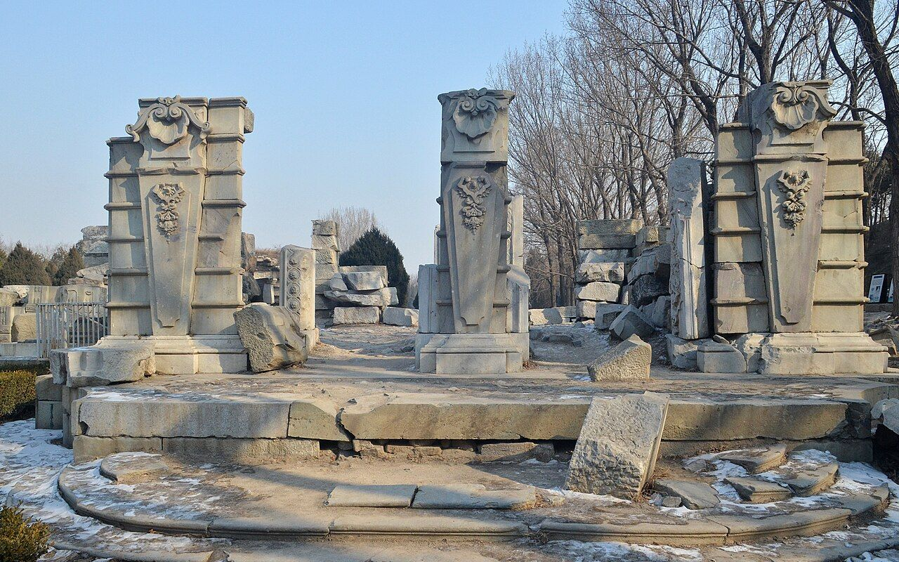

- **P0358** (sure): Haiyantang the stone shells 20130126.JPG (2013-01-26 13:44:23 (Commons DateTimeOriginal)). https://commons.wikimedia.org/wiki/File:Haiyantang_the_stone_shells_20130126.JPG

  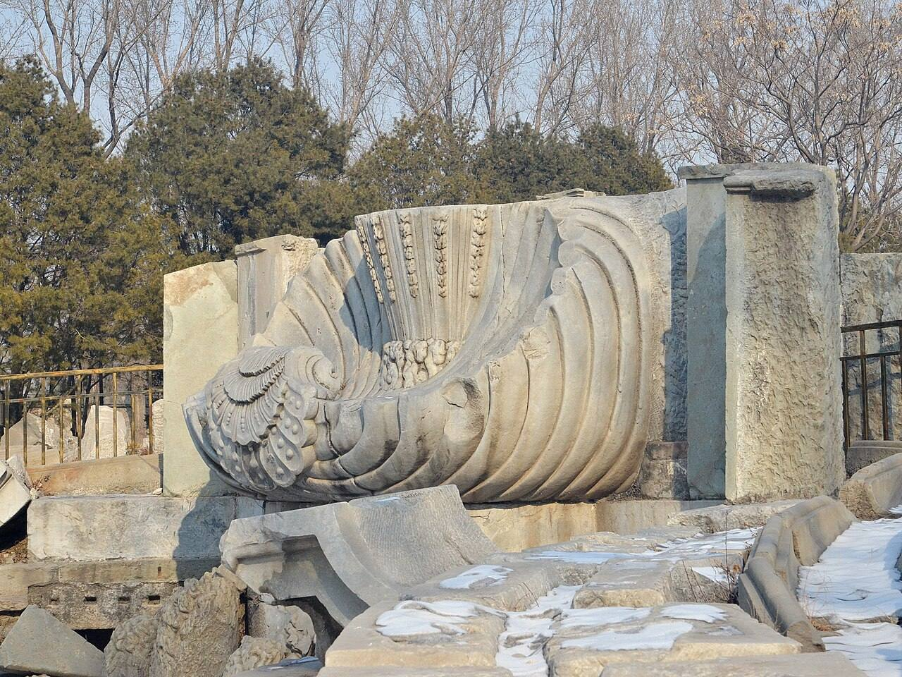

- **P0359** (sure): 海晏堂蓄水池遗址 - Ruins of Haiyantang Reservoir - 2013.03 - panoramio.jpg (Taken on 13 March 2013 (Commons DateTimeOriginal)). https://commons.wikimedia.org/wiki/File:%E6%B5%B7%E6%99%8F%E5%A0%82%E8%93%84%E6%B0%B4%E6%B1%A0%E9%81%97%E5%9D%80_-_Ruins_of_Haiyantang_Reservoir_-_2013.03_-_panoramio.jpg

  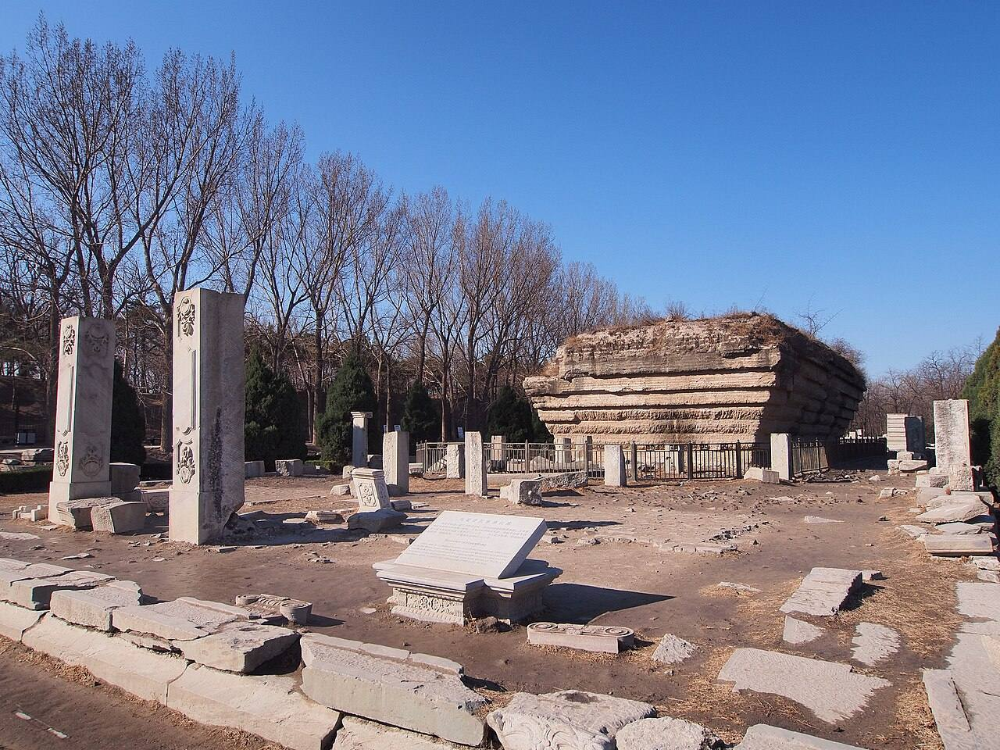

- **P0360** (sure): Yuanmingyuan Haiyantang the water tower Ruins 20120715.jpg (2012-07-15 13:09:11 (Commons DateTimeOriginal)). https://commons.wikimedia.org/wiki/File:Yuanmingyuan_Haiyantang_the_water_tower_Ruins_20120715.jpg

  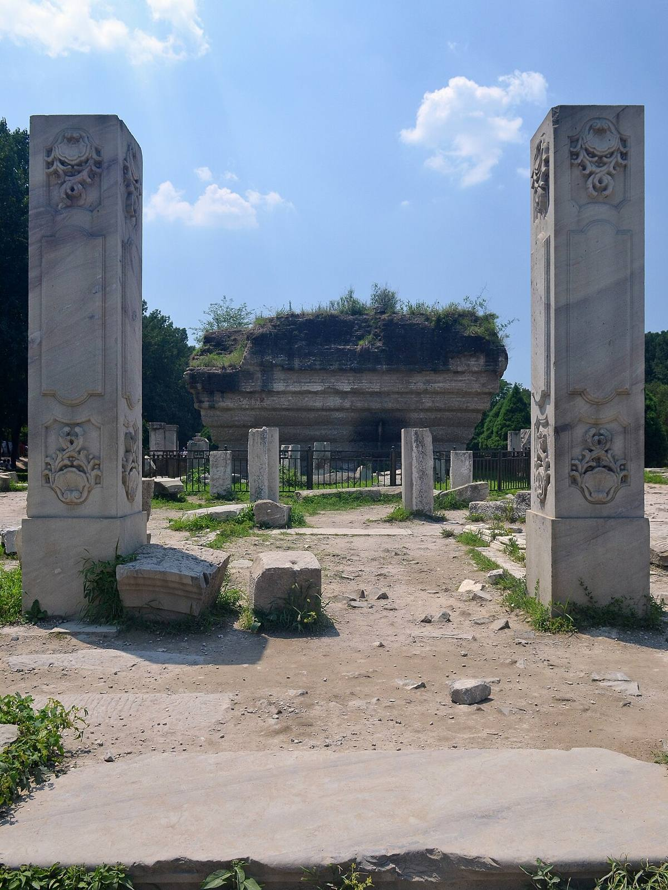

- **P0438** (sure): Yuanmingyuan Haiyantang Base of the reservoir in the water tower 20130126.JPG (2013-01-26 13:35:21 (Commons DateTimeOriginal)). https://commons.wikimedia.org/wiki/File:Yuanmingyuan_Haiyantang_Base_of_the_reservoir_in_the_water_tower_20130126.JPG

  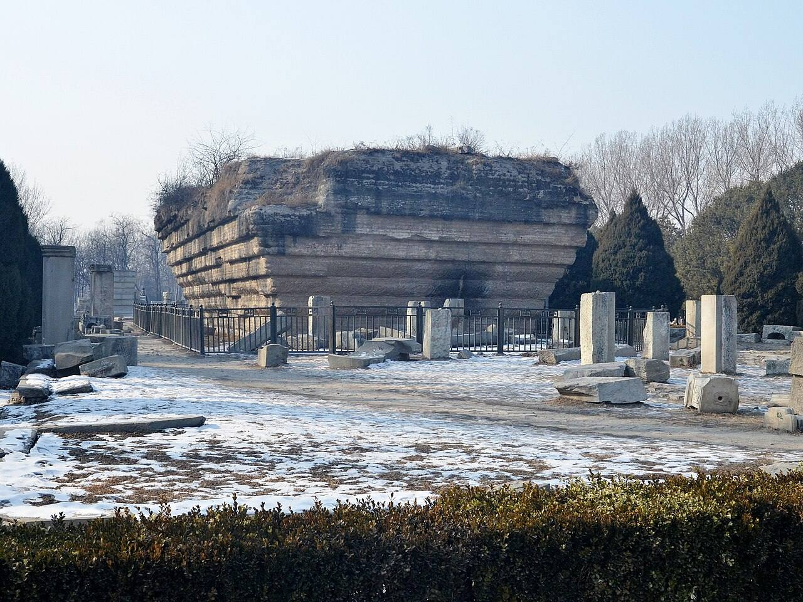

- **P0439** (sure): 海晏堂 安放喷水兽首的地方 - panoramio.jpg (Taken on 27 May 2011 (Commons DateTimeOriginal)). https://commons.wikimedia.org/wiki/File:%E6%B5%B7%E6%99%8F%E5%A0%82_%E5%AE%89%E6%94%BE%E5%96%B7%E6%B0%B4%E5%85%BD%E9%A6%96%E7%9A%84%E5%9C%B0%E6%96%B9_-_panoramio.jpg

  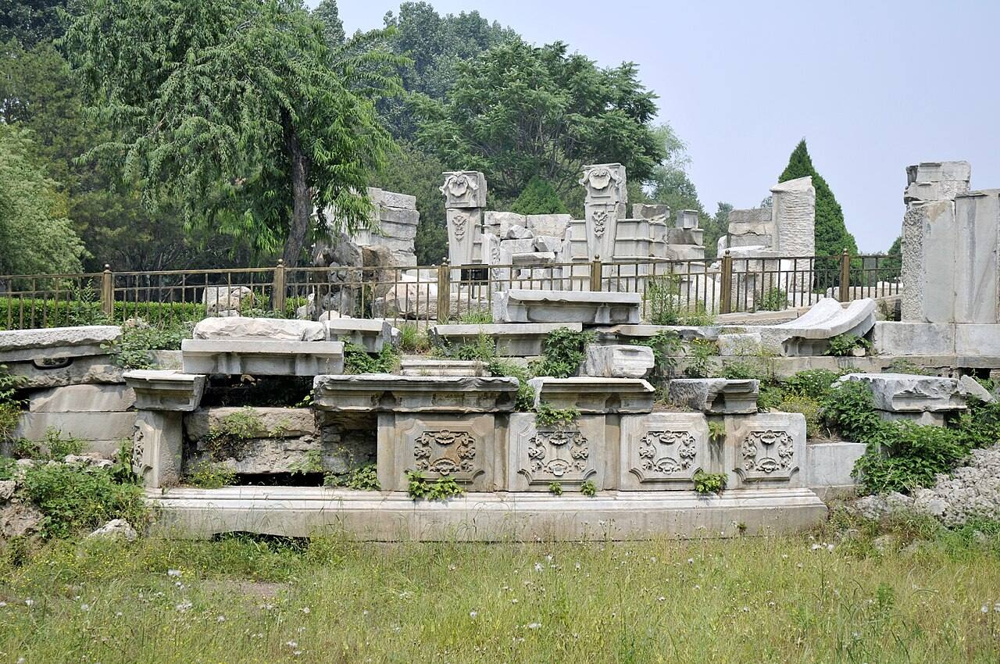

- **P0440** (sure): Ruins of Haiyantang 20130421.jpg (2013-04-21 17:44:44 (Commons DateTimeOriginal)). https://commons.wikimedia.org/wiki/File:Ruins_of_Haiyantang_20130421.jpg

  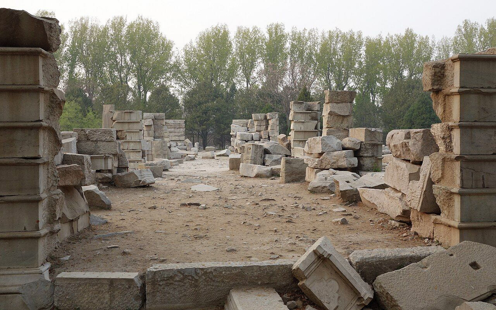

## Texts and drawings (16)

- **E0955** (description, sure): Plate X: 海晏堂 Haiyan Tang, west, and the water clock. 1786-1803 · pp.181-182, Plate X · S258. https://archive.org/details/BIUSante_40644
  > Sur deux des côtés du triangle, sont placés douze animaux de différentes espèces, six de chaque côté.
  Ten bays with a central block and attic and end pavilions; a landing with two stairs, jets from vases along both ramps as at St Cloud and Versailles. A triangular basin; animals spout towards the centre; at the apex towards the building a rock group with a shell; the largest jet from a vase at the base; two pyramids at the sides. He says animals spout by hour count.
- **E0956** (description, sure): Plates XI to XIII: 海晏堂, other views. 1786-1803 · pp.182-183, Plates XI-XIII · S258. https://archive.org/details/BIUSante_40644
  > Ce palais est rempli de jets d'eau, et son perron rappelle le palais de Caprarola, près de Viterbe en Italie.
  Weeping willows in the gardens of plate XI. Stair compared with Caprarola. Little else.
- **E1524** (description, sure): 玉明 侍游御園記 (in 蕉軒隨錄). 1856 (咸豐六年七月二十一日) · 蕉軒隨錄, 御園侍游 (line 336 of the corpus file) · S210. https://github.com/garychowcmu/daizhigev20/blob/master/史藏/志存记录/蕉轩随录.txt
  > ◎御园侍游玉将军（明）有《侍游御园记》，成竹坪同年（林）曾属予代作跋语，恭书于后。按，《记》云：“咸丰六年秋七月二十一日，奉旨：本日散朝后，著玉明、肃顺自备鞍马，午初一刻进西南门，在山高水长伺候。有顷，上从内乘船，至山高水长后阁扇下船，出前门，谕玉明、肃顺暨珠勒亨、西拉布、托云、德勒格尔、伊勒东阿等脱去外褂。上乘马，命七臣随行。自山高水长游藻园，至厂地，过汇芳书院，复由紫碧山房至鱼跃鸢飞少坐。过蕊珠宫门，至黄花磴进茶毕，往西洋楼海宴堂，至转马台，过小角门，至狮子林清淑斋赏饭。左右四卓，命七臣坐，并奉温谕可饱食，非外边筵宴比也。上命膳房先给七臣面各一器，上进面，复进饭，颁赏御用菜蔬，七臣叩头谢。上进粥，复赏粥毕。随驾起行，由宝相寺、法慧寺、谐奇趣过明春门，至雷峰夕照马头，坐如在天上船，游福海。上命笔砚作诗毕，至渊氵亭镜澈马头下船。进丽春门骑马，由旧园东墙根过敷春堂，游西大堤汉城关，至含辉楼下马，命七臣散归。玉明自道光十一年由侍卫擢厕御前二十余年，仰邀优渥，得遍瞻御园盛景。欣感之余，谨作记以纪荣遇。”
  A rare first-hand record of a day in the garden four years before its destruction. The emperor takes seven officials by a named route from 山高水長 through 藻園, 彚芳書院, 紫碧山房 and 魚躍鳶飛, past 蕊珠宫門, on to 海宴堂 in the 西洋樓, a meal at 清淑齋 in 獅子林, 寳相寺, 法慧寺, 諧奇趣, by boat on 福海, then 敷春堂 and 含暉楼. All were standing then.
- **E0957** (description, sure): Engraving 10: 海晏堂 Haiyan Tang, west front and water clock. 1934 · pp.148-154 · S02. https://archive.org/details/historyofpekings00malo
  > There two broad staircases one swinging to the right and one to the left, met before the main entrance on the level of the second floor.
  Largest of the group; held Benoist's pumps and the main reservoir. Fifty small jets on the stair balustrades fed three basins. Twelve seated animal figures, one for each two-hour period, spouted in turn to a larger fountain in the pool. After Benoist's death the machinery failed and water was raised by buckets and ropes (Benoist 1786, Amiot 1787, per n.). Malone compares bronze figures in the Winter Palace, made later.
- **E0958** (description, sure): Engravings 11 to 13: 海晏堂 north, east and south. 1934 · p.155 · S02. https://archive.org/details/historyofpekings00malo
  > The tallest parts of the building covered the hydraulic machines, and between them lay the reservoir.
  North front covers the machines, with the reservoir between; zigzag stairs at the east end lead to the reservoir; the south side repeats the north.
- **E0959** (description, sure): Informants on the ruins: Lu, Ho, Tung. 1934 · pp.231 · S02. https://archive.org/details/historyofpekings00malo
  > He says he was twelve sui, or ten or eleven years of age, and employed there as a helper to sweep the walks and pull the weeds, when the palace was destroyed in 1860.
  Old Lu lived in a hut at the east end of 海晏堂, the source of Malone's oral details on the European buildings. The eunuchs Ho and Tung, still there in 1919, told him what was rebuilt after 1860 and destroyed again in 1900. Treat as oral: useful, unverified.
- **E0960** (description, sure): 刘阳, 《圆明园的故事》, excerpt on 西洋楼, 澎湃. 2017 · excerpt, part 2 · S109. https://www.thepaper.cn/newsDetail_forward_1750908
  刘阳: 海晏堂, 1759, largest of the group; behind it the water tower, an H-plan solid building with a gallery below and balconies above, and a spiral stone stair on the east.
- **E0507** (description, likely): 圆明园五朝御制诗文集注 v4, editors' note on 西洋楼. 2020 edition · v4 p.120 · S361. https://www.yuanmingyuanpark.cn/xs/yjbg/202008/P020200803382796786124.pdf#page=123
  The editors walk the strip from west to east with completion dates and plaques: 谐奇趣 1751, 养雀笼 1759, then the fountains and the perspective walls, with their mechanical details. They put the whole at about 2% of the gardens.
- **E0544** (drawing, sure, search index only): 西洋楼水法图. 国家图书馆善本部 none shown · S310. https://www.mhymy.com/dasl/ysltd/7643.html
  Plan of the Xiyang Lou waterworks across its dozen sites; the record shows no shelf number. No image here; the site may ask a small payment for the full record.
- **E0961** (drawing, sure, search index only): 海晏堂东水车房. 不详 · 国家图书馆善本部 样094-4号 · S310. https://www.mhymy.com/dasl/ysltd/12168.html
  Undated ink base sheet of the east water-wheel house at Haiyan Tang, 503x453 mm. No image here; the site may ask a small payment for the full record.
- **E0962** (archaeology, sure): 海晏堂蓄水楼 加固, 北京青年报 via 人民网. 2016-07-28 · news, 王猛 · S110. http://house.people.com.cn/n1/2016/0728/c164220-28590471.html
  The surviving water tower of 海晏堂 is a rammed-earth core like an inverted truncated pyramid, about 7.2 m high. Conservation in 2016 propped the four corners with about 160,000 bricks and added a concealed drain on top.
- **E0363** (archaeology, sure): 揭秘圆明园考古, 华西都市报 via 中证网. 2017-07-10 · news, 张中华 and 张利芳 · S140. https://cs.com.cn/ssgs/gssc/201707/t20170710_5365575.html
  Three large campaigns since 1996 yielded over 50,000 finds. The campaign from 2012 dug 桃花洞, 大宫门, 养雀笼, the 海晏堂 water tower and 远瀛观. At 如园 Ru Yuan, the best-preserved of these sites and the first imitation of a Jiangnan garden dug here (19,000 m2 site, 2,800 m2 buildings, 3,800 m2 opened), diggers found 芝兰室, 云萝山馆, 听泉榭, 延清堂, 含碧楼, 挹霞亭, 观丰榭, 引胜轩, rockery, paths and shores, and burnt famille-rose floor tiles in 延清堂.
- **E0554** (archaeology, sure): 西洋楼区域考古勘探报告. n.d. · mhymy 档案史料 12205, free part · S149. https://www.mhymy.com/dasl/12205.html
  Report's opening: the strip runs 860 m east-west, up to 300 m wide in the west and 65 m at its narrowest, about 70,000 m2, built 1747-1783. A central axis divides it into about five sections, each with its own north-south axis, thirteen units from 谐奇趣 to 线法墙. Survey results are paywalled.
- **E0984** (reconstruction, sure): 3D技术复现“万园之园”: 北京大学 stone scanning. 2025-05-21 · 京报网 · S351. https://news.bjd.com.cn/2025/05/21/11171051.shtml
  The park and Peking University's School of Archaeology and Museology record the carved stones by 3D scan, photogrammetry and panorama, at 大水法, 观水法, 远瀛观, 海晏堂 and pieces now on the Peking University campus. This is the nearest thing found to a 'Peking University Digital Yuanmingyuan'. It says over 10 sites have been dug since the 1990s.
- **E0936** (reconstruction, likely): Digital restoration research and 3D model of Xieqiqu, ISPRS Annals II-5/W3. 2015 · open access paper · S108. https://isprs-annals.copernicus.org/articles/II-5-W3/75/2015/
  The Yuanmingyuan Digital Restoration Research Project of 2013 covered five of thirteen 西洋楼 scenes in its first two years: 谐奇趣, 海晏堂, 方外观, 蓄水楼, 观水法. The paper explains 谐奇趣's method: present-day survey with archival drawings and engravings.
- **E0987** (reconstruction, likely, search index only): [清华]观水法; [清华]海晏堂. n.d. · mhymy szfy 13312 · S340. https://www.mhymy.com/szfy/13312.html
  Link card to Tsinghua team renders of 观水法 Guan Shuifa. A sibling post covers 海晏堂, its page not seen.

**On the plan:** Drawn on the plan of the gardens (S01), labelled 海晏堂, 1x3 cells. https://artmuseum.princeton.edu/collections/objects/138657

## Open questions

- Q2: What is S01: the original or the tracing?
- Q4: The pasted slips
- Q16: 海晏堂's east half and the plan's working names
- Q32: OSM errors

<!-- generated:end -->

## Notes

<!-- Yours: regeneration never touches this part. It goes on the public site; what you write below a line holding only %% private %% stays in the research copy. -->
