<!-- generated:start (scripts/building_pages.py): do not edit between these markers -->

# XY09: 远瀛观 Yuanying Guan

Yuan Ying Kuan, View of Distant Seas · Xiyang Lou

**3D object:** 2 boxes. Open it: `/reconstruction/3d.html?b=XY09`

## What we know

- **Name:** 远瀛观 Yuanying Guan (S02, S06, S42, S01, S109, S03, S258, S310 · confidence A)
- **English:** Yuan Ying Kuan, View of Distant Seas (S02, S06, S42, S01, S109, S03, S258, S310)
- **Garden:** Xiyang Lou (S02, S06, S42, S01, S109, S03, S258, S310)
- **Type:** european (S02, S06, S42, S01, S109, S03, S258, S310 · confidence A)
- **Built:** 乾隆四十八年 1783 (S42 12613; printed there as 乾隆十四八年) (S02, S06, S42, S01, S109, S03, S258, S310)
- **Destroyed:** Looted and burnt 1860; stone ruins stayed, further damage 1900 and after (S02 pp.142,218) (S02, S06, S42, S01, S109, S03, S258, S310)
- **Position:** 40.01240, 116.30658. S850;S01, moved in Round 6: on the ruin, research/xiyanglou/boxes.csv (S01 · confidence B)
- **Bays:** 5 (S06) in the texts / 5x4 on the plan (S02, S06, S42, S01, S109, S03, S258, S310)
- **Size in the inventory:** 28.0 × 21.0 m. stated: S603;S850;S71, research/xiyanglou/boxes.csv (S01)
- **Lead on its size, from a modern study, not used in the model:** Yuanying Guan: terrace about 35 x 31 m; building footprint 21 x 28 m; post grid known to about 50 cm (S603, pp. 131-132). (confidence B)
- **Storeys:** 1 (S02, S06, S42, S01, S109, S03, S258, S310)
- **Roof:** 庑殿顶 3-tier (S06) (S02, S06, S42, S01, S109, S03, S258, S310)
- **Tiles:** 五色琉璃, 鱼鳞金瓦 (S06) (S02, S06, S42, S01, S109, S03, S258, S310)
- **Where the text puts it:** 西为海晏堂 东为线法山 前为大水法观水法 (S42) (S02, S06, S42, S01, S109, S03, S258, S310) *(research copy, not public)*
- **Note:** Copper engraving no. 14 per S02. Later than 大水法 (S42). Excavated 2016: 3 phases, late-Qing use (S42). Gobelins tapestries 1767 (S02 p.160); S06 says Louis XVI. Grey brick with carved marble (S02 p.155). Hall for the Gobelins tapestries sent in 1767; 70 pieds long, new in 1786, full of machines (S258, pp.165, 183). bays: 17 rooms in all on an inverted 凹 plan, with a 3-bay central hall; buildings.csv has 5 (S06) (S310, ysltd/12443 (list card on /special/yslt; 排架 not seen)). Round 6 replaced frontage 59.2 m. Round 6 replaced depth 51.0 m. (S02, S06, S42, S01, S109, S03, S258, S310)
- **Plan reader's note:** Label written well south of the hall, at (10529,1180), beside the axis. The hall B0096 stands on a terrace projecting north of the strip's wall line, as Malone says. | plan: 5 bays: agrees. South row left open (U-shaped bottom in the grid). Terrace x 10498-10622, y 765-945; stairs (hatched) x 10500-10532, y 946-982 and x 10596-10627, y 943-975. (S01) *(research copy, not public)*
- **How it was read:** sure (S01) *(research copy, not public)*
- **Plan pixels:** 10562, 823 (S01) *(research copy, not public)*

## Our model now

Simple massing of a European palace: position and footprint from the ruin, the plan or a survey, heights read from the plates of the 1780s (research/xiyanglou/boxes.csv). Not a detailed model yet; the figures and their methods are in the Dimensions block.

- **1 ×:** terrace: 31 × 35 m, eave 2 m, ridge 2 m
- **1 ×:** hall, five roofs, on the terrace: 28 × 21 m, eave 9.7 m, ridge 14.6 m
- **Confidence:** B

## Inside it (3)

- XY09-N01
- XY09-N02
- XY09-N03

## Pictures (37)

- **P0054** (sure): 远瀛观正面 (圆明园铜版画册 / 西洋楼铜版画, plate 十四 of 二十; title and number printed on the plate) (1786 (Commons); Palace Museum: 清). https://commons.wikimedia.org/wiki/File%3A%E5%9C%86%E6%98%8E%E5%9B%AD%E9%93%9C%E7%89%88%E7%94%BB%E5%86%8C-11.jpg

  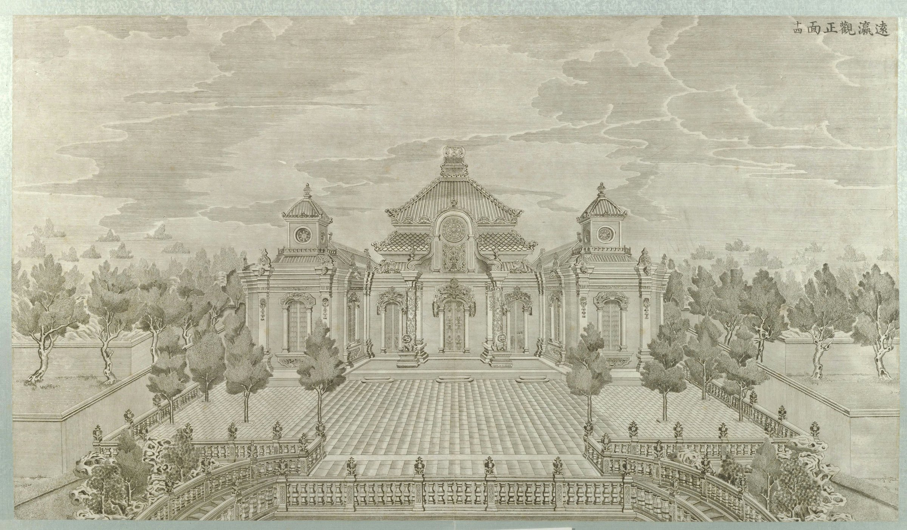

- **P0779** (sure): 圓明園東長春園平面圖 (第一圖), plan of the Xiyang Lou strip (drawn by Ohlmer, 1867-1879, per Teng Gu's preface; from Börschmann's collection). https://commons.wikimedia.org/wiki/File:CADAL11102995_%E5%9C%93%E6%98%8E%E5%9C%93%E6%AD%90%E5%BC%8F%E5%AE%AE%E6%AE%BF%E6%AE%98%E8%B7%A1.djvu

  

- **P0179** (sure): Ruinerna efter Östporten till Xianfa-kullen i det gamla sommarpalatset (000611, F.2603) (1920 (holder); 1900-1920 (Commons)). http://kulturarvsdata.se/SMVK-OM/Bildarkiv/195708

  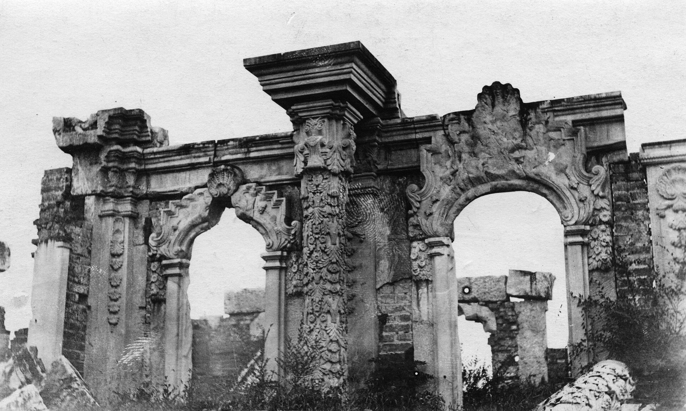

- **P0183** (sure): South side of 远瀛观 ruin, the clock gate front (between 1872 and 1873 (Commons); 1873 (hpchina blog)). https://commons.wikimedia.org/wiki/File%3ASouth_Side_of_Yuanyingguan%2C_Ernst_Ohlmer%2C_1870s.jpg

  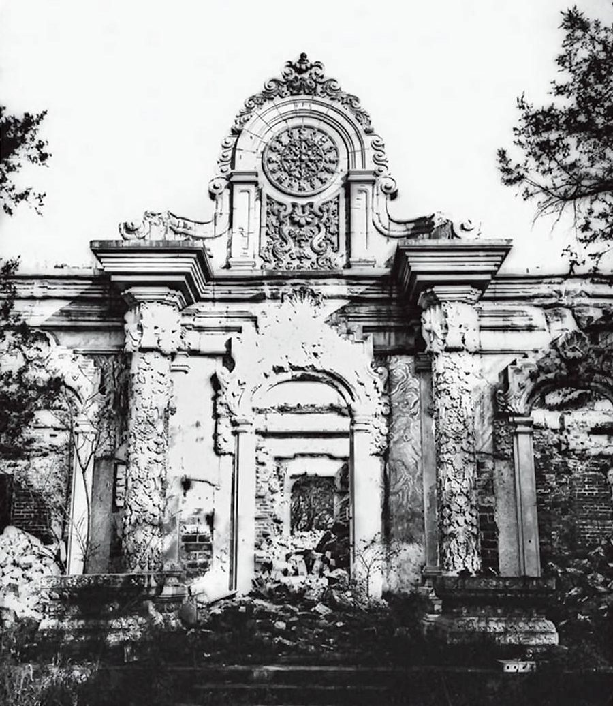

- **P0190** (sure): South side of 远瀛观 ruin (file name: Théophile Piry, 1876) (1876 (file name only)). https://commons.wikimedia.org/wiki/File%3ASouth_Side_of_Yuanyingguan_Ruins%2C_Th%C3%A9ophile_Piry%2C_1876.jpg

  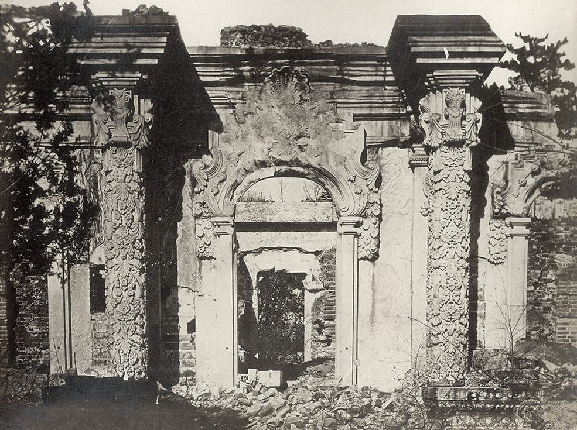

- **P0214** (sure): Enligt text under Pl. 191b Kinas trädgårdar Vol. I: Yuanmingyuan. Yuanyingguan, ”Utblick över Fjärran Vatten”. Bild efter fotografi 1922. (1922 (holder caption)). http://kulturarvsdata.se/SMVK-OM/Bildarkiv/198826

  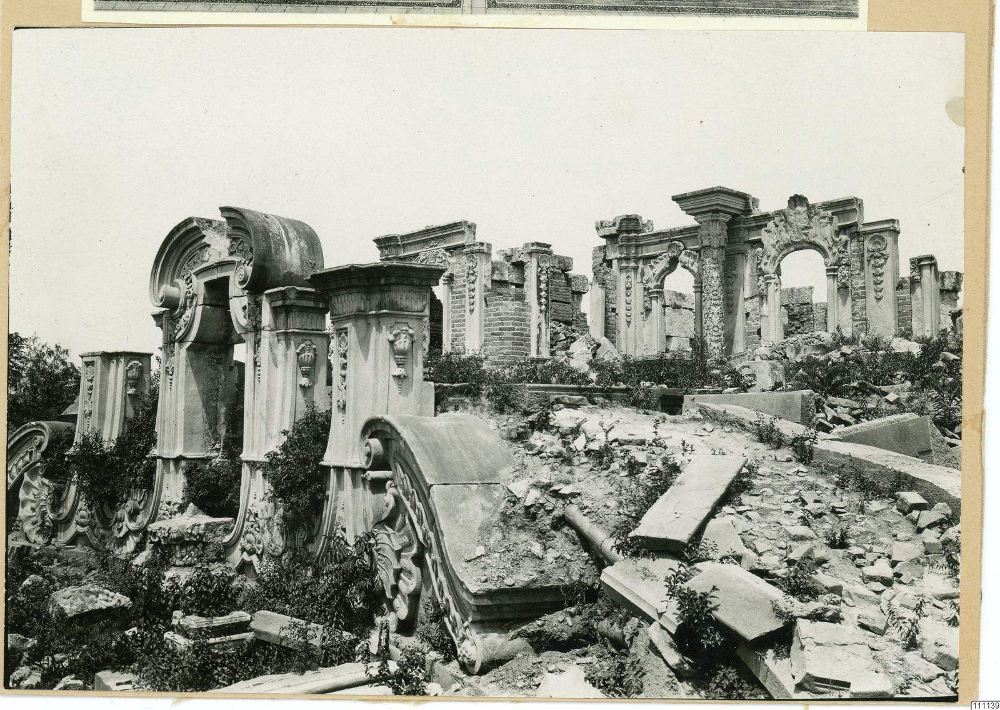

- **P0216** (sure): Enligt text under Pl. 192b Kinas trädgårdar Vol. I: Yuanmingyuan. Dashuifa ”De Stora Springvattnen”. Bild efter fotografi 1922. (1922 (holder caption)). http://kulturarvsdata.se/SMVK-OM/Bildarkiv/198828

  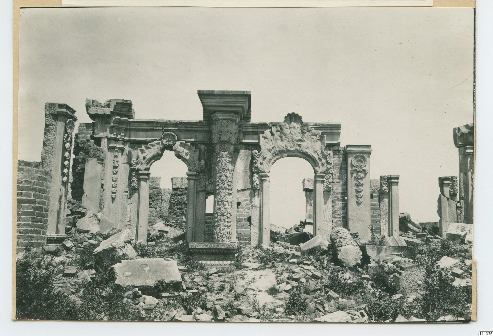

- **P0290** (sure): Fotografija Detajl ruševine vzhodnih vrat h gori Xianfa v Stari poletni palači (album: "Yüen-Ming-Yüen: Detail von Nr. 336") (20th c., album bought 1914-1920 (holder)). https://vazcollections.si/predmeti/fotografija-detajl-rusevine-vzhodnih-vrat-h-gori-xianfa-v-stari-poletni-palaci/

  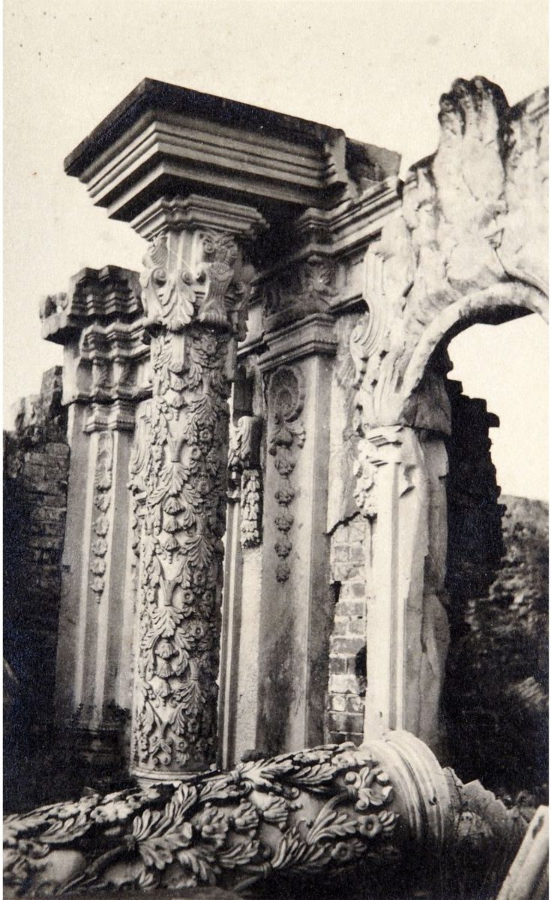

- **P0291** (sure): Fotografija Ruševine vzhodnih vrat h gori Xianfa v Stari poletni palači (album: "Yüen-Ming-Yüen: Nr. 334 gegenwärtig") (20th c., album bought 1914-1920 (holder)). https://vazcollections.si/predmeti/fotografija-rusevine-vzhodnih-vrat-h-gori-xianfa-v-stari-poletni-palaci/

  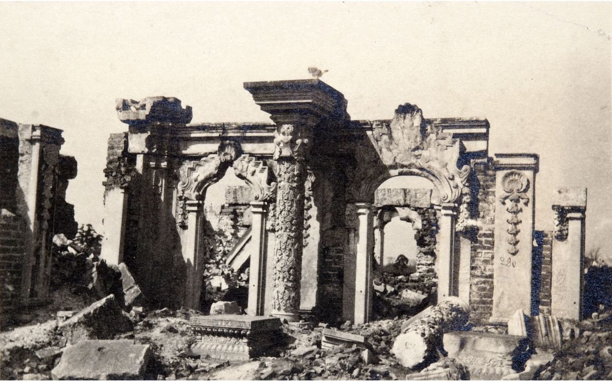

- **P0646** (sure): 圓明園址 (1), 図版 XII-54 (printed caption) (published 昭和16 (1941), NDL record; photographs undated). https://dl.ndl.go.jp/pid/1902723/1/59

  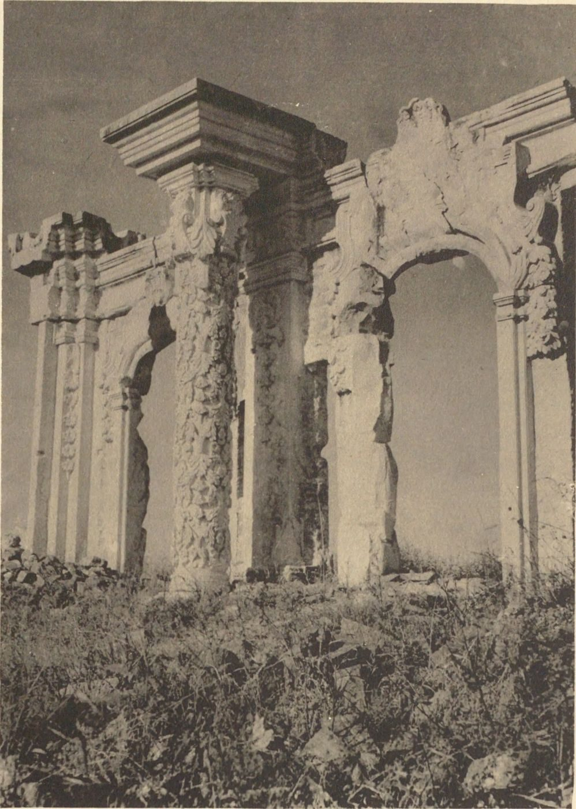

- **P0719** (sure): 圓明園の廢墟 (printed caption slip beside the photograph) (series 昭和10-17 (NDL); this number not dated in what I read). https://dl.ndl.go.jp/pid/1266050/1/9

  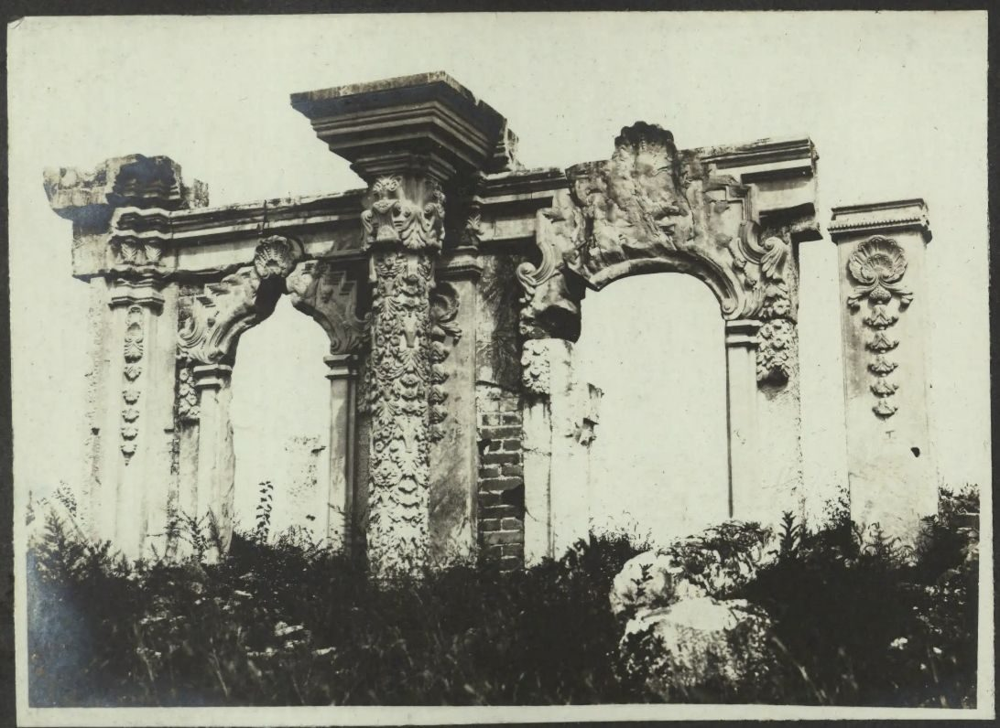

- **P0758** (sure): 远瀛观遗址 - panoramio (Taken on 27 May 2011 (Commons)). https://commons.wikimedia.org/wiki/File:%E8%BF%9C%E7%80%9B%E8%A7%82%E9%81%97%E5%9D%80_-_panoramio.jpg

  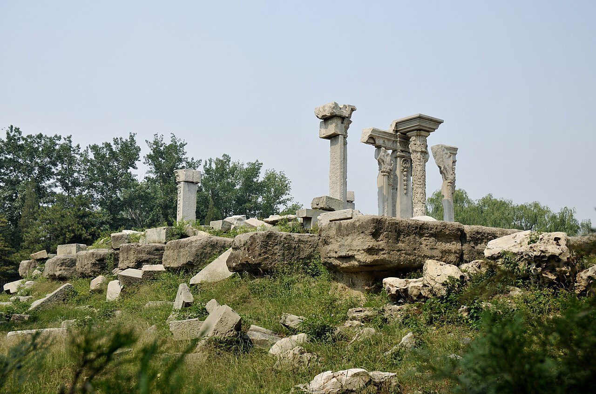

- **P0761** (sure): 大水法遗址 - panoramio (Taken on 27 May 2011 (Commons)). https://commons.wikimedia.org/wiki/File:%E5%A4%A7%E6%B0%B4%E6%B3%95%E9%81%97%E5%9D%80_-_panoramio.jpg

  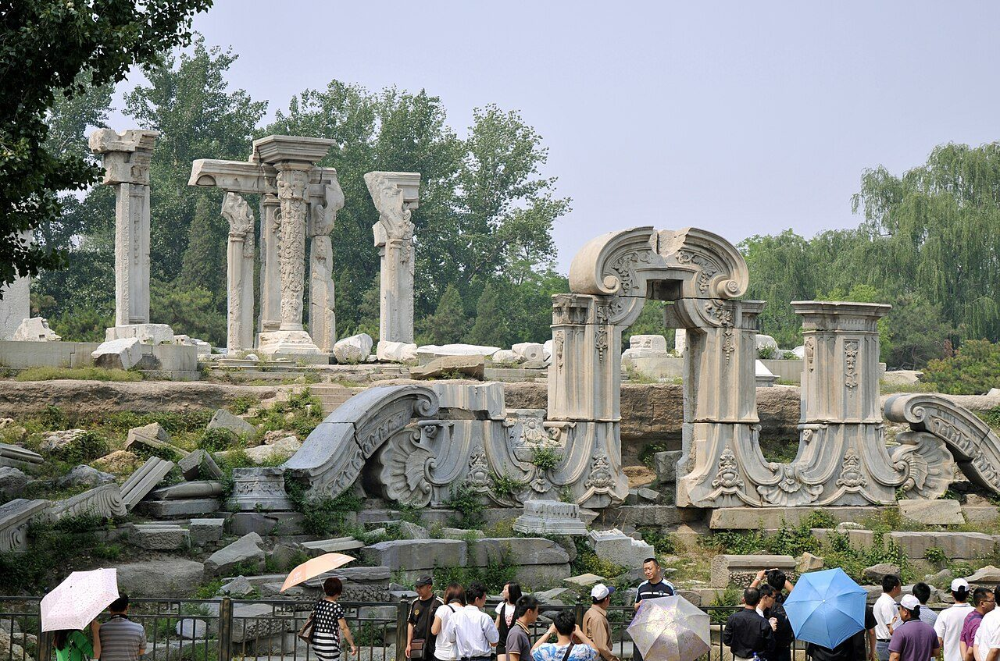

- **P0771** (sure): THE REMAINS OF THE YUEN MING YUEN SUMMER PALACE, AFTER SIXTY-SIX YEARS, The Vanished Empire (1926, printed in Putnam Weale, The Vanished Empire (Commons)). https://commons.wikimedia.org/wiki/File:THE_REMAINS_OF_THE_YUEN_MING_YUEN_SUMMER_PALACE,_AFTER_SIXTY-_SIX_YEARS_The_Vanished_Empire.png

  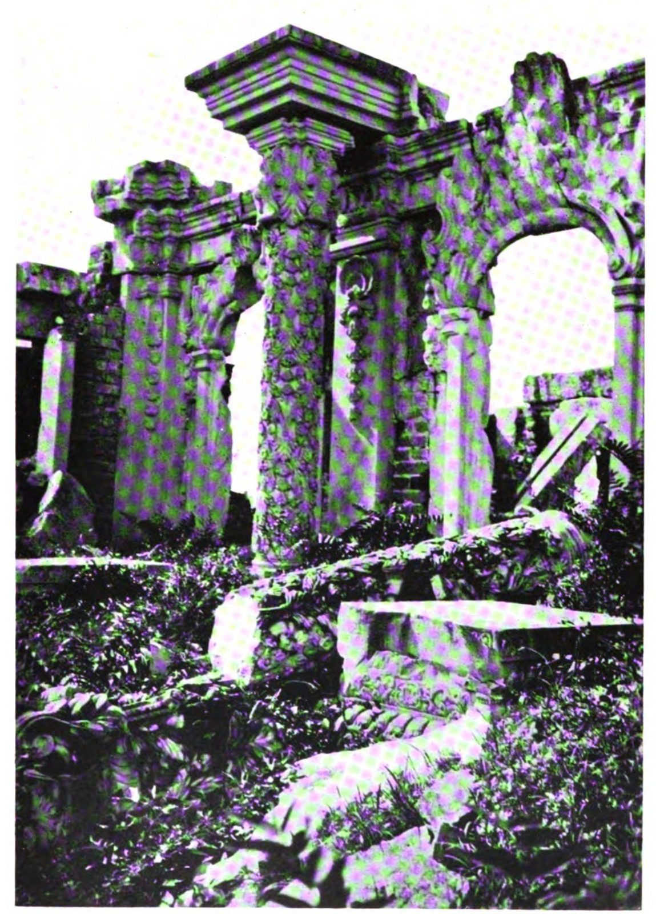

- **P0772** (sure): Von Chinas Göttern; Reisen in China, Tafel 7, Yüan ming yüan (1900-1920 (Commons)). https://commons.wikimedia.org/wiki/File:Von_Chinas_G%C3%B6ttern;_Reisen_in_China-Tafel_7,_Y%C3%BCan_ming_y%C3%BCan,_000611(F.2603-bearb).jpg

  

- **P0169** (likely): Hauptgebäude im Renaissancestil (before or in 1902 (Commons)). https://commons.wikimedia.org/wiki/File%3AHauptgeb%C3%A4ude_im_Renaissancestil.jpg

  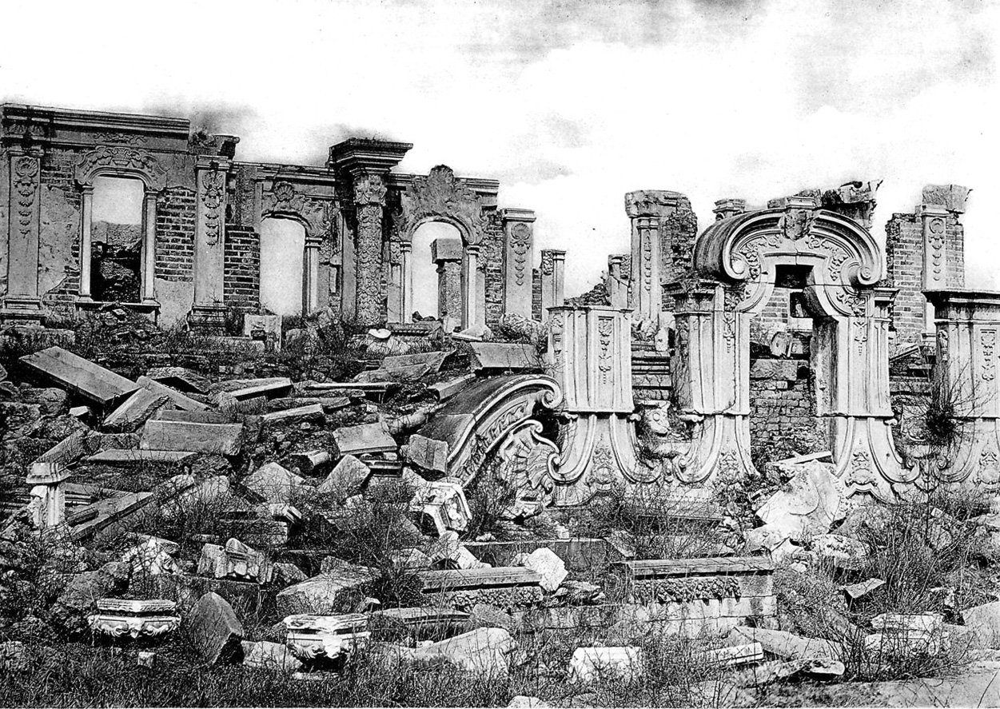

- **P0292** (likely): Fotografija Ruševine paviljona Dashuifa v Stari poletni palači (album: "Yüen-Ming-Yüen: Thron-Halle") (20th c., album bought 1914-1920 (holder)). https://vazcollections.si/predmeti/fotografija-rusevine-paviljona-dashuifa-v-stari-poletni-palaci/

  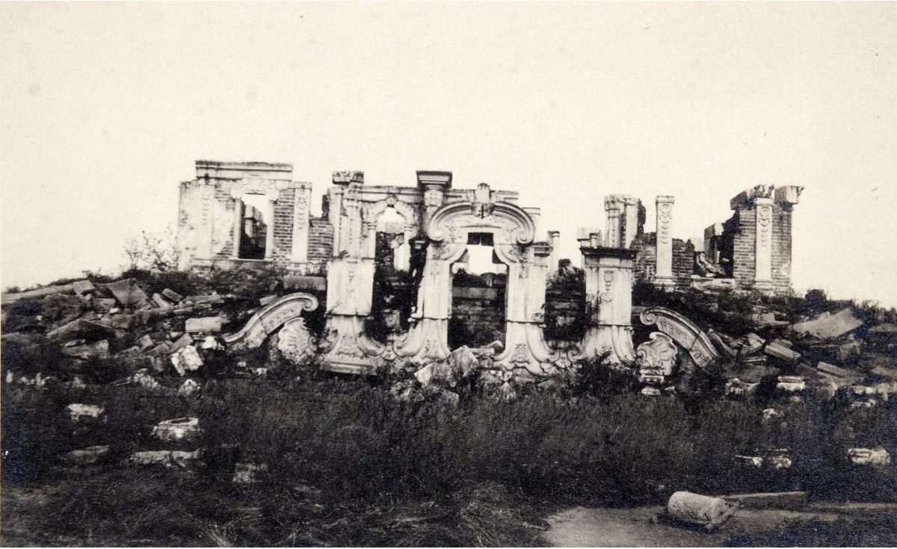

- **P0293** (likely): Fotografija Ruševine – panoramski pogled z vzhoda v Stari poletni palači (album: "Yüen-Ming-Yüen: Total-Ansicht vom Osten") (20th c., album bought 1914-1920 (holder)). https://vazcollections.si/predmeti/fotografija-rusevine-panoramski-pogled-z-vzhoda-v-stari-poletni-palaci/

  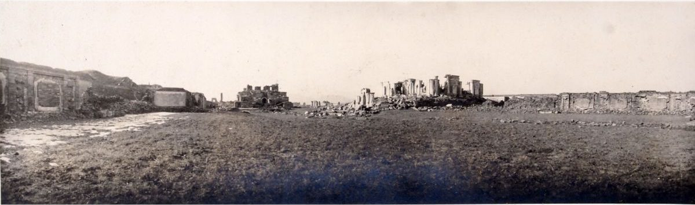

- **P0776** (likely): 大水法正面 (第十二圖) (1873 (S770; dated by S89); Teng Gu says only that Ohlmer took them 1867-1879, about sixty years before). https://commons.wikimedia.org/wiki/File:CADAL11102995_%E5%9C%93%E6%98%8E%E5%9C%93%E6%AD%90%E5%BC%8F%E5%AE%AE%E6%AE%BF%E6%AE%98%E8%B7%A1.djvu

  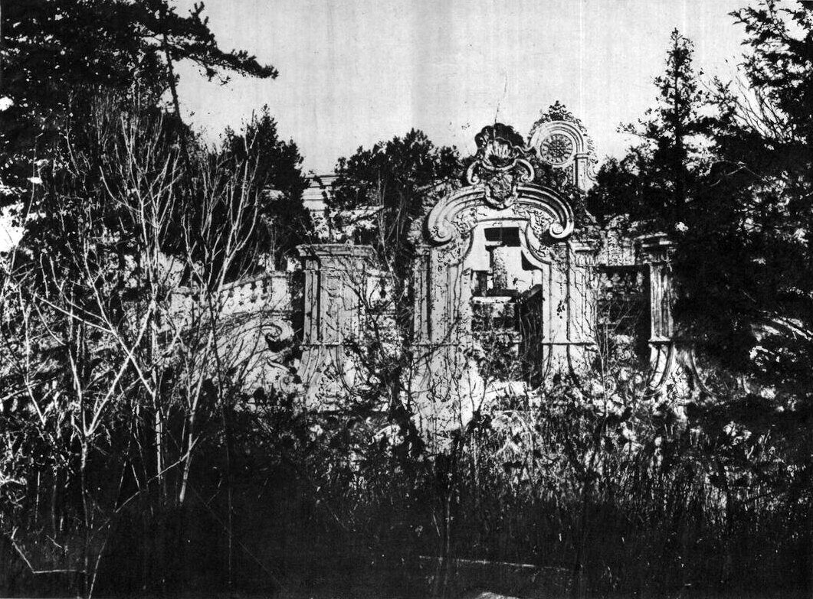

- **P0199** (sure): 圓明園遺址, from Peking the Beautiful (between 1922 and 1927 (Commons)). https://commons.wikimedia.org/wiki/File%3A%E5%9C%93%E6%98%8E%E5%9C%92%E9%81%BA%E5%9D%80.jpg Research-only: link card.

  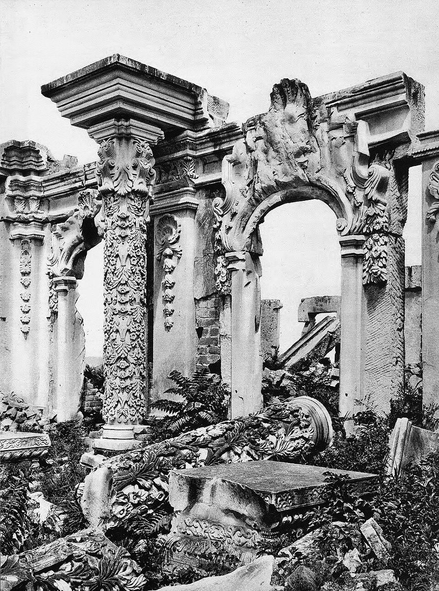

- **P0213** (sure): Sirén, Enligt text under Pl. 191a Kinas trädgårdar Vol. I: Yuanmingyuan. Yuanyingguan, ”Utblick över Fjärran Vatten”. Bild efter gravyr av år 1786. (undated by holder; Sirén's second trip 1921-23 for this group). http://kulturarvsdata.se/SMVK-OM/Bildarkiv/198825 Research-only: link card.

  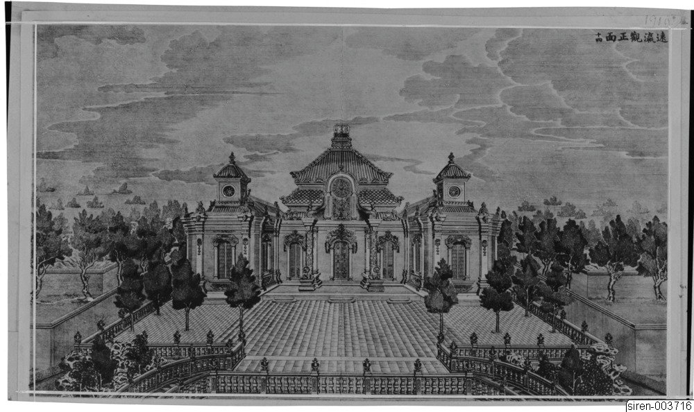

- **P0310** (likely): Sirén: Yuanmingyuan (Old summer palace): Ruins. (undated; Sirén 1921-23). http://kulturarvsdata.se/SMVK-OM/Bildarkiv/199632 Research-only: link card.
- **P0723** (likely): Dashuifa (Great Fountain) (S770 caption), Ohlmer negative K (1873 (S770; dated by S89)). https://visualizingcultures.mit.edu/garden_perfect_brightness_03/ymy303/e503.htm Research-only: link card.

  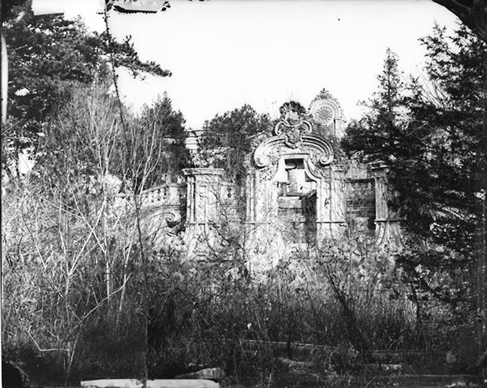

- **P0778** (likely): 晚近之大水法 (第十三圖) ('near today', a few years before the preface of July 1932, sent from Beiping by 周纘武 (Teng Gu)). https://commons.wikimedia.org/wiki/File:CADAL11102995_%E5%9C%93%E6%98%8E%E5%9C%93%E6%AD%90%E5%BC%8F%E5%AE%AE%E6%AE%BF%E6%AE%98%E8%B7%A1.djvu Research-only: link card.

  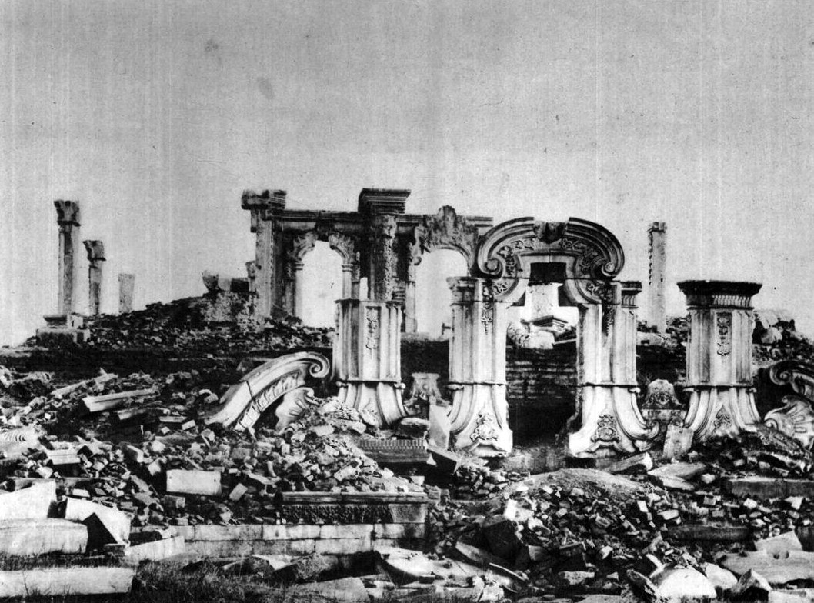

- **P0338** (sure): Yuanmingyuan Ruins of Dashuifa and Yuanyingguan 20120715.jpg (2012-07-15 12:57:04 (Commons DateTimeOriginal)). https://commons.wikimedia.org/wiki/File:Yuanmingyuan_Ruins_of_Dashuifa_and_Yuanyingguan_20120715.jpg

  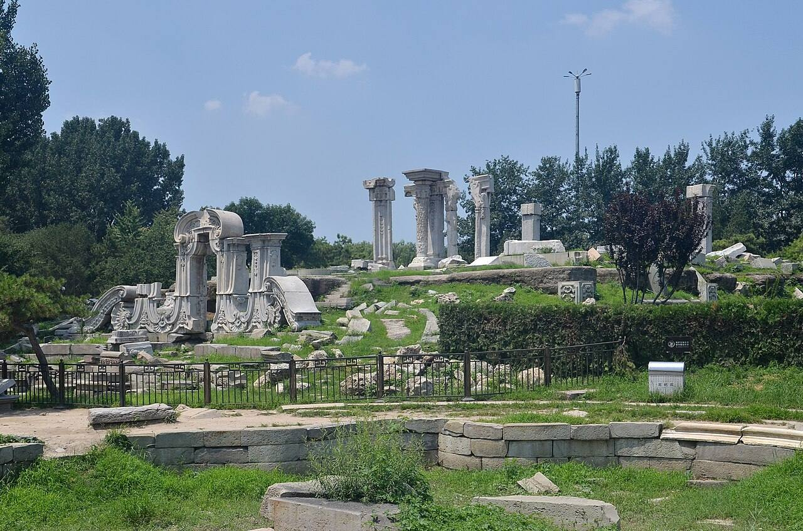

- **P0339** (sure): Dashuifa and Yuanyingguan 20130414.JPG (2013-04-14 17:18:32 (Commons DateTimeOriginal)). https://commons.wikimedia.org/wiki/File:Dashuifa_and_Yuanyingguan_20130414.JPG

  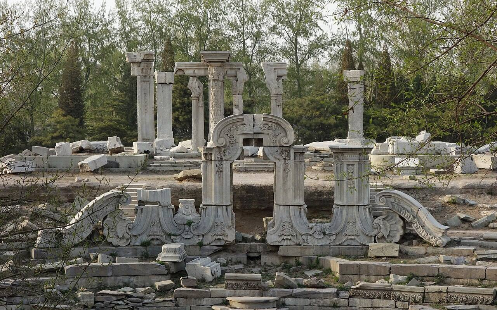

- **P0341** (sure): Ruins of Yuanyingguan02 20130126.JPG (2013-01-26 13:07:04 (Commons DateTimeOriginal)). https://commons.wikimedia.org/wiki/File:Ruins_of_Yuanyingguan02_20130126.JPG

  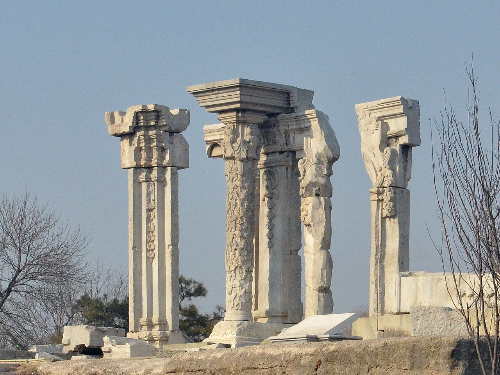

- **P0342** (sure): 远瀛观 永远不倒的石柱 - panoramio.jpg (Taken on 27 May 2011 (Commons DateTimeOriginal)). https://commons.wikimedia.org/wiki/File:%E8%BF%9C%E7%80%9B%E8%A7%82_%E6%B0%B8%E8%BF%9C%E4%B8%8D%E5%80%92%E7%9A%84%E7%9F%B3%E6%9F%B1_-_panoramio.jpg

  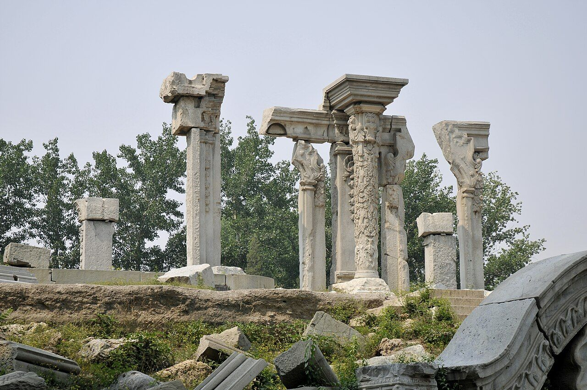

- **P0755** (sure): Ruins of Yuanyingguan 20130201 (2013-02-01 17:27:42 (Commons)). https://commons.wikimedia.org/wiki/File:Ruins_of_Yuanyingguan_20130201.JPG

  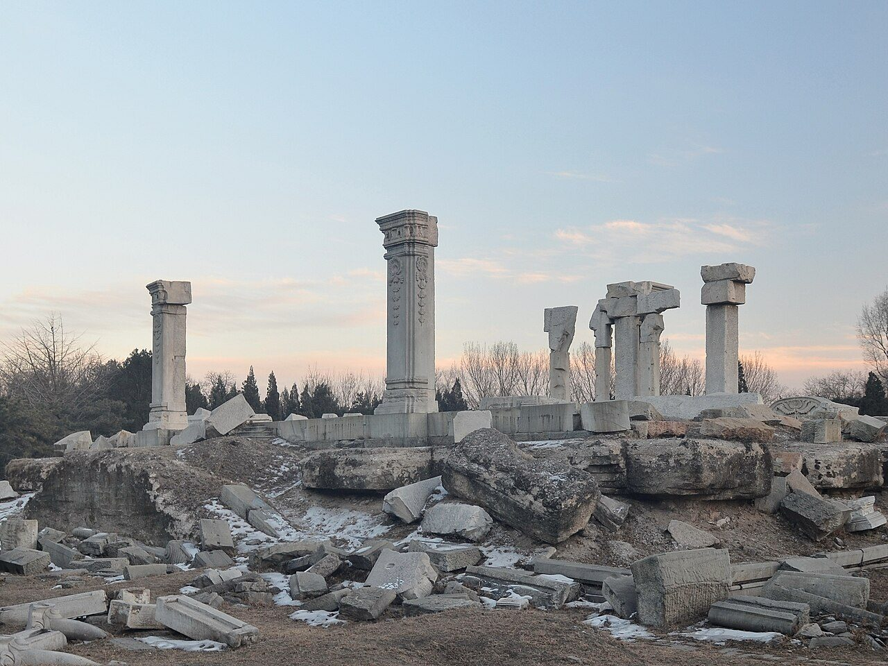

- **P0756** (sure): Ruins of Yuanyingguan01 20130126 (2013-01-26 13:24:38 (Commons)). https://commons.wikimedia.org/wiki/File:Ruins_of_Yuanyingguan01_20130126.JPG

  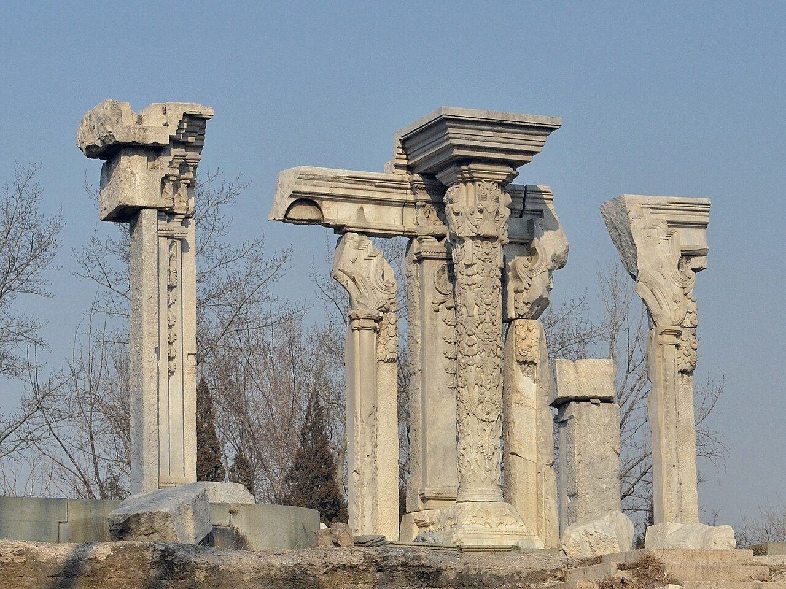

- **P0757** (sure): Yuanmingyuan (9865214586) (2007-06-23 11:00 (Commons)). https://commons.wikimedia.org/wiki/File:Yuanmingyuan_(9865214586).jpg

  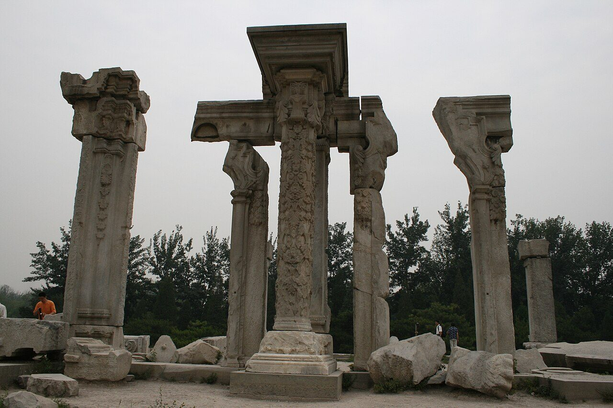

- **P0780** (sure): 远瀛观 standing columns from the north side (2007-06-23 (Commons)). https://commons.wikimedia.org/wiki/File:Yuanmingyuan_(9865480493).jpg

  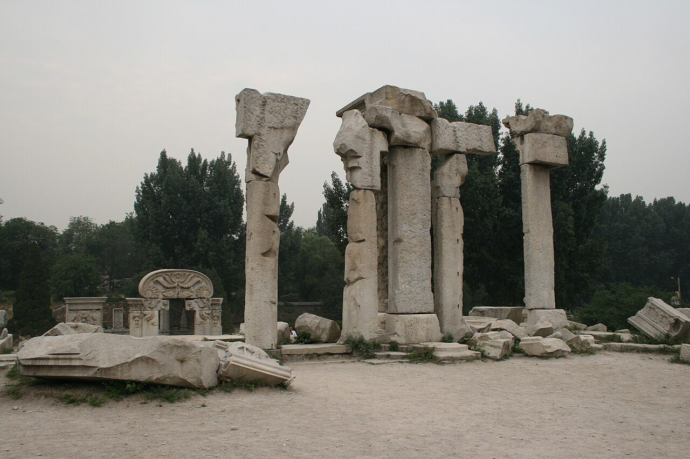

- **P0760** (likely): Dashuifa, Old Summer Palace (2021-02-17 17:03:02 (Commons)). https://commons.wikimedia.org/wiki/File:Dashuifa,_Old_Summer_Palace.jpg

  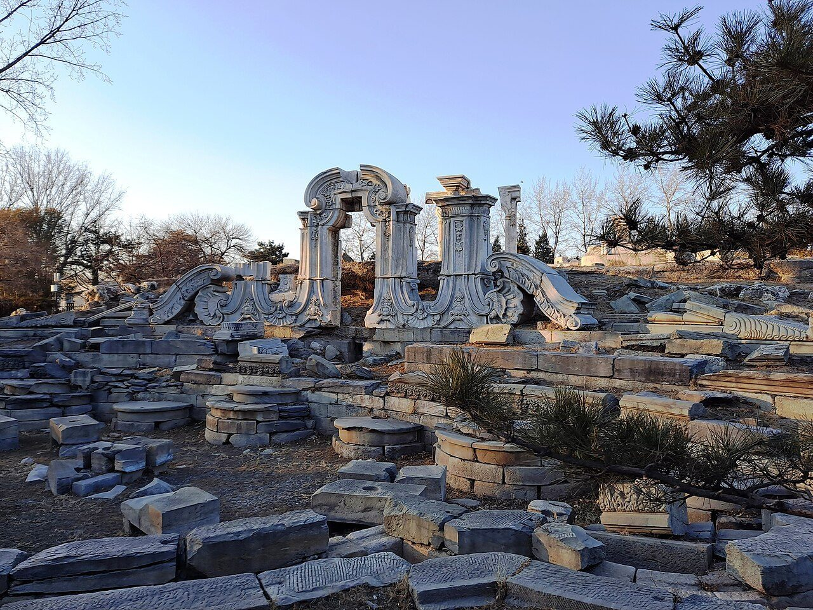

- **P0312** (guess): Sirén: Yuanmingyuan (Old summer palace): Ruins. (undated; Sirén 1921-23). http://kulturarvsdata.se/SMVK-OM/Bildarkiv/199634 Research-only: link card.
- **P0313** (guess): Sirén: Yuanmingyuan (Old summer palace): Ruins. (undated; Sirén 1921-23). http://kulturarvsdata.se/SMVK-OM/Bildarkiv/199635 Research-only: link card.
- **P0328** (guess): Arches and carved marble column from a ruined building at Yuan Ming Yuan (1933-1946 (HPC estimate)). https://hpcbristol.net/visual/Hv20-059 Research-only: link card.
- **P0331** (guess): Carved marble column and capital from a ruined building at Yuan Ming Yuan (1933-1946 (HPC estimate)). https://hpcbristol.net/visual/Hv20-073 Research-only: link card.

## Texts and drawings (35)

- **E0185** (poem, likely): 御製 題澤蘭堂. 1795 (御製詩五集) · KR4f0005_486:3a · S201. https://github.com/kanripo/KR4f0005/blob/master/KR4f0005_486.txt
  > 題澤蘭堂 書堂號澤蘭樸斵謝青丹芸帙堪永日藤窻避薄寒蕪情報韶意水法列竒觀（堂北為西洋水法處盖縁乾隆十八年西洋博爾都噶里雅國）（來京朝貢聞彼處以水法為竒觀因念中國地大物博水法不過工巧之一端遂命住京之西洋人郎世寧造）（為此法俾來使至此瞻仰前嵗□咭唎國使臣等至京朝貢亦令閲看深為歎服昨冬廣東督臣長麟撫臣朱）（珪奏荷蘭國使臣嘚□等以今嵗為朕御極六十年大慶懇請来京朝賀鑒其數萬里外慕化悃誠因允其請）（已即於臈月到京新正並與朝賀宴賞節間令於是處觀看水法使知朕所嘉者逺人嚮化之誠若其任土作）（貢則中國之大何竒不有初不以為貴也）洋使賀正至逺瀛合俾看
  The one imperial statement found on the European water works. Qianlong's note says the 西洋水法 stands north of 澤蘭堂; after a Portuguese embassy of 乾隆十八年 (1753) he had 郎世寧 Castiglione build it to show envoys; British envoys saw it in the 1790s, and the Dutch envoys at New Year 1795 were to see it. He adds that what he values is their coming, not their marvels.
- **E2429** (text, likely): Lucy: a 'Palais Louis XV' on about 8 October 1860. 1860 (published 1861) · letter of 8 October; IA OCR line 4098, page not fixed · S247. https://archive.org/details/souvenirsdevoya00lucygoog
  > Nous dénichons aussi un Palais Louis XV. Il y avait là le matin encore les tapisseries des Gobelins, représentant la toilette chinoise, l'arrivée des Européens en Chine, etc., etc., présent du roi Louis XV à l'Empereur ... mais elles ont été mises en sûreté !! Plus loin, c'est une collection de portraits des beautés de la cour de Louis XV, avec les noms au bas. Crevés hélas !
  Witness of 1860: the French enter a European-style building, with Gobelins tapestries (the man names the wrong Chinese emperor) and pictures of court ladies with their names. Tapestries gone by the afternoon. Agrees with the plate XIV note and with S245.
- **E2430** (text, likely): Varin: chambers of Gobelins and portraits in a Louis XV palace, 1860. 1860 (1862 edition per S245) · IA OCR line 9748; S02 p.184 quotes it · S245. https://archive.org/details/expditiondechin00paulgoog
  > Dans un de ces palais, bâti dans le style Louis XV, on voyait une série de chambres revêtues de tapis des Gobelins aux armes de France, et aux murs desquelles étaient suspendus des portraits en pied de beautés de la cour de France, avec leurs noms au bas.
  Varin: secondary palaces, long abandoned and turned into stores. Tapestries and paintings 'delabrés, crevés': already in poor state. This is the same room as Lucy's. The two French witnesses tell us the building was a store with contents in October 1860, not an inhabited palace.
- **E0964** (poem, sure): 远瀛观. 嘉庆三年 (1798) · v4 p.123, under 西洋楼; source ref 1-386 · S361. https://www.yuanmingyuanpark.cn/xs/yjbg/202008/P020200803382796786124.pdf#page=126
  > 楼式仿西洋，圣皇声教彰。远瀛咸向化，绝域尽来王。可识天威畅，同霑惠泽长。大清超万古，继序凛无遑。
  Poem 远瀛观 by the Jiaqing Emperor, 1798, filed by the editors under 西洋楼.
- **E0965** (poem, sure): 远瀛观: 嘉庆三年 poem of the Jiaqing Emperor. 嘉庆三年 (1798), date from the compilation · p.295 item (1), under 远瀛观 · S360. https://www.yuanmingyuanpark.cn/xs/yjbg/202007/P020200730387572832602.pdf#page=295
  > 引机运水石池注，溅玉喷珠万斛雄。敬识圣皇声教广，流沙西海尽同风。
  Jiaqing, 1798: machine-raised water fills a stone basin, with jets of spray: a dated witness that the fountains worked.
- **E0966** (poem, sure): 远瀛观: 嘉庆七年 poem of the Jiaqing Emperor. 嘉庆七年 (1802), date from the compilation · p.295 item (2), under 远瀛观 · S360. https://www.yuanmingyuanpark.cn/xs/yjbg/202007/P020200730387572832602.pdf#page=295
  > 室仿西洋式，寸心括远瀛。仁恩全浃洽，遐迩庆升平。驭世思图大，宅中念守成。怀柔先立极，抚字凛持盈。永保丕基巩，诞敷考泽宠。化期周渤澥，六合奉皇清。
  Poem of the Jiaqing Emperor at 远瀛观, 1802, on the view. Year as given by the compilation.
- **E0968** (poem, sure): 远瀛观: 嘉庆十三年 poem of the Jiaqing Emperor. 嘉庆十三年 (1808), date from the compilation · p.295 item (3), under 远瀛观 · S360. https://www.yuanmingyuanpark.cn/xs/yjbg/202007/P020200730387572832602.pdf#page=295
  > 圣皇声教被远方，东踰使鹿西氐羌。咭唎国来梯航，岂珍异物鉴心臧。爰修石室包贡藏，擘窠三字昭龙光。远瀛观额聿辉煌，后昆永念帝泽洋。中安外靖奕禩康，勤政爱民勉自强。凛承宝命敢怠遑，不愆不忘由旧章。
  Poem of the Jiaqing Emperor at 远瀛观, 1808. Year as given by the compilation.
- **E0969** (poem, sure): 远瀛观: 嘉庆十九年 poem of the Jiaqing Emperor. 嘉庆十九年 (1814), date from the compilation · p.295 item (4), under 远瀛观 · S360. https://www.yuanmingyuanpark.cn/xs/yjbg/202007/P020200730387572832602.pdf#page=295
  > 圣化敷海洋，远人会中土。咭唎来 朝，仿式建数宇。不宝贡物奇，题额深意取。持盈保泰衷，观此思安抚。
  Poem of the Jiaqing Emperor at 远瀛观, 1814. Year as given by the compilation.
- **E0970** (poem, sure): 远瀛观: 嘉庆二十一年 poem of the Jiaqing Emperor. 嘉庆二十一年 (1816), date from the compilation · p.296 item (5), under 远瀛观 · S360. https://www.yuanmingyuanpark.cn/xs/yjbg/202007/P020200730387572832602.pdf#page=296
  > 中国驭外域，崇德化远陬。异物奚足贵，奇珍不妄求。结构仿洋式，娱情偶来游。如披画图景，悦目意漫留。达士必超越，沾滞皆凡俦。子帷务实政，敦俗安嚣浡。
  Poem of the Jiaqing Emperor at 远瀛观, 1816. Year as given by the compilation.
- **E0971** (poem, sure): 远瀛观: 嘉庆二十一年 poem of the Jiaqing Emperor. 嘉庆二十一年 (1816), date from the compilation · p.296 item (6), under 远瀛观 · S360. https://www.yuanmingyuanpark.cn/xs/yjbg/202007/P020200730387572832602.pdf#page=296
  > 本无招致心，突来咭唎。既来复不驯，巧言多诈伪。未能成礼还，庸臣实偾事。瞻额衷惭惶，艰哉在上位。训诲竟敢违，要名又任意。用人诚冣难，题壁述予志。（前据两广督臣等奏称咭唎固使臣呈请前来朝贡，予以其远隔重洋输诚纳赆不可虗其归戴之忱，是以准令由天津每口登岸，并非有心招致之也。不意夷情狡诈，反复不驯。予先复命苏楞额和世泰等赴当赐宴，令其演礼，谆谕以如能行礼方准带领入京。乃苏楞额广惠既违训诲于前，和世泰穆克登额又复妄行于后，以致届期不能成礼。种种愤事皆由庸臣贻误，用人之难如此。兹来斯地瞻言旧额，抚衷实增私恧，题此以述予志焉）
  Poem of the Jiaqing Emperor at 远瀛观, 1816, on the view. Year as given by the compilation.
- **E0972** (poem, sure): 远瀛观: 嘉庆二十三年 poem of the Jiaqing Emperor. 嘉庆二十三年 (1818), date from the compilation · p.296 item (7), under 远瀛观 · S360. https://www.yuanmingyuanpark.cn/xs/yjbg/202007/P020200730387572832602.pdf#page=296
  > 驭远从来贵严肃，彼咭唎性难伏。每来先蓄图利心，宽则无忌肆贪黩。强悍不循中国仪，辱其主命宜驱逐。大君岂贵贡珍奇，所宝惟贤慎司牧。（抚驭远人理贵严肃，余诗所谓中国有威仪，岂可少贬损是也。彼咭唎使臣鄙野无知，贪黩强悍，又复不循礼仪，辱其主命，是以却彼贡献，逐令回国。盖为国以礼所宝，惟贤人君之道理当如是云尔）
  Poem of the Jiaqing Emperor at 远瀛观, 1818, on the view. Year as given by the compilation.
- **E0973** (poem, sure): 远瀛观: 嘉庆二十四年 poem of the Jiaqing Emperor. 嘉庆二十四年 (1819), date from the compilation · p.296 item (8), under 远瀛观 · S360. https://www.yuanmingyuanpark.cn/xs/yjbg/202007/P020200730387572832602.pdf#page=296
  > 远瀛渺漠阻世尘，彼咭唎隔大秦。五万余里孰招致，占风航海通天津。既来倔强失礼节，未可觐见随班列。仍施厚赏命回帆，外域羁縻示不绝。
  Poem of the Jiaqing Emperor at 远瀛观, 1819, on the view. Year as given by the compilation.
- **E0974** (poem, sure): 远瀛观: 嘉庆二十五年 poem of the Jiaqing Emperor. 嘉庆二十五年 (1820), date from the compilation · p.296 item (9), under 远瀛观 · S360. https://www.yuanmingyuanpark.cn/xs/yjbg/202007/P020200730387572832602.pdf#page=296
  > 圣化海隅被，来朝恩泽覃。近年虽晋谒，仪节未详谙。厚往从京北，护归自粤南。远瀛示宽大，六合一心含。
  Poem of the Jiaqing Emperor at 远瀛观, 1820, on the view. Year as given by the compilation.
- **E0975** (poem, sure): 远瀛观: 道光三年 poem of the Daoguang Emperor. 道光三年 (1823), date from the compilation · p.296 item (10), under 远瀛观 · S360. https://www.yuanmingyuanpark.cn/xs/yjbg/202007/P020200730387572832602.pdf#page=296
  > 久仰高皇御世模，远人向化德巍乎。海西琛赆昭王会，天外帆樯萃帝都。垂示不须珍异物，绥徕只为焕鸿图（孙臣）。继绪增兢惕勉，竭精勤守不渝（皇祖圣武，远扬尧天，广覆流沙，西海重译来王，于兹楼仿西洋见远瀛之向化，而引机运水，亦以征怀柔至德，泽被无垠。予小子景仰鸿图，勉思绳武，益助精勤之素志，无忘声教之诞敷云尔）。
  Daoguang, 1823: his note reads the Western-style tower and its machine-raised water as signs of imperial reach. The view is the emperor's own.
- **E0963** (poem, likely): 远瀛观歌. 嘉庆二年 (1797) · v4 p.122, under 西洋楼; source ref 1-239 · S361. https://www.yuanmingyuanpark.cn/xs/yjbg/202008/P020200803382796786124.pdf#page=125
  > 宇宙两戒渤海环，九州罗列四大间。西洋伊古谁得到，贡琛向化趋朝班。彼英吉利一郡小，航海恭献天文表。圣皇怜彼远人诚，荒服心坚物微渺。连延崇阁仿重洋，凿沼引水机运详。曲折灌注互荡激，三伏三见脉络藏。不宝异物旅獒志，薄来厚往古籍识。九袠又喜聚梯航，图开王会共球备。
  Poem 远瀛观歌 by the Jiaqing Emperor, 1797, filed by the editors under 西洋楼.
- **E0967** (poem, likely): 远瀛观歌. 嘉庆八年 (1803) · v4 p.124, under 西洋楼; source ref 2-264 · S361. https://www.yuanmingyuanpark.cn/xs/yjbg/202008/P020200803382796786124.pdf#page=127
  > 石级参差列珠树，玻璃为牖佳境布。八窗洞开引清风，翠屏紫凤萦香雾。一室澄观备远瀛，圣念包罗九有宏。瞻临堂构切抚字，凛乎驭朽弥持盈。
  Poem 远瀛观歌 by the Jiaqing Emperor, 1803, filed by the editors under 西洋楼.
- **E0461** (description, sure): Bourgeois 1786: European houses, glass and the Gobelins hall. 1786 · pp.164-165 · S258. https://archive.org/details/BIUSante_40644
  > Dans la salle qu'il a fait nouvellement bâtir pour placer les Tapisseries de la manufacture des Gobelins, que la Cour de France lui a envoyées en 1767, il y a partout des trumeaux magnifiques.
  Direct French text behind S02 p.160. Hall 70 pieds long, new in 1786, so full of machines there is hardly room to pass; window panes cut from mirror glass. Plate XIV (p.183) names the building made for these tapestries, which by the set's number is 远瀛观.
- **E0976** (description, sure): Plate XIV: 远瀛观 Yuanying Guan, built for the Gobelins. 1786-1803 · p.183, Plate XIV · S258. https://archive.org/details/BIUSante_40644
  > Ce palais qui n'est pas fort élevé, et qui n'a qu'un rez-de-chaussée, est composé d'un corps principal, flanqué de deux pavillons en avant-corps.
  "Bâtiment construit pour placer les tapisseries des Gobelins." On a terrace reached by a round double-ramp stair, simpler than the others. One storey only.
- **E0978** (description, sure): Engraving 14: 远瀛观 Yuanying Guan. 1934 · pp.155-156 · S02. https://archive.org/details/historyofpekings00malo
  > This large gray brick building was lavishly decorated with carved white marble around the doors and windows and with two elaborately and intricately carved marble pillars before the main door.
  On a terrace projecting north beyond the line of the park wall; faced the Great Fountains. Plate p.154: one pillar fallen.
- **E2371** (description, likely): Varin: behind the palace, and a European building with Gobelins. 1860 · p.240 · S245. https://archive.org/details/expditiondechin00paulgoog
  > Dans un de ces palais, bâti dans le style Louis XV, on voyait une série de chambres revêtues de tapis des Gobelins aux armes de France,
  Behind the palace a much larger lake with three buildings; then a maze of canals, lakes and hills with secondary palaces long abandoned and used as stores. The European one held Gobelins and portraits, in poor state. Building not named.
- **E0487** (description, likely): Father Bourgeois 1786 on the contents of the European palaces. 1934 · p.160 · S02. https://archive.org/details/historyofpekings00malo
  > In the hall which he had made new for the tapestries of the manufacture of Gobelins, which the French court sent in 1767, there are many pier glasses.
  Bourgeois, quoted via Combaz and Delatour: only European furniture and ornaments; window panes cut from Venetian and French mirror glass; a new hall 70 ft long for the Gobelins tapestries sent in 1767, crowded with machines. Not named here; S258 p.183 ties the Gobelins building to plate XIV, 远瀛观. Benoist's pneumatic machine was also sent here (Lettres édifiantes xxxiii).
- **E0488** (description, likely): French presents seen in a European building, October 1860. 1934 · p.184 · S02. https://archive.org/details/historyofpekings00malo
  > In one of the palaces built in the style of Louis XV, there were seen a series of chambers hung with Gobelin tapestries marked with the arms of France,
  Varin pp.240-44: Gobelins with the arms of France and full-length portraits of court ladies, dilapidated from years of neglect. Building not named; 远瀛观 by S258 p.183.
- **E2421** (description, likely): Written then-and-now captions on Morrison photographs. 2026-08-06 · article, captions 1-9 · S775. https://www.163.com/dy/article/L3KN3VCD05527FJF.html
  Compares about nine 1930s photographs with today in words, not with new pictures. Claims the single-arch gate remnant on the south of 海晏堂 stood in the Republican years and has now collapsed, and the two arch frames at 远瀛观 have mostly fallen. Unverified user writing.
- **E0525** (description, likely): 清代御苑胜境——圆明园西洋楼二十景图创作理路探赜. post n.d. · jzys · S337. http://iqh.ruc.edu.cn/old/qdhjylyjzx/xszl/ylfj/549967f93aa3432880765881e768a3b7.htm
  On the 20 copper plates: how the Chinese artist 伊兰泰 Yi Lantai, long thought a Westerner, emerged from the archives after 1980, and what the plates' composition aims at. Gives 1783 and 远瀛观 as the end of building.
- **E0977** (description, sure): 圆明园百景史事分景汇编: 远瀛观. 1798-1823 · from p.295, under 远瀛观 · S360. https://www.yuanmingyuanpark.cn/xs/yjbg/202007/P020200730387572832602.pdf#page=295
  Jiaqing's poem of 1798 describes machine-raised water filling a stone basin and jets of spray, a dated sign that the fountains still ran. His poems of 1816 and after use the hall to reflect on the British embassy; a Daoguang note of 1823 reads the Western-style tower and its machine-raised water as signs of imperial reach. 远瀛观: 10 dated items, 1798-1823, of which 10 poems (Jiaqing, Daoguang); recurring themes: the view. First dated 1798, last dated 1823.
- **E0507** (description, sure): 圆明园五朝御制诗文集注 v4, editors' note on 西洋楼. 2020 edition · v4 p.120 · S361. https://www.yuanmingyuanpark.cn/xs/yjbg/202008/P020200803382796786124.pdf#page=123
  The editors walk the strip from west to east with completion dates and plaques: 谐奇趣 1751, 养雀笼 1759, then the fountains and the perspective walls, with their mechanical details. They put the whole at about 2% of the gardens.
- **E0544** (drawing, sure, search index only): 西洋楼水法图. 国家图书馆善本部 none shown · S310. https://www.mhymy.com/dasl/ysltd/7643.html
  Plan of the Xiyang Lou waterworks across its dozen sites; the record shows no shelf number. No image here; the site may ask a small payment for the full record.
- **E0979** (drawing, sure, search index only): 远瀛观总平面图 (图名: 远瀛观地盘样). 不详 · 国家图书馆善本部 none shown · S310. https://www.mhymy.com/dasl/ysltd/12443.html
  Undated ground plan of Yuanying Guan; the record shows no shelf number. No image here; the site may ask a small payment for the full record.
- **E0980** (drawing, sure, search index only): 远瀛观装修平面图. 不详 · 国家图书馆善本部 none shown · S310. https://www.mhymy.com/dasl/ysltd/12043.html
  Undated plan of Yuanying Guan's fittings; the extract shows no shelf number. No image here; the site may ask a small payment for the full record.
- **E2440** (plan, sure): Teng Gu's preface on the photographs and plan. 1932-07 (preface), 1933 (book) · pp.3-5 of the preface, djvu pages 5-7 · S871. https://commons.wikimedia.org/wiki/File:CADAL11102995_%E5%9C%93%E6%98%8E%E5%9C%93%E6%AD%90%E5%BC%8F%E5%AE%AE%E6%AE%BF%E6%AE%98%E8%B7%A1.djvu
  Teng Gu says the photographs and the plan belonged to Ernst Boerschmann and were taken and drawn by Ohlmer, a customs official in Tianjin who lived in Beijing 1867-1879 and whose collection went to the Hildesheim museum. He argues they are earlier than those in Favier's Péking (1897), Combaz 1909, Perzynski 1920 and Münsterberg 1912, naming pages he compared. Fig. 13 is a recent photograph by Zhou Zuanwu; fig. 15 is copied from Favier p.264.
- **E2419** (plan, sure): Three plans by Antoine Durand: 1984 from Jin Xun at 1/500 inside Adam's 1/10000; 1985 from a survey of the whole site; 1987 fountain area from 128 surveyed points with a manual survey of all surface parts. 1984-87 · pp.125-129, Figs 4, 5, 9, 12, 16 · S603. https://www.persee.fr/doc/arasi_0004-3958_1988_num_43_1_1240
  The only published method statement for an on-site survey of the whole strip. Only excavation could fix the east fence of the gardens and the east edge of the basin. The west edge of the 线法山 gate and the ramp fix the geometry. See R0139-R0143. Plans without a printed scale in the copy I read.
- **E0950** (archaeology, sure): 圆明园遗址考古今年推进至大水法, 浙江在线. 2016-06-12 · news, 金和天 · S141. https://china.zjol.com.cn/gnxw/201606/t20160612_1619014.shtml
  养雀笼 Yangque Long: 1,000 m2 cleared in 2015, showing foundations that combine 三合土 lime concrete with brick and stone. 大水法 and 远瀛观 were next, about 2,000 m2 planned for 2016, with the stated aim of learning how imperial buildings were founded, which standing buildings cannot show.
- **E0981** (archaeology, sure): 远瀛观遗址考古发掘简报, 北京市文物研究所. dug 2016-06 to 12 · mhymy 档案史料 12613, abstract · S153. https://www.mhymy.com/dasl/12613.html
  Salvage dig for conservation of the ruin, 800 m2: main hall, storehouses behind, roads and wall footings, three early and late building phases, and many glazed fittings. The hall stood on a high platform, brick and stone with a glazed roof, its plan an inverted U. The text dates the hall later than 大水法 and 观水法 to its south.
- **E0363** (archaeology, sure): 揭秘圆明园考古, 华西都市报 via 中证网. 2017-07-10 · news, 张中华 and 张利芳 · S140. https://cs.com.cn/ssgs/gssc/201707/t20170710_5365575.html
  Three large campaigns since 1996 yielded over 50,000 finds. The campaign from 2012 dug 桃花洞, 大宫门, 养雀笼, the 海晏堂 water tower and 远瀛观. At 如园 Ru Yuan, the best-preserved of these sites and the first imitation of a Jiangnan garden dug here (19,000 m2 site, 2,800 m2 buildings, 3,800 m2 opened), diggers found 芝兰室, 云萝山馆, 听泉榭, 延清堂, 含碧楼, 挹霞亭, 观丰榭, 引胜轩, rockery, paths and shores, and burnt famille-rose floor tiles in 延清堂.
- **E0554** (archaeology, sure): 西洋楼区域考古勘探报告. n.d. · mhymy 档案史料 12205, free part · S149. https://www.mhymy.com/dasl/12205.html
  Report's opening: the strip runs 860 m east-west, up to 300 m wide in the west and 65 m at its narrowest, about 70,000 m2, built 1747-1783. A central axis divides it into about five sections, each with its own north-south axis, thirteen units from 谐奇趣 to 线法墙. Survey results are paywalled.

**On the plan:** Drawn on the plan of the gardens (S01), labelled 远瀛观, 5x4 cells. https://artmuseum.princeton.edu/collections/objects/138657

## Reconstructions by others (9)

Modern interpretation, not evidence.
- **R0314** (drawing, sure): Gartenplan der Xiyang Lou (西洋楼) in Peking. Maximilian Dörrbecker (Chumwa). https://commons.wikimedia.org/wiki/File:Gartenplan_der_Xiyang_Lou.png
- **R0092** (render, likely): 远瀛观, image 762 in a gallery. posted 2019. https://www.thepaper.cn/newsDetail_forward_3323921 Research-only: link card.
- **R0003** (3D model, sure): 3D技术复现“万园之园”: 北京大学 stone scanning. 圆明园管理处; 北京大学考古文博学院, 2025. https://news.bjd.com.cn/2025/05/21/11171051.shtml Research-only: link card.
- **R0139** (drawing, sure): Fig. 4, Plan d'ensemble (plan de restitution 1985). Antoine Durand, Mission Palais d'Ete, under Michele Pirazzoli-t'Serstevens, 1985 (published 1988). https://www.persee.fr/doc/arasi_0004-3958_1988_num_43_1_1240 Research-only: link card.
- **R0143** (drawing, sure): Fig. 16, Facade sud du Yuanyingguan (restitution 1986). Antoine Durand, Mission Palais d'Ete, 1986 (published 1988). https://www.persee.fr/doc/arasi_0004-3958_1988_num_43_1_1240 Research-only: link card.
- **R0140** (drawing, likely): Fig. 5, Plan de l'aire du buffet d'eau (plan de restitution 1987). Antoine Durand, Mission Palais d'Ete, 1987 (published 1988). https://www.persee.fr/doc/arasi_0004-3958_1988_num_43_1_1240 Research-only: link card.
- **R0123** (drawing, sure): Abb. 31, 远瀛观 Yuanying Guan (Szene 221), Lage und Grundriss. Shuang Zhang, TU Berlin, 2004. https://doi.org/10.14279/depositonce-566 Research-only: link card.
- **R0133** (physical model, likely): Maquette of the European garden (Xiyang Lou), with a new measured plan. Philippe Jonathan, Antoine Durand, French Foreign Ministry mission to Yuanmingyuan, 1983-85, 1987. https://www.ghamu.org/wp-content/uploads/2022/09/Rabreau-YMY-2022.pdf Research-only: link card.
- **R0134** (paper figure, likely): Le jardin a l'europeenne du Yuanming Yuan: Fig. 5 ruins of the Belvedere 1983, comparisons and plates, a book-length essay with 40+ figures. Daniel Rabreau, GHAMU, 2022. https://www.ghamu.org/wp-content/uploads/2022/09/Rabreau-YMY-2022.pdf Research-only: link card.

## Evidence for the set of buildings

- Reconstructions and comparables for the whole garden, 西洋楼 Xiyang Lou: see GARDEN-XY

## Open questions

- Q9: Bay counts, plan against text
- Q24: Xiyang Lou
- Q48: Xiyang Lou
- Q49: Captions overruled by form (old photographs)
- Q56: Reconstructions against the period evidence
- Q60: Captions and claims, old photographs (Round 5)
- Q64: The plan's scale and turn in this strip (Round 6)
- Q67: 远瀛观 (Round 6)

<!-- generated:end -->

## Notes

<!-- Yours: regeneration never touches this part. It goes on the public site; what you write below a line holding only %% private %% stays in the research copy. -->
