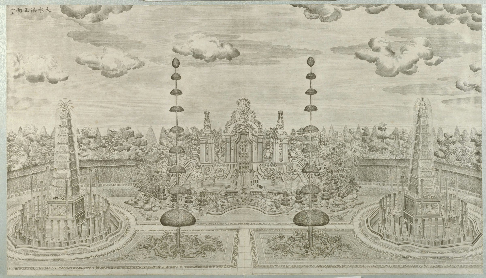

<!-- generated:start (scripts/building_pages.py): do not edit between these markers -->

# XY10-N02: Hall without a name on the plan

east pyramid fountain · Xiyang Lou

**3D object:** 2 boxes. Open it: `/reconstruction/3d.html?b=XY10-N02`

**Part of:** XY10 大水法

## What we know

- **English:** east pyramid fountain (S01, S02, S603)
- **Garden:** Xiyang Lou (S01, S02, S603)
- **Type:** other (S01, S02, S603 · confidence B)
- **Destroyed:** 1860 (S01, S02, S603)
- **Position:** 40.01206, 116.30699. S850;S01, moved in Round 6: on the ruin, research/xiyanglou/boxes.csv (S01 · confidence B)
- **Bays:** 1 in the texts / 1x1 on the plan (S01, S02, S603)
- **Size in the inventory:** 4.6 × 4.2 m. stated: S01;S71;S02, research/xiyanglou/boxes.csv (S01)
- **Note:** Round 6 replaced frontage 5.3 m. Round 6 replaced depth 6.0 m. (S01, S02, S603)
- **Plan reader's note:** rect=22,20,0 for the base. Round pool x 10654-10741, y 1076-1159. (S01) *(research copy, not public)*
- **How it was read:** likely (S01) *(research copy, not public)*
- **Plan pixels:** 10697, 1117 (S01) *(research copy, not public)*

## Our model now

Modelled from plate 15 of 1783-86, Ohlmer's photograph of 1873, the ruin photographs of 1902-1922 and today's (P0641 for the proportions), the plan S01 and Durand's survey (S603); every figure is a reading (C) unless the row says otherwise. Faces no picture shows (the piers' backs, the stairs' flights, the towers' north faces) are carried round from the documented parts (assumed).

- **Niche:** the frame 9.2 m wide over its posts, the opening 3.7 m, the posts' caps 10.0 m above the court, the deep arch head to 13.7 m and the shell crest to 17.7 m (plate 15, P0641, P0762, P0776, C); seven water steps in the recess under the lion mask (S310, B)
- **Piers:** two square piers 3.2 m across, their outer edges 21.2 m apart (S01, b), console feet, cornice at 9.9 m, vase finials to 14.4 m (plate 15; gone by 1873, P0776); proportions from P0641 (C)
- **Stairs:** a flight beside each pier up to the terrace of 远瀛观, 4.63 m above the court, on the diagonal of S01's hatched blocks (C); its court-side parapet is plate 15's ribbed band: a balustrade on top, a curl at the pier, the great volute at its foot (plate 15, P0776; the volutes lying today were re-laid in 1978-83). The treads behind the parapet are assumed
- **Basin:** lobed, 28.4 m wide (the ruin, S850, B), 16.4 m deep (C), with a low rail on its front, potted trees on pedestals, two urn fountains; the stag on its rock and ten hounds round it in the plan's places (S01, plate 15, C)
- **Towers:** two pyramids of 10 tiers (plate 15, C; S310 says 13) on carved pedestals 4.6 m square (S01, B), 5 m high, their tops 17.1 m above the water; basins 18 m across, 62 m apart (S603, survey, B), about 40 jets each
- **Court:** the sunken area 110 × 60 m, 1.30 m below the gardens (S603, survey, B): paved bands, four parterres before the towers (plate 15, C)
- **Colours:** white marble (S02 p.157, B); the stag and hounds in stone grey: their material is not stated in the sources read (C)

## Pictures (1)

- **P0055** (sure): 大水法正面 (圆明园铜版画册 / 西洋楼铜版画, plate 十五 of 二十; title and number printed on the plate) (1786 (Commons); Palace Museum: 清). https://commons.wikimedia.org/wiki/File%3A%E5%9C%86%E6%98%8E%E5%9B%AD%E9%93%9C%E7%89%88%E7%94%BB%E5%86%8C-12.jpg

  

## Texts and drawings (0)

None of its own.

**On the plan:** Drawn on the plan of the gardens (S01) with no label, 1x1 cells: a building stood here, its name unknown. https://artmuseum.princeton.edu/collections/objects/138657

## Evidence for the set of buildings

- Evidence for the whole compound 大水法: see XY10
- Reconstructions and comparables for the whole garden, 西洋楼 Xiyang Lou: see GARDEN-XY
- Standing buildings comparable to a square pavilion (not this building): see CLASS-pavilion_square

**Searched and not found:** This block has no name on the plan or in the texts, so no source can be searched for it by name.

## Open questions

None that name it.

<!-- generated:end -->

## Notes

<!-- Yours: regeneration never touches this part. It goes on the public site; what you write below a line holding only %% private %% stays in the research copy. -->
