<!-- generated:start (scripts/building_pages.py): do not edit between these markers -->

# XY10: 大水法 Da Shuifa

Ta Shui Fa, the Great Fountains · Xiyang Lou

**3D object:** 3 boxes. Open it: `/reconstruction/3d.html?b=XY10`

## What we know

- **Name:** 大水法 Da Shuifa (S02, S06, S56, S01, S109, S201 · confidence A)
- **English:** Ta Shui Fa, the Great Fountains (S02, S06, S56, S01, S109, S201)
- **Garden:** Xiyang Lou (S02, S06, S56, S01, S109, S201)
- **Type:** european (S02, S06, S56, S01, S109, S201 · confidence A)
- **Built:** After the Portuguese embassy of 乾隆十八年 (1753), per Qianlong's note, built by 郎世寧 Castiglione (S02, S06, S56, S01, S109, S201)
- **Destroyed:** Looted and burnt 1860; stone ruins stayed, further damage 1900 and after (S02 pp.142,218) (S02, S06, S56, S01, S109, S201)
- **Position:** 40.01221, 116.30660. S850;S01, moved in Round 6: on the ruin, research/xiyanglou/boxes.csv (S01 · confidence B)
- **Size in the inventory:** 21.2 × 4.4 m. stated: S01;S850;S71, research/xiyanglou/boxes.csv (S01)
- **Lead on its size, from a modern study, not used in the model:** Water-buffet area 110 x 60 m, level drop 1.30 m at the banks, hedges about 2.50 m; composition of the rockwork and throne about 50 m long; twin basins 18 m in diameter, 62 m between centres (S603, p. 127). (confidence B)
- **Where the text puts it:** 远瀛观前平台之南 (S06) (S02, S06, S56, S01, S109, S201) *(research copy, not public)*
- **Note:** Copper engraving no. 15 per S02. Tall pyramids and animal figures (S02 p.156). S06 10 hounds and a stag. Round 6 replaced frontage 20.0 m. Round 6 replaced depth 3.0 m. (S02, S06, S56, S01, S109, S201)
- **Plan reader's note:** Shell-shaped basin with small figures + arc behind + two round pools with square bases (the two pyramid fountains of engraving 15). Identified by Malone/engraving. | plan: rect=139,100,0. Shell-shaped basin x 10493-10632, y 996-1096 with about 9 small figures and centre rect (10562,1037). Arc behind it x 10511-10611, y 968-989. (S01) *(research copy, not public)*
- **How it was read:** likely (S01) *(research copy, not public)*
- **Plan pixels:** 10562, 1046 (S01) *(research copy, not public)*

## Our model now

Simple massing of a European palace: position and footprint from the ruin, the plan or a survey, heights read from the plates of the 1780s (research/xiyanglou/boxes.csv). Not a detailed model yet; the figures and their methods are in the Dimensions block.

- **1 ×:** sunken fountain area, 1.30 m below the gardens (not cut into the ground here): 110 × 60 m, eave 0.3 m, ridge 0.3 m
- **1 ×:** shell pool: 29 × 19 m, eave 0.5 m, ridge 0.5 m
- **1 ×:** niche building: 21.2 × 4.4 m, eave 14.3 m, ridge 14.3 m
- **Confidence:** B and C, some assumed

## Inside it (2)

- XY10-N01
- XY10-N02

## Pictures (25)

- **P0055** (sure): 大水法正面 (圆明园铜版画册 / 西洋楼铜版画, plate 十五 of 二十; title and number printed on the plate) (1786 (Commons); Palace Museum: 清). https://commons.wikimedia.org/wiki/File%3A%E5%9C%86%E6%98%8E%E5%9B%AD%E9%93%9C%E7%89%88%E7%94%BB%E5%86%8C-12.jpg

  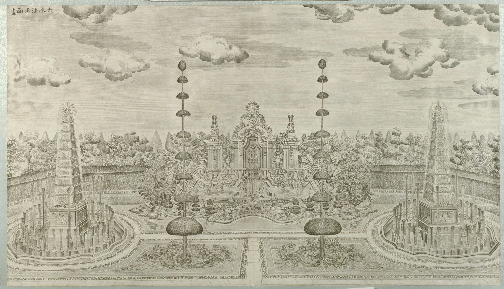

- **P0222** (sure): Xiyang Lou plates, Getty set: The European Pavilions at the Garden of Perfect Clarity (1783-1786 (Getty)). https://www.getty.edu/art/exhibitions/china_paper/ Research-only: link card.
- **P0779** (sure): 圓明園東長春園平面圖 (第一圖), plan of the Xiyang Lou strip (drawn by Ohlmer, 1867-1879, per Teng Gu's preface; from Börschmann's collection). https://commons.wikimedia.org/wiki/File:CADAL11102995_%E5%9C%93%E6%98%8E%E5%9C%93%E6%AD%90%E5%BC%8F%E5%AE%AE%E6%AE%BF%E6%AE%98%E8%B7%A1.djvu

  

- **P0169** (sure): Hauptgebäude im Renaissancestil (before or in 1902 (Commons)). https://commons.wikimedia.org/wiki/File%3AHauptgeb%C3%A4ude_im_Renaissancestil.jpg

  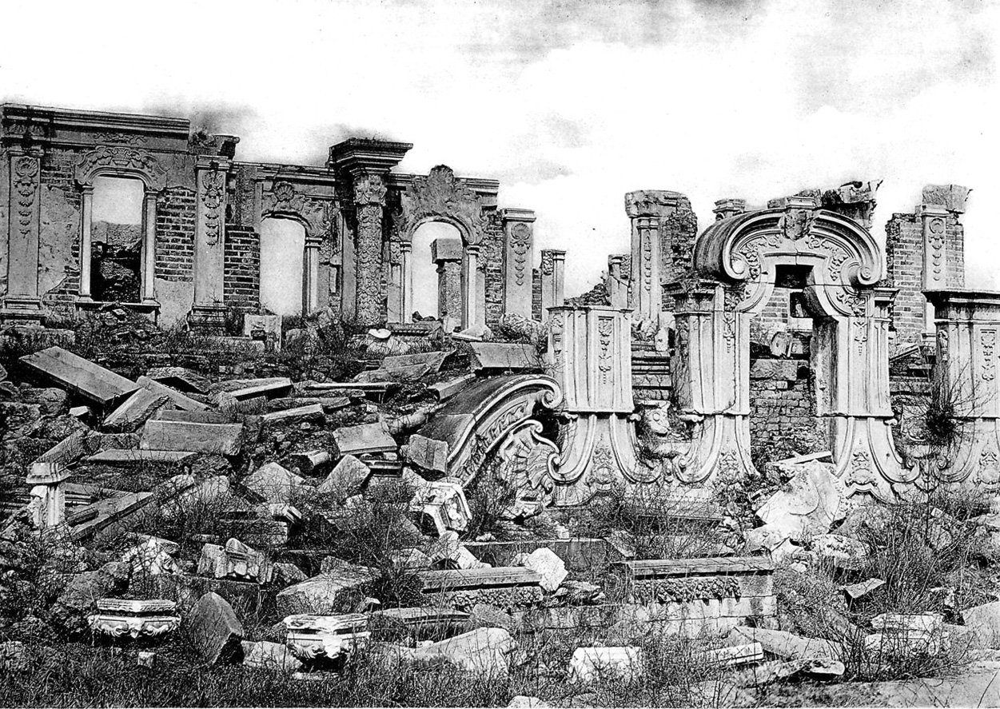

- **P0214** (sure): Enligt text under Pl. 191b Kinas trädgårdar Vol. I: Yuanmingyuan. Yuanyingguan, ”Utblick över Fjärran Vatten”. Bild efter fotografi 1922. (1922 (holder caption)). http://kulturarvsdata.se/SMVK-OM/Bildarkiv/198826

  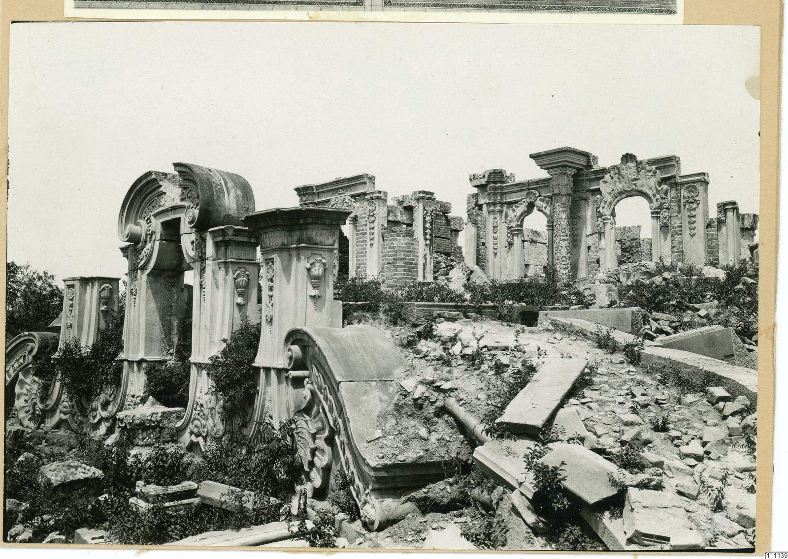

- **P0288** (sure): Ruins of Yuanmingyuan, Old Summer Palace (undated by holder (Sirén set, 1921-23 per the other prints)). http://kulturarvsdata.se/SMVK-OM/Bildarkiv/199686

  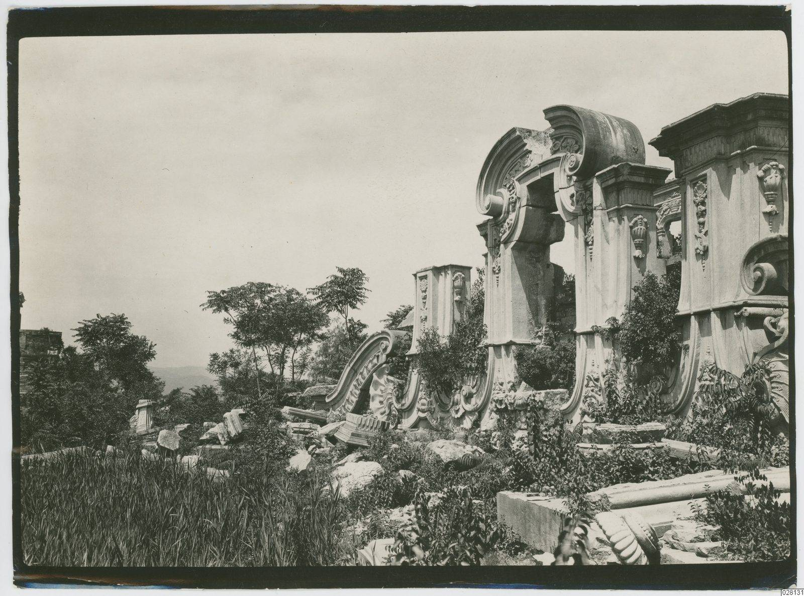

- **P0292** (sure): Fotografija Ruševine paviljona Dashuifa v Stari poletni palači (album: "Yüen-Ming-Yüen: Thron-Halle") (20th c., album bought 1914-1920 (holder)). https://vazcollections.si/predmeti/fotografija-rusevine-paviljona-dashuifa-v-stari-poletni-palaci/

  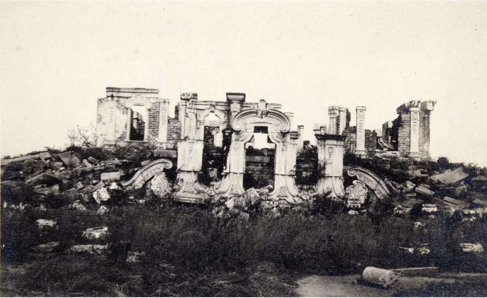

- **P0761** (sure): 大水法遗址 - panoramio (Taken on 27 May 2011 (Commons)). https://commons.wikimedia.org/wiki/File:%E5%A4%A7%E6%B0%B4%E6%B3%95%E9%81%97%E5%9D%80_-_panoramio.jpg

  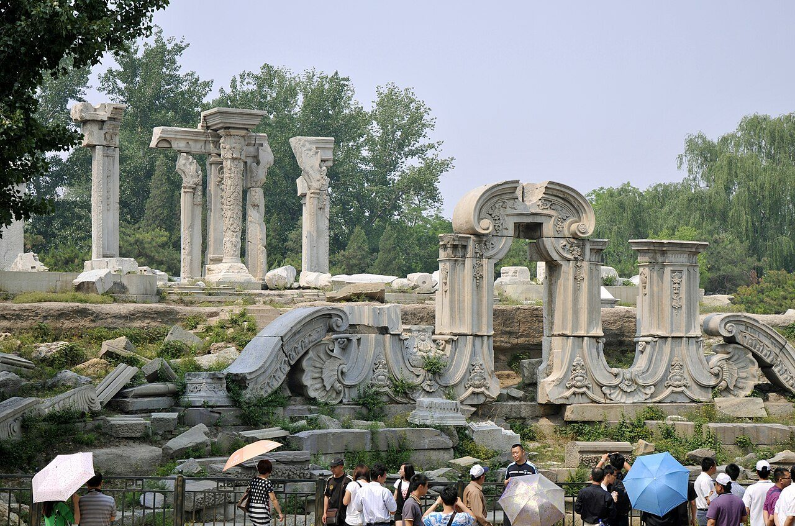

- **P0776** (sure): 大水法正面 (第十二圖) (1873 (S770; dated by S89); Teng Gu says only that Ohlmer took them 1867-1879, about sixty years before). https://commons.wikimedia.org/wiki/File:CADAL11102995_%E5%9C%93%E6%98%8E%E5%9C%93%E6%AD%90%E5%BC%8F%E5%AE%AE%E6%AE%BF%E6%AE%98%E8%B7%A1.djvu

  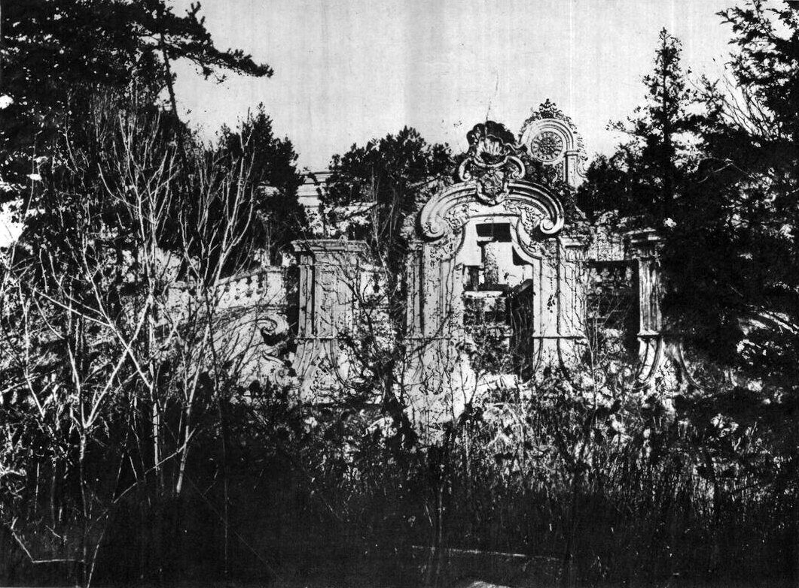

- **P0293** (likely): Fotografija Ruševine – panoramski pogled z vzhoda v Stari poletni palači (album: "Yüen-Ming-Yüen: Total-Ansicht vom Osten") (20th c., album bought 1914-1920 (holder)). https://vazcollections.si/predmeti/fotografija-rusevine-panoramski-pogled-z-vzhoda-v-stari-poletni-palaci/

  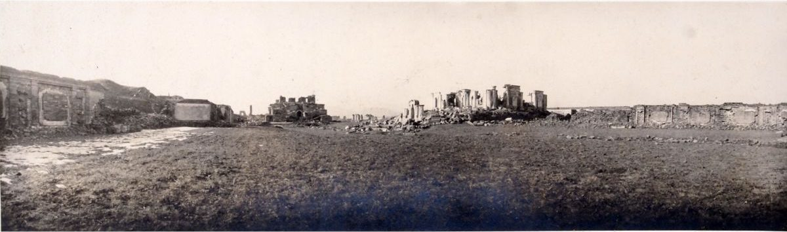

- **P0758** (likely): 远瀛观遗址 - panoramio (Taken on 27 May 2011 (Commons)). https://commons.wikimedia.org/wiki/File:%E8%BF%9C%E7%80%9B%E8%A7%82%E9%81%97%E5%9D%80_-_panoramio.jpg

  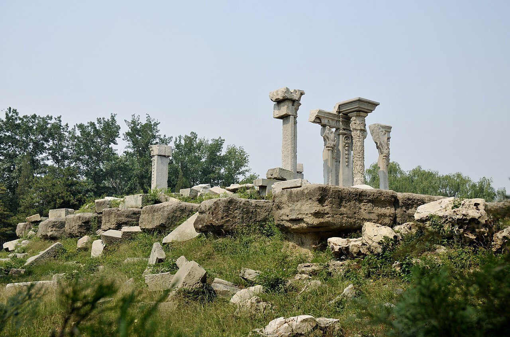

- **P0215** (sure): Sirén, Enligt text under Pl. 192a Kinas trädgårdar Vol. I: Yuanmingyuan. Dashuifa ”De Stora Springvattnen”. Bild efter gravyr år 1786. (undated by holder; Sirén's second trip 1921-23 for this group). http://kulturarvsdata.se/SMVK-OM/Bildarkiv/198827 Research-only: link card.

  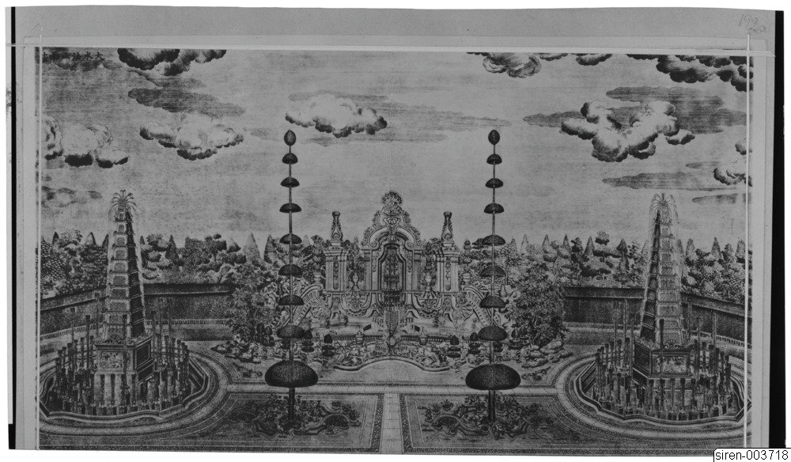

- **P0310** (sure): Sirén: Yuanmingyuan (Old summer palace): Ruins. (undated; Sirén 1921-23). http://kulturarvsdata.se/SMVK-OM/Bildarkiv/199632 Research-only: link card.
- **P0723** (sure): Dashuifa (Great Fountain) (S770 caption), Ohlmer negative K (1873 (S770; dated by S89)). https://visualizingcultures.mit.edu/garden_perfect_brightness_03/ymy303/e503.htm Research-only: link card.

  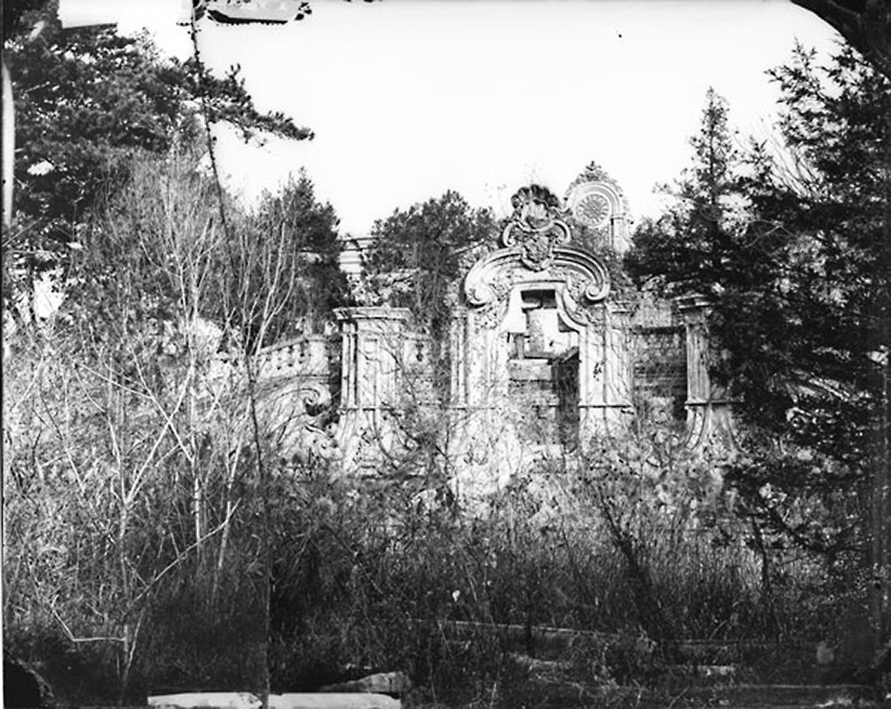

- **P0778** (sure): 晚近之大水法 (第十三圖) ('near today', a few years before the preface of July 1932, sent from Beiping by 周纘武 (Teng Gu)). https://commons.wikimedia.org/wiki/File:CADAL11102995_%E5%9C%93%E6%98%8E%E5%9C%93%E6%AD%90%E5%BC%8F%E5%AE%AE%E6%AE%BF%E6%AE%98%E8%B7%A1.djvu Research-only: link card.

  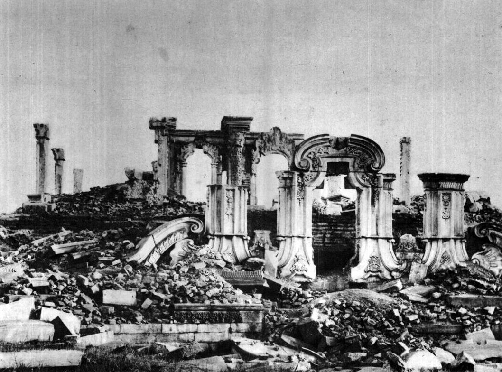

- **P0338** (sure): Yuanmingyuan Ruins of Dashuifa and Yuanyingguan 20120715.jpg (2012-07-15 12:57:04 (Commons DateTimeOriginal)). https://commons.wikimedia.org/wiki/File:Yuanmingyuan_Ruins_of_Dashuifa_and_Yuanyingguan_20120715.jpg

  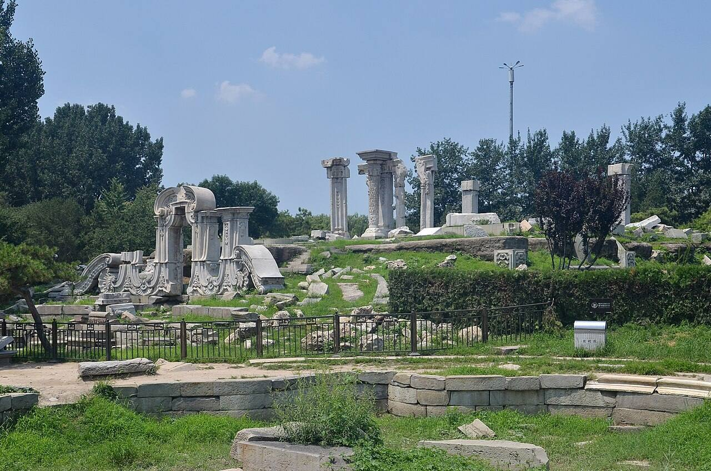

- **P0339** (sure): Dashuifa and Yuanyingguan 20130414.JPG (2013-04-14 17:18:32 (Commons DateTimeOriginal)). https://commons.wikimedia.org/wiki/File:Dashuifa_and_Yuanyingguan_20130414.JPG

  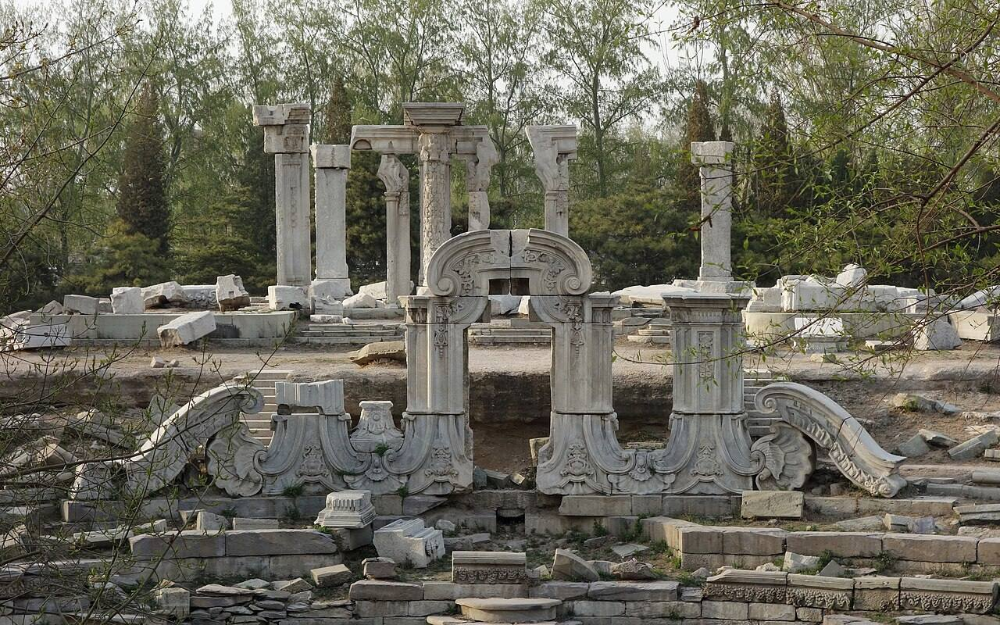

- **P0340** (sure): Yuanmingyuan Ruins of Dashuifa 202510.jpg (2025-10-19 16:47:02 (Commons DateTimeOriginal)). https://commons.wikimedia.org/wiki/File:Yuanmingyuan_Ruins_of_Dashuifa_202510.jpg

  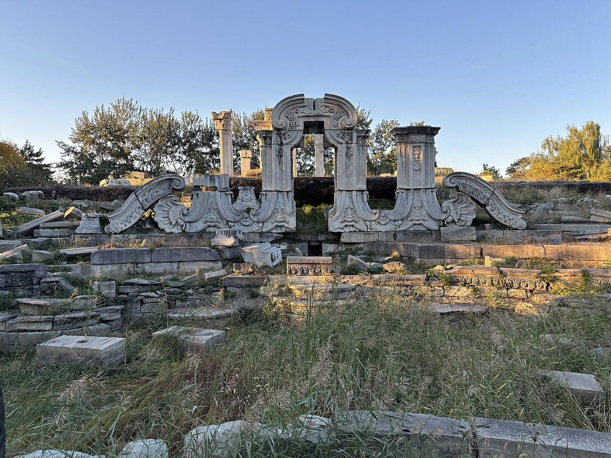

- **P0455** (sure): Ruins of Dashuifa 20130126.jpg (2013-01-26 13:14:21 (Commons DateTimeOriginal)). https://commons.wikimedia.org/wiki/File:Ruins_of_Dashuifa_20130126.jpg

  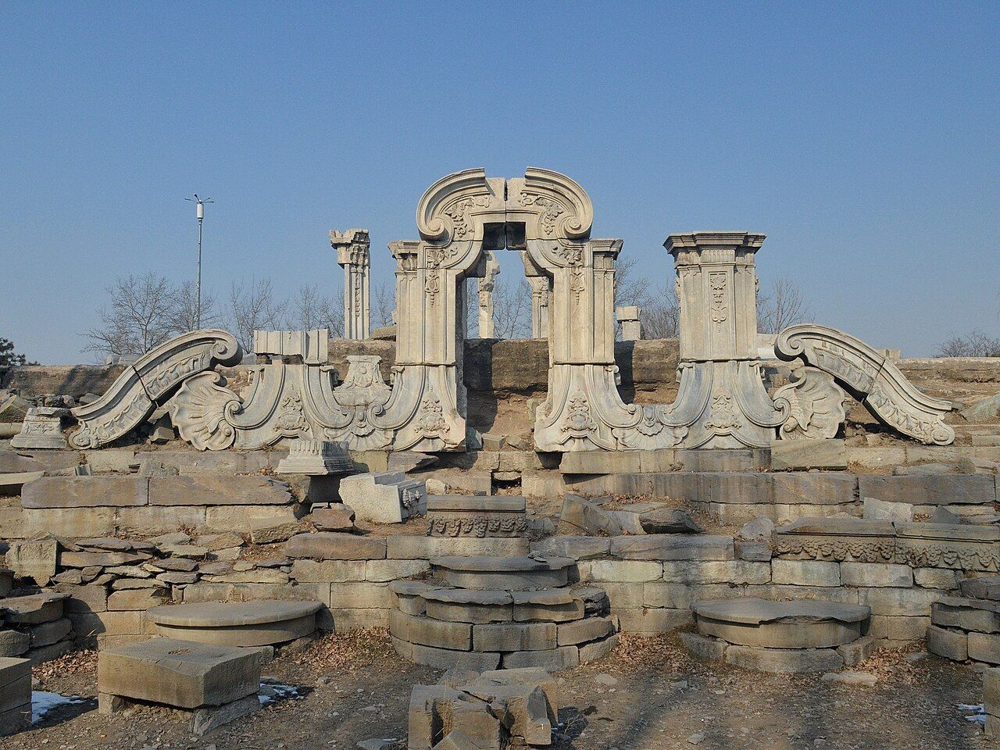

- **P0641** (sure): 圆明园大水法遗址图 (2019-08-04 (Commons)). https://commons.wikimedia.org/wiki/File:%E5%9C%86%E6%98%8E%E5%9B%AD%E5%A4%A7%E6%B0%B4%E6%B3%95%E9%81%97%E5%9D%80%E5%9B%BE.jpg

  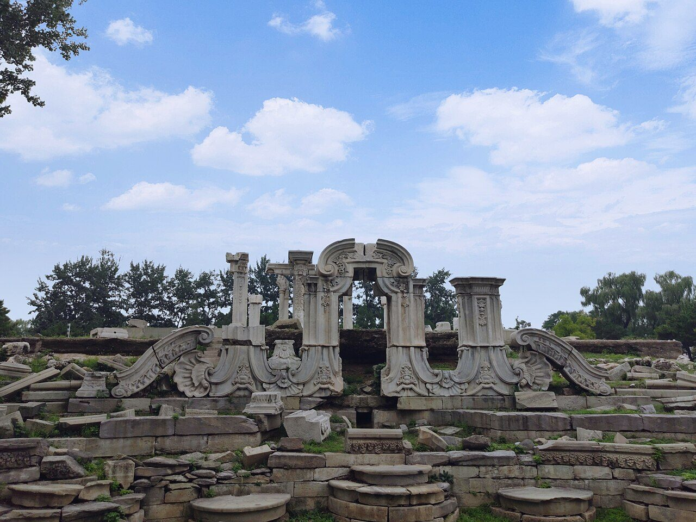

- **P0759** (sure): Dashuifa ruins (2014-03-31 15:55:46 (Commons)). https://commons.wikimedia.org/wiki/File:Dashuifa_ruins.jpg

  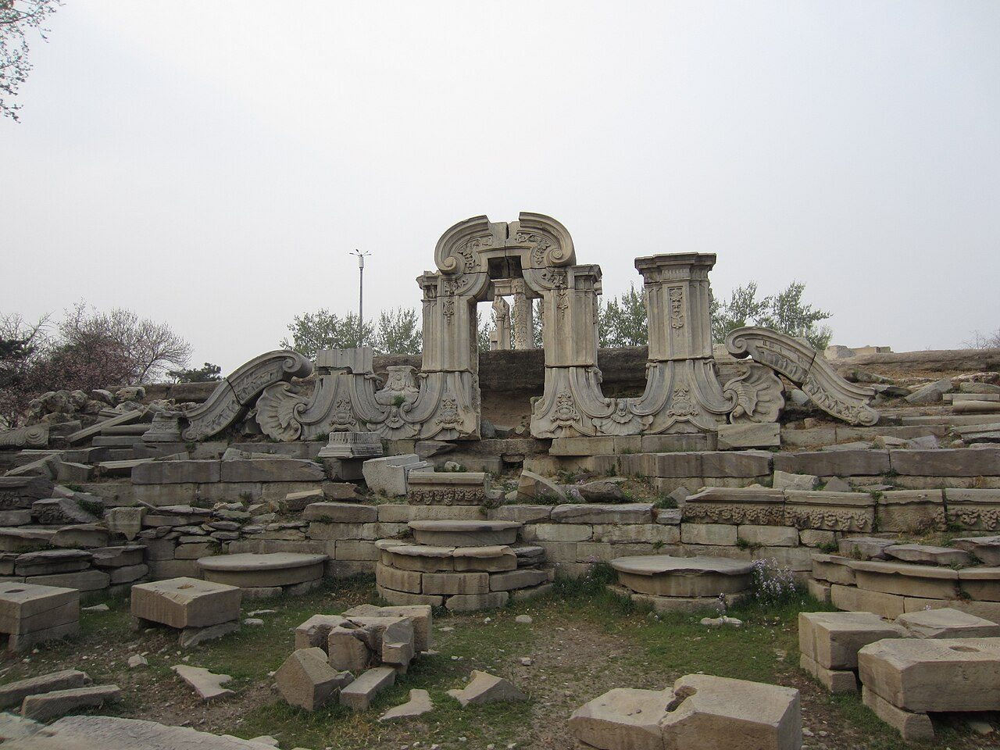

- **P0760** (sure): Dashuifa, Old Summer Palace (2021-02-17 17:03:02 (Commons)). https://commons.wikimedia.org/wiki/File:Dashuifa,_Old_Summer_Palace.jpg

  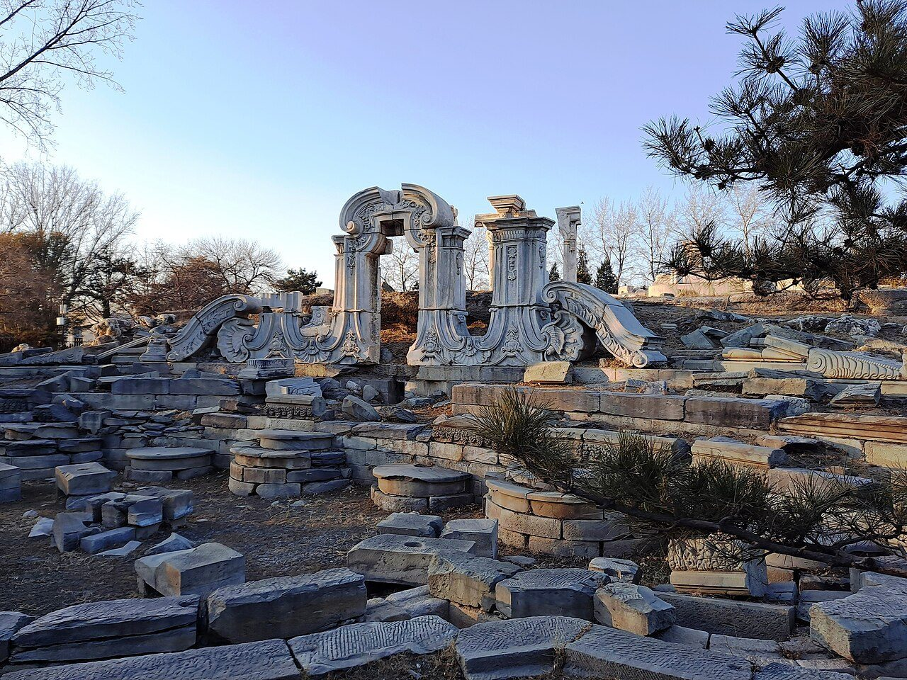

- **P0762** (sure): Yuanmingyuan (9865225085) (2007-06-23 10:59 (Commons)). https://commons.wikimedia.org/wiki/File:Yuanmingyuan_(9865225085).jpg

  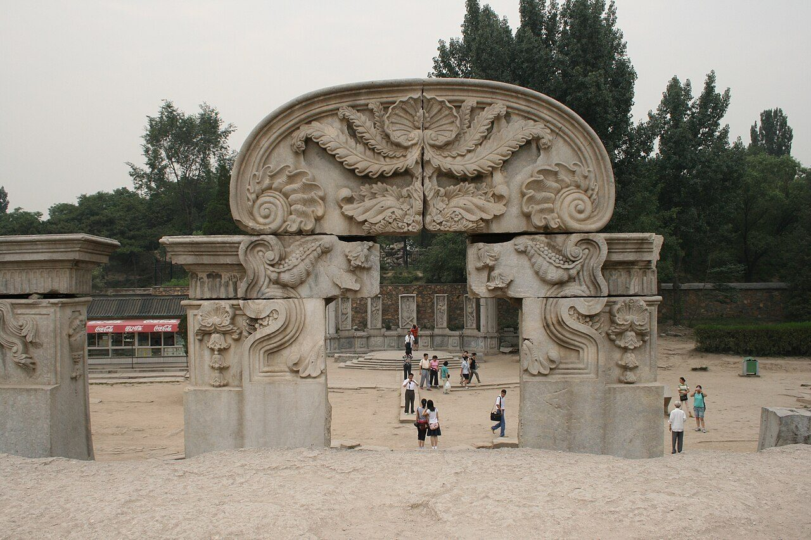

- **P0763** (sure): Yuanmingyuan Ruins of Dashuifa (20240708) (2024-07-08 10:00:12 (Commons)). https://commons.wikimedia.org/wiki/File:Yuanmingyuan_Ruins_of_Dashuifa_(20240708).jpg

  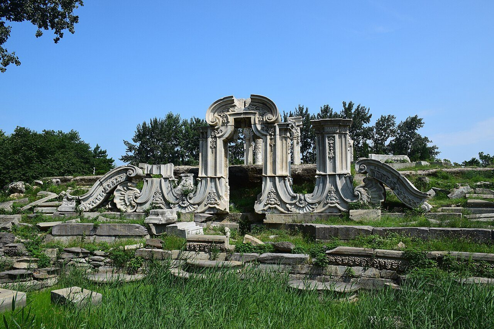

- **P0780** (likely): 远瀛观 standing columns from the north side (2007-06-23 (Commons)). https://commons.wikimedia.org/wiki/File:Yuanmingyuan_(9865480493).jpg

  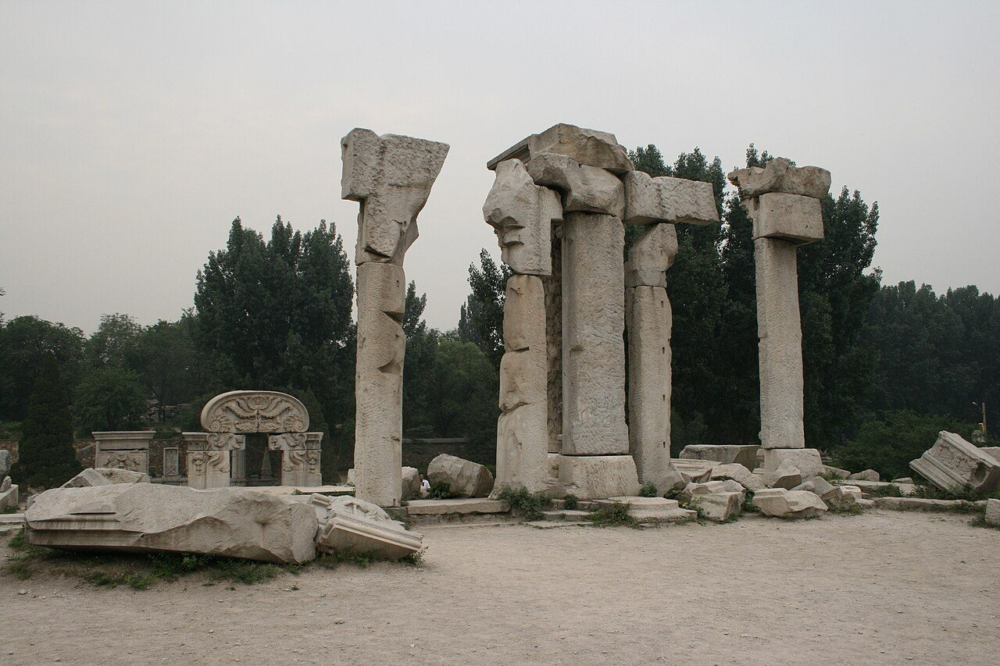

## Texts and drawings (16)

- **E0185** (poem, sure): 御製 題澤蘭堂. 1795 (御製詩五集) · KR4f0005_486:3a · S201. https://github.com/kanripo/KR4f0005/blob/master/KR4f0005_486.txt
  > 題澤蘭堂 書堂號澤蘭樸斵謝青丹芸帙堪永日藤窻避薄寒蕪情報韶意水法列竒觀（堂北為西洋水法處盖縁乾隆十八年西洋博爾都噶里雅國）（來京朝貢聞彼處以水法為竒觀因念中國地大物博水法不過工巧之一端遂命住京之西洋人郎世寧造）（為此法俾來使至此瞻仰前嵗□咭唎國使臣等至京朝貢亦令閲看深為歎服昨冬廣東督臣長麟撫臣朱）（珪奏荷蘭國使臣嘚□等以今嵗為朕御極六十年大慶懇請来京朝賀鑒其數萬里外慕化悃誠因允其請）（已即於臈月到京新正並與朝賀宴賞節間令於是處觀看水法使知朕所嘉者逺人嚮化之誠若其任土作）（貢則中國之大何竒不有初不以為貴也）洋使賀正至逺瀛合俾看
  The one imperial statement found on the European water works. Qianlong's note says the 西洋水法 stands north of 澤蘭堂; after a Portuguese embassy of 乾隆十八年 (1753) he had 郎世寧 Castiglione build it to show envoys; British envoys saw it in the 1790s, and the Dutch envoys at New Year 1795 were to see it. He adds that what he values is their coming, not their marvels.
- **E2433** (text, sure): Test of the claim that the fountains stopped when Benoist died in 1774. 2018 on archives of 1763-1795 · p.2414; with S258 pp.165-169, S02 p.154, E0928, E0929, E0965, E0185 · S600. https://www.jstage.jst.go.jp/article/aija/83/754/83_2409/_article
  Result: the common form of the claim is wrong in two ways. (1) The machines failed before Benoist died: the wheel broke in 1763 and windlasses replaced it. (2) The fountains did not stop: reports of 1786 and 1789 have men filling the reservoir a day or two before a visit so that the water could play for the emperor (Bourgeois); wicker buckets from the river (Amiot); pipes repaired 1794, Dutch envoys meant to see the 水法 in early 1795 (E0185); machines scrapped 1795, but 嘉庆's poems of 1796-98 still mention water sent by machine: poetry, weak. Holding: after 1763 or so the fountains ran on occasion with stored water, carried by labour.
- **E0965** (poem, likely): 远瀛观: 嘉庆三年 poem of the Jiaqing Emperor. 嘉庆三年 (1798), date from the compilation · p.295 item (1), under 远瀛观 · S360. https://www.yuanmingyuanpark.cn/xs/yjbg/202007/P020200730387572832602.pdf#page=295
  > 引机运水石池注，溅玉喷珠万斛雄。敬识圣皇声教广，流沙西海尽同风。
  Jiaqing, 1798: machine-raised water fills a stone basin, with jets of spray: a dated witness that the fountains worked.
- **E0982** (description, sure): Plate XV: 大水法 Da Shuifa. 1786-1803 · pp.183-184, Plate XV · S258. https://archive.org/details/BIUSante_40644
  > au milieu duquel est un cerf en pied, dont le bois lance de l'eau par chacun de ses andouillers:
  Two high water pyramids. A mask at the top of the central piece fills a shell basin, then six basins in cascade, then a large basin with a stag whose antlers spout, hounds spouting at it from both sides.
- **E0983** (description, sure): Engraving 15: 大水法 Da Shuifa. 1934 · pp.156-157 · S02. https://archive.org/details/historyofpekings00malo
  > On the right and left stood excessively tall pyramidal fountains surrounded by numerous small jets.
  Two tall pyramids with small jets; a pool in the middle where jets played on animals, birds and fish, before the carved terrace of 远瀛观. Plate p.156: ruins in 1924.
- **E2409** (description, sure): Detail gain, 3 plates against the catalogue thumbs. crops cmp08, cmp12, cmp15, cmp01 in palace_r6_tmp_plates · S71;S73;S700. 
  Same regions at 900 px. Plate 8 (P0048): window lattice, shading hatch and baluster ornament resolve, thumb showed them as texture. Plate 12 (P0052): door panel pattern and urn outlines clear. Plate 15 (P0055): water drops and fountain tiers separate, thumb mashes them. Original is 2.6 times wider than the thumb. Plate 1 Chester Beatty against Palace Museum: 2.7 times wider again and far darker: roof tile, hatch and capitals sharp.
- **E0460** (description, guess): Notice on Benoist: the first fountain. 1775 · p.414 · S257. https://archive.org/details/lettresdifiantes24jesu_0
  > La machine hydraulique & le premier jet-d'eau ne furent finis qu'à la fin de l'automne.
  French text behind S02 p.139. Autumn of 1747 or just after. Which building is not stated.
- **E0491** (description, guess): Xiyang Lou: origin, 1747. 1934 · pp.139-140 · S02. https://archive.org/details/historyofpekings00malo
  > The hydraulic machine and the first fountain were finished at the end of autumn.
  From the 1775 life of Benoist in Lettres édifiantes vol. xxiv: Qianlong saw a picture of a fountain in 1747, Benoist made a model, and the emperor resolved to build a European palace. Castiglione drew the plans with Benoist; Benoist designed the fountains and the "water castles" and trained the workmen. He worked on fountains for about twelve years. Which fountain came first is not stated.
- **E2421** (description, likely): Written then-and-now captions on Morrison photographs. 2026-08-06 · article, captions 1-9 · S775. https://www.163.com/dy/article/L3KN3VCD05527FJF.html
  Compares about nine 1930s photographs with today in words, not with new pictures. Claims the single-arch gate remnant on the south of 海晏堂 stood in the Republican years and has now collapsed, and the two arch frames at 远瀛观 have mostly fallen. Unverified user writing.
- **E0507** (description, sure): 圆明园五朝御制诗文集注 v4, editors' note on 西洋楼. 2020 edition · v4 p.120 · S361. https://www.yuanmingyuanpark.cn/xs/yjbg/202008/P020200803382796786124.pdf#page=123
  The editors walk the strip from west to east with completion dates and plaques: 谐奇趣 1751, 养雀笼 1759, then the fountains and the perspective walls, with their mechanical details. They put the whole at about 2% of the gardens.
- **E0544** (drawing, sure, search index only): 西洋楼水法图. 国家图书馆善本部 none shown · S310. https://www.mhymy.com/dasl/ysltd/7643.html
  Plan of the Xiyang Lou waterworks across its dozen sites; the record shows no shelf number. No image here; the site may ask a small payment for the full record.
- **E2440** (plan, sure): Teng Gu's preface on the photographs and plan. 1932-07 (preface), 1933 (book) · pp.3-5 of the preface, djvu pages 5-7 · S871. https://commons.wikimedia.org/wiki/File:CADAL11102995_%E5%9C%93%E6%98%8E%E5%9C%93%E6%AD%90%E5%BC%8F%E5%AE%AE%E6%AE%BF%E6%AE%98%E8%B7%A1.djvu
  Teng Gu says the photographs and the plan belonged to Ernst Boerschmann and were taken and drawn by Ohlmer, a customs official in Tianjin who lived in Beijing 1867-1879 and whose collection went to the Hildesheim museum. He argues they are earlier than those in Favier's Péking (1897), Combaz 1909, Perzynski 1920 and Münsterberg 1912, naming pages he compared. Fig. 13 is a recent photograph by Zhou Zuanwu; fig. 15 is copied from Favier p.264.
- **E2419** (plan, sure): Three plans by Antoine Durand: 1984 from Jin Xun at 1/500 inside Adam's 1/10000; 1985 from a survey of the whole site; 1987 fountain area from 128 surveyed points with a manual survey of all surface parts. 1984-87 · pp.125-129, Figs 4, 5, 9, 12, 16 · S603. https://www.persee.fr/doc/arasi_0004-3958_1988_num_43_1_1240
  The only published method statement for an on-site survey of the whole strip. Only excavation could fix the east fence of the gardens and the east edge of the basin. The west edge of the 线法山 gate and the ramp fix the geometry. See R0139-R0143. Plans without a printed scale in the copy I read.
- **E1086** (plan, likely, search index only): Yangshi Lei plan cards on 梦回圆明园: 勤政殿平面图, 西峰秀色总平面图, 安佑宫室内布置图, 映清斋平面图, 绮春园宫门区平面图, 敷春堂殿平面图, 敷春堂东南所平面图, 涵秋馆地盘图, 四宜书屋(绮春园)平面图, 河道泊岸总平面图, 长春园样式雷河道图, 西洋楼水法图, 御制廓然大公八景诗图. Qing · dasl/ysltd: 11009, 11099, 7659, 9716, 7496, 12232, 9879, 7704, 13985, 9509, 6902, 7643; dasl 11675 · S340. https://www.mhymy.com/dasl/ysltd/11009.html
  Titles seen in the index, drawings not opened. Pattern: https://www.mhymy.com/dasl/ysltd/<id>.html.
- **E0950** (archaeology, sure): 圆明园遗址考古今年推进至大水法, 浙江在线. 2016-06-12 · news, 金和天 · S141. https://china.zjol.com.cn/gnxw/201606/t20160612_1619014.shtml
  养雀笼 Yangque Long: 1,000 m2 cleared in 2015, showing foundations that combine 三合土 lime concrete with brick and stone. 大水法 and 远瀛观 were next, about 2,000 m2 planned for 2016, with the stated aim of learning how imperial buildings were founded, which standing buildings cannot show.
- **E0554** (archaeology, sure): 西洋楼区域考古勘探报告. n.d. · mhymy 档案史料 12205, free part · S149. https://www.mhymy.com/dasl/12205.html
  Report's opening: the strip runs 860 m east-west, up to 300 m wide in the west and 65 m at its narrowest, about 70,000 m2, built 1747-1783. A central axis divides it into about five sections, each with its own north-south axis, thirteen units from 谐奇趣 to 线法墙. Survey results are paywalled.

**On the plan:** Its place is drawn on the plan of the gardens (S01), with no name written. https://artmuseum.princeton.edu/collections/objects/138657

## Reconstructions by others (12)

Modern interpretation, not evidence.
- **R0003** (3D model, sure): 3D技术复现“万园之园”: 北京大学 stone scanning. 圆明园管理处; 北京大学考古文博学院, 2025. https://news.bjd.com.cn/2025/05/21/11171051.shtml Research-only: link card.
- **R0145** (drawing, sure): Plan de l'aire du buffet d'eau (Fig. 3 in S603), Jin Xun's drawing. 金勋 Jin Xun, Reproduced in Durand 1988, from Adam 1936, 1924 per S603. https://www.persee.fr/doc/arasi_0004-3958_1988_num_43_1_1240 Research-only: link card.
- **R0139** (drawing, sure): Fig. 4, Plan d'ensemble (plan de restitution 1985). Antoine Durand, Mission Palais d'Ete, under Michele Pirazzoli-t'Serstevens, 1985 (published 1988). https://www.persee.fr/doc/arasi_0004-3958_1988_num_43_1_1240 Research-only: link card.
- **R0140** (drawing, sure): Fig. 5, Plan de l'aire du buffet d'eau (plan de restitution 1987). Antoine Durand, Mission Palais d'Ete, 1987 (published 1988). https://www.persee.fr/doc/arasi_0004-3958_1988_num_43_1_1240 Research-only: link card.
- **R0133** (physical model, likely): Maquette of the European garden (Xiyang Lou), with a new measured plan. Philippe Jonathan, Antoine Durand, French Foreign Ministry mission to Yuanmingyuan, 1983-85, 1987. https://www.ghamu.org/wp-content/uploads/2022/09/Rabreau-YMY-2022.pdf Research-only: link card.
- **R0300** (AR/VR, likely): 《梦回圆明园》 VR大空间. 圆明园管理处; technical supplier not named, 圆明园管理处 Yuanmingyuan Administration, 2025. https://m.bjnews.com.cn/detail/1758771462129689.html Research-only: link card.
- **R0262** (game or community build, likely): 【建筑】重建圆明园！目前大水法已经完成，继续肝. 辰言星宇, 2024. https://www.bilibili.com/video/BV134421Q7R5 Research-only: link card.
- **R0256** (game or community build, likely): 建筑接力 12th leg, 《圆明园》, Minecraft. Qiu Zekai, online name 邱小牛er Qiuxiaoniuer, 2025. https://global.chinadaily.com.cn/a/202512/17/WS6941f335a310d6866eb2efeb.html Research-only: link card.
- **R0193** (3D model, guess): 大水法. islayu, 2024. https://sketchfab.com/3d-models/7167c907e0874c569314bedb155a6f10 Research-only: link card.
- **R0231** (video, guess): 你还记得这里吗？. 熊猫雷尼, visit to 横店圆明新园, 横店集团 Hengdian, 2023. https://www.bilibili.com/video/BV1tC4y1f7Ti Research-only: link card.
- **R0270** (video, guess): 圆明园复原-大水法. unknown; account bili_30370363215, 2025. https://www.bilibili.com/video/BV1VcQzYTEj1 Research-only: link card.
- **R0266** (video, guess): 爆肝20亿 token，只想带你走进一次圆明园. 策殊丶, 2026. https://www.bilibili.com/video/BV1xQYc6AEao Research-only: link card.

## Surviving comparable buildings, not this building (4)

- **T090** 圣克卢大瀑布 Grande Cascade de Saint-Cloud, Saint-Cloud, France. Comparable: same court, era or type, confidence A, standing: yes. A comparison by the Jesuit builders, in print in the 1770s: scale and ambition of the water show, rising stages with vases and jets Basis: S415 p.22 quoting the Lettres édifiantes, and S02 pp.158-159 with vol. xxiv p.421 (cf. S257): the great water piece of the second European house would stand the parallel with those of Versailles and St Cloud. S415 p.81: the cascade still exists. https://www.ghamu.org/wp-content/uploads/2022/09/Rabreau-YMY-2022.pdf
  - P0651: Vues de Paris et de ses environs - H. Plaut photographe éditeur - btv1b84470114 (45 of 56). https://commons.wikimedia.org/wiki/File:Vues_de_Paris_et_de_ses_environs_-_H._Plaut_photographe_%C3%A9diteur_-_btv1b84470114_(45_of_56).jpg
  - P0652: Atget - (Saint-Cloud) (La Grande Cascade), btv1b10519221g. https://commons.wikimedia.org/wiki/File:Atget_-_(Saint-Cloud)_(La_Grande_Cascade),_btv1b10519221g.jpeg
- **T088** 凡尔赛 凯旋门树丛 水金字塔 Pyramid fountains, Bosquet de l'Arc de Triomphe (Versailles), Versailles, France. Comparable: same court, era or type, confidence B, standing: partly. The two tower or pyramid fountains flanking the basin Basis: S415 figs 99-100: water pyramids at 大水法 set against those shown by Pérelle in this grove; S02 pp.158-159 on pyramids; S415 p.22 for the letter. https://www.ghamu.org/wp-content/uploads/2022/09/Rabreau-YMY-2022.pdf
  - P0671: De triomfboog in de tuin van Versailles L'Arc de Triomph, dans un des bosquets des jardins de Versailles (titel op object), RP-P-1974-207. https://commons.wikimedia.org/wiki/File:De_triomfboog_in_de_tuin_van_Versailles_L%27Arc_de_Triomph,_dans_un_des_bosquets_des_jardins_de_Versailles_(titel_op_object),_RP-P-1974-207.jpg
  - P0672: Versailles-Les Grandes Eaux Musicales-Bosque de l'Arc de Triomphe fused. https://commons.wikimedia.org/wiki/File:Versailles-Les_Grandes_Eaux_Musicales-Bosque_de_l%27Arc_de_Triomphe_fused.jpg
- **T091** 特里亚农 水台 Buffet d'Eau, Grand Trianon, Versailles, France. Comparable: same court, era or type, confidence B, standing: yes. Tiered marble wall of water; shell ornament Basis: S415 p.22, quoting the Lettres édifiantes (t. XIII per Rabreau; S02 pp.158-159 cites vol. xxiv p.421, cf. S257): the great water piece «soutiendrait le parallèle» with those of Versailles and St Cloud, and from his throne the emperor sees two great water pyramids. S02: pyramids, carved pool edges, statues, shell ornament in both. S420: the Trianon Buffet d'Eau is by Hardouin-Mansart, 1702, «Italian-inspired», restoration begun 2022. https://archive.org/details/historyofpekings00malo
  - P0673: Buffet d'eau après la restauration de 2021-2023 - vue générale 01. https://commons.wikimedia.org/wiki/File:Buffet_d%27eau_apr%C3%A8s_la_restauration_de_2021-2023_-_vue_g%C3%A9n%C3%A9rale_01.jpg
  - P0674: Trianon Buffet d'eau. https://commons.wikimedia.org/wiki/File:Trianon_Buffet_d%27eau.JPG
- **T089** 卡塞塔王宫 狄安娜喷泉 Fountain of Diana and Actaeon, Reggia di Caserta, Caserta, Italy. Comparable: same court, era or type, confidence C, standing: yes. Theme of a stag at bay in water Basis: S415 p.98: the hunt scene in the central basin (deer and hounds) is called analogous, without the myth, to a basin at Caserta; he notes the theme only. https://www.ghamu.org/wp-content/uploads/2022/09/Rabreau-YMY-2022.pdf
  - P0622: Royal Park of the Palace of Caserta - Diana. https://commons.wikimedia.org/wiki/File:Royal_Park_of_the_Palace_of_Caserta_-_Diana.jpg

## Evidence for the set of buildings

- Reconstructions and comparables for the whole garden, 西洋楼 Xiyang Lou: see GARDEN-XY

## Open questions

- Q48: Xiyang Lou
- Q49: Captions overruled by form (old photographs)

<!-- generated:end -->

## Notes

<!-- Yours: regeneration never touches this part. It goes on the public site; what you write below a line holding only %% private %% stays in the research copy. -->
