<!-- generated:start (scripts/building_pages.py): do not edit between these markers -->

# XY11: 观水法 Guan Shuifa

Kuan Shui Fa, View of the Fountains · Xiyang Lou

**3D object:** 2 boxes. Open it: `/reconstruction/3d.html?b=XY11`

## What we know

- **Name:** 观水法 Guan Shuifa (S02, S06, S56, S01 · confidence A)
- **English:** Kuan Shui Fa, View of the Fountains (S02, S06, S56, S01)
- **Garden:** Xiyang Lou (S02, S06, S56, S01)
- **Type:** european (S02, S06, S56, S01 · confidence A)
- **Destroyed:** Looted and burnt 1860; stone ruins stayed, further damage 1900 and after (S02 pp.142,218) (S02, S06, S56, S01)
- **Position:** 40.01184, 116.30668. S850;S01, moved in Round 6: On OSM's point (S01 · confidence B)
- **Size in the inventory:** 14.5 × 11.5 m. stated: S01;S03;S603, research/xiyanglou/boxes.csv (S01)
- **Where the text puts it:** 大水法之南 坐南朝北 (S06) (S02, S06, S56, S01) *(research copy, not public)*
- **Note:** Copper engraving no. 16 per S02. Throne with a screen of 5 carved marble panels (S02 pp.157-158). Panels moved: S06. Round 6 replaced frontage 12.0 m. Round 6 replaced depth 6.0 m. (S02, S06, S56, S01)
- **Plan reader's note:** Arc-shaped screen at the south end of the axis, opening north. Matches 观水法 screen. No label of its own (远瀛观 label sits next to it). | plan: rect=68,54,0. Arc screen x 10521-10589, y 1225-1279, opening north. (S01) *(research copy, not public)*
- **How it was read:** likely (S01) *(research copy, not public)*
- **Plan pixels:** 10555, 1252 (S01) *(research copy, not public)*

## Our model now

Modelled from plate 16 of 1783-86, Ohlmer's photograph of 1873 and the photographs since 1914 (the panels re-erected in 1977, the platform in place), the plan S01 and Durand's survey (S603); every figure is a reading (C) unless the row says otherwise. Faces no picture shows (the screen's brick back, the wall's south face) are carried round (assumed).

- **Screen:** five carved marble panels of European arms in a concave screen 14.4 m over its end piers (P0343, S01, C), its ends 2.8 m forward (P0640, P0764, C); the socle 1.3 m (S603, B), panels 2.2 m high (P0764, C), cornice 6.3 m above the court, a crest and eight urns (plate 16, C); brick backing behind (S02, B; its depth assumed). The panels were set back in 1977 on their old spot (S817, B)
- **Platform and throne:** the round platform 0.7 m above the court with 5 convex steps (P0344, P0764; in place, S603 p.129, B); on it the throne with its canopy, 3 m high, and the low balustrade with trophies (plate 16, C)
- **Pedestals and obelisks:** two trophy pedestals before the end piers and two obelisks on their bases beyond them, their balls 4.4 m above the court (plate 16; the obelisks stand today, P0764, C)
- **Gates and wall:** the side gates 33.8 m apart (S01, C) on the gardens' level, 1.3 m above the court (S603, B), each with a flight of 10 steps down (plate 16, C) and the form of P0193; clipped hedges and the plain back wall (plate 16, C)
- **Colours:** white marble (S02 pp.158-159, B), the backing and the wall rendered brick, the throne gilt (C: the plate is not coloured)

## Pictures (16)

- **P0056** (sure): 观水法正面 (圆明园铜版画册 / 西洋楼铜版画, plate 十六 of 二十; title and number printed on the plate) (1786 (Commons); Palace Museum: 清). https://commons.wikimedia.org/wiki/File%3A%E5%9C%86%E6%98%8E%E5%9B%AD%E9%93%9C%E7%89%88%E7%94%BB%E5%86%8C-13.jpg

  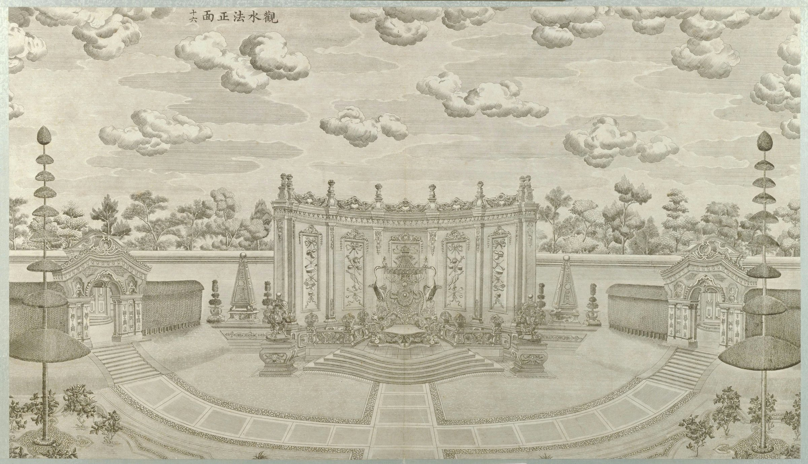

- **P0779** (sure): 圓明園東長春園平面圖 (第一圖), plan of the Xiyang Lou strip (drawn by Ohlmer, 1867-1879, per Teng Gu's preface; from Börschmann's collection). https://commons.wikimedia.org/wiki/File:CADAL11102995_%E5%9C%93%E6%98%8E%E5%9C%93%E6%AD%90%E5%BC%8F%E5%AE%AE%E6%AE%BF%E6%AE%98%E8%B7%A1.djvu

  

- **P0294** (sure): Fotografija Ruševine rimskih plošč v Stari poletni palači (album: "Yüen-Ming-Yüen: Römische Tafeln") (20th c., album bought 1914-1920 (holder)). https://vazcollections.si/predmeti/fotografija-rusevine-rimskih-plosc-v-stari-poletni-palaci/

  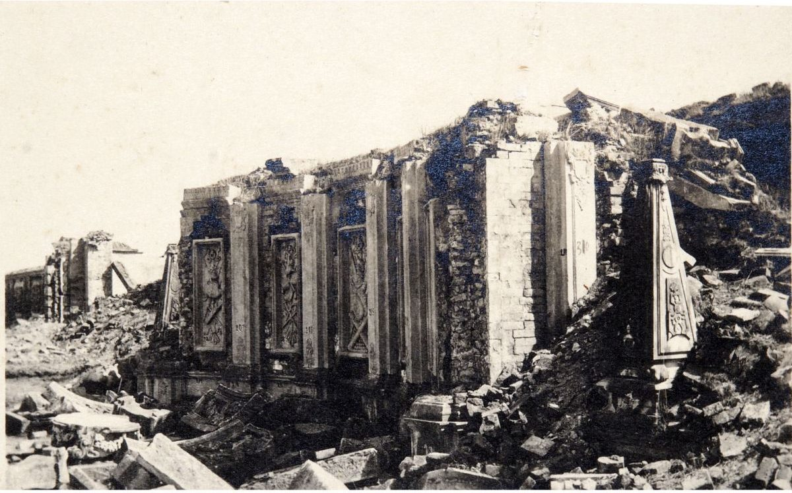

- **P0300** (sure): Fotografija Ruševine rimskih plošč v Stari poletni palači (album: "Yüen-Ming-Yüen: Römische Tafeln") (20th c., album bought 1914-1920 (holder)). https://vazcollections.si/predmeti/fotografija-rusevine-rimskih-plosc-v-stari-poletni-palaci-2/

  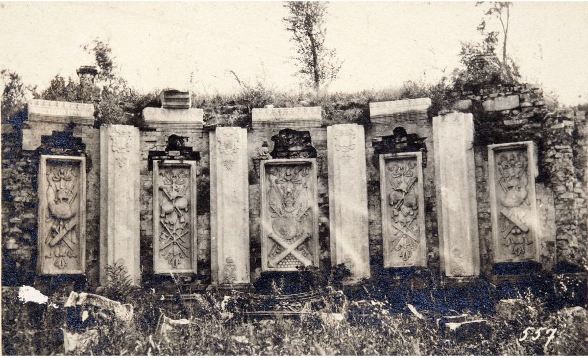

- **P0709** (sure): PORTE LOUIS XV AU PALAIS D'ÉTÉ (p. 377), Pl. XII (printed caption) (Plate in Favier, c. 1897 (Rijksmuseum, book); same negative as Child's Princes Porch, 1875-77 per the Commons text on P0194). https://id.rijksmuseum.nl/200721138

  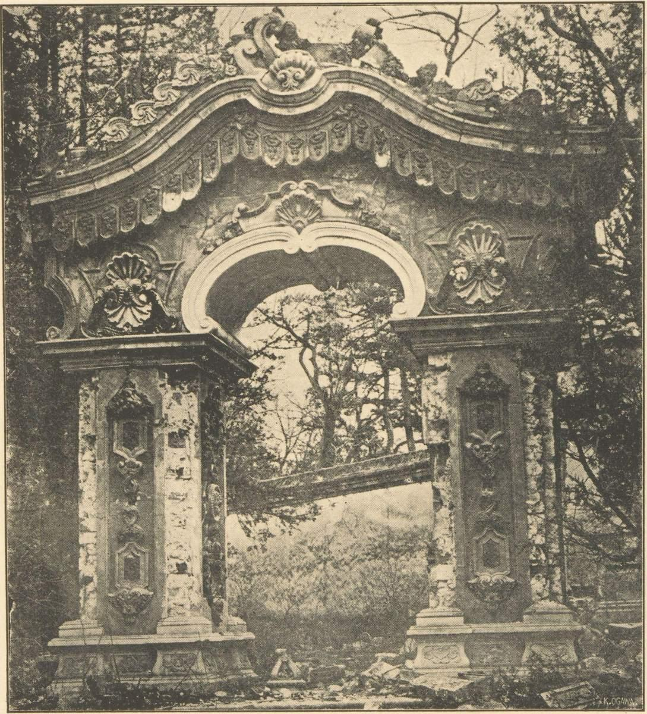

- **P0777** (sure): 觀水法正面 (第十四圖) (1873 (S770; dated by S89); Teng Gu says only that Ohlmer took them 1867-1879, about sixty years before). https://commons.wikimedia.org/wiki/File:CADAL11102995_%E5%9C%93%E6%98%8E%E5%9C%93%E6%AD%90%E5%BC%8F%E5%AE%AE%E6%AE%BF%E6%AE%98%E8%B7%A1.djvu

  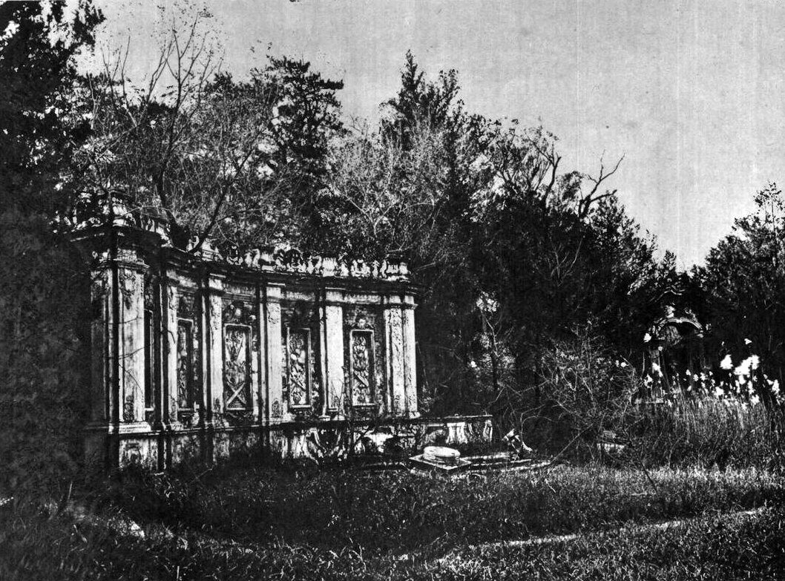

- **P0193** (likely): 19th century photograph of the Princes Porch (1870s (Commons)). https://commons.wikimedia.org/wiki/File%3AThomas_Child_Princes_Porch.jpg

  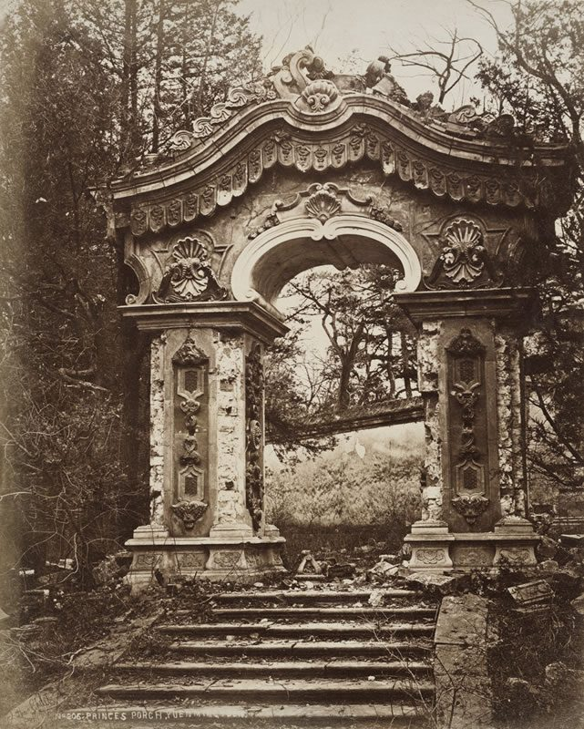

- **P0194** (likely): Side door of 观水法 (file name) (between 1875 and 1877 (Commons description)). https://commons.wikimedia.org/wiki/File%3ASide_door_of_the_guanshuifa_in_Yuanmingyuan.jpg

  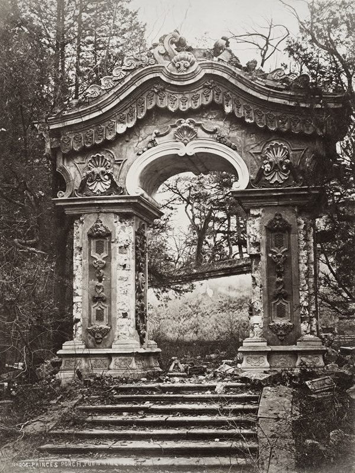

- **P0323** (sure): Sirén: The Imperial Palaces of Peking pl. 216 (1922 (holder)). http://kulturarvsdata.se/SMVK-OM/Bildarkiv/203253 Research-only: link card.
- **P0724** (sure): Guanshuifa (S770 caption), Ohlmer negative L (1873 (S770; dated by S89)). https://visualizingcultures.mit.edu/garden_perfect_brightness_03/ymy303/e503.htm Research-only: link card.

  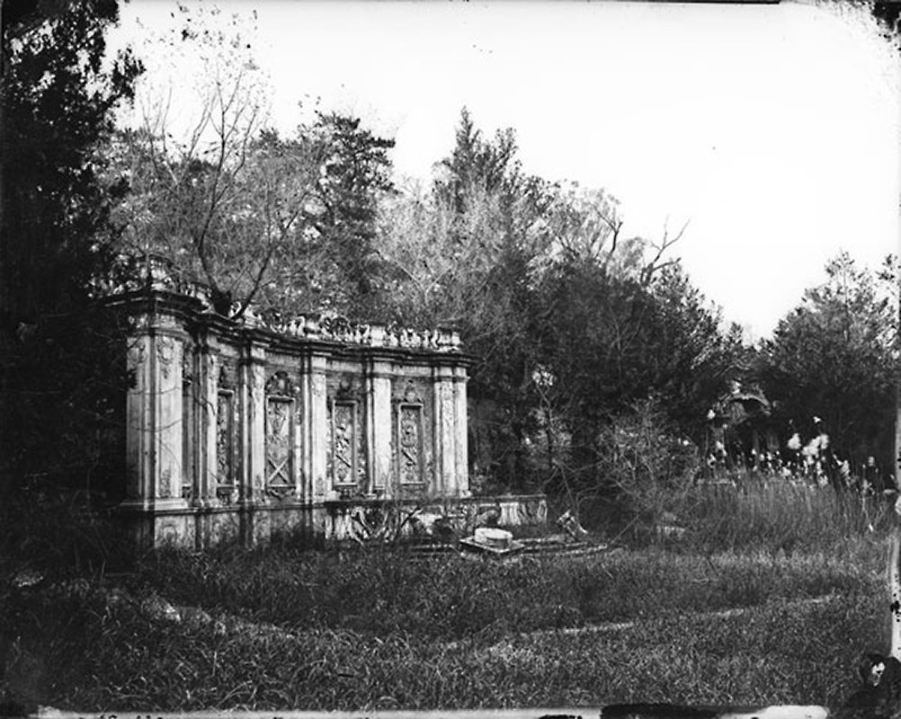

- **P0343** (sure): Photos of Ruins of Old Summer Palace - 2019 - 12.jpg (2019-07-14 19:21:15 (Commons DateTimeOriginal)). https://commons.wikimedia.org/wiki/File:Photos_of_Ruins_of_Old_Summer_Palace_-_2019_-_12.jpg

  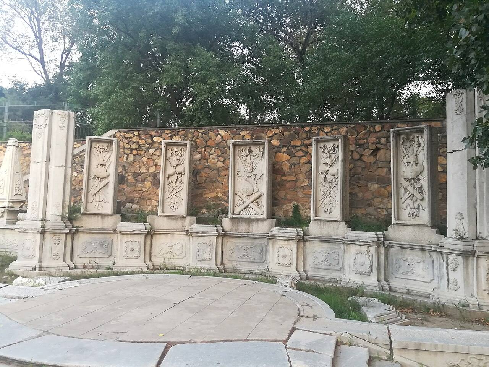

- **P0344** (sure): Old Summer Palace, Ruins of Guan Shuifa.jpg (2005-02 (Commons DateTimeOriginal)). https://commons.wikimedia.org/wiki/File:Old_Summer_Palace,_Ruins_of_Guan_Shuifa.jpg

  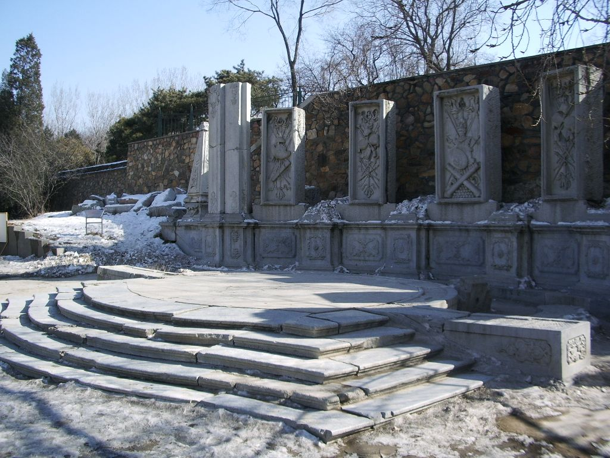

- **P0640** (sure): 圆明园观水法遗址图 (2019-08-04 (Commons)). https://commons.wikimedia.org/wiki/File:%E5%9C%86%E6%98%8E%E5%9B%AD%E8%A7%82%E6%B0%B4%E6%B3%95%E9%81%97%E5%9D%80%E5%9B%BE.jpg

  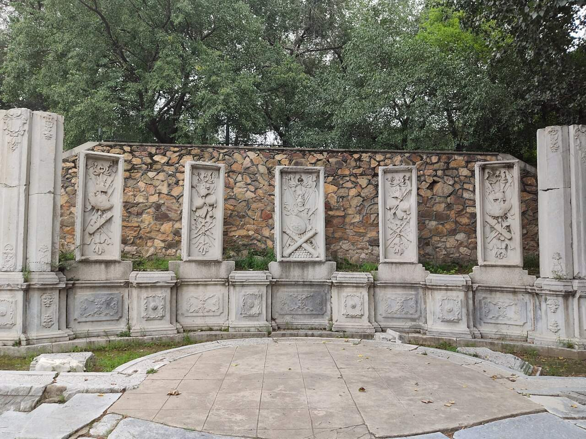

- **P0764** (sure): Guanfa ruins (2014-03-31 15:56:45 (Commons)). https://commons.wikimedia.org/wiki/File:Guanfa_ruins.jpg

  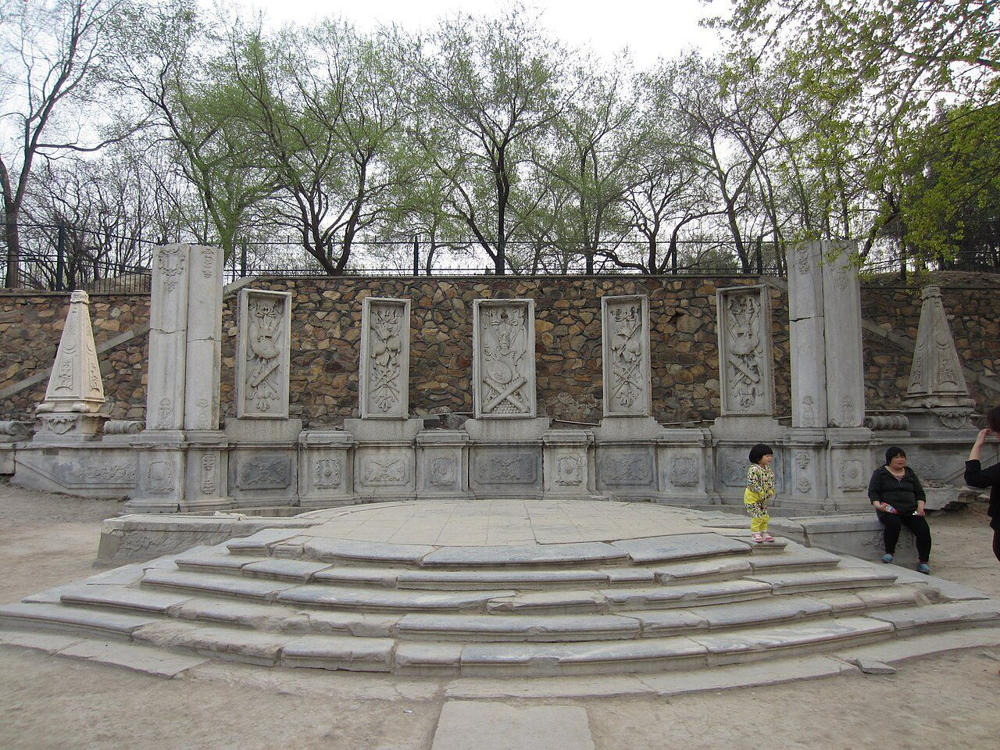

- **P0765** (sure): Ruins of Guan Shuifa 20130323 (2013-03-23 14:17:57 (Commons)). https://commons.wikimedia.org/wiki/File:Ruins_of_Guan_Shuifa_20130323.jpg

  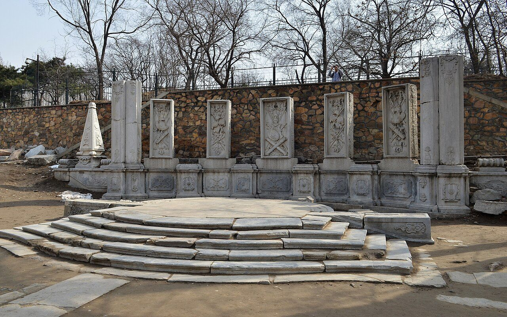

- **P0766** (sure): Yuanmingyuan (9865248366) (2007-06-23 10:57 (Commons)). https://commons.wikimedia.org/wiki/File:Yuanmingyuan_(9865248366).jpg

  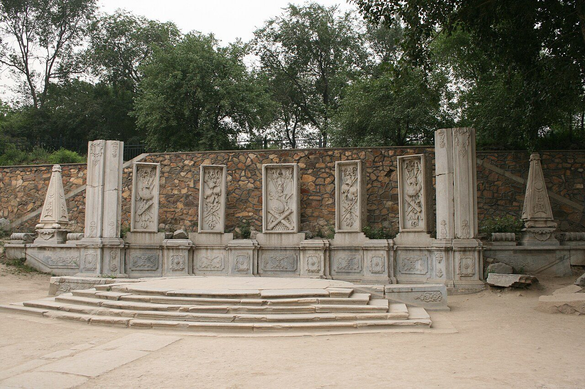

## Texts and drawings (7)

- **E0985** (description, sure): Plates XVI to XIX: 观水法, 线法山门, 线法山, 螺蛳牌楼. 1786-1803 · pp.184-185, Plates XVI-XIX · S258. https://archive.org/details/BIUSante_40644
  > Montagne factice sur laquelle il y a un Ting-tsé,
  XVI throne facing the jets. XVII triumphal arch, the most Greek. XVIII an artificial hill with a 亭 on top. XIX another triumphal arch, less sober.
- **E0986** (description, sure): Engraving 16: 观水法 Guan Shuifa. 1934 · pp.157-158 · S02. https://archive.org/details/historyofpekings00malo
  > carved marble pannels representing European swords, spears, armor, drums, flags, cannon, and other arms.
  Throne with a canopy and a brick screen with five marble panels of European arms. Clipped hedges with two gateways right and left. The Jesuits compared it with the water buffets of Versailles and St Cloud.
- **E0507** (description, sure): 圆明园五朝御制诗文集注 v4, editors' note on 西洋楼. 2020 edition · v4 p.120 · S361. https://www.yuanmingyuanpark.cn/xs/yjbg/202008/P020200803382796786124.pdf#page=123
  The editors walk the strip from west to east with completion dates and plaques: 谐奇趣 1751, 养雀笼 1759, then the fountains and the perspective walls, with their mechanical details. They put the whole at about 2% of the gardens.
- **E0544** (drawing, sure, search index only): 西洋楼水法图. 国家图书馆善本部 none shown · S310. https://www.mhymy.com/dasl/ysltd/7643.html
  Plan of the Xiyang Lou waterworks across its dozen sites; the record shows no shelf number. No image here; the site may ask a small payment for the full record.
- **E2440** (plan, sure): Teng Gu's preface on the photographs and plan. 1932-07 (preface), 1933 (book) · pp.3-5 of the preface, djvu pages 5-7 · S871. https://commons.wikimedia.org/wiki/File:CADAL11102995_%E5%9C%93%E6%98%8E%E5%9C%93%E6%AD%90%E5%BC%8F%E5%AE%AE%E6%AE%BF%E6%AE%98%E8%B7%A1.djvu
  Teng Gu says the photographs and the plan belonged to Ernst Boerschmann and were taken and drawn by Ohlmer, a customs official in Tianjin who lived in Beijing 1867-1879 and whose collection went to the Hildesheim museum. He argues they are earlier than those in Favier's Péking (1897), Combaz 1909, Perzynski 1920 and Münsterberg 1912, naming pages he compared. Fig. 13 is a recent photograph by Zhou Zuanwu; fig. 15 is copied from Favier p.264.
- **E2419** (plan, sure): Three plans by Antoine Durand: 1984 from Jin Xun at 1/500 inside Adam's 1/10000; 1985 from a survey of the whole site; 1987 fountain area from 128 surveyed points with a manual survey of all surface parts. 1984-87 · pp.125-129, Figs 4, 5, 9, 12, 16 · S603. https://www.persee.fr/doc/arasi_0004-3958_1988_num_43_1_1240
  The only published method statement for an on-site survey of the whole strip. Only excavation could fix the east fence of the gardens and the east edge of the basin. The west edge of the 线法山 gate and the ramp fix the geometry. See R0139-R0143. Plans without a printed scale in the copy I read.
- **E0554** (archaeology, sure): 西洋楼区域考古勘探报告. n.d. · mhymy 档案史料 12205, free part · S149. https://www.mhymy.com/dasl/12205.html
  Report's opening: the strip runs 860 m east-west, up to 300 m wide in the west and 65 m at its narrowest, about 70,000 m2, built 1747-1783. A central axis divides it into about five sections, each with its own north-south axis, thirteen units from 谐奇趣 to 线法墙. Survey results are paywalled.

**On the plan:** Its place is drawn on the plan of the gardens (S01), with no name written. https://artmuseum.princeton.edu/collections/objects/138657

## Reconstructions by others (8)

Modern interpretation, not evidence.
- **R0018** (physical model, sure): 20240112 Guanshuifa, Hengdian Yingshicheng. Hengdian World Studios (replica); Yumeto (photograph), Hengdian World Studios (per the Commons category). https://commons.wikimedia.org/wiki/File:20240112_Guanshuifa,_Hengdian_Yingshicheng.jpg
- **R0094** (render, likely): 观水法, image 766 in a gallery. posted 2019. https://www.thepaper.cn/newsDetail_forward_3323921 Research-only: link card.
- **R0003** (3D model, sure): 3D技术复现“万园之园”: 北京大学 stone scanning. 圆明园管理处; 北京大学考古文博学院, 2025. https://news.bjd.com.cn/2025/05/21/11171051.shtml Research-only: link card.
- **R0145** (drawing, sure): Plan de l'aire du buffet d'eau (Fig. 3 in S603), Jin Xun's drawing. 金勋 Jin Xun, Reproduced in Durand 1988, from Adam 1936, 1924 per S603. https://www.persee.fr/doc/arasi_0004-3958_1988_num_43_1_1240 Research-only: link card.
- **R0139** (drawing, sure): Fig. 4, Plan d'ensemble (plan de restitution 1985). Antoine Durand, Mission Palais d'Ete, under Michele Pirazzoli-t'Serstevens, 1985 (published 1988). https://www.persee.fr/doc/arasi_0004-3958_1988_num_43_1_1240 Research-only: link card.
- **R0140** (drawing, sure): Fig. 5, Plan de l'aire du buffet d'eau (plan de restitution 1987). Antoine Durand, Mission Palais d'Ete, 1987 (published 1988). https://www.persee.fr/doc/arasi_0004-3958_1988_num_43_1_1240 Research-only: link card.
- **R0004** (paper figure, likely): Digital restoration research and 3D model of Xieqiqu, ISPRS Annals II-5/W3. M. Gao, W. Piao, J. Guo, Re-Yuanmingyuan Company, 2015. https://isprs-annals.copernicus.org/articles/II-5-W3/75/2015/ Research-only: link card.
- **R0025** (render, sure, search index only): [清华]观水法. 清华大学建筑学院 郭黛姮 team (site tag "[清华]"), 清华大学 (as tagged "[清华]" on mhymy; the site does not state more in what was seen). https://www.mhymy.com/szfy/13312.html Research-only: link card.

## Surviving comparable buildings, not this building (1)

- **T092** 潘菲利别墅 圆形剧场 Amphitheatre of the Villa Pamphili (Vigna Pamphile), Rome. Comparable: same court, era or type, confidence C, standing: partly. Garden theatre with a seat in front of water Basis: S415 p.93 fig.83-84 and p.109: Pérelle's print of the Vigne Pamphile is used for an analogy with curved marble walls here; figs 85-86 show the 观水法 throne beside it; Lancaster also lists Pamphili for 海晏堂 (p.83). https://www.ghamu.org/wp-content/uploads/2022/09/Rabreau-YMY-2022.pdf
  - P0704: Gezicht op het amfitheater Villa Doria Pamphili, RP-P-1951-518-128. https://commons.wikimedia.org/wiki/File:Gezicht_op_het_amfitheater_Villa_Doria_Pamphili,_RP-P-1951-518-128.jpg

## Evidence for the set of buildings

- Reconstructions and comparables for the whole garden, 西洋楼 Xiyang Lou: see GARDEN-XY

## Open questions

- Q60: Captions and claims, old photographs (Round 5)
- Q64: The plan's scale and turn in this strip (Round 6)
- Q65: How far the plates can be trusted for size (Round 6)
- Q71: 观水法 on the axis (Round 6)
- Q212: The tall tiered columns at 大水法 and 观水法
- Q233: Plate 16's side gates

<!-- generated:end -->

## Notes

<!-- Yours: regeneration never touches this part. It goes on the public site; what you write below a line holding only %% private %% stays in the research copy. -->
