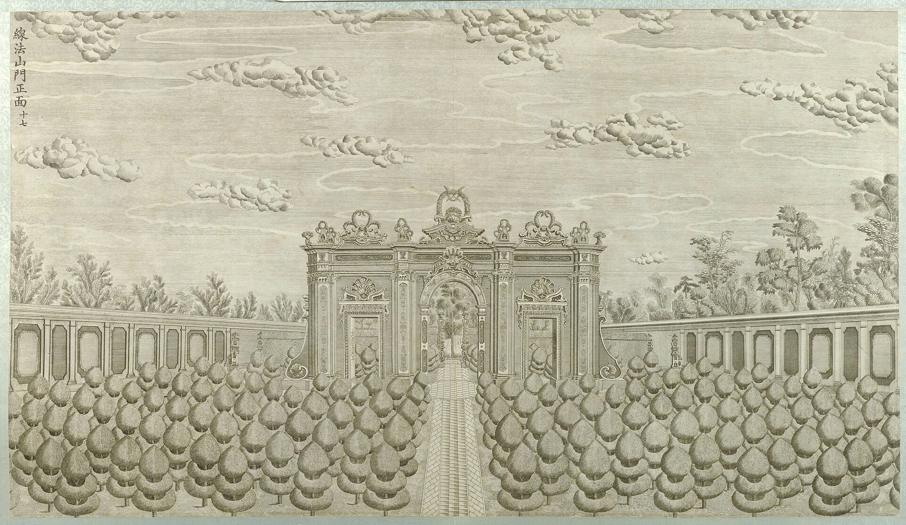

<!-- generated:start (scripts/building_pages.py): do not edit between these markers -->

# XY12-01: 线法山门 Xianfa Shan Men

Xiyang Lou

**3D object:** 1 box. Open it: `/reconstruction/3d.html?b=XY12-01`

**Part of:** XY12 线法山

## What we know

- **Name:** 线法山门 Xianfa Shan Men (S02, S01 · confidence A)
- **Garden:** Xiyang Lou (S02, S01)
- **Type:** gate (S02, S01 · confidence A)
- **Destroyed:** 1860 (S02, S01)
- **Position:** 40.01219, 116.30785. S01 likely (S01 · confidence B)
- **Where the text puts it:** engraving 17 (S02 p.159) (S02, S01) *(research copy, not public)*
- **Note:** Triple gate like a triumphal arch. (S02, S01)
- **Plan reader's note:** No gate drawn: a 65 px gap in the N-S wall x=11057 (wall ends at y 1085 and y 1150). Same gaps at x=10823 and x=11314. (S01) *(research copy, not public)*
- **How it was read:** likely (S01) *(research copy, not public)*
- **Plan pixels:** 11057, 1117 (S01) *(research copy, not public)*

## Our model now

Simple massing of a European palace, assumed: sizes from the texts and the ruin polygons, position from the plan or the ruin. Not a reading of the 1786 engravings yet.

- **Box:** 10 × 2 m, european, wall
- **Part:** triple gate like a triumphal arch; size a guess
- **Faces:** 83.5° from north
- **Confidence:** C, assumed

## Pictures (1)

- **P0057** (sure): 线法山门正面 (圆明园铜版画册 / 西洋楼铜版画, plate 十七 of 二十; title and number printed on the plate) (1786 (Commons); Palace Museum: 清). https://commons.wikimedia.org/wiki/File%3A%E5%9C%86%E6%98%8E%E5%9B%AD%E9%93%9C%E7%89%88%E7%94%BB%E5%86%8C-14.jpg

  

## Texts and drawings (2)

- **E0985** (description, sure): Plates XVI to XIX: 观水法, 线法山门, 线法山, 螺蛳牌楼. 1786-1803 · pp.184-185, Plates XVI-XIX · S258. https://archive.org/details/BIUSante_40644
  > Montagne factice sur laquelle il y a un Ting-tsé,
  XVI throne facing the jets. XVII triumphal arch, the most Greek. XVIII an artificial hill with a 亭 on top. XIX another triumphal arch, less sober.
- **E0989** (description, sure): Engraving 17: 线法山门 Xianfa Shan gate. 1934 · p.159 · S02. https://archive.org/details/historyofpekings00malo
  > A triple gateway, resembling a European triumphal arch.
  Triple gateway like a triumphal arch.

**On the plan:** Drawn on the plan of the gardens (S01), labelled 线法山门. https://artmuseum.princeton.edu/collections/objects/138657

## Evidence for the set of buildings

- Evidence for the whole compound 线法山: see XY12

## Open questions

None that name it.

<!-- generated:end -->

## Notes

<!-- Yours: regeneration never touches this part. It goes on the public site; what you write below a line holding only %% private %% stays in the research copy. -->
