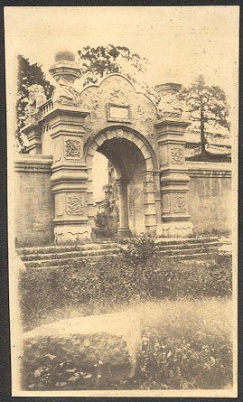
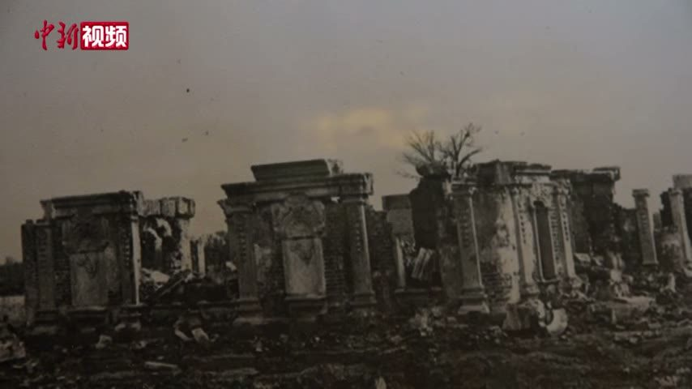

<!-- generated:start (scripts/building_pages.py): do not edit between these markers -->

# XY12-01: 线法山门 Xianfa Shan Men

Xiyang Lou

**3D object:** 1 box. Open it: `/reconstruction/3d.html?b=XY12-01`

**Part of:** XY12 线法山

## What we know

- **Name:** 线法山门 Xianfa Shan Men (S02, S01 · confidence A)
- **Garden:** Xiyang Lou (S02, S01)
- **Type:** gate (S02, S01 · confidence A)
- **Destroyed:** 1860 (S02, S01)
- **Position:** 40.01217, 116.30786. S01 likely (S01 · confidence B)
- **Size in the inventory:** 13.6 × 2.0 m. stated: S01;S71, research/xiyanglou/boxes.csv (S01)
- **Where the text puts it:** engraving 17 (S02 p.159) (S02, S01) *(research copy, not public)*
- **Note:** Triple gate like a triumphal arch. Round 6 replaced frontage none m. Round 6 replaced depth none m. (S02, S01)
- **Plan reader's note:** No gate drawn: a 65 px gap in the N-S wall x=11057 (wall ends at y 1085 and y 1150). Same gaps at x=10823 and x=11314. (S01) *(research copy, not public)*
- **How it was read:** likely (S01) *(research copy, not public)*
- **Plan pixels:** 11057, 1117 (S01) *(research copy, not public)*

## Our model now

Modelled from plate 17 of 1783-86, drawn frontally and read at the plan's width; no photograph of the gate standing or of its ruin is known, so every figure is a reading (C).

- **West front:** a triple gate 13.6 m wide (S01's gap, b): the arch 2.08 m wide to 4.25 m, a square-headed door 1.3 × 2.65 m either side under a shell, four carved pilasters on pedestals with capitals at 4.85 m, the entablature with its frieze panels to 6.03 m (plate 17, C)
- **Crests:** the attic with its broken pediment (7.04 m) and the garland crest over the centre (8.58 m), crests of scrolls and garlands over the side bays (7.63 m), lyre finials over the pilasters (7.25 m) and vases at the ends (plate 17, C)
- **Walls:** panelled walls 2.7 m high with pilasters, sunk panels and a coping, from the gate's ends north and south 30 m on S01's straight line (plate 17's copings lean back east: Q312), an urn on a pedestal by the gate on each side (plate 17, C)
- **Assumed:** the depth (2 m), the east face, the ends and the passages, carried round from the west front; the walls' backs and their ends (C, the pale tint with conf=1)

## Pictures (4)

- **P0057** (sure): 线法山门正面 (圆明园铜版画册 / 西洋楼铜版画, plate 十七 of 二十; title and number printed on the plate) (1786 (Commons); Palace Museum: 清). https://commons.wikimedia.org/wiki/File%3A%E5%9C%86%E6%98%8E%E5%9B%AD%E9%93%9C%E7%89%88%E7%94%BB%E5%86%8C-14.jpg

  

- **P0768** (guess): Peking Gates [Yuanmingyuan?] (c. mid- to late-1920s (holder)). http://hdl.handle.net/1885/43371

  

- **P0315** (guess): Sirén: The Imperial Palaces of Peking pl. 208 (1922 (holder)). http://kulturarvsdata.se/SMVK-OM/Bildarkiv/199637 Research-only: link card.
- **P0717** (guess): 线法门 (spoken in the clip: 这张照片是最新发现的一张线法门的照片) (not stated; shown as newly found (S650)). https://commons.wikimedia.org/wiki/File:2021-02-24_圆明园中西建筑如何过渡_未彻底损毁前珍贵影像公布.webm Research-only: link card.

  

## Texts and drawings (2)

- **E0985** (description, sure): Plates XVI to XIX: 观水法, 线法山门, 线法山, 螺蛳牌楼. 1786-1803 · pp.184-185, Plates XVI-XIX · S258. https://archive.org/details/BIUSante_40644
  > Montagne factice sur laquelle il y a un Ting-tsé,
  XVI throne facing the jets. XVII triumphal arch, the most Greek. XVIII an artificial hill with a 亭 on top. XIX another triumphal arch, less sober.
- **E0989** (description, sure): Engraving 17: 线法山门 Xianfa Shan gate. 1934 · p.159 · S02. https://archive.org/details/historyofpekings00malo
  > A triple gateway, resembling a European triumphal arch.
  Triple gateway like a triumphal arch.

**On the plan:** Drawn on the plan of the gardens (S01), labelled 线法山门. https://artmuseum.princeton.edu/collections/objects/138657

## Evidence for the set of buildings

- Evidence for the whole compound 线法山: see XY12
- Reconstructions and comparables for the whole garden, 西洋楼 Xiyang Lou: see GARDEN-XY

## Open questions

- Q312: 线法山门's walls. (Round 30)

<!-- generated:end -->

## Notes

<!-- Yours: regeneration never touches this part. It goes on the public site; what you write below a line holding only %% private %% stays in the research copy. -->
