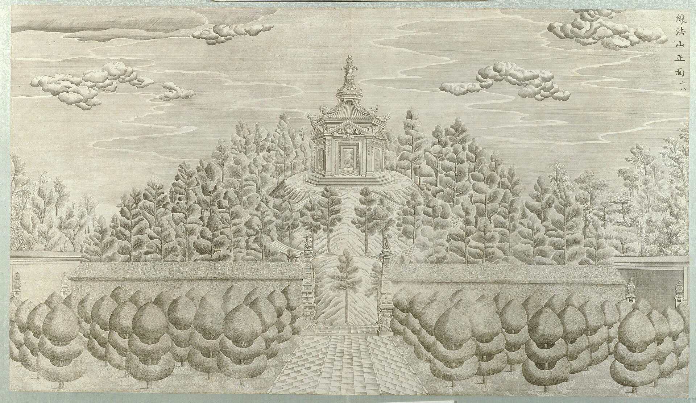

<!-- generated:start (scripts/building_pages.py): do not edit between these markers -->

# XY12-02: 山顶亭 Shanding ting

Xiyang Lou

**3D object:** 1 box. Open it: `/reconstruction/3d.html?b=XY12-02`

**Part of:** XY12 线法山

## What we know

- **Name:** 山顶亭 Shanding ting (S02, S06, S01 · confidence A)
- **Garden:** Xiyang Lou (S02, S06, S01)
- **Type:** pavilion (S02, S06, S01 · confidence A)
- **Destroyed:** 1860 (S02, S06, S01)
- **Position:** 40.01221, 116.30817. S01 likely (S01 · confidence B)
- **Bays:** 1x1 on the plan (S02, S06, S01)
- **Size in the inventory:** 9.6 × 12.1 m. S01 plan px / hall scale (S01)
- **Where the text puts it:** hilltop (S02 p.159) (S02, S06, S01) *(research copy, not public)*
- **Note:** S06 八角四券石亭. (S02, S06, S01)
- **Plan reader's note:** rect=40,40,0. Innermost ring; pavilion not drawn as a building. (S01) *(research copy, not public)*
- **How it was read:** likely (S01) *(research copy, not public)*
- **Plan pixels:** 11184, 1121 (S01) *(research copy, not public)*

## Our model now

Simple massing of a European palace, assumed: sizes from the texts and the ruin polygons, position from the plan or the ruin. Not a reading of the 1786 engravings yet.

- **Box:** 7.5 × 7.5 m, european, octagon
- **Part:** small octagon on top
- **Faces:** 173.5° from north
- **Confidence:** C, assumed

## Pictures (1)

- **P0058** (sure): 线法山正面 (圆明园铜版画册 / 西洋楼铜版画, plate 十八 of 二十; title and number printed on the plate) (1786 (Commons); Palace Museum: 清). https://commons.wikimedia.org/wiki/File%3A%E5%9C%86%E6%98%8E%E5%9B%AD%E9%93%9C%E7%89%88%E7%94%BB%E5%86%8C-15.jpg

  

## Texts and drawings (2)

- **E0985** (description, sure): Plates XVI to XIX: 观水法, 线法山门, 线法山, 螺蛳牌楼. 1786-1803 · pp.184-185, Plates XVI-XIX · S258. https://archive.org/details/BIUSante_40644
  > Montagne factice sur laquelle il y a un Ting-tsé,
  XVI throne facing the jets. XVII triumphal arch, the most Greek. XVIII an artificial hill with a 亭 on top. XIX another triumphal arch, less sober.
- **E0988** (description, sure): Engraving 18: 线法山 Xianfa Shan. 1934 · p.159 · S02. https://archive.org/details/historyofpekings00malo
  > Regularly intersecting circular paths led up to the pavilion on the top of this circular hill,
  Circular hill, intersecting circular paths, pavilion on top. Lu says the emperor rode up on horseback. N.20: 线法 means line method, perhaps the Jesuits' perspective.

**On the plan:** Drawn on the plan of the gardens (S01) with no label, 1x1 cells: a building stood here, its name unknown. https://artmuseum.princeton.edu/collections/objects/138657

## Evidence for the set of buildings

- Evidence for the whole compound 线法山: see XY12
- Reconstructions and comparables for the whole garden, 西洋楼 Xiyang Lou: see GARDEN-XY
- Standing buildings comparable to a square pavilion (not this building): see CLASS-pavilion_square

## Open questions

None that name it.

<!-- generated:end -->

## Notes

<!-- Yours: regeneration never touches this part. It goes on the public site; what you write below a line holding only %% private %% stays in the research copy. -->
