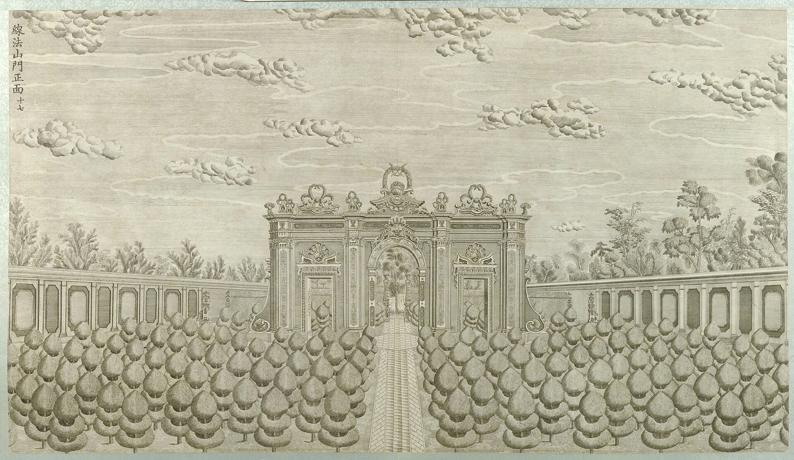
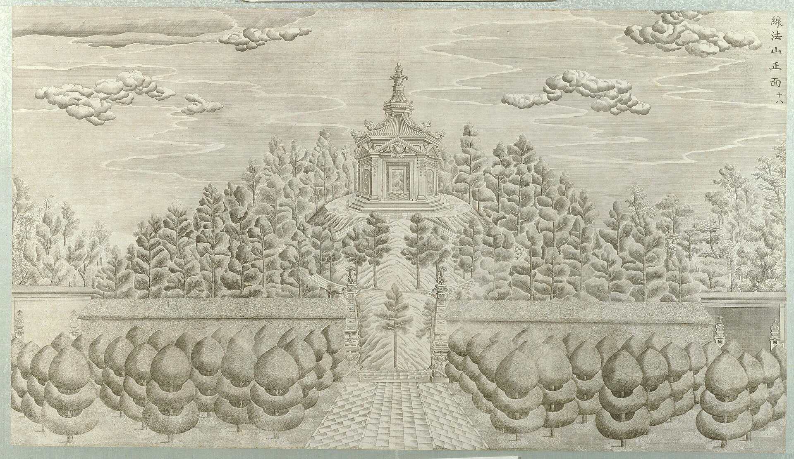
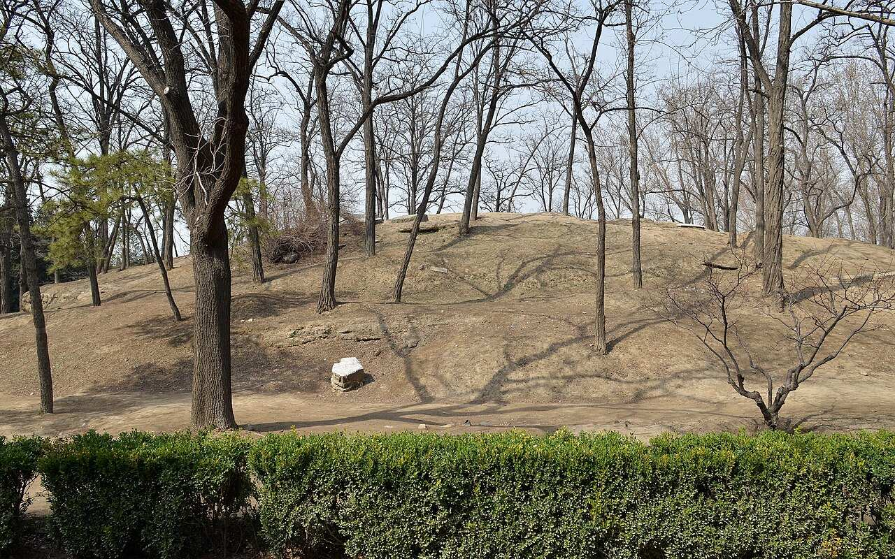
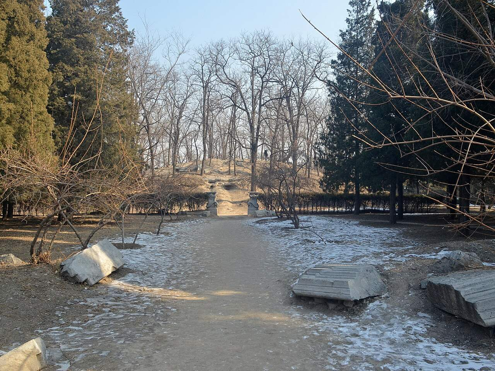
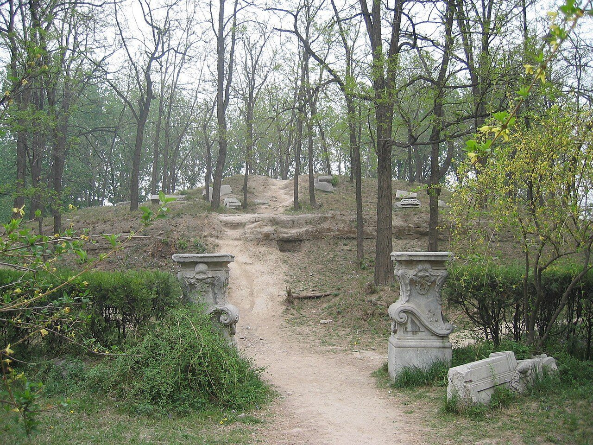
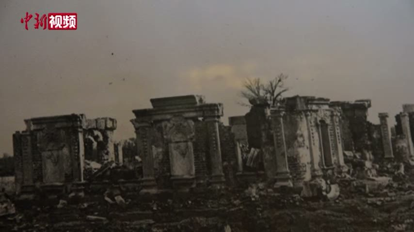

<!-- generated:start (scripts/building_pages.py): do not edit between these markers -->

# XY12: 线法山 Xianfa Shan

Hsien Fa Shan, Hsien Fa Hill · Xiyang Lou

**3D object:** 2 boxes. Open it: `/reconstruction/3d.html?b=XY12`

## What we know

- **Name:** 线法山 Xianfa Shan (S02, S06, S56, S01 · confidence A)
- **English:** Hsien Fa Shan, Hsien Fa Hill (S02, S06, S56, S01)
- **Written on the plan:** 转马台 (S01 · confidence A)
- **Garden:** Xiyang Lou (S02, S06, S56, S01)
- **Type:** european (S02, S06, S56, S01 · confidence A)
- **Destroyed:** Looted and burnt 1860; stone ruins stayed, further damage 1900 and after (S02 pp.142,218) (S02, S06, S56, S01)
- **Position:** 40.01219, 116.30818. S01 sure (S01 · confidence B)
- **Size in the inventory:** 41.7 × 41.7 m. stated: S01, plan's outer ring, local scale (S01)
- **Where the text puts it:** 远瀛观东 (S42); 线法山门 triple gate (S02 p.159) (S02, S06, S56, S01) *(research copy, not public)*
- **Note:** Copper engraving no. 17-18 per S02. Circular paths to a hilltop pavilion (S02). Round 6 replaced frontage none m. Round 6 replaced depth none m. (S02, S06, S56, S01)
- **Plan reader's note:** Label reads 轉馬台 (转马台), the plan's name for 线法山: concentric spiral paths on a round hill; Malone: emperor rode up on horseback. West wall gap at (11057,1117) is the gate. | plan: Round hill, outer diameter ~195 (y 1021-1218), concentric broken ring paths. (S01) *(research copy, not public)*
- **How it was read:** sure (S01) *(research copy, not public)*
- **Plan pixels:** 11184, 1121 (S01) *(research copy, not public)*

## Our model now

2 boxes stand in this compound, 0 on blocks drawn on the plan, 2 assumed. Its halls are listed below.

## Inside it (2)

- XY12-01 线法山门
- XY12-02 山顶亭

## Pictures (8)

- **P0057** (sure): 线法山门正面 (圆明园铜版画册 / 西洋楼铜版画, plate 十七 of 二十; title and number printed on the plate) (1786 (Commons); Palace Museum: 清). https://commons.wikimedia.org/wiki/File%3A%E5%9C%86%E6%98%8E%E5%9B%AD%E9%93%9C%E7%89%88%E7%94%BB%E5%86%8C-14.jpg

  

- **P0058** (sure): 线法山正面 (圆明园铜版画册 / 西洋楼铜版画, plate 十八 of 二十; title and number printed on the plate) (1786 (Commons); Palace Museum: 清). https://commons.wikimedia.org/wiki/File%3A%E5%9C%86%E6%98%8E%E5%9B%AD%E9%93%9C%E7%89%88%E7%94%BB%E5%86%8C-15.jpg

  

- **P0779** (likely): 圓明園東長春園平面圖 (第一圖), plan of the Xiyang Lou strip (drawn by Ohlmer, 1867-1879, per Teng Gu's preface; from Börschmann's collection). https://commons.wikimedia.org/wiki/File:CADAL11102995_%E5%9C%93%E6%98%8E%E5%9C%93%E6%AD%90%E5%BC%8F%E5%AE%AE%E6%AE%BF%E6%AE%98%E8%B7%A1.djvu

  

- **P0361** (sure): Xianfashan 20130323.jpg (2013-03-23 14:07:20 (Commons DateTimeOriginal)). https://commons.wikimedia.org/wiki/File:Xianfashan_20130323.jpg

  

- **P0362** (sure): Ruins of Xianfashan 20130126.JPG (2013-01-26 13:04:50 (Commons DateTimeOriginal)). https://commons.wikimedia.org/wiki/File:Ruins_of_Xianfashan_20130126.JPG

  

- **P0767** (sure): Xianfashan (2005-04-23 (Commons)). https://commons.wikimedia.org/wiki/File:Xianfashan.jpg

  

- **P0306** (guess): Sirén: Illustrated: 272:206 (Imperial Palaces pl. 206) (1922 (holder)). http://kulturarvsdata.se/SMVK-OM/Bildarkiv/199343 Research-only: link card.
- **P0717** (guess): 线法门 (spoken in the clip: 这张照片是最新发现的一张线法门的照片) (not stated; shown as newly found (S650)). https://commons.wikimedia.org/wiki/File:2021-02-24_圆明园中西建筑如何过渡_未彻底损毁前珍贵影像公布.webm Research-only: link card.

  

Of its halls: P0768 (XY12-01).

## Texts and drawings (7)

- **E0985** (description, sure): Plates XVI to XIX: 观水法, 线法山门, 线法山, 螺蛳牌楼. 1786-1803 · pp.184-185, Plates XVI-XIX · S258. https://archive.org/details/BIUSante_40644
  > Montagne factice sur laquelle il y a un Ting-tsé,
  XVI throne facing the jets. XVII triumphal arch, the most Greek. XVIII an artificial hill with a 亭 on top. XIX another triumphal arch, less sober.
- **E0988** (description, sure): Engraving 18: 线法山 Xianfa Shan. 1934 · p.159 · S02. https://archive.org/details/historyofpekings00malo
  > Regularly intersecting circular paths led up to the pavilion on the top of this circular hill,
  Circular hill, intersecting circular paths, pavilion on top. Lu says the emperor rode up on horseback. N.20: 线法 means line method, perhaps the Jesuits' perspective.
- **E0989** (description, sure): Engraving 17: 线法山门 Xianfa Shan gate. 1934 · p.159 · S02. https://archive.org/details/historyofpekings00malo
  > A triple gateway, resembling a European triumphal arch.
  Triple gateway like a triumphal arch.
- **E0942** (description, sure): 万花阵 and 花园门; 线法山 and 螺蛳牌楼, yaffin 系列02, 13. c. 2011 · captions to the 20 engravings · S356. https://blog.sina.com.cn/s/blog_65fec3ab0100svq5.html
  Lead: the maze gate 花园门 is shaped like a Western clock case with two brass doors; the maze 89 x 59 m, walls about 1.2 m high and over 1,600 m long; the hill 线法山 has a gate each side, the east one called 螺蛳牌楼. Check against the engravings.
- **E0507** (description, sure): 圆明园五朝御制诗文集注 v4, editors' note on 西洋楼. 2020 edition · v4 p.120 · S361. https://www.yuanmingyuanpark.cn/xs/yjbg/202008/P020200803382796786124.pdf#page=123
  The editors walk the strip from west to east with completion dates and plaques: 谐奇趣 1751, 养雀笼 1759, then the fountains and the perspective walls, with their mechanical details. They put the whole at about 2% of the gardens.
- **E0544** (drawing, sure, search index only): 西洋楼水法图. 国家图书馆善本部 none shown · S310. https://www.mhymy.com/dasl/ysltd/7643.html
  Plan of the Xiyang Lou waterworks across its dozen sites; the record shows no shelf number. No image here; the site may ask a small payment for the full record.
- **E0554** (archaeology, sure): 西洋楼区域考古勘探报告. n.d. · mhymy 档案史料 12205, free part · S149. https://www.mhymy.com/dasl/12205.html
  Report's opening: the strip runs 860 m east-west, up to 300 m wide in the west and 65 m at its narrowest, about 70,000 m2, built 1747-1783. A central axis divides it into about five sections, each with its own north-south axis, thirteen units from 谐奇趣 to 线法墙. Survey results are paywalled.

**On the plan:** Drawn on the plan of the gardens (S01), labelled 转马台. https://artmuseum.princeton.edu/collections/objects/138657

## Reconstructions by others (3)

Modern interpretation, not evidence.
- **R0139** (drawing, sure): Fig. 4, Plan d'ensemble (plan de restitution 1985). Antoine Durand, Mission Palais d'Ete, under Michele Pirazzoli-t'Serstevens, 1985 (published 1988). https://www.persee.fr/doc/arasi_0004-3958_1988_num_43_1_1240 Research-only: link card.
- **R0133** (physical model, likely): Maquette of the European garden (Xiyang Lou), with a new measured plan. Philippe Jonathan, Antoine Durand, French Foreign Ministry mission to Yuanmingyuan, 1983-85, 1987. https://www.ghamu.org/wp-content/uploads/2022/09/Rabreau-YMY-2022.pdf Research-only: link card.
- **R0182** (paper figure, likely, search index only): The Qianlong Emperor's Western Vistas: Linear Perspective and Trompe l'Oeil Illusion in the European Palaces of the Yuanming Yuan. John R. Finlay, Bulletin de l'Ecole francaise d'Extreme-Orient, 2007. https://doi.org/10.3406/befeo.2007.6068 Research-only: link card.

## Surviving comparable buildings, not this building (2)

- **T094** 美第奇别墅 帕尔纳索斯丘 Mound of the Villa Medici, Rome. Comparable: same court, era or type, confidence B, standing: yes. Round planted mound with a spiral or ring path and a top pavilion Basis: S415 p.100, quoting Droguet: the wood with a planted hill in 线法山 follows the type of the cypress-ringed mausoleo in the Villa Medici garden, as printed by Falda 1683. https://www.ghamu.org/wp-content/uploads/2022/09/Rabreau-YMY-2022.pdf
  - P0675: Giovanni Battista Falda, View of Villa Medici at Rome. https://commons.wikimedia.org/wiki/File:Giovanni_Battista_Falda,_View_of_Villa_Medici_at_Rome.jpg
- **T093** 线法山 / 线法桥 sources: Picolomini villa, Frascati Villa Piccolomini, Frascati, Frascati, Italy. Comparable: same court, era or type, confidence C, standing: yes. Nothing to build from. Kept so nobody repeats it Basis: Lancaster 1948 reported in S415 p.83, for 线法桥; Rabreau rejects most of the list (p.82). The fountain before the maze «goût de Frascati» is Beurdeley's: S415 p.81 asks why. https://www.ghamu.org/wp-content/uploads/2022/09/Rabreau-YMY-2022.pdf
  - P0705: Giardino e Ninfeo Villa Lancellotti a Frascati. https://commons.wikimedia.org/wiki/File:Giardino_e_Ninfeo_Villa_Lancellotti_a_Frascati.jpg

## Evidence for the set of buildings

- Reconstructions and comparables for the whole garden, 西洋楼 Xiyang Lou: see GARDEN-XY

## Open questions

- Q16: 海晏堂's east half and the plan's working names
- Q60: Captions and claims, old photographs (Round 5)
- Q73: The east end (Round 6)
- Q312: 线法山门's walls. (Round 30)

<!-- generated:end -->

## Notes

<!-- Yours: regeneration never touches this part. It goes on the public site; what you write below a line holding only %% private %% stays in the research copy. -->
