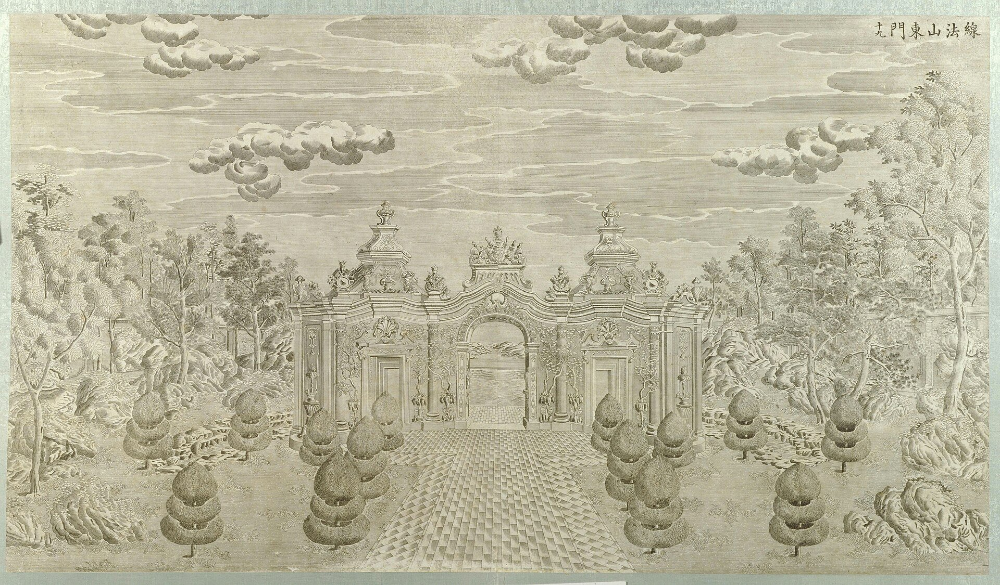

<!-- generated:start (scripts/building_pages.py): do not edit between these markers -->

# XY13: 螺蛳牌楼 Luosi Pailou

Hsien Fa Shan Tung Men, East Gate to Hsien Fa Hill · Xiyang Lou

**3D object:** 1 box. Open it: `/reconstruction/3d.html?b=XY13`

## What we know

- **Name:** 螺蛳牌楼 Luosi Pailou (S02, S06, S56, S01 · confidence A)
- **English:** Hsien Fa Shan Tung Men, East Gate to Hsien Fa Hill (S02, S06, S56, S01)
- **Garden:** Xiyang Lou (S02, S06, S56, S01)
- **Type:** european (S02, S06, S56, S01 · confidence A)
- **Destroyed:** Looted and burnt 1860; stone ruins stayed, further damage 1900 and after (S02 pp.142,218) (S02, S06, S56, S01)
- **Position:** 40.01224, 116.30878. S01 sure (S01 · confidence B)
- **Size in the inventory:** 8.0 × 1.5 m. typology xiyang_lou, C (S01)
- **Where the text puts it:** 山东为线法山东门 所谓螺丝牌楼 (S06) (S02, S06, S56, S01) *(research copy, not public)*
- **Note:** Copper engraving no. 19 per S02. 3 arches with vine carving (S02 p.159). (S02, S06, S56, S01)
- **Plan reader's note:** Label 螺螄牌? (last char written like 婁/樓 abbreviated) at (11465,1070). Drawn as a N-S ornamental figure, not as a gate plan. | plan: rect=235,60,-90. N-S figure x 11381-11454, y 1008-1242: cloud-shaped ends and a lobed spine; the triple arch of engraving 19 is not drawn in plan. (S01) *(research copy, not public)*
- **How it was read:** sure (S01) *(research copy, not public)*
- **Plan pixels:** 11415, 1125 (S01) *(research copy, not public)*

## Our model now

Simple massing of a European palace, assumed: sizes from the texts and the ruin polygons, position from the plan or the ruin. Not a reading of the 1786 engravings yet.

- **Box:** 8 × 1.5 m, european
- **Part:** arch
- **Heights:** platform 0.2 m, eave 6 m, ridge 7 m above the ground
- **Roof:** gable 硬山 or 悬山, glazed tile
- **Faces:** 85.9° from north
- **Confidence:** C, assumed

## Pictures (2)

- **P0059** (sure): 线法山东门 (圆明园铜版画册 / 西洋楼铜版画, plate 十九 of 二十; title and number printed on the plate) (1786 (Commons); Palace Museum: 清). https://commons.wikimedia.org/wiki/File%3A%E5%9C%86%E6%98%8E%E5%9B%AD%E9%93%9C%E7%89%88%E7%94%BB%E5%86%8C-16.jpg

  

- **P0225** (likely): Moore negatives of the European palaces, Royal BC Museum MS-3171 (13 negatives, 12 views, c.1875 to early 1880s) (perhaps c.1875; early 1880s (visualisingchina.net)). https://search-bcarchives.royalbcmuseum.bc.ca/c-f-moore-fonds Research-only: link card.

## Texts and drawings (3)

- **E0985** (description, sure): Plates XVI to XIX: 观水法, 线法山门, 线法山, 螺蛳牌楼. 1786-1803 · pp.184-185, Plates XVI-XIX · S258. https://archive.org/details/BIUSante_40644
  > Montagne factice sur laquelle il y a un Ting-tsé,
  XVI throne facing the jets. XVII triumphal arch, the most Greek. XVIII an artificial hill with a 亭 on top. XIX another triumphal arch, less sober.
- **E0990** (description, sure): Engraving 19: 线法山东门 / 螺蛳牌楼. 1934 · p.159 · S02. https://archive.org/details/historyofpekings00malo
  > was a peculiar gateway of three arches with both side passages leading through side rooms, and with decorations of vine-like trees carved even over the faces of the pillars on the outside of the building.
  Three-arched gate, side passages through side rooms, carved vine ornament on the pillars.
- **E0942** (description, sure): 万花阵 and 花园门; 线法山 and 螺蛳牌楼, yaffin 系列02, 13. c. 2011 · captions to the 20 engravings · S356. https://blog.sina.com.cn/s/blog_65fec3ab0100svq5.html
  Lead: the maze gate 花园门 is shaped like a Western clock case with two brass doors; the maze 89 x 59 m, walls about 1.2 m high and over 1,600 m long; the hill 线法山 has a gate each side, the east one called 螺蛳牌楼. Check against the engravings.

**On the plan:** Drawn on the plan of the gardens (S01), labelled 螺蛳牌楼. https://artmuseum.princeton.edu/collections/objects/138657

## Open questions

None that name it.

<!-- generated:end -->

## Notes

<!-- Yours: regeneration never touches this part. It goes on the public site; what you write below a line holding only %% private %% stays in the research copy. -->
