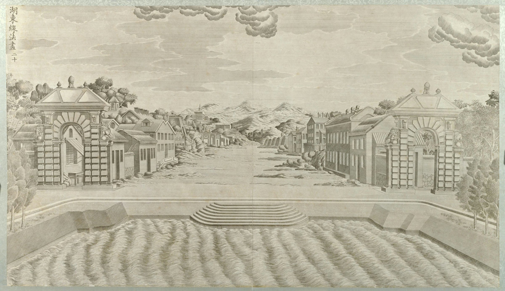
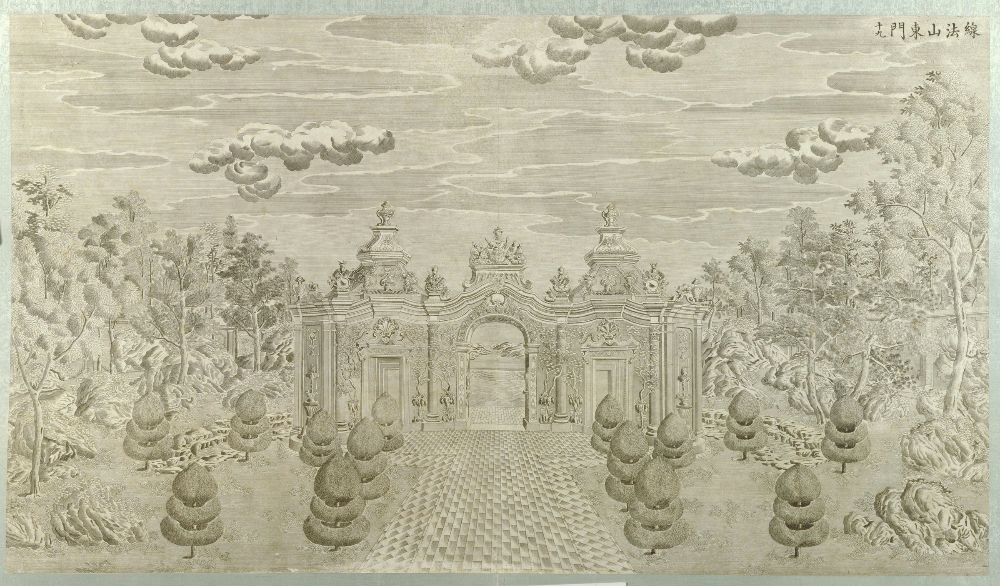
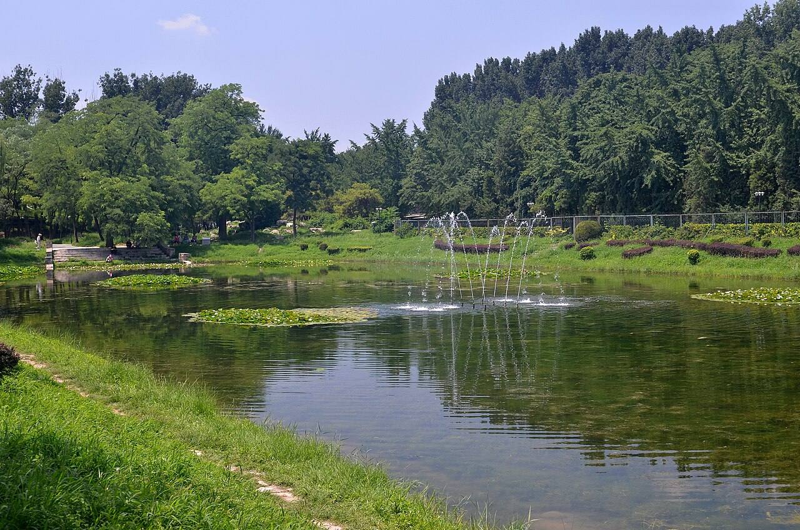
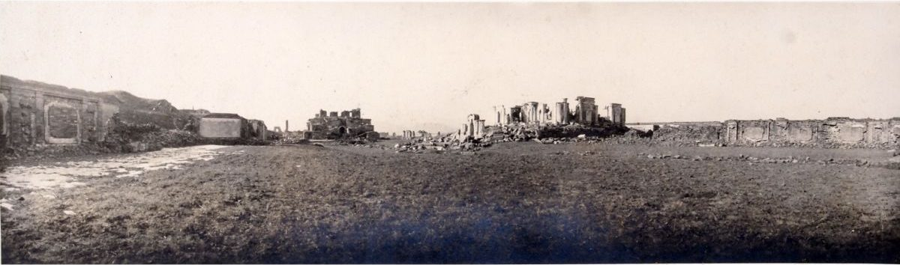

<!-- generated:start (scripts/building_pages.py): do not edit between these markers -->

# XY14: 方河 Fang He

(Lake of the Hsien Fa picture) · Xiyang Lou

**3D object:** none yet.

## What we know

- **Name:** 方河 Fang He (S02, S06, S42, S01 · confidence A)
- **English:** (Lake of the Hsien Fa picture) (S02, S06, S42, S01)
- **Garden:** Xiyang Lou (S02, S06, S42, S01)
- **Type:** other (S02, S06, S42, S01 · confidence A)
- **Destroyed:** n/a (water) (S02, S06, S42, S01)
- **Position:** 40.01234, 116.31003. S01 likely (S01 · confidence B)
- **Size in the inventory:** 145.9 × 51.9 m. stated: S01;S03, N-S plan; today's bank is 7 m inside it on the north (S01)
- **Where the text puts it:** 线法山之东为方河 (S06) (S02, S06, S42, S01) *(research copy, not public)*
- **Note:** Copper engraving no. 20 per S02. Lake in the foreground of engraving 20. Malone gives no separate name; S42 方河. Round 6 replaced frontage none m. Round 6 replaced depth none m. (S02, S06, S42, S01)
- **Plan reader's note:** Large rectangular basin R0070 with neck to the south at x~11960. No label; the water between 螺蛳牌楼 and 线法画. | plan: Basin; see compound polygon. (S01) *(research copy, not public)*
- **How it was read:** likely (S01) *(research copy, not public)*
- **Plan pixels:** 11890, 1125 (S01) *(research copy, not public)*

## Our model now

No box in the 3D view: the plan shows no building here, or a plot, water, a hill or a name only.

## Pictures (5)

- **P0060** (sure): 湖东线法画 (圆明园铜版画册 / 西洋楼铜版画, plate 二十 of 二十; title and number printed on the plate) (1786 (Commons); Palace Museum: 清). https://commons.wikimedia.org/wiki/File%3A%E5%9C%86%E6%98%8E%E5%9B%AD%E9%93%9C%E7%89%88%E7%94%BB%E5%86%8C-19.jpg

  

- **P0059** (likely): 线法山东门 (圆明园铜版画册 / 西洋楼铜版画, plate 十九 of 二十; title and number printed on the plate) (1786 (Commons); Palace Museum: 清). https://commons.wikimedia.org/wiki/File%3A%E5%9C%86%E6%98%8E%E5%9B%AD%E9%93%9C%E7%89%88%E7%94%BB%E5%86%8C-16.jpg

  

- **P0779** (sure): 圓明園東長春園平面圖 (第一圖), plan of the Xiyang Lou strip (drawn by Ohlmer, 1867-1879, per Teng Gu's preface; from Börschmann's collection). https://commons.wikimedia.org/wiki/File:CADAL11102995_%E5%9C%93%E6%98%8E%E5%9C%93%E6%AD%90%E5%BC%8F%E5%AE%AE%E6%AE%BF%E6%AE%98%E8%B7%A1.djvu

  

- **P0458** (sure): Yuanmingyuan fanghe 20120715.JPG (2012-07-15 (Commons DateTimeOriginal)). https://commons.wikimedia.org/wiki/File:Yuanmingyuan_fanghe_20120715.JPG

  

- **P0293** (guess): Fotografija Ruševine – panoramski pogled z vzhoda v Stari poletni palači (album: "Yüen-Ming-Yüen: Total-Ansicht vom Osten") (20th c., album bought 1914-1920 (holder)). https://vazcollections.si/predmeti/fotografija-rusevine-panoramski-pogled-z-vzhoda-v-stari-poletni-palaci/

  

## Texts and drawings (7)

- **E0991** (description, sure): Plate XX: 线法墙 Xianfa Qiang and 方河 Fanghe. 1786-1803 · pp.185-186, Plate XX · S258. https://archive.org/details/BIUSante_40644
  > Il faut remarquer à l'entrée de la rue, les deux grandes portes placées sur le premier plan.
  The east end of the ground; two rows of houses forming a street, leading the eye to far mountains, cut off from the park by a wide water; two rustic Tuscan gates in the foreground. Called fit for a stage set.
- **E0992** (description, sure): Engraving 20: 线法墙 Xianfa Qiang (湖东线法画) and 方河 Fanghe. 1934 · pp.159-160 · S02. https://archive.org/details/historyofpekings00malo
  > To produce an illusion of distance by means of the European idea of perspective with a single central vanishing point houses were partly modeled and partly painted on walls, five on each side, set like the wings of a stage,
  A European town seen across a lake: five walls a side narrowing towards the back, with a city wall and mountains painted on the back wall. Plate p.159: the ruin of those walls. Note Q35 has six a side.
- **E2404** (description, sure): Slips in holder transcriptions of printed titles. TEI line for Plate_19; V&A O398694 · S700;S74. 
  The plates print 蓄水樓, read in four holders: V&A types 畜水樓 and glosses Chushuilou. Plate 19: Rylands TEI types 線法山門正面十九 with the pinyin Dongmen; V&A types 線法山東門十九, which is what the plate title is by every other holder. NYPL names Castiglione as artist, nobody else does. None changes a tie.
- **E0507** (description, sure): 圆明园五朝御制诗文集注 v4, editors' note on 西洋楼. 2020 edition · v4 p.120 · S361. https://www.yuanmingyuanpark.cn/xs/yjbg/202008/P020200803382796786124.pdf#page=123
  The editors walk the strip from west to east with completion dates and plaques: 谐奇趣 1751, 养雀笼 1759, then the fountains and the perspective walls, with their mechanical details. They put the whole at about 2% of the gardens.
- **E0544** (drawing, sure, search index only): 西洋楼水法图. 国家图书馆善本部 none shown · S310. https://www.mhymy.com/dasl/ysltd/7643.html
  Plan of the Xiyang Lou waterworks across its dozen sites; the record shows no shelf number. No image here; the site may ask a small payment for the full record.
- **E2415** (drawing, likely, search index only): 线法墙地样 (线法墙平面图). 国家图书馆善本部; no shelf number shown; title recorded in 1933 北平图书馆 bulletin per E0993 · S310. https://www.mhymy.com/dasl/ysltd/12410.html
  Lei plan of the walled plot holding 线法墙, 方河 and 螺蛳牌楼: per the page, 81 zhang E-W (259 m), 19 zhang N-S, with 11 walls from west to east in two lines. Same as E0993, now with figures in a search extract.
- **E0554** (archaeology, sure): 西洋楼区域考古勘探报告. n.d. · mhymy 档案史料 12205, free part · S149. https://www.mhymy.com/dasl/12205.html
  Report's opening: the strip runs 860 m east-west, up to 300 m wide in the west and 65 m at its narrowest, about 70,000 m2, built 1747-1783. A central axis divides it into about five sections, each with its own north-south axis, thirteen units from 谐奇趣 to 线法墙. Survey results are paywalled.

**On the plan:** Its place is drawn on the plan of the gardens (S01), with no name written. https://artmuseum.princeton.edu/collections/objects/138657

## Reconstructions by others (1)

Modern interpretation, not evidence.
- **R0314** (drawing, sure): Gartenplan der Xiyang Lou (西洋楼) in Peking. Maximilian Dörrbecker (Chumwa). https://commons.wikimedia.org/wiki/File:Gartenplan_der_Xiyang_Lou.png

## Evidence for the set of buildings

- Reconstructions and comparables for the whole garden, 西洋楼 Xiyang Lou: see GARDEN-XY

## Open questions

- Q32: OSM errors

<!-- generated:end -->

## Notes

<!-- Yours: regeneration never touches this part. It goes on the public site; what you write below a line holding only %% private %% stays in the research copy. -->
