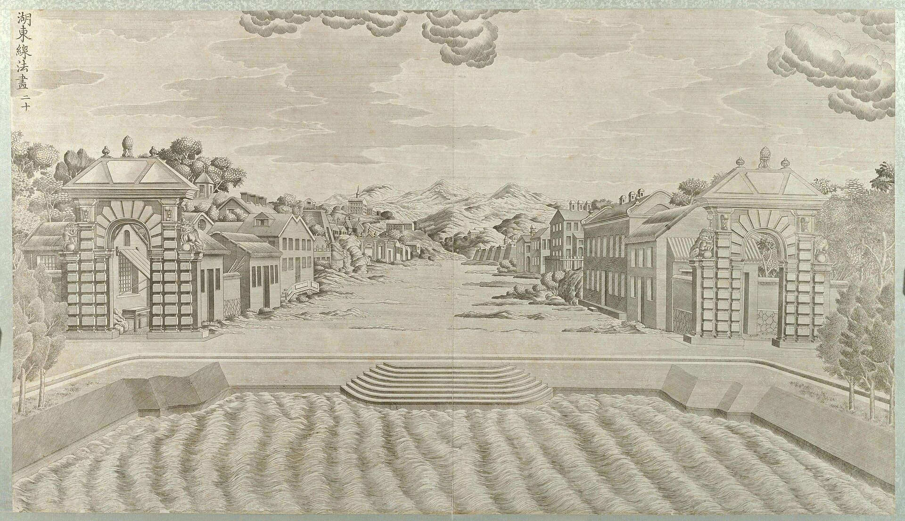

<!-- generated:start (scripts/building_pages.py): do not edit between these markers -->

# XY15: 线法墙 Xianfa Qiang

Hu Tung Hsien Fa T'u, Hsien Fa Picture East of the Lake · Xiyang Lou

**3D object:** 12 boxes. Open it: `/reconstruction/3d.html?b=XY15`

## What we know

- **Name:** 线法墙 Xianfa Qiang (S02, S06, S56, S01 · confidence A)
- **English:** Hu Tung Hsien Fa T'u, Hsien Fa Picture East of the Lake (S02, S06, S56, S01)
- **Written on the plan:** 线法画 (S01 · confidence A)
- **Garden:** Xiyang Lou (S02, S06, S56, S01)
- **Type:** european (S02, S06, S56, S01 · confidence A)
- **Destroyed:** Looted and burnt 1860; stone ruins stayed, further damage 1900 and after (S02 pp.142,218) (S02, S06, S56, S01)
- **Position:** 40.01244, 116.31113. S01 sure (S01 · confidence B)
- **Size in the inventory:** 6.0 × 1.0 m. typology xiyang_lou, C (S01)
- **Where the text puts it:** 线法山之东 方河 线法墙 (S06) (S02, S06, S56, S01) *(research copy, not public)*
- **Note:** Copper engraving no. 20 per S02. Five walls each side like stage wings, painted town (S02 p.159). S06 阿克苏十景 (lead). Also 线法画 (S56). Five walls a side by Malone; Q35 uses six (S02, p.159). (S02, S06, S56, S01)
- **Plan reader's note:** Label reads 線法畫 (线法画), i.e. the 线法墙 / 湖东线法图 of engraving 20. 6 staggered wall pairs (Malone says five each side) + 5-bay B0155 and B0215 at N and S. | plan: 6 staggered walls per side, each ~8x35 px, N-S. North set (x,y): 12259 1021; 12275 1025; 12298 1040; 12323 1053; 12348 1067; 12375 1084. South set: 12255 1250; 12276 1241; 12299 1228; 12322 1216; 12348 1198; 12375 1185. Malone says five each side. (S01) *(research copy, not public)*
- **How it was read:** sure (S01) *(research copy, not public)*
- **Plan pixels:** 12310, 1127 (S01) *(research copy, not public)*

## Our model now

Simple massing of a European palace, assumed: sizes from the texts and the ruin polygons, position from the plan or the ruin. Not a reading of the 1786 engravings yet.

- **12 ×:** screen for perspective paintings (S06); six per side as on S01 (Q16): 6 × 1 m, eave 5 m, ridge 5 m
- **Confidence:** C, all assumed

## Inside it (2)

- XY15-N01
- XY15-N02

## Pictures (1)

- **P0060** (sure): 湖东线法画 (圆明园铜版画册 / 西洋楼铜版画, plate 二十 of 二十; title and number printed on the plate) (1786 (Commons); Palace Museum: 清). https://commons.wikimedia.org/wiki/File%3A%E5%9C%86%E6%98%8E%E5%9B%AD%E9%93%9C%E7%89%88%E7%94%BB%E5%86%8C-19.jpg

  

## Texts and drawings (6)

- **E0991** (description, sure): Plate XX: 线法墙 Xianfa Qiang and 方河 Fanghe. 1786-1803 · pp.185-186, Plate XX · S258. https://archive.org/details/BIUSante_40644
  > Il faut remarquer à l'entrée de la rue, les deux grandes portes placées sur le premier plan.
  The east end of the ground; two rows of houses forming a street, leading the eye to far mountains, cut off from the park by a wide water; two rustic Tuscan gates in the foreground. Called fit for a stage set.
- **E0992** (description, sure): Engraving 20: 线法墙 Xianfa Qiang (湖东线法画) and 方河 Fanghe. 1934 · pp.159-160 · S02. https://archive.org/details/historyofpekings00malo
  > To produce an illusion of distance by means of the European idea of perspective with a single central vanishing point houses were partly modeled and partly painted on walls, five on each side, set like the wings of a stage,
  A European town seen across a lake: five walls a side narrowing towards the back, with a city wall and mountains painted on the back wall. Plate p.159: the ruin of those walls. Note Q35 has six a side.
- **E0507** (description, sure): 圆明园五朝御制诗文集注 v4, editors' note on 西洋楼. 2020 edition · v4 p.120 · S361. https://www.yuanmingyuanpark.cn/xs/yjbg/202008/P020200803382796786124.pdf#page=123
  The editors walk the strip from west to east with completion dates and plaques: 谐奇趣 1751, 养雀笼 1759, then the fountains and the perspective walls, with their mechanical details. They put the whole at about 2% of the gardens.
- **E0544** (drawing, sure, search index only): 西洋楼水法图. 国家图书馆善本部 none shown · S310. https://www.mhymy.com/dasl/ysltd/7643.html
  Plan of the Xiyang Lou waterworks across its dozen sites; the record shows no shelf number. No image here; the site may ask a small payment for the full record.
- **E0993** (drawing, sure, search index only): 线法墙平面图 (图名: 线法墙地样). 国家图书馆善本部 none shown · S310. https://www.mhymy.com/dasl/ysltd/12410.html
  Plan of the perspective walls, known from the 1933 Bulletin of the National Library of Peiping, original title 线法墙地样; the record gives no shelf number. No image here; the site may ask a small payment for the full record.
- **E0554** (archaeology, sure): 西洋楼区域考古勘探报告. n.d. · mhymy 档案史料 12205, free part · S149. https://www.mhymy.com/dasl/12205.html
  Report's opening: the strip runs 860 m east-west, up to 300 m wide in the west and 65 m at its narrowest, about 70,000 m2, built 1747-1783. A central axis divides it into about five sections, each with its own north-south axis, thirteen units from 谐奇趣 to 线法墙. Survey results are paywalled.

**On the plan:** Drawn on the plan of the gardens (S01), labelled 线法画. https://artmuseum.princeton.edu/collections/objects/138657

## Reconstructions by others (2)

Modern interpretation, not evidence.
- **R0139** (drawing, sure): Fig. 4, Plan d'ensemble (plan de restitution 1985). Antoine Durand, Mission Palais d'Ete, under Michele Pirazzoli-t'Serstevens, 1985 (published 1988). https://www.persee.fr/doc/arasi_0004-3958_1988_num_43_1_1240 Research-only: link card.
- **R0182** (paper figure, sure, search index only): The Qianlong Emperor's Western Vistas: Linear Perspective and Trompe l'Oeil Illusion in the European Palaces of the Yuanming Yuan. John R. Finlay, Bulletin de l'Ecole francaise d'Extreme-Orient, 2007. https://doi.org/10.3406/befeo.2007.6068 Research-only: link card.

## Surviving comparable buildings, not this building (3)

- **T097** 倦勤斋 通景画 及 小戏台 Juanqin Zhai trompe l'oeil theatre, Qianlong Garden, 宁寿宫花园 Forbidden City. Same design family, confidence B, standing: yes. How 线法 looked when it survives: painted wings, single vanishing point, an illusion of distance Basis: S412 p.38, pp.44-45: both are retirement-garden stages in the far corner of their gardens, perspective by the Jesuits or their Chinese students; Juanqin looks on a painted landscape. S412 p.43: Nian Xiyao's 视学 closely follows Pozzo. S415 p.101: Pozzo as Castiglione's master by his own words. https://mar.mcgill.ca/article/view/19/15
- **T096** Pozzo, Gesù altar of St Ignatius Altar of St Ignatius, Il Gesù, Rome. Comparable: same court, era or type, confidence B, standing: yes. Panel count at XY15, rail pattern at XY06/XY08 Basis: S412 p.43: Pozzo's altar scheme in six painted panels and his treatise; six panels at our stage; Pozzo's book stood in the Jesuit library in Beijing. S415 p.120 uses the same altar's rail as a common source for balustrades here and in Vienna. https://mar.mcgill.ca/article/view/19/15
  - P0677: Chapel S. Ignazio Gesu Rome. https://commons.wikimedia.org/wiki/File:Chapel_S._Ignazio_Gesu_Rome.jpg
  - P0678: Altar St Ignatius Pozzo. https://commons.wikimedia.org/wiki/File:Altar_St_Ignatius_Pozzo.jpg
- **T098** 阿拉里奥别墅 花园剧场 Open-air theatre, Villa Alario, Cernusco sul Naviglio, Italy. Comparable: same court, era or type, confidence B, standing: partly. Canal before a stage of wings Basis: S415 p.100: Droguet finds an analogy in Dal Re's 1743 print of canal and stage set; Rabreau: ours is otherwise «à aucune source connue». Malone (S02 p.159): walls set like the wings of a stage. https://www.ghamu.org/wp-content/uploads/2022/09/Rabreau-YMY-2022.pdf
  - P0679: Villa Alari seen from Naviglio Martesana, Cernusco sul Naviglio, Italy. https://commons.wikimedia.org/wiki/File:Villa_Alari_seen_from_Naviglio_Martesana,_Cernusco_sul_Naviglio,_Italy.jpg

## Evidence for the set of buildings

- Reconstructions and comparables for the whole garden, 西洋楼 Xiyang Lou: see GARDEN-XY

## Open questions

- Q16: 海晏堂's east half and the plan's working names
- Q35: Xiyang Lou massing (Round 2)
- Q48: Xiyang Lou

<!-- generated:end -->

## Notes

<!-- Yours: regeneration never touches this part. It goes on the public site; what you write below a line holding only %% private %% stays in the research copy. -->
