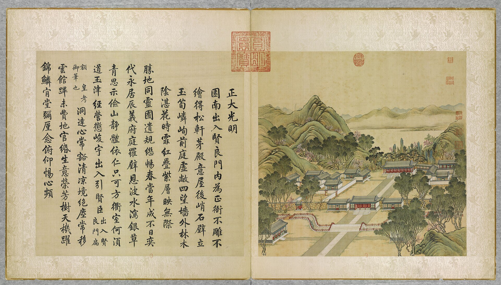

<!-- generated:start (scripts/building_pages.py): do not edit between these markers -->

# YM01-02: 出入贤良门前石桥 Churu Xianliang Men qian shiqiao

Yuanming Yuan

**3D object:** none yet.

**Part of:** YM01 正大光明

## What we know

- **Name:** 出入贤良门前石桥 Churu Xianliang Men qian shiqiao (S05, S02, S245, S211 · confidence B)
- **Garden:** Yuanming Yuan (S05, S02, S245, S211)
- **Type:** bridge (S05, S02, S245, S211 · confidence B)
- **Changed:** 1839 (道光十九年 己亥): the arched (bow-backed) bridge before 出入贤良门 levelled flat; so in 1860 a flat bridge, not the arch of the album and of S05 (S05, S02, S245, S211)
- **Destroyed:** 1860 (S05, S02, S245, S211)
- **Position:** Not placed: the name was not found on the plan.
- **Note:** Rixia: three stone bridges over a moon-shaped moat; Malone p.75 "an arched bridge". Two gilt bronze dragons on the marble bridge, carried off in 1860; two wooden side galleries on the bridge (S245, pp.228, 233 n.1). (S05, S02, S245, S211)

## Our model now

The formal entrance of the garden as it stood in the 1850s, from the terrace before 大宫门 to the rock peaks behind the audience hall: the plan S01 gives the layout, the yellow slip 样001-4 the hall's seven bays, depth and porches (A), Malone and Barrow its platform (B), the dig the gate's base (B), the leaf of 1744 the roofs, colours, railings and the gallery, the witnesses of 1860 the flagged courts, the marble canal and bridge, the lions. Heights, the halls round the courts and every ornament are C.

- **Layout:** As S01 draws it (re-read in Round 19 in plan pixels, B): 大宫门 on the palace wall, the inner court with its offices and ranges, the moon-shaped canal, 出入贤良门 on the gate line, the court and 正大光明殿 with its terrace; S01 draws the hall and terrace 0.8 times the stated sizes (Q256), the model keeps the stated sizes centred where S01 draws them
- **正大光明殿:** Seven bays 4.32 + 4.32 + 4.83 + 5.17 + 4.83 + 4.32 + 4.32 m with porches of 1.92 m all round, 16.0 m deep (the slip 样001-4, A); the rear porch walled in, the front end bays windows over a sill wall, the rear end bays walled (the slip, A; Barrow, B); ten red columns across the front (Malone, B); the platform 39.3 x 19.2 m, 1.22 m above the court (Malone, Barrow, B); three flights (Malone; the leaf); rolled 歇山, grey tile, a painted bracket band (the leaf, S337, Barrow, B); column 5.12 m and the roof's pitch C; Yongzheng's plaque 正大光明 (S05, A)
- **Terrace 月台:** 38.40 x 14.82 m, 0.26 m high, with four censers (S119, B; added 1775-1793); the balustrade and the censers' form C
- **Court:** Flagged (Wolseley, M'Ghee 1860, B), 79 x 22.6 m between the side halls and from the terrace to the gate line (S01); the five-bay side halls 东西配殿 (S05, A; their form C); a covered way east from the hall (the leaf, Malone, B); the rock peaks of 寿山 behind (S05, the leaf; places and heights C)
- **出入贤良门:** Five bays (S05, A), rolled 歇山 (S337, B), red plank doors in the middle bays (the leaf); the duty rooms either side, lower and gabled (S05, the leaf); the gate line's rubble wall about 4 m high with two side gates (Varin 1860, the leaf, S05; B); widths and heights C
- **Canal and bridge:** The moon-shaped canal about 3 m wide lined with white marble (S05, S01, Varin; B), red railings on its banks (the leaf); one flat marble bridge on the axis, its north end flared (S01; levelled flat in 1839, S211, A), wooden railings and two gilt dragons (Varin, B; their form C); a slab crossing where S01 breaks the canal east of the axis (C). S05 gives three bridges (Q130)
- **Inner court:** Flagged (M'Ghee 1860, B); the court offices 内朝房, five bays each (S05, A; form C); a long range on each side (S01; the east one has no box, C); the garden wall round it, red (Round 19's W01 on S01; colour and height C)
- **大宫门:** Five bays (S05, A) on the dig's base 21.57 x 11.33 m, 0.77 m high (S102, B); rolled 歇山 (S337, B); red plank doors with gilt studs (Wolseley 1860, B); Yongzheng's plaque 圆明园 (S05, A); the column 4.16 m and the brackets C; on the palace wall (S42) with a 左门 either side (S42, S01; form C)
- **Terrace and lions:** The gate's terrace as S01 draws it (21.6 x 10 m; height 0.40 m C) with a pair of bronze lions on stone pedestals where S01 draws two squares (1763, S42; Wolseley, Varin 1860; B); the lions' form C
- **Before the gate:** The court offices 外朝房, five bays each (S05, A; at S01's boxes; form C); the stone road on the axis 4.8 m wide (S05, S42, S01; B)
- **Beyond the model:** 勤政殿 of 勤政亲贤 (YM02-01) and the spirit wall 大影壁 (YM41-12) are models of their own, drawn by this model's generator
- **Assumed:** Every height but the platforms', the halls round the courts, the ranges and duty rooms, the side gates, the censers, the lions' and dragons' form, the balustrade, the brackets, the rock peaks: the hall kit's classes and the Qing manual's typology (C, the pale tint with conf=1)

## Pictures (1)

- **P0001** (likely): 正大光明 Zhengda guangming [Droiture et clarté] (圓明園四十景, 第1景) (1744 (BnF record: 1744年，清朝乾隆九年)). https://commons.wikimedia.org/wiki/File%3A%E5%9C%93%E6%98%8E%E5%9C%92%E5%9B%9B%E5%8D%81%E6%99%AF._%E7%AC%AC%E4%B8%80%E6%99%AF_%28%E4%B8%8A%E5%86%8C%EF%BC%8C%E7%AC%AC%E4%B8%80%E5%B9%85%E5%9B%BE%29%2C_%E6%AD%A3%E5%A4%A7%E5%85%89%E6%98%8E_-_%28%E6%B8%85%29%E5%94%90%E5%B2%B1%E3%80%81%E6%B2%88%E6%BA%90%E5%90%88%E7%95%AB_%3B_%28%E4%B9%BE%E9%9A%86%E5%90%9F%E8%AF%97%EF%BC%8C%E6%B1%AA%E7%94%B1%E6%95%A6%E4%BB%A3%E4%B9%A6%29Zhengda_guangming_-_%28Qing%29Tang_Dai%2C_Shen_Yuan_he_hua_-_btv1b550083229.jpg

  

## Texts and drawings (5)

- **E1000** (text, sure): 日下舊聞考 正大光明. 1780s (乾隆 敕撰) · j80:9a-11a · S05. https://github.com/kanripo/KR2k0036/blob/master/KR2k0036_080.txt
  > 大宫門内為出入賢良門五楹門左右為直房前跨石橋度橋東西朝房各五楹西南為茶膳房再西為繙書房東南為清茶房為軍機處（圓明園冊）臣等謹按出入賢良門額世宗御書是為二宫門凡武職侍衛引見御此門較射左右直房為各部院臣工入直之所東西設兩罩門各衙門奏事由東罩門逓進茶膳房太監人等由西罩門出入門前河形如月中駕石橋三其水自西來東注如意門閘口㑹東園各河而出出入賢良門内為正大光明殿七楹東西配殿各五楹後為壽山殿東為洞明堂（圓明園冊）臣等謹按圓明園四十景中世宗御題四字額者凡十有四正大光明殿其一也餘如牡丹臺今為鏤月開雲蓬萊洲今為蓬島瑶臺乃乾隆九年皇上恭依避暑山莊三十六景四字題額之例更鍚嘉名用昭畫一敬就各條下加按並恭載御製四十景詩至附近各景詩已載御製詩全集者兹不備録又按正大光明殿内聨曰心天之心而宵衣旰食樂民之樂以和性怡情為世宗御書又聨曰遹求寜觀成無逺弗届以對時育物有那其居為皇上御書東壁懸御書周書無逸篇西壁懸豳風圖東為洞明堂世宗御書額
  Through the five-bay 出入賢良門, the second gate with duty rooms and three stone bridges over a moon-shaped canal, are court offices, kitchens, the translation office and the 軍機處 Grand Council. Then 正大光明殿 of seven bays with five-bay side halls, 壽山殿 behind and 洞明堂 to the east. The notes explain the renaming of the fourteen Yongzheng titles under the 1744 four-character scheme, and record the couplets, the 無逸 text on the east wall and the 豳風 picture on the west wall.
- **E2443** (text, sure): 竹葉亭雜記: the bow-backed bridge before 出入賢良門 levelled in 己亥 (1839). early 19th c., on 1839 · 卷一, line 35 of the corpus file · S211. https://github.com/garychowcmu/daizhigev20/blob/master/史藏/志存记录/竹叶亭杂记.txt
  > 贤良门外有河，河有桥，式如弓背。上看箭，鹄设于桥西河边，射者立桥北，北向而射。每发矢，上右顾以视其中否。岁己亥将桥拆平，鹄于桥南对上设焉；射者立桥北，面向西而射，以免上右顾之烦也。谈风水者谓此桥架河上如弓之有靶，今拆平则弓去靶矣，恐武不振。明年有英夷之扰，其果以是欤？
  Outside 出入贤良门 a canal with a bridge shaped like a bow's back. For archery the target stood on the west bank of the bridge and the archers north of it shooting north, so the emperor had to turn right to watch. In 己亥 (1839) the bridge was taken down to flat, the target set south of the bridge facing the emperor and the archers shooting west. Geomancers said the bow had lost its target and feared for the army: the British war came the next year.
- **E2106** (description, sure): Varin: the night reconnaissance through the courts. 1860 · pp.227-228 · S245. https://archive.org/details/expditiondechin00paulgoog
  > et on s'engagea dans une cour immense traversée dans sa dernière partie par un canal revêtu en marbre blanc, et couvert d'un pont, également en marbre, soutenant deux galeries latérales en bois.
  A large space with trees and a lake on one side and the palace on the other, a bare esplanade with regular side buildings, chevaux-de-frise at the entry. Centre gate barred, side doors used. Second enclosure, then a big court crossed by the marble-lined canal and bridge with two wooden galleries. Third enclosure with a wall about 4 m high and two small side doors.
- **E2122** (description, sure): Varin: lions, dragons and the first throne hall. 1860 · pp.232-233 · S245. https://archive.org/details/expditiondechin00paulgoog
  > Le mur de gauche de la salle était recouvert, dans son entier, par un seul tableau peint sur soie et représentant des vues des palais impériaux.
  Lions in bronze on white marble pedestals 3 m high, too heavy to carry off. Two gilt bronze dragons on the marble bridge were carried away later (his n.1). Hall reached by a wide white marble stair; black wood throne carved through, cloisonné incense burners and large enamel vases. Picture on silk.
- **E1009** (description, sure): Scene 1, 正大光明 Zhengda Guangming: courts, gate, moat and hall. 1934 · pp.75-76 · S02. https://archive.org/details/historyofpekings00malo
  > This Second Gate of the Palace led into the courtyard where the Main Audience Hall stood on a foundation 129 feet long, 63 feet wide, and 4 feet high, ascended by three sets of stone steps. It was a building of seven chien besides having a porch all around the outside, formed by an outer row of columns supporting the projecting eaves, so that the facade presented a colonnade of ten columns.
  Malone measured the site. Foundation 129 x 63 x 4 ft, three stairs, seven bays plus a surrounding porch, ten columns across the front, round column bases 2 ft 9 in across, floor of veined marble slabs on brick and lime. Plain under Yongzheng in 1725; before the end of Qianlong's reign columns red, capitals with dragons, gilt wire over the entablature. Pines and a rockery hill behind, a covered passage to the east.

## Evidence for the set of buildings

- Evidence for the whole compound 正大光明: see YM01
- Reconstructions and comparables for the whole garden, 圆明园 Yuanming Yuan: see GARDEN-YM

## Open questions

- Q87: YM01-02
- Q164: YM01-02 bridge before 出入贤良门

<!-- generated:end -->

## Notes

<!-- Yours: regeneration never touches this part. It goes on the public site; what you write below a line holding only %% private %% stays in the research copy. -->
