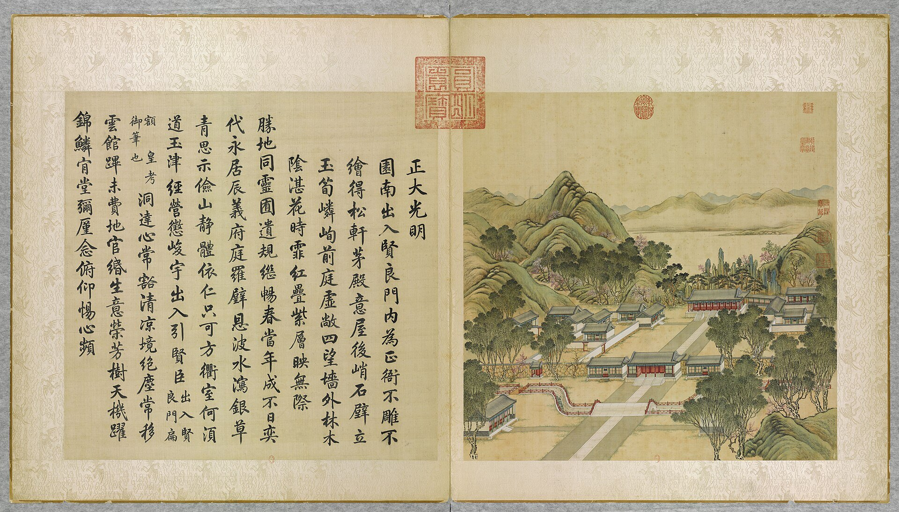
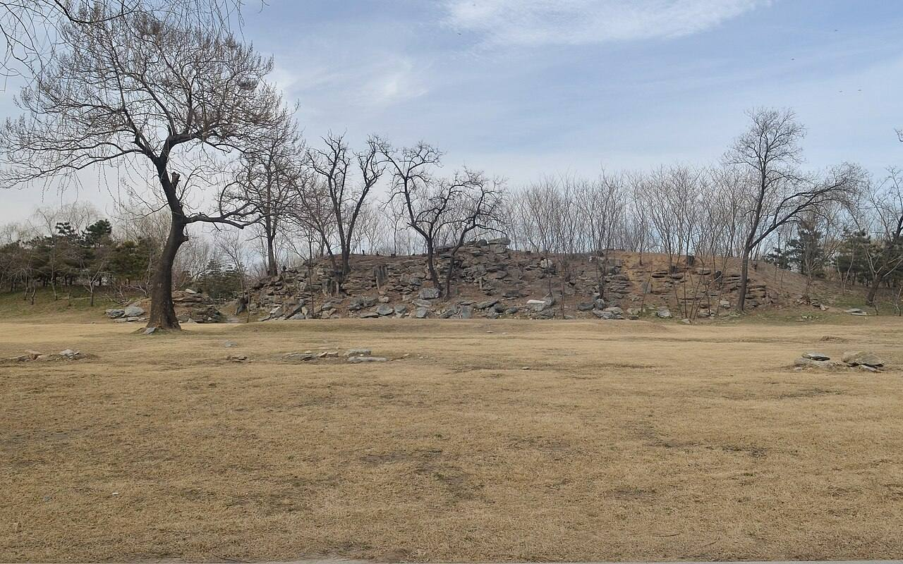

<!-- generated:start (scripts/building_pages.py): do not edit between these markers -->

# YM01-08: 正大光明殿 Zhengda Guangming Dian

Yuanming Yuan

**3D object:** 1 box. Open it: `/reconstruction/3d.html?b=YM01-08`

**Part of:** YM01 正大光明

## What we know

- **Name:** 正大光明殿 Zhengda Guangming Dian (S05, S02, S06, S01, S106, S119, S08, S202, S251, S240, S242, S337, S310 · confidence B)
- **Written on the plan:** 正大光明 (S01 · confidence B)
- **Garden:** Yuanming Yuan (S05, S02, S06, S01, S106, S119, S08, S202, S251, S240, S242, S337, S310)
- **Type:** audience hall (S05, S02, S06, S01, S106, S119, S08, S202, S251, S240, S242, S337, S310 · confidence B)
- **Built:** 雍正三年 1725 (S02 p.76) (S05, S02, S06, S01, S106, S119, S08, S202, S251, S240, S242, S337, S310)
- **Changed:** Plain under Yongzheng; columns painted red and capitals with dragons before the end of Qianlong (S02 p.76); Used for the palace re-examination 1844-50 and from 1814 for clansmen; dated later use (S05, S02, S06, S01, S106, S119, S08, S202, S251, S240, S242, S337, S310)
- **Destroyed:** 19 October 1860, last of the buildings; the troops had quartered in it (S05, S02, S06, S01, S106, S119, S08, S202, S251, S240, S242, S337, S310)
- **Position:** 40.00193, 116.29052. S01 sure (S01 · confidence B)
- **Bays:** 7 in the texts / 7x1 on the plan (S05, S02, S06, S01, S106, S119, S08, S202, S251, S240, S242, S337, S310)
- **Size in the inventory:** 39.32 × 19.2 m. stated in a source (S01)
- **Roof:** 卷棚歇山 (S06) (S05, S02, S06, S01, S106, S119, S08, S202, S251, S240, S242, S337, S310)
- **Tiles:** 灰瓦 grey (S06) (S05, S02, S06, S01, S106, S119, S08, S202, S251, S240, S242, S337, S310)
- **Note:** S06 进深五间. Malone p.75 measured the foundation on site: 129 x 63 ft, 4 ft high = 39.3 x 19.2 x 1.2 m; porch colonnade of 10 columns; pillars c. 2 ft 8 in. Macartney 150 x 60 ft (S02 p.76). Interior height over 20 ft per Staunton (S02 p.76 n.). Macartney gifts 1793 set up here. Scene of camp and last fire 1860 (S02 p.77). 不雕不繪 per 1744 poem [j80:11a]. 33.5 inside room (110 ft); current 39.32 is Malone's foundation, 129 ft (S251, p.125). 12.8 inside room (42 ft); current 19.2 is Malone's foundation, 63 ft (S251, p.125). 1860 descriptions: rosewood or dark painted throne, polished marble floor, wall-size picture of the gardens, wire net under the eaves (S240, pp.232-235). frontage_m: 36.45 (S337, 圆明园正大光明初探). depth_m: 16 (S337, 圆明园正大光明初探). roof: single-eave 卷棚歇山, ten purlins (S337, 圆明园正大光明初探). depth_m: 16 (S310, NLC 样001-4 正大光明白差准底 (undated), slip text quoted on mhymy record 10451). frontage_m: 35.95 (S310, NLC 样001-4 正大光明白差准底 (undated), slip text quoted on mhymy record 10451). (S05, S02, S06, S01, S106, S119, S08, S202, S251, S240, S242, S337, S310)
- **Plan reader's note:** Text 7. Label in the court south of it (S01) *(research copy, not public)*
- **How it was read:** sure (S01) *(research copy, not public)*
- **Plan pixels:** 3305, 5444 (S01) *(research copy, not public)*

## Our model now

The formal entrance of the garden as it stood in the 1850s, from the terrace before 大宫门 to the rock peaks behind the audience hall: the plan S01 gives the layout, the yellow slip 样001-4 the hall's seven bays, depth and porches (A), Malone and Barrow its platform (B), the dig the gate's base (B), the leaf of 1744 the roofs, colours, railings and the gallery, the witnesses of 1860 the flagged courts, the marble canal and bridge, the lions. Heights, the halls round the courts and every ornament are C.

- **Layout:** As S01 draws it (re-read in Round 19 in plan pixels, B): 大宫门 on the palace wall, the inner court with its offices and ranges, the moon-shaped canal, 出入贤良门 on the gate line, the court and 正大光明殿 with its terrace; S01 draws the hall and terrace 0.8 times the stated sizes (Q256), the model keeps the stated sizes centred where S01 draws them
- **正大光明殿:** Seven bays 4.32 + 4.32 + 4.83 + 5.17 + 4.83 + 4.32 + 4.32 m with porches of 1.92 m all round, 16.0 m deep (the slip 样001-4, A); the rear porch walled in, the front end bays windows over a sill wall, the rear end bays walled (the slip, A; Barrow, B); ten red columns across the front (Malone, B); the platform 39.3 x 19.2 m, 1.22 m above the court (Malone, Barrow, B); three flights (Malone; the leaf); rolled 歇山, grey tile, a painted bracket band (the leaf, S337, Barrow, B); column 5.12 m and the roof's pitch C; Yongzheng's plaque 正大光明 (S05, A)
- **Terrace 月台:** 38.40 x 14.82 m, 0.26 m high, with four censers (S119, B; added 1775-1793); the balustrade and the censers' form C
- **Court:** Flagged (Wolseley, M'Ghee 1860, B), 79 x 22.6 m between the side halls and from the terrace to the gate line (S01); the five-bay side halls 东西配殿 (S05, A; their form C); a covered way east from the hall (the leaf, Malone, B); the rock peaks of 寿山 behind (S05, the leaf; places and heights C)
- **出入贤良门:** Five bays (S05, A), rolled 歇山 (S337, B), red plank doors in the middle bays (the leaf); the duty rooms either side, lower and gabled (S05, the leaf); the gate line's rubble wall about 4 m high with two side gates (Varin 1860, the leaf, S05; B); widths and heights C
- **Canal and bridge:** The moon-shaped canal about 3 m wide lined with white marble (S05, S01, Varin; B), red railings on its banks (the leaf); one flat marble bridge on the axis, its north end flared (S01; levelled flat in 1839, S211, A), wooden railings and two gilt dragons (Varin, B; their form C); a slab crossing where S01 breaks the canal east of the axis (C). S05 gives three bridges (Q130)
- **Inner court:** Flagged (M'Ghee 1860, B); the court offices 内朝房, five bays each (S05, A; form C); a long range on each side (S01; the east one has no box, C); the garden wall round it, red (Round 19's W01 on S01; colour and height C)
- **大宫门:** Five bays (S05, A) on the dig's base 21.57 x 11.33 m, 0.77 m high (S102, B); rolled 歇山 (S337, B); red plank doors with gilt studs (Wolseley 1860, B); Yongzheng's plaque 圆明园 (S05, A); the column 4.16 m and the brackets C; on the palace wall (S42) with a 左门 either side (S42, S01; form C)
- **Terrace and lions:** The gate's terrace as S01 draws it (21.6 x 10 m; height 0.40 m C) with a pair of bronze lions on stone pedestals where S01 draws two squares (1763, S42; Wolseley, Varin 1860; B); the lions' form C
- **Before the gate:** The court offices 外朝房, five bays each (S05, A; at S01's boxes; form C); the stone road on the axis 4.8 m wide (S05, S42, S01; B)
- **Beyond the model:** 勤政殿 of 勤政亲贤 (YM02-01) and the spirit wall 大影壁 (YM41-12) are models of their own, drawn by this model's generator
- **Assumed:** Every height but the platforms', the halls round the courts, the ranges and duty rooms, the side gates, the censers, the lions' and dragons' form, the balustrade, the brackets, the rock peaks: the hall kit's classes and the Qing manual's typology (C, the pale tint with conf=1)

## Pictures (3)

- **P0001** (likely): 正大光明 Zhengda guangming [Droiture et clarté] (圓明園四十景, 第1景) (1744 (BnF record: 1744年，清朝乾隆九年)). https://commons.wikimedia.org/wiki/File%3A%E5%9C%93%E6%98%8E%E5%9C%92%E5%9B%9B%E5%8D%81%E6%99%AF._%E7%AC%AC%E4%B8%80%E6%99%AF_%28%E4%B8%8A%E5%86%8C%EF%BC%8C%E7%AC%AC%E4%B8%80%E5%B9%85%E5%9B%BE%29%2C_%E6%AD%A3%E5%A4%A7%E5%85%89%E6%98%8E_-_%28%E6%B8%85%29%E5%94%90%E5%B2%B1%E3%80%81%E6%B2%88%E6%BA%90%E5%90%88%E7%95%AB_%3B_%28%E4%B9%BE%E9%9A%86%E5%90%9F%E8%AF%97%EF%BC%8C%E6%B1%AA%E7%94%B1%E6%95%A6%E4%BB%A3%E4%B9%A6%29Zhengda_guangming_-_%28Qing%29Tang_Dai%2C_Shen_Yuan_he_hua_-_btv1b550083229.jpg

  

- **P0284** (sure): 凯宴成功诸将士于正大光明殿 Victory banquet at 正大光明殿, print from 平定回疆得胜图 (10 plates); also an album leaf of 1828-29 shown at Hong Kong (c. 1830 (BM, snippet); plates inscribed 己丑 1829 (Crouch 2019, snippet); leaf 1828-29 (S262)). https://www.britishmuseum.org/collection/object/A_1938-0113-0-1 Research-only: link card.
- **P0363** (sure): 正大光明 20130318.JPG (2013-03-18 15:13:40 (Commons DateTimeOriginal)). https://commons.wikimedia.org/wiki/File:%E6%AD%A3%E5%A4%A7%E5%85%89%E6%98%8E_20130318.JPG

  

## Texts and drawings (38)

- **E1000** (text, sure): 日下舊聞考 正大光明. 1780s (乾隆 敕撰) · j80:9a-11a · S05. https://github.com/kanripo/KR2k0036/blob/master/KR2k0036_080.txt
  > 大宫門内為出入賢良門五楹門左右為直房前跨石橋度橋東西朝房各五楹西南為茶膳房再西為繙書房東南為清茶房為軍機處（圓明園冊）臣等謹按出入賢良門額世宗御書是為二宫門凡武職侍衛引見御此門較射左右直房為各部院臣工入直之所東西設兩罩門各衙門奏事由東罩門逓進茶膳房太監人等由西罩門出入門前河形如月中駕石橋三其水自西來東注如意門閘口㑹東園各河而出出入賢良門内為正大光明殿七楹東西配殿各五楹後為壽山殿東為洞明堂（圓明園冊）臣等謹按圓明園四十景中世宗御題四字額者凡十有四正大光明殿其一也餘如牡丹臺今為鏤月開雲蓬萊洲今為蓬島瑶臺乃乾隆九年皇上恭依避暑山莊三十六景四字題額之例更鍚嘉名用昭畫一敬就各條下加按並恭載御製四十景詩至附近各景詩已載御製詩全集者兹不備録又按正大光明殿内聨曰心天之心而宵衣旰食樂民之樂以和性怡情為世宗御書又聨曰遹求寜觀成無逺弗届以對時育物有那其居為皇上御書東壁懸御書周書無逸篇西壁懸豳風圖東為洞明堂世宗御書額
  Through the five-bay 出入賢良門, the second gate with duty rooms and three stone bridges over a moon-shaped canal, are court offices, kitchens, the translation office and the 軍機處 Grand Council. Then 正大光明殿 of seven bays with five-bay side halls, 壽山殿 behind and 洞明堂 to the east. The notes explain the renaming of the fourteen Yongzheng titles under the 1744 four-character scheme, and record the couplets, the 無逸 text on the east wall and the 豳風 picture on the west wall.
- **E1129** (text, sure): 日下舊聞考 九洲清晏. 1780s (乾隆 敕撰) · j80:20b-23b · S05. https://github.com/kanripo/KR2k0036/blob/master/KR2k0036_080.txt
  > 正大光明後有湖亦稱前湖湖正北為圓明園殿五楹後為奉三無私殿七楹又後為九州清宴殿七楹東為天地一家春西為樂安和又西為清暉閣閣前為露香齋左為茹古堂為松雲樓右為涵徳書屋（圓明園冊）臣等謹按九州清宴額世宗御書四十景之一也前第一層殿恭懸聖祖御書圓明園額聨曰每對青山緑水㑹心處一邱一壑總自天恩浩蕩常從霽月光風悦目時一草一木莫非帝徳高深世宗藩邸時書聨曰恤小民之依所其無逸稽古人之徳彰厥有常皇上御書第二層為奉三無私殿内恭懸皇上御書聖祖仁皇帝聖訓曰天下之治亂休咎皆係人主之一身一心政令之設必當遠慮深謀以防後悔周詳籌度計及久長不可為近名邀利之舉不可用一已偏執之見採羣言以廣益合衆志以成城始為無偏無黨之道孝者百行之原不孝之人斷不可用義者萬事之本非義之事必不可為孝以立身義以制事無是二者雖君臣父子不能保也世宗憲皇帝聖訓曰敬天法祖勤政親賢愛民擇吏除暴安良勿過寛柔勿過嚴猛同氣至親實為一體誠心友愛休戚相闗時聞正言日行正事弗為小人所誘弗為邪説所惑聖祖所貽之宗室宜親國家所用之賢良宜保自然和氣致祥綿宗社萬年之慶額曰清虚靜泰聨曰澗泉無操琴泠然善也風竹有聲畫顧而樂之寳座聨曰所無逸而居動靜適徴仁智體有常以治照臨並叶清寜皇上御書九州清宴殿後額曰蔚然深秀聨曰紅篆爐烟看氣直緑苞庭竹愛心虛與樂安和清暉閣諸額皆御書清暉閣北壁懸圓明園全圖乾隆二年命畫院郎世寜唐岱孫祐沈源張萬邦丁觀鵬恭繪御題大觀二字並題聨曰稽古重圖書義存無逸三宗訓勤民咨稼穡事著豳風七月篇
  North across the lake behind the audience hall: 圓明園殿 (five bays), 奉三無私殿 (seven), 九州清宴殿 (seven), with 天地一家春 to the east, 樂安和 to the west, then 清暉閣 with 露香齋, 茹古堂, 松雲樓 and 涵徳書屋. The note gives the plaques and full text of the Kangxi and Yongzheng instructions on the second hall's wall. On the north wall of 清暉閣 hung the 圓明園全圖 painted in 乾隆二年 (1737) by 郎世寜 Castiglione, 唐岱, 孫祐, 沈源, 張萬邦 and 丁觀鵬.
- **E0995** (poem, likely): 御製正大光明殿詩（圓明園四十景詩）. 1744 (乾隆九年) · printed in S05 j80:11a-11b · S40. https://github.com/kanripo/KR2k0036/blob/master/KR2k0036_080.txt
  > 乾隆九年 御製正大光明殿詩 園南出入賢良門内為正衙不雕不繪得松軒茅殿意屋後峭石壁立玉筍嶙峋前庭虚敞四望牆外林木隂湛花時霏紅叠紫層暎無際 勝地同靈囿遺規繼暢春當年成不日奕代永居辰義府庭羅璧恩波水㵼銀草青思示儉山靜體依仁只可方衢室何湏道玉津經營懲峻宇出入引賢臣（出入賢良門扁額皇考御筆也）洞逹心常豁清凉境絶塵每移雲館蹕未費地官緡生意榮芳樹天機躍錦鱗肯堂彌厪念俯仰惕心頻
  The formal audience hall, inside 出入賢良門. Qianlong stresses it is uncarved and unpainted, like a pine-and-thatch hall. Tall rock stands behind it, the forecourt is open, and flowering trees beyond the walls fill the view.
- **E1557** (text, sure): 文宗實錄 咸豐二年六月. 1852 (咸豐二年六月) · 實錄卷之六十三 · S207. https://github.com/garychowcmu/daizhigev20/blob/master/史藏/别史/清实录咸丰朝实录.txt
  > 上诣安佑宫行礼。○诣绮春园、皇贵太妃前行礼。○御正大光明殿。王以下文武大臣官员、蒙古王贝勒等、行庆贺礼。○幸同乐园。赐王公大臣蒙古王贝勒等食。
  The emperor's birthday round in 1852: rites at 安佑宫, the consort at 綺春園, congratulations in 正大光明殿 and a feast at 同樂園. The halls in use eight years before the end.
- **E0415** (poem, sure): 王闓運 圓明園詞. 1871 (同治十年) · whole poem; copy without the 自注 · S203. https://www.douban.com/group/topic/46378693/
  > 宜春苑中萤火飞，建章长乐柳十围。 离宫从来奉游豫，皇居那复在郊圻？ 旧池澄绿流燕蓟，洗马高梁游牧地。 北藩本镇故元都，西山自拥兴王气。 九衢尘起暗连天，辰极星移北斗边。 沟洫填淤成斥卤，宫庭映带觅泉原。 渟泓稍见丹棱泮，陂陀先起畅春园。 畅春风光秀南苑，霓旌凤盖长游宴。 地灵不惜瓮山湖，天题更创圆明殿。 圆明始赐在潜龙，因回邸第作郊宫。 十八篱门随曲涧，七楹正殿倚乔松。 轩堂四十皆依水，山石参差尽亚风。 甘泉避暑因留跸，长杨扈从且弢弓。 纯皇缵业当全盛，江海无波待游幸。 行所留连赏四园，画师写放开双境。 谁道江南风景佳，移天缩地在君怀。 当时只拟成灵囿，小费何曾数露台。 殷勤毋佚箴骄念，岂意元皇失恭俭！ 秋狝俄闻罢木兰，妖氛暗已传离坎。 吏治陵迟民困痛，长鲸跋浪海波枯。 始惊计吏忧财赋，欲卖行宫助转输。 沉吟五十年前事，厝火薪边然已至。 揭竿敢欲犯阿房，探丸早见诛文吏。 此时先帝见忧危，诏选三臣出视师。 宣室无人侍前席，郊坛有恨哭遗黎。 年年辇路看春草，处处伤心对花鸟。 玉女投壶强笑歌，金杯掷酒连昏晓。 四时景物爱郊居，玄冬入内望春初。 袅袅四春随凤辇，沉沉五夜递铜鱼。 内装颇学崔家髻，讽谏频除姜后珥。 玉路旋悲车毂鸣，金銮莫问残灯事。 鼎湖弓剑恨空还，郊垒风烟一炬间。 玉泉悲咽昆明塞，惟有铜犀守荆棘。 青芝岫里狐夜啼，绣漪桥下鱼空泣。 何人老监福园门，曾缀朝班奉至尊。 昔日暄阗厌朝贵，于今寂寞喜游人。 游人朝贵殊暄寂，偶来无复金闺客。 贤良门闭有残砖，光明殿毁寻颓壁。 文宗新构清辉堂，为近前湖纳晓光。 妖梦林神辞二品，佛城舍卫散诸方。 湖中蒲稗依依长，阶前蒿艾萧萧响。 枯树重抽盗作薪，游鳞暂跃惊逢网。 别有开云镂月台，太平三圣昔同来。 宁知乱竹侵苔落，不见春风泣露开。 平湖西去轩亭在，题壁银钩连倒薤。 金梯步步度莲花，绿窗处处留蠃黛。 当时仓卒动铃驼，守宫上直余嫔娥。 芦笳短吹随秋月，豆粥长饥望热河。 上东门开胡雏过，正有王公班道左。 敌兵未爇雍门荻，牧童已见骊山火。 应怜蓬岛一孤臣，欲持高洁比灵均。 丞相避兵生取节，徒人拒寇死当门。 即今福海冤如海，谁信神州尚有神！ 百年成毁何匆促，四海荒残如在目。 丹城紫禁犹可归，岂闻江燕巢林木？ 废宇倾基君好看，艰危始识中兴难。 已惩御史言修复，休遣中官织锦纨。 锦纨枉竭江南赋，鸳文龙爪新还故。 总饶结彩大宫门，何如旧日西湖路。 西湖地薄比郇瑕，武清暂住已倾家。 惟应鱼稻资民利，莫教莺柳斗宫花。 词臣讵解论都赋，挽辂难移幸雒车。 相如徒有上林颂，不遇良时空自嗟。
  A long lament on the garden's rise and destruction. It names the eighteen fence gates, the seven-bay main hall and forty halls by water, then the ruined 賢良門 and 光明殿, the new 清輝堂 of Xianfeng, 舍衛城, 鏤月開雲, and 福海 where the official 文豐 died.
- **E1022** (text, sure): 養吉齋叢錄 卷九. mid-19th c. (printed 1890s), on earlier reigns · 卷九, line 583 of the corpus file · S202. https://raw.githubusercontent.com/garychowcmu/daizhigev20/master/%E5%8F%B2%E8%97%8F/%E5%BF%97%E5%AD%98%E8%AE%B0%E5%BD%95/%E5%85%BB%E5%90%89%E6%96%8B%E4%B8%9B%E5%BD%95.txt
  > 宗室乡、会试，中式后在正大光明殿覆试，自嘉庆十九年始。其试用一文一诗。
  From 嘉慶十九年 (1814) clansmen's examinations were re-checked in 正大光明殿.
- **E1023** (text, sure): 養吉齋叢錄 卷九. mid-19th c. (printed 1890s), on earlier reigns · 卷九, line 584 of the corpus file · S202. https://raw.githubusercontent.com/garychowcmu/daizhigev20/master/%E5%8F%B2%E8%97%8F/%E5%BF%97%E5%AD%98%E8%AE%B0%E5%BD%95/%E5%85%BB%E5%90%89%E6%96%8B%E4%B8%9B%E5%BD%95.txt
  > 新进士向在干清官覆试。嘉庆六年后，改于保和殿。道光二十四年后，皆在圆明园正大光明殿，惟三十年在保和殿覆试，以圣驾在宫中也。咸丰辛亥[一]后，皆在保和殿。
  Palace re-examination of new graduates was held in 正大光明殿 from 道光二十四年 (1844), and moved to 保和殿 in 咸豐辛亥 (1851). A dated use in the later reign.
- **E1024** (text, sure): 養吉齋叢錄 卷十. mid-19th c. (printed 1890s), on earlier reigns · 卷十, line 617 of the corpus file · S202. https://raw.githubusercontent.com/garychowcmu/daizhigev20/master/%E5%8F%B2%E8%97%8F/%E5%BF%97%E5%AD%98%E8%AE%B0%E5%BD%95/%E5%85%BB%E5%90%89%E6%96%8B%E4%B8%9B%E5%BD%95.txt
  > 圣祖驻跸阳春园时，则于隋车居散馆。世宗驻跸圆明园，则于吏部朝房散馆。至高宗时，命于正大光明殿散馆。今则在保和殿矣。圣祖于散馆时，每先引见。近时则大臣阅卷进呈，亲定等第，越日 [一]「吴拔」原误作「吴鼐」 ,据初稿本改。
  Hanlin leaving examinations: at the 吏部 office in the garden under Yongzheng and in 正大光明殿 under Qianlong.
- **E1025** (text, sure): 養吉齋叢錄 卷十五. mid-19th c. (printed 1890s), on earlier reigns · 卷十五, line 1032 of the corpus file · S202. https://raw.githubusercontent.com/garychowcmu/daizhigev20/master/%E5%8F%B2%E8%97%8F/%E5%BF%97%E5%AD%98%E8%AE%B0%E5%BD%95/%E5%85%BB%E5%90%89%E6%96%8B%E4%B8%9B%E5%BD%95.txt
  > 上元正大光明殿筵宴，观庆隆舞，状八旗士马射猎破阵。旁列伶工，唱清字歌曲，皆陈王业艰难，与武始北出，再成而南之义相似。其曲译汉者，具载会典，甚古雅。
  The Lantern Festival banquet at 正大光明殿 with the 慶隆舞, a dance of Eight Banner riders in the hunt.
- **E1182** (text, sure): 養吉齋叢錄 卷十五. mid-19th c. (printed 1890s), on earlier reigns · 卷十五, line 1026 of the corpus file · S202. https://raw.githubusercontent.com/garychowcmu/daizhigev20/master/%E5%8F%B2%E8%97%8F/%E5%BF%97%E5%AD%98%E8%AE%B0%E5%BD%95/%E5%85%BB%E5%90%89%E6%96%8B%E4%B8%9B%E5%BD%95.txt
  > 正月十四日，宗亲宴，皆近支亲藩。道光间，在奉三无私。定例，皇子位次，在亲王、郡王上，惟家宴则近支诸王与皇子以长幼为序。十五日，蒙古亲藩宴在正大光明殿。是日掌仪司进玩艺，派蒙古王公递酒。旧时惟满洲一、二品大臣许入座。嘉庆七年，并许一、二品汉大臣与宴。后以为常。讲官与宴者，席于殿之西北隅。十六日，廷臣宴在正大光明殿。满、汉大学士尚书皆与。侍郎亦有命入座者。督、抚、将军人觐在京，或得与宴。如乾隆时之萨载、万福、常青是也。宴次有喜起舞，清语谓之嘛克新。人数曩亦无定，其礼节与除夕保和殿筵宴同。
  New Year banquets: the imperial clan at 奉三無私殿 under Daoguang; Mongol princes on the fifteenth and officials on the sixteenth at 正大光明殿.
- **E2446** (text, sure): 養吉齋叢錄: whose hand wrote the 正大光明 plaques. author active to 1860s · line 1094 of the corpus file · S202. https://raw.githubusercontent.com/garychowcmu/daizhigev20/master/%E5%8F%B2%E8%97%8F/%E5%BF%97%E5%AD%98%E8%AE%B0%E5%BD%95/%E5%85%BB%E5%90%89%E6%96%8B%E4%B8%9B%E5%BD%95.txt
  > 圆明园「正大光明殿」额，世宗御信书。
  The plaque of the garden's 正大光明殿 is in Yongzheng's hand, agreeing with S05 j80:10a (the corpus copy reads 御信书, probably for 御书).
- **E0994** (poem, sure): 正大光明: 乾隆八年 poem of the Qianlong Emperor. 乾隆八年 (1743), date from the compilation · p.29 item (10), under 正大光明 · S360. https://www.yuanmingyuanpark.cn/xs/yjbg/202007/P020200730387572832602.pdf#page=29
  > 筲三簸用精，圆融如意粒。甜滑自然秔，体借蟾蜍魄。竒传沆瀣英，常留春日意。恰称令宵名，的的星丸皎。
  Poem of the Qianlong Emperor at 正大光明, 1743, on banquets. Year as given by the compilation.
- **E0996** (poem, sure): 正大光明: 乾隆十三年 poem of the Qianlong Emperor. 乾隆十三年 (1748), date from the compilation · p.31 item (25), under 正大光明 · S360. https://www.yuanmingyuanpark.cn/xs/yjbg/202007/P020200730387572832602.pdf#page=31
  > 青韶琼苑景，嫩日拂庐晨（每宴外藩武备院设武帐示优渥之意）。我有来朝客，群称守土臣。雕筵湑湛露，令节启光春。既许欢心洽，还遵礼数彬。鹓班陪济济，鹭羽乐振振。内外需和会，宗功逮后人。
  Poem of the Qianlong Emperor at 正大光明, 1748, on banquets. Year as given by the compilation.
- **E0997** (poem, sure): 正大光明: 乾隆十三年 poem of the Qianlong Emperor. 乾隆十三年 (1748), date from the compilation · p.32 item (28), under 正大光明 · S360. https://www.yuanmingyuanpark.cn/xs/yjbg/202007/P020200730387572832602.pdf#page=32
  > 载阳迟景荡晴空，雪色冰纹暖渐融。依旧东风来上苑，偶因佳节忆琳宫（燕九始于邱处机，都下长春宫至今为胜会焉）。流风遗俗追寻处，去岁今年想象中。只有烟花还恋赏，晩来强作耐时红（都下灯火自上元至燕九为盛，过此则皆收矣） 。
  Poem of the Qianlong Emperor at 正大光明, 1748, on the view and lanterns and fireworks. Year as given by the compilation.
- **E1026** (description, sure): Barrow: 正大光明殿 described and measured. 1793 · pp.124-125 · S251. https://archive.org/details/b22012928
  > The length of this room within was one hundred and ten feet, breadth forty-two, and height twenty feet: the ceiling painted with circles, squares, and polygons, whimsically disposed, and loaded with a great variety of colours. The floor was paved with grey marble flag stones laid chequer-wise.
  Granite platform about 4 ft high. Two rows of wooden columns; brick to about 4 ft between the inner ones, oiled-paper lattice above, opening entirely on public occasions. No capitals. Painted frieze in blue, red, green and gilt under wire netting against birds. Red-painted pillars at the throne recess, throne carved of wood like mahogany. Furniture: brass kettle drums, two large paintings, two pairs of blue vases, an old Clarke clock. A fine brick wall round the flower garden.
- **E1028** (description, sure): M'Ghee: burning of the audience hall, 19 October. 1860 · p.288 · S242. https://archive.org/details/howwegotintopek01ghegoog
  > and all that now remained was the Hall of Audience already described, and the lodges and buildings between that and the grand entrance ; they were spared to the last, as in them the troops had been quartered.
  60th Rifles and the Punjabis had burned far and wide. About three o'clock the hall was set alight, the roof fell in, then the gate and lodges. Pages 285-287 describe a palace among hills eight or nine miles off, also burned: outside this project, probably 静宜园.
- **E1029** (description, sure): M'Ghee: 正大光明殿 inside. 1860 · p.204 · S242. https://archive.org/details/howwegotintopek01ghegoog
  > A large and most elaborate plan of the Palace Gardens nearly covered the wall at one end of the room.
  Separate building, length about 120 ft, breadth about 80 (his estimate). Doors on the gate side and on the imperial side behind. An enormous enamel bowl at each end. Dais with three steps about half way down one side, chair of dark carved wood. Deeply carved wooden ceiling. A passage behind between the hall and a large rockery.
- **E1030** (description, sure): Swinhoe: picture of the grounds. 1860 · p.295 · S241. https://archive.org/details/narrativeofnorth00swin
  > The left side of the room was covered with one extensive picture, representing the grounds of the Summer Palace.
  Throne floor with a light red cloth, three low series of steps, the central one widest. Side tables with books in yellow silk.
- **E1031** (description, sure): Wolseley: painting of the gardens on the wall of the hall. 1860 · p.234 · S240. https://archive.org/details/narrativeofwarwi00wols
  > An immense painting covered the upper portion of the wall upon the left hand as we entered ; it was a representation of the summer palaces and surrounding gardens done in isometrical projection,
  Floor of polished marble in closely fitted geometric pieces. The picture is confirmed by Swinhoe p.295, M'Ghee p.204 and Varin p.233.
- **E1032** (description, sure): Wolseley: the throne. 1860 · p.235 · S240. https://archive.org/details/narrativeofwarwi00wols
  > To leave the hall and get into the gardens, you passed out behind a screen at the back of the throne.
  Rosewood throne on a platform about 18 in. high, carved open balustrade, a pole screen of blue enamel and peacock feathers each side, tables with enamels and china, French clocks, the year's decrees and classics piled by.
- **E1033** (description, sure): Wolseley: 正大光明殿 outside. 1860 · pp.232-233 · S240. https://archive.org/details/narrativeofwarwi00wols
  > A neatly finished wire network was stretched along under the wood carvings of the roof eaves
  Long flagged court, the hall at the far side, carving, gilding and paint fresh, tile in perfect order. Same wire net as Barrow, Malone and Swinhoe report.
- **E2105** (description, sure): Swinhoe: entry of 7 October and the hall. 1860 · p.294 · S241. https://archive.org/details/narrativeofnorth00swin
  > On the centre of the pavement, and facing the gate, stood the grand reception hall, a large Chinese building, well adorned exteriorly with paint and gilding, and netted with iron wire under the fretted eaves to keep the birds off.
  Smooth marble floor. Throne carved with dragons, which he found on close look to be lesser wood painted as ebony.
- **E2122** (description, sure): Varin: lions, dragons and the first throne hall. 1860 · pp.232-233 · S245. https://archive.org/details/expditiondechin00paulgoog
  > Le mur de gauche de la salle était recouvert, dans son entier, par un seul tableau peint sur soie et représentant des vues des palais impériaux.
  Lions in bronze on white marble pedestals 3 m high, too heavy to carry off. Two gilt bronze dragons on the marble bridge were carried away later (his n.1). Hall reached by a wide white marble stair; black wood throne carved through, cloisonné incense burners and large enamel vases. Picture on silk.
- **E0485** (description, sure): 18-19 October 1860: the burning. 1934 · pp.187-188 · S02. https://archive.org/details/historyofpekings00malo
  > The British troops burned libraries of choice and rare books, notably one of the four copies of the great compilation of Ch'ien Lung's day, the Ssu K'u Ch'uan Shu, temples, dwellings, Chinese and foreign halls, storerooms, pavilions, offices, and lastly the Main Audience Hall itself,
  From M'Ghee pp.283-89 and Gordon's letter (Boulger pp.45-46). Beyond the three gardens the fire reached 万寿山, 玉泉山 and 香山, because Yuan Ming Yuan meant the whole region to the British. A north-west wind carried the smoke over Peking. Destruction dated 18 and 19 October on p.189.
- **E1006** (description, sure): Barrow in the garden, 1793 (quoted by Malone). 1934 · pp.163-165 · S02. https://archive.org/details/historyofpekings00malo
  > The very dwelling of the Emperor and the grand hall in which he gives audience, when divested of the gilding and the gaudy colors with which they are daubed, are little superior and much less solid, than the barns of a substantial English farmer.
  Barrow, lodged about 200 yards from the hall and closely watched, saw only the part near it. Surface compared to Richmond Park, with canals and lakes, irregular banks and rock headlands. He heard of thirty residences. The presents stood before the throne. The birthday ceremony of 17 September with cups of tea, oil and rice on three tripods (Barrow p.116).
- **E1008** (description, sure): Macartney on the Presence Chamber, 1793 (quoted by Malone from Robbins). 1934 · p.76 · S02. https://archive.org/details/historyofpekings00malo
  > It is one hundred and fifty feet long and sixty feet wide; there are windows on one side only, and opposite to them is the Imperial Throne of carved mahogany, the logs of which were brought from England, and elevated by a few steps from the floor.
  Macartney's journal for 1793 as quoted by Malone: hall 150 x 60 ft (his estimate), windows on one side, throne facing them, chequered grey and white marble floor with mats, a musical clock by George Clarke of Leadenhall Street. Chosen for setting up the presents. Malone's n.24: the wood was probably Chinese redwood, not English. Note 22: Staunton puts the inside height above 20 ft.
- **E1009** (description, sure): Scene 1, 正大光明 Zhengda Guangming: courts, gate, moat and hall. 1934 · pp.75-76 · S02. https://archive.org/details/historyofpekings00malo
  > This Second Gate of the Palace led into the courtyard where the Main Audience Hall stood on a foundation 129 feet long, 63 feet wide, and 4 feet high, ascended by three sets of stone steps. It was a building of seven chien besides having a porch all around the outside, formed by an outer row of columns supporting the projecting eaves, so that the facade presented a colonnade of ten columns.
  Malone measured the site. Foundation 129 x 63 x 4 ft, three stairs, seven bays plus a surrounding porch, ten columns across the front, round column bases 2 ft 9 in across, floor of veined marble slabs on brick and lime. Plain under Yongzheng in 1725; before the end of Qianlong's reign columns red, capitals with dragons, gilt wire over the entablature. Pines and a rockery hill behind, a covered passage to the east.
- **E0469** (description, likely): Gordon's letter. 1860 · p.46 · S256. https://archive.org/details/lifeofgordonmajo00bouluoft
  > The throne-room was lined with ebony, carved in a marvellous way. There were huge mirrors of all shapes and kinds, clocks, watches, musical boxes with puppets on them, magnificent china of every description,
  Gordon's letter of October 1860 with the order and the reason given by proclamation. S02 p.187 quotes the same letter.
- **E1027** (description, likely): Hérisson: the throne hall, low trust. 1860, published 1886 · pp.311-313 · S246. https://archive.org/details/journalduninter00irigoog
  > Le toit est couvert de ces tuiles jaunes vernissées qu'on fabrique dans la petite ville où nous avons couché hier.
  Seven polished granite steps, two rows of ironwood columns carved with scenes, yellow glazed tile with green edges and green faience dragons at the corners. S02 p.185 n. calls him the least reliable. Other witnesses mention no carved columns. Keep only as a claim.
- **E2441** (description, likely): Hérisson: the side rooms of the throne hall and the private apartments behind. 1860 (published 1886) · pp.315-317 · S246. https://archive.org/details/journalduninter00irigoog
  > Derrière la salle du Trône s'étendent, sur un espace immense, au milieu des jardins, les appartements privés, également bondés d'objets d'art et de luxe, mais moins extraordinaires en somme.
  Two doors at the corners beside the throne lead to small side rooms, the right one to the private apartments; he fills them with gold, enamelled pagodas, European clocks and the emperor's daily objects, then says the private apartments stretch over a large area among gardens behind the hall. Low trust (S02 p.185 n.); keep as a claim, not for form.
- **E2452** (description, likely): Swinhoe: the gate and audience hall burning, 19 October. 1860 · pp.336-337 · S241. https://archive.org/details/narrativeofnorth00swin
  > We passed the chief entrance to the Yuen-ming-yuen, and watched [...] the dancing flames curling into grotesque festoons and wreaths, as they twined in their last embrace round the grand portal of the Palace, while the black column of smoke that rose straight up into the sky from the already roof-fallen reception-hall
  Before sunset on 19 October every place had been fired by the British troops; leaving, Swinhoe saw the main gate in flames and smoke rising from the reception hall behind it, whose roof had already fallen. Peasants' houses next to the walls had caught fire too.
- **E1007** (description, likely): Later uses of the Main Audience Hall: Dutch embassy 1795, camp in 1860. 1934 · p.77 · S02. https://archive.org/details/historyofpekings00malo
  > Apparently this hall was also used as camp by the British soldiers who burned the Yuan Ming Yuan in 1860 and was the last place to which they set fire.
  Dutch embassy ceremony of 3 February 1795 (Van Braam). British troops camped at the hall in 1860 and burned it last (M'Ghee pp.283-89, cited by Malone). Malone also reports that Gordon bought an imperial throne, not proven to be from this hall.
- **E2111** (description, likely): 7 October 1860: entry, the audience hall and the emperor's rooms. 1934 · pp.180-181 · S02. https://archive.org/details/historyofpekings00malo
  > We entered the central gateway upon a large paved courtyard, whereon the bodies of two Chinese officials were lying dead.
  Swinhoe, with Montauban at the entry of 7 October (n.17 identifies the dead as the eunuchs of the night before). Through the audience hall to the emperor's bedroom, the English treaty of 1858 on a table; looting began with officers. Foley saw the rooms at 6 and at 11:30 a.m. and the collections much reduced.
- **E1012** (description, sure): 圆明园中的正大光明殿 (单志刚). 2022 · lswh · S106. http://iqh.ruc.edu.cn/old/qdhjylyjzx/xszl/lswh/7dca16cf3b144adc892b1d0b14d24e60.htm
  Traces the phrase to 朱熹 and notes four such plaques in Qing palaces, this one by Yongzheng. Reads the layout from the 1744 album: stepped galleries east of the hall, 寿山 behind; it says 日下旧闻考's 寿山殿 is an error.
- **E1013** (description, sure): 圆明园正大光明初探. post n.d. · lswh or jzys list · S337. http://iqh.ruc.edu.cn/old/qdhjylyjzx/xszl/ylfj/2d97c9a95a8442f7abf5b8e453d02fa3.htm
  The whole front court district, built 1725, 370 x 310 m. 大宫门 and 出入贤良门 are five-bay gate halls with 卷棚歇山 roofs on the garden's south wall line. 正大光明殿: seven bays by three, all-round gallery, single eave, grey tile, high base, 36.45 x 16 m, with a terrace and four incense burners. Stresses its garden-like, less formal planning.
- **E1001** (description, sure): 圆明园百景史事分景汇编: 正大光明. 1727-1860 · from p.27, under 正大光明 · S360. https://www.yuanmingyuanpark.cn/xs/yjbg/202007/P020200730387572832602.pdf#page=27
  The main audience hall: New Year banquets for Mongol and other princes, examinations of officials, weddings of princesses and birthday rites, with the Macartney gifts recorded in 1793 and the last banquet in the first month of 1860. 正大光明: 447 dated items, 1727-1860, of which 215 poems and 232 court records (Yongzheng, Qianlong, Jiaqing, Daoguang, Xianfeng); recurring themes: banquets, lanterns and fireworks, state papers. First dated 1727, last dated 1860.
- **E1016** (drawing, sure): 正大光明殿平面图 (图名: 正大光明白差准底). 不详 · 国家图书馆善本部 样001-4号 · S310. https://www.mhymy.com/dasl/ysltd/10451.html
  Undated interior plan of the audience hall in ink, 520x210 mm, showing the throne canopy, splayed walls and bookcases. No image here; the site may ask a small payment for the full record.
- **E1017** (archaeology, sure): 正大光明区域考古勘探报告. n.d. · mhymy 档案史料 12324, free part · S102. https://www.mhymy.com/dasl/12324.html
  Report's opening describes three successive courts from 大宫门 to 正大光明殿, 370 m north-south and 310 m east-west between the 如意门 gates, 114,700 m2 of site and 7,000 m2 of buildings, begun 1725. Gate hall of five bays on a base 21.57 x 11.33 m, 0.77 m high; screen wall 41.6 m long, 204.8 m south of the gate terrace.

**On the plan:** Drawn on the plan of the gardens (S01), labelled 正大光明, 7x1 cells. https://artmuseum.princeton.edu/collections/objects/138657

## Reconstructions by others (2)

Modern interpretation, not evidence.
- **R0286** (drawing, likely): 重现圆明园之正大光明. 星垂野阔大江流, 2024. https://www.bilibili.com/video/BV1j8qGYaERm Research-only: link card.
- **R0035** (paper figure, sure, search index only): 再现·圆明园——正大光明. 贺艳 (清华大学, as the extract states), 清华大学, 2011. https://www.mhymy.com/xsjl/qklw/9456.html Research-only: link card.

## Evidence for the set of buildings

- Evidence for the whole compound 正大光明: see YM01
- Reconstructions and comparables for the whole garden, 圆明园 Yuanming Yuan: see GARDEN-YM
- Standing buildings comparable to a grand hall (not this building): see CLASS-grand_hall

## Open questions

- Q46: 正大光明殿 YM01-08
- Q81: YM01-08
- Q182: Typology, grand_hall heights
- Q183: Typology, grand_hall bays
- Q198: The album's hills are too tall
- Q256: S01 draws 正大光明殿 and its terrace small
- Q257: The terrace 月台 of 正大光明殿

<!-- generated:end -->

## Notes

<!-- Yours: regeneration never touches this part. It goes on the public site; what you write below a line holding only %% private %% stays in the research copy. -->
