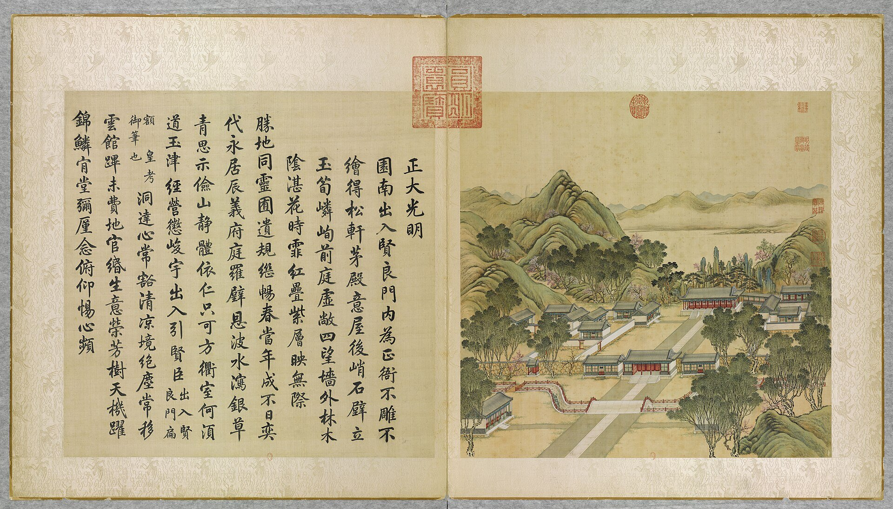

<!-- generated:start (scripts/building_pages.py): do not edit between these markers -->

# YM01-12: 寿山 Shou Shan

Yuanming Yuan

**3D object:** none yet.

**Part of:** YM01 正大光明

## What we know

- **Name:** 寿山 Shou Shan (S05, S02, S42, S01 · confidence B)
- **Garden:** Yuanming Yuan (S05, S02, S42, S01)
- **Type:** other (S05, S02, S42, S01 · confidence B)
- **Destroyed:** 1860 (S05, S02, S42, S01)
- **Position:** 40.00214, 116.29048. S01 likely (S01 · confidence B)
- **Note:** Hill with rockery behind the hall (S02 p.76). S06: 笋石 later moved to the Summer Palace 仁寿殿. (S05, S02, S42, S01)
- **Plan reader's note:** 寿山: no label. Two big rock ridges with a gap on the axis, rect=380,100,0, directly behind 正大光明 | no box: the plan shows a labelled plot, hill or dock here, not a hall (S01) *(research copy, not public)*
- **How it was read:** likely (S01) *(research copy, not public)*
- **Plan pixels:** 3300, 5335 (S01) *(research copy, not public)*

## Our model now

No box in the 3D view: the plan shows no building here, or a plot, water, a hill or a name only.

## Pictures (1)

- **P0001** (likely): 正大光明 Zhengda guangming [Droiture et clarté] (圓明園四十景, 第1景) (1744 (BnF record: 1744年，清朝乾隆九年)). https://commons.wikimedia.org/wiki/File%3A%E5%9C%93%E6%98%8E%E5%9C%92%E5%9B%9B%E5%8D%81%E6%99%AF._%E7%AC%AC%E4%B8%80%E6%99%AF_%28%E4%B8%8A%E5%86%8C%EF%BC%8C%E7%AC%AC%E4%B8%80%E5%B9%85%E5%9B%BE%29%2C_%E6%AD%A3%E5%A4%A7%E5%85%89%E6%98%8E_-_%28%E6%B8%85%29%E5%94%90%E5%B2%B1%E3%80%81%E6%B2%88%E6%BA%90%E5%90%88%E7%95%AB_%3B_%28%E4%B9%BE%E9%9A%86%E5%90%9F%E8%AF%97%EF%BC%8C%E6%B1%AA%E7%94%B1%E6%95%A6%E4%BB%A3%E4%B9%A6%29Zhengda_guangming_-_%28Qing%29Tang_Dai%2C_Shen_Yuan_he_hua_-_btv1b550083229.jpg

  

## Texts and drawings (7)

- **E1000** (text, sure): 日下舊聞考 正大光明. 1780s (乾隆 敕撰) · j80:9a-11a · S05. https://github.com/kanripo/KR2k0036/blob/master/KR2k0036_080.txt
  > 大宫門内為出入賢良門五楹門左右為直房前跨石橋度橋東西朝房各五楹西南為茶膳房再西為繙書房東南為清茶房為軍機處（圓明園冊）臣等謹按出入賢良門額世宗御書是為二宫門凡武職侍衛引見御此門較射左右直房為各部院臣工入直之所東西設兩罩門各衙門奏事由東罩門逓進茶膳房太監人等由西罩門出入門前河形如月中駕石橋三其水自西來東注如意門閘口㑹東園各河而出出入賢良門内為正大光明殿七楹東西配殿各五楹後為壽山殿東為洞明堂（圓明園冊）臣等謹按圓明園四十景中世宗御題四字額者凡十有四正大光明殿其一也餘如牡丹臺今為鏤月開雲蓬萊洲今為蓬島瑶臺乃乾隆九年皇上恭依避暑山莊三十六景四字題額之例更鍚嘉名用昭畫一敬就各條下加按並恭載御製四十景詩至附近各景詩已載御製詩全集者兹不備録又按正大光明殿内聨曰心天之心而宵衣旰食樂民之樂以和性怡情為世宗御書又聨曰遹求寜觀成無逺弗届以對時育物有那其居為皇上御書東壁懸御書周書無逸篇西壁懸豳風圖東為洞明堂世宗御書額
  Through the five-bay 出入賢良門, the second gate with duty rooms and three stone bridges over a moon-shaped canal, are court offices, kitchens, the translation office and the 軍機處 Grand Council. Then 正大光明殿 of seven bays with five-bay side halls, 壽山殿 behind and 洞明堂 to the east. The notes explain the renaming of the fourteen Yongzheng titles under the 1744 four-character scheme, and record the couplets, the 無逸 text on the east wall and the 豳風 picture on the west wall.
- **E1035** (text, sure): 日下舊聞考: 寿山. 1780s (乾隆 敕撰) · j80:11a · S05. https://github.com/kanripo/KR2k0036
  > 屋後峭石壁立玉筍嶙峋
- **E1037** (description, sure): Swinhoe: from the hall to the emperor's rooms. 1860 · pp.296-298 · S241. https://archive.org/details/narrativeofnorth00swin
  > Behind the grand hall was rockery, and in rear of that again a large pond, so that a pebbled path leading over a bridge and taking a semicircular sweep of half the water, had to be traversed before you visited the next hall.
  About 500 yards to a smaller hall with images of Buddha in rooms each side, then another reception hall and a third, and on the left the emperor's own rooms: one moderate room with a double-seated throne, chandelier, clocks; passage to two small rooms and a spiral stair to two upper rooms with books, whose windows look down into the hall; two retiring rooms and the bedroom. The 1858 treaty lay on a table. This fits the axis 圆明园殿, 奉三无私, 九洲清晏; the ids are my reading.
- **E1038** (description, sure): Wolseley: from the hall to the private apartments. 1860 · pp.235-236 · S240. https://archive.org/details/narrativeofwarwi00wols
  > the walk opened out upon a tolerably sized pond, on the further side of which were the private apartments of his Majesty, surrounded by the houses of his many wives, concubines, eunuchs, and servants.
  Walks between high planted mounds behind the hall, stone benches and rock piles, dwarf trees, rustic bridges and steps, then the pond. Wardrobes of silk and fur, jade in chests. Small armed junks on the ponds for shows watched from a tea-house (p.237).
- **E1036** (description, likely): M'Ghee: the water before the imperial apartments. 1860 · pp.204-205 · S242. https://archive.org/details/howwegotintopek01ghegoog
  > and on the opposite side of this miniature lake stood the imperial apartments, entered by none save members of the imperial family.
  From the passage turning left and to the front, a small lake with rockeries, bridged at each end, and the apartments beyond. To the right of the passage courtyards full of stores.
- **E1009** (description, likely): Scene 1, 正大光明 Zhengda Guangming: courts, gate, moat and hall. 1934 · pp.75-76 · S02. https://archive.org/details/historyofpekings00malo
  > This Second Gate of the Palace led into the courtyard where the Main Audience Hall stood on a foundation 129 feet long, 63 feet wide, and 4 feet high, ascended by three sets of stone steps. It was a building of seven chien besides having a porch all around the outside, formed by an outer row of columns supporting the projecting eaves, so that the facade presented a colonnade of ten columns.
  Malone measured the site. Foundation 129 x 63 x 4 ft, three stairs, seven bays plus a surrounding porch, ten columns across the front, round column bases 2 ft 9 in across, floor of veined marble slabs on brick and lime. Plain under Yongzheng in 1725; before the end of Qianlong's reign columns red, capitals with dragons, gilt wire over the entablature. Pines and a rockery hill behind, a covered passage to the east.
- **E1013** (description, sure): 圆明园正大光明初探. post n.d. · lswh or jzys list · S337. http://iqh.ruc.edu.cn/old/qdhjylyjzx/xszl/ylfj/2d97c9a95a8442f7abf5b8e453d02fa3.htm
  The whole front court district, built 1725, 370 x 310 m. 大宫门 and 出入贤良门 are five-bay gate halls with 卷棚歇山 roofs on the garden's south wall line. 正大光明殿: seven bays by three, all-round gallery, single eave, grey tile, high base, 36.45 x 16 m, with a terrace and four incense burners. Stresses its garden-like, less formal planning.

**On the plan:** Drawn on the plan of the gardens (S01) with no label: a building stood here, its name unknown. https://artmuseum.princeton.edu/collections/objects/138657

## Evidence for the set of buildings

- Evidence for the whole compound 正大光明: see YM01
- Reconstructions and comparables for the whole garden, 圆明园 Yuanming Yuan: see GARDEN-YM

## Open questions

- Q17: Halls in the texts and not on the plan
- Q60: Captions and claims, old photographs (Round 5)
- Q126: Commons hits for 'Yuen Ming Yuen' outside the Xiyang Lou are mostly not 圆明园
- Q202: Hills the plan's outlines miss

<!-- generated:end -->

## Notes

<!-- Yours: regeneration never touches this part. It goes on the public site; what you write below a line holding only %% private %% stays in the research copy. -->
