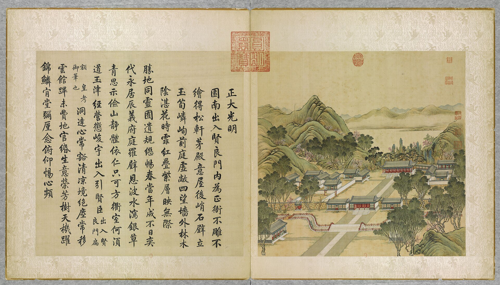
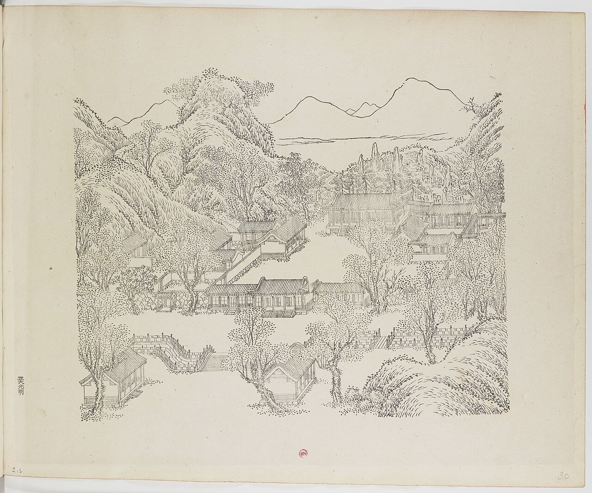
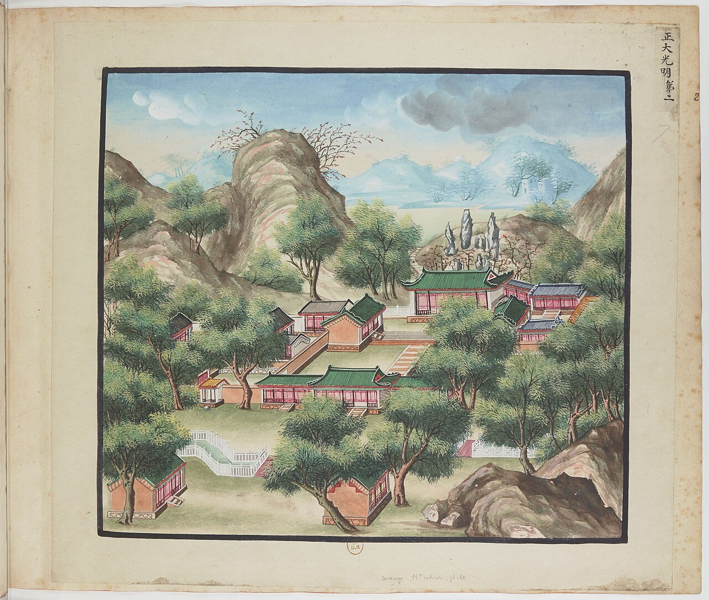
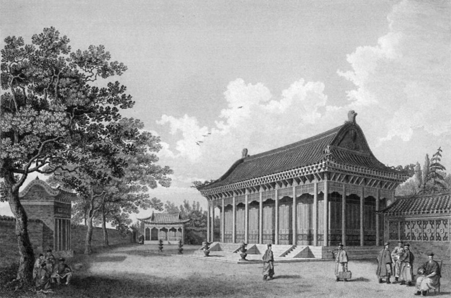
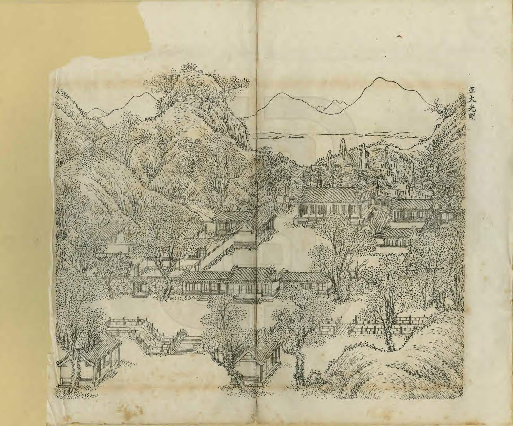
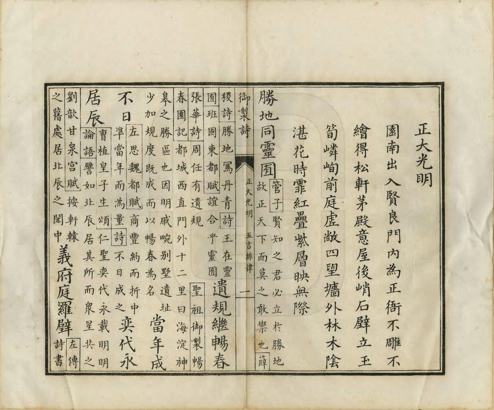
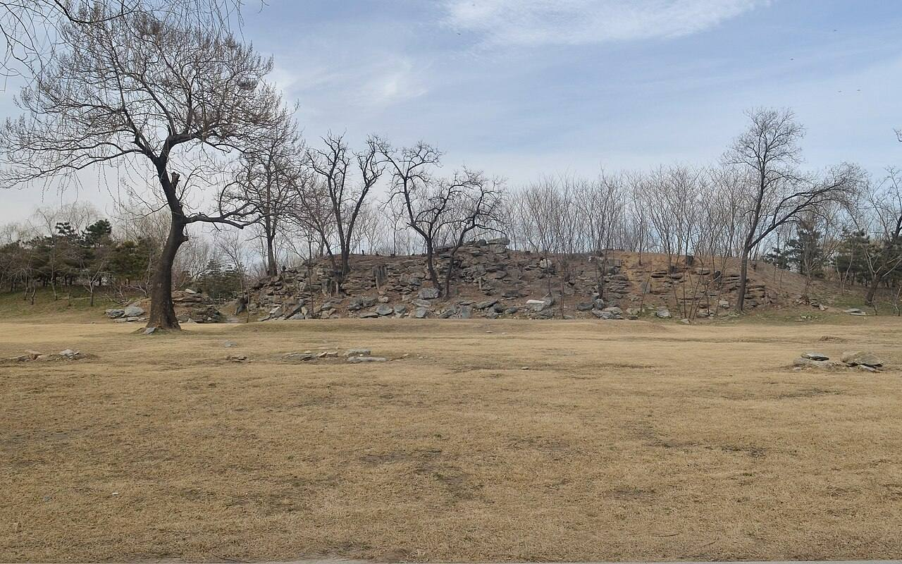
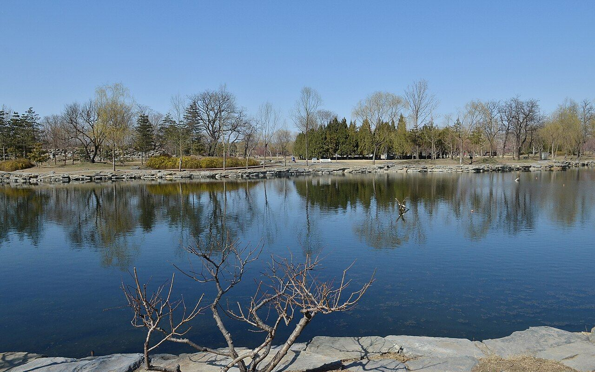
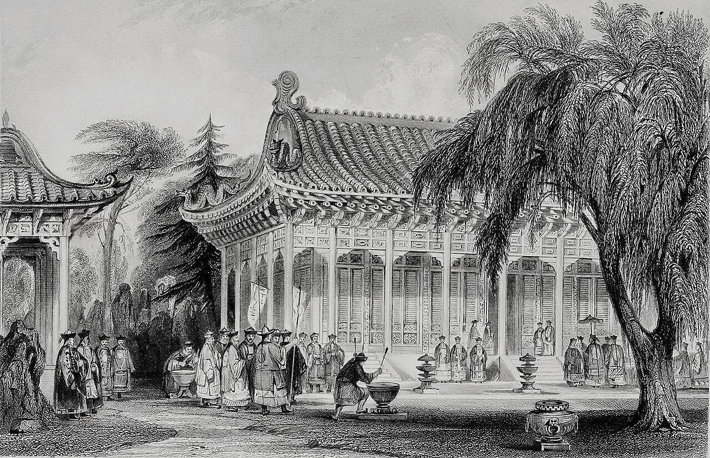

<!-- generated:start (scripts/building_pages.py): do not edit between these markers -->

# YM01: 正大光明 Zhengda Guangming

The Main Audience Hall (Central Great Brilliant Bright) · Yuanming Yuan

**3D object:** 19 boxes. Open it: `/reconstruction/3d.html?b=YM01`

## What we know

- **Name:** 正大光明 Zhengda Guangming (S05, S02, S08, S42, S01 · confidence A)
- **English:** The Main Audience Hall (Central Great Brilliant Bright) (S05, S02, S08, S42, S01)
- **Garden:** Yuanming Yuan (S05, S02, S08, S42, S01)
- **Type:** scene (S05, S02, S08, S42, S01 · confidence A)
- **Built:** 雍正三年 1725 (S02 p.76, S42 正大光明区域) (S05, S02, S08, S42, S01)
- **Destroyed:** 1860 (S05, S02, S08, S42, S01)
- **Position:** 40.00193, 116.29052. S01 sure (S01 · confidence B)
- **Note:** Scene spans 大宫门 (YM41), 二宫门, 正大光明殿, 寿山. S42: 南起大影壁北至寿山 纵长370 m, 东西宽310 m, 建筑面积7000 m2. (S05, S02, S08, S42, S01)
- **Plan reader's note:** Label under B1053. Polygon = main court, 寿山 ridges, forecourt with 配殿 and the moon stream; the outbuilding yards 清茶房 and 膳房 fall in YM41 polygon (S01) *(research copy, not public)*
- **How it was read:** sure (S01) *(research copy, not public)*
- **Plan pixels:** 3305, 5444 (S01) *(research copy, not public)*

## Our model now

19 boxes stand in this compound, 17 on blocks drawn on the plan, 2 assumed. Its halls are listed below.

## Inside it (23)

- YM01-01 出入贤良门
- YM01-02 出入贤良门前石桥
- YM01-03 内朝房
- YM01-04 军机处
- YM01-05 清茶房
- YM01-06 茶膳房
- YM01-07 翻书房
- YM01-08 正大光明殿
- YM01-09 东西配殿
- YM01-10 寿山殿
- YM01-11 洞明堂
- YM01-12 寿山
- YM01-13 前湖
- YM01-B1083
- YM01-B1086
- YM01-B1108
- YM01-B1109
- YM01-B1110
- YM01-B1150
- YM01-B1151
- YM01-B1154
- YM01-B1178
- YM01-B1179

## Pictures (11)

- **P0001** (sure): 正大光明 Zhengda guangming [Droiture et clarté] (圓明園四十景, 第1景) (1744 (BnF record: 1744年，清朝乾隆九年)). https://commons.wikimedia.org/wiki/File%3A%E5%9C%93%E6%98%8E%E5%9C%92%E5%9B%9B%E5%8D%81%E6%99%AF._%E7%AC%AC%E4%B8%80%E6%99%AF_%28%E4%B8%8A%E5%86%8C%EF%BC%8C%E7%AC%AC%E4%B8%80%E5%B9%85%E5%9B%BE%29%2C_%E6%AD%A3%E5%A4%A7%E5%85%89%E6%98%8E_-_%28%E6%B8%85%29%E5%94%90%E5%B2%B1%E3%80%81%E6%B2%88%E6%BA%90%E5%90%88%E7%95%AB_%3B_%28%E4%B9%BE%E9%9A%86%E5%90%9F%E8%AF%97%EF%BC%8C%E6%B1%AA%E7%94%B1%E6%95%A6%E4%BB%A3%E4%B9%A6%29Zhengda_guangming_-_%28Qing%29Tang_Dai%2C_Shen_Yuan_he_hua_-_btv1b550083229.jpg

  

- **P0100** (sure): 中国皇帝的宫殿与庙宇. 第30页, 正大光明 - (清)孙祜、沈源Zhengda guangming - (Qing)Sun Hu, Shen Yuan (1745 (Commons, from the BnF record)). https://commons.wikimedia.org/wiki/File%3A%E4%B8%AD%E5%9B%BD%E7%9A%87%E5%B8%9D%E7%9A%84%E5%AE%AB%E6%AE%BF%E4%B8%8E%E5%BA%99%E5%AE%87._%E7%AC%AC30%E9%A1%B5%2C_%E6%AD%A3%E5%A4%A7%E5%85%89%E6%98%8E_-_%28%E6%B8%85%29%E5%AD%99%E7%A5%9C%E3%80%81%E6%B2%88%E6%BA%90Zhengda_guangming_-_%28Qing%29Sun_Hu%2C_Shen_Yuan_-_btv1b10520658k.jpg

  

- **P0102** (sure): 海淀(镇)：中国皇帝的行宫. 第2幅图, 正大光明Zhengda guangming (1750-1792 (BnF, cb43831905b; ex coll. Bertin)). https://commons.wikimedia.org/wiki/File%3A%E6%B5%B7%E6%B7%80%28%E9%95%87%29%EF%BC%9A%E4%B8%AD%E5%9B%BD%E7%9A%87%E5%B8%9D%E7%9A%84%E8%A1%8C%E5%AE%AB._%E7%AC%AC2%E5%B9%85%E5%9B%BE%2C_%E6%AD%A3%E5%A4%A7%E5%85%89%E6%98%8EZhengda_guangming_-_btv1b105206574.jpg

  

- **P0151** (likely): Palace of the Yuenminyuen (1793 (Commons), as published 1843). https://commons.wikimedia.org/wiki/File%3APalace_of_the_Yuenminyuen-William_Alexander.jpg

  

- **P0284** (sure): 凯宴成功诸将士于正大光明殿 Victory banquet at 正大光明殿, print from 平定回疆得胜图 (10 plates); also an album leaf of 1828-29 shown at Hong Kong (c. 1830 (BM, snippet); plates inscribed 己丑 1829 (Crouch 2019, snippet); leaf 1828-29 (S262)). https://www.britishmuseum.org/collection/object/A_1938-0113-0-1 Research-only: link card.
- **P0232** (sure): 正大光明 Zhengda Guangming (御製圓明園圖詠, 1887 石印本, 上卷 (Commons 卷一), 第1景; printed title in the right margin of the picture) (光緒十三年 1887 (Commons/NLC record; colophon 光緒十三年七月天津石印書屋 in the SSID copy, S98 PDF p.2); design after the woodblock of 1745 by 孫祜 Sun Hu and 沈源 Shen Yuan). https://commons.wikimedia.org/wiki/File%3ANLC403-312001107375-14035_%E7%A6%A6%E5%88%B6%E5%9C%93%E6%98%8E%E5%9C%92%E5%9C%96%E8%A9%A0_%E5%8D%B7%E4%B8%80.pdf?page=23

  

- **P0508** (sure): 正大光明 Zhengda Guangming: 乾隆 Qianlong's preface and poem with the courtiers' commentary, 御製圓明園圖詠 1887 (poem 1744 (乾隆九年); this printing 1887). https://commons.wikimedia.org/wiki/File%3ANLC403-312001107375-14035_%E7%A6%A6%E5%88%B6%E5%9C%93%E6%98%8E%E5%9C%92%E5%9C%96%E8%A9%A0_%E5%8D%B7%E4%B8%80.pdf?page=24

  

- **P0363** (sure): 正大光明 20130318.JPG (2013-03-18 15:13:40 (Commons DateTimeOriginal)). https://commons.wikimedia.org/wiki/File:%E6%AD%A3%E5%A4%A7%E5%85%89%E6%98%8E_20130318.JPG

  

- **P0396** (sure): Yuanmingyuan Front lake of Jiuzhou 20130324.JPG (2013-03-24 14:33:15 (Commons DateTimeOriginal)). https://commons.wikimedia.org/wiki/File:Yuanmingyuan_Front_lake_of_Jiuzhou_20130324.JPG

  

- **P0152** (guess): Palace of Yuen-min-Yuen, Peking (Thomas Allom after William Alexander) (not stated on Commons). https://commons.wikimedia.org/wiki/File%3APalace-yuenminyuen-peking-Thomas_Allom.jpg

  

- **P0789** (guess): 散落在山坡的石构件 - panoramio.jpg (Taken on 27 May 2011 (Commons file page)). https://commons.wikimedia.org/wiki/File:%E6%95%A3%E8%90%BD%E5%9C%A8%E5%B1%B1%E5%9D%A1%E7%9A%84%E7%9F%B3%E6%9E%84%E4%BB%B6_-_panoramio.jpg

## Texts and drawings (44)

- **E0995** (poem, sure): 御製正大光明殿詩（圓明園四十景詩）. 1744 (乾隆九年) · printed in S05 j80:11a-11b · S40. https://github.com/kanripo/KR2k0036/blob/master/KR2k0036_080.txt
  > 乾隆九年 御製正大光明殿詩 園南出入賢良門内為正衙不雕不繪得松軒茅殿意屋後峭石壁立玉筍嶙峋前庭虚敞四望牆外林木隂湛花時霏紅叠紫層暎無際 勝地同靈囿遺規繼暢春當年成不日奕代永居辰義府庭羅璧恩波水㵼銀草青思示儉山靜體依仁只可方衢室何湏道玉津經營懲峻宇出入引賢臣（出入賢良門扁額皇考御筆也）洞逹心常豁清凉境絶塵每移雲館蹕未費地官緡生意榮芳樹天機躍錦鱗肯堂彌厪念俯仰惕心頻
  The formal audience hall, inside 出入賢良門. Qianlong stresses it is uncarved and unpainted, like a pine-and-thatch hall. Tall rock stands behind it, the forecourt is open, and flowering trees beyond the walls fill the view.
- **E0998** (poem, sure): 御製前湖詩. 1763 (乾隆二十八年) · j80:7b-8a · S05. https://github.com/kanripo/KR2k0036/blob/master/KR2k0036_080.txt
  > 乾隆二十八年御製前湖詩　御園之前本無湖而今疏濬胡稱乎石衢之右地下濕邇年遭潦水占諸衢左亦不大高衍徃來車馬愁泥塗因卑為澤事惟半取右益左功倍俱歉嵗受僱兼代賑三冬畚鍤集衆徒役成春水有所受路東濘去誠坦途一舉三得惠不費對敭來者咸歡娛蓋聞王者無私事有事皆應史筆書此非綴景漫修剔什用播告賢與愚
  Explains that no lake originally lay before the gate; low ground west of the road flooded, so in a famine-relief works earth was moved east to raise the road and the hollow became a lake.
- **E0999** (text, sure): 日下舊聞考 正大光明. 1780s (乾隆 敕撰) · j80:7b · S05. https://github.com/kanripo/KR2k0036/blob/master/KR2k0036_080.txt
  > 大宫門前輦道東西皆有湖是為前湖（圓明園冊）臣等謹按前湖西岸有石刻御製前湖詩
  The lake called 前湖 Front Lake lies east and west of the carriage road before the main gate; the compilers record a stone-cut poem on its west bank.
- **E1000** (text, sure): 日下舊聞考 正大光明. 1780s (乾隆 敕撰) · j80:9a-11a · S05. https://github.com/kanripo/KR2k0036/blob/master/KR2k0036_080.txt
  > 大宫門内為出入賢良門五楹門左右為直房前跨石橋度橋東西朝房各五楹西南為茶膳房再西為繙書房東南為清茶房為軍機處（圓明園冊）臣等謹按出入賢良門額世宗御書是為二宫門凡武職侍衛引見御此門較射左右直房為各部院臣工入直之所東西設兩罩門各衙門奏事由東罩門逓進茶膳房太監人等由西罩門出入門前河形如月中駕石橋三其水自西來東注如意門閘口㑹東園各河而出出入賢良門内為正大光明殿七楹東西配殿各五楹後為壽山殿東為洞明堂（圓明園冊）臣等謹按圓明園四十景中世宗御題四字額者凡十有四正大光明殿其一也餘如牡丹臺今為鏤月開雲蓬萊洲今為蓬島瑶臺乃乾隆九年皇上恭依避暑山莊三十六景四字題額之例更鍚嘉名用昭畫一敬就各條下加按並恭載御製四十景詩至附近各景詩已載御製詩全集者兹不備録又按正大光明殿内聨曰心天之心而宵衣旰食樂民之樂以和性怡情為世宗御書又聨曰遹求寜觀成無逺弗届以對時育物有那其居為皇上御書東壁懸御書周書無逸篇西壁懸豳風圖東為洞明堂世宗御書額
  Through the five-bay 出入賢良門, the second gate with duty rooms and three stone bridges over a moon-shaped canal, are court offices, kitchens, the translation office and the 軍機處 Grand Council. Then 正大光明殿 of seven bays with five-bay side halls, 壽山殿 behind and 洞明堂 to the east. The notes explain the renaming of the fourteen Yongzheng titles under the 1744 four-character scheme, and record the couplets, the 無逸 text on the east wall and the 豳風 picture on the west wall.
- **E2443** (text, sure): 竹葉亭雜記: the bow-backed bridge before 出入賢良門 levelled in 己亥 (1839). early 19th c., on 1839 · 卷一, line 35 of the corpus file · S211. https://github.com/garychowcmu/daizhigev20/blob/master/史藏/志存记录/竹叶亭杂记.txt
  > 贤良门外有河，河有桥，式如弓背。上看箭，鹄设于桥西河边，射者立桥北，北向而射。每发矢，上右顾以视其中否。岁己亥将桥拆平，鹄于桥南对上设焉；射者立桥北，面向西而射，以免上右顾之烦也。谈风水者谓此桥架河上如弓之有靶，今拆平则弓去靶矣，恐武不振。明年有英夷之扰，其果以是欤？
  Outside 出入贤良门 a canal with a bridge shaped like a bow's back. For archery the target stood on the west bank of the bridge and the archers north of it shooting north, so the emperor had to turn right to watch. In 己亥 (1839) the bridge was taken down to flat, the target set south of the bridge facing the emperor and the archers shooting west. Geomancers said the bow had lost its target and feared for the army: the British war came the next year.
- **E0433** (text, sure): 徐樹鈞 圓明園詞序. 1871 (同治十年立秋), recording a visit of 四月十日 · preface, whole · S203. https://www.douban.com/group/topic/46378693/
  > 圆明园在京城西，出平则门三十里，畅春园北里许，世宗皇帝藩邸赐园也。圣祖常游豫西郊，次于丹棱沜，乐其川原，因明武清侯李伟清华园旧址，筑畅春园，藩邸赐园，故在其旁。雍正三年，乃大宫殿朝署之规以避暑听政，前临西山，环以西湖。湖水发源玉泉山，曰瓮山，度宫墙东流入清河，《水经注》所谓“蓟县西湖，绿水澄澹，燕之旧池”者也。东流为洗马沟，东南合高梁之水，故鱼稻饶衍，陂泉交绮。高宗皇帝嗣位，海宇殷阗，八方无事，每岁缔构，专饰园居。大驾南巡，流览湖山风景之胜，图画以归，若海宁安澜园、江宁瞻园、钱塘小有天园、吴县狮子林，皆仿其制，增制园中。列景四十，以四字题匾者为一胜区，一区之内，斋馆无数。复东拓长春，西辟清漪，离宫别馆，月榭风亭，属之西山，所费不计亿万。园地多明权珰别业，或传崇祯末，诸奄皆以珍宝窟宅于兹，乾隆间浚池，发金银数百万，时国运方兴，地不爱宝，上心悦豫，殚精构造，曲尽游观之妙，元明以来，未之闻也。每岁夏幸园中，冬初还宫，内廷大臣，赐第相望，文武侍从，并直园林，入直奏对，昕夕往来，络绎道路，历雍乾嘉道，百余年于兹矣。文宗初，粤寇踞金陵，盗贼蜂起，上初即位，求直言，得胜保、曾国藩、袁甲三三臣，既以塞 、程、徐、陆，先朝重望，相继倾覆，始擢用前言事者，各畀重任，三臣支柱，贼不犯畿。然迭胜迭败，东南数省，蹂躏无完土，上悯苍生之颠沛，慨左右之无人。九年冬，郊宿于斋宫，夜分痛哭，侍臣凄恻。大考翰詹，以宣室前席发题，忧心焦思，伤于祸乱，然后稍自抑解，寄于文酒。以宫中行止有节，尤喜园居，冬至入宫，初正即出。时园中传有四春之宠，皆汉女，分居亭馆，所谓杏花春、武陵春、牡丹春、海棠春者也。然上明于料兵，委权阃外，超次用人，海内称哲。而部寺诸臣，无所磨励，颇袭旧敝。晚得肃顺，敢言自任，故委以谋议。先是道光二十年，英吉利夷船，至广东香港，求通商不得，又以烧烟起衅，执政议和，予海关税银千八百万。英夷请立约，广督耆英，与期十年。届期而徐广缙督两广，夷使至广州，拒不许入，以受封爵，夷酋恨焉，志入广州。咸丰元 [ 九 ] 年，英吉利、法兰西、美利坚各国，乘粤寇鸱张，中国多故，复以轮舶直入大沽台。王僧格林沁，托团练之名，焚其二船，尽击走之。夷人知大皇帝无意于战，特臣民之私愤，乃潜至海岸，买马数千，募群盗为军，半年而成，再犯天津，称西洋马队，闻者恐栗，夷马步登岸，我未陈而敌骑长驱矣。十年六 [ 八 ] 月十六日，上方园居，闻夷骑至通州，仓卒率后嫔幸热河，道路初无供帐，途出密云，御食豆乳麦粥而已。十七日，英夷帅叩东便门，或有闭城者，闻炮而开，王公请和，和议将定。十九日，夷人至圆明园宫门，管园大臣文丰当门说止之，夷兵已去。文都统知奸民将起，环问守卫禁兵，无一在者，乃自索马还内，投福海死。奸人乘时纵火，入宫劫掠，夷人从之，各园皆火发，三昼夜不熄，非独我无官府诘问，夷帅亦不能知也。初英夷使臣巴夏里，已拘刑部，和议成，以礼释囚。于是巴夏里与英帅，各陈兵仗至礼部，订约五十七条，予以海关税银三千六百万，而夷人抵偿圆明园银二十万。王公奏言，未敢斥夷，文丰与主事惠丰，同死于园，不称殉节，但言遭兵燹而已。十一年七月，文宗晏驾热河，今上即位，奉两宫皇太后还京，垂帘十载，巨寇削平。而夷人通商江海，往来贸易，设通商王大臣，以接夷使。然常言：“某省士民毁天主教堂，某省不行其教，某省民教构衅。”日以难我，应之不暇，盖岌岌乎华夷杂处，又忽忽十有一年。园居荒墟，鞠为茂草，西山大寺，夷妇深居，予旅京师，恻然不敢过也。同治十年春，同年王壬父重至辇下，追话旧游，张子雨珊亦以计偕来，约访故宫，因驻守参将廖承恩许为道主。四月十日，命仆马同过绣漪桥，寻清漪园遗迹，颓垣断瓦，零乱榛芜，宫树苍苍，水鸣呜咽。由辇路登廓如亭，南望万寿山，但见牧童樵子，往来林莽间。暮从昆明湖归，桥上铜犀卧荆棘中，犀背御铭，琅然可诵。明日访守园者，得董监，自言：“年七十有余，自道光初入寺园中，今秩五品，居福园门旁。”导予等从瓦砾中，循出入贤良门而北，指勤政、光明、寿山、太和四殿遗址，前湖圆明寝殿五楹，后为奉三无私殿、九州清晏殿各七楹，坏壁犹立，拾级可寻。董监言：“东为天地一家春，后居也，西为乐安和，诸妃嫔贵人居也，洞天深处，皇子居也。清辉殿为文宗重建，与五福堂、镂月开云台、朗吟阁皆不可复识。”镂月开云者，即所谓牡丹春者也。世宗为皇子时，迎圣祖至赐园，而高宗年十二，以皇孙召侍左右，三天子福寿冠前古，集于一堂，高宗后制诗，尝夸乐之。经其废基，裴回惄焉。东渡湖，为苏堤、长春仙馆、藻园，又北为月地云居、舍卫城、日天琳宇、水木明瑟、濂溪乐处，仅约略指视所在。东北至香雪廊，阶前茅荻萧萧，废池可辩，有老监奉茶自石畔出，讶客所从来，颇似桃源人逢渔郎也。渡桥循福海西行，为平湖秋月，水光溶溶，一泻千顷。望蓬岛瑶台，岛上殿宇，犹存数楹，惜无方舟不达。其下流水潺湲，激石成响，董监示予：“此管园大臣文公死所也。”西北至双鹤斋，又西过规月桥，登绮吟堂，经采芝径，折而东，仍出双鹤斋。园中残毁几遍，独存此为劫灰之余，乱草侵阶，窗棂宛在，尤动人禾黍悲耳。双鹤斋西，为溪月松风，翠柏苍藤，沿流覆道，斜日在林，有老宫人驱羊豕下来。东过碧桐书院，地跨池上，东为金鳌，西为玉蝀，坊楔犹存。又东去，皆败坏难寻，遂不复往。莫色沈沈，栖乌乱飞，揖董监，出福园门，还于廖宅。廖，沣州人，字枫亭，少从塞尚阿、僧格林沁军，亦能言行间事，感予来游，颇尽宾主之欢。既夕言归，则礼部放榜日也。雨珊既落第南去，予与壬父每相过从，念言园游，辄惘惘不自得。壬父又曰：“园之盛时，纯皇勒记，必殷殷踵事之戒，然仁宗始罢南幸，宣宗尤忧国贫，秋狝之礼，辍而不举。惟夫张弛之道宜及，嘉道时，补纯皇倦勤之功，而内外大臣，惟务慎节，监司宽厚，牧令昏庸，讳盗容奸，以为安静。八卦妖徒，连兵十载，无生天主，教目滋繁，由游民轻法，刑废不用故也。江淮行宫，既皆斥卖，国之所患，岂在乏财。”又曰：“燕地经安史戎马之迹，爰及辽金，近沙漠之风矣。明太宗以燕王旧居，不务改宅，仍而至今，地利竭矣。又园居单外，非所以驻万乘，废而不居，盖亦时宜。” 予曰：“然，前年御史德泰，请按户亩鳞次捐输，复修园宫。大臣以侈端将启，请旨切责，谪戍未行，愤悔自死。自此莫敢言园居者。而比年备办大婚，费已千万，结彩宫门，至十余万，公奏朝廷动用钱粮，婚以成礼，岂在华饰，若前明户部司官得以谏争，予且建言矣。又予闻慈安太后在文宗时，有脱簪之谏，《关雎》《车舝》之贤，中兴之由也。又园宫未焚前一岁，妖言传上坐寝殿，见白须老翁，自称园神，请辞而去，上梦中加神二品阶，明日，至祠谕祀之，未一期而园毁，岂能定欤？子能诗者，达于政事，曷以风人之意，备《繁霜》《云汉》之采？”于是壬父为《圆明园词》一篇。而周学士（即大学士周祖培）、潘侍郎见之，并叹其伤心感人，笔墨通于情性。予以此诗可传后来，虑夫代远年逝，传闻失实，词中所述，罔有征者，乃为文以序之。同治十年立秋日，长沙徐树钧撰。
  A walk through the ruins eleven years after the destruction, guided by an old eunuch who had served since the 1820s. It says which sites could still be read, and that 雙鶴齋 with its surroundings alone stood, as did some rooms on 蓬島瑶臺 and the 金鼇 and 玉蝀 arches. Its account of 1860 credits the first fires to local robbers, which differs from the British and French record in S02.
- **E1022** (text, sure): 養吉齋叢錄 卷九. mid-19th c. (printed 1890s), on earlier reigns · 卷九, line 583 of the corpus file · S202. https://raw.githubusercontent.com/garychowcmu/daizhigev20/master/%E5%8F%B2%E8%97%8F/%E5%BF%97%E5%AD%98%E8%AE%B0%E5%BD%95/%E5%85%BB%E5%90%89%E6%96%8B%E4%B8%9B%E5%BD%95.txt
  > 宗室乡、会试，中式后在正大光明殿覆试，自嘉庆十九年始。其试用一文一诗。
  From 嘉慶十九年 (1814) clansmen's examinations were re-checked in 正大光明殿.
- **E1023** (text, sure): 養吉齋叢錄 卷九. mid-19th c. (printed 1890s), on earlier reigns · 卷九, line 584 of the corpus file · S202. https://raw.githubusercontent.com/garychowcmu/daizhigev20/master/%E5%8F%B2%E8%97%8F/%E5%BF%97%E5%AD%98%E8%AE%B0%E5%BD%95/%E5%85%BB%E5%90%89%E6%96%8B%E4%B8%9B%E5%BD%95.txt
  > 新进士向在干清官覆试。嘉庆六年后，改于保和殿。道光二十四年后，皆在圆明园正大光明殿，惟三十年在保和殿覆试，以圣驾在宫中也。咸丰辛亥[一]后，皆在保和殿。
  Palace re-examination of new graduates was held in 正大光明殿 from 道光二十四年 (1844), and moved to 保和殿 in 咸豐辛亥 (1851). A dated use in the later reign.
- **E1024** (text, sure): 養吉齋叢錄 卷十. mid-19th c. (printed 1890s), on earlier reigns · 卷十, line 617 of the corpus file · S202. https://raw.githubusercontent.com/garychowcmu/daizhigev20/master/%E5%8F%B2%E8%97%8F/%E5%BF%97%E5%AD%98%E8%AE%B0%E5%BD%95/%E5%85%BB%E5%90%89%E6%96%8B%E4%B8%9B%E5%BD%95.txt
  > 圣祖驻跸阳春园时，则于隋车居散馆。世宗驻跸圆明园，则于吏部朝房散馆。至高宗时，命于正大光明殿散馆。今则在保和殿矣。圣祖于散馆时，每先引见。近时则大臣阅卷进呈，亲定等第，越日 [一]「吴拔」原误作「吴鼐」 ,据初稿本改。
  Hanlin leaving examinations: at the 吏部 office in the garden under Yongzheng and in 正大光明殿 under Qianlong.
- **E1034** (text, sure): 養吉齋叢錄 卷六. mid-19th c. (printed 1890s), on earlier reigns · 卷六, line 350 of the corpus file · S202. https://raw.githubusercontent.com/garychowcmu/daizhigev20/master/%E5%8F%B2%E8%97%8F/%E5%BF%97%E5%AD%98%E8%AE%B0%E5%BD%95/%E5%85%BB%E5%90%89%E6%96%8B%E4%B8%9B%E5%BD%95.txt
  > 按：曩时勾到之地，宫内在懋勤殿，圆明园在洞明堂，香山在勤政殿后、致远斋之东、正直和平楼下，避暑山庄在依清旷。国有大庆则停勾。康熙二十三年，以岁逢甲子停勾。乾隆九年、嘉庆九年，亦以甲子停勾。此开甲之初，特施霈泽也。
  Capital sentences were reviewed in 洞明堂 when the court was in the garden.
- **E2444** (text, sure): 養吉齋叢錄 卷四: the Grand Council office in the garden, inside 如意門 south of the canal. author active to 1860s · 卷四, lines 243-244 of the corpus file · S202. https://raw.githubusercontent.com/garychowcmu/daizhigev20/master/%E5%8F%B2%E8%97%8F/%E5%BF%97%E5%AD%98%E8%AE%B0%E5%BD%95/%E5%85%BB%E5%90%89%E6%96%8B%E4%B8%9B%E5%BD%95.txt
  > 圆明园则如意门内，御河之南，为军机堂。堂之右，为满章京直房，其前为汉章京直房。 ... 在园则由如意门入。
  In the garden the Grand Council hall 军机堂 stood inside the 如意门, south of the palace canal; the Manchu secretaries' room to its right, the Han secretaries' room in front of it. Council members entered by the 如意门.
- **E1021** (text, likely): 養吉齋叢錄 卷四. mid-19th c. (printed 1890s), on earlier reigns · 卷四, line 250 of the corpus file · S202. https://raw.githubusercontent.com/garychowcmu/daizhigev20/master/%E5%8F%B2%E8%97%8F/%E5%BF%97%E5%AD%98%E8%AE%B0%E5%BD%95/%E5%85%BB%E5%90%89%E6%96%8B%E4%B8%9B%E5%BD%95.txt
  > 圆明园章京直庐，一在挂甲屯，一在冰窖。
  Grand Council secretaries of the garden had two lodgings outside it, at 掛甲屯 and 冰窖.
- **E0994** (poem, sure): 正大光明: 乾隆八年 poem of the Qianlong Emperor. 乾隆八年 (1743), date from the compilation · p.29 item (10), under 正大光明 · S360. https://www.yuanmingyuanpark.cn/xs/yjbg/202007/P020200730387572832602.pdf#page=29
  > 筲三簸用精，圆融如意粒。甜滑自然秔，体借蟾蜍魄。竒传沆瀣英，常留春日意。恰称令宵名，的的星丸皎。
  Poem of the Qianlong Emperor at 正大光明, 1743, on banquets. Year as given by the compilation.
- **E0996** (poem, sure): 正大光明: 乾隆十三年 poem of the Qianlong Emperor. 乾隆十三年 (1748), date from the compilation · p.31 item (25), under 正大光明 · S360. https://www.yuanmingyuanpark.cn/xs/yjbg/202007/P020200730387572832602.pdf#page=31
  > 青韶琼苑景，嫩日拂庐晨（每宴外藩武备院设武帐示优渥之意）。我有来朝客，群称守土臣。雕筵湑湛露，令节启光春。既许欢心洽，还遵礼数彬。鹓班陪济济，鹭羽乐振振。内外需和会，宗功逮后人。
  Poem of the Qianlong Emperor at 正大光明, 1748, on banquets. Year as given by the compilation.
- **E0997** (poem, sure): 正大光明: 乾隆十三年 poem of the Qianlong Emperor. 乾隆十三年 (1748), date from the compilation · p.32 item (28), under 正大光明 · S360. https://www.yuanmingyuanpark.cn/xs/yjbg/202007/P020200730387572832602.pdf#page=32
  > 载阳迟景荡晴空，雪色冰纹暖渐融。依旧东风来上苑，偶因佳节忆琳宫（燕九始于邱处机，都下长春宫至今为胜会焉）。流风遗俗追寻处，去岁今年想象中。只有烟花还恋赏，晩来强作耐时红（都下灯火自上元至燕九为盛，过此则皆收矣） 。
  Poem of the Qianlong Emperor at 正大光明, 1748, on the view and lanterns and fireworks. Year as given by the compilation.
- **E1019** (poem, sure): 出入贤良门前射布靶三弟获中四支诗以志贺（233）. 乾隆五十三年 (1788) · v4 p.405, under 春熙院 · S361. https://www.yuanmingyuanpark.cn/xs/yjbg/202008/P020200803382796786124.pdf#page=408
  > 四鍭叠中技超然，校射承欢禁籞前。早是精娴邀宠渥，都缘审固用工专。高标有裕欣连袂，同学无能媿比肩。自此更应增勉励，莫教一篑少攻研。
  Poem 出入贤良门前射布靶三弟获中四支诗以志贺（233） by the Qianlong Emperor, 1788, filed by the editors under 春熙院.
- **E1003** (description, sure): Barrow: lodging near the hall, and how little he saw. 1793 · pp.108, 122 · S251. https://archive.org/details/b22012928
  > Even in the short distance between the hall of audience and our lodgings, which might be about three hundred paces, we were continually watched.
  Lodging about 200 yards from the hall, with bare walls. Claims the grounds reach ten English miles across, or sixty thousand acres, partly waste and woodland; far above the plan.
- **E1026** (description, sure): Barrow: 正大光明殿 described and measured. 1793 · pp.124-125 · S251. https://archive.org/details/b22012928
  > The length of this room within was one hundred and ten feet, breadth forty-two, and height twenty feet: the ceiling painted with circles, squares, and polygons, whimsically disposed, and loaded with a great variety of colours. The floor was paved with grey marble flag stones laid chequer-wise.
  Granite platform about 4 ft high. Two rows of wooden columns; brick to about 4 ft between the inner ones, oiled-paper lattice above, opening entirely on public occasions. No capitals. Painted frieze in blue, red, green and gilt under wire netting against birds. Red-painted pillars at the throne recess, throne carved of wood like mahogany. Furniture: brass kettle drums, two large paintings, two pairs of blue vases, an old Clarke clock. A fine brick wall round the flower garden.
- **E1005** (description, sure): Varin: second and third throne halls. 1860 · pp.234-235 · S245. https://archive.org/details/expditiondechin00paulgoog
  > On arriva, ensuite, devant un lac artificiel entouré de rochers et de montagnes rapportés, lequel était côtoyé par une route sablée ; on traversa un pont jeté sur le canal d'alimentation de ce lac, et on se retrouva dans une troisième salle du trône,
  A second, smaller and more elegant throne hall behind the first, then the lake and the third. Behind it salons; on the right the store of furs and robes, ahead the emperor's rooms, on the left the empress's. Varin's second hall lies before the lake, unlike Swinhoe's sequence.
- **E1028** (description, sure): M'Ghee: burning of the audience hall, 19 October. 1860 · p.288 · S242. https://archive.org/details/howwegotintopek01ghegoog
  > and all that now remained was the Hall of Audience already described, and the lodges and buildings between that and the grand entrance ; they were spared to the last, as in them the troops had been quartered.
  60th Rifles and the Punjabis had burned far and wide. About three o'clock the hall was set alight, the roof fell in, then the gate and lodges. Pages 285-287 describe a palace among hills eight or nine miles off, also burned: outside this project, probably 静宜园.
- **E1033** (description, sure): Wolseley: 正大光明殿 outside. 1860 · pp.232-233 · S240. https://archive.org/details/narrativeofwarwi00wols
  > A neatly finished wire network was stretched along under the wood carvings of the roof eaves
  Long flagged court, the hall at the far side, carving, gilding and paint fresh, tile in perfect order. Same wire net as Barrow, Malone and Swinhoe report.
- **E2104** (description, sure): M'Ghee: the two courts. 1860 · p.203 · S242. https://archive.org/details/howwegotintopek01ghegoog
  > Inside the first entrance-gate there is a large, flagged courtyard, some hundred yards wide by eighty deep ; at each side, both within and without, are guard-rooms.
  Causeway through a sheet of water to the outer gate. A second gate of the same form, then a second court about the same size with the hall on its far side.
- **E2106** (description, sure): Varin: the night reconnaissance through the courts. 1860 · pp.227-228 · S245. https://archive.org/details/expditiondechin00paulgoog
  > et on s'engagea dans une cour immense traversée dans sa dernière partie par un canal revêtu en marbre blanc, et couvert d'un pont, également en marbre, soutenant deux galeries latérales en bois.
  A large space with trees and a lake on one side and the palace on the other, a bare esplanade with regular side buildings, chevaux-de-frise at the entry. Centre gate barred, side doors used. Second enclosure, then a big court crossed by the marble-lined canal and bridge with two wooden galleries. Third enclosure with a wall about 4 m high and two small side doors.
- **E1006** (description, sure): Barrow in the garden, 1793 (quoted by Malone). 1934 · pp.163-165 · S02. https://archive.org/details/historyofpekings00malo
  > The very dwelling of the Emperor and the grand hall in which he gives audience, when divested of the gilding and the gaudy colors with which they are daubed, are little superior and much less solid, than the barns of a substantial English farmer.
  Barrow, lodged about 200 yards from the hall and closely watched, saw only the part near it. Surface compared to Richmond Park, with canals and lakes, irregular banks and rock headlands. He heard of thirty residences. The presents stood before the throne. The birthday ceremony of 17 September with cups of tea, oil and rice on three tripods (Barrow p.116).
- **E1007** (description, sure): Later uses of the Main Audience Hall: Dutch embassy 1795, camp in 1860. 1934 · p.77 · S02. https://archive.org/details/historyofpekings00malo
  > Apparently this hall was also used as camp by the British soldiers who burned the Yuan Ming Yuan in 1860 and was the last place to which they set fire.
  Dutch embassy ceremony of 3 February 1795 (Van Braam). British troops camped at the hall in 1860 and burned it last (M'Ghee pp.283-89, cited by Malone). Malone also reports that Gordon bought an imperial throne, not proven to be from this hall.
- **E1008** (description, sure): Macartney on the Presence Chamber, 1793 (quoted by Malone from Robbins). 1934 · p.76 · S02. https://archive.org/details/historyofpekings00malo
  > It is one hundred and fifty feet long and sixty feet wide; there are windows on one side only, and opposite to them is the Imperial Throne of carved mahogany, the logs of which were brought from England, and elevated by a few steps from the floor.
  Macartney's journal for 1793 as quoted by Malone: hall 150 x 60 ft (his estimate), windows on one side, throne facing them, chequered grey and white marble floor with mats, a musical clock by George Clarke of Leadenhall Street. Chosen for setting up the presents. Malone's n.24: the wood was probably Chinese redwood, not English. Note 22: Staunton puts the inside height above 20 ft.
- **E1009** (description, sure): Scene 1, 正大光明 Zhengda Guangming: courts, gate, moat and hall. 1934 · pp.75-76 · S02. https://archive.org/details/historyofpekings00malo
  > This Second Gate of the Palace led into the courtyard where the Main Audience Hall stood on a foundation 129 feet long, 63 feet wide, and 4 feet high, ascended by three sets of stone steps. It was a building of seven chien besides having a porch all around the outside, formed by an outer row of columns supporting the projecting eaves, so that the facade presented a colonnade of ten columns.
  Malone measured the site. Foundation 129 x 63 x 4 ft, three stairs, seven bays plus a surrounding porch, ten columns across the front, round column bases 2 ft 9 in across, floor of veined marble slabs on brick and lime. Plain under Yongzheng in 1725; before the end of Qianlong's reign columns red, capitals with dragons, gilt wire over the entablature. Pines and a rockery hill behind, a covered passage to the east.
- **E2111** (description, sure): 7 October 1860: entry, the audience hall and the emperor's rooms. 1934 · pp.180-181 · S02. https://archive.org/details/historyofpekings00malo
  > We entered the central gateway upon a large paved courtyard, whereon the bodies of two Chinese officials were lying dead.
  Swinhoe, with Montauban at the entry of 7 October (n.17 identifies the dead as the eunuchs of the night before). Through the audience hall to the emperor's bedroom, the English treaty of 1858 on a table; looting began with officers. Foley saw the rooms at 6 and at 11:30 a.m. and the collections much reduced.
- **E2113** (description, sure): Grant's first view, 7 October 1860. 1934 · pp.182-183 · S02. https://archive.org/details/historyofpekings00malo
  > We passed the park walls by a fine old stately gateway, and proceeding up an avenue, came to a range of handsome dwellings roofed over with yellow tiles, turned up at the ends, Chinese fashion.
  Grant: forty small palaces in the grounds, paths in order, ornamental water, the French camped at the entrance of the Great Audience Hall. Main palace held jade, jars, enamels, bronzes, clocks; in a building near it two howitzers from Woolwich given by Macartney. 8 October: gold and silver found in one of the temples and a room of silks and furs, shared between the armies.
- **E1002** (description, likely): Attiret: the emperor's residence. 1743 · [pp.21-23] · S157. https://faculty.bard.edu/~louis/gardens/attiretaccount.html
  > This Palace for the usual Residence of the Emperor is just within the grand Gate of the Pleasure-ground. First are the Ante-chambers; then, the Halls for Audience: and then, the Courts, and Gardens belonging to them. The Whole forms an Island; which is entirely surrounded by a large and deep Canal.
  As big as the town of Dole. Audience halls, then courts and gardens, on an island within a deep canal. S02 p.136 n. takes the description of the rooms to mean scene 3.
- **E2448** (description, likely): Attiret (French original): the emperor's residence is an island. 1743, printed 1749 · pp.21-22 (OCR running heads) · S911. https://archive.org/details/lettresdifiant27pari
  > Ce logement ordinaire de l'Empereur, est immédiatement après les portes d'entrée, les premières salles, les salles d'audience, les cours & leurs jardins. Il forme une isle. Il est entouré de tous les côtés par un large & profond canal. On pourroit l'appeller un Sérail.
  French text behind E1002: the residence lies right after the entrance gates, first halls, audience halls and courts; it forms an island ringed by a wide deep canal, and holds the finest furniture, lacquer, porcelain and silks. Attiret compares the whole quarter of the women and eunuchs to the town of Dole.
- **E0470** (description, likely): Grant: first view of the gardens, 7 October. 1860 · pp.127-130 · S243. https://archive.org/details/incidentsinchina00granrich
  > In different parts of the grounds were 40 separate small palaces, in beautiful situations.
  Grant's journal, as also quoted in S02 p.182.
- **E1004** (description, guess): Six paintings, IV: an entrance compound, probably 正大光明. before 1799 · pp.202-203, Tableau IV · S258. https://archive.org/details/BIUSante_40644
  > On distingue l'entrée principale, précédée de deux pavillons, probablement destinés aux gardiens de cette entrée.
  A bridge over a walled canal to a range with two wings, a large paved court, the main isolated block joined by two galleries to side pavilions, side courts. Fits the audience compounds; 正大光明 or 勤政亲贤 unproven.
- **E1011** (description, sure): Site status table, about 2011: nothing visible, or built over. c. 2011 · 系列06 repost, status table · S356. https://blog.sina.com.cn/s/blog_c27029650101itzz.html
  Same table. In it the first group shows no visible remains; 得全阁, 流香渚, 凤麟洲, 涵秋馆, 蔚藻堂, 中和堂, 敷春堂 and 心镜轩 have service buildings on them, and 含晖楼, 澄心堂, 延寿寺, 清夏堂 and 喜雨山房 are occupied by other institutions. 澹泊宁静 and several others have been dug since, so this is out of date for them.
- **E1012** (description, sure): 圆明园中的正大光明殿 (单志刚). 2022 · lswh · S106. http://iqh.ruc.edu.cn/old/qdhjylyjzx/xszl/lswh/7dca16cf3b144adc892b1d0b14d24e60.htm
  Traces the phrase to 朱熹 and notes four such plaques in Qing palaces, this one by Yongzheng. Reads the layout from the 1744 album: stepped galleries east of the hall, 寿山 behind; it says 日下旧闻考's 寿山殿 is an error.
- **E1013** (description, sure): 圆明园正大光明初探. post n.d. · lswh or jzys list · S337. http://iqh.ruc.edu.cn/old/qdhjylyjzx/xszl/ylfj/2d97c9a95a8442f7abf5b8e453d02fa3.htm
  The whole front court district, built 1725, 370 x 310 m. 大宫门 and 出入贤良门 are five-bay gate halls with 卷棚歇山 roofs on the garden's south wall line. 正大光明殿: seven bays by three, all-round gallery, single eave, grey tile, high base, 36.45 x 16 m, with a terrace and four incense burners. Stresses its garden-like, less formal planning.
- **E1014** (description, sure): 论清代圆明园军机处 (何瑜). post n.d. · lswh · S337. http://iqh.ruc.edu.cn/old/qdhjylyjzx/xszl/ylfj/52b1d18668d840f9903e03787c125492.htm
  何瑜 reviews the rival dates for the founding of the Grand Council and argues it began in spring 1729 and, by location, in 圆明园 itself, for the western campaign.
- **E2117** (description, likely): 圆明园大宫门区历史文脉调查研究. 2016-09 to 2017-02, posted 2020-08-03 · 圆明园官网 yjbg t20200803_4417131 · S338. https://www.yuanmingyuanpark.cn/xs/yjbg/202008/t20200803_4417131.html
  Park study of about 2 km2 south of the garden wall: 挂甲屯, 西马厂, the 八旗 drill ground and princes' gardens that served the court, their fall after 1860. Abstract on the page, the full text is an attachment.
- **E0512** (description, likely): 朱强, 圆明园核心功能景区的园林化特征试析, 圆明园研究 (issue page dated 2026-02-03). 2026-02-03 · xs/ktsb/202602/t20260203_4804592; abstract read · S338. https://www.yuanmingyuanpark.cn/xs/ktsb/202602/t20260203_4804592.html
  Reconstructs the five core functions of the main garden (outer court, government, residence, ritual, military display) and reads each area's garden design against comparable sites. Only the abstract was read; the scene ties are my reading of those five functions.
- **E1001** (description, sure): 圆明园百景史事分景汇编: 正大光明. 1727-1860 · from p.27, under 正大光明 · S360. https://www.yuanmingyuanpark.cn/xs/yjbg/202007/P020200730387572832602.pdf#page=27
  The main audience hall: New Year banquets for Mongol and other princes, examinations of officials, weddings of princesses and birthday rites, with the Macartney gifts recorded in 1793 and the last banquet in the first month of 1860. 正大光明: 447 dated items, 1727-1860, of which 215 poems and 232 court records (Yongzheng, Qianlong, Jiaqing, Daoguang, Xianfeng); recurring themes: banquets, lanterns and fireworks, state papers. First dated 1727, last dated 1860.
- **E1010** (description, sure, search index only): Droiture et Clarté, Che Bing Chiu. 1999 · Studies in the History of Gardens 19, 364-375 · S346. https://faculty.bard.edu/~louis/gardens/bibliochinaalpha.htm
  Article on the 正大光明 scene; the same author's 2000 book covers the whole garden. Citation only.
- **E1015** (drawing, sure): 《国家图书馆藏样式雷图档·圆明园卷初编》: 正大光明. mostly 道光, 咸丰, 同治 per the publisher · 初编 目录: 正大光明, pp.13-31 · S13. https://www.nlcpress.com/ProductView.aspx?Id=7642
  The printed facsimile of the National Library of China's Yangshi Lei sheets has a section on this place at pp.13-31 (19 pages, section length worked out from the next heading); sheet titles and numbers are in the volume, ordered from a library.
- **E1016** (drawing, sure): 正大光明殿平面图 (图名: 正大光明白差准底). 不详 · 国家图书馆善本部 样001-4号 · S310. https://www.mhymy.com/dasl/ysltd/10451.html
  Undated interior plan of the audience hall in ink, 520x210 mm, showing the throne canopy, splayed walls and bookcases. No image here; the site may ask a small payment for the full record.
- **E1017** (archaeology, sure): 正大光明区域考古勘探报告. n.d. · mhymy 档案史料 12324, free part · S102. https://www.mhymy.com/dasl/12324.html
  Report's opening describes three successive courts from 大宫门 to 正大光明殿, 370 m north-south and 310 m east-west between the 如意门 gates, 114,700 m2 of site and 7,000 m2 of buildings, begun 1725. Gate hall of five bays on a base 21.57 x 11.33 m, 0.77 m high; screen wall 41.6 m long, 204.8 m south of the gate terrace.

**On the plan:** Drawn on the plan of the gardens (S01), labelled 正大光明. https://artmuseum.princeton.edu/collections/objects/138657

## Reconstructions by others (6)

Modern interpretation, not evidence.
- **R0117** (drawing, sure): Abb. 16, 正大光明 Zhengda Guangming (Szene 101), Lageplan und Grundriss. Shuang Zhang, TU Berlin, 2004. https://doi.org/10.14279/depositonce-566 Research-only: link card.
- **R0286** (drawing, likely): 重现圆明园之正大光明. 星垂野阔大江流, 2024. https://www.bilibili.com/video/BV1j8qGYaERm Research-only: link card.
- **R0042** (AR/VR, sure): “再现圆明园” 数字导览系统: 12 scenes, 40 planned. 郭黛姮 team; 孙慧皎 (清城睿现) on the technical side, 清华大学; 清华控股 清城睿现数字科技研究院; 圆明园管理处, 2014. https://www.tsinghua.edu.cn/info/1182/39112.htm Research-only: link card.
- **R0301** (AR/VR, likely): 时光巴士, hydrogen XR bus with transparent screens. Jeff Smith and Steve Petersen, Chrono Craft, 圆明园管理处, 2024. https://arinsider.co/?p=25138 Research-only: link card.
- **R0035** (paper figure, sure, search index only): 再现·圆明园——正大光明. 贺艳 (清华大学, as the extract states), 清华大学, 2011. https://www.mhymy.com/xsjl/qklw/9456.html Research-only: link card.
- **R0190** (game or community build, likely): 圆明园--正园（正大光明殿）. yyb666, 2023. https://sketchfab.com/3d-models/2a51f14ab24a474dbe072a1ae2f55774 Research-only: link card.

## Surviving comparable buildings, not this building (3)

- **T003** 澹泊敬诚殿 (楠木殿) Danbo Jingcheng Hall (Nanmu Hall), 避暑山庄 Chengde. Comparable: same court, era or type, confidence B, standing: yes. Seven bays, rolled ridge, same use, same reigns: the closest living audience hall Basis: S422: built 1710 (S430 says 1711), where the emperor gave audience and held the great rites, unpainted nanmu. S430 (tourist, snippet): 7 x 3 bays, single-eave 卷棚歇山, gallery all round; altered in nanmu 1754. S05 j.80 f.10a links the gardens. No text calls one a copy of the other. https://zh.wikipedia.org/wiki/承德避暑山庄及其周围寺庙
  - P0567: 承德避暑山庄澹泊敬诚殿2025.11. https://commons.wikimedia.org/wiki/File:%E6%89%BF%E5%BE%B7%E9%81%BF%E6%9A%91%E5%B1%B1%E5%BA%84%E6%BE%B9%E6%B3%8A%E6%95%AC%E8%AF%9A%E6%AE%BF2025.11.jpg
  - P0568: Palace Dan Bo Jing Cheng 20120803. https://commons.wikimedia.org/wiki/File:Palace_Dan_Bo_Jing_Cheng_20120803.jpg
- **T001** 保和殿 Hall of Preserving Harmony, Forbidden City, Beijing. Comparable: same court, era or type, confidence C, standing: yes. grand hall on a terrace Basis: No source pairs them; chosen for form only, as a building of the same court, decades or type. https://commons.wikimedia.org/wiki/File:2015-01-10_Hall_of_Preserving_Harmony_(Forbidden_City).jpg
  - P0570: 2015-01-10 Hall of Preserving Harmony (Forbidden City). https://commons.wikimedia.org/wiki/File:2015-01-10_Hall_of_Preserving_Harmony_(Forbidden_City).jpg
- **T002** 太和殿 Taihe Dian, 故宫 Forbidden City. Comparable: same court, era or type, confidence C, standing: yes. Contrast only: what the garden hall refused: double eave and yellow tile Basis: No source pairs them. Reason: the audience hall of the Forbidden City, against which the plainness of ours can be read (S08, S06 on grey tile and rolled ridges). https://commons.wikimedia.org/wiki/File:Hall_of_Supreme_Harmony_(20241127120000).jpg
  - P0569: Hall of Supreme Harmony (20241127120000). https://commons.wikimedia.org/wiki/File:Hall_of_Supreme_Harmony_(20241127120000).jpg

## Evidence for the set of buildings

- Reconstructions and comparables for the whole garden, 圆明园 Yuanming Yuan: see GARDEN-YM

## Open questions

- Q46: 正大光明殿 YM01-08
- Q81: YM01-08
- Q99: Wolseley (S240), M'Ghee (S242), Loch (S244)
- Q128: The gouaches of 1750-92 (S77, P0101-P0140) recolour systematically
- Q130: YM01
- Q165: YM01 survives_en and recons_en are empty
- Q182: Typology, grand_hall heights
- Q183: Typology, grand_hall bays

<!-- generated:end -->

## Notes

<!-- Yours: regeneration never touches this part. It goes on the public site; what you write below a line holding only %% private %% stays in the research copy. -->
