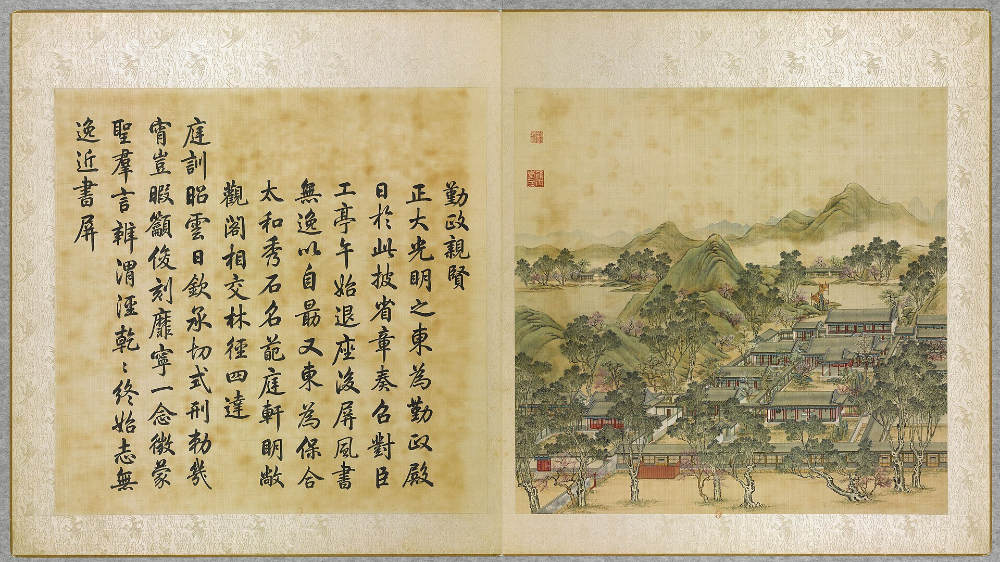
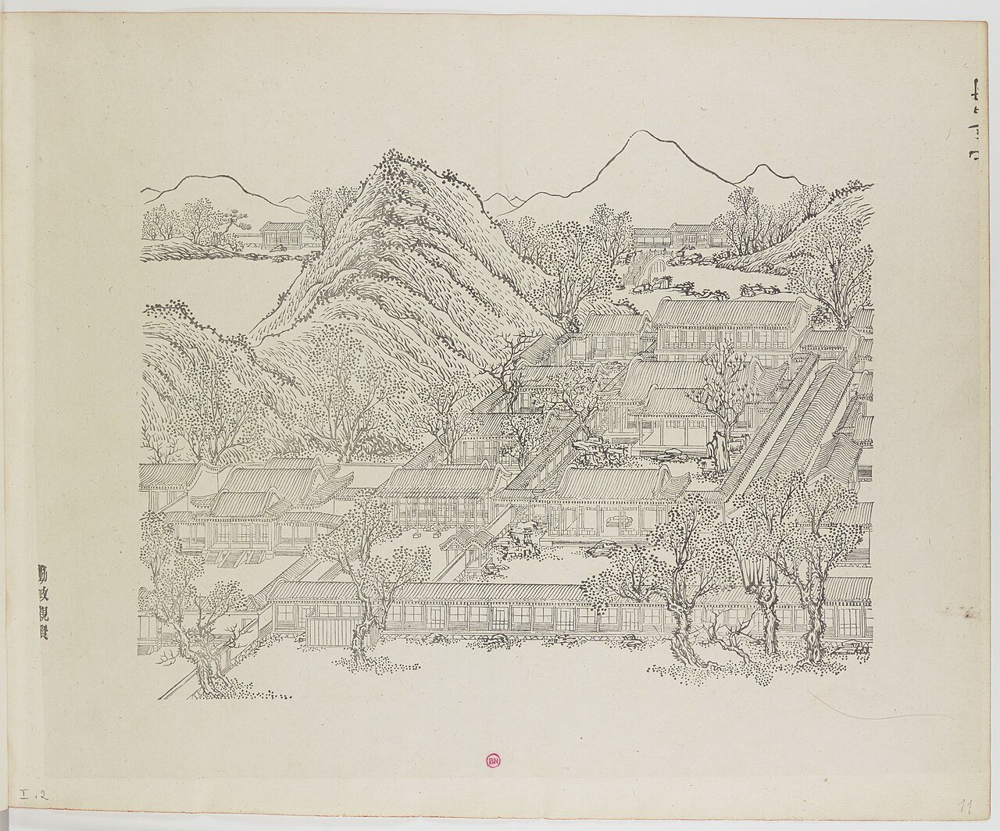
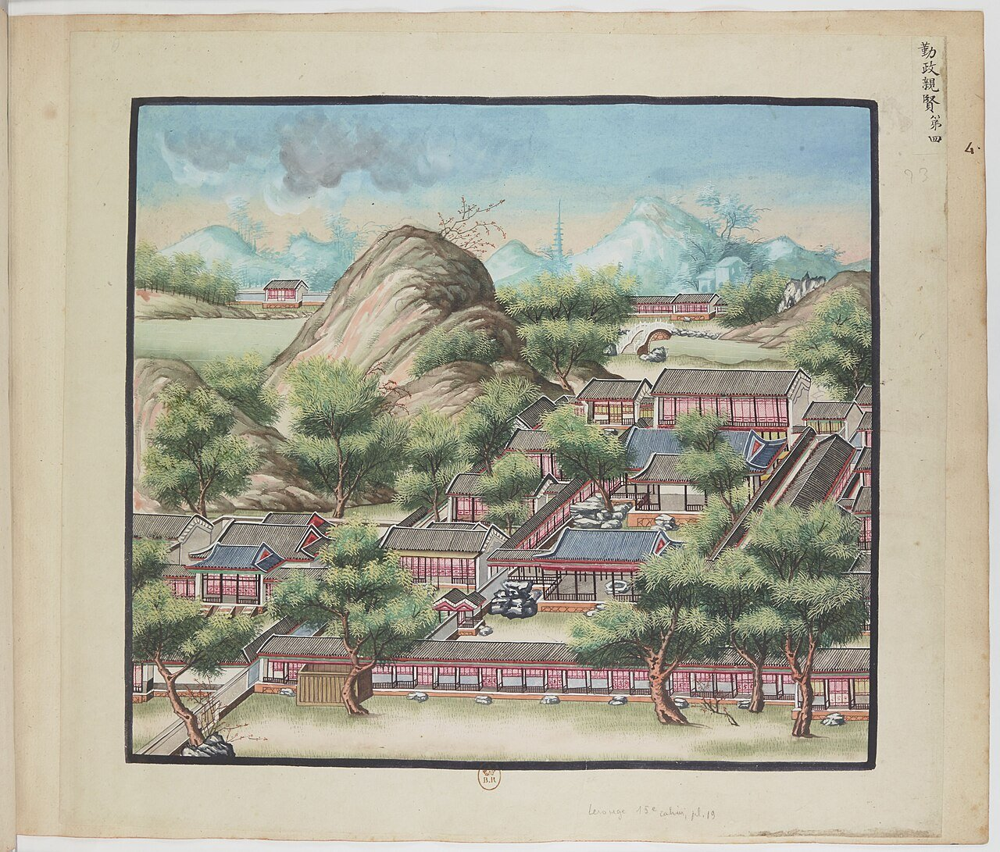
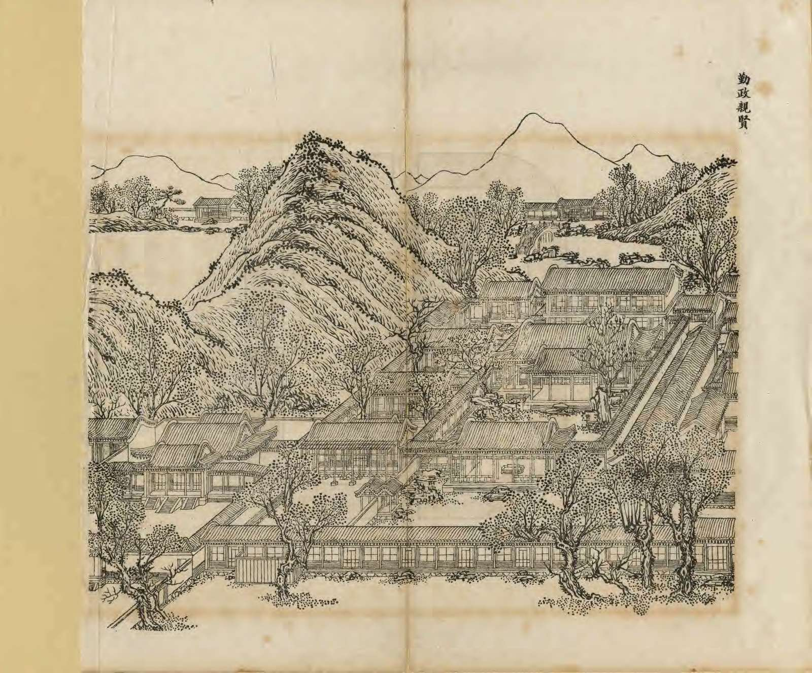
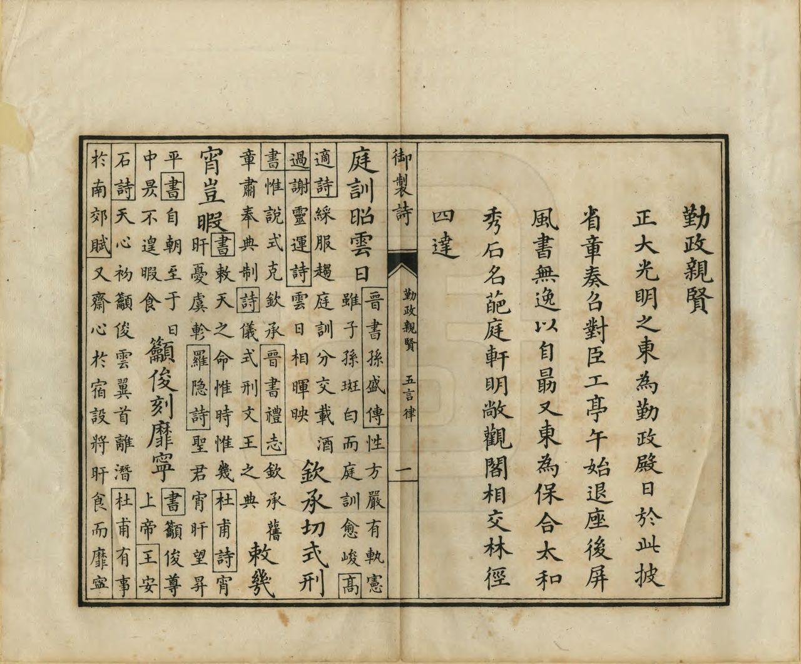

<!-- generated:start (scripts/building_pages.py): do not edit between these markers -->

# YM02: 勤政亲贤 Qinzheng Qinxian

Hall of Diligent Government (Diligent in Government and Friendly with Officials) · Yuanming Yuan

**3D object:** 28 boxes. Open it: `/reconstruction/3d.html?b=YM02`

## What we know

- **Name:** 勤政亲贤 Qinzheng Qinxian (S05, S02, S08, S41, S01, S310 · confidence B)
- **English:** Hall of Diligent Government (Diligent in Government and Friendly with Officials) (S05, S02, S08, S41, S01, S310)
- **Garden:** Yuanming Yuan (S05, S02, S08, S41, S01, S310)
- **Type:** scene (S05, S02, S08, S41, S01, S310 · confidence B)
- **Changed:** Differs between album and later Yangshi Lei plans (S41, no details) (S05, S02, S08, S41, S01, S310)
- **Destroyed:** 1860 (S05, S02, S08, S41, S01, S310)
- **Position:** 40.00205, 116.29144. S01 likely (S01 · confidence B)
- **Note:** Album does not show the 1860 state here (S41). after1860: site later held houses and the duck farm of the 海淀乡 livestock brigade; hills and water restored in 2004; a few building parts and Taihu rocks remain (S310, mhymy ysltd 603). (S05, S02, S08, S41, S01, S310)
- **Plan reader's note:** Scene name not written; hall label 勤政殿 legible and 保合太和 富春楼 飞云轩 芳碧丛 match the text. Blue number near (3950,5330) looks like 7 or 2: not the album number 2 with certainty (S01) *(research copy, not public)*
- **How it was read:** likely (S01) *(research copy, not public)*
- **Plan pixels:** 3692, 5430 (S01) *(research copy, not public)*

## Our model now

28 boxes stand in this compound, 28 on blocks drawn on the plan, 0 assumed. Its halls are listed below.

## Inside it (28)

- YM02-01 勤政殿
- YM02-02 飞云轩
- YM02-03 静鉴阁
- YM02-04 怀清芬
- YM02-05 秀木佳荫
- YM02-06 生秋庭
- YM02-07 芳碧丛
- YM02-08 保合太和殿
- YM02-09 富春楼
- YM02-10 竹林清响
- YM02-B0969
- YM02-B0971
- YM02-B0989
- YM02-B0990
- YM02-B1024
- YM02-B1025
- YM02-B1055
- YM02-B1060
- YM02-B1061
- YM02-B1087
- YM02-B1088
- YM02-B1089
- YM02-B1111
- YM02-B1112
- YM02-B1113
- YM02-B1114
- YM02-B1115
- YM02-N01 吉祥所

## Pictures (5)

- **P0002** (sure): 勤政親賢 Qinzheng qinxian [Diligence en affaires et déférence envers les vertueux] (圓明園四十景, 第2景) (1744 (BnF record: 1744年，清朝乾隆九年)). https://commons.wikimedia.org/wiki/File%3A%E5%9C%93%E6%98%8E%E5%9C%92%E5%9B%9B%E5%8D%81%E6%99%AF_-_%28%E6%B8%85%29%E5%94%90%E5%B2%B1%E3%80%81%E6%B2%88%E6%BA%90%E5%90%88%E7%95%AB_%3B_%28%E4%B9%BE%E9%9A%86%E5%90%9F%E8%AF%97%EF%BC%8C%E6%B1%AA%E7%94%B1%E6%95%A6%E4%BB%A3%E4%B9%A6%29_-_btv1b55008362z_%28007_of_124%29.jpg

  

- **P0071** (sure): 中国皇帝的宫殿与庙宇. 第11幅图, 勤政親賢 - (清)孙祜、沈源Qinzheng qinxian - (Qing)Sun Hu, Shen Yuan (1745 (Commons, from the BnF record)). https://commons.wikimedia.org/wiki/File%3A%E4%B8%AD%E5%9B%BD%E7%9A%87%E5%B8%9D%E7%9A%84%E5%AE%AB%E6%AE%BF%E4%B8%8E%E5%BA%99%E5%AE%87._%E7%AC%AC11%E5%B9%85%E5%9B%BE%2C_%E5%8B%A4%E6%94%BF%E8%A6%AA%E8%B3%A2_-_%28%E6%B8%85%29%E5%AD%99%E7%A5%9C%E3%80%81%E6%B2%88%E6%BA%90Qinzheng_qinxian_-_%28Qing%29Sun_Hu%2C_Shen_Yuan_-_btv1b10520660d.jpg

  

- **P0104** (sure): 海淀(镇)：中国皇帝的行宫. 第4幅图, 勤政親賢Qinzheng qinxian (1750-1792 (BnF, cb43831905b; ex coll. Bertin)). https://commons.wikimedia.org/wiki/File%3A%E6%B5%B7%E6%B7%80%28%E9%95%87%29%EF%BC%9A%E4%B8%AD%E5%9B%BD%E7%9A%87%E5%B8%9D%E7%9A%84%E8%A1%8C%E5%AE%AB._%E7%AC%AC4%E5%B9%85%E5%9B%BE%2C_%E5%8B%A4%E6%94%BF%E8%A6%AA%E8%B3%A2Qinzheng_qinxian_-_btv1b10520653b.jpg

  

- **P0233** (sure): 勤政親賢 Qinzheng Qinxian (御製圓明園圖詠, 1887 石印本, 上卷 (Commons 卷一), 第2景; printed title in the right margin of the picture) (光緒十三年 1887 (Commons/NLC record; colophon 光緒十三年七月天津石印書屋 in the SSID copy, S98 PDF p.2); design after the woodblock of 1745 by 孫祜 Sun Hu and 沈源 Shen Yuan). https://commons.wikimedia.org/wiki/File%3ANLC403-312001107375-14035_%E7%A6%A6%E5%88%B6%E5%9C%93%E6%98%8E%E5%9C%92%E5%9C%96%E8%A9%A0_%E5%8D%B7%E4%B8%80.pdf?page=28

  

- **P0509** (sure): 勤政親賢 Qinzheng Qinxian: 乾隆 Qianlong's preface and poem with the courtiers' commentary, 御製圓明園圖詠 1887 (poem 1744 (乾隆九年); this printing 1887). https://commons.wikimedia.org/wiki/File%3ANLC403-312001107375-14035_%E7%A6%A6%E5%88%B6%E5%9C%93%E6%98%8E%E5%9C%92%E5%9C%96%E8%A9%A0_%E5%8D%B7%E4%B8%80.pdf?page=29

  

## Texts and drawings (57)

- **E1039** (poem, sure): 御製勤政親賢詩（圓明園四十景詩）. 1744 (乾隆九年) · printed in S05 j80:17b-18a · S40. https://github.com/kanripo/KR2k0036/blob/master/KR2k0036_080.txt
  > 乾隆九年 御製勤政親賢詩 正大光明殿之東為勤政殿日於此披省章奏召對臣工亭午始退座後屏風書無逸以自朂又東為保合太和秀石名葩庭軒明敞觀閣相交林徑四逹 庭訓昭雲日欽承切式刑勅幾宵豈暇籲俊刻靡寜一念徴䝉聖羣言辨渭涇乾乾終始志無逸近書屏
  East of the audience hall stands 勤政殿, where he read memorials and saw officials until noon, with 無逸 written on the screen behind the seat. Further east is 保合太和, among rocks, flowers, bright courts and linked pavilions.
- **E1042** (poem, sure): 御製賦得為君難六韻. 1759 (乾隆二十四年) · j80:18a-19a · S05. https://github.com/kanripo/KR2k0036/blob/master/KR2k0036_080.txt
  > 乾隆二十四年御製賦得為君難六韻　圓明園勤政殿後楹奎題高揭蓋我皇考取魯論為君難語御書箴座者也由一言興道之幾見千聖傳心之要於以對揚榘訓黙契清衷視子玉銘系有恒藴古篇呈大寳瞠乎後矣其奚足云爰憑乙夜書紳敬藉五言綴簡　宣尼著明訓曽未試躬行身體惟皇考手書示後生絶勝銘几杖詎止見牆羮辭約義賅富思艱圖易亨勅幾所無逸保㤗凛持盈三字垂家法萬年奉永清
  Six-rhyme poem on the plaque 為君難 at the rear of 勤政殿, which Yongzheng took from the 論語 and hung over his seat.
- **E1066** (text, sure): 日下舊聞考 勤政亲贤. 1780s (乾隆 敕撰) · j80:11b-12b · S05. https://github.com/kanripo/KR2k0036/blob/master/KR2k0036_080.txt
  > 正大光明殿東為勤政親賢正殿五楹（圓明園冊）臣等謹按勤政殿額曰勤政親賢四十景之一也後楹額曰為君難皆世宗御書聨曰至治凛惟艱修和九叙大猷懐用乂董正六官後楹聨曰懋勤特喜書無逸攬勝還思賦有卷皆皇上御書寳座屏風上御書無逸一篇後楹東壁陳御製創業守成難易説臣梁詩正敬書西壁陳御製為君難䟦臣于敏中敬書
  正大光明殿's eastern neighbour is 勤政親賢, a five-bay main hall. The note records its plaques (the rear one 為君難, by Yongzheng), Qianlong's couplets, his 無逸 on the throne screen, and two of his essays set out on the rear walls, written by 梁詩正 and 于敏中.
- **E1067** (text, sure): 日下舊聞考 勤政亲贤. 1780s (乾隆 敕撰) · j80:19a-20a · S05. https://github.com/kanripo/KR2k0036/blob/master/KR2k0036_080.txt
  > 勤政親賢之東為飛雲軒東有閣為靜鑑其北為懐清芬又北為秀木佳䕃轉後為生秋庭靜鑑閣東為芳碧叢後為保合太和正殿三楹後為富春樓樓東為竹林清響（圓圓明園册）臣等謹按飛雲軒懐清芬秀木佳䕃生秋庭諸額皆御書保合太和殿壁恭懸御書聖訓四箴箴已載養心殿卷内不備録其西暖閣亦有勤政親賢額西暖閣内額曰叢雲曰養性北曰隨安室富春樓下額曰坐擁琳琅曰蔚然深秀曰無倦齋曰清風明月樓與竹林清響額皆御書
  East of 勤政親賢 stand 飛雲軒, the 靜鑑閣 pavilion, 懐清芬, 秀木佳䕃, 生秋庭 and 芳碧叢; then 保合太和殿 of three bays with 富春樓 and 竹林清響 behind. The note lists plaques, including a second 勤政親賢 plaque and a 隨安室 in the west warm room.
- **E1069** (text, sure): 御製創業守成難易説. 乾隆 (undated in S05) · j80:12b-15b · S05. https://github.com/kanripo/KR2k0036/blob/master/KR2k0036_080.txt
  > 御製創業守成難易説　唐太宗與廷臣較創業守成孰難時房喬魏徴各以所見對太宗皆見其難獨岑文本則曰剏撥亂之業其功既難守已成之基其道不易踵其論者率無軒輊於其間葢以難即不易不易即難也而余則以為不然夫難與不易豈可同日而語哉今有二人焉甲則饑乙則不飽不飽者縱不果腹堪遲待焉而饑者一再不食將餒而僵矣以是喻難與不易其輕重不可立見耶或曰難亦不易也不易亦難也今必强為低昻是視死與不生為二也其可乎余曰是正所以為二也蓋不生者雖不得生而其實尚未至死其死者又安可復生乎以是喻難與不易其輕重不又可立見耶難與不易之説明則岑文本所云撥亂難守成不易之説余又以為不然蓋創業固難矣然以守成較之但可謂之不易而守成則實難耳何則創業之主捄焚拯溺危然後安其難可謂至矣然於制度紀綱時有未暇留俟後人未為不可守成者遺大投艱單心繼序苟無以光前烈啟後圖思凛然有不終畝之憂是創業者未竟之難亦守成者分内之難也所繋不愈重乎哉世之治産者或致億或致萬或致千百無不可也子若孫持其業者増之可耳少有所損於其間人將訾之然則嗣先王之基者不待失道失衆始為慙負前人但使式廓之版圖或有侵削垂裕之成憲或有廢弛是即無以覲耿光而揚大烈昔舜之稱禹曰克勤於邦克儉於家不自滿假君天下者勤儉尚已顧創業者櫛風沐雨不期勤而自無不勤蓽路籃縷不期儉而自無不儉至於守成之主席豐履厚易至於驕驕則怠生焉故陳宵旰於太平之時言茅茨於玉陛之世輙厭而不納是非安不忘危存不忘亡鮮有不盛滿中之者以此思難則所以持難者可知矣况乎守成之責固開國之主與繼體之君所同一仔肩者也夏之王也以禹為創業以啟為守成殷之王也以湯為創業以太甲三宗為守成周之王也以文武為創業以成康為守成然禹湯文武未聞不自守其所創者以貽後昆也我不可不監於有夏我不可不監於有商我不可不監於有周嚮使為子孫者咸知守成之難雖三代至今存可也惟世少守成之主而後有創業之君出焉故予之獨以難責夫守成者非敢忘創業者之難正以慰創業者之初心耳尚書五十八篇其渉創業者惟湯誓湯誥㤗誓武成諸篇其自二典三謨以至太甲説命立政周官罔不於致治保邦為兢兢無逸一篇蔡傳謂周公所舉三宗皆繼世之君一篇中凡七更端深嗟永歎其意深遠周禮為致太平之書所言體國經野皆守成之事古人惟深見其難故言之不厭其詳也如文本之説將以繼世而有天下者坐享成功視開剏為有間則古來守文令辟與䝉業而安者幾可等量而齊觀且使中才之主得所藉口謂昔之人既為其難我僅居其不易稍自暇逸亦無不可何用是汲汲為甚者溺於宴安弗克負荷棄厥基焉夫孰階之厲也故闡明其説如此既申儆於後且藉以自朂焉
  Essay on whether founding or keeping a dynasty is harder, argued against 岑文本: founding is hard but keeping is harder. It was hung on the rear east wall of 勤政殿.
- **E1070** (text, sure): 御製為君難跋. 乾隆 (undated in S05) · j80:15b-17b · S05. https://github.com/kanripo/KR2k0036/blob/master/KR2k0036_080.txt
  > 御製為君難跋　予昔為創業守成難易説亦既反覆辨論難與不易之輕重懸殊不可同日而語以為岑文本之言非是而定之曰開創不易守成難矣此非在守成言守成蓋實有見其難也兹特引伸觸𩔖敬述勤政殿後楣皇考御書為君難之義而為之跋曰大哉王言示大清億萬斯年家法大訓歟夫為君難之言孔子道人之言耳而吾直以為皇考之言者何蓋耕當問僕織當問婢豈不以習焉安焉不見異物而遷之謂乎孔子非為君者也其云難亦不過思其理而度其勢究未身歴其境而心親其勞也皇考禀内聖之姿行外王之道質諸心得驗以躬行故取孔子之言而銘之梠端所以自警也所以訓予小子也所以詔世世孫曾常凛此志以迓天庥而基命宥宻永永無極也是故言政莫備於尚書而言難亦權輿於尚書放勲重華一再曰欽引而未發至於大禹祇承於帝首曰后克艱厥后艱者難也承於帝舜者舜實承於帝堯也惟帝其難之則益深切著明言之矣無輕民事惟艱伊尹之申誥也先知稼穡之艱難周公之作訓也五十八篇之中其於天命民碞之可畏暑雨祁寒之宜思誨之諄諄三致意焉甄古今之得失綜政典之治亂無知難而不興之世亦無不知難而不亡之朝然而知難非空言知其難而已其必勅命謹幾明徳修身以立其本懲忿窒慾親賢遠侫以正其施凜凜焉惴惴焉以謹對越而培永圖予故曰大哉王言示大清億萬斯年家法大訓也或曰為君難為臣不易孔子之言也今獨舉其一豈股肱交儆之義哉予曰向不云乎難與不易輕重懸殊不可同日而語則為臣之不易吾將俟為臣者自言其不易可耳未若為君之難也且也當其不易者恒多語有之衆擎易舉則不易者亦將成易而當其難者一人而已嗚呼豈不甚難
  Colophon to Yongzheng's plaque 為君難 'To Be Ruler Is Hard', hung on the rear west wall of 勤政殿: he traces the idea through the classics and claims it as family law.
- **E2442** (text, sure): 竹葉亭雜記: how officials entered 勤政殿, and the east study rebuilt in 丁酉 (probably 1837). early 19th c., on 丁酉-戊戌, probably 1837-1838 · 卷一, lines 27-29 of the corpus file · S211. https://github.com/garychowcmu/daizhigev20/blob/master/史藏/志存记录/竹叶亭杂记.txt
  > 臣工等由东首台阶上进殿，过横桶，转牌杈，向南稍东即南向跪，则面圣矣。此地不大，盖截书房北段为小间。北墙有桶扇门，驾由此出入，是以上面北坐也。丁酉冬，将书房添前廊，南向开门，北安窗，炕倚窗，设御座炕之西头。东南向窗间设大玻璃，以防苑外人窃听。圣人防闲之严如此。臣工由殿外南向之门入见，自戊戌正月始也。
  Continues E1088. Officials climbed the east steps, passed the partition and the screen and knelt facing south: the emperor sat facing north in a small room cut from the north end of the east study, entering by a door in its north wall. In winter 丁酉 (most likely 1837, 道光十七年, in the author's own career; 1777 is the other possible reading) the study got a front porch and a south door, windows on the north, a kang against them with the throne at its west end, and large glass panes in the south-east windows against eavesdroppers; from the first month of 戊戌 (1838 on that reading) officials entered by the south door.
- **E1089** (text, sure): 文宗實錄 道光三十年. 1850 (道光三十年) · 實錄卷之三 · S207. https://github.com/garychowcmu/daizhigev20/blob/master/史藏/别史/清实录咸丰朝实录.txt
  > 自是日始。上居飞云轩苫次。
  The new emperor kept mourning in 飛雲軒 from this day, showing the hall in use in 1850.
- **E1088** (text, sure): 竹葉亭雜記. early 19th c. · line 25 of the corpus file · S211. https://github.com/garychowcmu/daizhigev20/blob/master/史藏/志存记录/竹叶亭杂记.txt
  > 圆明园召见，向在勤政殿。三楹桶扇洞开，殿中有横桶分前后焉。殿东有套间曰东书房，无前廊。夏日召见在殿中，春秋则在书房。书房门向东，前加牌杈。
  How audiences were held at 勤政殿: three bays with folding doors opened, a partition front to back, and a side room on the east called 東書房 used in spring and autumn. Gives the interior; the bay count differs from S05.
- **E2445** (text, sure): 養吉齋叢錄 卷六: 御門聽政 in the garden held at 勤政殿. author active to 1860s · 卷六, line 331 of the corpus file · S202. https://raw.githubusercontent.com/garychowcmu/daizhigev20/master/%E5%8F%B2%E8%97%8F/%E5%BF%97%E5%AD%98%E8%AE%B0%E5%BD%95/%E5%85%BB%E5%90%89%E6%96%8B%E4%B8%9B%E5%BD%95.txt
  > 宫内御干清门，圆明园御勤政殿。
  The formal 'audience at the gate' for memorials from the boards was held at 乾清门 in the palace and at 勤政殿 in the garden.
- **E1068** (text, likely): 圆明园内生秋庭等建筑名录. Qing, undated on the contents page · 初编 目录 p.521 · S13. https://www.nlcpress.com/ProductView.aspx?Id=7642
  List of buildings beginning with Shengqiu Ting. Printed in the facsimile volume; text not seen.
- **E1040** (poem, sure): 静鉴室: 乾隆二十三年 poem of the Qianlong Emperor. 乾隆二十三年 (1758), date from the compilation · p.106 item (1), under 静鉴室 · S360. https://www.yuanmingyuanpark.cn/xs/yjbg/202007/P020200730387572832602.pdf#page=106
  > 一窗涵万象，十笏玩三余。不拟刘君室，还思周子书。摅情常课有，飬志欲冲虚。设以衡材论，返观祗慊如。
  Poem of the Qianlong Emperor at 静鉴室, 1758. Year as given by the compilation.
- **E1041** (poem, sure): 勤政殿: 乾隆二十四年 poem of the Qianlong Emperor. 乾隆二十四年 (1759), date from the compilation · p.104 item (1), under 勤政殿 · S360. https://www.yuanmingyuanpark.cn/xs/yjbg/202007/P020200730387572832602.pdf#page=104
  > 奎题高掲 盖我皇考取鲁论，为君难语御书箴座者也。由一言兴道之几，见千圣传心之要。于以对扬榘训黙契，清衷视子玉铭。系有恒藴古篇，呈大宝瞠乎后矣。其奚足云爰凭乙夜，书绅敬藉五言缀简。宣尼著明训曾未试躬行身体，惟皇考手书示后生，絶胜铭几杖讵止。见墙羮辞约义，赅富思艰，图易亨勅。几所无逸保泰凛持盈，三字垂家法，万年奉永清。
  Poem of the Qianlong Emperor at 勤政殿, 1759, on state papers. Year as given by the compilation.
- **E1043** (poem, sure): 芳碧丛: 乾隆二十四年 poem of the Qianlong Emperor. 乾隆二十四年 (1759), date from the compilation · p.107 item (1), under 芳碧丛 · S360. https://www.yuanmingyuanpark.cn/xs/yjbg/202007/P020200730387572832602.pdf#page=107
  > 玲珑湖石逻㠝岏，视之茗邈即之闲。锦绣舒芳葩几簇，琅玕摇碧筠千竿。碧筠诘曲中得路，芳葩如屏后庭护。文轩五架虚且明，夏晓延凉咨政处。延凉缅想歌南薫，阜财解愠厪万民。每多旱甚盼雨候，亦有霖恒望霁辰。望霁较可盼雨必，一岁舒眉能几日。咄哉前言戏之耳，合是先忧凛无逸。
  Poem of the Qianlong Emperor at 芳碧丛, 1759, on state papers and the view. Year as given by the compilation.
- **E1044** (poem, sure): 飞云轩: 乾隆二十四年 poem of the Qianlong Emperor. 乾隆二十四年 (1759), date from the compilation · p.106 item (1), under 飞云轩 · S360. https://www.yuanmingyuanpark.cn/xs/yjbg/202007/P020200730387572832602.pdf#page=106
  > 高轩疎朗似飞云，无意书题著桂棼。却几烟花悦曾我，祗饶宵旰惕为君。即今正厌终风盛，镇日空愁散霭纷。云尔飞来慢飞去，闷増剧欲易其文。
  Poem of the Qianlong Emperor at 飞云轩, 1759. Year as given by the compilation.
- **E1045** (poem, sure): 富春楼: 乾隆二十五年 poem of the Qianlong Emperor. 乾隆二十五年 (1760), date from the compilation · p.109 item (1), under 富春楼 · S360. https://www.yuanmingyuanpark.cn/xs/yjbg/202007/P020200730387572832602.pdf#page=109
  > 园楼久额富春名，曾未题诗太懒生。拾级试观泰元德，拈毫敢忘体乾情。虽然红紫迟酣放，要识机关在始萌。色色形形从此鬯，凭栏次第待闲评。
  Poem of the Qianlong Emperor at 富春楼, 1760. Year as given by the compilation.
- **E1046** (poem, sure): 飞云轩: 乾隆二十六年 poem of the Qianlong Emperor. 乾隆二十六年 (1761), date from the compilation · p.106 item (2), under 飞云轩 · S360. https://www.yuanmingyuanpark.cn/xs/yjbg/202007/P020200730387572832602.pdf#page=106
  > 春冀英英作势浓，秋希敛尽不遗踪。坐轩棘欲云飞去，轩笑不知何所从。
  Poem of the Qianlong Emperor at 飞云轩, 1761. Year as given by the compilation.
- **E1047** (poem, sure): 静鉴室: 乾隆二十八年 poem of the Qianlong Emperor. 乾隆二十八年 (1763), date from the compilation · p.106 item (2), under 静鉴室 · S360. https://www.yuanmingyuanpark.cn/xs/yjbg/202007/P020200730387572832602.pdf#page=106
  > 鉴以照为德，更以静为用。惟其物不示，是故形随贡。既无妍丑见，亦免爱憎中。题室拟铭盘，甄心企空洞。
  Poem of the Qianlong Emperor at 静鉴室, 1763. Year as given by the compilation.
- **E1048** (poem, sure): 无倦斋: 乾隆三十五年 poem of the Qianlong Emperor. 乾隆三十五年 (1770), date from the compilation · p.110 item (1), under 无倦斋 · S360. https://www.yuanmingyuanpark.cn/xs/yjbg/202007/P020200730387572832602.pdf#page=110
  > 先之更继以劳之，请教曰当无倦。为乾象正符不息义讵，惟姑使自深思。（末句反程子注语意即胡氏所云勇者，喜于有为而不能持久，亦未为契旨也。）
  Poem of the Qianlong Emperor at 无倦斋, 1770. Year as given by the compilation.
- **E1049** (poem, sure): 富春楼: 乾隆五十四年 poem of the Qianlong Emperor. 乾隆五十四年 (1789), date from the compilation · p.109 item (2), under 富春楼 · S360. https://www.yuanmingyuanpark.cn/xs/yjbg/202007/P020200730387572832602.pdf#page=109
  > 保合太和（殿名）后，富春层有楼。顾名思义久，点笔著词酬， （是楼建于乾隆三年，至二十五年才一题句，兹阅三十年始再有诗，亦可谓疎矣）岂诩花木景，惟先民物忧。庶几守初志，永保万年庥。
  Poem of the Qianlong Emperor at 富春楼, 1789. Year as given by the compilation.
- **E1050** (poem, sure): 怀清芬: 乾隆五十七年 poem of the Qianlong Emperor. 乾隆五十七年 (1792), date from the compilation · p.106 item (1), under 怀清芬 · S360. https://www.yuanmingyuanpark.cn/xs/yjbg/202007/P020200730387572832602.pdf#page=106
  > 经史清芬一室如，额题略已卌年余。春秋倐忽八旬逮，祝颂缤纷四得誉。论著两编申已愧， （前岁八旬万寿群臣献词颂者不可偻计，因著四得论，四得续论以为禄位，名寿胥因德而得之，予之得此四者乃荷天地黙佑祖宗延禧，非德之所致，岂肯蕼然自居方且引以为愧耳。）言殊累牍似他虚。即今不息强増昔，（计至归政之期尚有三年，兢业之 心不敢少懈，即昨年廓尔喀侵扰后蔵一事，早夜筹划尚觉精力堪副，惟有益加惕励，庶不负羲经自强不息之意云尔。）归政方称未负书。
  Poem of the Qianlong Emperor at 怀清芬, 1792. Year as given by the compilation.
- **E1051** (poem, sure): 富春楼: 乾隆五十九年 poem of the Qianlong Emperor. 乾隆五十九年 (1794), date from the compilation · p.109 item (3), under 富春楼 · S360. https://www.yuanmingyuanpark.cn/xs/yjbg/202007/P020200730387572832602.pdf#page=109
  > 富春额署五旬年，（是楼在镂月开云之前，乾隆甲子始题此额，至今已五十年矣。）每欲题词輙忸然。物阜民安方谓可，衣丰食足倍怀牵。惭今盈六故吾耳，抚此初韶仍尔焉。诗匣懋勤排岁奉，（近年九月杪，自御园进宫，后因三冬多暇，命懋勤殿翰林等将次年新春所游咏之处，自大内及宁寿宫西苑并圆明园、万寿山、玉泉山各等处，酌检若干题，每日乘暇豫作数首。至开韶庆节宴赏频蕃，颇不得暇，即偶有所作，可以从容涉笔，亦凡事豫则立之意也。计甲寅、乙卯两年，尚须依例作之，逮丙辰归政后，吟兴偶至，即可随意所便，不必仍沿此例矣。）踟蹰未免懒摅笺。
  Poem of the Qianlong Emperor at 富春楼, 1794. Year as given by the compilation.
- **E1052** (poem, sure): 无倦斋: 嘉庆元年 poem of the Qianlong Emperor. 嘉庆元年 (1796), date from the compilation · p.110 item (10), under 无倦斋 · S360. https://www.yuanmingyuanpark.cn/xs/yjbg/202007/P020200730387572832602.pdf#page=110
  > 六旬周甲丙辰春，天佑幸为符愿身。敢曰倦勤无事者，劳劳望捷正愁人。（去岁斋中口号有深慕天恩或符愿明年，即作倦勤人之句。今岁虽已传位，而子皇帝践阼之始，用人行政尚须训示。予幸精神强固，每日披览庶政不至倦勤，且楚南逆首石三保、石柳邓势已穷蹙，擒获在即，而捷报尚未奏到，盼望殷殷亦正劳念。）
  Poem of the Qianlong Emperor at 无倦斋, 1796, on state papers. Year as given by the compilation.
- **E1053** (poem, sure): 无倦斋: 嘉庆元年 poem of the Qianlong Emperor. 嘉庆元年 (1796), date from the compilation · p.110 item (11), under 无倦斋 · S360. https://www.yuanmingyuanpark.cn/xs/yjbg/202007/P020200730387572832602.pdf#page=110
  > 昨年七字谓明春，（去年题是斋诗，有明年即作倦勤人之句。）明忽为今倏至身。天锡倦勤亶符愿，仍勤敢倦作闲人。
  Poem of the Qianlong Emperor at 无倦斋, 1796, on reading. Year as given by the compilation.
- **E1054** (poem, sure): 竹林清响: 嘉庆元年 poem of the Jiaqing Emperor. 嘉庆元年 (1796), date from the compilation · p.110 item (1), under 竹林清响 · S360. https://www.yuanmingyuanpark.cn/xs/yjbg/202007/P020200730387572832602.pdf#page=110
  > 万个筼筜罨翠深，七贤物外漫招寻。窗前清响凉飔送，日日平安报好音。
  Poem of the Jiaqing Emperor at 竹林清响, 1796, on the view. Year as given by the compilation.
- **E1055** (poem, sure): 后天不老: 嘉庆二年 poem of the Jiaqing Emperor. 嘉庆二年 (1797), date from the compilation · p.111 item (1), under 后天不老 · S360. https://www.yuanmingyuanpark.cn/xs/yjbg/202007/P020200730387572832602.pdf#page=111
  > 昔日弦歌地，重来已来年。随兄怀雅训，勖弟勉成贤。师友三天聚，（御园皇子读书处前层檐额曰：“前垂天贶中层”。额曰：“中天景物后”。层额曰：“后天不老
  Poem of the Jiaqing Emperor at 后天不老, 1797, on reading and remembering his forebears. Year as given by the compilation.
- **E1056** (poem, sure): 怀清芬: 嘉庆二年 poem of the Jiaqing Emperor. 嘉庆二年 (1797), date from the compilation · p.107 item (2), under 怀清芬 · S360. https://www.yuanmingyuanpark.cn/xs/yjbg/202007/P020200730387572832602.pdf#page=107
  > 四壁满图书，清芬素所慕。兴废鉴古人，千载恍相遇。政迹有本原，圣贤深意具。揽要探心傅，岂徒诵章句。辅德殷鉴存，无逸周书布。临民实艰哉，朽索渊冰惧。知难非空言，敕几谨尺度。
  Poem of the Jiaqing Emperor at 怀清芬, 1797, on reading. Year as given by the compilation.
- **E1057** (poem, sure): 竹林清响: 嘉庆二年 poem of the Jiaqing Emperor. 嘉庆二年 (1797), date from the compilation · p.110 item (2), under 竹林清响 · S360. https://www.yuanmingyuanpark.cn/xs/yjbg/202007/P020200730387572832602.pdf#page=110
  > 浮筠绕亭榭，渐觉碧云深。烟羃筼筜色，风吹箫管音。吟怀千亩迹，思入五弦琴。晤坐聆清响，七贤忆竹林。
  Poem of the Jiaqing Emperor at 竹林清响, 1797, on the view. Year as given by the compilation.
- **E1058** (poem, sure): 怀清芬: 嘉庆三年 poem of the Jiaqing Emperor. 嘉庆三年 (1798), date from the compilation · p.107 item (3), under 怀清芬 · S360. https://www.yuanmingyuanpark.cn/xs/yjbg/202007/P020200730387572832602.pdf#page=107
  > 清芬在古籍，披玩畅襟怀。圣学诚无际，文津漫得涯。琢磨惜阴速，探讨与时皆。仰止还思慕，游心艺苑佳。
  Poem of the Jiaqing Emperor at 怀清芬, 1798, on reading. Year as given by the compilation.
- **E1059** (poem, sure): 勤政殿: 嘉庆六年 poem of the Jiaqing Emperor. 嘉庆六年 (1801), date from the compilation · p.105 item (3), under 勤政殿 · S360. https://www.yuanmingyuanpark.cn/xs/yjbg/202007/P020200730387572832602.pdf#page=105
  > 三载日聆皇考训，悲含孺慕独临轩。心忧民瘼慈恩重，额仰君难祖泽存。（殿内恭悬皇祖御书为君难扁额，并皇考御书跋语横幅。）嘉树铺阴感风木，素楹示俭念先言。于斯听政仍如昔，勉继前猷永弗谖。（皇考御宇六十余年临幸御园时接见臣工，披览章奏措施诸大政皆御此殿，予寅承大宝日于此敬聆圣训。兹听政临轩追慕情何能巳，惟以顾名思义凛守前猷，弗敢暇逸为兢兢尔。）
  Poem of the Jiaqing Emperor at 勤政殿, 1801, on state papers. Year as given by the compilation.
- **E1060** (poem, sure): 生秋庭: 嘉庆六年 poem of the Jiaqing Emperor. 嘉庆六年 (1801), date from the compilation · p.107 item (1), under 生秋庭 · S360. https://www.yuanmingyuanpark.cn/xs/yjbg/202007/P020200730387572832602.pdf#page=107
  > 经时溽暑望秋生，风爽天澄灏气清。指日嘉音至御苑，民安稍慰旰宵萦。
  Poem of the Jiaqing Emperor at 生秋庭, 1801, on escaping the heat. Year as given by the compilation.
- **E1061** (poem, sure): 飞云轩: 嘉庆九年 poem of the Jiaqing Emperor. 嘉庆九年 (1804), date from the compilation · p.106 item (5), under 飞云轩 · S360. https://www.yuanmingyuanpark.cn/xs/yjbg/202007/P020200730387572832602.pdf#page=106
  > 风漾平林木叶挥，仰瞻玉宇白云飞。沙汀飏影鸿余迹，石洞团香菊吐菲。省岁难期皆有岁，授衣更悯咏无衣。轩邻勤政咨诹切，宥密单心理万几。
  Poem of the Jiaqing Emperor at 飞云轩, 1804. Year as given by the compilation.
- **E1062** (poem, sure): 芳碧丛: 嘉庆十二年 poem of the Jiaqing Emperor. 嘉庆十二年 (1807), date from the compilation · p.108 item (10), under 芳碧丛 · S360. https://www.yuanmingyuanpark.cn/xs/yjbg/202007/P020200730387572832602.pdf#page=108
  > 圣制超品汇，竹春不知秋。和章承笔削，铭泐永率由。（乾隆甲辰春皇考六巡江浙，恭扈銮舆命和游龙井诗，当蒙于乙览之次。亲御丹毫为改十字曰泉雷忽疑雨，竹春不知秋，诗情物理曲尽灵区之妙。予今操觚托咏，悉本当年诗教之源。兹地丝筠参碧，阅岁滋深，抚景兴怀不觉，忆趋庭而述往事云。）庭前益繁茂，猗猗绿筱稠。夙沐化雨润，浮筠岁月修。劲节挺烟雾，清音戛琳球。静对有斐泽，缅怀贤哲俦。
  Poem of the Jiaqing Emperor at 芳碧丛, 1807, on state papers and the view. Year as given by the compilation.
- **E1063** (poem, sure): 三友轩: 嘉庆十三年 poem of the Jiaqing Emperor. 嘉庆十三年 (1808), date from the compilation · p.111 item (1), under 三友轩 · S360. https://www.yuanmingyuanpark.cn/xs/yjbg/202007/P020200730387572832602.pdf#page=111
  > 奇石嵯峨磴道连，日亲三友蜃窗前。松坚竹劲梅清洁，物外忘形几岁年。或咏诗词或写生，总由幻想结同盟。予心自有真三益，惟敬惟勤惟致诚。
  Poem of the Jiaqing Emperor at 三友轩, 1808, on state papers. Year as given by the compilation.
- **E1064** (poem, sure): 勤政殿: 道光三年 poem of the Daoguang Emperor. 道光三年 (1823), date from the compilation · p.105 item (4), under 勤政殿 · S360. https://www.yuanmingyuanpark.cn/xs/yjbg/202007/P020200730387572832602.pdf#page=105
  > 为政先探本，承恩念在勤。箴言钦可法，忠告想多闻。（我皇祖于理事正殿皆颜勤政，皇考圣制勤政箴有曰，为政在勤，勤则不匮。又曰亮采寅清，竭忠尽智，探本之论允足垂法万禩。）问夜常虞晏，瞻楹每惜分。一诚诚不巳，贵实屏虚文。 （勤政之道本乎存诚，存诚之功征于不息，予小子绍闻衣德崇实黜浮，兹于三月三日御勤政殿听政，瞻仰云楣倍深，惟日孜孜之意焉。 ）
  Poem of the Daoguang Emperor at 勤政殿, 1823, on state papers. Year as given by the compilation.
- **E1065** (poem, sure): 芳碧丛: 道光三年 poem of the Daoguang Emperor. 道光三年 (1823), date from the compilation · p.108 item (13), under 芳碧丛 · S360. https://www.yuanmingyuanpark.cn/xs/yjbg/202007/P020200730387572832602.pdf#page=108
  > 虚榭宽闲夏景凉，勅几听政晓批章。飘香幽径多佳卉，戛玉空阶满绿篁。每踞匡床非静憩，钦承大命凛当阳。一诚不息遵谟训，黾勉难期庶事康。（芳碧丛在勤政殿之东，长夏每于此阅折批章，傅膳办事敬念缵承，丕绪日理万几，想勉寸诚无时豫怠，庶几法天行之不息，致庶事之咸熙。虽新篁成韵密莜迎凉，未甞翫景物而耽清暇 也。）
  Poem of the Daoguang Emperor at 芳碧丛, 1823, on escaping the heat and the view. Year as given by the compilation.
- **E1082** (description, sure): Scene 2, 勤政亲贤 Qinzheng Qinxian. 1934 · p.77 · S02. https://archive.org/details/historyofpekings00malo
  > This was a smaller audience hall connected with several adjacent courtyards lying just east of the Main Audience Hall.
  A smaller audience hall with adjacent courts east of 正大光明. Its use for ordinary business and for conferences with scholars is Malone's inference from the name and imperial texts.
- **E1004** (description, guess): Six paintings, IV: an entrance compound, probably 正大光明. before 1799 · pp.202-203, Tableau IV · S258. https://archive.org/details/BIUSante_40644
  > On distingue l'entrée principale, précédée de deux pavillons, probablement destinés aux gardiens de cette entrée.
  A bridge over a walled canal to a range with two wings, a large paved court, the main isolated block joined by two galleries to side pavilions, side courts. Fits the audience compounds; 正大光明 or 勤政亲贤 unproven.
- **E1083** (description, sure): 吉祥所 of 勤政亲贤. c. 2011 blog, unnamed source · 系列06, section 勤政亲贤 · S50. 
  East of 勤政亲贤 stood 吉祥院, called also 吉祥所, counted apart in the building totals. In 1860 its gate and three courts survived while the rest burned. No other source seen: a lead.
- **E2464** (description, sure): 勤政殿地盘图样 (record text). record 2020-22 · mhymy dasl/ysltd/7310 · S310. https://www.mhymy.com/dasl/ysltd/7310.html
  Record on 勤政殿: five bays facing south with three-bay 抱厦 front and back, plaques 勤政殿 (Yongzheng) and 勤政亲贤, the throne screen with 无逸, couplets. No drawing number in the free part.
- **E0512** (description, likely): 朱强, 圆明园核心功能景区的园林化特征试析, 圆明园研究 (issue page dated 2026-02-03). 2026-02-03 · xs/ktsb/202602/t20260203_4804592; abstract read · S338. https://www.yuanmingyuanpark.cn/xs/ktsb/202602/t20260203_4804592.html
  Reconstructs the five core functions of the main garden (outer court, government, residence, ritual, military display) and reads each area's garden design against comparable sites. Only the abstract was read; the scene ties are my reading of those five functions.
- **E1071** (description, sure): 圆明园百景史事分景汇编: 静鉴室. 1758-1763 · from p.106, under 正大光明 · S360. https://www.yuanmingyuanpark.cn/xs/yjbg/202007/P020200730387572832602.pdf#page=106
  静鉴室: 2 dated items, 1758-1763, of which 2 poems (Qianlong). First dated 1758, last dated 1763.
- **E1072** (description, sure): 圆明园百景史事分景汇编: 勤政殿. 1759-1829 · from p.104, under 正大光明 · S360. https://www.yuanmingyuanpark.cn/xs/yjbg/202007/P020200730387572832602.pdf#page=104
  The working hall. Yongzheng's 为君难 plaque hung here with Qianlong's colophon (poems and notes of 1759, 1785, 1801), and a note of 1823 explains the name. 勤政殿: 8 dated items, 1759-1829, of which 7 poems and 1 court records (Qianlong, Jiaqing, Daoguang); recurring themes: state papers. First dated 1759, last dated 1829.
- **E1073** (description, sure): 圆明园百景史事分景汇编: 芳碧丛. 1759-1824 · from p.107, under 正大光明 · S360. https://www.yuanmingyuanpark.cn/xs/yjbg/202007/P020200730387572832602.pdf#page=107
  East of 勤政殿. A Daoguang note of 1823 has him reading memorials and eating here in the long summer days. 芳碧丛: 15 dated items, 1759-1824, of which 15 poems (Qianlong, Jiaqing, Daoguang); recurring themes: state papers, the view, escaping the heat. First dated 1759, last dated 1824.
- **E1074** (description, sure): 圆明园百景史事分景汇编: 飞云轩. 1759-1804 · from p.106, under 正大光明 · S360. https://www.yuanmingyuanpark.cn/xs/yjbg/202007/P020200730387572832602.pdf#page=106
  飞云轩: 5 dated items, 1759-1804, of which 5 poems (Qianlong, Jiaqing). First dated 1759, last dated 1804.
- **E1075** (description, sure): 圆明园百景史事分景汇编: 富春楼. 1760-1813 · from p.109, under 正大光明 · S360. https://www.yuanmingyuanpark.cn/xs/yjbg/202007/P020200730387572832602.pdf#page=109
  Qianlong's own notes date the tower to 1738 and its plaque to 1744; one places it in front of 镂月开云, not in the 勤政亲贤 group where the compilation and our list file it. 富春楼: 7 dated items, 1760-1813, of which 7 poems (Qianlong, Jiaqing); recurring themes: the view. First dated 1760, last dated 1813.
- **E1076** (description, sure): 圆明园百景史事分景汇编: 无倦斋. 1770-1796 · from p.110, under 正大光明 · S360. https://www.yuanmingyuanpark.cn/xs/yjbg/202007/P020200730387572832602.pdf#page=110
  无倦斋: 5 dated items, 1770-1796, of which 5 poems (Qianlong); recurring themes: reading, state papers. First dated 1770, last dated 1796.
- **E1077** (description, sure): 圆明园百景史事分景汇编: 怀清芬. 1792-1798 · from p.106, under 正大光明 · S360. https://www.yuanmingyuanpark.cn/xs/yjbg/202007/P020200730387572832602.pdf#page=106
  怀清芬: 3 dated items, 1792-1798, of which 3 poems (Qianlong, Jiaqing); recurring themes: reading. First dated 1792, last dated 1798.
- **E1078** (description, sure): 圆明园百景史事分景汇编: 竹林清响. 1796-1797 · from p.110, under 正大光明 · S360. https://www.yuanmingyuanpark.cn/xs/yjbg/202007/P020200730387572832602.pdf#page=110
  竹林清响: 2 dated items, 1796-1797, of which 2 poems (Jiaqing); recurring themes: the view. First dated 1796, last dated 1797.
- **E1079** (description, sure): 圆明园百景史事分景汇编: 后天不老. 1797-1797 · from p.111, under 正大光明 · S360. https://www.yuanmingyuanpark.cn/xs/yjbg/202007/P020200730387572832602.pdf#page=111
  后天不老: 1 dated items, 1797-1797, of which 1 poems (Jiaqing); recurring themes: reading, remembering his forebears. First dated 1797, last dated 1797.
- **E1080** (description, sure): 圆明园百景史事分景汇编: 生秋庭. 1801-1801 · from p.107, under 正大光明 · S360. https://www.yuanmingyuanpark.cn/xs/yjbg/202007/P020200730387572832602.pdf#page=107
  生秋庭: 1 dated items, 1801-1801, of which 1 poems (Jiaqing); recurring themes: escaping the heat. First dated 1801, last dated 1801.
- **E1081** (description, sure): 圆明园百景史事分景汇编: 三友轩. 1808-1808 · from p.110, under 正大光明 · S360. https://www.yuanmingyuanpark.cn/xs/yjbg/202007/P020200730387572832602.pdf#page=110
  三友轩: 1 dated items, 1808-1808, of which 1 poems (Jiaqing); recurring themes: state papers. First dated 1808, last dated 1808.
- **E1084** (drawing, sure): 勤政殿平面图 (图名: 踏勘勤政殿东书房尺寸底). 咸丰五年 (1855) 三月 · 国家图书馆善本部 样002-3号 · S310. https://www.mhymy.com/dasl/ysltd/11009.html
  Survey sheet of the east study of the Qinzheng hall with measurements, March 1855, 350x349 mm, red and ink. No image here; the site may ask a small payment for the full record.
- **E2470** (drawing, sure): 样式雷烫样 of the Tongzhi repair of Yuanming Yuan (list by site). 同治 (1873-74) for most, per the report · Lei family models, now chiefly 故宫博物院; the report does not give numbers · S920. https://www.thepaper.cn/newsDetail_forward_2201516
  The Lei family card models cover Yuanming Yuan, Wanchun Yuan, the Summer Palace and others; most of the Yuanming Yuan ones were made for Tongzhi's repair: the whole central (九洲清晏) axis, 泉石自娱, 同乐堂, 上下天光, 思顺堂, 天地一家春; in the north 恒春堂, 课农轩, 廓然大公; in the south 勤政殿; in the west 万方安和. Period objects of 1873-74, not of 1860: they show the Tongzhi design, which kept many old names but changed forms.
- **E1085** (drawing, sure): 《国家图书馆藏样式雷图档·圆明园卷初编》: 勤政亲贤. mostly 道光, 咸丰, 同治 per the publisher · 初编 目录: 勤政亲贤, pp.32-65 · S13. https://www.nlcpress.com/ProductView.aspx?Id=7642
  The printed facsimile of the National Library of China's Yangshi Lei sheets has a section on this place at pp.32-65 (34 pages, section length worked out from the next heading); sheet titles and numbers are in the volume, ordered from a library.
- **E2469** (drawing, sure): 保合太和殿装修平面图 (图名: 保合太和). 不详 · 国家图书馆善本部 样002-17号 · S310. https://www.mhymy.com/dasl/ysltd/10368.html
  Interior plan of 保合太和殿, 422x260 mm, ink, working sheet, undated. Its slip writes the main sizes: three bays, each as wide as three ordinary bays, so the front reads as nine; a three-bay open front porch; throne, platform and splayed screen at the back of the central bay, bookcases behind a board wall.
- **E1086** (plan, sure, search index only): Yangshi Lei plan cards on 梦回圆明园: 勤政殿平面图, 西峰秀色总平面图, 安佑宫室内布置图, 映清斋平面图, 绮春园宫门区平面图, 敷春堂殿平面图, 敷春堂东南所平面图, 涵秋馆地盘图, 四宜书屋(绮春园)平面图, 河道泊岸总平面图, 长春园样式雷河道图, 西洋楼水法图, 御制廓然大公八景诗图. Qing · dasl/ysltd: 11009, 11099, 7659, 9716, 7496, 12232, 9879, 7704, 13985, 9509, 6902, 7643; dasl 11675 · S340. https://www.mhymy.com/dasl/ysltd/11009.html
  Titles seen in the index, drawings not opened. Pattern: https://www.mhymy.com/dasl/ysltd/<id>.html.

**On the plan:** Drawn on the plan of the gardens (S01), labelled 勤政亲贤. https://artmuseum.princeton.edu/collections/objects/138657

## Reconstructions by others (5)

Modern interpretation, not evidence.
- **R0086** (render, likely): 勤政亲贤 (first image), image 751 in a gallery. posted 2019. https://www.thepaper.cn/newsDetail_forward_3323921 Research-only: link card.
- **R0087** (render, likely): 勤政亲贤 (second image), image 752 in a gallery. posted 2019. https://www.thepaper.cn/newsDetail_forward_3323921 Research-only: link card.
- **R0148** (physical model, likely): 样式雷烫样 Yangshi Lei card models of Yuanmingyuan: 泉石自娱, 同乐堂, 上下天光, 思顺堂, 天地一家春, 恒春堂, 课农轩, 廓然大公, 勤政殿, 万方安和. 雷氏 Lei family holdings, shown in 故宫 exhibition 营缮之道 《单士元》, Tongzhi period for most, per the report. https://www.thepaper.cn/newsDetail_forward_2201516 Research-only: link card.
- **R0042** (AR/VR, sure): “再现圆明园” 数字导览系统: 12 scenes, 40 planned. 郭黛姮 team; 孙慧皎 (清城睿现) on the technical side, 清华大学; 清华控股 清城睿现数字科技研究院; 圆明园管理处, 2014. https://www.tsinghua.edu.cn/info/1182/39112.htm Research-only: link card.
- **R0036** (paper figure, sure, search index only): 再现·圆明园——勤政亲贤. 贺艳 (清华大学, as the extract states), 清华大学, 2011. https://www.mhymy.com/xsjl/qklw/9476.html Research-only: link card.

## Surviving comparable buildings, not this building (3)

- **T005** 仁寿殿 (原 勤政殿) Renshou Dian, first named Qinzheng Dian, 颐和园 Summer Palace. Comparable: same court, era or type, confidence B, standing: rebuilt 1886. Audience hall in a garden, with side halls; roof and tile Basis: S422: built 1750 as 勤政殿, same name and same use; burned by the Anglo-French force 1860; rebuilt 1886 and renamed. S430 (snippet): 7 x 5 bays, gallery round, 卷棚歇山, grey tile. https://zh.wikipedia.org/wiki/颐和园
  - P0572: 北京颐和园仁寿殿2023.6 (1). https://commons.wikimedia.org/wiki/File:%E5%8C%97%E4%BA%AC%E9%A2%90%E5%92%8C%E5%9B%AD%E4%BB%81%E5%AF%BF%E6%AE%BF2023.6_(1).jpg
  - P0573: Bundesarchiv Bild 137-022925, Sommerpalast in Peking. https://commons.wikimedia.org/wiki/File:Bundesarchiv_Bild_137-022925,_Sommerpalast_in_Peking.jpg
- **T004** 万壑松风 Wanhe Songfeng, 避暑山庄 Chengde. Comparable: same court, era or type, confidence C, standing: yes. Working rooms of a ruler set in a garden, small scale Basis: S422: finished 1708, the first group in the palace area; Kangxi often handled affairs here. Same role of a working hall by the water; no text pairs them. https://zh.wikipedia.org/wiki/承德避暑山庄及其周围寺庙
- **T006** 勤政殿 (静宜园) Qinzheng Dian, Jingyi Yuan, 香山公园 Fragrant Hills, Beijing. Comparable: same court, era or type, confidence C, standing: partly. Layout idea: moon river and offices Basis: S422: built 1745, the emperor's audience place in the garden with main hall, side halls, offices and a moon river; destroyed; rebuilt 2002-03 at public cost. https://zh.wikipedia.org/wiki/香山公园
  - P0686: 香山勤政殿. https://commons.wikimedia.org/wiki/File:%E9%A6%99%E5%B1%B1%E5%8B%A4%E6%94%BF%E6%AE%BF.jpg

## Evidence for the set of buildings

- Reconstructions and comparables for the whole garden, 圆明园 Yuanming Yuan: see GARDEN-YM

## Open questions

- Q1: Target state
- Q41: 藏密楼 YM31-07, 松风阁 YM81
- Q45: Halls in the texts with no row
- Q119: Digs
- Q125: Geotagged Commons coverage is thin

<!-- generated:end -->

## Notes

<!-- Yours: regeneration never touches this part. It goes on the public site; what you write below a line holding only %% private %% stays in the research copy. -->
