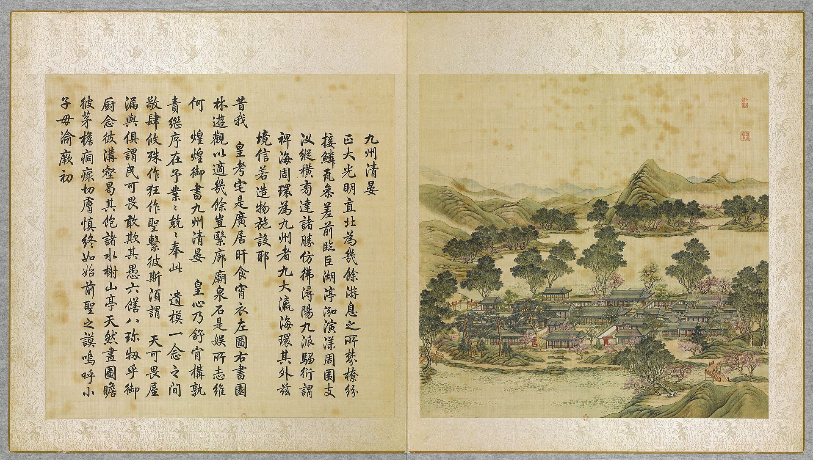
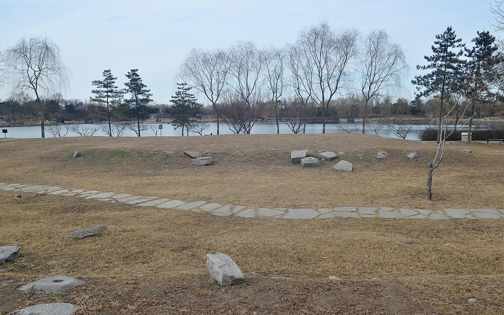

<!-- generated:start (scripts/building_pages.py): do not edit between these markers -->

# YM03-03: 九洲清晏殿 Jiuzhou Qingyan Dian

Yuanming Yuan

**3D object:** 1 box. Open it: `/reconstruction/3d.html?b=YM03-03`

**Part of:** YM03 九洲清晏

## What we know

- **Name:** 九洲清晏殿 Jiuzhou Qingyan Dian (S05, S41, S54, S01, S337, S02, S310 · confidence B)
- **Garden:** Yuanming Yuan (S05, S41, S54, S01, S337, S02, S310)
- **Type:** residence (S05, S41, S54, S01, S337, S02, S310 · confidence B)
- **Changed:** After 1836 fire (S41); 1836: rebuilt after fire with five bays, rear annex removed; 咸丰五年九月 (Sept-Oct 1855): a three-bay rear porch 后抱厦 added; measured with the 同道堂 套殿 on 九月二十四日 (S05, S41, S54, S01, S337, S02, S310)
- **Destroyed:** 1860 (S05, S41, S54, S01, S337, S02, S310)
- **Position:** 40.00369, 116.29029. S01 likely (S01 · confidence B)
- **Bays:** 7 in the texts / 5x2 on the plan (S05, S41, S54, S01, S337, S02, S310)
- **Size in the inventory:** 19.9 × 18.4 m. S01 plan px / hall scale (S01)
- **Note:** Yongzheng and Daoguang said to have died at 九州清晏 (S54 lead; S43 places Daoguang at 慎德堂). bays: 7 to 1836, then 5 (no rear annex) (S337, 三幅样式雷圆明园河道全图辨析; 九州清晏殿 interior article). orientation: its north front faces the Back Lake (a hall open both ways: the court of 奉三无私 to the south, the lake to the north) (S02, p.79). (S05, S41, S54, S01, S337, S02, S310)
- **Plan reader's note:** 九洲清晏殿: next hall north on the axis, faces the 后湖 side. Plan 5, text 7 (or 7 counting the blocks at its sides). Faint ghost characters in its court, last looks like 殿; not legible (S01) *(research copy, not public)*
- **How it was read:** likely (S01) *(research copy, not public)*
- **Plan pixels:** 3303, 4518 (S01) *(research copy, not public)*

## Our model now

On the block drawn on the Qing plan S01: position and frontage from the plan, heights and roof from the typology of its hall class, its form drawn by the hall kit. It will be updated as the research goes on.

- **Box:** 17.12 × 12.85 m, main hall
- **Heights:** platform 0.7 m, eave 4.4 m, ridge 8.81 m above the ground
- **Roof:** hip-and-gable 歇山, rolled ridge 卷棚, grey tile
- **Faces:** 173.9° from north
- **Fit:** reduced towards the size drawn on the plan, to stand clear of its neighbours or the water; moved 1.5 m
- **Drawn:** by the hall kit: 7 bays, the middle widest, a porch front and back, steps on the back, front, 歇山 hip-and-gable with a rolled ridge 卷棚, grey tile, a painted beam under the eave. From its own figures and readings where the dossier gives them (roof read: halls.csv S08 A; tiles read: halls.csv S08 A), the rest from the typology of its hall class.
- **Confidence:** B

## Pictures (2)

- **P0003** (likely): 九州清晏 Jiuzhou qingyan [Paix sur les Neufs Continents] (圓明園四十景, 第3景) (1744 (BnF record: 1744年，清朝乾隆九年)). https://commons.wikimedia.org/wiki/File%3A%E5%9C%93%E6%98%8E%E5%9C%92%E5%9B%9B%E5%8D%81%E6%99%AF._%E7%AC%AC%E4%B8%89%E6%99%AF_%28%E4%B8%8A%E5%86%8C%EF%BC%8C%E7%AC%AC%E4%B8%89%E5%B9%85%E5%9B%BE%29%2C_%E4%B9%9D%E5%B7%9E%E6%B8%85%E6%99%8F_-_%28%E6%B8%85%29%E5%94%90%E5%B2%B1%E3%80%81%E6%B2%88%E6%BA%90%E5%90%88%E7%95%AB_%3B_%28%E4%B9%BE%E9%9A%86%E5%90%9F%E8%AF%97%EF%BC%8C%E6%B1%AA%E7%94%B1%E6%95%A6%E4%BB%A3%E4%B9%A6%29Jiuzhou_qingyan_-_%28Qing%29Tang_Dai%2C_Shen_Yuan_he_hua_-_btv1b550083441.jpg

  

- **P0365** (sure): 九州清晏殿遗址 20130318.JPG (2013-03-18 15:35:06 (Commons DateTimeOriginal)). https://commons.wikimedia.org/wiki/File:%E4%B9%9D%E5%B7%9E%E6%B8%85%E6%99%8F%E6%AE%BF%E9%81%97%E5%9D%80_20130318.JPG

  

## Texts and drawings (20)

- **E1091** (poem, sure): 御製九州清宴詩（圓明園四十景詩）. 1744 (乾隆九年) · printed in S05 j80:23b-24a · S40. https://github.com/kanripo/KR2k0036/blob/master/KR2k0036_080.txt
  > 乾隆九年 御製九州清宴詩 正大光明直北為㡬餘游息之所棼橑紛接鱗瓦參差前臨巨湖渟浤演漾周圍支汊縱横旁逹諸勝仿彿潯陽九𣲖騶衍謂禆海周環為九州者九大瀛海環其外兹境信若造物施設耶 昔我皇考宅是廣居旰食宵衣左圖右書園林游觀以適幾餘豈繄廊廟泉石是娱所志維何煌煌御書九州清宴皇心乃舒肯構孰責繼序在余業業兢兢奉此遺模一念之間敬肆攸殊作狂作聖繫彼斯湏謂天可畏屋漏與俱謂民可畏敢欺其愚六膳八珍牣乎御㕑念彼溝壑曷其飽諸水榭山亭天然畫圖瞻彼茅簷痌瘝切膚慎終如始前聖之謨嗚呼小子母渝厥初
  North of the audience hall is the place of daily rest: crowded roofs and rafters, a great lake in front and channels on every side. The nine land masses recall 鄒衍's nine continents within an encircling sea.
- **E1099** (poem, sure): 御製賦得樂安和詩（有序）. 1774 (乾隆三十九年) · j80:25a-26a · S05. https://github.com/kanripo/KR2k0036/blob/master/KR2k0036_080.txt
  > 乾隆三十九年御製賦得樂安和詩（有序）　顔寢殿之額曰樂安和意雖一貫義亦各具昔湯之盤武之席莫不各有銘所以觸目警心也盤席祗日用物猶亟亟焉而况朝夕所處之室乎各成六韻以勅一躬　樂亦六情一因而額寢齋弗耽斯得正從欲實為乖花鳥引機緒詩書藴道荄當思不可亟恒念與之偕應在雨暘若寜湏絲竹排三端姑彼置五字識吾懐（右樂）　向祗隨所遇（舊額所居書室曰隨安堂取隨遇而安之義）今惟安在斯朝乾實切矣夕惕亦居之適已非為合圖民乃得宜禮經著和樂堯典仰文思建久賈生䇿計情鼂氏辭更深殷念者永固萬年基（右安）　和者寛仁施（去聲）是誠得衆縁温而厲則可柔以發斯偏性命保合正起居安養便莫慙衾影獨那溺景光妍無欲心常泰有為身弼肩春基一氣鬯與物共誾然（右和）臣等謹按九州清宴清暉閣樂安和御製詩㳟載首見之篇餘不備録
  Three poems on the words of the bedroom plaque 樂安和, explaining each word: Qianlong's reminders to himself of restraint, with a note on his earlier room name 隨安堂.
- **E1129** (text, sure): 日下舊聞考 九洲清晏. 1780s (乾隆 敕撰) · j80:20b-23b · S05. https://github.com/kanripo/KR2k0036/blob/master/KR2k0036_080.txt
  > 正大光明後有湖亦稱前湖湖正北為圓明園殿五楹後為奉三無私殿七楹又後為九州清宴殿七楹東為天地一家春西為樂安和又西為清暉閣閣前為露香齋左為茹古堂為松雲樓右為涵徳書屋（圓明園冊）臣等謹按九州清宴額世宗御書四十景之一也前第一層殿恭懸聖祖御書圓明園額聨曰每對青山緑水㑹心處一邱一壑總自天恩浩蕩常從霽月光風悦目時一草一木莫非帝徳高深世宗藩邸時書聨曰恤小民之依所其無逸稽古人之徳彰厥有常皇上御書第二層為奉三無私殿内恭懸皇上御書聖祖仁皇帝聖訓曰天下之治亂休咎皆係人主之一身一心政令之設必當遠慮深謀以防後悔周詳籌度計及久長不可為近名邀利之舉不可用一已偏執之見採羣言以廣益合衆志以成城始為無偏無黨之道孝者百行之原不孝之人斷不可用義者萬事之本非義之事必不可為孝以立身義以制事無是二者雖君臣父子不能保也世宗憲皇帝聖訓曰敬天法祖勤政親賢愛民擇吏除暴安良勿過寛柔勿過嚴猛同氣至親實為一體誠心友愛休戚相闗時聞正言日行正事弗為小人所誘弗為邪説所惑聖祖所貽之宗室宜親國家所用之賢良宜保自然和氣致祥綿宗社萬年之慶額曰清虚靜泰聨曰澗泉無操琴泠然善也風竹有聲畫顧而樂之寳座聨曰所無逸而居動靜適徴仁智體有常以治照臨並叶清寜皇上御書九州清宴殿後額曰蔚然深秀聨曰紅篆爐烟看氣直緑苞庭竹愛心虛與樂安和清暉閣諸額皆御書清暉閣北壁懸圓明園全圖乾隆二年命畫院郎世寜唐岱孫祐沈源張萬邦丁觀鵬恭繪御題大觀二字並題聨曰稽古重圖書義存無逸三宗訓勤民咨稼穡事著豳風七月篇
  North across the lake behind the audience hall: 圓明園殿 (five bays), 奉三無私殿 (seven), 九州清宴殿 (seven), with 天地一家春 to the east, 樂安和 to the west, then 清暉閣 with 露香齋, 茹古堂, 松雲樓 and 涵徳書屋. The note gives the plaques and full text of the Kangxi and Yongzheng instructions on the second hall's wall. On the north wall of 清暉閣 hung the 圓明園全圖 painted in 乾隆二年 (1737) by 郎世寜 Castiglione, 唐岱, 孫祐, 沈源, 張萬邦 and 丁觀鵬.
- **E1132** (text, sure): 宣宗實錄 道光十六年十月. 1836 (道光十六年) · 實錄卷之二百九十 · S208. https://github.com/garychowcmu/daizhigev20/blob/master/史藏/别史/清实录道光朝实录.txt
  > 总管内务府大臣禧恩等奏、遵审失火延烧九洲清晏等处之首领太监黄喜等、按律定拟。得旨、园庭重地。该太监等应何等小心谨慎。乃平日疏懈。以致失火延烧。
  Report on the eunuchs held to blame for the fire that spread to 九洲清晏 and other places; the sentences follow in the entry.
- **E1134** (text, sure): 宣宗實錄 御製重修圓明園三殿記. 1837 (道光十七年七月) · 實錄卷之二百九十九 · S208. https://github.com/garychowcmu/daizhigev20/blob/master/史藏/别史/清实录道光朝实录.txt
  > 癸巳。重修圆明园三殿成。御制记曰。予自践阼以来。于今十有七年。兢兢业业。惟虑政治之未修。民生之未裕。一切兴作。概从简略。非慕卑宫之名。惜露台之费。盖事必权其缓急。心必戒夫逸豫。惟怀永图。不敢不慎也。若今者圆明园三殿之重修。盖有说焉。三殿者。前曰圆明园。中曰奉三无私。后曰九洲清晏。溯自圣祖赐额。世宗定居。皇祖皇考。因淳守朴。不改成规。爰逮藐躬。德輶任重。亦惟祗承基绪。曷敢不念□荷之艰。乃以丙申九月二十六日戌亥之交。融风告警。郁攸从之。虽绠缶有备。而涂彻已多。予心怵惕。不遑启处。惟兹三殿。乃祖宗缔构所诒。居御园之中。为寝兴之所。非若山茨水槛。仅备游观。若不及时修复。何以自安。爰命内府诸臣。庀材鸠功。缮完补阙。惟期示俭于后。不敢增美于前。工未逾年。制已复旧。于以昭不雕不斲之风。亦以守不愆不忘之志版筑之兴。洵不得己也。抑予之说。更有进焉。周书大诰梓材。两言作室。既底法矣。继之曰肯堂肯构。既勤垣墉矣。继之曰涂塈茨。自古帝王。肇造丕基。规模远大。匪第令后世无以加也。亦谓数传而后。其张弛损益。因乎时。存乎人焉。故创业务期可继。而守成亦贵有为。若因循玩泄。有废莫举。所谓堂构涂塈者安在耶。然非值必不可缓之事。有必不得已之心。动辄更张。矜言改作。则前人厎法之善。必至纷然失其所守。其弊更有不可胜言者。是举也。惟愿我后人念作室之不易。则图易而思艰。睹寝成之孔安。则居安而虑殆。慎宪省成。庶几乎无废事焉。且知宫室之制度已备。国家之经费有常。工不可以创兴。役不可以轻举。持盈保泰。庶几乎无侈心焉。夫无废事。勤也。无侈心。俭也。勤者治之本。俭者福之源也。继自今以引以翼。攸芋攸跻。监成宪以无愆。巩洪图于勿替。是则予之厚望也夫。工既竣。乃述颠末而为之记。
  The Daoguang emperor's account of the rebuilding. A fire on 丙申九月二十六日 (1836) struck the three halls 圓明園殿, 奉三無私 and 九洲清晏, his living quarters. He had them restored to the old form in under a year, with nothing added.
- **E1184** (text, sure): 宣宗實錄 道光二十年. 1840 (道光二十年), on 1836 · 實錄卷之三百三十 · S208. https://github.com/garychowcmu/daizhigev20/blob/master/史藏/别史/清实录道光朝实录.txt
  > 现讯庆玉供称、道光十六年闻说修理九洲清晏。需用二丈六尺大柁。曾向禧恩回明。愿将旧存大柁六架呈用。禧恩当即饬令运送圆明园。嗣后仅发给运脚银三十两。并未发给木价等语。
  Testimony: the repair of 九洲清晏 needed beams 二丈六尺 long, and six were offered. A later note says they were decayed and not used.
- **E0433** (text, sure): 徐樹鈞 圓明園詞序. 1871 (同治十年立秋), recording a visit of 四月十日 · preface, whole · S203. https://www.douban.com/group/topic/46378693/
  > 圆明园在京城西，出平则门三十里，畅春园北里许，世宗皇帝藩邸赐园也。圣祖常游豫西郊，次于丹棱沜，乐其川原，因明武清侯李伟清华园旧址，筑畅春园，藩邸赐园，故在其旁。雍正三年，乃大宫殿朝署之规以避暑听政，前临西山，环以西湖。湖水发源玉泉山，曰瓮山，度宫墙东流入清河，《水经注》所谓“蓟县西湖，绿水澄澹，燕之旧池”者也。东流为洗马沟，东南合高梁之水，故鱼稻饶衍，陂泉交绮。高宗皇帝嗣位，海宇殷阗，八方无事，每岁缔构，专饰园居。大驾南巡，流览湖山风景之胜，图画以归，若海宁安澜园、江宁瞻园、钱塘小有天园、吴县狮子林，皆仿其制，增制园中。列景四十，以四字题匾者为一胜区，一区之内，斋馆无数。复东拓长春，西辟清漪，离宫别馆，月榭风亭，属之西山，所费不计亿万。园地多明权珰别业，或传崇祯末，诸奄皆以珍宝窟宅于兹，乾隆间浚池，发金银数百万，时国运方兴，地不爱宝，上心悦豫，殚精构造，曲尽游观之妙，元明以来，未之闻也。每岁夏幸园中，冬初还宫，内廷大臣，赐第相望，文武侍从，并直园林，入直奏对，昕夕往来，络绎道路，历雍乾嘉道，百余年于兹矣。文宗初，粤寇踞金陵，盗贼蜂起，上初即位，求直言，得胜保、曾国藩、袁甲三三臣，既以塞 、程、徐、陆，先朝重望，相继倾覆，始擢用前言事者，各畀重任，三臣支柱，贼不犯畿。然迭胜迭败，东南数省，蹂躏无完土，上悯苍生之颠沛，慨左右之无人。九年冬，郊宿于斋宫，夜分痛哭，侍臣凄恻。大考翰詹，以宣室前席发题，忧心焦思，伤于祸乱，然后稍自抑解，寄于文酒。以宫中行止有节，尤喜园居，冬至入宫，初正即出。时园中传有四春之宠，皆汉女，分居亭馆，所谓杏花春、武陵春、牡丹春、海棠春者也。然上明于料兵，委权阃外，超次用人，海内称哲。而部寺诸臣，无所磨励，颇袭旧敝。晚得肃顺，敢言自任，故委以谋议。先是道光二十年，英吉利夷船，至广东香港，求通商不得，又以烧烟起衅，执政议和，予海关税银千八百万。英夷请立约，广督耆英，与期十年。届期而徐广缙督两广，夷使至广州，拒不许入，以受封爵，夷酋恨焉，志入广州。咸丰元 [ 九 ] 年，英吉利、法兰西、美利坚各国，乘粤寇鸱张，中国多故，复以轮舶直入大沽台。王僧格林沁，托团练之名，焚其二船，尽击走之。夷人知大皇帝无意于战，特臣民之私愤，乃潜至海岸，买马数千，募群盗为军，半年而成，再犯天津，称西洋马队，闻者恐栗，夷马步登岸，我未陈而敌骑长驱矣。十年六 [ 八 ] 月十六日，上方园居，闻夷骑至通州，仓卒率后嫔幸热河，道路初无供帐，途出密云，御食豆乳麦粥而已。十七日，英夷帅叩东便门，或有闭城者，闻炮而开，王公请和，和议将定。十九日，夷人至圆明园宫门，管园大臣文丰当门说止之，夷兵已去。文都统知奸民将起，环问守卫禁兵，无一在者，乃自索马还内，投福海死。奸人乘时纵火，入宫劫掠，夷人从之，各园皆火发，三昼夜不熄，非独我无官府诘问，夷帅亦不能知也。初英夷使臣巴夏里，已拘刑部，和议成，以礼释囚。于是巴夏里与英帅，各陈兵仗至礼部，订约五十七条，予以海关税银三千六百万，而夷人抵偿圆明园银二十万。王公奏言，未敢斥夷，文丰与主事惠丰，同死于园，不称殉节，但言遭兵燹而已。十一年七月，文宗晏驾热河，今上即位，奉两宫皇太后还京，垂帘十载，巨寇削平。而夷人通商江海，往来贸易，设通商王大臣，以接夷使。然常言：“某省士民毁天主教堂，某省不行其教，某省民教构衅。”日以难我，应之不暇，盖岌岌乎华夷杂处，又忽忽十有一年。园居荒墟，鞠为茂草，西山大寺，夷妇深居，予旅京师，恻然不敢过也。同治十年春，同年王壬父重至辇下，追话旧游，张子雨珊亦以计偕来，约访故宫，因驻守参将廖承恩许为道主。四月十日，命仆马同过绣漪桥，寻清漪园遗迹，颓垣断瓦，零乱榛芜，宫树苍苍，水鸣呜咽。由辇路登廓如亭，南望万寿山，但见牧童樵子，往来林莽间。暮从昆明湖归，桥上铜犀卧荆棘中，犀背御铭，琅然可诵。明日访守园者，得董监，自言：“年七十有余，自道光初入寺园中，今秩五品，居福园门旁。”导予等从瓦砾中，循出入贤良门而北，指勤政、光明、寿山、太和四殿遗址，前湖圆明寝殿五楹，后为奉三无私殿、九州清晏殿各七楹，坏壁犹立，拾级可寻。董监言：“东为天地一家春，后居也，西为乐安和，诸妃嫔贵人居也，洞天深处，皇子居也。清辉殿为文宗重建，与五福堂、镂月开云台、朗吟阁皆不可复识。”镂月开云者，即所谓牡丹春者也。世宗为皇子时，迎圣祖至赐园，而高宗年十二，以皇孙召侍左右，三天子福寿冠前古，集于一堂，高宗后制诗，尝夸乐之。经其废基，裴回惄焉。东渡湖，为苏堤、长春仙馆、藻园，又北为月地云居、舍卫城、日天琳宇、水木明瑟、濂溪乐处，仅约略指视所在。东北至香雪廊，阶前茅荻萧萧，废池可辩，有老监奉茶自石畔出，讶客所从来，颇似桃源人逢渔郎也。渡桥循福海西行，为平湖秋月，水光溶溶，一泻千顷。望蓬岛瑶台，岛上殿宇，犹存数楹，惜无方舟不达。其下流水潺湲，激石成响，董监示予：“此管园大臣文公死所也。”西北至双鹤斋，又西过规月桥，登绮吟堂，经采芝径，折而东，仍出双鹤斋。园中残毁几遍，独存此为劫灰之余，乱草侵阶，窗棂宛在，尤动人禾黍悲耳。双鹤斋西，为溪月松风，翠柏苍藤，沿流覆道，斜日在林，有老宫人驱羊豕下来。东过碧桐书院，地跨池上，东为金鳌，西为玉蝀，坊楔犹存。又东去，皆败坏难寻，遂不复往。莫色沈沈，栖乌乱飞，揖董监，出福园门，还于廖宅。廖，沣州人，字枫亭，少从塞尚阿、僧格林沁军，亦能言行间事，感予来游，颇尽宾主之欢。既夕言归，则礼部放榜日也。雨珊既落第南去，予与壬父每相过从，念言园游，辄惘惘不自得。壬父又曰：“园之盛时，纯皇勒记，必殷殷踵事之戒，然仁宗始罢南幸，宣宗尤忧国贫，秋狝之礼，辍而不举。惟夫张弛之道宜及，嘉道时，补纯皇倦勤之功，而内外大臣，惟务慎节，监司宽厚，牧令昏庸，讳盗容奸，以为安静。八卦妖徒，连兵十载，无生天主，教目滋繁，由游民轻法，刑废不用故也。江淮行宫，既皆斥卖，国之所患，岂在乏财。”又曰：“燕地经安史戎马之迹，爰及辽金，近沙漠之风矣。明太宗以燕王旧居，不务改宅，仍而至今，地利竭矣。又园居单外，非所以驻万乘，废而不居，盖亦时宜。” 予曰：“然，前年御史德泰，请按户亩鳞次捐输，复修园宫。大臣以侈端将启，请旨切责，谪戍未行，愤悔自死。自此莫敢言园居者。而比年备办大婚，费已千万，结彩宫门，至十余万，公奏朝廷动用钱粮，婚以成礼，岂在华饰，若前明户部司官得以谏争，予且建言矣。又予闻慈安太后在文宗时，有脱簪之谏，《关雎》《车舝》之贤，中兴之由也。又园宫未焚前一岁，妖言传上坐寝殿，见白须老翁，自称园神，请辞而去，上梦中加神二品阶，明日，至祠谕祀之，未一期而园毁，岂能定欤？子能诗者，达于政事，曷以风人之意，备《繁霜》《云汉》之采？”于是壬父为《圆明园词》一篇。而周学士（即大学士周祖培）、潘侍郎见之，并叹其伤心感人，笔墨通于情性。予以此诗可传后来，虑夫代远年逝，传闻失实，词中所述，罔有征者，乃为文以序之。同治十年立秋日，长沙徐树钧撰。
  A walk through the ruins eleven years after the destruction, guided by an old eunuch who had served since the 1820s. It says which sites could still be read, and that 雙鶴齋 with its surroundings alone stood, as did some rooms on 蓬島瑶臺 and the 金鼇 and 玉蝀 arches. Its account of 1860 credits the first fires to local robbers, which differs from the British and French record in S02.
- **E1131** (text, sure): Qing record: 九洲清晏. 道光十六年十月 (1836) · p.9 item (17), under 九洲清晏 · S360. https://www.yuanmingyuanpark.cn/xs/yjbg/202007/P020200730387572832602.pdf#page=9
  > 失火延烧九洲清晏等处，首领太监黄喜等按律定拟。
  Record of the 1836 fire that spread across 九洲清晏; the eunuch in charge was sentenced.
- **E1133** (text, sure): Qing record, overview item 90. 道光十七年七月 (1837) · p.25, 综述 item 90 · S360. https://www.yuanmingyuanpark.cn/xs/yjbg/202007/P020200730387572832602.pdf#page=25
  > 御制记曰：予自践阼以来，于今十有七年，兢兢业业。惟虑政治之未修，民生之未裕，一切兴作，概从简略，非慕卑宫之名，惜露台之费。盖事必权其缓急，心必戒夫逸豫，惟怀永图，不敢不慎也。若今者，圆明园三殿之重修，盖有说焉。三殿者，前曰圆明园，中曰奉三无私，后曰九洲清晏，溯自圣祖赐额，世宗定居，皇祖皇考因淳守朴，不改成规。
  Daoguang's record on rebuilding the three halls of the 九洲清晏 axis, 1837; the first part reprinted here says little was built in his reign, but this repair was needed.
- **E1153** (description, sure): Scene 3, 九洲清晏 Jiuzhou Qingyan: the emperor's apartments. 1934 · pp.77-79 · S02. https://archive.org/details/historyofpekings00malo
  > The island occupied by the imperial residence is the largest of all and is so covered with buildings and courtyards that there is room for only a little ornamental rock work and almost no artificial hills.
  On the island north of the hall across the Front Lake: 圆明园殿 on the south, a court, a seven-bay hall, a second court, then 九洲清晏 facing the Back Lake. The 1737 map by Castiglione and five Chinese artists hung in 清晖阁 in the western half. Nine islands, scenes 3 to 11, each with two to four bridges. Note 30: a pasted sheet on the Official Map shows a later rearrangement here.
- **E1037** (description, guess): Swinhoe: from the hall to the emperor's rooms. 1860 · pp.296-298 · S241. https://archive.org/details/narrativeofnorth00swin
  > Behind the grand hall was rockery, and in rear of that again a large pond, so that a pebbled path leading over a bridge and taking a semicircular sweep of half the water, had to be traversed before you visited the next hall.
  About 500 yards to a smaller hall with images of Buddha in rooms each side, then another reception hall and a third, and on the left the emperor's own rooms: one moderate room with a double-seated throne, chandelier, clocks; passage to two small rooms and a spiral stair to two upper rooms with books, whose windows look down into the hall; two retiring rooms and the bedroom. The 1858 treaty lay on a table. This fits the axis 圆明园殿, 奉三无私, 九洲清晏; the ids are my reading.
- **E1154** (description, sure): 圆明园九州清晏殿早期内檐装修格局特点讨论, 古建园林技术 2006(6). 2006 · jzys · S337. http://iqh.ruc.edu.cn/old/qdhjylyjzx/xszl/ylfj/0b87ab74b7b548389ae1f6c597a41471.htm
  Reads the early interior from the 九州清晏旧样 drawing against the texts. Seven bays and a three-bay rear annex; a two-storey interior open space framed by a running gallery in front three bays of a single-eave hall, reached by raising the column height. Compares it with later halls such as 淳化轩.
- **E2460** (description, sure): 九洲清晏殿装修图样 (record text). record 2020-22 · mhymy dasl/ysltd/7237 · S310. https://www.mhymy.com/dasl/ysltd/7237.html
  Record on the 九洲清晏 hall: five bays with a three-bay rear porch, front and rear verandas, Yongzheng's plaque; the name in the 活计档 from 雍正三年 (1725); discusses 洲 vs 州. No drawing number or date shown in the free part; rest paid.
- **E1162** (drawing, sure): 九洲清晏殿添接抱厦平面图. 咸丰五年 (1855) 九月 · 国家图书馆 样005-27-1号 · S310. https://www.mhymy.com/dasl/ysltd/10881.html
  ...for adding a REAR porch (后抱厦) to the Jiuzhou Qingyan hall...
- **E1170** (drawing, sure): 九洲清晏殿及同道堂装修平面图. 咸丰五年 (1855) (site prints 1865 in error) · 国家图书馆善本部 样004-2-1号 · S310. https://www.mhymy.com/dasl/ysltd/10933.html
  Fittings plan of the Jiuzhou Qingyan hall and Tongdao Tang, listed in the site's index; own page URL, shelf number and date not seen. No image here; the site may ask a small payment for the full record.
- **E1171** (drawing, sure): 九洲清晏殿建筑及室内装修平面图 (旧样). 道光十六年以前 · 国家图书馆善本部 样004-5号 · S310. https://www.mhymy.com/dasl/ysltd/7106.html
  Plan of the Jiuzhou Qingyan hall and its interior fittings as it stood before the fire of Daoguang 16 (1836). No image here; the site may ask a small payment for the full record.
- **E1172** (drawing, sure, search index only): 圆明园九洲清晏殿 烫样. 同治年间 · 故宫博物院 · S326. https://m.thepaper.cn/detail/31695388
  Paper model of the Jiuzhou Qingyan hall made for Tongzhi's repair project with exterior, fittings and furniture, so after the target state.
- **E0548** (plan, sure): 三幅样式雷圆明园河道全图辨析. 2024-06-18 post · NLC 043-001, -002, -003 · S337. http://iqh.ruc.edu.cn/old/qdhjylyjzx/xszl/jzys/59b83e20f7ab4840b746a6208a550939.htm
  Dates three NLC Yangshi Lei water-course plans (about 1:2000) by the changes they show. It lists dated works: 1803 channel from 宁和镇 to 秀清村; 1810 镜远洲 at 平湖秋月; 1811 恒春堂; after 1828 清晖阁 replaced by 湛静斋; 1831 慎德堂; 1836 九州清晏殿 reduced to five bays with 同道堂 added west; 1846 洞天深处 four courts to two.
- **E1175** (plan, likely): 法国巴黎《圆明园地盘全图》考辨: names and red lines at 九洲清晏 (王其亨, 张凤梧, 《中国园林》2009 no.12). 2009, on a plan of 1858-1873/74 · section 年代推断 · S337. http://iqh.ruc.edu.cn/old/qdhjylyjzx/xszl/hwyj/f075d549d1d94c89bc870ce17d7f8eb1.htm
  The Guimet plan also carries the labels 思顺堂 and 承恩堂, with red lines of the Tongzhi project at 九洲清晏: a fourth depth for 慎德堂, a changed 同道堂 with its theatre, 九洲清晏殿 changed, and in the east road a square pavilion, galleries and a rear hall, with a pool. The authors date the red lines to 1873-74 and the base plan to 1858 or later. S01 at the same place shows a square pavilion in a round pool in the court south of its 七间殿.
- **E1176** (archaeology, sure): 九洲清晏区域考古勘探报告. n.d. · mhymy 档案史料 12600, free part · S151. https://www.mhymy.com/dasl/12600.html
  Survey report's opening: the island site measures 220 x 120 m (printed area 25,000 m2), with 8,600 m2 of buildings, 656 bays of halls and galleries in middle, east and west routes, not symmetrical. The earliest hall, 清晖阁 Qinghui Ge, is given as 1707, and building went on into Daoguang. The survey results themselves sit behind a paywall.

**On the plan:** Drawn on the plan of the gardens (S01) with no label, 5x2 cells: a building stood here, its name unknown. https://artmuseum.princeton.edu/collections/objects/138657

## Reconstructions by others (3)

Modern interpretation, not evidence.
- **R0046** (video, likely): 三维立体视频 of the 圆明园四十景, including 九洲清晏. 数字圆明园 team, 郭黛姮; 贺艳 as main lead, as the report states; institution not named beyond the team, 2022. https://www.tsinghua.edu.cn/info/1182/97060.htm Research-only: link card.
- **R0290** (physical model, sure, search index only): 烫样, 九洲清晏殿. 样式房 Yangshi Lei, 故宫博物院 Palace Museum, Tongzhi. https://m.thepaper.cn/detail/31695388 Research-only: link card.
- **R0070** (paper figure, sure, search index only): 《故宫博物院藏九洲清晏殿烫样解读》, 故宫博物院院刊 2019(9). 蒋哲, 刘畅 (清华大学建筑学院, per search extract), 清华大学建筑学院, 2019. https://www.mhymy.com/xsjl/qklw/11204.html Research-only: link card.

## Evidence for the set of buildings

- Evidence for the whole compound 九洲清晏: see YM03
- Reconstructions and comparables for the whole garden, 圆明园 Yuanming Yuan: see GARDEN-YM
- Standing buildings comparable to a main hall (not this building): see CLASS-main_hall

## Open questions

- Q9: Bay counts, plan against text
- Q51: Reading the Yangshi Lei records
- Q101: YM03-03 九洲清晏殿
- Q104: 烫样 dates
- Q163: YM03-03 九洲清晏殿

<!-- generated:end -->

## Notes

<!-- Yours: regeneration never touches this part. It goes on the public site; what you write below a line holding only %% private %% stays in the research copy. -->
