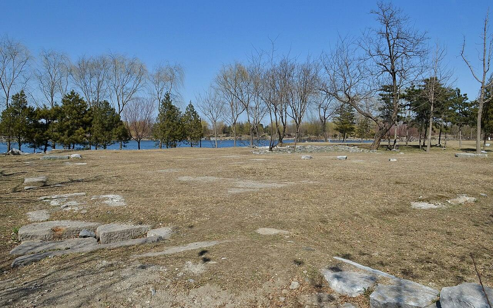
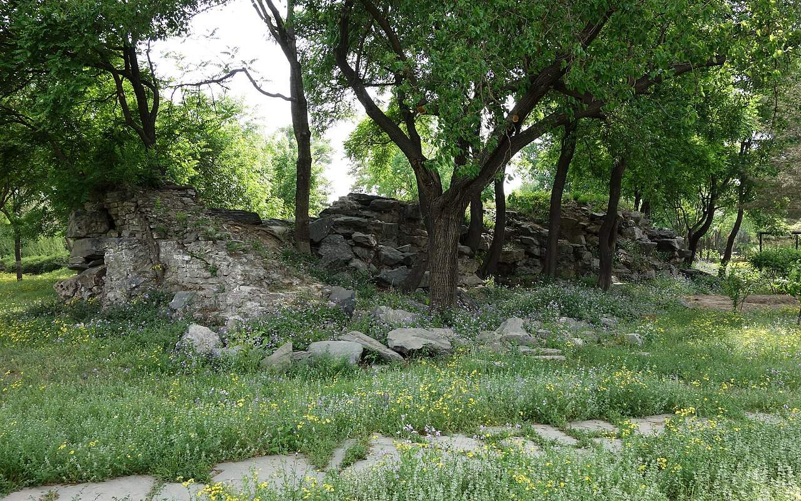
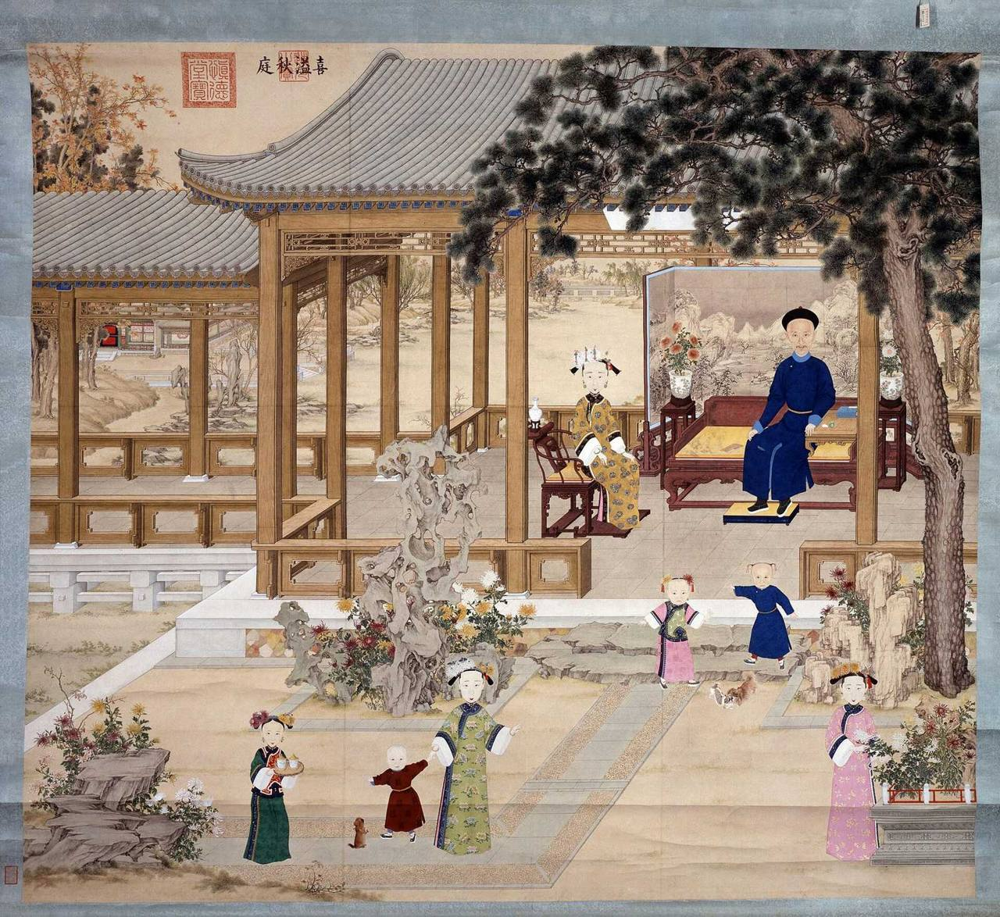

<!-- generated:start (scripts/building_pages.py): do not edit between these markers -->

# YM03-11: 慎德堂 Shende Tang

Yuanming Yuan

**3D object:** 1 box. Open it: `/reconstruction/3d.html?b=YM03-11`

**Part of:** YM03 九洲清晏

## What we know

- **Name:** 慎德堂 Shende Tang (S41, S43, S42, S01, S208, S337, S02, S310, S945 · confidence A)
- **Garden:** Yuanming Yuan (S41, S43, S42, S01, S208, S337, S02, S310, S945)
- **Type:** residence (S41, S43, S42, S01, S208, S337, S02, S310, S945 · confidence A)
- **Built:** 道光十一年 1831 (S41;S43); 道光十年 per S54; by 道光十一年五月 (1831): the 記 is in the 實錄; first dated use the next month; 1831, on the 怡情书史 and fish-pond area (S41, S43, S42, S01, S208, S337, S02, S310, S945)
- **Destroyed:** 1860 (S41, S43, S42, S01, S208, S337, S02, S310, S945)
- **Position:** 40.00350, 116.28976. S01 likely (S01 · confidence B)
- **Bays:** 5 in the texts / 5x4 on the plan (S41, S43, S42, S01, S208, S337, S02, S310, S945)
- **Size in the inventory:** 23.36 × 26.49 m. stated: S310, mhymy ysltd 7342 (慎德堂装修图样, free part), metres as printed; drawing not named (S01)
- **Where the text puts it:** 西路 (S42) (S41, S43, S42, S01, S208, S337, S02, S310, S945) *(research copy, not public)*
- **Note:** 五间三卷大寝宫 (S43). Daoguang died here (S43). In 1860 state only. Malone p.79 n.: Tongzhi said born here (hearsay). function: faces the large courtyard in the western part of the island; by one oral tradition the birthplace of the Tongzhi emperor, by another 碧桐书院 (S02, p.80 n.). after1860: Daoguang died in the sleeping chamber of 慎德堂 in 道光三十年正月 (1850) (S310, mhymy ysltd 7342). bays: 5 bays, 3 deep, under a three-roll 三卷 roof; front, middle and back sections with a study and bedchambers; the largest three-roll hall of the gardens; built 1831 west of the three-hall axis (S945, 概述; section 1 (figs 3-4 Yangshi Lei site plans before and after 1831)). (S41, S43, S42, S01, S208, S337, S02, S310, S945)
- **Plan reader's note:** 慎德堂: no label on plan. Malone p.80 note: a hall of this name faces on the large courtyard in the western part of the island; this is the only hall on that court. 5 bays x 3 rolls. Huge, 107 x 159 px. See dating in notes (S01) *(research copy, not public)*
- **How it was read:** likely (S01) *(research copy, not public)*
- **Plan pixels:** 3076, 4588 (S01) *(research copy, not public)*

## Our model now

A plain box on the block drawn on the Qing plan S01: position and frontage from the plan, heights and roof from the typology of its hall class. It will be updated as the research goes on.

- **Box:** 25.6 × 48 m, grand hall
- **Heights:** platform 1.22 m, eave 6.34 m, ridge 12.02 m above the ground
- **Roof:** hip-and-gable 歇山, rolled ridge 卷棚, 3 parallel rolls 勾连搭, grey tile
- **Faces:** 174.7° from north
- **Confidence:** B

## Pictures (4)

- **P0274** (likely): The Daoguang Emperor with his sons and daughters, horizontal scroll, plaque Clearing Mind and Rectifying Nature in the pavilion (ca. 1847 (S261)). https://www.hkpm.org.hk/en/exhibition/the-hong-kong-jockey-club-series-yuan-ming-yuan-art-and-culture-of-an-imperial-garden-palace Research-only: link card.
- **P0366** (sure): 九州清晏慎德堂遗址 20130324.JPG (2013-03-24 14:29:13 (Commons DateTimeOriginal)). https://commons.wikimedia.org/wiki/File:%E4%B9%9D%E5%B7%9E%E6%B8%85%E6%99%8F%E6%85%8E%E5%BE%B7%E5%A0%82%E9%81%97%E5%9D%80_20130324.JPG

  

- **P0451** (likely): 九州清晏遗址02 20130512.JPG (2013-05-12 15:54:56 (Commons DateTimeOriginal)). https://commons.wikimedia.org/wiki/File:%E4%B9%9D%E5%B7%9E%E6%B8%85%E6%99%8F%E9%81%97%E5%9D%8002_20130512.JPG

  

- **P0280** (guess): 道光帝喜溢秋庭图轴 Autumn Courtyard Overflowing with Happiness (printed 喜溢秋庭) (1833-34, slip dated 甲午 1834 (S262)). https://commons.wikimedia.org/wiki/File:%E9%81%93%E5%85%89%E5%B8%9D%E5%96%9C%E6%BA%A2%E7%A7%8B%E5%BA%AD%E5%9B%BE%E8%BD%B4.jpg

  

## Texts and drawings (31)

- **E1188** (text, sure): 宣宗實錄 御製慎德堂記. 1831 (道光十一年五月) · 實錄卷之一百八十九 · S208. https://github.com/garychowcmu/daizhigev20/blob/master/史藏/别史/清实录道光朝实录.txt
  > 己卯。御制慎德堂记曰。崇俭去奢慎修思永。孰不知其所当然哉。非知之艰。行之惟艰在士大夫犹患其位不期骄而骄禄不期侈而侈膺天命、绍大统者。可不兢兢焉惴惴焉懔夫皇天无亲。惟无是辅念夫祖功宗德创垂不易后世子孙。坐享承平之福纵不尚奢华。无所加增。自问已觉不安矣。若败度败礼视富贵为己所应有。是直不可与言者也。又奚能常保厥位耶。况我大清龙兴东土。首重朴实。列圣丕承。凡心法治法。无非以勤俭训后。诚以世变风移。敝化放心。有不期然而然之势苟非操之固。审之精朴素自甘。慎终如始难与言俭也。至于饮食勿。尚珍异。冠裳勿求华美耳目勿为物欲所诱。居处勿为淫巧所惑。此犹俭德之小者。不作无益害有益不贵异物贱用物。一丝一粟。皆出于民脂民膏思及此。又岂容逞欲妄为哉。所谓无为而治俾天下阴受其福。而民不知者是也然行俭责在一人。不以天下自奉非概从悭□□吝也若救饥拯溺。去暴安良。国用之常经。民生之休戚正措施之不遑。又何可稍存吝惜于其辨也。是以修身务存俭约之心。以期永久。图治之道。可不加慎而切记之乎。
  The Daoguang emperor's account of the hall's name: a statement on thrift. He says one must spare nothing to aid the people, while holding one's own needs down. It names no building detail.
- **E1189** (text, sure): 宣宗實錄 道光十一年六月壬午. 1831 (道光十一年六月) · 實錄卷之一百九十 · S208. https://github.com/garychowcmu/daizhigev20/blob/master/史藏/别史/清实录道光朝实录.txt
  > 壬午。上奉皇太后幸慎德堂。进膳。
  The first of many entries in which the emperor takes his mother to 慎德堂 for a meal. This is one month after the 記.
- **E1180** (text, sure): 郎潛紀聞初筆. late 19th c., on 1850 · line 481 of the corpus file · S216. https://github.com/garychowcmu/daizhigev20/blob/master/史藏/志存记录/郎潜纪闻初笔.txt
  > ◎宣宗立文宗为太子事季文敏公《丹魁堂年谱》，纪宣宗立文宗为太子事甚详确，谨录之。谱云：“道光庚戌正月，上违豫久，犹日至奉三无私（敬按：四字别殿名），召见办事。十三日召见慎德堂（敬按：寝宫名），仅军机大臣、大学士祁｛宀隽｝藻、杜受田，尚书何汝霖，侍郎陈孚恩、季芝昌五人，语良久。十四日卯初刻，诸臣甫入直，已传旨召对，凡十人，盖定郡王载铨及大军机五人，御前大臣怡亲王载垣、郑亲王端华、科尔沁王僧格林沁三人，暨内务府大臣、步军统领尚书文庆也。上冠服端坐，命至榻前，告以立今上为皇太子。须臾，今上入，上取缄匣朱旨传示，并谕勉诸臣，毕，各退。今上命军机五人同阅章奏，移时，甫还直庐，忽急宣趋入，惊闻大行皇帝龙驭上宾矣。”康祺按：道学家言，每以易箦启手，神志湛然，为生平学道之效。况万乘天子，临御多年，髦期而不闻倦勤，大渐而从容审训，缀衣当出庭之日，冕服无凭几之容，兢兢业业，钦始钦终，非圣人其孰能之。
  The same events of January 1850 from the 丹魁堂年譜 of 季芝昌, a minister who was present.
- **E1190** (text, sure): 文宗實錄 道光三十年正月丁未. 1850 (道光三十年正月) · 實錄卷之一 · S207. https://github.com/garychowcmu/daizhigev20/blob/master/史藏/别史/清实录咸丰朝实录.txt
  > 丁未。宣宗成皇帝宾天。时宣宗居圆明园慎德堂孝和睿皇后苫次。卯刻。召宗人府宗令载铨、御前大臣载垣、端华、僧格林沁、军机大臣穆彰阿、赛尚阿、何汝霖、陈孚恩、季芝昌、内务府大臣文庆、宣示朱谕。立皇四子奕詝为皇太子。午刻。宣宗疾大渐。上哭诣慎德堂。少顷。宣宗升遐。上稽颡哀恸呼号。
  The Daoguang emperor died in 慎德堂, naming his fourth son heir there the same morning.
- **E1183** (text, sure): 清稗類鈔 宣宗立文宗為太子. 1917, on 1850 · line 1887 of the corpus file · S214. https://github.com/garychowcmu/daizhigev20/blob/master/子藏/类书/清稗类钞.txt
  > 宣宗立文宗为太子道光庚戌正月，宣宗违豫久，犹日至奉三无私， 「 四字别殿名。」 召见办事。十三日，召见慎德堂， 「 寝宫名。」 仅军机大臣大学士祁寯藻， 杜受田， 尚书何汝霖， 侍郎陈孚恩， 季芙昌五人， 语良久。 十四日卯初， 诸臣甫入直， 已传旨召对， 凡十人， 盖定郡王载铨， 及军机大臣五人， 御前大臣怡亲王载垣， 郑亲王端华， 科尔沁王僧格林沁三人， 暨内务府大臣步军统领尚书文庆也。 宣宗冠服端坐， 命至榻前， 告以立文宗为皇太子。 须臾， 文宗入， 宣宗取缄匣朱旨传示， 并谕勉诸臣， 毕， 各退。 文宗命军机大臣五人同阅章奏。 移时， 甫还直庐， 忽急宣趋入， 惊闻大行皇帝龙驭上宾矣。
  Glosses 奉三無私 as a side hall and 慎德堂 as the bedroom: in the last days the emperor worked in the first and saw his ministers in the second.
- **E1123** (poem, sure): 慎德堂: 道光十一年 poem of the Daoguang Emperor. 道光十一年 (1831), date from the compilation · p.129 item (1), under 慎德堂 · S360. https://www.yuanmingyuanpark.cn/xs/yjbg/202007/P020200730387572832602.pdf#page=129
  > 崇俭去奢，慎修思永，孰不知其所当然哉！非知之艰，行之惟艰，在士大夫犹患其位不期骄而骄、禄不期侈而侈，膺天命绍大统者，可不兢兢焉、惴惴焉？懔夫皇天无亲，惟无是辅，念夫祖功宗德创垂不易，后世子孙坐享承平之福，纵不尚奢华、无所加增，自问已觉不安矣！若败度败礼，视富贵为己所应有，是直不可与言者也，又奚能常保厥位耶？况我大清龙兴东土，首重朴实，列圣丕承，凡心法治法，无非以勤俭训后，诚以世变风移，敝化放心。有不期然而然之势，苟非操之固。审之精朴素自甘，慎终如始难与言俭也。至于饮食勿尚珍异，冠裳勿求华美，耳目勿为物欲所诱，居处勿为淫巧所惑，此犹俭德之小者。不作无益害有益，不贵异物贱用物，一丝一粟皆出于民脂民膏，思及此，又岂容逞欲妄为哉？所谓无为而治，俾天下阴受其福而民不知者，是也。然行俭责在一人，不以天下自奉非概从悭悋也，若救饥拯溺、去暴安良，国用之常经、民生之休戚，正措施之不遑，又何可稍存吝惜于其辨也！是以修身务存俭约之心，以期永久图治之道，可不加慎而切记之乎？道光十一年岁次辛卯季春月御制。
  Poem of the Daoguang Emperor at 慎德堂, 1831. Year as given by the compilation.
- **E1130** (text, sure): Qing record: 慎德堂. 道光十一年 (1831) · p.9 item (1), under 慎德堂 · S360. https://www.yuanmingyuanpark.cn/xs/yjbg/202007/P020200730387572832602.pdf#page=9
  > 崇俭去奢，慎修思永，孰不知其所当然哉！非知之艰，行之惟艰，在士大夫犹患其位不期骄而骄、禄不期侈而侈，膺天命绍大统者，可不兢兢焉、惴惴焉？懔夫皇天无亲，惟无是辅，念夫祖功宗德创垂不易，后世子孙坐享承平之福，纵不尚奢华、无所加增，自问已觉不安矣！若败度败礼，视富贵为己所应有，是直不可与言者也，又奚能常保厥位耶？况我大清龙兴东土，首重朴实，列圣丕承，凡心法治法，无非以勤俭训后，诚以世变风移，敝化放心。有不期然而然之势，苟非操之固。审之精朴素自甘，慎终如始难与言俭也。至于饮食勿尚珍异，冠裳勿求华美，耳目勿为物欲所诱，居处勿为淫巧所惑，此犹俭德之小者。不作无益害有益，不贵异物贱用物，一丝一粟皆出于民脂民膏，思及此，又岂容逞欲妄为哉？所谓无为而治，俾天下阴受其福而民不知者，是也。然行俭责在一人，不以天下自奉非概从悭悋也，若救饥拯溺、去暴安良，国用之常经、民生之休戚，正措施之不遑，又何可稍存吝惜于其辨也！是以修身务存俭约之心，以期永久图治之道，可不加慎而切记之乎？道光十一年岁次辛卯季春月御制。
  道光 Daoguang's own essay on thrift for the hall, 慎德堂记, dated spring 1831.
- **E1124** (poem, sure): 慎德堂: 道光十二年 poem of the Daoguang Emperor. 道光十二年 (1832), date from the compilation · p.129 item (2), under 慎德堂 · S360. https://www.yuanmingyuanpark.cn/xs/yjbg/202007/P020200730387572832602.pdf#page=129
  > 为爱新堂远俗缘，不雕不绘喜安便。面开松嶂涛初起，背映冰湖月正圆。永戒骄奢心勿放，时操勤俭力须坚。清虚静泰承天语（奉三无私殿内恭悬皇祖御书“清虚静泰”扁额），气志由中悟浩然。
  Poem of the Daoguang Emperor at 慎德堂, 1832, on daily residence there. Year as given by the compilation.
- **E1128** (poem, sure): 慎德堂: 咸丰七年 poem of the Xianfeng Emperor. 咸丰七年 (1857), date from the compilation · p.130 item (7), under 慎德堂 · S360. https://www.yuanmingyuanpark.cn/xs/yjbg/202007/P020200730387572832602.pdf#page=130
  > 巍峨广殿月偏多，绕树栖鸟三两过。慎宪省成子意切，朝朝勤政引鸣珂。经营尚忆我生年，（慎德堂落成于道光辛卯）受命恩深倍惕乾。 （庚戌春宣谕立储在兹殿之寝宫）往事何堪重回首，多情惟有月知圆。
  Poem of the Xianfeng Emperor at 慎德堂, 1857, on the view and daily residence there. Year as given by the compilation.
- **E1153** (description, likely): Scene 3, 九洲清晏 Jiuzhou Qingyan: the emperor's apartments. 1934 · pp.77-79 · S02. https://archive.org/details/historyofpekings00malo
  > The island occupied by the imperial residence is the largest of all and is so covered with buildings and courtyards that there is room for only a little ornamental rock work and almost no artificial hills.
  On the island north of the hall across the Front Lake: 圆明园殿 on the south, a court, a seven-bay hall, a second court, then 九洲清晏 facing the Back Lake. The 1737 map by Castiglione and five Chinese artists hung in 清晖阁 in the western half. Nine islands, scenes 3 to 11, each with two to four bridges. Note 30: a pasted sheet on the Official Map shows a later rearrangement here.
- **E1037** (description, guess): Swinhoe: from the hall to the emperor's rooms. 1860 · pp.296-298 · S241. https://archive.org/details/narrativeofnorth00swin
  > Behind the grand hall was rockery, and in rear of that again a large pond, so that a pebbled path leading over a bridge and taking a semicircular sweep of half the water, had to be traversed before you visited the next hall.
  About 500 yards to a smaller hall with images of Buddha in rooms each side, then another reception hall and a third, and on the left the emperor's own rooms: one moderate room with a double-seated throne, chandelier, clocks; passage to two small rooms and a spiral stair to two upper rooms with books, whose windows look down into the hall; two retiring rooms and the bedroom. The 1858 treaty lay on a table. This fits the axis 圆明园殿, 奉三无私, 九洲清晏; the ids are my reading.
- **E1150** (description, guess): M'Ghee: the imperial apartments. 1860 · pp.208-210 · S242. https://archive.org/details/howwegotintopek01ghegoog
  > and a spiral staircase, the only one in the building, led to a similar suite of apartments overhead,
  Courtyard plan. State room with dark carved furniture and wainscot, then a court about 50 ft square flagged in marble, a larger room with jade, china, enamel, clocks, mirrors, chandeliers. Rooms of the court ladies on the extreme left, with the only spiral stair. Front on another sheet of water with large planted rockeries. To the right the buildings ran about half a mile: officials, servants, stores with shelved rooms of labelled objects. Swinhoe p.297 also has a spiral stair. 慎德堂 is my guess for the emperor's rooms under Xianfeng.
- **E1191** (description, sure): 九洲清晏 west road, 1831. 2020, on Yangshi Lei plans · section 三, end · S41. http://iqh.ruc.edu.cn/old/qdhjylyjzx/xszl/jzys/8eef05885c3e4279ae0132f1a37a13c9.htm
  慎德堂 was added on the west road in 1831, with 乐安和 and 怡情书史 removed. 怡情书史 is therefore a state of before 1831, not of 1860.
- **E2463** (description, sure): 慎德堂装修图样 (record text). record 2020-22 · mhymy dasl/ysltd/7342 · S310. https://www.mhymy.com/dasl/ysltd/7342.html
  Record on 慎德堂: five bays under three linked roofs, built 1831 over 乐安和, 怡情书史 and a fish pond; bay widths, depths, column and platform height in metres (dim rows); Daoguang died there in 1850. Drawing behind the figures not named.
- **E1148** (description, sure): 圆明园百景史事分景汇编: 慎德堂. 1831-1857 · from p.129, under 九洲清晏 · S360. https://www.yuanmingyuanpark.cn/xs/yjbg/202007/P020200730387572832602.pdf#page=129
  Daoguang's essay on thrift, 慎德堂记, is dated spring 1831. Xianfeng lived here in 1856-1857, though the compiler's captions for those years wrongly name 道光帝. 慎德堂: 7 dated items, 1831-1857, of which 7 poems (Daoguang, Xianfeng); recurring themes: daily residence there, the view. First dated 1831, last dated 1857.
- **E0453** (description, likely, search index only): 《圆明园 1707-1850 修建过程》. 1707-1850 · S317. https://www.mhymy.com/dasl/2278.html
  Year-by-year building chronology citing the Imperial Household archives, including the 1831 rebuilding that produced Shende Tang.
- **E1156** (drawing, sure): 慎德堂室内装修平面图（一）. 道光十六年以前 (record prints 道光十六年(1826), Daoguang 16 is 1836) · 国家图书馆善本部 样005-4号 · S310. https://www.mhymy.com/dasl/ysltd/10529.html
  Presentation plan of Shende Tang's interior before the fire of 1836, likely its fittings as built in 1831, 369x333 mm, ink with yellow slips. No image here; the site may ask a small payment for the full record.
- **E1157** (drawing, sure): 慎德堂内檐装修尺寸地盘画样. after c. 1830 · 国家图书馆 · S13. https://book.douban.com/review/10163867/
  Interior fittings and sizes, named in the printed volume's preface; no number given.
- **E1158** (drawing, sure): 慎德堂明间后檐支摘窗一槽立样. after c. 1830 · 国家图书馆 · S13. https://book.douban.com/review/10163867/
  Elevation of one set of windows on the rear of the central bay, named in the printed volume's preface; no number given.
- **E1159** (drawing, sure): 慎德堂添安装修地盘样. after c. 1830 · 国家图书馆 · S13. https://book.douban.com/review/10163867/
  One of several dozen Shende Tang sheets named in the printed volume's preface; no number given.
- **E1160** (drawing, sure): 慎德堂室内装修平面图（二）. 咸丰元年 (1851) 八月二十六日 (inscription) · 国家图书馆善本部 样011-12号 · S310. https://www.mhymy.com/dasl/ysltd/10570.html
  Design sheet reworking the old Shende Tang interior, inscribed 26th of the 8th month of Xianfeng 1 (1851); its own page URL not seen, link is the site's Shende Tang list. No image here; the site may ask a small payment for the full record.
- **E1174** (drawing, sure): 慎德堂室内装修平面图（三）. 咸丰六年 (1856) 正月二十二日 · 国家图书馆善本部 样008-11号 · S310. https://www.mhymy.com/dasl/ysltd/10577.html
  Plan of Shende Tang's interior later than the 1851 sheet, with the front bay rebuilt as an indoor stage; own page URL, shelf number and date not seen. No image here; the site may ask a small payment for the full record.
- **E1164** (drawing, sure): 慎德堂室内装修平面图（四）. 原无年代; 指向咸丰九年 (1859) 旨意档 · 国家图书馆善本部 样017-12号 · S310. https://www.mhymy.com/dasl/ysltd/10598.html
  Undated plan of Shende Tang's interior, mostly like 样003-5 with added loft symbols in the east bay, tied by the site to an order of Xianfeng 9 (1859), so the last state before the destruction. No image here; the site may ask a small payment for the full record.
- **E1165** (drawing, sure): 慎德堂平面图. 咸丰九年 (1859) 七月二十六日 · 国家图书馆善本部 样008-18号 · S310. https://www.mhymy.com/dasl/ysltd/10636.html
  Plan of Shende Tang recording a revision of July 1859 of the west loft, turning the straight stair into a turning stair; own page URL, shelf number not seen. No image here; the site may ask a small payment for the full record.
- **E1173** (drawing, sure, search index only): 慎德堂室内装修图 (cited as 样003-5). 国家图书馆 样003-5 · S310. https://www.mhymy.com/tag/598
  Sheet cited as close to Shende Tang interior plan （四）; its own record not seen. No image here; the site may ask a small payment for the full record.
- **E0548** (plan, sure): 三幅样式雷圆明园河道全图辨析. 2024-06-18 post · NLC 043-001, -002, -003 · S337. http://iqh.ruc.edu.cn/old/qdhjylyjzx/xszl/jzys/59b83e20f7ab4840b746a6208a550939.htm
  Dates three NLC Yangshi Lei water-course plans (about 1:2000) by the changes they show. It lists dated works: 1803 channel from 宁和镇 to 秀清村; 1810 镜远洲 at 平湖秋月; 1811 恒春堂; after 1828 清晖阁 replaced by 湛静斋; 1831 慎德堂; 1836 九州清晏殿 reduced to five bays with 同道堂 added west; 1846 洞天深处 four courts to two.
- **E0550** (plan, sure): 圆明园新证—乾隆朝圆明园全图的发现与研究 (端木泓). post n.d. · 故宫博物院图书馆 no.1704 · S337. http://iqh.ruc.edu.cn/old/qdhjylyjzx/xszl/xstl/1c9094aef4f041148f15883c7c266cb9.htm
  Argues Palace Museum Library plan no.1704, paper, about 17.6 x 13.1 m, is the earliest complete plan of the Qianlong garden. About a hundred pasted corrections sit over the base layer, recording changes from Qianlong 44 (1779) to Daoguang 11 (1831, 慎德堂). 坐石临流 is one scene shown both ways.
- **E0551** (plan, sure): 法国巴黎《圆明园地盘全图》考辨 (王其亨, 张凤梧). post n.d. · Musée Guimet plan · S337. http://iqh.ruc.edu.cn/old/qdhjylyjzx/xszl/hwyj/f075d549d1d94c89bc870ce17d7f8eb1.htm
  Studies the plan of the whole garden in the Musée Guimet, Paris, the only one known outside China. Worked from photographs by permission. The west gallery of 慎德堂 already shows its 1858 change, so the plan's last state is close to the eve of 1860: a direct witness for the target state.
- **E2262** (plan, sure): 圆明园新证, 端木泓: dated additions shown on plan 1704. post n.d. · tables 1 and 2 · S337. http://iqh.ruc.edu.cn/old/qdhjylyjzx/xszl/xstl/1c9094aef4f041148f15883c7c266cb9.htm
  Tables of when things were added, drawn from archives to date the plan's layers: 藻园 1752, 廓然大公 eight views 1754, 春雨轩 1755, 藏密楼 1758, 多稼轩 ten views 1759, 紫碧山房 1760, 安澜园 and 澄练楼 1763, 若帆之阁 1764, 汇万总春之庙 1769, 文源阁 1775, 法源楼 1779; after: 兰亭八柱 1779, 知过堂 1782, 课农轩 1816, 涵月楼 1827. The most useful single dating table found.
- **E1175** (plan, likely): 法国巴黎《圆明园地盘全图》考辨: names and red lines at 九洲清晏 (王其亨, 张凤梧, 《中国园林》2009 no.12). 2009, on a plan of 1858-1873/74 · section 年代推断 · S337. http://iqh.ruc.edu.cn/old/qdhjylyjzx/xszl/hwyj/f075d549d1d94c89bc870ce17d7f8eb1.htm
  The Guimet plan also carries the labels 思顺堂 and 承恩堂, with red lines of the Tongzhi project at 九洲清晏: a fourth depth for 慎德堂, a changed 同道堂 with its theatre, 九洲清晏殿 changed, and in the east road a square pavilion, galleries and a rear hall, with a pool. The authors date the red lines to 1873-74 and the base plan to 1858 or later. S01 at the same place shows a square pavilion in a round pool in the court south of its 七间殿.
- **E1176** (archaeology, sure): 九洲清晏区域考古勘探报告. n.d. · mhymy 档案史料 12600, free part · S151. https://www.mhymy.com/dasl/12600.html
  Survey report's opening: the island site measures 220 x 120 m (printed area 25,000 m2), with 8,600 m2 of buildings, 656 bays of halls and galleries in middle, east and west routes, not symmetrical. The earliest hall, 清晖阁 Qinghui Ge, is given as 1707, and building went on into Daoguang. The survey results themselves sit behind a paywall.

**On the plan:** Drawn on the plan of the gardens (S01) with no label, 5x4 cells: a building stood here, its name unknown. https://artmuseum.princeton.edu/collections/objects/138657

## Evidence for the set of buildings

- Evidence for the whole compound 九洲清晏: see YM03
- Reconstructions and comparables for the whole garden, 圆明园 Yuanming Yuan: see GARDEN-YM
- Standing buildings comparable to a grand hall (not this building): see CLASS-grand_hall

## Open questions

- Q1: Target state
- Q3: Which state does S01 draw?
- Q25: Other dates
- Q120: Q36 / YM03
- Q131: YM03
- Q182: Typology, grand_hall heights

<!-- generated:end -->

## Notes

<!-- Yours: regeneration never touches this part. It goes on the public site; what you write below a line holding only %% private %% stays in the research copy. -->
