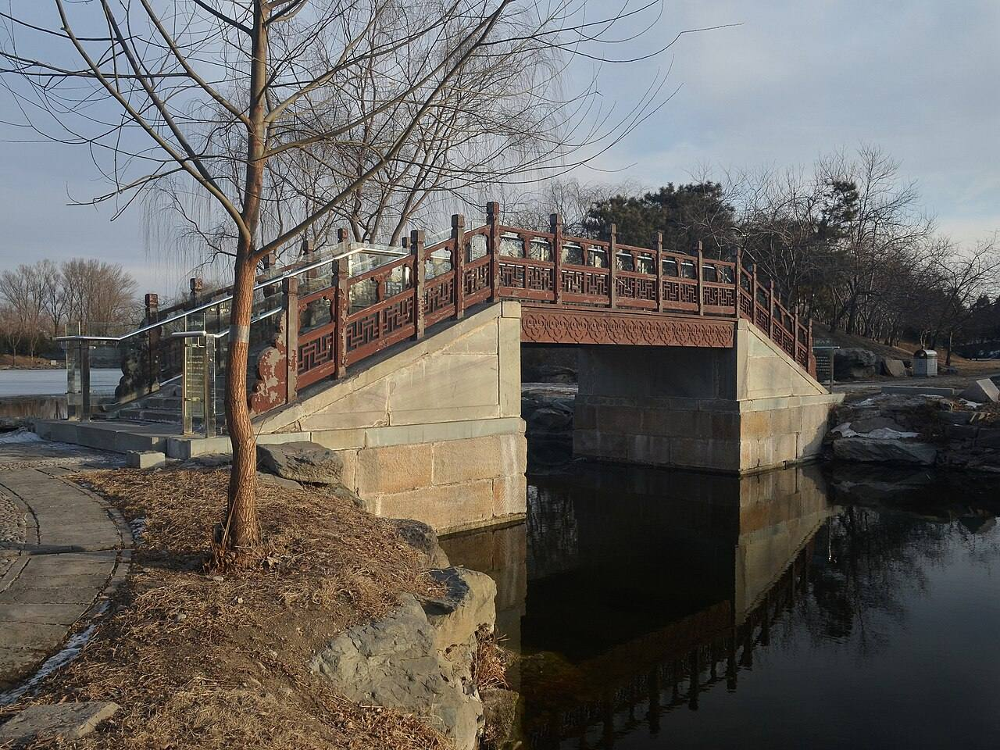

<!-- generated:start (scripts/building_pages.py): do not edit between these markers -->

# YM03-22: 南大桥 Nanda Qiao

Yuanming Yuan

**3D object:** none yet.

**Part of:** YM03 九洲清晏

## What we know

- **Name:** 南大桥 Nanda Qiao (S06 · confidence B)
- **Garden:** Yuanming Yuan (S06)
- **Type:** bridge (S06 · confidence B)
- **Destroyed:** 1860 (S06)
- **Position:** Not placed: the name was not found on the plan.
- **Where the text puts it:** 岛南 西 (S06) (S06) *(research copy, not public)*

## Our model now

The bridge from the island's south-west corner to the shore of 正大光明 (S01, the label sure), its deck at the level Round 10 gives it: dressed-stone abutments as today's bridge rebuilt on the old ones shows (P0367, B), a timber deck on posts with red railings as the 1744 leaf paints the island's west bridge (S08 P0003, A for 1744). Its span's timber and its posts are C.

- **Abutments:** Dressed stone at both ends (today's rebuilding on the old ones, P0367, B)
- **Deck:** Timber on posts, 3 m wide (Round 9's bridges), at Round 10's levels
- **Railings:** Red posts and two rails (the 1744 leaf, A for 1744; their rhythm C)

## Pictures (1)

- **P0367** (sure): Nanda Bridge in Yuanmingyuan Ruins 20130201.JPG (2013-02-01 16:19:29 (Commons DateTimeOriginal)). https://commons.wikimedia.org/wiki/File:Nanda_Bridge_in_Yuanmingyuan_Ruins_20130201.JPG

  

## Texts and drawings (0)

None of its own.

## Evidence for the set of buildings

- Evidence for the whole compound 九洲清晏: see YM03
- Reconstructions and comparables for the whole garden, 圆明园 Yuanming Yuan: see GARDEN-YM

**Searched and not found:** No text or drawing names it in 日下旧闻考 j80-82, the Qianlong poems on Kanripo, 養吉齋叢錄, Malone 1934, the witnesses of 1860, what search indexes show of the Yangshi Lei drawings.

## Open questions

- Q194: How did the emperor cross the 前湖 from 九洲清晏?
- Q203: Water layer and shores

<!-- generated:end -->

## Notes

<!-- Yours: regeneration never touches this part. It goes on the public site; what you write below a line holding only %% private %% stays in the research copy. -->
