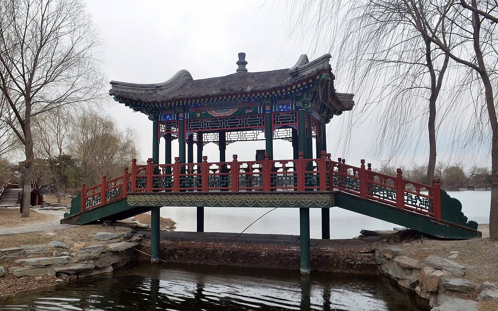

<!-- generated:start (scripts/building_pages.py): do not edit between these markers -->

# YM03-23: 棕亭桥 Zongting Qiao

Yuanming Yuan

**3D object:** none yet.

**Part of:** YM03 九洲清晏

## What we know

- **Name:** 棕亭桥 Zongting Qiao (S41 · confidence B)
- **Garden:** Yuanming Yuan (S41)
- **Type:** bridge (S41 · confidence B)
- **Changed:** 3-span plank bridge in silk album, with a pavilion in the woodcut; repaired 1777 (S41) (S41)
- **Destroyed:** 1860 (S41)
- **Position:** Not placed: the name was not found on the plan.
- **Where the text puts it:** 九州清晏岛西北角 到茹古涵今 (S41) (S41) *(research copy, not public)*

## Our model now

棕亭桥 at the island's north-west corner (S01, the label read as a guess): a bridge with a pavilion on it, as its name and today's rebuilding show (P0368, B for the type); every size and the roof are C.

- **Pavilion:** Four columns and a pyramid roof on the bridge's middle (the name, P0368: C)
- **Deck:** Timber with red railings at Round 10's levels; stone abutments (C)

## Pictures (1)

- **P0368** (sure): Zongting Bridge 20130318.JPG (2013-03-18 17:27:22 (Commons DateTimeOriginal)). https://commons.wikimedia.org/wiki/File:Zongting_Bridge_20130318.JPG

  

## Texts and drawings (1)

- **E0508** (description, likely): 圆明园历史桥梁形制研究. 2020-07-29 · 圆明园官网 yjbg t20200729_4416663 · S338. https://www.yuanmingyuanpark.cn/xs/yjbg/202007/t20200729_4416663.html
  Park study of the forms of the garden's historic bridges, from archives and digs, intended to guide new bridges. Abstract on the page, the full text is an attached PDF.

## Evidence for the set of buildings

- Evidence for the whole compound 九洲清晏: see YM03
- Reconstructions and comparables for the whole garden, 圆明园 Yuanming Yuan: see GARDEN-YM

## Open questions

None that name it.

<!-- generated:end -->

## Notes

<!-- Yours: regeneration never touches this part. It goes on the public site; what you write below a line holding only %% private %% stays in the research copy. -->
