<!-- generated:start (scripts/building_pages.py): do not edit between these markers -->

# YM03: 九洲清晏 Jiuzhou Qingyan

The Emperor's Private Apartments (Nine Continents Clear and Calm) · Yuanming Yuan

**3D object:** 55 boxes. Open it: `/reconstruction/3d.html?b=YM03`

## What we know

- **Name:** 九洲清晏 Jiuzhou Qingyan (S05, S02, S08, S41, S42, S43, S01, S208, S360 · confidence A)
- **English:** The Emperor's Private Apartments (Nine Continents Clear and Calm) (S05, S02, S08, S41, S42, S43, S01, S208, S360)
- **Written on the plan:** 圆明园殿 (S01 · confidence A)
- **Garden:** Yuanming Yuan (S05, S02, S08, S41, S42, S43, S01, S208, S360)
- **Type:** scene (S05, S02, S08, S41, S42, S43, S01, S208, S360 · confidence A)
- **Built:** 最早建筑清晖阁 康熙四十六年 1707 (S42); name under Yongzheng (S42) (S05, S02, S08, S41, S42, S43, S01, S208, S360)
- **Changed:** 1765 四景 added (S05); 1831 慎德堂, 乐安和/怡情书史 removed (S41; S43); 1836 fire on the central axis, 3 halls rebuilt (S41; S54); 1837 同道堂 (S43); 1855 theatre (S43); Fire on 丙申九月二十六日 (1836). 圓明園殿, 奉三無私 and 九洲清晏 rebuilt to the old form, finished 道光十七年 (1837); 1836 fire; three halls rebuilt by 1837 (S05, S02, S08, S41, S42, S43, S01, S208, S360)
- **Destroyed:** 1860 (S05, S02, S08, S41, S42, S43, S01, S208, S360)
- **Position:** 40.00369, 116.29029. S01 sure (S01 · confidence B)
- **Note:** S42: 东西长220 m, 南北宽120 m, 占地25000 m2, 建筑面积8600 m2, 殿宇游廊656间. Rixia spells 九州清宴. Plan readers: the 1860 state of the west road is the Daoguang one. Album does not show the 1860 state here (S41). (S05, S02, S08, S41, S42, S43, S01, S208, S360)
- **Plan reader's note:** Identified by 圆明园殿 label, 前湖 and 后湖 labels. plan_x,y = presumed 九洲清晏殿 B0805 (S01) *(research copy, not public)*
- **How it was read:** sure (S01) *(research copy, not public)*
- **Plan pixels:** 3303, 4518 (S01) *(research copy, not public)*

## Our model now

55 boxes stand in this compound, 55 on blocks drawn on the plan, 0 assumed. Its halls are listed below.

## Inside it (73)

- YM03-01 圆明园殿
- YM03-02 奉三无私殿
- YM03-03 九洲清晏殿
- YM03-04 天地一家春
- YM03-05 乐安和
- YM03-06 清晖阁
- YM03-07 露香斋
- YM03-08 茹古堂
- YM03-09 松云楼
- YM03-10 涵德书屋
- YM03-11 慎德堂
- YM03-12 壶天仙籁戏台
- YM03-13 同道堂
- YM03-14 同道堂戏台
- YM03-15 怡情书史
- YM03-16 昭吟镜亭
- YM03-17 基福堂
- YM03-18 性存斋
- YM03-19 永春室
- YM03-20 泉石自娱
- YM03-21 如意桥
- YM03-22 南大桥
- YM03-23 棕亭桥
- YM03-AC003
- YM03-AC004
- YM03-B0808
- YM03-B0809
- YM03-B0836
- YM03-B0837
- YM03-B0839
- YM03-B0840
- YM03-B0863
- YM03-B0864
- YM03-B0865
- YM03-B0866
- YM03-B0870
- YM03-B0872
- YM03-B0874
- YM03-B0875
- YM03-B0877
- YM03-B0878
- YM03-B0879
- YM03-B0900
- YM03-B0901
- YM03-B0903
- YM03-B0905
- YM03-B0906
- YM03-B0907
- YM03-B0908
- YM03-B0909
- YM03-B0910
- YM03-B0911
- YM03-B0912
- YM03-B0913
- YM03-B0914
- YM03-B0915
- YM03-B0916
- YM03-B0917
- YM03-B0918
- YM03-B0919
- YM03-B0920
- YM03-B0930
- YM03-B0931
- YM03-B0932
- YM03-B0933
- YM03-B0936
- YM03-N01 七间殿
- YM03-N02 福寿仁恩
- YM03-N03 后殿
- YM03-N04 思顺堂
- YM03-N05 前殿
- YM03-N06 承恩堂
- YM03-N07 同顺堂

## Pictures (14)

- **P0003** (sure): 九州清晏 Jiuzhou qingyan [Paix sur les Neufs Continents] (圓明園四十景, 第3景) (1744 (BnF record: 1744年，清朝乾隆九年)). https://commons.wikimedia.org/wiki/File%3A%E5%9C%93%E6%98%8E%E5%9C%92%E5%9B%9B%E5%8D%81%E6%99%AF._%E7%AC%AC%E4%B8%89%E6%99%AF_%28%E4%B8%8A%E5%86%8C%EF%BC%8C%E7%AC%AC%E4%B8%89%E5%B9%85%E5%9B%BE%29%2C_%E4%B9%9D%E5%B7%9E%E6%B8%85%E6%99%8F_-_%28%E6%B8%85%29%E5%94%90%E5%B2%B1%E3%80%81%E6%B2%88%E6%BA%90%E5%90%88%E7%95%AB_%3B_%28%E4%B9%BE%E9%9A%86%E5%90%9F%E8%AF%97%EF%BC%8C%E6%B1%AA%E7%94%B1%E6%95%A6%E4%BB%A3%E4%B9%A6%29Jiuzhou_qingyan_-_%28Qing%29Tang_Dai%2C_Shen_Yuan_he_hua_-_btv1b550083441.jpg

  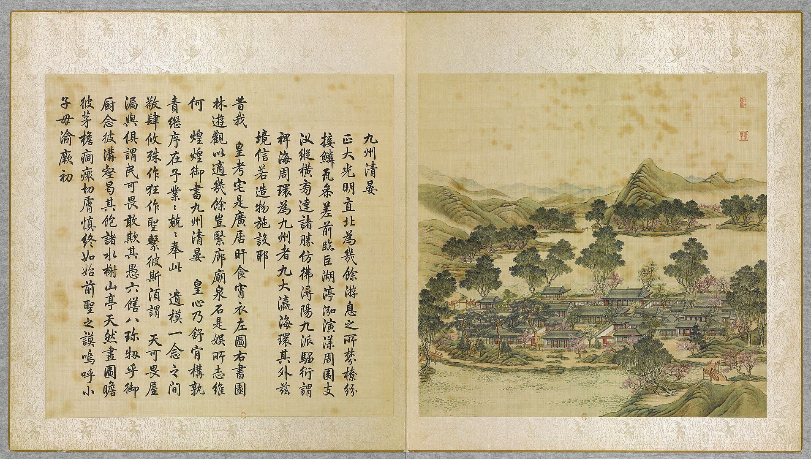

- **P0089** (sure): 中国皇帝的宫殿与庙宇. 第29幅图, 九州清晏 - (清)孙祜、沈源Jiuzhou qingyan - (Qing)Sun Hu, Shen Yuan (1745 (Commons, from the BnF record)). https://commons.wikimedia.org/wiki/File%3A%E4%B8%AD%E5%9B%BD%E7%9A%87%E5%B8%9D%E7%9A%84%E5%AE%AB%E6%AE%BF%E4%B8%8E%E5%BA%99%E5%AE%87._%E7%AC%AC29%E5%B9%85%E5%9B%BE%2C_%E4%B9%9D%E5%B7%9E%E6%B8%85%E6%99%8F_-_%28%E6%B8%85%29%E5%AD%99%E7%A5%9C%E3%80%81%E6%B2%88%E6%BA%90Jiuzhou_qingyan_-_%28Qing%29Sun_Hu%2C_Shen_Yuan_-_btv1b10520661v.jpg

  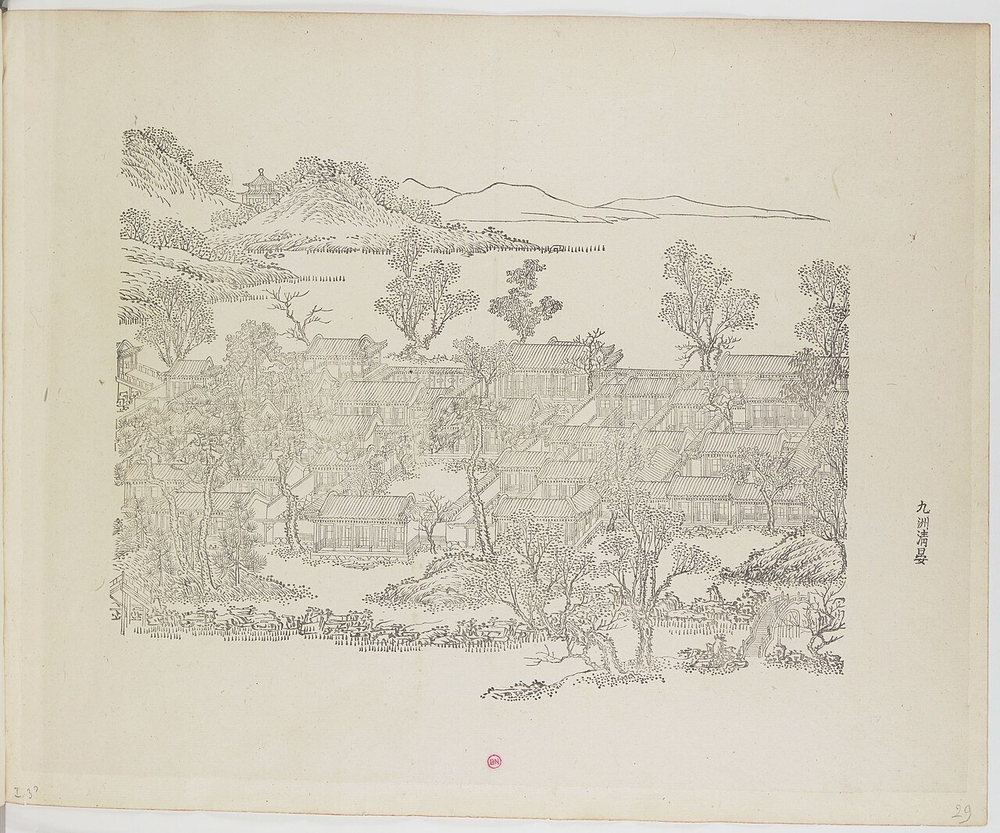

- **P0103** (sure): 海淀(镇)：中国皇帝的行宫. 第3幅图, 九州清晏Jiuzhou qingyan (1750-1792 (BnF, cb43831905b; ex coll. Bertin)). https://commons.wikimedia.org/wiki/File%3A%E6%B5%B7%E6%B7%80%28%E9%95%87%29%EF%BC%9A%E4%B8%AD%E5%9B%BD%E7%9A%87%E5%B8%9D%E7%9A%84%E8%A1%8C%E5%AE%AB._%E7%AC%AC3%E5%B9%85%E5%9B%BE%2C_%E4%B9%9D%E5%B7%9E%E6%B8%85%E6%99%8FJiuzhou_qingyan_-_btv1b10520654s.jpg

  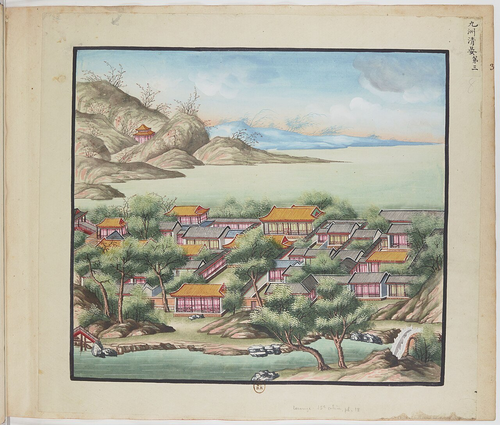

- **P0272** (sure): The Qianlong Emperor at Leisure (scroll formerly pasted inside a garden building) (c. 1765-67 (S262)). https://asianartnewspaper.com/yuanming-yuan-in-paintings/ Research-only: link card.
- **P0274** (likely): The Daoguang Emperor with his sons and daughters, horizontal scroll, plaque Clearing Mind and Rectifying Nature in the pavilion (ca. 1847 (S261)). https://www.hkpm.org.hk/en/exhibition/the-hong-kong-jockey-club-series-yuan-ming-yuan-art-and-culture-of-an-imperial-garden-palace Research-only: link card.
- **P0234** (sure): 九州清晏 Jiuzhou Qingyan (御製圓明園圖詠, 1887 石印本, 上卷 (Commons 卷一), 第3景; printed title in the right margin of the picture) (光緒十三年 1887 (Commons/NLC record; colophon 光緒十三年七月天津石印書屋 in the SSID copy, S98 PDF p.2); design after the woodblock of 1745 by 孫祜 Sun Hu and 沈源 Shen Yuan). https://commons.wikimedia.org/wiki/File%3ANLC403-312001107375-14035_%E7%A6%A6%E5%88%B6%E5%9C%93%E6%98%8E%E5%9C%92%E5%9C%96%E8%A9%A0_%E5%8D%B7%E4%B8%80.pdf?page=31

  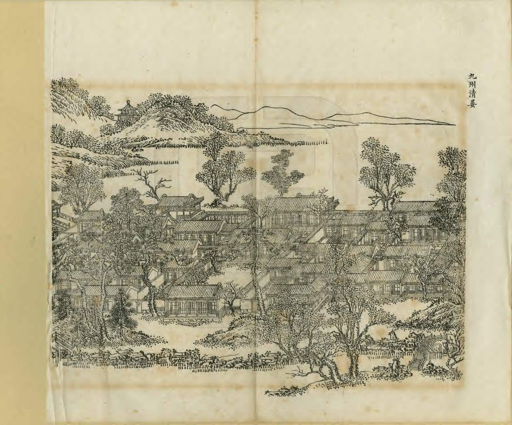

- **P0510** (sure): 九州清晏 Jiuzhou Qingyan: 乾隆 Qianlong's preface and poem with the courtiers' commentary, 御製圓明園圖詠 1887 (poem 1744 (乾隆九年); this printing 1887). https://commons.wikimedia.org/wiki/File%3ANLC403-312001107375-14035_%E7%A6%A6%E5%88%B6%E5%9C%93%E6%98%8E%E5%9C%92%E5%9C%96%E8%A9%A0_%E5%8D%B7%E4%B8%80.pdf?page=32

  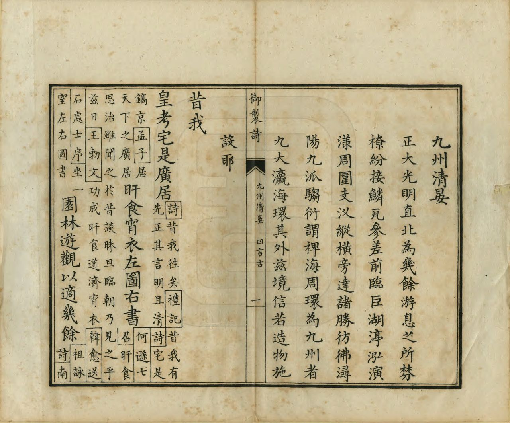

- **P0364** (sure): 九州清晏遗址01 20130318.JPG (2013-03-18 15:32:11 (Commons DateTimeOriginal)). https://commons.wikimedia.org/wiki/File:%E4%B9%9D%E5%B7%9E%E6%B8%85%E6%99%8F%E9%81%97%E5%9D%8001_20130318.JPG

  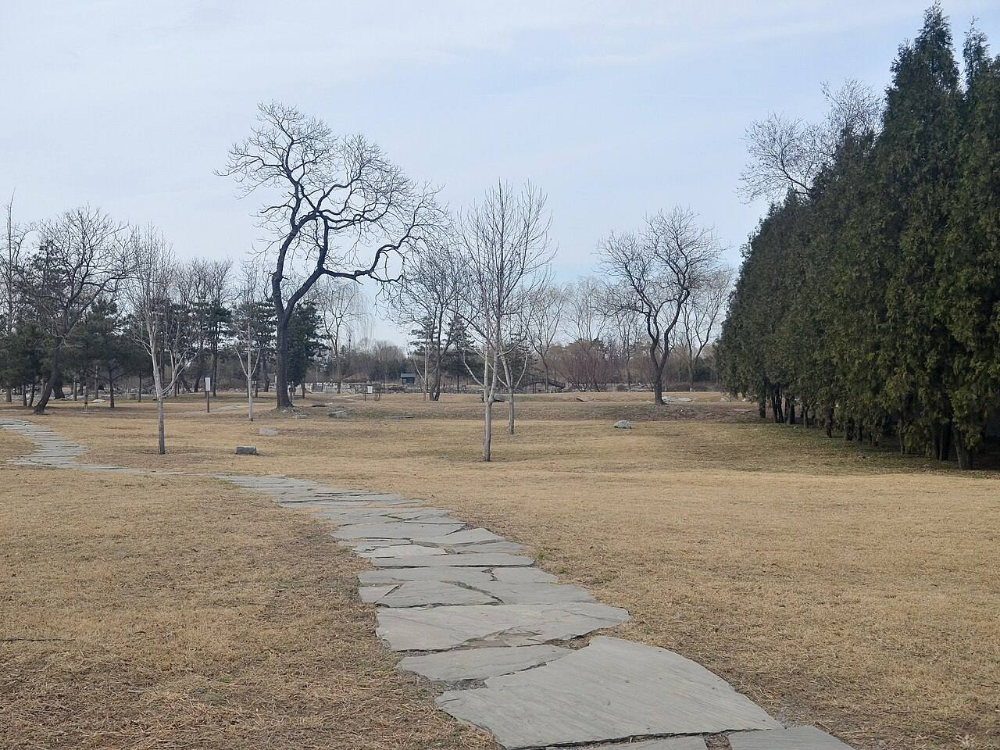

- **P0365** (sure): 九州清晏殿遗址 20130318.JPG (2013-03-18 15:35:06 (Commons DateTimeOriginal)). https://commons.wikimedia.org/wiki/File:%E4%B9%9D%E5%B7%9E%E6%B8%85%E6%99%8F%E6%AE%BF%E9%81%97%E5%9D%80_20130318.JPG

  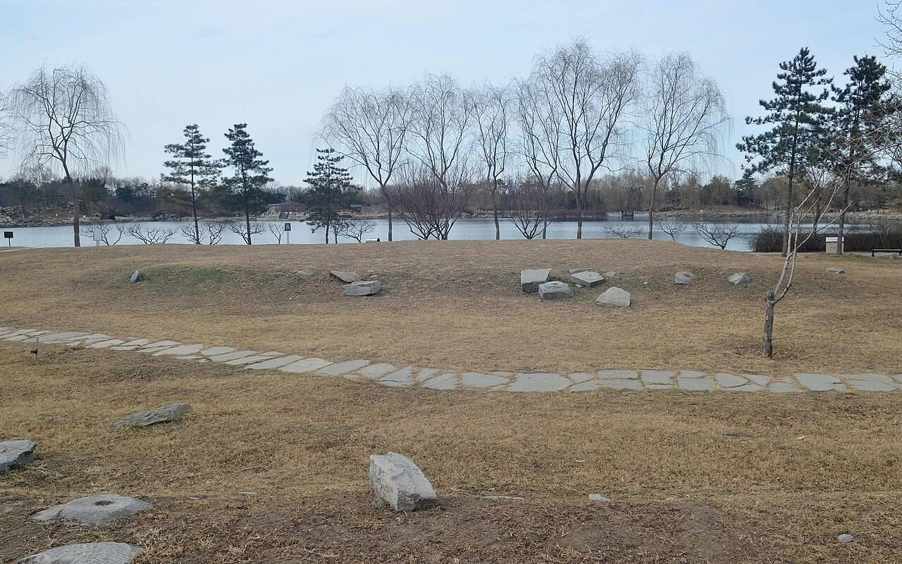

- **P0366** (sure): 九州清晏慎德堂遗址 20130324.JPG (2013-03-24 14:29:13 (Commons DateTimeOriginal)). https://commons.wikimedia.org/wiki/File:%E4%B9%9D%E5%B7%9E%E6%B8%85%E6%99%8F%E6%85%8E%E5%BE%B7%E5%A0%82%E9%81%97%E5%9D%80_20130324.JPG

  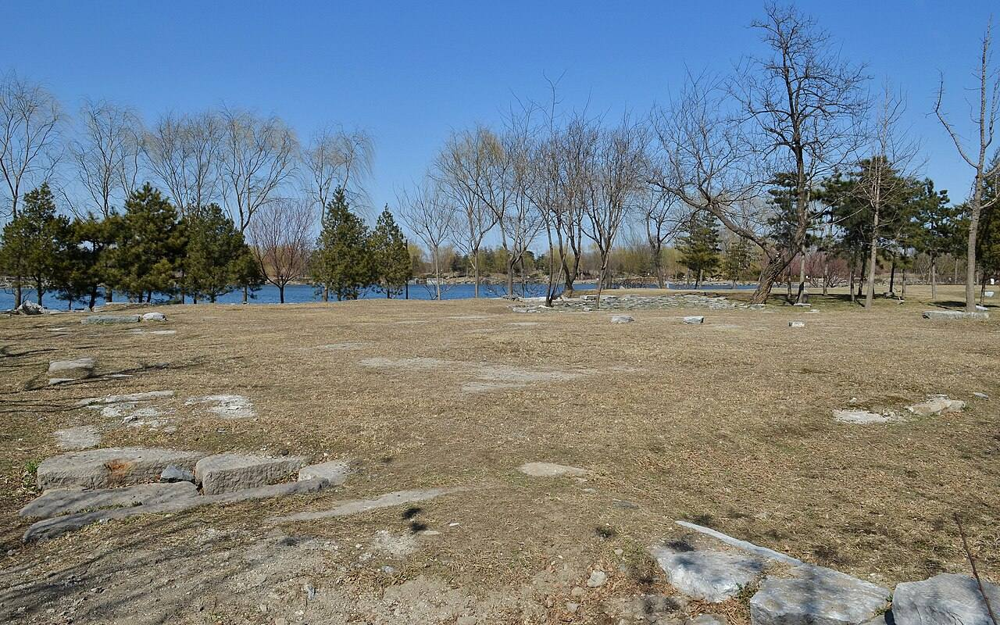

- **P0367** (sure): Nanda Bridge in Yuanmingyuan Ruins 20130201.JPG (2013-02-01 16:19:29 (Commons DateTimeOriginal)). https://commons.wikimedia.org/wiki/File:Nanda_Bridge_in_Yuanmingyuan_Ruins_20130201.JPG

  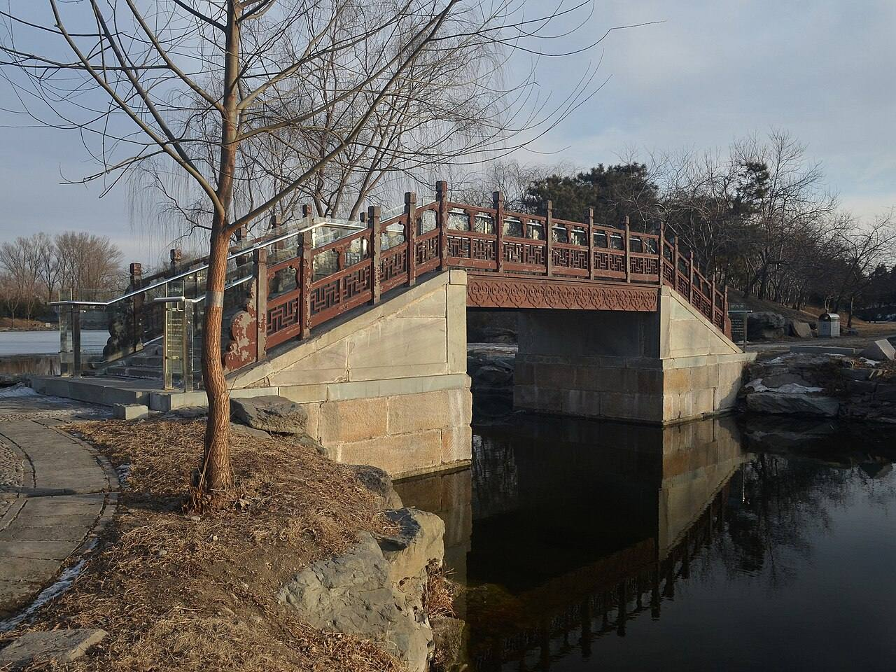

- **P0368** (sure): Zongting Bridge 20130318.JPG (2013-03-18 17:27:22 (Commons DateTimeOriginal)). https://commons.wikimedia.org/wiki/File:Zongting_Bridge_20130318.JPG

  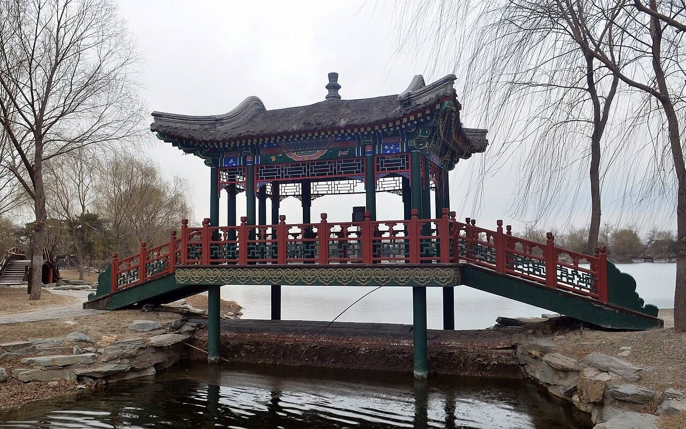

- **P0451** (sure): 九州清晏遗址02 20130512.JPG (2013-05-12 15:54:56 (Commons DateTimeOriginal)). https://commons.wikimedia.org/wiki/File:%E4%B9%9D%E5%B7%9E%E6%B8%85%E6%99%8F%E9%81%97%E5%9D%8002_20130512.JPG

  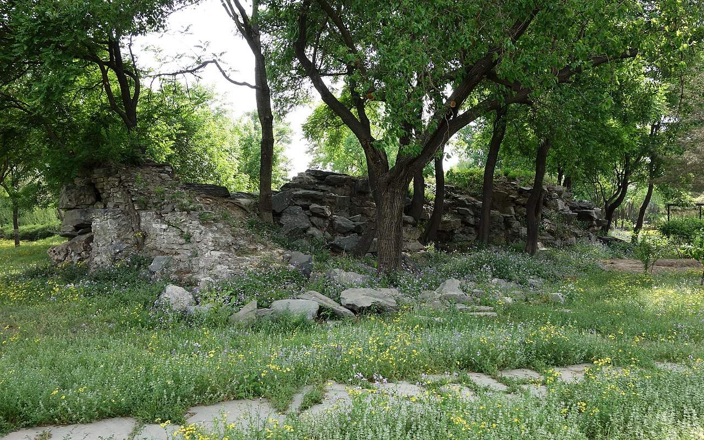

- **P0396** (likely): Yuanmingyuan Front lake of Jiuzhou 20130324.JPG (2013-03-24 14:33:15 (Commons DateTimeOriginal)). https://commons.wikimedia.org/wiki/File:Yuanmingyuan_Front_lake_of_Jiuzhou_20130324.JPG

  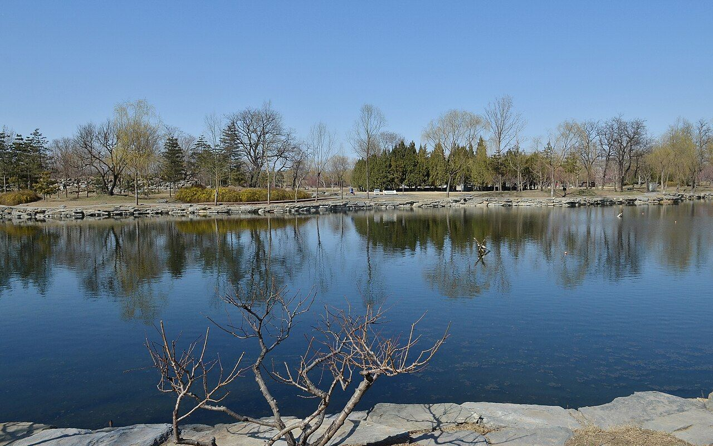

Of its halls: P0280 (YM03-11).

## Texts and drawings (107)

- **E1091** (poem, sure): 御製九州清宴詩（圓明園四十景詩）. 1744 (乾隆九年) · printed in S05 j80:23b-24a · S40. https://github.com/kanripo/KR2k0036/blob/master/KR2k0036_080.txt
  > 乾隆九年 御製九州清宴詩 正大光明直北為㡬餘游息之所棼橑紛接鱗瓦參差前臨巨湖渟浤演漾周圍支汊縱横旁逹諸勝仿彿潯陽九𣲖騶衍謂禆海周環為九州者九大瀛海環其外兹境信若造物施設耶 昔我皇考宅是廣居旰食宵衣左圖右書園林游觀以適幾餘豈繄廊廟泉石是娱所志維何煌煌御書九州清宴皇心乃舒肯構孰責繼序在余業業兢兢奉此遺模一念之間敬肆攸殊作狂作聖繫彼斯湏謂天可畏屋漏與俱謂民可畏敢欺其愚六膳八珍牣乎御㕑念彼溝壑曷其飽諸水榭山亭天然畫圖瞻彼茅簷痌瘝切膚慎終如始前聖之謨嗚呼小子母渝厥初
  North of the audience hall is the place of daily rest: crowded roofs and rafters, a great lake in front and channels on every side. The nine land masses recall 鄒衍's nine continents within an encircling sea.
- **E1094** (poem, sure): 御製題清暉閣四景. 1765 (乾隆三十年) · j80:24a-25a · S05. https://github.com/kanripo/KR2k0036/blob/master/KR2k0036_080.txt
  > 乾隆三十年御製題清暉閣四景　閣前喬松已燬石壁獨存突兀横亘致不惬觀山以樹為儀新松長成復需嵗月乃因高就低㸃綴為樓齋若干間取其小無取其大取其樸無取其麗坐閣中頗似展倪黄横披小卷也　閣對横陳石壁修因高新築兩層樓隔牆延得松雲意（閣前松遭燬牆外者猶存喬柯此樓近之因以命名）小許居然勝一籌（右松雲樓）　假山有真樹秋露零瀼瀼高下綴枝葉沆瀣凝珠光寜湏詡其甘訝可裛其香玲瓏石竅間然疑即上皇硬黄待揮毫却愧米襄陽（右露香齋）　書屋剛容方丈寛慎修勤浴敢圖安其楶斧藻猶慙若漫擬東京八殿看（右涵徳書屋）　巖堂何所貯所貯惟縹緗雖非鄴侯多開卷益有方詎祗資詠吟將以騐幾康獲心在古人茹豈因柔剛（右茹古堂）
  The old pines before 清暉閣 had burned, leaving a bare rock wall. He built small plain rooms at varied heights instead: 松雲樓, 露香齋, 涵徳書屋, 茹古堂, one verse each. Useful for the dated change of 乾隆三十年 (1765).
- **E1099** (poem, sure): 御製賦得樂安和詩（有序）. 1774 (乾隆三十九年) · j80:25a-26a · S05. https://github.com/kanripo/KR2k0036/blob/master/KR2k0036_080.txt
  > 乾隆三十九年御製賦得樂安和詩（有序）　顔寢殿之額曰樂安和意雖一貫義亦各具昔湯之盤武之席莫不各有銘所以觸目警心也盤席祗日用物猶亟亟焉而况朝夕所處之室乎各成六韻以勅一躬　樂亦六情一因而額寢齋弗耽斯得正從欲實為乖花鳥引機緒詩書藴道荄當思不可亟恒念與之偕應在雨暘若寜湏絲竹排三端姑彼置五字識吾懐（右樂）　向祗隨所遇（舊額所居書室曰隨安堂取隨遇而安之義）今惟安在斯朝乾實切矣夕惕亦居之適已非為合圖民乃得宜禮經著和樂堯典仰文思建久賈生䇿計情鼂氏辭更深殷念者永固萬年基（右安）　和者寛仁施（去聲）是誠得衆縁温而厲則可柔以發斯偏性命保合正起居安養便莫慙衾影獨那溺景光妍無欲心常泰有為身弼肩春基一氣鬯與物共誾然（右和）臣等謹按九州清宴清暉閣樂安和御製詩㳟載首見之篇餘不備録
  Three poems on the words of the bedroom plaque 樂安和, explaining each word: Qianlong's reminders to himself of restraint, with a note on his earlier room name 隨安堂.
- **E1129** (text, sure): 日下舊聞考 九洲清晏. 1780s (乾隆 敕撰) · j80:20b-23b · S05. https://github.com/kanripo/KR2k0036/blob/master/KR2k0036_080.txt
  > 正大光明後有湖亦稱前湖湖正北為圓明園殿五楹後為奉三無私殿七楹又後為九州清宴殿七楹東為天地一家春西為樂安和又西為清暉閣閣前為露香齋左為茹古堂為松雲樓右為涵徳書屋（圓明園冊）臣等謹按九州清宴額世宗御書四十景之一也前第一層殿恭懸聖祖御書圓明園額聨曰每對青山緑水㑹心處一邱一壑總自天恩浩蕩常從霽月光風悦目時一草一木莫非帝徳高深世宗藩邸時書聨曰恤小民之依所其無逸稽古人之徳彰厥有常皇上御書第二層為奉三無私殿内恭懸皇上御書聖祖仁皇帝聖訓曰天下之治亂休咎皆係人主之一身一心政令之設必當遠慮深謀以防後悔周詳籌度計及久長不可為近名邀利之舉不可用一已偏執之見採羣言以廣益合衆志以成城始為無偏無黨之道孝者百行之原不孝之人斷不可用義者萬事之本非義之事必不可為孝以立身義以制事無是二者雖君臣父子不能保也世宗憲皇帝聖訓曰敬天法祖勤政親賢愛民擇吏除暴安良勿過寛柔勿過嚴猛同氣至親實為一體誠心友愛休戚相闗時聞正言日行正事弗為小人所誘弗為邪説所惑聖祖所貽之宗室宜親國家所用之賢良宜保自然和氣致祥綿宗社萬年之慶額曰清虚靜泰聨曰澗泉無操琴泠然善也風竹有聲畫顧而樂之寳座聨曰所無逸而居動靜適徴仁智體有常以治照臨並叶清寜皇上御書九州清宴殿後額曰蔚然深秀聨曰紅篆爐烟看氣直緑苞庭竹愛心虛與樂安和清暉閣諸額皆御書清暉閣北壁懸圓明園全圖乾隆二年命畫院郎世寜唐岱孫祐沈源張萬邦丁觀鵬恭繪御題大觀二字並題聨曰稽古重圖書義存無逸三宗訓勤民咨稼穡事著豳風七月篇
  North across the lake behind the audience hall: 圓明園殿 (five bays), 奉三無私殿 (seven), 九州清宴殿 (seven), with 天地一家春 to the east, 樂安和 to the west, then 清暉閣 with 露香齋, 茹古堂, 松雲樓 and 涵徳書屋. The note gives the plaques and full text of the Kangxi and Yongzheng instructions on the second hall's wall. On the north wall of 清暉閣 hung the 圓明園全圖 painted in 乾隆二年 (1737) by 郎世寜 Castiglione, 唐岱, 孫祐, 沈源, 張萬邦 and 丁觀鵬.
- **E1188** (text, sure): 宣宗實錄 御製慎德堂記. 1831 (道光十一年五月) · 實錄卷之一百八十九 · S208. https://github.com/garychowcmu/daizhigev20/blob/master/史藏/别史/清实录道光朝实录.txt
  > 己卯。御制慎德堂记曰。崇俭去奢慎修思永。孰不知其所当然哉。非知之艰。行之惟艰在士大夫犹患其位不期骄而骄禄不期侈而侈膺天命、绍大统者。可不兢兢焉惴惴焉懔夫皇天无亲。惟无是辅念夫祖功宗德创垂不易后世子孙。坐享承平之福纵不尚奢华。无所加增。自问已觉不安矣。若败度败礼视富贵为己所应有。是直不可与言者也。又奚能常保厥位耶。况我大清龙兴东土。首重朴实。列圣丕承。凡心法治法。无非以勤俭训后。诚以世变风移。敝化放心。有不期然而然之势苟非操之固。审之精朴素自甘。慎终如始难与言俭也。至于饮食勿。尚珍异。冠裳勿求华美耳目勿为物欲所诱。居处勿为淫巧所惑。此犹俭德之小者。不作无益害有益不贵异物贱用物。一丝一粟。皆出于民脂民膏思及此。又岂容逞欲妄为哉。所谓无为而治俾天下阴受其福。而民不知者是也然行俭责在一人。不以天下自奉非概从悭□□吝也若救饥拯溺。去暴安良。国用之常经。民生之休戚正措施之不遑。又何可稍存吝惜于其辨也。是以修身务存俭约之心。以期永久。图治之道。可不加慎而切记之乎。
  The Daoguang emperor's account of the hall's name: a statement on thrift. He says one must spare nothing to aid the people, while holding one's own needs down. It names no building detail.
- **E1132** (text, sure): 宣宗實錄 道光十六年十月. 1836 (道光十六年) · 實錄卷之二百九十 · S208. https://github.com/garychowcmu/daizhigev20/blob/master/史藏/别史/清实录道光朝实录.txt
  > 总管内务府大臣禧恩等奏、遵审失火延烧九洲清晏等处之首领太监黄喜等、按律定拟。得旨、园庭重地。该太监等应何等小心谨慎。乃平日疏懈。以致失火延烧。
  Report on the eunuchs held to blame for the fire that spread to 九洲清晏 and other places; the sentences follow in the entry.
- **E1134** (text, sure): 宣宗實錄 御製重修圓明園三殿記. 1837 (道光十七年七月) · 實錄卷之二百九十九 · S208. https://github.com/garychowcmu/daizhigev20/blob/master/史藏/别史/清实录道光朝实录.txt
  > 癸巳。重修圆明园三殿成。御制记曰。予自践阼以来。于今十有七年。兢兢业业。惟虑政治之未修。民生之未裕。一切兴作。概从简略。非慕卑宫之名。惜露台之费。盖事必权其缓急。心必戒夫逸豫。惟怀永图。不敢不慎也。若今者圆明园三殿之重修。盖有说焉。三殿者。前曰圆明园。中曰奉三无私。后曰九洲清晏。溯自圣祖赐额。世宗定居。皇祖皇考。因淳守朴。不改成规。爰逮藐躬。德輶任重。亦惟祗承基绪。曷敢不念□荷之艰。乃以丙申九月二十六日戌亥之交。融风告警。郁攸从之。虽绠缶有备。而涂彻已多。予心怵惕。不遑启处。惟兹三殿。乃祖宗缔构所诒。居御园之中。为寝兴之所。非若山茨水槛。仅备游观。若不及时修复。何以自安。爰命内府诸臣。庀材鸠功。缮完补阙。惟期示俭于后。不敢增美于前。工未逾年。制已复旧。于以昭不雕不斲之风。亦以守不愆不忘之志版筑之兴。洵不得己也。抑予之说。更有进焉。周书大诰梓材。两言作室。既底法矣。继之曰肯堂肯构。既勤垣墉矣。继之曰涂塈茨。自古帝王。肇造丕基。规模远大。匪第令后世无以加也。亦谓数传而后。其张弛损益。因乎时。存乎人焉。故创业务期可继。而守成亦贵有为。若因循玩泄。有废莫举。所谓堂构涂塈者安在耶。然非值必不可缓之事。有必不得已之心。动辄更张。矜言改作。则前人厎法之善。必至纷然失其所守。其弊更有不可胜言者。是举也。惟愿我后人念作室之不易。则图易而思艰。睹寝成之孔安。则居安而虑殆。慎宪省成。庶几乎无废事焉。且知宫室之制度已备。国家之经费有常。工不可以创兴。役不可以轻举。持盈保泰。庶几乎无侈心焉。夫无废事。勤也。无侈心。俭也。勤者治之本。俭者福之源也。继自今以引以翼。攸芋攸跻。监成宪以无愆。巩洪图于勿替。是则予之厚望也夫。工既竣。乃述颠末而为之记。
  The Daoguang emperor's account of the rebuilding. A fire on 丙申九月二十六日 (1836) struck the three halls 圓明園殿, 奉三無私 and 九洲清晏, his living quarters. He had them restored to the old form in under a year, with nothing added.
- **E1190** (text, sure): 文宗實錄 道光三十年正月丁未. 1850 (道光三十年正月) · 實錄卷之一 · S207. https://github.com/garychowcmu/daizhigev20/blob/master/史藏/别史/清实录咸丰朝实录.txt
  > 丁未。宣宗成皇帝宾天。时宣宗居圆明园慎德堂孝和睿皇后苫次。卯刻。召宗人府宗令载铨、御前大臣载垣、端华、僧格林沁、军机大臣穆彰阿、赛尚阿、何汝霖、陈孚恩、季芝昌、内务府大臣文庆、宣示朱谕。立皇四子奕詝为皇太子。午刻。宣宗疾大渐。上哭诣慎德堂。少顷。宣宗升遐。上稽颡哀恸呼号。
  The Daoguang emperor died in 慎德堂, naming his fourth son heir there the same morning.
- **E1193** (text, sure): 文宗實錄 道光三十年. 1850 (道光三十年) · 實錄卷之三 · S207. https://github.com/garychowcmu/daizhigev20/blob/master/史藏/别史/清实录咸丰朝实录.txt
  > 丙寅。上诣永春室问皇贵太妃安。
  The new emperor visits the senior consort at 永春室, a hall in the garden's later state not in S05.
- **E1181** (text, sure): 文宗實錄 咸豐六年正月甲戌. 1856 (咸豐六年正月) · 實錄卷之一百八十九 · S207. https://github.com/garychowcmu/daizhigev20/blob/master/史藏/别史/清实录咸丰朝实录.txt
  > 上御奉三无私殿、赐近支亲藩等宴。
  New Year banquet for close kinsmen in 奉三無私殿, as under Daoguang (S202).
- **E0433** (text, sure): 徐樹鈞 圓明園詞序. 1871 (同治十年立秋), recording a visit of 四月十日 · preface, whole · S203. https://www.douban.com/group/topic/46378693/
  > 圆明园在京城西，出平则门三十里，畅春园北里许，世宗皇帝藩邸赐园也。圣祖常游豫西郊，次于丹棱沜，乐其川原，因明武清侯李伟清华园旧址，筑畅春园，藩邸赐园，故在其旁。雍正三年，乃大宫殿朝署之规以避暑听政，前临西山，环以西湖。湖水发源玉泉山，曰瓮山，度宫墙东流入清河，《水经注》所谓“蓟县西湖，绿水澄澹，燕之旧池”者也。东流为洗马沟，东南合高梁之水，故鱼稻饶衍，陂泉交绮。高宗皇帝嗣位，海宇殷阗，八方无事，每岁缔构，专饰园居。大驾南巡，流览湖山风景之胜，图画以归，若海宁安澜园、江宁瞻园、钱塘小有天园、吴县狮子林，皆仿其制，增制园中。列景四十，以四字题匾者为一胜区，一区之内，斋馆无数。复东拓长春，西辟清漪，离宫别馆，月榭风亭，属之西山，所费不计亿万。园地多明权珰别业，或传崇祯末，诸奄皆以珍宝窟宅于兹，乾隆间浚池，发金银数百万，时国运方兴，地不爱宝，上心悦豫，殚精构造，曲尽游观之妙，元明以来，未之闻也。每岁夏幸园中，冬初还宫，内廷大臣，赐第相望，文武侍从，并直园林，入直奏对，昕夕往来，络绎道路，历雍乾嘉道，百余年于兹矣。文宗初，粤寇踞金陵，盗贼蜂起，上初即位，求直言，得胜保、曾国藩、袁甲三三臣，既以塞 、程、徐、陆，先朝重望，相继倾覆，始擢用前言事者，各畀重任，三臣支柱，贼不犯畿。然迭胜迭败，东南数省，蹂躏无完土，上悯苍生之颠沛，慨左右之无人。九年冬，郊宿于斋宫，夜分痛哭，侍臣凄恻。大考翰詹，以宣室前席发题，忧心焦思，伤于祸乱，然后稍自抑解，寄于文酒。以宫中行止有节，尤喜园居，冬至入宫，初正即出。时园中传有四春之宠，皆汉女，分居亭馆，所谓杏花春、武陵春、牡丹春、海棠春者也。然上明于料兵，委权阃外，超次用人，海内称哲。而部寺诸臣，无所磨励，颇袭旧敝。晚得肃顺，敢言自任，故委以谋议。先是道光二十年，英吉利夷船，至广东香港，求通商不得，又以烧烟起衅，执政议和，予海关税银千八百万。英夷请立约，广督耆英，与期十年。届期而徐广缙督两广，夷使至广州，拒不许入，以受封爵，夷酋恨焉，志入广州。咸丰元 [ 九 ] 年，英吉利、法兰西、美利坚各国，乘粤寇鸱张，中国多故，复以轮舶直入大沽台。王僧格林沁，托团练之名，焚其二船，尽击走之。夷人知大皇帝无意于战，特臣民之私愤，乃潜至海岸，买马数千，募群盗为军，半年而成，再犯天津，称西洋马队，闻者恐栗，夷马步登岸，我未陈而敌骑长驱矣。十年六 [ 八 ] 月十六日，上方园居，闻夷骑至通州，仓卒率后嫔幸热河，道路初无供帐，途出密云，御食豆乳麦粥而已。十七日，英夷帅叩东便门，或有闭城者，闻炮而开，王公请和，和议将定。十九日，夷人至圆明园宫门，管园大臣文丰当门说止之，夷兵已去。文都统知奸民将起，环问守卫禁兵，无一在者，乃自索马还内，投福海死。奸人乘时纵火，入宫劫掠，夷人从之，各园皆火发，三昼夜不熄，非独我无官府诘问，夷帅亦不能知也。初英夷使臣巴夏里，已拘刑部，和议成，以礼释囚。于是巴夏里与英帅，各陈兵仗至礼部，订约五十七条，予以海关税银三千六百万，而夷人抵偿圆明园银二十万。王公奏言，未敢斥夷，文丰与主事惠丰，同死于园，不称殉节，但言遭兵燹而已。十一年七月，文宗晏驾热河，今上即位，奉两宫皇太后还京，垂帘十载，巨寇削平。而夷人通商江海，往来贸易，设通商王大臣，以接夷使。然常言：“某省士民毁天主教堂，某省不行其教，某省民教构衅。”日以难我，应之不暇，盖岌岌乎华夷杂处，又忽忽十有一年。园居荒墟，鞠为茂草，西山大寺，夷妇深居，予旅京师，恻然不敢过也。同治十年春，同年王壬父重至辇下，追话旧游，张子雨珊亦以计偕来，约访故宫，因驻守参将廖承恩许为道主。四月十日，命仆马同过绣漪桥，寻清漪园遗迹，颓垣断瓦，零乱榛芜，宫树苍苍，水鸣呜咽。由辇路登廓如亭，南望万寿山，但见牧童樵子，往来林莽间。暮从昆明湖归，桥上铜犀卧荆棘中，犀背御铭，琅然可诵。明日访守园者，得董监，自言：“年七十有余，自道光初入寺园中，今秩五品，居福园门旁。”导予等从瓦砾中，循出入贤良门而北，指勤政、光明、寿山、太和四殿遗址，前湖圆明寝殿五楹，后为奉三无私殿、九州清晏殿各七楹，坏壁犹立，拾级可寻。董监言：“东为天地一家春，后居也，西为乐安和，诸妃嫔贵人居也，洞天深处，皇子居也。清辉殿为文宗重建，与五福堂、镂月开云台、朗吟阁皆不可复识。”镂月开云者，即所谓牡丹春者也。世宗为皇子时，迎圣祖至赐园，而高宗年十二，以皇孙召侍左右，三天子福寿冠前古，集于一堂，高宗后制诗，尝夸乐之。经其废基，裴回惄焉。东渡湖，为苏堤、长春仙馆、藻园，又北为月地云居、舍卫城、日天琳宇、水木明瑟、濂溪乐处，仅约略指视所在。东北至香雪廊，阶前茅荻萧萧，废池可辩，有老监奉茶自石畔出，讶客所从来，颇似桃源人逢渔郎也。渡桥循福海西行，为平湖秋月，水光溶溶，一泻千顷。望蓬岛瑶台，岛上殿宇，犹存数楹，惜无方舟不达。其下流水潺湲，激石成响，董监示予：“此管园大臣文公死所也。”西北至双鹤斋，又西过规月桥，登绮吟堂，经采芝径，折而东，仍出双鹤斋。园中残毁几遍，独存此为劫灰之余，乱草侵阶，窗棂宛在，尤动人禾黍悲耳。双鹤斋西，为溪月松风，翠柏苍藤，沿流覆道，斜日在林，有老宫人驱羊豕下来。东过碧桐书院，地跨池上，东为金鳌，西为玉蝀，坊楔犹存。又东去，皆败坏难寻，遂不复往。莫色沈沈，栖乌乱飞，揖董监，出福园门，还于廖宅。廖，沣州人，字枫亭，少从塞尚阿、僧格林沁军，亦能言行间事，感予来游，颇尽宾主之欢。既夕言归，则礼部放榜日也。雨珊既落第南去，予与壬父每相过从，念言园游，辄惘惘不自得。壬父又曰：“园之盛时，纯皇勒记，必殷殷踵事之戒，然仁宗始罢南幸，宣宗尤忧国贫，秋狝之礼，辍而不举。惟夫张弛之道宜及，嘉道时，补纯皇倦勤之功，而内外大臣，惟务慎节，监司宽厚，牧令昏庸，讳盗容奸，以为安静。八卦妖徒，连兵十载，无生天主，教目滋繁，由游民轻法，刑废不用故也。江淮行宫，既皆斥卖，国之所患，岂在乏财。”又曰：“燕地经安史戎马之迹，爰及辽金，近沙漠之风矣。明太宗以燕王旧居，不务改宅，仍而至今，地利竭矣。又园居单外，非所以驻万乘，废而不居，盖亦时宜。” 予曰：“然，前年御史德泰，请按户亩鳞次捐输，复修园宫。大臣以侈端将启，请旨切责，谪戍未行，愤悔自死。自此莫敢言园居者。而比年备办大婚，费已千万，结彩宫门，至十余万，公奏朝廷动用钱粮，婚以成礼，岂在华饰，若前明户部司官得以谏争，予且建言矣。又予闻慈安太后在文宗时，有脱簪之谏，《关雎》《车舝》之贤，中兴之由也。又园宫未焚前一岁，妖言传上坐寝殿，见白须老翁，自称园神，请辞而去，上梦中加神二品阶，明日，至祠谕祀之，未一期而园毁，岂能定欤？子能诗者，达于政事，曷以风人之意，备《繁霜》《云汉》之采？”于是壬父为《圆明园词》一篇。而周学士（即大学士周祖培）、潘侍郎见之，并叹其伤心感人，笔墨通于情性。予以此诗可传后来，虑夫代远年逝，传闻失实，词中所述，罔有征者，乃为文以序之。同治十年立秋日，长沙徐树钧撰。
  A walk through the ruins eleven years after the destruction, guided by an old eunuch who had served since the 1820s. It says which sites could still be read, and that 雙鶴齋 with its surroundings alone stood, as did some rooms on 蓬島瑶臺 and the 金鼇 and 玉蝀 arches. Its account of 1860 credits the first fires to local robbers, which differs from the British and French record in S02.
- **E1135** (text, sure): 同治十二年 上谕: 九洲清晏 halls renamed (as quoted in S220). 同治十二年十月初一 1873 · S220 section 五; archive not seen · S220. http://iqh.ruc.edu.cn/old/qdhjylyjzx/xszl/ylfj/00baad8cc3da4c6a901378da7919d9a8.htm
  > 绮春园改名万春园，敷春堂改名天地一家春，悦心园改名和春园，清夏斋改名清夏堂，圆明园九州清晏同道堂改名福寿仁恩，基福堂改名思顺堂，天地一家春改名承恩堂。清夏堂西宫门改名南宫门。
  The decree of 1873 gives the new names of Tongzhi's repair: 同道堂 becomes 福寿仁恩, 基福堂 becomes 思顺堂, the old 天地一家春 becomes 承恩堂. All three new names are written on the plan S01 at 九洲清晏, where its older names are not. So those labels cannot be earlier than this decree, and they are not names of the target state of 1860.
- **E1183** (text, sure): 清稗類鈔 宣宗立文宗為太子. 1917, on 1850 · line 1887 of the corpus file · S214. https://github.com/garychowcmu/daizhigev20/blob/master/子藏/类书/清稗类钞.txt
  > 宣宗立文宗为太子道光庚戌正月，宣宗违豫久，犹日至奉三无私， 「 四字别殿名。」 召见办事。十三日，召见慎德堂， 「 寝宫名。」 仅军机大臣大学士祁寯藻， 杜受田， 尚书何汝霖， 侍郎陈孚恩， 季芙昌五人， 语良久。 十四日卯初， 诸臣甫入直， 已传旨召对， 凡十人， 盖定郡王载铨， 及军机大臣五人， 御前大臣怡亲王载垣， 郑亲王端华， 科尔沁王僧格林沁三人， 暨内务府大臣步军统领尚书文庆也。 宣宗冠服端坐， 命至榻前， 告以立文宗为皇太子。 须臾， 文宗入， 宣宗取缄匣朱旨传示， 并谕勉诸臣， 毕， 各退。 文宗命军机大臣五人同阅章奏。 移时， 甫还直庐， 忽急宣趋入， 惊闻大行皇帝龙驭上宾矣。
  Glosses 奉三無私 as a side hall and 慎德堂 as the bedroom: in the last days the emperor worked in the first and saw his ministers in the second.
- **E1186** (text, sure): 養吉齋叢錄 卷十三. mid-19th c. (printed 1890s), on earlier reigns · 卷十三, line 929 of the corpus file · S202. https://raw.githubusercontent.com/garychowcmu/daizhigev20/master/%E5%8F%B2%E8%97%8F/%E5%BF%97%E5%AD%98%E8%AE%B0%E5%BD%95/%E5%85%BB%E5%90%89%E6%96%8B%E4%B8%9B%E5%BD%95.txt
  > 乾隆间，每岁上元前，于清晖阁张灯，侍皇太后筵宴。道光间，于含辉楼张灯，侍皇太后筵宴。御园中放灯收灯，以鸣锣传令。早晚有定时，一处鸣锣，五处应之。司房帖传掌仪司，不知自何时始也。
  Lamps before the Lantern Festival were hung at 清暉閣 under Qianlong and at 含暉樓 under Daoguang, for banquets with the empress dowager. Gongs at set times signalled lighting and putting out lamps.
- **E1090** (poem, sure): 清晖阁: 乾隆八年 poem of the Qianlong Emperor. 乾隆八年 (1743), date from the compilation · p.121 item (1), under 清晖阁 · S360. https://www.yuanmingyuanpark.cn/xs/yjbg/202007/P020200730387572832602.pdf#page=121
  > 春去春来客路辕，女夷雅解返花魂。柍桭旭影迟珠箔，燕雀风光猎网轩。䑕尾麝煤梧几静，松涛蟹眼茗炉喧。如酥脉起初耕便，消得恩膏自御园。 （入春雪泽沾足东作有赖，不似去岁有云汉之忧云。）
  Poem of the Qianlong Emperor at 清晖阁, 1743, on daily residence there. Year as given by the compilation.
- **E1092** (poem, sure): 池上居: 乾隆十二年 poem of the Qianlong Emperor. 乾隆十二年 (1747), date from the compilation · p.117 item (1), under 池上居 · S360. https://www.yuanmingyuanpark.cn/xs/yjbg/202007/P020200730387572832602.pdf#page=117
  > 槐日风清候，壶天池上居。润含新樾重，爽挹午窗虚。古调弹声鹤，天机唼浪鱼。底须费穿凿，水到自成渠。乍见锦绷勹，旋听绿玉敲。有堂如白傅，不雨度西郊。啭树莺求友，衔莎雀补巢。一泓相对处，无虑置杯胶。轩楹俯碧流，槛影座中浮。堪纳水云意，底论大小舟。风前饶乳燕，雨后尚鸣鸠。暇日无余事，新题每见投。
  Poem of the Qianlong Emperor at 池上居, 1747. Year as given by the compilation.
- **E1093** (poem, sure): 画禅室: 乾隆十五年 poem of the Qianlong Emperor. 乾隆十五年 (1750), date from the compilation · p.127 item (1), under 画禅室 · S360. https://www.yuanmingyuanpark.cn/xs/yjbg/202007/P020200730387572832602.pdf#page=127
  > 积素山逾远，寒侵夕益緐。节真应大雪，景恰媚名园。鹤讶翔松顶，蝗知避麦根。竹炉新仿得，（仿恵山制竹炉收雪水烹之）活火正温存。
  Poem of the Qianlong Emperor at 画禅室, 1750, on snow and the view. Year as given by the compilation.
- **E1095** (poem, sure): 松云楼: 乾隆三十二年 poem of the Qianlong Emperor. 乾隆三十二年 (1767), date from the compilation · p.127 item (1), under 松云楼 · S360. https://www.yuanmingyuanpark.cn/xs/yjbg/202007/P020200730387572832602.pdf#page=127
  > 假山之上峙真松，时蔚英英云态浓。青白由来投气味，便当为雨契从龙。
  Poem of the Qianlong Emperor at 松云楼, 1767, on the view. Year as given by the compilation.
- **E1096** (poem, sure): 长春书屋: 乾隆三十二年 poem of the Qianlong Emperor. 乾隆三十二年 (1767), date from the compilation · p.115 item (1), under 长春书屋 · S360. https://www.yuanmingyuanpark.cn/xs/yjbg/202007/P020200730387572832602.pdf#page=115
  > 清闲何为消，明窗芸编陈。耽书诚前縁，怡情谐常因。千秋于焉观，分阴良堪珍。汤盘铭曾言，予惟期其新。“临池怀前贤，抚古允我喜。虽常希颜筋，那有省可髓。孜孜勤悬针，草草哂累纸。佳言思公权，引以辅善理。” “匡床双金猊，焕灿护兽炭。氲氲檀芬烧，霭霭蕙篆散。褰帷薫心源，对座净鼻观。无然安清供，问政毖缔案。”“筠炉江南来，恰合设白屋。烹煎松风鸣，活泼雪色漉。竒吟输唐卢，佚乐学复陆。擎杯方无言，魄月䔩绿竹。
  Poem of the Qianlong Emperor at 长春书屋, 1767, on reading. Year as given by the compilation.
- **E1097** (poem, sure): 涵德书屋: 乾隆三十五年 poem of the Qianlong Emperor. 乾隆三十五年 (1770), date from the compilation · p.128 item (1), under 涵德书屋 · S360. https://www.yuanmingyuanpark.cn/xs/yjbg/202007/P020200730387572832602.pdf#page=128
  > 修己涵养德，践行固已艰。出治播淳风，民涵德倍难。即境思题额，鲜怡增赩颜。岂不景悦目，那无花娱观。耽此必忘彼，戒哉凛冰渊。
  Poem of the Qianlong Emperor at 涵德书屋, 1770, on reading. Year as given by the compilation.
- **E1098** (poem, sure): 乐安和: 乾隆三十九年 poem of the Qianlong Emperor. 乾隆三十九年 (1774), date from the compilation · p.116 item (1), under 乐安和 · S360. https://www.yuanmingyuanpark.cn/xs/yjbg/202007/P020200730387572832602.pdf#page=116
  > 乐安和意虽一贯，义亦各具。昔汤之盘武之席，莫不各有铭，所以触目警心也。盘席祗日用物犹亟亟焉，而况朝夕所处之室乎，各成六韵以勑一躬。”“乐亦六情一，因而额寝斋。弗耽斯得正，从欲实为乖。花鸟引机绪，诗书藴道荄。当思不可亟，恒念与之偕。应在雨旸若，宁须丝竹排。山端姑彼置，五字识吾怀。（右乐）”“向祗随所遇， （旧颜所居书屋曰：“随安室”。取随遇而安之义。 ）今惟安在斯。朝乾实切矣，夕惕亦居之。适已非为合，图民乃得宜。礼经著和乐，尧典仰文思。建久贾生策，计情鼌氏辞。更殷深念者，永固万年基。 （右安）” “和者寛仁施，是诚得众縁。温而厉则可，柔以发斯偏。性命保合正，起居赡养便。莫惭衾影独，那溺景光妍。无欲心常泰，有为身弼肩。春台一气鬯，与物共誾然。 （右和）
  Poem of the Qianlong Emperor at 乐安和, 1774, on daily residence there. Year as given by the compilation.
- **E1100** (poem, sure): 清晖阁: 乾隆三十九年 poem of the Qianlong Emperor. 乾隆三十九年 (1774), date from the compilation · p.122 item (19), under 清晖阁 · S360. https://www.yuanmingyuanpark.cn/xs/yjbg/202007/P020200730387572832602.pdf#page=122
  > 高阁清晖寝殿傍，多年恒与坐相羊。忧霖望雨题何伙，惕夕乾朝政每蘉。植绿蕉惟爱聴飒，（北方芭蕉至夏月乃可出坞植于庭）补新松亦渐成苍。（癸未，回禄后补松逮今又十二年矣）那辞两鬓添霜白，犹励初心勉未遑。
  Poem of the Qianlong Emperor at 清晖阁, 1774, on daily residence there. Year as given by the compilation.
- **E1101** (poem, sure): 池上居: 乾隆四十年 poem of the Qianlong Emperor. 乾隆四十年 (1775), date from the compilation · p.119 item (14), under 池上居 · S360. https://www.yuanmingyuanpark.cn/xs/yjbg/202007/P020200730387572832602.pdf#page=119
  > 夏日宜居池上居，天光水态澹如如。望云愁早幸过彼，较雨量晴略慰予。祇有殷心盼捷至，（阿桂攻克木思工，噶克丫口可以直压噶尔丹，寺明亮则初克甲索，宜喜复自达尔图下至基木斯丹当噶，并日旁以前环山五十里内贼碉俱经焚毁已可渡河，与阿桂合兵会剿勒乌围，计日大功可成，盼望红旗较前倍切。 ）岂无逸兴遣几余。拈吟即景犹嫌惯，校勘欣翻四库书。
  Poem of the Qianlong Emperor at 池上居, 1775, on daily residence there. Year as given by the compilation.
- **E1102** (poem, sure): 画禅室: 乾隆四十四年 poem of the Qianlong Emperor. 乾隆四十四年 (1779), date from the compilation · p.127 item (2), under 画禅室 · S360. https://www.yuanmingyuanpark.cn/xs/yjbg/202007/P020200730387572832602.pdf#page=127
  > 己巳池上居，清暇消夏暑。画禅学香光，名迹収其五。逮今三十年，一瞬光阴数。又复得其二，三朝册集古。（室中续贮一册皆宋元明真迹，其一则李唐江山小景长巻，皆香光所评品也。）江山小景巻，李唐真迹覩。名画荟珎帧，则我新所聚。弗让其大观，（荟珎册较其昌所藏更多，彼一唐人余皆名人真迹，亦无让大观册也。 ）唐画乃双取。都弆一檀匣，新旧各分部。同为无上珍，短什识罗缕。
  Poem of the Qianlong Emperor at 画禅室, 1779, on the view. Year as given by the compilation.
- **E1103** (poem, sure): 长春书屋: 乾隆四十六年 poem of the Qianlong Emperor. 乾隆四十六年 (1781), date from the compilation · p.115 item (2), under 长春书屋 · S360. https://www.yuanmingyuanpark.cn/xs/yjbg/202007/P020200730387572832602.pdf#page=115
  > 又值孟之春，御园首祚誾。四年久阙咏，（自丁酉大事过二十七月后，昨岁南巡自京起程至今忽四年矣。）一室永怡神。依例行时旧，不堪得句新。西南望仙馆（此书屋乃九州岛清晏别室之名，长春仙馆乂西南别一区，为昔日奉圣母驻御园度新正之处也。 ）益觉怅怀频。
  Poem of the Qianlong Emperor at 长春书屋, 1781, on reading. Year as given by the compilation.
- **E1104** (poem, sure): 乐安和: 乾隆五十四年 poem of the Qianlong Emperor. 乾隆五十四年 (1789), date from the compilation · p.116 item (2), under 乐安和 · S360. https://www.yuanmingyuanpark.cn/xs/yjbg/202007/P020200730387572832602.pdf#page=116
  > 御园乐安和，夏日每以居。山园乐安和，肖其式为诸。一游即返跸，诚似驰驿如。（予遇佳山水輙过而不留，昔年南巡尹继善有驰驿，游山之喻正契予意，诗中因屡及之。 ）然乐安与和，在民非在吾。民失和与安，吾乐岂良图。是则居与游，此意何处无。
  Poem of the Qianlong Emperor at 乐安和, 1789, on daily residence there. Year as given by the compilation.
- **E1105** (poem, sure): 池上居: 乾隆六十年 poem of the Qianlong Emperor. 乾隆六十年 (1795), date from the compilation · p.119 item (16), under 池上居 · S360. https://www.yuanmingyuanpark.cn/xs/yjbg/202007/P020200730387572832602.pdf#page=119
  > 池上年年例有诗，较晴量雨鲜逢宜。历观题壁多愁者，何幸拈毫值若时。遇顺却虞心有放，戒盈惟励志无移。箕畴恒忆曰忧句，望捷弗宁正在兹。（日前据福康安、和琳奏现在永绥之围虽解，而附近山坳岩洞甚多贼匪不时窥伺，随即分路攻克焚烧苗寨，殱戮贼众，无筭其鸦酉、黄瓜寨等处紧要隘口山梁、木栅林立贼首石柳邓等自知罪不可遣自必并力抵御，官兵正欲藉其并力一处方可聚族殱灭，谅不日即可悉数擒获，迅蒇大功，惟盼望捷音日益悬切耳。 ）
  Poem of the Qianlong Emperor at 池上居, 1795. Year as given by the compilation.
- **E1106** (poem, sure): 奉三无私: 嘉庆三年 poem of the Jiaqing Emperor. 嘉庆三年 (1798), date from the compilation · p.113 item (1), under 奉三无私 · S360. https://www.yuanmingyuanpark.cn/xs/yjbg/202007/P020200730387572832602.pdf#page=113
  > 本支百世荷皇恩，前夕家筵启御园。星灿兰膏悬锦幙，月辉云网漾珠旛。连床晋爵称纯嘏，接席傅柑近笑言。遍览图书谁得似，九旬太上见来孙。（皇父庆开九裹行健，符天德福之隆莫能飏颂，今春元孙载锡卜吉成婚即可，冀得来孙再阅六七岁期颐开庆之年遇此韶辰又可承恩入宴，自古称太上皇帝优蒙昊眷锡羡延洪者，循蜚疏仡以来实未之见也。 ）
  Poem of the Jiaqing Emperor at 奉三无私, 1798, on banquets. Year as given by the compilation.
- **E1107** (poem, sure): 九洲清晏: 嘉庆六年 poem of the Jiaqing Emperor. 嘉庆六年 (1801), date from the compilation · p.111 item (5), under 九洲清晏 · S360. https://www.yuanmingyuanpark.cn/xs/yjbg/202007/P020200730387572832602.pdf#page=111
  > 六十余年寝兴处，栋隆协吉寸诚钦。治民常念茅檐苦，勤政宁耽广厦深。松茂竹苞承世泽，衣宵食旰继慈心。瞻依敬勉肯堂志，日月光中永照临。
  Poem of the Jiaqing Emperor at 九洲清晏, 1801, on daily residence there and visits to the dowager. Year as given by the compilation.
- **E1108** (poem, sure): 松云楼: 嘉庆七年 poem of the Jiaqing Emperor. 嘉庆七年 (1802), date from the compilation · p.127 item (2), under 松云楼 · S360. https://www.yuanmingyuanpark.cn/xs/yjbg/202007/P020200730387572832602.pdf#page=127
  > 虬干郁葱结翠云，天涛披拂座中闻。几闲淡晤忘年友，心识岁寒领静芬。
  Poem of the Jiaqing Emperor at 松云楼, 1802, on the view. Year as given by the compilation.
- **E1109** (poem, sure): 涵德书屋: 嘉庆七年 poem of the Jiaqing Emperor. 嘉庆七年 (1802), date from the compilation · p.128 item (2), under 涵德书屋 · S360. https://www.yuanmingyuanpark.cn/xs/yjbg/202007/P020200730387572832602.pdf#page=128
  > 德业蕴于衷，涵养守其素。明镜必藏辉，来照随所遇。仁心在滋培，本性原自具。水月相印中，真空不常住。鸢鱼乐岂同，活泼天机露。
  Poem of the Jiaqing Emperor at 涵德书屋, 1802, on reading. Year as given by the compilation.
- **E1110** (poem, sure): 露香斋: 嘉庆七年 poem of the Jiaqing Emperor. 嘉庆七年 (1802), date from the compilation · p.128 item (1), under 露香斋 · S360. https://www.yuanmingyuanpark.cn/xs/yjbg/202007/P020200730387572832602.pdf#page=128
  > 九霄沆瀣本清凉，芳接荷盘潄异香。佳茗烹调沁心腑，餐霞岂更有仙方。
  Poem of the Jiaqing Emperor at 露香斋, 1802, on the view. Year as given by the compilation.
- **E1111** (poem, sure): 长春书屋: 嘉庆八年 poem of the Jiaqing Emperor. 嘉庆八年 (1803), date from the compilation · p.115 item (4), under 长春书屋 · S360. https://www.yuanmingyuanpark.cn/xs/yjbg/202007/P020200730387572832602.pdf#page=115
  > 万汇生于春，仁为众善首。大德遍含容，引长岁月久。我考额书斋，淳化洽九有。渥泽溥黎元，感沐栽培厚。 继统凛艰难，深虞弗克负。兢业念持盈，先言衷敬守。
  Poem of the Jiaqing Emperor at 长春书屋, 1803, on reading. Year as given by the compilation.
- **E1112** (poem, sure): 九洲清晏: 嘉庆十一年 poem of the Jiaqing Emperor. 嘉庆十一年 (1806), date from the compilation · p.112 item (9), under 九洲清晏 · S360. https://www.yuanmingyuanpark.cn/xs/yjbg/202007/P020200730387572832602.pdf#page=112
  > 福地寝兴六十年，日瞻堂构凛承先。九州岛清晏愿难遂，兆姓繁多治未宣。 （九洲清晏为御园寝兴之地，予小子仰承堂构仍之，而不敢轻易者也。日瞻楣梠敬绎璇题，未尝不勤勉缉熙，思敷化治于九寓，而垂姓繁庶，未能家给人足风俗之漓者，尚未悉返于淳，抚衷深切欿然耳。）岂恋园林供悦目，总因宵旰重仔肩。后湖冰鉴玉壶澈，朗印寸田养浩然。
  Poem of the Jiaqing Emperor at 九洲清晏, 1806, on daily residence there and visits to the dowager. Year as given by the compilation.
- **E1113** (poem, sure): 九洲清晏: 嘉庆十二年 poem of the Jiaqing Emperor. 嘉庆十二年 (1807), date from the compilation · p.112 item (10), under 九洲清晏 · S360. https://www.yuanmingyuanpark.cn/xs/yjbg/202007/P020200730387572832602.pdf#page=112
  > 祖考贻福地，继承凛鸿猷。顾名必思义，抚字怀九州岛。勅政主勤敬，事理以诚求。庶不负庭训，永图勉进修。（御园福地为祖考留贻，予继承居此未尝稍有更易。当日命字题颜已寓启迪后人之意，此寝兴处曰九洲清宴。九州岛赅寰宇而言，清宴致太平之象。而疆域宏恢，抚御不易。予一人克艰时念，主敬存诚以期治理之当，庶几恪守贻谋不忘庭训也。 ）
  Poem of the Jiaqing Emperor at 九洲清晏, 1807, on daily residence there and visits to the dowager. Year as given by the compilation.
- **E1114** (poem, sure): 乐安和: 嘉庆十四年 poem of the Jiaqing Emperor. 嘉庆十四年 (1809), date from the compilation · p.117 item (8), under 乐安和 · S360. https://www.yuanmingyuanpark.cn/xs/yjbg/202007/P020200730387572832602.pdf#page=117
  > 圣人治世凛，先忧年和民。安理庶事，寅承大宝守训。言思其艰以图其易，生齿繁多悯困穷愚顽，罹法每作伪未能同乐。皆小康吁嗟，此愿何时遂。
  Poem of the Jiaqing Emperor at 乐安和, 1809, on daily residence there. Year as given by the compilation.
- **E1115** (poem, sure): 万象涵春: 道光三年 poem of the Daoguang Emperor. 道光三年 (1823), date from the compilation · p.114 item (1), under 万象涵春 · S360. https://www.yuanmingyuanpark.cn/xs/yjbg/202007/P020200730387572832602.pdf#page=114
  > 清明甫过沐甘膏，敬感时和昊眷叨。袅袅含青添碧柳，枝枝著色助绯桃。最欣宿麦滋千亩，伫看新波长半篙。淅沥无声沾既足，北窗静对润丹毫。
  Poem of the Daoguang Emperor at 万象涵春, 1823, on rain and the view. Year as given by the compilation.
- **E1116** (poem, sure): 万象涵春: 道光三年 poem of the Daoguang Emperor. 道光三年 (1823), date from the compilation · p.114 item (2), under 万象涵春 · S360. https://www.yuanmingyuanpark.cn/xs/yjbg/202007/P020200730387572832602.pdf#page=114
  > 风静湖光好，迎凉坐北窗。游鳞冲细浪，驯鹤立平矼。药圃留珠蕾，松林挂玉釭。寂然群动息，隔水晚钟撞。
  Poem of the Daoguang Emperor at 万象涵春, 1823, on daily residence there. Year as given by the compilation.
- **E1117** (poem, sure): 奉三无私: 道光三年 poem of the Daoguang Emperor. 道光三年 (1823), date from the compilation · p.113 item (3), under 奉三无私 · S360. https://www.yuanmingyuanpark.cn/xs/yjbg/202007/P020200730387572832602.pdf#page=113
  > 由来君道贵无私，法祖承天日敬之。赞化流形归至教，春荣秋肃尽隆施。公诚接物情须顺，衡鉴平心理必随。朴素檐楹钦俭德，亿龄苞茂渥恩贻。（奉三无私乃九洲清晏前殿规制，朴素不事雕华，予小子式缵鸿基，永怀天法俭德敬祖，敢不朂哉。）
  Poem of the Daoguang Emperor at 奉三无私, 1823. Year as given by the compilation.
- **E1118** (poem, sure): 养正书屋: 道光四年 poem of the Daoguang Emperor. 道光四年 (1824), date from the compilation · p.128 item (1), under 养正书屋 · S360. https://www.yuanmingyuanpark.cn/xs/yjbg/202007/P020200730387572832602.pdf#page=128
  > 养正彦楣承考泽，圣功景仰理含宏。松阴满院阶除静，旭影当窗几案明。新岁时临心永慕，昔年日课集初成。皇哉堂构衷常凛，育德端居系寸情。（皇考御极之初，即书赐养正书屋扁，额勉以育德示以圣功手泽如新心传。若揭予小子渥蒙提命常目在兹，堂构丕承冰渊滋惕，而回忆芸窗日课端居多，暇之时又不觉情为之往矣。）
  Poem of the Daoguang Emperor at 养正书屋, 1824, on reading. Year as given by the compilation.
- **E1119** (poem, sure): 养正书屋: 道光五年 poem of the Daoguang Emperor. 道光五年 (1825), date from the compilation · p.128 item (2), under 养正书屋 · S360. https://www.yuanmingyuanpark.cn/xs/yjbg/202007/P020200730387572832602.pdf#page=128
  > 御园常占四时春，明暖窗栊净点尘。谡谡松声初霁后，曈曈日影上元辰。牙籖悦性天然趣，彩炬迎年分外新。养正精微心永慕，深恩钦感合书绅。
  Poem of the Daoguang Emperor at 养正书屋, 1825, on reading. Year as given by the compilation.
- **E1120** (poem, sure): 清晖阁: 道光七年 poem of the Daoguang Emperor. 道光七年 (1827), date from the compilation · p.127 item (58), under 清晖阁 · S360. https://www.yuanmingyuanpark.cn/xs/yjbg/202007/P020200730387572832602.pdf#page=127
  > 驱炎何所适，高阁展芸编。幽卉飘清馥，长松锁碧烟。非关尘外赏，自得静中缘。冲淡含真趣，凉飔一室延。
  Poem of the Daoguang Emperor at 清晖阁, 1827, on escaping the heat and the view. Year as given by the compilation.
- **E1121** (poem, sure): 万象涵春: 道光十年 poem of the Daoguang Emperor. 道光十年 (1830), date from the compilation · p.115 item (11), under 万象涵春 · S360. https://www.yuanmingyuanpark.cn/xs/yjbg/202007/P020200730387572832602.pdf#page=115
  > 虚室春光喜静便，苍苍松柏荫阶前。冰湖一鉴含斜日，冻柳千条惹暮烟。冲淡吾怀防俗念，观摩往迹鉴陈编。盆梅座右清芬袭，古干新葩雪后天。
  Poem of the Daoguang Emperor at 万象涵春, 1830, on the view. Year as given by the compilation.
- **E1122** (poem, sure): 奉三无私: 道光十一年 poem of the Daoguang Emperor. 道光十一年 (1831), date from the compilation · p.113 item (4), under 奉三无私 · S360. https://www.yuanmingyuanpark.cn/xs/yjbg/202007/P020200730387572832602.pdf#page=113
  > 五旬初度沛恩宜，首重亲亲固本支。晋爵更兼荣翠羽，章身乍睹耀金芝。同登寿㝢承先泽，永睦宗藩荷考慈。春雪更欣呈瑞景，福延奕叶大清基。（朕五旬庆节嘉惠，宗亲、 仪亲王之孙奕絪封为入八分辅国公，成郡王载锐赏戴三眼花翎，庆郡王绵慜之弟绵悌封为不入八分辅国公，定亲王奕绍赏给金黄朝服蟒袍，载铨封为不入八分镇国公，惇亲王绵恺赏银三千两，惠郡王绵愉赏银二千两，奕约赏银一千两。所以敷思衍庆，敦睦懿亲也。际兹肆筵授几，情洽欢联，洵为天家乐事。庶几赓雅歌于行苇，非徒酬令节于传柑云尔。 ）
  Poem of the Daoguang Emperor at 奉三无私, 1831. Year as given by the compilation.
- **E1123** (poem, sure): 慎德堂: 道光十一年 poem of the Daoguang Emperor. 道光十一年 (1831), date from the compilation · p.129 item (1), under 慎德堂 · S360. https://www.yuanmingyuanpark.cn/xs/yjbg/202007/P020200730387572832602.pdf#page=129
  > 崇俭去奢，慎修思永，孰不知其所当然哉！非知之艰，行之惟艰，在士大夫犹患其位不期骄而骄、禄不期侈而侈，膺天命绍大统者，可不兢兢焉、惴惴焉？懔夫皇天无亲，惟无是辅，念夫祖功宗德创垂不易，后世子孙坐享承平之福，纵不尚奢华、无所加增，自问已觉不安矣！若败度败礼，视富贵为己所应有，是直不可与言者也，又奚能常保厥位耶？况我大清龙兴东土，首重朴实，列圣丕承，凡心法治法，无非以勤俭训后，诚以世变风移，敝化放心。有不期然而然之势，苟非操之固。审之精朴素自甘，慎终如始难与言俭也。至于饮食勿尚珍异，冠裳勿求华美，耳目勿为物欲所诱，居处勿为淫巧所惑，此犹俭德之小者。不作无益害有益，不贵异物贱用物，一丝一粟皆出于民脂民膏，思及此，又岂容逞欲妄为哉？所谓无为而治，俾天下阴受其福而民不知者，是也。然行俭责在一人，不以天下自奉非概从悭悋也，若救饥拯溺、去暴安良，国用之常经、民生之休戚，正措施之不遑，又何可稍存吝惜于其辨也！是以修身务存俭约之心，以期永久图治之道，可不加慎而切记之乎？道光十一年岁次辛卯季春月御制。
  Poem of the Daoguang Emperor at 慎德堂, 1831. Year as given by the compilation.
- **E1130** (text, sure): Qing record: 慎德堂. 道光十一年 (1831) · p.9 item (1), under 慎德堂 · S360. https://www.yuanmingyuanpark.cn/xs/yjbg/202007/P020200730387572832602.pdf#page=9
  > 崇俭去奢，慎修思永，孰不知其所当然哉！非知之艰，行之惟艰，在士大夫犹患其位不期骄而骄、禄不期侈而侈，膺天命绍大统者，可不兢兢焉、惴惴焉？懔夫皇天无亲，惟无是辅，念夫祖功宗德创垂不易，后世子孙坐享承平之福，纵不尚奢华、无所加增，自问已觉不安矣！若败度败礼，视富贵为己所应有，是直不可与言者也，又奚能常保厥位耶？况我大清龙兴东土，首重朴实，列圣丕承，凡心法治法，无非以勤俭训后，诚以世变风移，敝化放心。有不期然而然之势，苟非操之固。审之精朴素自甘，慎终如始难与言俭也。至于饮食勿尚珍异，冠裳勿求华美，耳目勿为物欲所诱，居处勿为淫巧所惑，此犹俭德之小者。不作无益害有益，不贵异物贱用物，一丝一粟皆出于民脂民膏，思及此，又岂容逞欲妄为哉？所谓无为而治，俾天下阴受其福而民不知者，是也。然行俭责在一人，不以天下自奉非概从悭悋也，若救饥拯溺、去暴安良，国用之常经、民生之休戚，正措施之不遑，又何可稍存吝惜于其辨也！是以修身务存俭约之心，以期永久图治之道，可不加慎而切记之乎？道光十一年岁次辛卯季春月御制。
  道光 Daoguang's own essay on thrift for the hall, 慎德堂记, dated spring 1831.
- **E1124** (poem, sure): 慎德堂: 道光十二年 poem of the Daoguang Emperor. 道光十二年 (1832), date from the compilation · p.129 item (2), under 慎德堂 · S360. https://www.yuanmingyuanpark.cn/xs/yjbg/202007/P020200730387572832602.pdf#page=129
  > 为爱新堂远俗缘，不雕不绘喜安便。面开松嶂涛初起，背映冰湖月正圆。永戒骄奢心勿放，时操勤俭力须坚。清虚静泰承天语（奉三无私殿内恭悬皇祖御书“清虚静泰”扁额），气志由中悟浩然。
  Poem of the Daoguang Emperor at 慎德堂, 1832, on daily residence there. Year as given by the compilation.
- **E1125** (poem, sure): 养正书屋: 道光十三年 poem of the Daoguang Emperor. 道光十三年 (1833), date from the compilation · p.128 item (3), under 养正书屋 · S360. https://www.yuanmingyuanpark.cn/xs/yjbg/202007/P020200730387572832602.pdf#page=128
  > 三十年前手自栽，无人 管领恐残摧。新花老干须珍护，昔日风光眼底来。数年阔别理谁参，得地从兹雨露涵。人事变迁真可慨，树犹如此我何堪。
  Poem of the Daoguang Emperor at 养正书屋, 1833, on reading and the view. Year as given by the compilation.
- **E1131** (text, sure): Qing record: 九洲清晏. 道光十六年十月 (1836) · p.9 item (17), under 九洲清晏 · S360. https://www.yuanmingyuanpark.cn/xs/yjbg/202007/P020200730387572832602.pdf#page=9
  > 失火延烧九洲清晏等处，首领太监黄喜等按律定拟。
  Record of the 1836 fire that spread across 九洲清晏; the eunuch in charge was sentenced.
- **E1133** (text, sure): Qing record, overview item 90. 道光十七年七月 (1837) · p.25, 综述 item 90 · S360. https://www.yuanmingyuanpark.cn/xs/yjbg/202007/P020200730387572832602.pdf#page=25
  > 御制记曰：予自践阼以来，于今十有七年，兢兢业业。惟虑政治之未修，民生之未裕，一切兴作，概从简略，非慕卑宫之名，惜露台之费。盖事必权其缓急，心必戒夫逸豫，惟怀永图，不敢不慎也。若今者，圆明园三殿之重修，盖有说焉。三殿者，前曰圆明园，中曰奉三无私，后曰九洲清晏，溯自圣祖赐额，世宗定居，皇祖皇考因淳守朴，不改成规。
  Daoguang's record on rebuilding the three halls of the 九洲清晏 axis, 1837; the first part reprinted here says little was built in his reign, but this repair was needed.
- **E1126** (poem, sure): 基福堂: 咸丰五年 poem of the Xianfeng Emperor. 咸丰五年 (1855), date from the compilation · p.128 item (1), under 基福堂 · S360. https://www.yuanmingyuanpark.cn/xs/yjbg/202007/P020200730387572832602.pdf#page=128
  > 御园钟粹两颜楣，生我劬劳念在兹。（子于辛卯六月九日生于御园之湛静斋，即今基福堂也。）考妣恩深何以报，敬勤志最敢时遗。修身身立诚艰矣，基福福臻倍惕之。孝心存如赤子音，容莫睹祇余悲
  Xianfeng, 1855: his note says he was born on the 9th day of the sixth month of 1831 in 湛静斋, the present 基福堂.
- **E1127** (poem, sure): 基福堂: 咸丰五年 poem of the Xianfeng Emperor. 咸丰五年 (1855), date from the compilation · p.128 item (2), under 基福堂 · S360. https://www.yuanmingyuanpark.cn/xs/yjbg/202007/P020200730387572832602.pdf#page=128
  > 诞育辛年曾此地，慈颜已十五春远。聊因怀旧寝兴所，那复承欢膝下依。父母俱存恸不胜，未能继志愧多增。何堪乐境成忧境，惟敬惟勤考眷承。
  Poem of the Xianfeng Emperor at 基福堂, 1855, on daily residence there. Year as given by the compilation.
- **E1128** (poem, sure): 慎德堂: 咸丰七年 poem of the Xianfeng Emperor. 咸丰七年 (1857), date from the compilation · p.130 item (7), under 慎德堂 · S360. https://www.yuanmingyuanpark.cn/xs/yjbg/202007/P020200730387572832602.pdf#page=130
  > 巍峨广殿月偏多，绕树栖鸟三两过。慎宪省成子意切，朝朝勤政引鸣珂。经营尚忆我生年，（慎德堂落成于道光辛卯）受命恩深倍惕乾。 （庚戌春宣谕立储在兹殿之寝宫）往事何堪重回首，多情惟有月知圆。
  Poem of the Xianfeng Emperor at 慎德堂, 1857, on the view and daily residence there. Year as given by the compilation.
- **E1002** (description, sure): Attiret: the emperor's residence. 1743 · [pp.21-23] · S157. https://faculty.bard.edu/~louis/gardens/attiretaccount.html
  > This Palace for the usual Residence of the Emperor is just within the grand Gate of the Pleasure-ground. First are the Ante-chambers; then, the Halls for Audience: and then, the Courts, and Gardens belonging to them. The Whole forms an Island; which is entirely surrounded by a large and deep Canal.
  As big as the town of Dole. Audience halls, then courts and gardens, on an island within a deep canal. S02 p.136 n. takes the description of the rooms to mean scene 3.
- **E1005** (description, sure): Varin: second and third throne halls. 1860 · pp.234-235 · S245. https://archive.org/details/expditiondechin00paulgoog
  > On arriva, ensuite, devant un lac artificiel entouré de rochers et de montagnes rapportés, lequel était côtoyé par une route sablée ; on traversa un pont jeté sur le canal d'alimentation de ce lac, et on se retrouva dans une troisième salle du trône,
  A second, smaller and more elegant throne hall behind the first, then the lake and the third. Behind it salons; on the right the store of furs and robes, ahead the emperor's rooms, on the left the empress's. Varin's second hall lies before the lake, unlike Swinhoe's sequence.
- **E1036** (description, sure): M'Ghee: the water before the imperial apartments. 1860 · pp.204-205 · S242. https://archive.org/details/howwegotintopek01ghegoog
  > and on the opposite side of this miniature lake stood the imperial apartments, entered by none save members of the imperial family.
  From the passage turning left and to the front, a small lake with rockeries, bridged at each end, and the apartments beyond. To the right of the passage courtyards full of stores.
- **E1037** (description, sure): Swinhoe: from the hall to the emperor's rooms. 1860 · pp.296-298 · S241. https://archive.org/details/narrativeofnorth00swin
  > Behind the grand hall was rockery, and in rear of that again a large pond, so that a pebbled path leading over a bridge and taking a semicircular sweep of half the water, had to be traversed before you visited the next hall.
  About 500 yards to a smaller hall with images of Buddha in rooms each side, then another reception hall and a third, and on the left the emperor's own rooms: one moderate room with a double-seated throne, chandelier, clocks; passage to two small rooms and a spiral stair to two upper rooms with books, whose windows look down into the hall; two retiring rooms and the bedroom. The 1858 treaty lay on a table. This fits the axis 圆明园殿, 奉三无私, 九洲清晏; the ids are my reading.
- **E1038** (description, sure): Wolseley: from the hall to the private apartments. 1860 · pp.235-236 · S240. https://archive.org/details/narrativeofwarwi00wols
  > the walk opened out upon a tolerably sized pond, on the further side of which were the private apartments of his Majesty, surrounded by the houses of his many wives, concubines, eunuchs, and servants.
  Walks between high planted mounds behind the hall, stone benches and rock piles, dwarf trees, rustic bridges and steps, then the pond. Wardrobes of silk and fur, jade in chests. Small armed junks on the ponds for shows watched from a tea-house (p.237).
- **E1150** (description, sure): M'Ghee: the imperial apartments. 1860 · pp.208-210 · S242. https://archive.org/details/howwegotintopek01ghegoog
  > and a spiral staircase, the only one in the building, led to a similar suite of apartments overhead,
  Courtyard plan. State room with dark carved furniture and wainscot, then a court about 50 ft square flagged in marble, a larger room with jade, china, enamel, clocks, mirrors, chandeliers. Rooms of the court ladies on the extreme left, with the only spiral stair. Front on another sheet of water with large planted rockeries. To the right the buildings ran about half a mile: officials, servants, stores with shelved rooms of labelled objects. Swinhoe p.297 also has a spiral stair. 慎德堂 is my guess for the emperor's rooms under Xianfeng.
- **E1152** (description, sure): Malone on the pasted slip at 九洲清晏. 1934 · p.72 caption; p.80 note; p.232 · S02. https://archive.org/details/historyofpekings00malo
  > A piece of paper showing a plan of a later alteration of the Emperor's private Apartments is folded up over the Back Lake.
  On the Official Map a slip shows a later arrangement of this island. Our zoom on his photograph on p.72 (folded flap over 后湖) shows a ring with a square centre on the flap, the same device as S01 draws flat in the 七间殿 court. The halftone is coarse, so this is an impression that a better scan should test.
- **E1153** (description, sure): Scene 3, 九洲清晏 Jiuzhou Qingyan: the emperor's apartments. 1934 · pp.77-79 · S02. https://archive.org/details/historyofpekings00malo
  > The island occupied by the imperial residence is the largest of all and is so covered with buildings and courtyards that there is room for only a little ornamental rock work and almost no artificial hills.
  On the island north of the hall across the Front Lake: 圆明园殿 on the south, a court, a seven-bay hall, a second court, then 九洲清晏 facing the Back Lake. The 1737 map by Castiglione and five Chinese artists hung in 清晖阁 in the western half. Nine islands, scenes 3 to 11, each with two to four bridges. Note 30: a pasted sheet on the Official Map shows a later rearrangement here.
- **E1526** (description, sure): Van Braam, Dutch embassy, January-February 1795. 1934 · pp.167-170 · S02. https://archive.org/details/historyofpekings00malo
  > They are very numerous, of small dimensions, neatly furnished in the Chinese taste, and containing a few books and some very valuable curiosities. Three only of these apartments can boast of European time-pieces.
  Audience in a Tartar tent on the open space at the Drill Field; sled rides along frozen canals; goldfish of 15 inches and more; the emperor's rooms as quoted. They were not allowed to see the European buildings, and had seen twenty drawings of them in Canton. Told of a garden 300 li round with 36 residences; Malone calls this exaggerated.
- **E1151** (description, likely): Fire already during the looting (Favier, per Malone). 1934 · p.183 · S02. https://archive.org/details/historyofpekings00malo
  > Fires broke out, and the Emperor's own residence which contained the finest collection of the whole group was burned down.
  Malone, citing Favier pp.254-62. That is before the ordered burning of 18-19 October.
- **E2111** (description, likely): 7 October 1860: entry, the audience hall and the emperor's rooms. 1934 · pp.180-181 · S02. https://archive.org/details/historyofpekings00malo
  > We entered the central gateway upon a large paved courtyard, whereon the bodies of two Chinese officials were lying dead.
  Swinhoe, with Montauban at the entry of 7 October (n.17 identifies the dead as the eunuchs of the night before). Through the audience hall to the emperor's bedroom, the English treaty of 1858 on a table; looting began with officers. Foley saw the rooms at 6 and at 11:30 a.m. and the collections much reduced.
- **E0466** (description, guess): Six paintings, II: an island complex, unidentified. before 1799 · pp.196-197, Tableau II · S258. https://archive.org/details/BIUSante_40644
  > Le principal objet de ce numéro est encore une île dont on n'aperçoit que les deux extrémités.
  Very large island cut by the frame, many courts and galleries, one higher-roofed block at the back. Hills beyond, a steep masonry bridge and a wooden one. 九洲清晏 is only a guess.
- **E1154** (description, sure): 圆明园九州清晏殿早期内檐装修格局特点讨论, 古建园林技术 2006(6). 2006 · jzys · S337. http://iqh.ruc.edu.cn/old/qdhjylyjzx/xszl/ylfj/0b87ab74b7b548389ae1f6c597a41471.htm
  Reads the early interior from the 九州清晏旧样 drawing against the texts. Seven bays and a three-bay rear annex; a two-storey interior open space framed by a running gallery in front three bays of a single-eave hall, reached by raising the column height. Compares it with later halls such as 淳化轩.
- **E0512** (description, likely): 朱强, 圆明园核心功能景区的园林化特征试析, 圆明园研究 (issue page dated 2026-02-03). 2026-02-03 · xs/ktsb/202602/t20260203_4804592; abstract read · S338. https://www.yuanmingyuanpark.cn/xs/ktsb/202602/t20260203_4804592.html
  Reconstructs the five core functions of the main garden (outer court, government, residence, ritual, military display) and reads each area's garden design against comparable sites. Only the abstract was read; the scene ties are my reading of those five functions.
- **E1136** (description, sure): 圆明园百景史事分景汇编: 九洲清晏. 1738-1840 · from p.111, under 九洲清晏 · S360. https://www.yuanmingyuanpark.cn/xs/yjbg/202007/P020200730387572832602.pdf#page=111
  Notes of 1806 and 1823 call it the emperors' living quarters in the garden. A fire of 道光十六年 (1836) spread across it, and the compilation's overview has the three halls 圆明园殿, 奉三无私, 九洲清晏 rebuilt by 1837, with Daoguang's own record. 九洲清晏: 18 dated items, 1738-1840, of which 13 poems and 5 court records (Qianlong, Jiaqing, Daoguang); recurring themes: daily residence there, visits to the dowager, rain. First dated 1738, last dated 1840.
- **E1137** (description, sure): 圆明园百景史事分景汇编: 清晖阁. 1743-1827 · from p.121, under 九洲清晏 · S360. https://www.yuanmingyuanpark.cn/xs/yjbg/202007/P020200730387572832602.pdf#page=121
  A fire of 1763 burned the pines before the hall, and they were replanted. Family lantern feasts are recorded here, for example in 1777. 清晖阁: 58 dated items, 1743-1827, of which 57 poems and 1 court records (Qianlong, Jiaqing, Daoguang); recurring themes: daily residence there, reading, escaping the heat. First dated 1743, last dated 1827.
- **E1138** (description, sure): 圆明园百景史事分景汇编: 池上居. 1747-1819 · from p.117, under 九洲清晏 · S360. https://www.yuanmingyuanpark.cn/xs/yjbg/202007/P020200730387572832602.pdf#page=117
  池上居: 32 dated items, 1747-1819, of which 32 poems (Qianlong, Jiaqing); recurring themes: escaping the heat, the view, daily residence there. First dated 1747, last dated 1819.
- **E1139** (description, sure): 圆明园百景史事分景汇编: 画禅室. 1750-1779 · from p.127, under 九洲清晏 · S360. https://www.yuanmingyuanpark.cn/xs/yjbg/202007/P020200730387572832602.pdf#page=127
  画禅室: 2 dated items, 1750-1779, of which 2 poems (Qianlong); recurring themes: the view, snow. First dated 1750, last dated 1779.
- **E1140** (description, sure): 圆明园百景史事分景汇编: 松云楼. 1767-1802 · from p.127, under 九洲清晏 · S360. https://www.yuanmingyuanpark.cn/xs/yjbg/202007/P020200730387572832602.pdf#page=127
  松云楼: 2 dated items, 1767-1802, of which 2 poems (Qianlong, Jiaqing); recurring themes: the view. First dated 1767, last dated 1802.
- **E1141** (description, sure): 圆明园百景史事分景汇编: 长春书屋. 1767-1803 · from p.115, under 九洲清晏 · S360. https://www.yuanmingyuanpark.cn/xs/yjbg/202007/P020200730387572832602.pdf#page=115
  长春书屋: 5 dated items, 1767-1803, of which 5 poems (Qianlong, Jiaqing); recurring themes: reading, remembering his forebears. First dated 1767, last dated 1803.
- **E1142** (description, sure): 圆明园百景史事分景汇编: 涵德书屋. 1770-1802 · from p.127, under 九洲清晏 · S360. https://www.yuanmingyuanpark.cn/xs/yjbg/202007/P020200730387572832602.pdf#page=127
  涵德书屋: 2 dated items, 1770-1802, of which 2 poems (Qianlong, Jiaqing); recurring themes: reading. First dated 1770, last dated 1802.
- **E1143** (description, sure): 圆明园百景史事分景汇编: 乐安和. 1774-1809 · from p.116, under 九洲清晏 · S360. https://www.yuanmingyuanpark.cn/xs/yjbg/202007/P020200730387572832602.pdf#page=116
  乐安和: 8 dated items, 1774-1809, of which 8 poems (Qianlong, Jiaqing); recurring themes: daily residence there. First dated 1774, last dated 1809.
- **E1144** (description, sure): 圆明园百景史事分景汇编: 奉三无私. 1798-1831 · from p.113, under 九洲清晏 · S360. https://www.yuanmingyuanpark.cn/xs/yjbg/202007/P020200730387572832602.pdf#page=113
  Family banquets of 1798 and 1831, and the opening New Year feasts for imperial clansmen under Daoguang. 奉三无私: 4 dated items, 1798-1831, of which 4 poems (Jiaqing, Daoguang); recurring themes: banquets. First dated 1798, last dated 1831.
- **E1145** (description, sure): 圆明园百景史事分景汇编: 露香斋. 1802-1802 · from p.128, under 九洲清晏 · S360. https://www.yuanmingyuanpark.cn/xs/yjbg/202007/P020200730387572832602.pdf#page=128
  露香斋: 1 dated items, 1802-1802, of which 1 poems (Jiaqing); recurring themes: the view. First dated 1802, last dated 1802.
- **E1146** (description, sure): 圆明园百景史事分景汇编: 万象涵春. 1823-1830 · from p.114, under 九洲清晏 · S360. https://www.yuanmingyuanpark.cn/xs/yjbg/202007/P020200730387572832602.pdf#page=114
  Daoguang's evening room for rain and views of the Western Hills, 1823-1830. It has no row in the building list. 万象涵春: 11 dated items, 1823-1830, of which 11 poems (Daoguang); recurring themes: daily residence there, the view, rain. First dated 1823, last dated 1830.
- **E1147** (description, sure): 圆明园百景史事分景汇编: 养正书屋. 1824-1833 · from p.128, under 九洲清晏 · S360. https://www.yuanmingyuanpark.cn/xs/yjbg/202007/P020200730387572832602.pdf#page=128
  养正书屋: 3 dated items, 1824-1833, of which 3 poems (Daoguang); recurring themes: reading, the view. First dated 1824, last dated 1833.
- **E1148** (description, sure): 圆明园百景史事分景汇编: 慎德堂. 1831-1857 · from p.129, under 九洲清晏 · S360. https://www.yuanmingyuanpark.cn/xs/yjbg/202007/P020200730387572832602.pdf#page=129
  Daoguang's essay on thrift, 慎德堂记, is dated spring 1831. Xianfeng lived here in 1856-1857, though the compiler's captions for those years wrongly name 道光帝. 慎德堂: 7 dated items, 1831-1857, of which 7 poems (Daoguang, Xianfeng); recurring themes: daily residence there, the view. First dated 1831, last dated 1857.
- **E1149** (description, sure): 圆明园百景史事分景汇编: 基福堂. 1855-1855 · from p.128, under 九洲清晏 · S360. https://www.yuanmingyuanpark.cn/xs/yjbg/202007/P020200730387572832602.pdf#page=128
  A Xianfeng note of 1855 says he was born in 1831 in 湛静斋, which is the present 基福堂. 基福堂: 2 dated items, 1855-1855, of which 2 poems (Xianfeng); recurring themes: daily residence there, remembering his forebears. First dated 1855, last dated 1855.
- **E1155** (description, sure, search index only): 《再现·圆明园——九洲清晏（中）》. S313. https://www.mhymy.com/xsjl/qklw/9484.html
  Modern account of the Jiuzhou Qingyan compound; read in extract only.
- **E1157** (drawing, sure): 慎德堂内檐装修尺寸地盘画样. after c. 1830 · 国家图书馆 · S13. https://book.douban.com/review/10163867/
  Interior fittings and sizes, named in the printed volume's preface; no number given.
- **E1158** (drawing, sure): 慎德堂明间后檐支摘窗一槽立样. after c. 1830 · 国家图书馆 · S13. https://book.douban.com/review/10163867/
  Elevation of one set of windows on the rear of the central bay, named in the printed volume's preface; no number given.
- **E1159** (drawing, sure): 慎德堂添安装修地盘样. after c. 1830 · 国家图书馆 · S13. https://book.douban.com/review/10163867/
  One of several dozen Shende Tang sheets named in the printed volume's preface; no number given.
- **E1167** (drawing, sure): 《国家图书馆藏样式雷图档·圆明园卷续编》: 九州清晏. 续编, 656 drawings + 169 texts in all per the 卷序 · S13. https://book.douban.com/review/10163867/
  Over 400 sheets of Jiuzhou Qingyan per the preface. The contents of this volume were not found online.
- **E1168** (drawing, sure): 九州清晏图. 国家图书馆 国图011-0001 · S13. https://book.douban.com/review/10163867/
  Cited in the printed volume's preface as showing the early form of the scene; number as printed there.
- **E1156** (drawing, sure, search index only): 慎德堂室内装修平面图（一）. 道光十六年以前 (record prints 道光十六年(1826), Daoguang 16 is 1836) · 国家图书馆善本部 样005-4号 · S310. https://www.mhymy.com/dasl/ysltd/10529.html
  Presentation plan of Shende Tang's interior before the fire of 1836, likely its fittings as built in 1831, 369x333 mm, ink with yellow slips. No image here; the site may ask a small payment for the full record.
- **E1160** (drawing, sure, search index only): 慎德堂室内装修平面图（二）. 咸丰元年 (1851) 八月二十六日 (inscription) · 国家图书馆 样0011-12 (as cited in （三）'s record) · S310. https://www.mhymy.com/tag/598
  Design sheet reworking the old Shende Tang interior, inscribed 26th of the 8th month of Xianfeng 1 (1851); its own page URL not seen, link is the site's Shende Tang list. No image here; the site may ask a small payment for the full record.
- **E1161** (drawing, sure, search index only): 九洲清晏总平面图（一） (图名: 九洲清晏全样). 咸丰五年 (1855) 十月至十二月 · 国家图书馆 样011-3号 · S310. https://www.mhymy.com/dasl/ysltd/11352.html
  Overall plan of the Jiuzhou Qingyan scene drawn October-December 1855, the closest dated overall sheet to the target state found here. No image here; the site may ask a small payment for the full record.
- **E1162** (drawing, sure, search index only): 九洲清晏殿添接抱厦平面图. 咸丰五年 (1855) 九月 · 国家图书馆 样005-27-1号 · S310. https://www.mhymy.com/dasl/ysltd/10881.html
  Design sheet of September 1855 for adding a front porch to the Jiuzhou Qingyan hall; it relies on sheet 样005-13, measured for the Tongdao Tang annex on the 24th of that month. No image here; the site may ask a small payment for the full record.
- **E1163** (drawing, sure, search index only): 圆明园殿平面图. 咸丰五年 (1855) · 国家图书馆善本部 样007-9-1号 · S310. https://www.mhymy.com/dasl/ysltd/11195.html
  Plan of the Yuanming Yuan hall on the Jiuzhou Qingyan axis, drawn in Xianfeng 5 (1855). No image here; the site may ask a small payment for the full record.
- **E1164** (drawing, sure, search index only): 慎德堂室内装修平面图（四）. 原无年代; 指向咸丰九年 (1859) 旨意档 · 国家图书馆 · S310. https://www.mhymy.com/tag/598
  Undated plan of Shende Tang's interior, mostly like 样003-5 with added loft symbols in the east bay, tied by the site to an order of Xianfeng 9 (1859), so the last state before the destruction. No image here; the site may ask a small payment for the full record.
- **E1165** (drawing, sure, search index only): 慎德堂平面图. 咸丰九年 (1859) 正月之后 · 国家图书馆 · S310. https://www.mhymy.com/tag/598
  Plan of Shende Tang recording a revision of July 1859 of the west loft, turning the straight stair into a turning stair; own page URL, shelf number not seen. No image here; the site may ask a small payment for the full record.
- **E1166** (drawing, sure, search index only): 九洲清晏总平面图（二） (图名: 圆明园中路天地一家春等处地盘画样). 同治十三年 (1874) · 故宫博物院图书馆 故1299号 · S310. https://www.mhymy.com/dasl/ysltd/11901.html
  Presentation plan of the Jiuzhou Qingyan scene for Tongzhi's repair of 1874, so a project after the target state; the record takes NLC sheet 006-3 as a possible draft. No image here; the site may ask a small payment for the full record.
- **E1169** (drawing, sure, search index only): 九洲清晏中路总平面图. S310. https://www.mhymy.com/tag/560
  Plan of the central axis of Jiuzhou Qingyan with column grid, walls, fittings and courtyards, red and yellow slips naming halls and sizes; own page URL, shelf number and date not seen. No image here; the site may ask a small payment for the full record.
- **E1170** (drawing, sure, search index only): 九洲清晏殿及同道堂装修平面图. S310. https://www.mhymy.com/tag/560
  Fittings plan of the Jiuzhou Qingyan hall and Tongdao Tang, listed in the site's index; own page URL, shelf number and date not seen. No image here; the site may ask a small payment for the full record.
- **E1171** (drawing, sure, search index only): 九洲清晏殿建筑及室内装修平面图 (旧样). 道光十六年以前 · 国家图书馆善本部 样004-5号 · S310. https://www.mhymy.com/dasl/ysltd/7106.html
  Plan of the Jiuzhou Qingyan hall and its interior fittings as it stood before the fire of Daoguang 16 (1836). No image here; the site may ask a small payment for the full record.
- **E1172** (drawing, sure, search index only): 圆明园九洲清晏殿 烫样. 同治年间 · 故宫博物院 · S326. https://m.thepaper.cn/detail/31695388
  Paper model of the Jiuzhou Qingyan hall made for Tongzhi's repair project with exterior, fittings and furniture, so after the target state.
- **E1173** (drawing, sure, search index only): 慎德堂室内装修图 (cited as 样003-5). 国家图书馆 样003-5 · S310. https://www.mhymy.com/tag/598
  Sheet cited as close to Shende Tang interior plan （四）; its own record not seen. No image here; the site may ask a small payment for the full record.
- **E1174** (drawing, sure, search index only): 慎德堂室内装修平面图（三）. 国家图书馆 · S310. https://www.mhymy.com/tag/598
  Plan of Shende Tang's interior later than the 1851 sheet, with the front bay rebuilt as an indoor stage; own page URL, shelf number and date not seen. No image here; the site may ask a small payment for the full record.
- **E1175** (plan, sure): 法国巴黎《圆明园地盘全图》考辨: names and red lines at 九洲清晏 (王其亨, 张凤梧, 《中国园林》2009 no.12). 2009, on a plan of 1858-1873/74 · section 年代推断 · S337. http://iqh.ruc.edu.cn/old/qdhjylyjzx/xszl/hwyj/f075d549d1d94c89bc870ce17d7f8eb1.htm
  The Guimet plan also carries the labels 思顺堂 and 承恩堂, with red lines of the Tongzhi project at 九洲清晏: a fourth depth for 慎德堂, a changed 同道堂 with its theatre, 九洲清晏殿 changed, and in the east road a square pavilion, galleries and a rear hall, with a pool. The authors date the red lines to 1873-74 and the base plan to 1858 or later. S01 at the same place shows a square pavilion in a round pool in the court south of its 七间殿.
- **E0548** (plan, sure): 三幅样式雷圆明园河道全图辨析. 2024-06-18 post · NLC 043-001, -002, -003 · S337. http://iqh.ruc.edu.cn/old/qdhjylyjzx/xszl/jzys/59b83e20f7ab4840b746a6208a550939.htm
  Dates three NLC Yangshi Lei water-course plans (about 1:2000) by the changes they show. It lists dated works: 1803 channel from 宁和镇 to 秀清村; 1810 镜远洲 at 平湖秋月; 1811 恒春堂; after 1828 清晖阁 replaced by 湛静斋; 1831 慎德堂; 1836 九州清晏殿 reduced to five bays with 同道堂 added west; 1846 洞天深处 four courts to two.
- **E1176** (archaeology, sure): 九洲清晏区域考古勘探报告. n.d. · mhymy 档案史料 12600, free part · S151. https://www.mhymy.com/dasl/12600.html
  Survey report's opening: the island site measures 220 x 120 m (printed area 25,000 m2), with 8,600 m2 of buildings, 656 bays of halls and galleries in middle, east and west routes, not symmetrical. The earliest hall, 清晖阁 Qinghui Ge, is given as 1707, and building went on into Daoguang. The survey results themselves sit behind a paywall.
- **E1178** (reconstruction, sure): 三幅样式雷圆明园河道全图辨析: west road of 九洲清晏 after 1828. post 2024, on plans of Jiaqing to Daoguang · section 二 · S337. http://iqh.ruc.edu.cn/old/qdhjylyjzx/xszl/jzys/59b83e20f7ab4840b746a6208a550939.htm
  Sequence of works on Yangshi Lei plans: after 1828 清晖阁 became 湛静斋 with 穿堂殿 and 后殿; 1831 怡情书史 and its fish pond gave way to 慎德堂; 1836 the three axis halls were rebuilt and 同道堂 added; 1846 the four courts of 洞天深处 became two. This fits the labels 前殿, ?顺堂, 后殿 on S01 as the former 湛静斋 group.
- **E1177** (reconstruction, sure, search index only): 再现·圆明园——九洲清晏 (中, 下), 贺艳, 紫禁城 2011(11) etc.. 2011 · mhymy qklw 9484, 9486 · S341. https://www.mhymy.com/xsjl/qklw/9484.html
  贺艳's essays on the imperial residence island, north of 寿山 on the garden's axis; timber bridges lead NE to 镂月开云 and NW to 茹古涵今. See also part 下 at qklw/9486.html.
- **E1179** (reconstruction, sure, search index only): 九洲景区俯瞰复原图. n.d. · mhymy szfy 2635 · S340. https://www.mhymy.com/szfy/2635.html
  Link card to a bird's eye reconstruction of the nine-island district.

**On the plan:** Drawn on the plan of the gardens (S01), labelled 圆明园殿. https://artmuseum.princeton.edu/collections/objects/138657

## Open questions

- Q1: Target state
- Q3: Which state does S01 draw?
- Q4: The pasted slips
- Q9: Bay counts, plan against text
- Q20: Name variants
- Q36: S01 at 九洲清晏 carries names of 1873. For the next modelling round
- Q43: The Twelve Months paintings P0155–P0160, P0281–P0283
- Q45: Halls in the texts with no row
- Q51: Reading the Yangshi Lei records

<!-- generated:end -->

## Notes

<!-- Yours: regeneration never touches this part. It goes on the public site; what you write below a line holding only %% private %% stays in the research copy. -->
