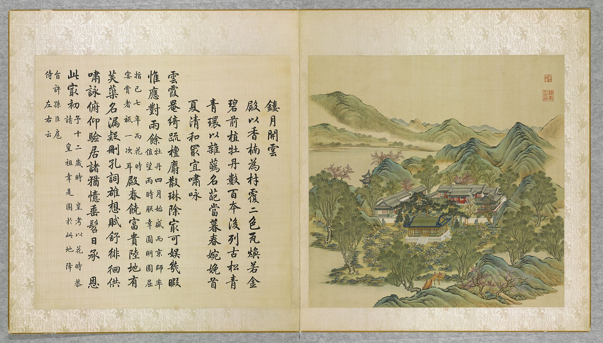

<!-- generated:start (scripts/building_pages.py): do not edit between these markers -->

# YM04-01: 纪恩堂 Ji'en Tang

Yuanming Yuan

**3D object:** 1 box. Open it: `/reconstruction/3d.html?b=YM04-01`

**Part of:** YM04 镂月开云

## What we know

- **Name:** 纪恩堂 Ji'en Tang (S05, S01 · confidence A)
- **Written on the plan:** ?云楼 (S01 · confidence A)
- **Garden:** Yuanming Yuan (S05, S01)
- **Type:** other (S05, S01 · confidence A)
- **Changed:** 1766 (乾隆三十一年): plaque 紀恩堂 given (S05, S01)
- **Destroyed:** 1860 (S05, S01)
- **Position:** 40.00395, 116.29208. S01 likely (S01 · confidence B)
- **Bays:** 9x2 on the plan (S05, S01)
- **Size in the inventory:** 44.7 × 21.1 m. S01 plan px / hall scale (S01)
- **Tiles:** 二色瓦 two-colour (poem: 殿以香楠為材覆二色瓦) [j80:30a] (S05, S01)
- **Note:** Nanmu timber. Kangxi, Yongzheng, Qianlong met here 1722 [j80:28a]. S06: 金碧二色琉璃瓦. roof_tiles: two-colour glazed (二色瓦) (S05, j80:30a). (S05, S01)
- **Plan reader's note:** Inventory 纪恩堂. First char 镂 or 楼. Label at (4046,4568) (S01) *(research copy, not public)*
- **How it was read:** likely (S01) *(research copy, not public)*
- **Plan pixels:** 4059, 4484 (S01) *(research copy, not public)*

## Our model now

A plain box on the block drawn on the Qing plan S01: position and frontage from the plan, heights and roof from the typology of its hall class. It will be updated as the research goes on.

- **Box:** 39.08 × 16.44 m, grand hall
- **Heights:** platform 1.22 m, eave 6.34 m, ridge 12.18 m above the ground
- **Roof:** hip-and-gable 歇山, rolled ridge 卷棚, mixed tile
- **Faces:** 172.5° from north
- **Fit:** reduced towards the size drawn on the plan, to stand clear of its neighbours or the water; moved 1.2 m
- **Confidence:** B

## Pictures (2)

- **P0004** (likely): 鏤月開雲 Louyue kaiyun [Graver la lune et ciseler les nuées] (圓明園四十景, 第4景) (1744 (BnF record: 1744年，清朝乾隆九年)). https://commons.wikimedia.org/wiki/File%3A%E5%9C%93%E6%98%8E%E5%9C%92%E5%9B%9B%E5%8D%81%E6%99%AF._%E7%AC%AC%E5%9B%9B%E6%99%AF_%28%E4%B8%8A%E5%86%8C%EF%BC%8C%E7%AC%AC%E5%9B%9B%E5%B9%85%E5%9B%BE%29%2C_%E9%8F%A4%E6%9C%88%E9%96%8B%E9%9B%B2_-_%28%E6%B8%85%29%E5%94%90%E5%B2%B1%E3%80%81%E6%B2%88%E6%BA%90%E5%90%88%E7%95%AB_%3B_%28%E4%B9%BE%E9%9A%86%E5%90%9F%E8%AF%97%EF%BC%8C%E6%B1%AA%E7%94%B1%E6%95%A6%E4%BB%A3%E4%B9%A6%29Louyue_kaiyun_-_%28Qing%29Tang_Dai%2C_Shen_Yuan_he_hua_-_btv1b55008355w.jpg

  

- **P0273** (likely): Spring Everlasting on the Abode of the Immortals, leaf 镂月开云 Louyue Kaiyun (Engraved Moon and Unfolding Clouds), album of 20 leaves in colour (ca. 1821 or later (S261)). https://www.hkpm.org.hk/en/exhibition/the-hong-kong-jockey-club-series-yuan-ming-yuan-art-and-culture-of-an-imperial-garden-palace Research-only: link card.

## Texts and drawings (4)

- **E1209** (text, sure): 御製紀恩堂記. 1766 (乾隆三十一年) · j80:26b-30a · S05. https://github.com/kanripo/KR2k0036/blob/master/KR2k0036_080.txt
  > 御製紀恩堂記御蘭芬諸額皆皇上御書御製紀恩堂記　圓明園之後記成於昔壬戍紀恩堂之題額乃於今丙戍始黽勉以亟為既鄭重以有待事若相殊理則一致我皇考之為圓明園前記也凡夫遵訓勤民親賢勵已之要深切言之而於昔恭迓皇祖鑾輿欣承色笑綢繆懇欵三致意焉予小子敬奉先帝園囿此對時而此臨政故敬成後記申闡皇考遵訓勤民親賢勵已之義唯日孜孜母敢少懈黽勉亟為者以此若今紀恩堂之題額實因紀皇祖之恩紀皇考之恩必有差所謂不負皇祖之恩者是不易言也我皇考迓皇祖承色笑者每一再舉行至予小子之恭承皇祖恩養育宫中則在康熙壬寅春即駕臨之日而覲於斯堂之内云斯堂在圓明園寢殿殿左舊謂之牡丹臺即四十景内所稱鏤月開雲者向於詩中亦經言及惟是皇考奉皇祖觀花燕喜之次以予名奏聞遂䝉眷顧育之禁廷日侍慈顔而承敎誨即雍正十三年詔尚以是為言故予小子自踐祚以來敬惟古帝王所以凛承付托者不過於其考或偶於其祖若予則皇祖皇考付託所洊重言及此自視常若不足遑敢弛朝乾夕愓之志故凡出治臨民罔不盡心籌度日慎一日至於今三十年仰䝉天佑内恬外闢政雖未臻上理而民則可謂粗安此所謂差不負皇祖之恩者乎鄭重有待者以此夫人之論周室率謂太王欲傳位王季以及文王泰伯知而避去此非也蓋知子莫若父王季其勤王家實足以興周家也若泰伯之不從朱子以為即夷齊叩馬之心予以為在夷齊則可在泰伯則不可何則從聖父以翦寖衰之商正也太王知泰伯有亷讓而無締搆王季又聖故傳位焉是亦正也是知以及文王之言及後人想當之談政恐後人之謬為比擬是以申而論之然則紀皇祖之恩即所以紀皇考之恩則先此之不敢遽云紀恩者以有待也雖然豈一題額即可以告畢吾事而息吾肩者哉茍吾志之偶渝即吾言之自寒矜矜焉惴惴焉將日觸吾目而警吾心且以告後來之入斯堂者亹繼繩而篤勤敬云爾
  He wrote this account only in 丙戌 (1766) for the plaque 紀恩堂: as a boy in the spring of 康熙壬寅 (1722) he was presented to Kangxi here at peony time, and was then brought up in the palace. The hall stands left of the bedchamber in the old 牡丹臺.
- **E1210** (text, sure): 日下舊聞考 镂月开云. 1780s (乾隆 敕撰) · j80:26a-26b · S05. https://github.com/kanripo/KR2k0036/blob/master/KR2k0036_080.txt
  > 鏤月開雲在富春樓之後即紀恩堂北為御蘭芬（圓明園冊）臣等謹按鏤月開雲四十景之一也原名牡丹臺乾隆九年易今名三十一年御題額曰紀恩堂詳
  鏤月開雲, formerly 牡丹臺 Peony Terrace and renamed in 1744, lies behind 富春樓; its hall is 紀恩堂, plaque of 乾隆三十一年 (1766), with 御蘭芬 to the north.
- **E1206** (poem, likely): 镂月开云: 嘉庆七年 poem of the Jiaqing Emperor. 嘉庆七年 (1802), date from the compilation · p.157 item (6), under 镂月开云 · S360. https://www.yuanmingyuanpark.cn/xs/yjbg/202007/P020200730387572832602.pdf#page=157
  > 受恩之自斯堂中，百有余载郅治崇。（恭本圣制纪恩堂记语）三朝遗泽一身荷，艰哉嘉庆承乾隆。心殷肯构弥敬懔，苞茂攸宁适兴寝。守成不易缅前徽，记文捧诵衷详审。
  Poem of the Jiaqing Emperor at 镂月开云, 1802, on remembering his forebears. Year as given by the compilation.
- **E1215** (description, sure): Scene 4, 镂月开云 Louyue Kaiyun, the Peony Terrace. 1934 · p.79 · S02. https://archive.org/details/historyofpekings00malo
  > Mu Tan T'ai, or Peony Terrace, was the common name of this island because of the woody peonies which grew among the ornamental rocks on a terrace on the southern half of the island.
  Common name 牡丹台 Mudan Tai; peonies on a terrace on the south half. Qianlong later wrote the name 纪恩堂 Ji'en Tang for the hall, because Kangxi visited him here as a child.

**On the plan:** Drawn on the plan of the gardens (S01), labelled ?云楼 (? marks an unread character), 9x2 cells. https://artmuseum.princeton.edu/collections/objects/138657

## Evidence for the set of buildings

- Evidence for the whole compound 镂月开云: see YM04
- Reconstructions and comparables for the whole garden, 圆明园 Yuanming Yuan: see GARDEN-YM
- Standing buildings comparable to a grand hall (not this building): see CLASS-grand_hall

## Open questions

- Q133: YM04-01

<!-- generated:end -->

## Notes

<!-- Yours: regeneration never touches this part. It goes on the public site; what you write below a line holding only %% private %% stays in the research copy. -->
