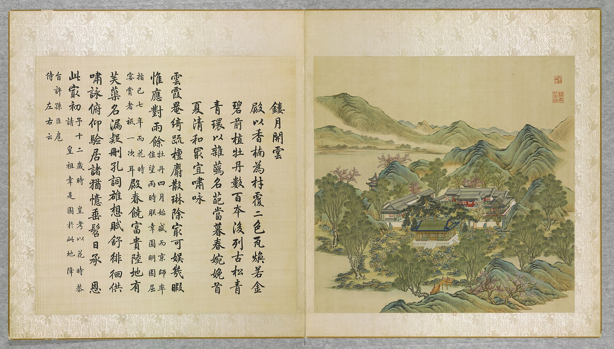

<!-- generated:start (scripts/building_pages.py): do not edit between these markers -->

# YM04-N01: 来青亭 Lai Qing Ting

Yuanming Yuan

**3D object:** 1 box. Open it: `/reconstruction/3d.html?b=YM04-N01`

**Part of:** YM04 镂月开云

## What we know

- **Name:** 来青亭 Lai Qing Ting (S01, S201 · confidence B)
- **Garden:** Yuanming Yuan (S01, S201)
- **Type:** pavilion (S01, S201 · confidence B)
- **Destroyed:** 1860 (S01, S201)
- **Position:** 40.00392, 116.29136. S01 likely (S01 · confidence B)
- **Bays:** 1 in the texts / 1x1 on the plan (S01, S201)
- **Size in the inventory:** 5.7 × 7.3 m. S01 plan px / hall scale (S01)
- **Note:** 永春亭 Yongchun Ting (plan label read 来青亭) (S201, KR4f0005_486:2a). (S01, S201)
- **Plan reader's note:** Octagonal pavilion on the corner between 九洲清晏 and 镂月开云 islands, bridge to the former. Second char less sure. Not in the inventory (S01) *(research copy, not public)*
- **How it was read:** likely (S01) *(research copy, not public)*
- **Plan pixels:** 3766, 4452 (S01) *(research copy, not public)*

## Our model now

On the block drawn on the Qing plan S01: position and frontage from the plan, heights and roof from the typology of its hall class, its form drawn by the hall kit. It will be updated as the research goes on.

- **Box:** 5.7 × 7.3 m, pavilion square
- **Heights:** platform 0.48 m, eave 3.68 m, ridge 6.33 m above the ground
- **Roof:** pyramid 攒尖, double eaves 重檐, grey tile
- **Faces:** 172.4° from north
- **Drawn:** by the hall kit: 1 bay, steps on the front, 攒尖 pyramid, double eaves 重檐, grey tile, a painted beam under the eave. From its own figures and readings where the dossier gives them (roof read: halls.csv S08 A; tiles read: halls.csv S08 A), the rest from the typology of its hall class.
- **Confidence:** B

## Pictures (1)

- **P0004** (likely): 鏤月開雲 Louyue kaiyun [Graver la lune et ciseler les nuées] (圓明園四十景, 第4景) (1744 (BnF record: 1744年，清朝乾隆九年)). https://commons.wikimedia.org/wiki/File%3A%E5%9C%93%E6%98%8E%E5%9C%92%E5%9B%9B%E5%8D%81%E6%99%AF._%E7%AC%AC%E5%9B%9B%E6%99%AF_%28%E4%B8%8A%E5%86%8C%EF%BC%8C%E7%AC%AC%E5%9B%9B%E5%B9%85%E5%9B%BE%29%2C_%E9%8F%A4%E6%9C%88%E9%96%8B%E9%9B%B2_-_%28%E6%B8%85%29%E5%94%90%E5%B2%B1%E3%80%81%E6%B2%88%E6%BA%90%E5%90%88%E7%95%AB_%3B_%28%E4%B9%BE%E9%9A%86%E5%90%9F%E8%AF%97%EF%BC%8C%E6%B1%AA%E7%94%B1%E6%95%A6%E4%BB%A3%E4%B9%A6%29Louyue_kaiyun_-_%28Qing%29Tang_Dai%2C_Shen_Yuan_he_hua_-_btv1b55008355w.jpg

  

## Texts and drawings (1)

- **E1203** (poem, sure): 永春亭: fixes the label by its place. 乾隆六十年 1795 · KR4f0005_486:2a; also 444:6a (1790) · S201. https://github.com/kanripo/KR4f0005
  > 後湖東岸永春亭兩字奎章萬古馨生物之方節臨向（是亭居湖東岸面向東）
  Poem and its note: the pavilion stands on the east shore of 后湖 and faces east, under a plaque by Yongzheng. The octagon drawn there on S01 with the label read 来青亭 by the plan reader is this pavilion: the label's first two characters are miscopied.

**On the plan:** Drawn on the plan of the gardens (S01), labelled 来青亭, 1x1 cells. https://artmuseum.princeton.edu/collections/objects/138657

## Evidence for the set of buildings

- Evidence for the whole compound 镂月开云: see YM04
- Reconstructions and comparables for the whole garden, 圆明园 Yuanming Yuan: see GARDEN-YM
- Standing buildings comparable to a square pavilion (not this building): see CLASS-pavilion_square

## Open questions

- Q37: A pointer to the tracing (Q2, Q4)

<!-- generated:end -->

## Notes

<!-- Yours: regeneration never touches this part. It goes on the public site; what you write below a line holding only %% private %% stays in the research copy. -->
