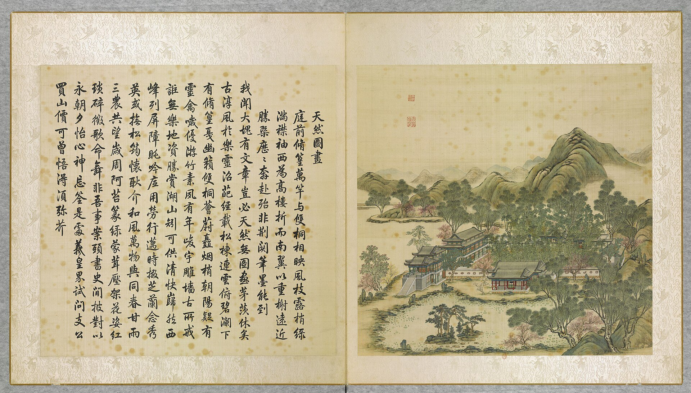
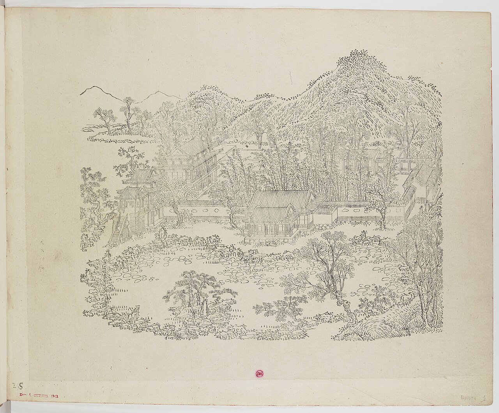
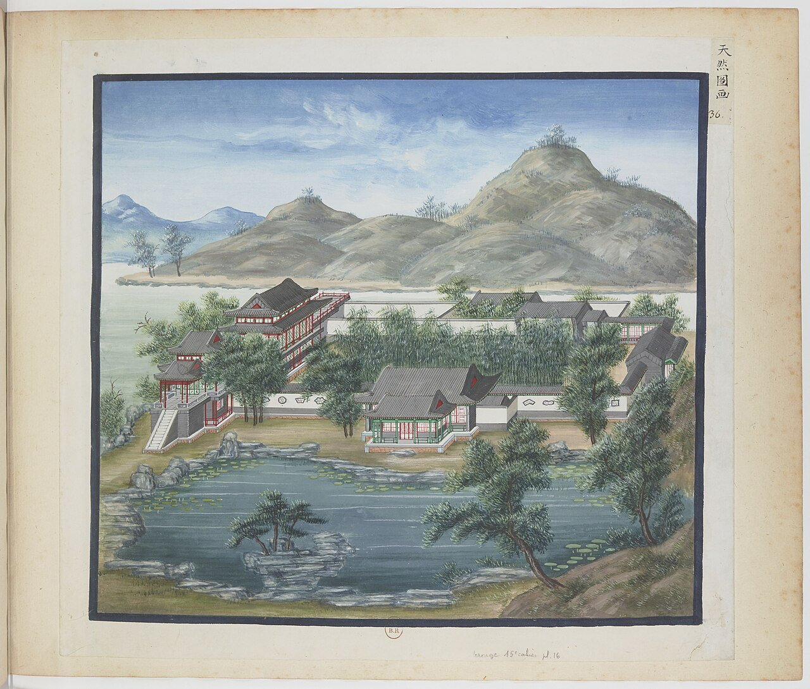
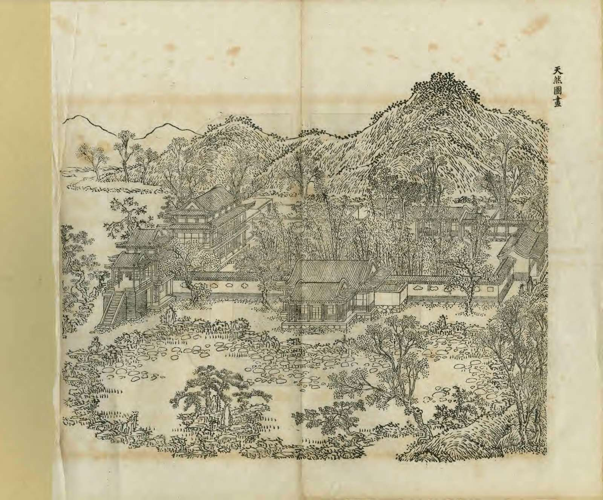
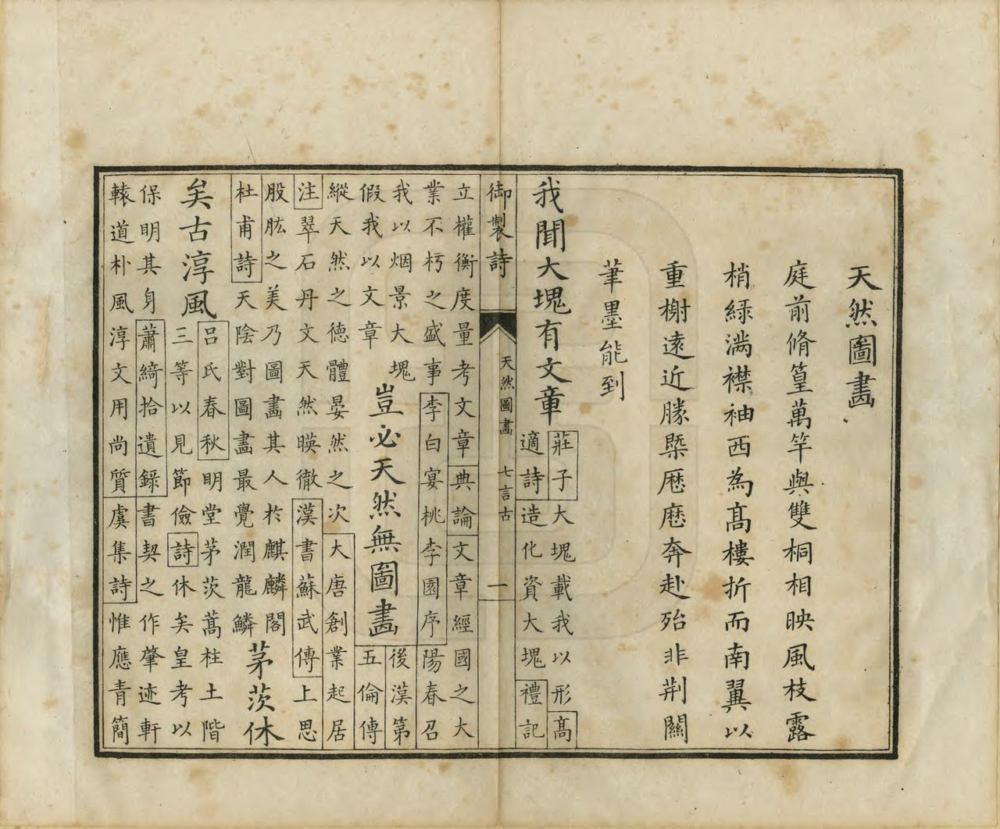
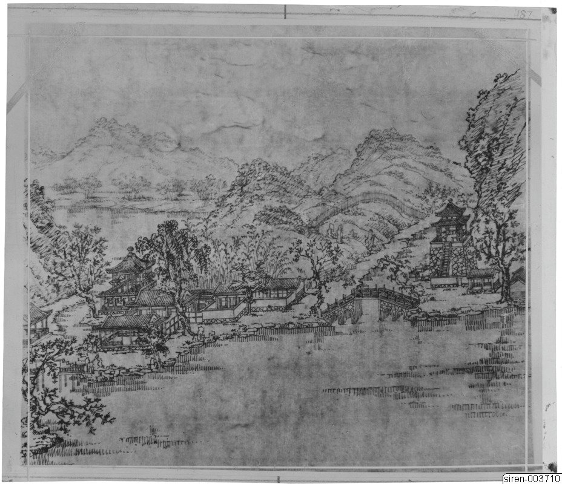
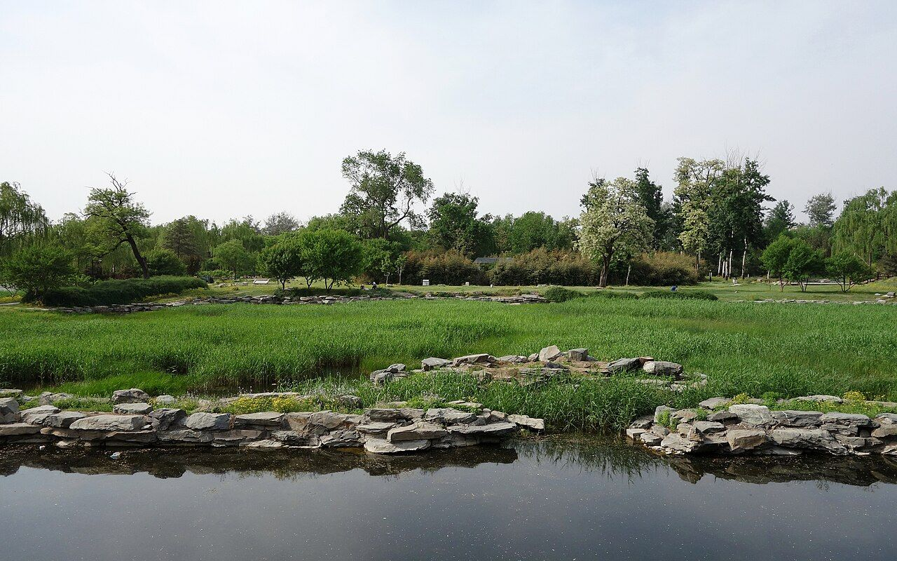

<!-- generated:start (scripts/building_pages.py): do not edit between these markers -->

# YM05: 天然图画 Tianran Tuhua

A Painting by Nature · Yuanming Yuan

**3D object:** 18 boxes. Open it: `/reconstruction/3d.html?b=YM05`

## What we know

- **Name:** 天然图画 Tianran Tuhua (S05, S02, S08, S41, S01 · confidence B)
- **English:** A Painting by Nature (S05, S02, S08, S41, S01)
- **Garden:** Yuanming Yuan (S05, S02, S08, S41, S01)
- **Type:** scene (S05, S02, S08, S41, S01 · confidence B)
- **Changed:** South pool and islet filled, probably c. 1831; pool found by excavation (S41). Not in the 1860 state. (S05, S02, S08, S41, S01)
- **Destroyed:** 1860 (S05, S02, S08, S41, S01)
- **Position:** 40.00475, 116.29159. S01 sure (S01 · confidence B)
- **Note:** Album does not show the 1860 state here (S41). (S05, S02, S08, S41, S01)
- **Plan reader's note:** Blue 5 at (4122,4045). East edge reaches the scroll gap at x about 4305-4318; a building straddles it at (4292,3870) (S01) *(research copy, not public)*
- **How it was read:** sure (S01) *(research copy, not public)*
- **Plan pixels:** 3932, 4034 (S01) *(research copy, not public)*

## Our model now

18 boxes stand in this compound, 18 on blocks drawn on the plan, 0 assumed. Its halls are listed below.

## Inside it (21)

- YM05-01 天然图画楼
- YM05-02 朗吟阁
- YM05-03 竹薖楼
- YM05-04 五福堂
- YM05-05 竹深荷净
- YM05-06 静知春事佳
- YM05-07 苏堤春晓
- YM05-08 文昌阁
- YM05-AC006
- YM05-B0676
- YM05-B0677
- YM05-B0679
- YM05-B0680
- YM05-B0697
- YM05-B0699
- YM05-B0701
- YM05-B0715
- YM05-B0716
- YM05-B0717
- YM05-B0725
- YM05-N01 桃花春一溪

## Pictures (8)

- **P0005** (sure): 天然圖畫 Tianran tuhua [Scène pittoresque de la nature] (圓明園四十景, 第5景) (1744 (BnF record: 1744年，清朝乾隆九年)). https://commons.wikimedia.org/wiki/File%3A%E5%9C%93%E6%98%8E%E5%9C%92%E5%9B%9B%E5%8D%81%E6%99%AF._%E7%AC%AC%E4%BA%94%E6%99%AF_%28%E4%B8%8A%E5%86%8C%EF%BC%8C%E7%AC%AC%E4%BA%94%E5%B9%85%E5%9B%BE%29%2C_%E5%A4%A9%E7%84%B6%E5%9C%96%E7%95%AB_-_%28%E6%B8%85%29%E5%94%90%E5%B2%B1%E3%80%81%E6%B2%88%E6%BA%90%E5%90%88%E7%95%AB_%3B_%28%E4%B9%BE%E9%9A%86%E5%90%9F%E8%AF%97%EF%BC%8C%E6%B1%AA%E7%94%B1%E6%95%A6%E4%BB%A3%E4%B9%A6%29Tianran_tuhua_-_%28Qing%29Tang_Dai%2C_Shen_Yuan_he_hua_-_btv1b55008357s.jpg

  

- **P0061** (sure): 中国皇帝的宫殿与庙宇. 第1幅图, 天然圖畫 - (清)孙祜、沈源Tianran tuhua - (Qing)Sun Hu, Shen Yuan (1745 (Commons, from the BnF record)). https://commons.wikimedia.org/wiki/File%3A%E4%B8%AD%E5%9B%BD%E7%9A%87%E5%B8%9D%E7%9A%84%E5%AE%AB%E6%AE%BF%E4%B8%8E%E5%BA%99%E5%AE%87._%E7%AC%AC1%E5%B9%85%E5%9B%BE%2C_%E5%A4%A9%E7%84%B6%E5%9C%96%E7%95%AB_-_%28%E6%B8%85%29%E5%AD%99%E7%A5%9C%E3%80%81%E6%B2%88%E6%BA%90Tianran_tuhua_-_%28Qing%29Sun_Hu%2C_Shen_Yuan_-_btv1b10520670t.jpg

  

- **P0136** (sure): 海淀(镇)：中国皇帝的行宫. 第36幅图, 天然图畫Tianran tuhua (1750-1792 (BnF, cb43831905b; ex coll. Bertin)). https://commons.wikimedia.org/wiki/File%3A%E6%B5%B7%E6%B7%80%28%E9%95%87%29%EF%BC%9A%E4%B8%AD%E5%9B%BD%E7%9A%87%E5%B8%9D%E7%9A%84%E8%A1%8C%E5%AE%AB._%E7%AC%AC36%E5%B9%85%E5%9B%BE%2C_%E5%A4%A9%E7%84%B6%E5%9B%BE%E7%95%ABTianran_tuhua_-_btv1b10520656p.jpg

  

- **P0275** (likely): Yinzhen Sitting in the Pavilion of Recitation in a Clear Voice (朗吟阁 Langyin Ge) (c. 1709-22 (S262)). https://asianartnewspaper.com/yuanming-yuan-in-paintings/ Research-only: link card.
- **P0236** (sure): 天然圖畫 Tianran Tuhua (御製圓明園圖詠, 1887 石印本, 上卷 (Commons 卷一), 第5景; printed title in the right margin of the picture) (光緒十三年 1887 (Commons/NLC record; colophon 光緒十三年七月天津石印書屋 in the SSID copy, S98 PDF p.2); design after the woodblock of 1745 by 孫祜 Sun Hu and 沈源 Shen Yuan). https://commons.wikimedia.org/wiki/File%3ANLC403-312001107375-14035_%E7%A6%A6%E5%88%B6%E5%9C%93%E6%98%8E%E5%9C%92%E5%9C%96%E8%A9%A0_%E5%8D%B7%E4%B8%80.pdf?page=40

  

- **P0512** (sure): 天然圖畫 Tianran Tuhua: 乾隆 Qianlong's preface and poem with the courtiers' commentary, 御製圓明園圖詠 1887 (poem 1744 (乾隆九年); this printing 1887). https://commons.wikimedia.org/wiki/File%3ANLC403-312001107375-14035_%E7%A6%A6%E5%88%B6%E5%9C%93%E6%98%8E%E5%9C%92%E5%9C%96%E8%A9%A0_%E5%8D%B7%E4%B8%80.pdf?page=41

  

- **P0208** (sure): Sirén, Enligt text under Pl. 187 Kinas trädgårdar Vol. I: Yuanmingyuan. Tianran tuhua, ”En Naturens Målning”. så kallad på grund av sin intima skönhet. Teckning av F.M. Piper efter ett av de (undated by holder; Sirén's second trip 1921-23 for this group). http://kulturarvsdata.se/SMVK-OM/Bildarkiv/198819 Research-only: link card.

  

- **P0370** (sure): 天然图画 20130512.JPG (2013-05-12 15:43:45 (Commons DateTimeOriginal)). https://commons.wikimedia.org/wiki/File:%E5%A4%A9%E7%84%B6%E5%9B%BE%E7%94%BB_20130512.JPG

  

## Texts and drawings (29)

- **E1221** (poem, sure): 御製天然圖畫詩（圓明園四十景詩）. 1744 (乾隆九年) · printed in S05 j80:32b-33a · S40. https://github.com/kanripo/KR2k0036/blob/master/KR2k0036_080.txt
  > 乾隆九年 御製天然圖畫詩 庭前修篁萬竿與雙桐相暎風枝露梢緑滿襟䄂西為髙樓折而南翼以重榭遠近勝概歴歴奔赴殆非荆關筆墨能到 我聞大塊有文章豈必天然無圖畫茅茨休矣古淳風於樂靈沼葩經載松棟連雲俯碧瀾下有修篁戞幽籟雙桐薈蔚矗烟梢朝陽疑有靈禽噦優游竹素夙有年峻宇雕牆古所戒詎無樂地資勝賞湖山矧可供清快巋然西峯列屏障眺吟底用勞行邁時掇芝蘭念秀英或撫松筠懐耿介和風萬物與同春甘雨三農共望嵗周阿苔篆緑䝉茸壓架花枝紅瑣碎徴歌命舞非吾事案頭書史閒披對以永朝夕怡心神忘筌是處羲皇界試問支公買山價可曽悟得湏彌芥
  Ten thousand bamboos and a pair of paulownias fill the court with green. A high tower to the west with terraces turning south commands near and far views beyond any landscape painter's reach.
- **E1222** (poem, sure): 御製朗吟閣詩. 1759 (乾隆二十四年) · j80:33a-33b · S05. https://github.com/kanripo/KR2k0036/blob/master/KR2k0036_080.txt
  > 乾隆二十四年御製朗吟閣詩　畫閣雲楣聖藻書題名猶在我生初（閣名猶所題皇考潛邸時也）爾時海濶天空意厥後朝乾夕惕居空色佛詮付茫若治安道要正慚如孩提常此聞詩禮石火流隂越感予
  Poem on 朗吟閣, whose name dates from Yongzheng's time as a prince.
- **E1230** (poem, sure): 御製五福堂六韻. 乾隆 (undated in S05) · j80:33b-34a · S05. https://github.com/kanripo/KR2k0036/blob/master/KR2k0036_080.txt
  > 御製五福堂六韻　春光酣百六景物逗吟憑園内此堂古祖恩皇考承（堂為賜也皇祖所）翹心思好徳聖意示含𢎞竹埭琳瑯峙蘭池綺縠澂對時常契會肯構敢云能歛錫遵前訓欽哉朂繼繩
  Poem on 五福堂, a grant from Kangxi to Yongzheng; mentions bamboo banks and an orchid pool.
- **E1231** (text, sure): 日下舊聞考 天然图画. 1780s (乾隆 敕撰) · j80:31b-32b · S05. https://github.com/kanripo/KR2k0036/blob/master/KR2k0036_080.txt
  > 鏤月開雲後有池一區池西北方樓為天然圖畫樓北為朗吟閣又北為竹薖樓東為五福堂五楹堂後迤北殿五楹為竹深荷淨其東南為靜知春事佳又東渡河為蘇堤春曉（圓明園冊）臣等謹按天然圖畫四十景之一也與朗吟閣竹薖竹深荷淨靜知春事佳諸額皆世宗御書竹薖樓簷額曰桃花春一溪亦世宗御書五福堂額為聖祖御書簷額曰蓮風竹露聨曰欣百物向榮每識乾坤生意值萬幾餘暇長同海宇熙春皆世宗御書對楣額曰葉嶼花潭曰蘇堤春曉皆皇上御書
  Behind 鏤月開雲 a pond, with the square tower 天然圖畫 north-west of it, then 朗吟閣 and 竹薖樓, the five-bay 五福堂 to the east, the five-bay 竹深荷淨 behind, 靜知春事佳, and 蘇堤春曉 across the stream. The note assigns the plaques to Kangxi, Yongzheng and Qianlong.
- **E1232** (text, sure): 文宗實錄 咸豐二年四月癸卯. 1852 (咸豐二年四月) · 實錄卷之六十 · S207. https://github.com/garychowcmu/daizhigev20/blob/master/史藏/别史/清实录咸丰朝实录.txt
  > 癸卯。上诣桃花春一溪、问皇贵太妃安。奉皇贵太妃、幸同乐园。进膳毕。跪送皇贵太妃、还绮春园。
  The emperor sees the senior consort at 桃花春一溪, the plaque of 竹薖樓 in S05 j80:32a; takes her to 同樂園 to eat; and sees her back to 綺春園, her home.
- **E1220** (poem, likely): 世宗 竹子院 (園景十二詠). before 1723 (雍邸集, printed as written while a prince) · KR4f0002_026:3a · S200. https://github.com/kanripo/KR4f0002/blob/master/KR4f0002_026.txt
  > 竹子院 深院溪流轉廽廊竹徑通珊珊鳴碎玉裊裊弄清風香氣侵書帙凉隂䕶綺櫳便娟蒼秀色偏茂嵗寒中
  Prince's poem on the Bamboo Court: a deep court with a turning stream, galleries and a bamboo path. Tied to 天然圖畫, whose 1744 preface opens with ten thousand bamboos; no text here states the identity.
- **E1241** (poem, sure): 天然图画. 乾隆九年 (1744) · v2 p.1, under 天然图画; source ref 2-682 · S361. https://www.yuanmingyuanpark.cn/xs/yjbg/202008/P020200803382343267004.pdf#page=4
  > 庭前修篁万竿，与双桐相映。风枝露梢，绿满襟袖。西为高楼，折而南翼以重榭，远近胜概，历历奔赴，殆非荆关笔墨能到。我闻大块有文章，岂必天然无图画。茅茨休矣古淳风，于乐灵沼葩经载。松栋连云俯碧澜，下有修篁戞幽籁。双桐荟蔚矗烟梢，朝阳疑有灵禽哕。优游竹素夙有年，峻宇雕墙古所戒。讵无乐地资盛赏，湖山矧可供清快。岿然西峰列屏障，眺吟底用劳行迈。时掇芝兰念秀英，或抚松筠怀耿介。和风万物与同春，甘雨三农共望岁。周阿苔篆绿濛茸，压架花姿红琐碎。征歌命舞非吾事，案头书史闲披对。以永朝夕怡心神，忘荃是处羲皇界。试问支公买山价，可曾悟得须弥芥。
  Poem 天然图画 by the Qianlong Emperor, 1744, filed by the editors under 天然图画.
- **E1223** (poem, sure): 朗吟阁（朗吟楼）: 乾隆二十四年 poem of the Qianlong Emperor. 乾隆二十四年 (1759), date from the compilation · p.156 item (2), under 朗吟阁（朗吟楼） · S360. https://www.yuanmingyuanpark.cn/xs/yjbg/202007/P020200730387572832602.pdf#page=156
  > 画阁云楣圣藻书，题名犹在 我生初。（阁名犹皇考潜邸时所题也）尔时海阔天空意，厥后朝乾夕惕居。空色佛诠付茫若，治安道要正惭如。孩提常此闻诗礼，石火流阴越感予。
  Poem of the Qianlong Emperor at 朗吟阁（朗吟楼）, 1759. Year as given by the compilation.
- **E1245** (poem, sure): 桃花春一溪. 乾隆二十四年 (1759) · v2 p.3, under 天然图画; source ref 6-712 · S361. https://www.yuanmingyuanpark.cn/xs/yjbg/202008/P020200803382343267004.pdf#page=6
  > 水裔桃之华灼灼，恰似琳池浸霞脚。东风惯与作参商，只见其忧那见乐。落英缤纷如印泥，宛转桃花春一溪。髙楼溪上契妙悟，空色色空轩篆题。讵必武陵无杂树，漫拟江南淮口渡。烟花世界幻三千，到此微尘无用处。忘物之极同物悲，调御神权谁则窥。我惟仔肩凛佛时，好春花事非我知。毎见蓬蓬风善妬，不惜花零惜云去。
  Poem 桃花春一溪 by the Qianlong Emperor, 1759, filed by the editors under 天然图画.
- **E1243** (poem, sure): 恭和御制五福堂对玉兰花二十韵元韵（84）. 乾隆五十三年 (1788) · v4 p.382, under 春熙院 · S361. https://www.yuanmingyuanpark.cn/xs/yjbg/202008/P020200803382796786124.pdf#page=385
  > 有嘉德斯有嘉树，燕喜千春荷天顾。一草一木被滋培，生之长之邀遭遇。卷阿恺悌乐来游，肩舆看花为小留。大块文章萃生意，矢音掞藻新诗酬。忆昨江南花下待，虎邱溪畔歌欸乃。以彼凡卉视名葩，迥隔人天千亿倍。东风披拂不相欺，万橤含英启睿思。龙飞瑞兆古稀上，曰富曰寿曰颐期。仰睹天章蕴精义，睿题肇自仁皇赐。即今圣治洽寰区，五代同堂五福备。弥性纯常德润身，此花应运栽培真。风日暄妍枝挺玉，雨露长养围如囷。层城十二白玉朵，宝光流雪纷婀娜。清香蓊郁散雕栏，茂矣苞矣同许可。栽者培之斯诚然，已沐恩晖五十年。策添大衍算无量，花亦如年容更妍。对育殷怀孝思则，曾侍含饴近颜色。堂中此日抱元孙，树人树木罔不克。天家敷锡陈箕畴，大地都消六极忧。根深末茂垂远荫，清芬万载承鸿庥。
  Poem 恭和御制五福堂对玉兰花二十韵元韵（84） by the Qianlong Emperor, 1788, filed by the editors under 春熙院.
- **E1244** (poem, sure): 恭和御制五福堂对玉兰花叠去岁韵元韵（95）. 乾隆五十三年 (1788) · v4 p.383, under 春熙院 · S361. https://www.yuanmingyuanpark.cn/xs/yjbg/202008/P020200803382796786124.pdf#page=386
  > 授时别殿抚嘉树，岁岁逢春蒙眷顾。百年雨露久滋培，得气欣荣庆遭遇。卷阿来咏肩舆游，几暇赏心花下留。白毫光现众香国，千春掞藻新歌酬。夭桃繁李时相待，上品名葩谁似乃。寿齐松竹兼苞茂，回视凡花亿万倍。东皇催发不相欺，素艳凝辉启藻思。曾经栽植三朝泽，兰芬玉色同心期。捧睹奎章含妙义，嘉名肇锡同天赐。即今海澨静风尘，圣化覃敷五者备。德基福致康强身，此花应运全天真。宝珠光满广寒界，好如仙桂围轮囷。湧现吉祥花万朵，清华四照翩婀娜。攸宁佳节乐攸跻，晏坐挥毫无不可。讬根得地理诚然，长挹恩辉祝大年。无量花征无量寿，寿人寿世春台妍。对育殷怀孝思则，缅忆堂中近颜色。恰欣五代同一堂，祭则受福战则克。祯符敷锡陈箕畴，不将后乐纾先忧。万年远荫垂寰宇，共登寿域承天庥。
  Poem 恭和御制五福堂对玉兰花叠去岁韵元韵（95） by the Qianlong Emperor, 1788, filed by the editors under 春熙院.
- **E1224** (poem, sure): 朗吟阁（朗吟楼）: 乾隆五十四年 poem of the Qianlong Emperor. 乾隆五十四年 (1789), date from the compilation · p.157 item (3), under 朗吟阁（朗吟楼） · S360. https://www.yuanmingyuanpark.cn/xs/yjbg/202007/P020200730387572832602.pdf#page=157
  > 最久园中阁，两言题额横。（此阁名为皇考潜邸时所题，其时予尚在幼龄，每于此仰承圣训。 ）春秋奉明训，风月寄闲评。五福堂依近（阁在堂之右，有廊通之）万年祚永宏。闻诗闻礼日，那识朗吟情。
  Poem of the Qianlong Emperor at 朗吟阁（朗吟楼）, 1789, on remembering his forebears. Year as given by the compilation.
- **E1225** (poem, sure): 五福五代堂: 乾隆五十五年 poem of the Qianlong Emperor. 乾隆五十五年 (1790), date from the compilation · p.154 item (1), under 五福五代堂 · S360. https://www.yuanmingyuanpark.cn/xs/yjbg/202007/P020200730387572832602.pdf#page=154
  > 敷锡名垂洪范篇，（洪范云敛时五福用敷，锡厥庶民，本非自厚其身之谓迨至。庶民保极，实则一人永膺多福也。）祖功宗德已身肩。三朝厚幸双文益，（五福堂之名乃皇祖御书以赐皇考者，甲辰予见元孙得増二字曰五福五代堂，以昭垂裕盖八袠初开，五代早全子之蒙福，实为厚幸。 ）八袠初开五代全。苞茂即今看秩秩，旰宵惟是励乾乾。奉时布恵宜春日，欣遇多收鲜缓蠲。（每岁新正加恩展赈，偏灾州县用普春祺，昨己酉岁各省收成俱在八九分以上。虽直隶、江苏安徽、河南、湖北五省间有被水处所合计各省尚不及二十分之一。己饬加意赈恤，是以新岁蠲缓之数甚稀。上天眷佑嘉与亿兆，同荷福禔，惟当益励。乾寅以恊，敷锡保极之意耳。）
  Poem of the Qianlong Emperor at 五福五代堂, 1790. Year as given by the compilation.
- **E1226** (poem, sure): 五福五代堂: 乾隆五十五年 poem of the Qianlong Emperor. 乾隆五十五年 (1790), date from the compilation · p.154 item (2), under 五福五代堂 · S360. https://www.yuanmingyuanpark.cn/xs/yjbg/202007/P020200730387572832602.pdf#page=154
  > 箕畴九向兆祥言，皇祖书勋皇考尊。历岁久经瞻潜邸，（皇祖御书五福堂以赐皇考，恭悬潜邸，即今雍和宫之后室也。 ）践基重以署名园。 （皇考践位后于圆明园中复摹奎章悬之是处，予于甲辰得见，元孙因即于是堂。并宁寿宫之景福宫及避暑山庄各增名五福五代堂扁额，仰惟诒谋，笃庆肇锡嘉祥，而予今岁在位六十年幸符初愿，明岁即当归政。仰荷鸿禧实为史册之所罕觏，既以自庆更倍悚敬。）钦承好德修身切，幸近考终归政繁。五代孙欣年十二，踰三 企望见来孙。（元孙载锡年已十二，再踰三年即可以得见来孙矣。）
  Poem of the Qianlong Emperor at 五福五代堂, 1790, on remembering his forebears. Year as given by the compilation.
- **E1227** (poem, sure): 五福五代堂. 嘉庆十三年 (1808) · v2 p.12, under 天然图画; source ref 4-35 · S361. https://www.yuanmingyuanpark.cn/xs/yjbg/202008/P020200803382343267004.pdf#page=15
  > 高堂宏敞后湖滨，备福于昭大圣人。绕膝曾元敷惠泽，传心政治洽蒸民。愧无教化宣三德，渐觉居诸近五旬。瞻额返躬敢奢望，惟祈天佑有年臻。斯堂为皇祖建构，皇曾祖赐名“五福堂”。皇子幼龄皆居此堂侧，予亦曾居是堂之东，就傅时始移居处。逮我皇考甲辰得五代元孙载锡，增题额为“五福五代堂”。我皇考德全福备，事事享伊，古未有之隆，即此五代同堂亦属皇家之极盛。今予于四月二十一日初得皇孙，锡名奕纬，从此岐嶷成立，瓜瓞联绵。天家婚礼早谐，毓瑞钟祥，当可曾元叠见。倘邀天祖眷佑，获致期颐，则予至八旬之年，或亦得上继我皇考履绥之庆。予非敢预存奢望，惟有修身勤政，仰俟天庥，庶几大耋增筹，康强逢吉，云仍兆瑞，奕叶延厘，斯予所劼毖几康虔祈
  Poem 五福五代堂 by the Jiaqing Emperor, 1808, filed by the editors under 天然图画.
- **E1229** (poem, sure): 五福五代堂: 嘉庆二十五年 poem of the Jiaqing Emperor. 嘉庆二十五年 (1820), date from the compilation · p.156 item (10), under 五福五代堂 · S360. https://www.yuanmingyuanpark.cn/xs/yjbg/202007/P020200730387572832602.pdf#page=156
  > 层楼东峙临碧汀，赐居斯地纔五龄。乌踆倐忽周花甲，不觉双鬓添星星。圣皇德厚备五福，藐躬何幸慈恩沐。子孙绕膝巳六人，尚待椒聊广似续。
  Poem of the Jiaqing Emperor at 五福五代堂, 1820. Year as given by the compilation.
- **E1246** (poem, sure): 桃花春一溪晚坐（195）. 道光五年 (1825) · v2 p.14, under 天然图画 · S361. https://www.yuanmingyuanpark.cn/xs/yjbg/202008/P020200803382343267004.pdf#page=17
  > 前朝微雨已清尘，更企甘霖降晚春。映户桃花红半堕，缘溪草色绿初匀。云遮远岫斜阳淡，烟敛平湖碧浪新。凭槛临流悦心性，暄妍佳景乐天真。
  Poem 桃花春一溪晚坐（195） by the Daoguang Emperor, 1825, filed by the editors under 天然图画.
- **E1242** (poem, sure): 秋日登朗吟阁寓目（350）. year not parsed · v2 p.1, under 天然图画 · S361. https://www.yuanmingyuanpark.cn/xs/yjbg/202008/P020200803382343267004.pdf#page=4
  > 缥渺遥峰带夕曛，晴光历历望中分。桥移虹影当溪卧，风度蝉声隔岸闻。数片晚霞三径菊，一潭秋水半床云。高亭避暑才吟罢，又听金飚送雁群。
  Poem 秋日登朗吟阁寓目（350） by the  Emperor, filed by the editors under 天然图画.
- **E1228** (poem, likely): 五福五代堂自述. 嘉庆十四年 (1809) · v2 p.12, under 天然图画; source ref 4-117 · S361. https://www.yuanmingyuanpark.cn/xs/yjbg/202008/P020200803382343267004.pdf#page=15
  > 赐居髫岁后湖边，弹指流阴五十年。继志承基沐厚德，安民图治重仔肩。永思考妣瞻天上，欣见儿孙绕膝前。大福从来备至圣，衷祈奕叶泽绵延。
  Poem 五福五代堂自述 by the Jiaqing Emperor, 1809, filed by the editors under 天然图画.
- **E1235** (description, sure): Scene 5, 天然图画 Tianran Tuhua. 1934 · p.79 · S02. https://archive.org/details/historyofpekings00malo
  > A pavilion built on a high brick terrace overlooks a lily pool, some dwellings, a bamboo grove, and the waters of the Back Lake,
  A pavilion on a high brick terrace, over a lily pool, dwellings, bamboo and the Back Lake.
- **E1216** (description, sure): Site status table, about 2011: remains tidied up. c. 2011 · 系列06 repost, status table · S356. https://blog.sina.com.cn/s/blog_c27029650101itzz.html
  A blogger's table of what was then visible. These scenes have building remains that have been cleared and tidied. Dated about 2011, so digs since then are not reflected.
- **E1236** (description, sure): 天然图画 文昌阁 (S47 section 2.16). 2012, citing archive and Qing texts · pp.116-117, 126; table row 28 · S47. https://www.dpm.org.cn/Uploads/File/2018/06/15/u5b23730ae0e5a.pdf
  By 静知春事佳 and the 苏堤春晓 pavilion, plaque 三宗会极, after Daoguang in S47's view. Xianfeng burned incense here on the 21st of the third lunar month of 1860. Damaged in 1860, rebuilt 1871 and standing in the survey of 1873: so its 1860 form is not known.
- **E1238** (description, sure): 王琳, 崔山, 圣皇被五福: 圆明园天然图画园林意境演变探究, 圆明园研究 99期. 2026-09-08 · xs/ktsb/202609/t20260908_4827967; abstract read · S338. https://www.yuanmingyuanpark.cn/xs/ktsb/202609/t20260908_4827967.html
  Traces 天然图画 from the Kangxi-era bamboo court 竹子院 onward through court archives, showing repeated changes of layout and of theme. Only the abstract was read.
- **E1233** (description, sure): 圆明园百景史事分景汇编: 朗吟阁（朗吟楼）. 1759-1789 · from p.156, under 天然图画 · S360. https://www.yuanmingyuanpark.cn/xs/yjbg/202007/P020200730387572832602.pdf#page=156
  朗吟阁（朗吟楼）: 3 dated items, 1759-1789, of which 3 poems (Qianlong); recurring themes: remembering his forebears. First dated 1759, last dated 1789.
- **E1234** (description, sure): 圆明园百景史事分景汇编: 五福五代堂. 1790-1820 · from p.154, under 天然图画 · S360. https://www.yuanmingyuanpark.cn/xs/yjbg/202007/P020200730387572832602.pdf#page=154
  Qianlong's poems of 1790 and 1796 celebrate five living generations here, and Jiaqing kept coming to pray for descendants until 1820. 五福五代堂: 10 dated items, 1790-1820, of which 10 poems (Qianlong, Jiaqing); recurring themes: remembering his forebears. First dated 1790, last dated 1820.
- **E1237** (description, sure): 圆明园五朝御制诗文集注 v2, editors' note on 天然图画. 2020 edition · v2 p.1 · S361. https://www.yuanmingyuanpark.cn/xs/yjbg/202008/P020200803382343267004.pdf#page=4
  Built before Yongzheng's accession on the east shore of the rear lake: a square lakeside tower, 朗吟阁 north of it (his favourite room as a prince), 竹簻楼, and 五福堂, renamed 五福五代堂 late in Qianlong's reign, behind which 竹深荷静 became 湛静斋 under Xianfeng.
- **E1239** (description, sure, search index only): 天然图画 scene card. n.d. · mhymy jqjs 3856 · S340. https://www.mhymy.com/ymss/jqjs/3856.html
  North of 镂月开云, west on 后湖, 150 x 110 m, 16,000 m2, 1,950 m2 of buildings.
- **E0529** (drawing, sure): 圆明园总平面图. 乾隆四十至四十二年绘, 改至道光十一年 (1775-1831) · 故宫博物院图书馆 样1704号 · S310. https://www.mhymy.com/dasl/ysltd/9380.html
  Large overall base plan of Yuanming Yuan, ink and light colour with pasted slips, 1761x1311 mm, drawn c. 1775-77 and altered until 1831, so its layers must be read apart; at Tianran Tuhua the pool is painted out in white. No image here; the site may ask a small payment for the full record.
- **E1240** (drawing, sure): 《国家图书馆藏样式雷图档·圆明园卷初编》: 天然图画. mostly 道光, 咸丰, 同治 per the publisher · 初编 目录: 天然图画, p.227 · S13. https://www.nlcpress.com/ProductView.aspx?Id=7642
  The printed facsimile of the National Library of China's Yangshi Lei sheets has a section on this place at p.227 (1 pages, section length worked out from the next heading); sheet titles and numbers are in the volume, ordered from a library.

**On the plan:** Drawn on the plan of the gardens (S01), labelled 天然图画. https://artmuseum.princeton.edu/collections/objects/138657

## Reconstructions by others (5)

Modern interpretation, not evidence.
- **R0313** (drawing, sure): 《圆明园四十景图·天然图画》复原图, printed as Fig. 2 in 圆明园研究 99期. 王裔婷 et al.. https://www.yuanmingyuanpark.cn/xs/ktsb/202609/t20260908_4827967.html Research-only: link card.
- **R0053** (AR/VR, sure): “飞跃圆明园四十景”, MR glasses, 2026 服贸会 at Shougang. 中央美术学院 人工智能与数字文化遗产研究中心, 中央美术学院 Central Academy of Fine Arts, 2026. https://cn.chinadaily.com.cn/a/202609/14/WS6aa802efe4b09a165c78a00c.html Research-only: link card.
- **R0312** (paper figure, sure): 圣皇被五福: landscape plan of 天然图画 YM05 reconstructed from the Forty Scenes leaf, 圆明园研究 99期. 王琳, 崔山, 中国农业大学园艺学院, 2026. https://www.yuanmingyuanpark.cn/xs/ktsb/202609/t20260908_4827967.html Research-only: link card.
- **R0032** (video, sure, search index only): [央美]镂月开云、天然图画复原视频. 中央美术学院圆明园研究中心 (央美 tag; the page names it, per search extract). https://www.mhymy.com/szfy/fysp/14820.html Research-only: link card.
- **R0223** (video, guess): 人在画中游：央美团队UE5复原圆明园，重现万园之园的辉煌壮丽. 中央美术学院 CAFA team, as stated in the title, 中央美术学院 Central Academy of Fine Arts, 2024. https://www.bilibili.com/video/BV1EZ421t7eM Research-only: link card.

## Surviving comparable buildings, not this building (1)

- **T009** 苏堤 Su Causeway, West Lake, 西湖 杭州 Hangzhou. Ours was copied from it, confidence B, standing: yes. Bank with willows; never scale Basis: S416 (苏堤春晓 article): Qianlong copied West Lake here; about 200 m bank between lotus pond and stream, against about 3 km in Hangzhou; only the bank remains. S05 j.80 f.31b-32a: plaque 苏堤春晓 by Qianlong, across the river from 天然图画. https://www.sohu.com/a/454029446_660430
  - P0655: Su Causeway, West Lake. https://commons.wikimedia.org/wiki/File:Su_Causeway,_West_Lake.jpg
  - P0656: Su Causeway near West Lake, looking towards north 20120529 1. https://commons.wikimedia.org/wiki/File:Su_Causeway_near_West_Lake,_looking_towards_north_20120529_1.jpg

## Evidence for the set of buildings

- Reconstructions and comparables for the whole garden, 圆明园 Yuanming Yuan: see GARDEN-YM

## Open questions

- Q1: Target state
- Q26: Forms
- Q57: What state a reconstruction shows

<!-- generated:end -->

## Notes

<!-- Yours: regeneration never touches this part. It goes on the public site; what you write below a line holding only %% private %% stays in the research copy. -->
