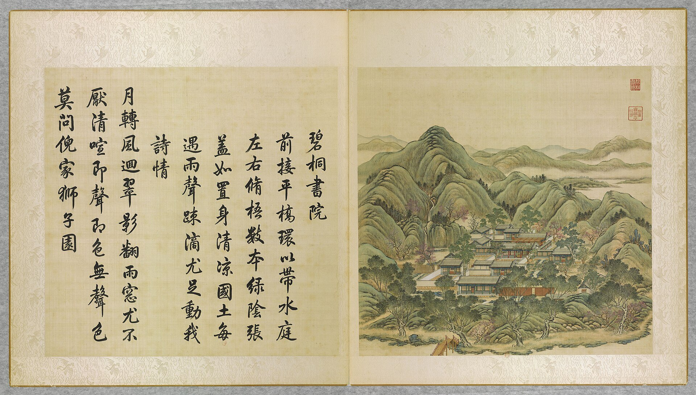

<!-- generated:start (scripts/building_pages.py): do not edit between these markers -->

# YM06-01: 前宇 Qian yu

Yuanming Yuan

**3D object:** 1 box. Open it: `/reconstruction/3d.html?b=YM06-01`

**Part of:** YM06 碧桐书院

## What we know

- **Name:** 前宇 Qian yu (S05, S01 · confidence B)
- **Garden:** Yuanming Yuan (S05, S01)
- **Type:** other (S05, S01 · confidence B)
- **Destroyed:** 1860 (S05, S01)
- **Position:** 40.00601, 116.29138. S01 likely (S01 · confidence B)
- **Bays:** 3 in the texts / 3x1 on the plan (S05, S01)
- **Size in the inventory:** 13.6 × 8.5 m. S01 plan px / hall scale (S01)
- **Plan reader's note:** 前宇 3: position on the axis, count fits (S01) *(research copy, not public)*
- **How it was read:** likely (S01) *(research copy, not public)*
- **Plan pixels:** 3946, 3394 (S01) *(research copy, not public)*

## Our model now

A plain box on the block drawn on the Qing plan S01: position and frontage from the plan, heights and roof from the typology of its hall class. It will be updated as the research goes on.

- **Box:** 11.81 × 6.95 m, side hall
- **Heights:** platform 0.54 m, eave 3.64 m, ridge 6.24 m above the ground
- **Roof:** gable 硬山 or 悬山, rolled ridge 卷棚, grey tile
- **Faces:** 174.2° from north
- **Fit:** reduced towards the size drawn on the plan, to stand clear of its neighbours or the water; moved 1 m
- **Confidence:** B

## Pictures (1)

- **P0006** (likely): 碧桐書院 Bitong shuyuan [Studio des aleurites d'émeraude] (圓明園四十景, 第6景) (1744 (BnF record: 1744年，清朝乾隆九年)). https://commons.wikimedia.org/wiki/File%3A%E5%9C%93%E6%98%8E%E5%9C%92%E5%9B%9B%E5%8D%81%E6%99%AF._%E7%AC%AC%E5%85%AD%E6%99%AF_%28%E4%B8%8A%E5%86%8C%EF%BC%8C%E7%AC%AC%E5%85%AD%E5%B9%85%E5%9B%BE%29%2C_%E7%A2%A7%E6%A1%90%E6%9B%B8%E9%99%A2_-_%28%E6%B8%85%29%E5%94%90%E5%B2%B1%E3%80%81%E6%B2%88%E6%BA%90%E5%90%88%E7%95%AB_%3B_%28%E4%B9%BE%E9%9A%86%E5%90%9F%E8%AF%97%EF%BC%8C%E6%B1%AA%E7%94%B1%E6%95%A6%E4%BB%A3%E4%B9%A6%29Bitong_shuyuan_-_%28Qing%29Tang_Dai%2C_Shen_Yuan_he_hua_-_btv1b550083587.jpg

  

## Texts and drawings (1)

- **E1250** (text, sure): 日下舊聞考 碧桐书院. 1780s (乾隆 敕撰) · j80:34b-35a · S05. https://github.com/kanripo/KR2k0036/blob/master/KR2k0036_080.txt
  > 由五福堂渡河而北山阜旋繞内為碧桐書院前宇三楹正殿五楹後照殿五楹其西巖石上為雲岑亭（圓明園冊）臣等謹按碧桐書院四十景之一也額為世宗御書㳟懸正殿内
  North across the stream from 五福堂, ringed by low hills: 碧桐書院 with a three-bay front range, a five-bay main hall and a five-bay rear hall, and 雲岑亭 on the rock to the west.

**On the plan:** Drawn on the plan of the gardens (S01) with no label, 3x1 cells: a building stood here, its name unknown. https://artmuseum.princeton.edu/collections/objects/138657

## Evidence for the set of buildings

- Evidence for the whole compound 碧桐书院: see YM06
- Reconstructions and comparables for the whole garden, 圆明园 Yuanming Yuan: see GARDEN-YM
- Standing buildings comparable to a side hall (not this building): see CLASS-side_hall

## Open questions

None that name it.

<!-- generated:end -->

## Notes

<!-- Yours: regeneration never touches this part. It goes on the public site; what you write below a line holding only %% private %% stays in the research copy. -->
