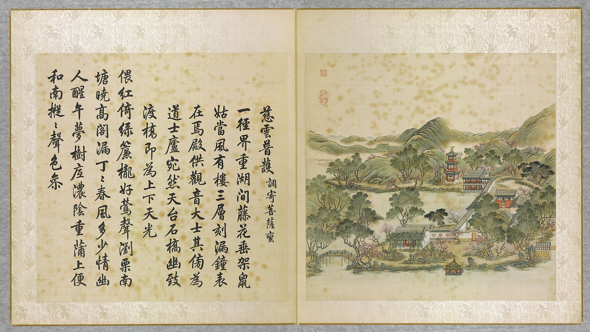

<!-- generated:start (scripts/building_pages.py): do not edit between these markers -->

# YM07-02: 慈云普护楼 Ciyun Puhu Lou

Yuanming Yuan

**3D object:** 1 box. Open it: `/reconstruction/3d.html?b=YM07-02`

**Part of:** YM07 慈云普护

## What we know

- **Name:** 慈云普护楼 Ciyun Puhu Lou (S05, S02, S47, S01, S360 · confidence B)
- **Written on the plan:** 慈云普护 (S01 · confidence B)
- **Garden:** Yuanming Yuan (S05, S02, S47, S01, S360)
- **Type:** temple (S05, S02, S47, S01, S360 · confidence B)
- **Built:** by 1744 (first dated item) (S05, S02, S47, S01, S360)
- **Destroyed:** 1860 (S05, S02, S47, S01, S360)
- **Position:** 40.00622, 116.29006. S01 sure (S01 · confidence B)
- **Bays:** 3 in the texts / 3x1 on the plan (S05, S02, S47, S01, S360)
- **Size in the inventory:** 12.4 × 6.3 m. S01 plan px / hall scale (S01)
- **Storeys:** 3 (S05, S02, S47, S01, S360)
- **Note:** 上奉觀音 下祀關帝 [j80:35b]. 1744 poem 有樓三層刻漏鐘表在焉 [j80:36b]; Malone p.80 3-storey bell tower. (S05, S02, S47, S01, S360)
- **Plan reader's note:** Text 3 (S01) *(research copy, not public)*
- **How it was read:** sure (S01) *(research copy, not public)*
- **Plan pixels:** 3392, 3243 (S01) *(research copy, not public)*

## Our model now

On the block drawn on the Qing plan S01: position and frontage from the plan, heights and roof from the typology of its hall class, its form drawn by the hall kit. It will be updated as the research goes on.

- **Box:** 12.4 × 6.3 m, storeyed hall
- **Heights:** platform 0.5 m, eave 18 m, ridge 23.94 m above the ground
- **Roof:** hip-and-gable 歇山, rolled ridge 卷棚, grey tile
- **Faces:** 176° from north
- **Drawn:** by the hall kit: 3 bays, the middle widest, a porch front, steps on the back, front, left, 歇山 hip-and-gable with a rolled ridge 卷棚, grey tile, a painted beam under the eave. Drawn from the typology of its hall class, not from a picture of this hall (assumed, C).
- **Confidence:** B

## Pictures (1)

- **P0007** (likely): 慈雲普護 Ciyun puhu [Nuage de miséricorde pour la bénédiction universelle] (圓明園四十景, 第7景) (1744 (BnF record: 1744年，清朝乾隆九年)). https://commons.wikimedia.org/wiki/File%3A%E5%9C%93%E6%98%8E%E5%9C%92%E5%9B%9B%E5%8D%81%E6%99%AF._%E7%AC%AC%E4%B8%83%E6%99%AF_%28%E4%B8%8A%E5%86%8C%EF%BC%8C%E7%AC%AC%E4%B8%83%E5%B9%85%E5%9B%BE%29%2C_%E6%85%88%E9%9B%B2%E6%99%AE%E8%AD%B7_-_%28%E6%B8%85%29%E5%94%90%E5%B2%B1%E3%80%81%E6%B2%88%E6%BA%90%E5%90%88%E7%95%AB_%3B_%28%E4%B9%BE%E9%9A%86%E5%90%9F%E8%AF%97%EF%BC%8C%E6%B1%AA%E7%94%B1%E6%95%A6%E4%BB%A3%E4%B9%A6%29Ciyun_puhu_-_%28Qing%29Tang_Dai%2C_Shen_Yuan_he_hua_-_btv1b55008359p.jpg

  

## Texts and drawings (10)

- **E1260** (text, sure): 日下舊聞考 慈云普护. 1780s (乾隆 敕撰) · j80:35b-36b · S05. https://github.com/kanripo/KR2k0036/blob/master/KR2k0036_080.txt
  > 碧桐書院之西為慈雲普䕶前殿南臨後湖三楹為歡喜佛塲其北樓宇三楹有慈雲普䕶額上奉觀音大士下祀關聖帝君東偏為龍王殿祀圓明園昭福龍王（圓明園冊）臣等謹按慈雲普䕶四十景之一也與歡喜佛塲額皆世宗御書龍王殿額曰如祈應禱關帝殿額曰昭明宇宙皆世宗御書又龍王殿額曰功宣普潤聨曰正中徳備乾符應利濟恩敷解澤流皇上御書
  West of 碧桐書院 on the Back Lake 後湖: a three-bay front hall (歡喜佛塲), a three-bay tower with Guanyin above and Guandi below, and an eastern 龍王殿 for the garden's 昭福 dragon king.
- **E1256** (poem, sure): 慈云普护: 乾隆九年 poem of the Qianlong Emperor. 乾隆九年 (1744), date from the compilation · p.153 item (1), under 慈云普护 · S360. https://www.yuanmingyuanpark.cn/xs/yjbg/202007/P020200730387572832602.pdf#page=153
  > 偎红倚绿帘栊好，莺声浏栗南塘晓。高阁漏丁丁春风，多少情幽人醒午梦。树底浓阴重，蒲上便和南，枞枞声色参。
  Poem of the Qianlong Emperor at 慈云普护, 1744. Year as given by the compilation.
- **E1257** (poem, sure): 慈云普护: 嘉庆元年 poem of the Jiaqing Emperor. 嘉庆元年 (1796), date from the compilation · p.154 item (2), under 慈云普护 · S360. https://www.yuanmingyuanpark.cn/xs/yjbg/202007/P020200730387572832602.pdf#page=154
  > 环绕莲台下，皈依般若禅。慈云布三界，法雨散诸天。溉润敷多稼，醍醐沃福田。杨枝祈遍洒，鉴此寸心虔。
  Poem of the Jiaqing Emperor at 慈云普护, 1796. Year as given by the compilation.
- **E1259** (poem, sure): 慈云普护: 嘉庆三年 poem of the Jiaqing Emperor. 嘉庆三年 (1798), date from the compilation · p.154 item (3), under 慈云普护 · S360. https://www.yuanmingyuanpark.cn/xs/yjbg/202007/P020200730387572832602.pdf#page=154
  > 示慈应感神州遍，天竺海南迹总同。紫竹香云飘物外，绿杨甘露滴虚空。境随心转诸缘扰，想自因生六道通。毕竟形骸归土木，现身说法警愚蒙。
  Poem of the Jiaqing Emperor at 慈云普护, 1798. Year as given by the compilation.
- **E1258** (poem, likely): 慈云普护瞻礼. 嘉庆二年 (1797) · v2 p.18, under 慈云普护; source ref 1-233 · S361. https://www.yuanmingyuanpark.cn/xs/yjbg/202008/P020200803382343267004.pdf#page=21
  > 层阁临湖景象幽，瓣香虔谒为民求。消魔敬愿大雄力，早释圣皇宵旰愁。湖北教匪刘之协等以左道煽惑愚民，经官兵剿捕，窜逸稽诛，致秦蜀匪徒间有闻风窃发，并阑入豫境。统兵大臣等层层剿洗，在穽之兽，自无虞漏网。惟为时已久，皇父盼望献俘，露布宵旰，倍殷悬廑。惟仰冀大雄威力，速清魔障，以纾圣虑焦劳尔。
  Poem 慈云普护瞻礼 by the Jiaqing Emperor, 1797, filed by the editors under 慈云普护.
- **E1263** (description, likely): Scene 7, 慈云普护 Ciyun Puhu, Island of Shrines. 1934 · p.80 · S02. https://archive.org/details/historyofpekings00malo
  > A three-storied bell tower with a sun dial on its south front, and shrines to Buddha, to the God of War, and to the Dragon King were grouped around a cove on the west side of this small island.
  Three-storey bell tower with a sundial on the south front and shrines to Buddha, the God of War and the Dragon King, round a cove on the west side.
- **E1266** (description, sure): 释圆明园慈云普护之多神殿. post n.d. · lswh · S337. http://iqh.ruc.edu.cn/old/qdhjylyjzx/xszl/ylfj/38163bb8aee541e2b80b63a5b0149e22.htm
  慈云普护 Ciyun Puhu, north shore of 后湖, 120 x 90 m, 800 m2 of buildings. A temple garden for several faiths: 欢喜佛场 for Buddha, a tower with 观音 above and 关帝 below, and the 龙王殿 for 昭福龙王. Cites a 1794 repair list giving three bays with a three-bay rear annex for 欢喜佛场.
- **E1264** (description, likely): 慈云普护 龙王殿, 关帝殿 (S47 section 2.1). 2012, citing archive and Qing texts · pp.110; table rows 1-2 · S47. https://www.dpm.org.cn/Uploads/File/2018/06/15/u5b23730ae0e5a.pdf
  East side hall of 慈云普护 is the dragon-king hall: three bays, hanging gable, facing west, with a front terrace and the plaque 如祈应祷. The two-storey building north of it had Guanyin above and Guandi below; a Qianlong note puts a Daoist cell beside it. Table dates both to Kangxi.
- **E1262** (description, sure): 圆明园百景史事分景汇编: 慈云普护. 1744-1798 · from p.153, under 慈云普护 · S360. https://www.yuanmingyuanpark.cn/xs/yjbg/202007/P020200730387572832602.pdf#page=153
  慈云普护: 3 dated items, 1744-1798, of which 3 poems (Qianlong, Jiaqing). First dated 1744, last dated 1798.
- **E1265** (description, sure): 圆明园五朝御制诗文集注 v2, editors' note on 慈云普护. 2020 edition · v2 p.17 · S361. https://www.yuanmingyuanpark.cn/xs/yjbg/202008/P020200803382343267004.pdf#page=20
  A temple garden on the north shore: main hall to Guanyin above and Guandi below, a dragon-king hall to the east, a hexagonal bell tower. Eunuch monks served here until 1839.

**On the plan:** Drawn on the plan of the gardens (S01), labelled 慈云普护, 3x1 cells. https://artmuseum.princeton.edu/collections/objects/138657

## Evidence for the set of buildings

- Evidence for the whole compound 慈云普护: see YM07
- Reconstructions and comparables for the whole garden, 圆明园 Yuanming Yuan: see GARDEN-YM
- Standing buildings comparable to a storeyed hall (not this building): see CLASS-storeyed_hall

## Open questions

- Q26: Forms

<!-- generated:end -->

## Notes

<!-- Yours: regeneration never touches this part. It goes on the public site; what you write below a line holding only %% private %% stays in the research copy. -->
