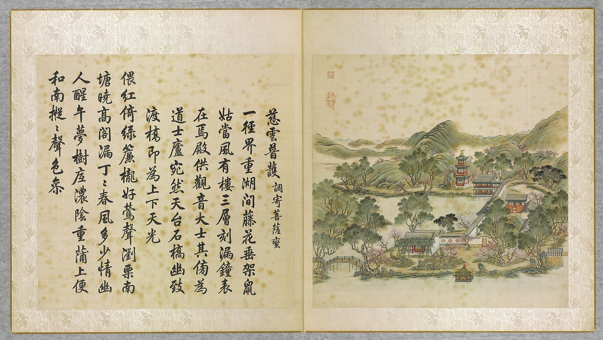

<!-- generated:start (scripts/building_pages.py): do not edit between these markers -->

# YM07-03: 龙王殿 Longwang Dian

Yuanming Yuan

**3D object:** 1 box. Open it: `/reconstruction/3d.html?b=YM07-03`

**Part of:** YM07 慈云普护

## What we know

- **Name:** 龙王殿 Longwang Dian (S05, S01 · confidence C)
- **Garden:** Yuanming Yuan (S05, S01)
- **Type:** temple (S05, S01 · confidence C)
- **Destroyed:** 1860 (S05, S01)
- **Position:** 40.00597, 116.29027. S01 guess (S01 · confidence C)
- **Bays:** 3x1 on the plan (S05, S01)
- **Size in the inventory:** 12.7 × 6.9 m. S01 plan px / hall scale (S01)
- **Note:** 祀圓明園昭福龍王 (S05, S01)
- **Plan reader's note:** 龙王殿: 东偏; no label (S01) *(research copy, not public)*
- **How it was read:** guess (S01) *(research copy, not public)*
- **Plan pixels:** 3472, 3364 (S01) *(research copy, not public)*

## Our model now

A plain box on the block drawn on the Qing plan S01: position and frontage from the plan, heights and roof from the typology of its hall class. It will be updated as the research goes on.

- **Box:** 12.7 × 6.9 m, side hall
- **Heights:** platform 0.54 m, eave 3.64 m, ridge 6.22 m above the ground
- **Roof:** gable 硬山 or 悬山, rolled ridge 卷棚, grey tile
- **Faces:** 265.2° from north
- **Confidence:** C

## Pictures (1)

- **P0007** (guess): 慈雲普護 Ciyun puhu [Nuage de miséricorde pour la bénédiction universelle] (圓明園四十景, 第7景) (1744 (BnF record: 1744年，清朝乾隆九年)). https://commons.wikimedia.org/wiki/File%3A%E5%9C%93%E6%98%8E%E5%9C%92%E5%9B%9B%E5%8D%81%E6%99%AF._%E7%AC%AC%E4%B8%83%E6%99%AF_%28%E4%B8%8A%E5%86%8C%EF%BC%8C%E7%AC%AC%E4%B8%83%E5%B9%85%E5%9B%BE%29%2C_%E6%85%88%E9%9B%B2%E6%99%AE%E8%AD%B7_-_%28%E6%B8%85%29%E5%94%90%E5%B2%B1%E3%80%81%E6%B2%88%E6%BA%90%E5%90%88%E7%95%AB_%3B_%28%E4%B9%BE%E9%9A%86%E5%90%9F%E8%AF%97%EF%BC%8C%E6%B1%AA%E7%94%B1%E6%95%A6%E4%BB%A3%E4%B9%A6%29Ciyun_puhu_-_%28Qing%29Tang_Dai%2C_Shen_Yuan_he_hua_-_btv1b55008359p.jpg

  

## Texts and drawings (4)

- **E1260** (text, sure): 日下舊聞考 慈云普护. 1780s (乾隆 敕撰) · j80:35b-36b · S05. https://github.com/kanripo/KR2k0036/blob/master/KR2k0036_080.txt
  > 碧桐書院之西為慈雲普䕶前殿南臨後湖三楹為歡喜佛塲其北樓宇三楹有慈雲普䕶額上奉觀音大士下祀關聖帝君東偏為龍王殿祀圓明園昭福龍王（圓明園冊）臣等謹按慈雲普䕶四十景之一也與歡喜佛塲額皆世宗御書龍王殿額曰如祈應禱關帝殿額曰昭明宇宙皆世宗御書又龍王殿額曰功宣普潤聨曰正中徳備乾符應利濟恩敷解澤流皇上御書
  West of 碧桐書院 on the Back Lake 後湖: a three-bay front hall (歡喜佛塲), a three-bay tower with Guanyin above and Guandi below, and an eastern 龍王殿 for the garden's 昭福 dragon king.
- **E1263** (description, sure): Scene 7, 慈云普护 Ciyun Puhu, Island of Shrines. 1934 · p.80 · S02. https://archive.org/details/historyofpekings00malo
  > A three-storied bell tower with a sun dial on its south front, and shrines to Buddha, to the God of War, and to the Dragon King were grouped around a cove on the west side of this small island.
  Three-storey bell tower with a sundial on the south front and shrines to Buddha, the God of War and the Dragon King, round a cove on the west side.
- **E1264** (description, sure): 慈云普护 龙王殿, 关帝殿 (S47 section 2.1). 2012, citing archive and Qing texts · pp.110; table rows 1-2 · S47. https://www.dpm.org.cn/Uploads/File/2018/06/15/u5b23730ae0e5a.pdf
  East side hall of 慈云普护 is the dragon-king hall: three bays, hanging gable, facing west, with a front terrace and the plaque 如祈应祷. The two-storey building north of it had Guanyin above and Guandi below; a Qianlong note puts a Daoist cell beside it. Table dates both to Kangxi.
- **E1266** (description, sure): 释圆明园慈云普护之多神殿. post n.d. · lswh · S337. http://iqh.ruc.edu.cn/old/qdhjylyjzx/xszl/ylfj/38163bb8aee541e2b80b63a5b0149e22.htm
  慈云普护 Ciyun Puhu, north shore of 后湖, 120 x 90 m, 800 m2 of buildings. A temple garden for several faiths: 欢喜佛场 for Buddha, a tower with 观音 above and 关帝 below, and the 龙王殿 for 昭福龙王. Cites a 1794 repair list giving three bays with a three-bay rear annex for 欢喜佛场.

**On the plan:** Drawn on the plan of the gardens (S01) with no label, 3x1 cells: a building stood here, its name unknown. https://artmuseum.princeton.edu/collections/objects/138657

## Evidence for the set of buildings

- Evidence for the whole compound 慈云普护: see YM07
- Reconstructions and comparables for the whole garden, 圆明园 Yuanming Yuan: see GARDEN-YM
- Standing buildings comparable to a side hall (not this building): see CLASS-side_hall

## Open questions

None that name it.

<!-- generated:end -->

## Notes

<!-- Yours: regeneration never touches this part. It goes on the public site; what you write below a line holding only %% private %% stays in the research copy. -->
